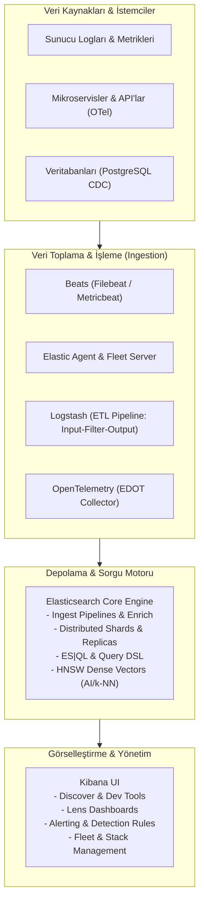

# 🏛️ Elastic Stack Temel Mimari Bileşenleri

Elastic Stack (ELK), dağıtık arama, büyük veri analitiği, log yönetimi ve tam gözlemlenebilirlik (observability) sağlayan entegre bir platformdur:

### Temel Bileşenlerin Rolleri:

1. **Elasticsearch:**
   * Apache Lucene tabanlı, dağıtık, RESTful JSON arama ve analitik motorudur.
   * Verileri **Index** yapılarında saklar; index'leri paralel işleme için **Shard** (birincil) ve **Replica** (yedek) parçalarına böler.
   * Veri girişinde **Ingest Node / Ingest Pipelines** ile dokümanları dönüştürür, PII maskelemesi yapar ve coğrafi IP (GeoIP) ekler.
2. **Kibana:**
   * Elasticsearch üzerindeki verileri keşfetmek (Discover), görsel panolar hazırlamak (Lens Dashboards), SQL/PPL/ES|QL sorguları çalıştırmak ve güvenlik/yaşam döngüsü (ILM/SLM) yönetmek için web arayüzüdür.
3. **Logstash:**
   * Ağır veri dönüştürme (ETL) boru hattıdır. `Input ➔ Filter (Grok, Dissect, Mutate) ➔ Output` mimarisiyle çalışır.
4. **Beats & Elastic Agent:**
   * **Beats:** Filebeat (log), Metricbeat (sistem metrikleri), Packetbeat (ağ) gibi tek amaçlı hafif Go ajanlarıdır.
   * **Elastic Agent & Fleet:** Tüm veri toplama araçlarını tek bir ajan altında toplayan ve Kibana üzerinden merkezi olarak yapılandırılan yeni nesil yönetim standardıdır.
