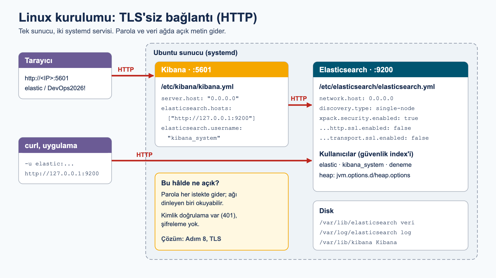
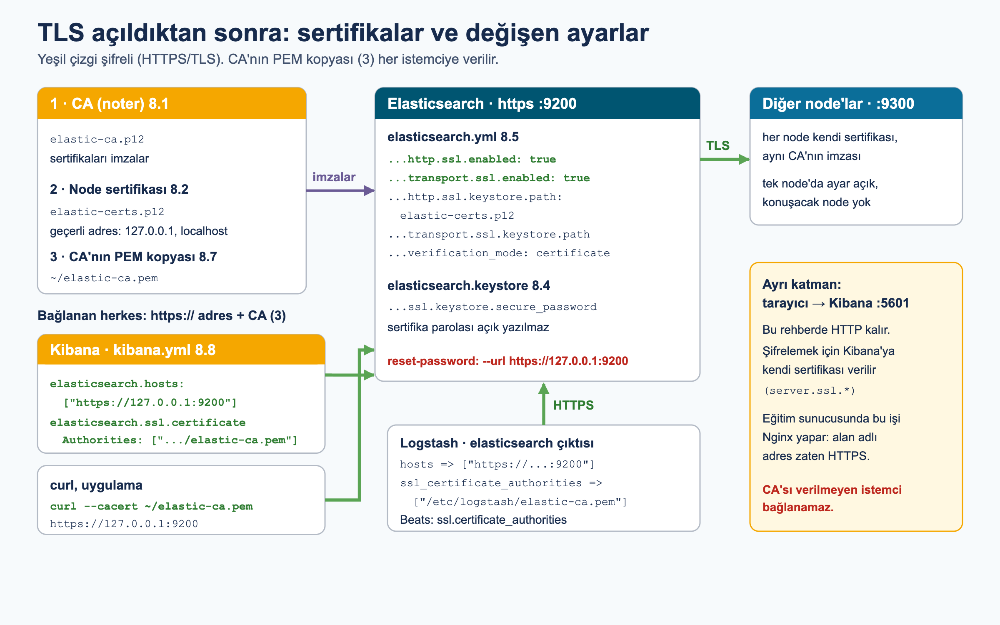

# Ubuntu 24.04 Native Kurulum: Elasticsearch ve Kibana (APT ve systemd)

Bu rehber Elasticsearch ve Kibana 9.5.5'i container olmadan, sunucuya APT paketi ve systemd servisi
olarak kurar. Amaç paket kurulumunun dosyalarını, servislerini ve loglarını görmek. Sonraki lablar Docker ile
kurulan ana cluster'ı kullanır; rehberin sonunda native servisler durdurulur ve LAB-01'in Docker kurulumuyla
devam edilir.

{width=60%}

---

## Ön Koşullar

Ubuntu 24.04 sunucu, en az 2 CPU ve 4 GB RAM. CPU sayısına ve belleğe bakın:

```bash
nproc
free -h
```

`nproc` CPU sayısını, `free -h` belleği verir; `Mem:` satırındaki `total` en az `3.8Gi` olmalı.

Paket listesini yenileyin ve rehberde kullanılan araçları kurun:

```bash
sudo apt-get update
sudo DEBIAN_FRONTEND=noninteractive apt-get install -y curl jq gnupg
```

`DEBIAN_FRONTEND=noninteractive` kurulumun soru sorup beklemesini önler.

**Docker ile ana cluster'ı daha önce kurduysanız** önce durdurun; iki kurulum aynı `9200` ve `5601` portlarını
kullanır. `stop` container'ları durdurur, silmez; index'ler yerinde kalır. Docker kurulumu yoksa bu bloğu geçin:

<!-- runner:skip -->
```bash
cd ~/elastic/labs/LAB-01-kurulum-kontrol/starter
docker compose stop
cd ~
```

`9200` ve `5601` portlarının boş olduğuna bakın. `grep` bir satır bulursa o portu bir süreç tutuyordur ve
satırdaki süreç adı hangisi olduğunu söyler; bulamazsa `||` sağındaki `echo` çalışır:

```bash
sudo ss -tlnp | grep -E ':(9200|5601) ' || echo "9200 ve 5601 boş"
```

Beklenen çıktı:

```text
9200 ve 5601 boş
```

---

## 1. Kernel ve servis sınırları

Elasticsearch index dosyalarını belleğe eşler (mmap). Linux'un varsayılan eşleme sınırı (`vm.max_map_count`)
düşüktür; 262144'ün altındaysa Elasticsearch açılmaz. Sınırı yükseltin:

```bash
sudo sysctl -w vm.max_map_count=262144
```

Beklenen çıktı:

```text
vm.max_map_count = 262144
```

Ayar sunucu yeniden başlayınca kaybolur. `/etc/sysctl.d/` altına yazarak kalıcı yapın:

```bash
echo "vm.max_map_count=262144" | sudo tee /etc/sysctl.d/99-elasticsearch.conf >/dev/null
```

Linux belleği dolmadan da kullanılmayan sayfaları diske (swap) atar; Elasticsearch'ün belleği diske
düşerse aramalar ve GC saniyelerce yavaşlar. `vm.swappiness=1` swap'ı yalnız son çareye bırakır:

```bash
sudo sysctl -w vm.swappiness=1
echo "vm.swappiness=1" | sudo tee -a /etc/sysctl.d/99-elasticsearch.conf >/dev/null
```

Beklenen çıktı:

```text
vm.swappiness = 1
```

Elasticsearch `elasticsearch` adlı servis kullanıcısıyla çalışır. Bu kullanıcının aynı anda açabileceği dosya
sayısını (`nofile`) ve belleği kilitleme hakkını (`memlock`) yükseltin; Docker'da bu sınırları container
kendisi getirir:

```bash
sudo tee /etc/security/limits.d/99-elasticsearch.conf >/dev/null << 'EOF'
elasticsearch soft nofile 65535
elasticsearch hard nofile 65535
elasticsearch soft memlock unlimited
elasticsearch hard memlock unlimited
EOF
```

## 2. Elastic APT deposu ve paketler

Paketler Elastic'in kendi deposundan gelir. Önce deponun imza anahtarını indirin; APT indirdiği paketin
Elastic'ten geldiğini ve değiştirilmediğini bu anahtarla doğrular:

```bash
curl -fsSL https://artifacts.elastic.co/GPG-KEY-elasticsearch | sudo gpg --dearmor --yes -o /usr/share/keyrings/elasticsearch-keyring.gpg
```

APT'ye Elastic deposunu tanıtın. Satır `/etc/apt/sources.list.d/` altına bir dosya olarak yazılır;
`signed-by` bu deponun yukarıdaki anahtarla doğrulanacağını söyler:

```bash
echo "deb [signed-by=/usr/share/keyrings/elasticsearch-keyring.gpg] https://artifacts.elastic.co/packages/9.x/apt stable main" | sudo tee /etc/apt/sources.list.d/elastic-9.x.list >/dev/null
```

Paket listesini yenileyin; APT artık Elastic deposundaki paketleri de görür:

```bash
sudo apt-get update
```

Elasticsearch ve Kibana'yı kurun. Sürümü `=9.5.5` ile sabitliyoruz ki ana cluster'la aynı sürüm kurulsun.
İki paket birlikte yaklaşık 1 GB indirir (Elasticsearch kendi Java'sını taşır); bağlantıya göre birkaç
dakika sürer, ilerleme ekranda görünür:

```bash
sudo DEBIAN_FRONTEND=noninteractive apt-get install -y elasticsearch=9.5.5 kibana=9.5.5
```

Kurulum çıktısında Elasticsearch güvenliği kendiliğinden yapılandırır (TLS sertifikaları, keystore) ve
rastgele bir `elastic` parolası basar; parolayı Adım 4'te kendi değerimize çevireceğiz. Sonda görünen
`Scanning processes...` satırları Ubuntu'nun servis kontrolüdür, kurulumu etkilemez.

Kurulan sürümlere bakın:

```bash
dpkg -l elasticsearch kibana | grep ^ii
```

Beklenen çıktı:

```text
ii  elasticsearch  9.5.5        amd64        Distributed RESTful search engine built for the cloud
ii  kibana         9.5.5        amd64        Explore and visualize your Elasticsearch data
```

## 3. Elasticsearch ayarları

Tek node, HTTP üzerinde TLS kapalı (Docker ana cluster'ıyla aynı erişim biçimi).

Dosyadaki `xpack.` ile başlayan satırlar Elasticsearch'ün güvenlik ayarlarıdır; lisans etkinleştirmekle ilgisi
yoktur. `xpack`, Elasticsearch paketinin içinde gelen ek özelliklerin (güvenlik, alerting, monitoring...) ortak
adıdır ve Basic (ücretsiz) lisansla da gelir. Güvenlik ayarları şunlardır:

- `xpack.security.enabled: true`: kimlik doğrulamayı açar. Parolasız istek `401` alır.
- `xpack.security.http.ssl.enabled`: `9200` üzerindeki istemci trafiğini (tarayıcı, `curl`, Kibana) TLS ile şifreler.
- `xpack.security.transport.ssl.enabled`: node'lar arası trafiği (`9300`) TLS ile şifreler.

Şimdilik iki TLS ayarı `false`; bölüm 8'de `true` yapılır. Ücretli özelliklerin lisansı ayrı bir konudur ve bu
dosyada ayarlanmaz.

Ayar dosyasını yazın:

```bash
sudo tee /etc/elasticsearch/elasticsearch.yml >/dev/null << 'EOF'
cluster.name: devops-cluster
node.name: node-ubuntu-01
path.data: /var/lib/elasticsearch
path.logs: /var/log/elasticsearch
network.host: 0.0.0.0
http.port: 9200
discovery.type: single-node
xpack.security.enabled: true
xpack.security.http.ssl.enabled: false
xpack.security.transport.ssl.enabled: false
EOF
```

- `network.host: 0.0.0.0`: tüm ağ arabirimlerini dinler; dışarıdan `http://<IP>:9200` açılır.
  Güvenlik açık olduğu için parolasız istek `401` alır.
- `discovery.type: single-node`: başka node aramaz.
- Kurulumun ürettiği TLS sertifikaları `certs/` altında kalır; HTTP TLS'i bu rehberde kapalı tutuyoruz.

Elasticsearch'ün kullanacağı belleği (heap) 1 GB yapın. `jvm.options.d/` altındaki dosya ana `jvm.options`'a
dokunmadan ayar verir; paket güncellemesinde ezilmez:

```bash
printf -- '-Xms1g\n-Xmx1g\n' | sudo tee /etc/elasticsearch/jvm.options.d/heap.options >/dev/null
```

## 4. Elasticsearch'ü başlatın ve parolaları verin

systemd'ye yeni ayarları okutun ve servisi başlatın. `start` servis istek almaya hazır olunca döner:

```bash
sudo systemctl daemon-reload
sudo systemctl start elasticsearch
systemctl is-active elasticsearch
```

Beklenen çıktı:

```text
active
```

`enable` kullanmıyoruz: `enable` servisi her açılışta başlatır ve Docker ana cluster'ıyla port çakışması çıkarır.

`elastic` kullanıcısının parolasını eğitim parolasına çevireceğiz. Kurulumun bastığı parolayı bilmediğimiz
için önce yeni bir rastgele parola üretip bir değişkene alın (`-a` otomatik üret, `-b` onay sorma, `-s` yalnız
parolayı yaz):

```bash
TMP_PW=$(sudo /usr/share/elasticsearch/bin/elasticsearch-reset-password -u elastic -a -b -s)
```

Bu geçici parolayla bağlanıp `elastic`'in parolasını `DevOps2026!` yapın. Bu komutu yukarıdakiyle **aynı terminalde,
hemen arkasından** çalıştırın: `TMP_PW` değişkeni yalnız o terminalde vardır. Başarılı yanıt boş bir JSON'dur
(`{}`); `401` dönerse parola değişmemiştir, iki komutu yeniden çalıştırın:

```bash
curl -s -u "elastic:$TMP_PW" -X POST 'http://127.0.0.1:9200/_security/user/elastic/_password' -H 'Content-Type: application/json' -d '{"password": "DevOps2026!"}'; echo
```

Beklenen çıktı:

```text
{}
```

Kibana Elasticsearch'e kendi servis kullanıcısıyla (`kibana_system`) bağlanır; ona da parola verin:

```bash
curl -s -u elastic:'DevOps2026!' -X POST 'http://127.0.0.1:9200/_security/user/kibana_system/_password' -H 'Content-Type: application/json' -d '{"password": "DevOps2026!"}'; echo
```

Beklenen çıktı:

```text
{}
```

Yeni parolayla cluster'ın sağlığına bakın:

```bash
curl -s -u elastic:'DevOps2026!' 'http://127.0.0.1:9200/_cluster/health?filter_path=cluster_name,status,number_of_nodes&pretty'
```

Beklenen çıktı:

```text
{
  "cluster_name" : "devops-cluster",
  "status" : "green",
  "number_of_nodes" : 1
}
```

## 5. Kibana

Kibana'nın ayar dosyasını yazın: hangi portta dinleyeceği, hangi Elasticsearch'e hangi kullanıcıyla
bağlanacağı:

```bash
sudo tee /etc/kibana/kibana.yml >/dev/null << 'EOF'
server.port: 5601
server.host: "0.0.0.0"
elasticsearch.hosts: ["http://127.0.0.1:9200"]
elasticsearch.username: "kibana_system"
elasticsearch.password: "DevOps2026!"
EOF
```

Kibana'yı başlatın:

```bash
sudo systemctl start kibana
```

Kibana'nın açılması bir-iki dakika sürer. Aşağıdaki komut Kibana hazır olana kadar 3 saniyede bir sorar ve
her denemede bir nokta basar; en çok 5 dakika bekler:

```bash
timeout 300 bash -c 'until curl -s -u elastic:"DevOps2026!" http://127.0.0.1:5601/api/status | jq -e ".status.overall.level==\"available\"" >/dev/null 2>&1; do printf .; sleep 3; done' && echo " Kibana hazır" || echo " Kibana 5 dakikada hazır olmadı"
```

Beklenen çıktı:

```text
......... Kibana hazır
```

Nokta sayısı sizde farklıdır.

## 6. Arayüzden bağlanmak: giriş, kullanıcı ve şifre

Kibana adresini sunucudan hesaplayın; iki biçimde yazdırılır (IP:port ve alan adı):

```bash
IP=$(curl -s https://api.ipify.org); H=$(hostname -s)
echo "Kibana: http://$IP:5601   https://$H-kibana.devopsatolyesi.com"
```

Tarayıcıda adreslerden birini açın ve `elastic` / `DevOps2026!` ile girin. Docker ana cluster'daki index'ler
burada görünmez: native Elasticsearch kendi veri klasörünü (`/var/lib/elasticsearch`) kullanır.

1. **İlk istek:** sol menüden **Management › Dev Tools**. Konsola `GET _cluster/health` yazıp satırın
   yanındaki çalıştır düğmesine basın; sağda `"cluster_name": "devops-cluster"` ve `"status": "green"` görünür.
2. **Kullanıcı açmak:** **Stack Management › Security › Users › Create user**. Username `deneme`, Password ve
   Confirm password `Deneme2026!`, Roles kutusundan `viewer` seçin, **Create user**.
3. **Şifre değiştirmek:** Users listesinde `deneme`'ye tıklayın (`elastic`'e değil), **Change password**; yeni şifre
   `Deneme2027!`, **Change password**. `elastic`'in şifresi `DevOps2026!` kalmalı: sonraki komutların hepsi onu kullanır.
4. **Yeni kullanıcıyla giriş:** sağ üstteki profil simgesinden **Log out**, `deneme` / `Deneme2027!` ile girin.
   `viewer` rolü panoları ve Discover'ı görür; Stack Management'ta kullanıcı açamaz.

Aynı işlerin komut satırı karşılığı: kullanıcı `_security/user` API'siyle açılır, şifresi `_password` ile
değişir. Arayüzde yaptığınızı doğrulayın. `_security/_authenticate` her kullanıcının kendi kimliğini sorabildiği
adrestir: eski şifre `401` (kimlik doğrulanamadı), yeni şifre `200` döner:

```bash
curl -s -o /dev/null -w "eski şifre: %{http_code}\n" -u deneme:'Deneme2026!' http://127.0.0.1:9200/_security/_authenticate
curl -s -o /dev/null -w "yeni şifre: %{http_code}\n" -u deneme:'Deneme2027!' http://127.0.0.1:9200/_security/_authenticate
```

Beklenen çıktı:

```text
eski şifre: 401
yeni şifre: 200
```

`elastic`'in şifresini komut satırından değiştirmek isterseniz `elasticsearch-reset-password` aracı yeni
şifreyi sorar (`-i` etkileşimli):

<!-- runner:skip -->
```bash
sudo /usr/share/elasticsearch/bin/elasticsearch-reset-password -u elastic -i
```

Bu rehberde `elastic`'in şifresini `DevOps2026!` bırakın; sonraki komutlar onu kullanır.

<details>
<summary><strong>elastic'in şifresini unuttuysanız ya da yanlışlıkla değiştirdiyseniz</strong></summary>

`elasticsearch-reset-password` eski şifreyi bilmeden çalışır; sunucuda `sudo` yetkisi yeterlidir. `-i` yeni
şifreyi sizin yazmanızı sağlar (iki kez sorar). `--url` aracın Elasticsearch'e hangi adresten bağlanacağını
söyler. TLS'i açmadan önce:

<!-- runner:skip -->
```bash
sudo /usr/share/elasticsearch/bin/elasticsearch-reset-password -u elastic -i --url http://127.0.0.1:9200
```

Adım 8'de TLS'i açtıktan sonra adres `https` olur. `--url` vermezseniz araç sunucunun iç IP'sinden bağlanır;
sertifika yalnız `127.0.0.1` ve `localhost` için üretildiği için `No subject alternative names matching IP
address` hatası verir:

<!-- runner:skip -->
```bash
sudo /usr/share/elasticsearch/bin/elasticsearch-reset-password -u elastic -i --url https://127.0.0.1:9200
```

`kibana_system`'in şifresi de aynı araçla değişir (`-u kibana_system`); Kibana'nın `kibana.yml`'deki şifreyle aynı
olmalıdır, değiştirince Kibana'yı yeniden başlatın.

</details>

## 7. Önemli klasörler ve loglar

Ayar ve veri klasörlerine bakın:

```bash
sudo ls /etc/elasticsearch /var/lib/elasticsearch
```

Beklenen çıktı:

```text
/etc/elasticsearch:
certs
elasticsearch-plugins.example.yml
elasticsearch.keystore
elasticsearch.yml
jvm.options
jvm.options.d
log4j2.properties
role_mapping.yml
roles.yml
users
users_roles

/var/lib/elasticsearch:
_state
indices
node.lock
nodes
snapshot_cache
```

### Elasticsearch logları

Paket kurulumunda Elasticsearch iki yere log yazar. Kendi log dosyası `/var/log/elasticsearch/` altındadır ve
adı `cluster.name` değeridir. Son satırlarına bakın:

```bash
sudo tail -n 5 /var/log/elasticsearch/devops-cluster.log
```

Satırlar sizde farklıdır; her satırda zaman, seviye (`INFO`, `WARN`, `ERROR`), bileşen (`o.e.n.Node` gibi) ve
node adı bulunur. Node açılışını bitirince `o.e.n.Node` bileşeni `started` satırı yazar; her yeniden başlatma yeni
bir satır ekler, son satır son açılıştır:

```bash
sudo grep 'o.e.n.Node.*started' /var/log/elasticsearch/devops-cluster.log | tail -1
```

Beklenen çıktı (zaman ve kimlikler sizde farklı):

```text
[2026-11-22T23:11:27,361][INFO ][o.e.n.Node               ] [node-ubuntu-01] started {node-ubuntu-01}{xLnhXcbS...
```

systemd de servisin başlama ve durma kayıtlarını tutar. Servis hiç açılmıyorsa ilk bakılacak yer burasıdır:

```bash
sudo journalctl -u elasticsearch -n 10 --no-pager
```

### Kibana logları

Bu rehberdeki `kibana.yml` log dosyası tanımlamadığı için Kibana loglarını systemd'ye yazar:

```bash
sudo journalctl -u kibana -n 10 --no-pager
```

Son satırlarda `plugins.fleet` uyarıları (`FleetEncryptedSavedObjectEncryptionKeyRequired`) görebilirsiniz; Fleet bu
rehberde kullanılmaz, uyarı zararsızdır. Kibana'nın hazır olduğunu gösteren satırı arayın:

```bash
sudo journalctl -u kibana --no-pager | grep 'Kibana is now available' | tail -1
```

Beklenen çıktı (zaman sizde farklı):

```text
Nov 22 23:20:30 student102 kibana[65532]: [2026-11-22T23:20:30.725+03:00][INFO ][status] Kibana is now available
```

Kibana Elasticsearch'e bağlanamıyorsa bu satır gelmez; logda `Unable to retrieve version information from
Elasticsearch nodes` görünür: adres, parola ya da TLS ayarı yanlıştır.

### Index diskte nerede durur?

Bir index oluşturup bir document yazın. `number_of_replicas: 0`: tek node'da replica'nın yerleşeceği ikinci node
yoktur:

```bash
curl -s -u elastic:'DevOps2026!' -X PUT 'http://127.0.0.1:9200/disk-deneme' -H 'Content-Type: application/json' -d '{"settings": {"number_of_shards": 1, "number_of_replicas": 0}}'; echo
curl -s -u elastic:'DevOps2026!' -X POST 'http://127.0.0.1:9200/disk-deneme/_doc?refresh=true' -H 'Content-Type: application/json' -d '{"mesaj": "diskte nerede duruyorum?"}'; echo
```

Elasticsearch index'leri diskte adıyla değil, kimliğiyle (UUID) saklar. Index'in kimliğini alın:

```bash
UUID=$(curl -s -u elastic:'DevOps2026!' 'http://127.0.0.1:9200/_cat/indices/disk-deneme?h=uuid')
echo "$UUID"
```

Bu kimlikle `/var/lib/elasticsearch/indices/` altındaki klasöre bakın. `0` index'in tek shard'ıdır; `index/`
Lucene segment dosyalarını, `translog/` henüz segment'e yazılmamış işlemleri tutar:

```bash
sudo ls /var/lib/elasticsearch/indices/$UUID
```

Beklenen çıktı:

```text
0
_state
```

```bash
sudo ls /var/lib/elasticsearch/indices/$UUID/0
```

Beklenen çıktı:

```text
_state
index
translog
```

```bash
sudo du -sh /var/lib/elasticsearch/indices/$UUID
```

Tek document'li index birkaç on KB tutar (ölçülen: `64K`).

Index silinince bu klasör de silinir. Veri klasörünü elle değiştirmek ya da kopyalamak index'i bozar; yedek için
snapshot kullanılır.

| Klasör | İçinde ne var |
|---|---|
| `/etc/elasticsearch/` | `elasticsearch.yml`, `jvm.options`, keystore, kurulumda üretilen sertifikalar (`certs/`) |
| `/var/lib/elasticsearch/` | Veri: index'ler ve cluster durumu |
| `/var/log/elasticsearch/` | `<cluster.name>.log` (ana log), `gc.log` |
| `/usr/share/elasticsearch/bin/` | `elasticsearch-reset-password`, `elasticsearch-certutil`, `elasticsearch-keystore`, `elasticsearch-plugin` |

<details>
<summary><strong>Servis açılmazsa nereye bakılır?</strong></summary>

<!-- runner:skip -->
```bash
sudo systemctl status elasticsearch --no-pager
sudo journalctl -u elasticsearch -n 50 --no-pager
sudo tail -n 60 /var/log/elasticsearch/devops-cluster.log
sudo dmesg -T | grep -i -E "oom|killed process"
```

</details>

## 8. TLS'i açmak: HTTP ve node'lar arası trafiği şifrelemek

Şu ana kadar Elasticsearch'e düz HTTP ile bağlandık: parola ve veri ağda açık metin gider. TLS bu trafiği
şifreler. İki katmanı vardır: **HTTP** (istemci ve Kibana ↔ Elasticsearch) ve **transport** (node'lar arası,
`9300`). Tek node'da transport'u gösterecek ikinci node yoktur ama açılışı aynıdır.

{width=60%}

Bu bölüm bir bütündür: Elasticsearch HTTPS'e geçtiği anda Kibana bağlanamaz; Kibana'yı da bölümün sonunda
güncelleyin.

### 8.1 CA üretmek

CA (sertifika yetkilisi), sertifikaları imzalayan "noter"dir: istemci bu CA'ya güvenirse onun imzaladığı her
sertifikaya güvenir. Kurulumla gelen `elasticsearch-certutil` ile kendi CA'nızı üretin. `--pass` CA dosyasının
parolasıdır:

```bash
sudo /usr/share/elasticsearch/bin/elasticsearch-certutil ca --silent --out /etc/elasticsearch/elastic-ca.p12 --pass 'DevOps2026!'
```

Komut ekrana bir şey yazmaz; `/etc/elasticsearch/elastic-ca.p12` dosyası oluşur.

### 8.2 Node sertifikası üretmek

CA ile Elasticsearch node'unun sertifikasını imzalayın. `--ip` ve `--dns` sertifikanın hangi adres için
geçerli olduğunu yazar; istemci `127.0.0.1` ya da `localhost`'a bağlandığında sertifika eşleşir:

```bash
sudo /usr/share/elasticsearch/bin/elasticsearch-certutil cert --silent --ca /etc/elasticsearch/elastic-ca.p12 --ca-pass 'DevOps2026!' --ip 127.0.0.1 --dns localhost --out /etc/elasticsearch/elastic-certs.p12 --pass 'DevOps2026!'
```

`/etc/elasticsearch/elastic-certs.p12` dosyası oluşur.

### 8.3 Dosya izinleri

Elasticsearch servisi dosyaları `elasticsearch` grubuyla okur. Sahipliği verin:

```bash
sudo chown root:elasticsearch /etc/elasticsearch/elastic-ca.p12 /etc/elasticsearch/elastic-certs.p12
```

İzni yalnız sahip ve grup okuyacak şekilde ayarlayın:

```bash
sudo chmod 640 /etc/elasticsearch/elastic-ca.p12 /etc/elasticsearch/elastic-certs.p12
```

### 8.4 Sertifika parolasını keystore'a eklemek

Sertifika dosyası parolalıdır. Parola `elasticsearch.yml`'e açık yazılmaz; Elasticsearch'ün şifreli keystore'una
eklenir. HTTP katmanı için:

```bash
echo 'DevOps2026!' | sudo /usr/share/elasticsearch/bin/elasticsearch-keystore add --stdin --force xpack.security.http.ssl.keystore.secure_password
```

Transport (node'lar arası) katmanı için:

```bash
echo 'DevOps2026!' | sudo /usr/share/elasticsearch/bin/elasticsearch-keystore add --stdin --force xpack.security.transport.ssl.keystore.secure_password
```

`--stdin` parolayı komut satırına değil girişe verir; `--force` aynı ad varsa üzerine yazar.

### 8.5 elasticsearch.yml'de TLS'i açmak

Adım 3'te yazdığınız `false` satırlarını `true` yapın. Aynı satırı yeniden eklemek YAML'da "duplicate key"
hatası verir ve servis açılmaz; bu yüzden `sed` ile değiştiriyoruz. HTTP TLS:

```bash
sudo sed -i 's/^xpack.security.http.ssl.enabled: false/xpack.security.http.ssl.enabled: true/' /etc/elasticsearch/elasticsearch.yml
```

Transport TLS:

```bash
sudo sed -i 's/^xpack.security.transport.ssl.enabled: false/xpack.security.transport.ssl.enabled: true/' /etc/elasticsearch/elasticsearch.yml
```

Sertifika dosyasının yerini ekleyin. `verification_mode: certificate`, node'ların birbirinin sertifikasını CA
ile doğrulamasını söyler:

```bash
sudo tee -a /etc/elasticsearch/elasticsearch.yml >/dev/null << 'EOF'
xpack.security.http.ssl.keystore.path: elastic-certs.p12
xpack.security.transport.ssl.keystore.path: elastic-certs.p12
xpack.security.transport.ssl.verification_mode: certificate
EOF
```

Dosyadaki TLS satırlarına bakın:

```bash
sudo grep 'ssl' /etc/elasticsearch/elasticsearch.yml
```

Beklenen çıktı:

```text
xpack.security.http.ssl.enabled: true
xpack.security.transport.ssl.enabled: true
xpack.security.http.ssl.keystore.path: elastic-certs.p12
xpack.security.transport.ssl.keystore.path: elastic-certs.p12
xpack.security.transport.ssl.verification_mode: certificate
```

### 8.6 Elasticsearch'ü yeniden başlatmak

Ayarlar yalnız açılışta okunur:

```bash
sudo systemctl restart elasticsearch
```

Yeniden başlamanın logdaki izine bakın: son `started` satırının zamanı az önceki olmalı. TLS ayarında bir hata
olsaydı (yanlış dosya adı, eksik parola) servis açılmaz, `started` satırı gelmez ve hata
`sudo journalctl -u elasticsearch -n 30 --no-pager` çıktısında yazardı:

```bash
sudo grep 'o.e.n.Node.*started' /var/log/elasticsearch/devops-cluster.log | tail -1
```

### 8.7 HTTPS'i denemek

Sertifika kendi CA'mızla imzalı; `curl`'ün ona güvenmesi için CA'yı PEM biçiminde dışarı alın:

```bash
sudo openssl pkcs12 -in /etc/elasticsearch/elastic-ca.p12 -nokeys -passin pass:'DevOps2026!' -out ~/elastic-ca.pem
```

`sudo` dosyayı root adına yazar; `curl` okuyabilsin diye dosyayı kendinize verin:

```bash
sudo chown "$USER" ~/elastic-ca.pem
```

Elasticsearch yeniden başladıktan sonra kullanıcıları birkaç saniye sonra doğrulayabilir. HTTPS isteği `200`
dönene kadar bekleyin (en çok 2 dakika, her denemede bir nokta):

```bash
timeout 120 bash -c 'until curl -s --cacert ~/elastic-ca.pem -u elastic:"DevOps2026!" -o /dev/null -w "%{http_code}" https://127.0.0.1:9200/ | grep -q 200; do printf .; sleep 3; done'; echo
```

Düz HTTP artık reddedilir. `000`, Elasticsearch'ün düz HTTP isteğine cevap vermeyip bağlantıyı kapattığını
gösterir:

```bash
curl -s -o /dev/null -w "düz HTTP: %{http_code}\n" -u elastic:'DevOps2026!' http://127.0.0.1:9200/
```

Beklenen çıktı:

```text
düz HTTP: 000
```

HTTPS ile, CA'yı `--cacert` ile vererek sağlığa bakın. `wait_for_status=green` shard'lar yüklenene kadar bekler:

```bash
curl -s --cacert ~/elastic-ca.pem -u elastic:'DevOps2026!' 'https://127.0.0.1:9200/_cluster/health?wait_for_status=green&timeout=60s&filter_path=status&pretty'
```

Beklenen çıktı:

```text
{
  "status" : "green"
}
```

### 8.8 Kibana'yı HTTPS'e bağlamak

Kibana da Elasticsearch'ün sertifikasına güvenmeli: CA'yı Kibana'nın ayar klasörüne kopyalayın:

```bash
sudo cp ~/elastic-ca.pem /etc/kibana/elastic-ca.pem
```

Kibana servisi dosyayı `kibana` grubuyla okur; sahipliği ve izni verin:

```bash
sudo chown root:kibana /etc/kibana/elastic-ca.pem
sudo chmod 640 /etc/kibana/elastic-ca.pem
```

Kibana'nın Elasticsearch adresini `http`'den `https`'e çevirin:

```bash
sudo sed -i 's#elasticsearch.hosts: \["http://127.0.0.1:9200"\]#elasticsearch.hosts: ["https://127.0.0.1:9200"]#' /etc/kibana/kibana.yml
```

Kibana'ya CA dosyasının yerini söyleyin:

```bash
echo 'elasticsearch.ssl.certificateAuthorities: ["/etc/kibana/elastic-ca.pem"]' | sudo tee -a /etc/kibana/kibana.yml >/dev/null
```

Kibana'yı yeniden başlatın:

```bash
sudo systemctl restart kibana
```

Kibana'nın yeniden hazır olmasını bekleyin:

```bash
timeout 300 bash -c 'until curl -s -u elastic:"DevOps2026!" http://127.0.0.1:5601/api/status | jq -e ".status.overall.level==\"available\"" >/dev/null 2>&1; do printf .; sleep 3; done' && echo " Kibana hazır" || echo " Kibana 5 dakikada hazır olmadı"
```

Beklenen çıktı:

```text
......... Kibana hazır
```

Logda yeni açılışın `Kibana is now available` satırına bakın; zamanı az önceki olmalı. Bekleme "hazır olmadı"
dediyse CA dosyası okunamıyor ya da adres yanlıştır; hata `sudo journalctl -u kibana -n 30 --no-pager` çıktısında
yazar:

```bash
sudo journalctl -u kibana --no-pager | grep 'Kibana is now available' | tail -1
```

Tarayıcıda Kibana'ya yine `http://<SUNUCU_IP>:5601` ile girin: Kibana'nın kendi adresi değişmedi, değişen
Kibana ile Elasticsearch arasındaki bağlantı. Alan adlı Elasticsearch adresi (`...-elastic.devopsatolyesi.com`)
sunucudaki Nginx üzerinden düz HTTP'ye yönlendiği için TLS açıkken çalışmaz.

## 9. Native servisleri durdurun ve Docker kurulumuyla devam edin

Sonraki bütün lablar Docker ile kurulan ana cluster'ı kullanır. Native servisler `9200` ve `5601`'i tuttuğu
sürece Docker container'ları bu portlara bağlanamaz. Servisleri durdurun:

```bash
sudo systemctl stop kibana elasticsearch
```

`disable`, servislerin sunucu yeniden başladığında kendiliğinden açılıp portları yeniden almasını önler:

```bash
sudo systemctl disable kibana elasticsearch
```


Servislerin durduğuna ve portların boşaldığına bakın:

```bash
systemctl is-active kibana elasticsearch
sudo ss -tlnp | grep -E ':(9200|5601) ' || echo "9200 ve 5601 boş"
```

Beklenen çıktı:

```text
inactive
inactive
9200 ve 5601 boş
```

Native paketler sunucuda kalır; tekrar denemek için `sudo systemctl start elasticsearch kibana` (önce Docker
ana cluster'ını `docker compose stop` ile durdurun).


**Docker ile ana cluster'ı henüz kurmadıysanız** LAB-01'e dönüp **2. Docker ile kurulum** yoluyla devam edin.

**Docker ile daha önce kurduysanız** durdurduğunuz ana cluster'ı verisiyle geri açın:

<!-- runner:skip -->
```bash
cd ~/elastic/labs/LAB-01-kurulum-kontrol/starter
docker compose start
curl -s -u elastic:'DevOps2026!' 'http://127.0.0.1:9200/_cluster/health?wait_for_status=yellow&timeout=60s&filter_path=status&pretty'
```

`wait_for_status=yellow` cluster'ın açıldığını bekler. Sonuç `green` ya da `yellow` olabilir: replica isteyen
bir index varsa (ör. LAB-04'teki örnek e-ticaret verisi) tek node'da `yellow` görünür; ikisi de cluster'ın
çalıştığını gösterir.

## 10. Linux kurulumunu kaldırmak

Native kurulumu bir daha kullanmayacaksanız ya da rehberi baştan denemek istiyorsanız sunucudan tamamen
kaldırın. Servisleri durdurun:

```bash
sudo systemctl stop kibana elasticsearch
```

Paketleri kaldırın. `purge`, paketle birlikte paketin ayar dosyalarını da siler:

```bash
sudo DEBIAN_FRONTEND=noninteractive apt-get purge -y elasticsearch kibana
```

`purge` veri ve log klasörlerini silmez; index'ler `/var/lib/elasticsearch` altında kalır. Onları, kurulumda
ürettiğiniz sertifikaları ve ayar klasörlerini silin:

```bash
sudo rm -rf /var/lib/elasticsearch /etc/elasticsearch /var/log/elasticsearch
sudo rm -rf /var/lib/kibana /etc/kibana /var/log/kibana
rm -f ~/elastic-ca.pem
```

Rehberin 1. ve 2. adımında eklediğiniz sistem ayarlarını ve Elastic APT deposunu da kaldırın:

```bash
sudo rm -f /etc/security/limits.d/99-elasticsearch.conf
sudo rm -f /etc/apt/sources.list.d/elastic-9.x.list /usr/share/keyrings/elasticsearch-keyring.gpg
sudo apt-get update
```

`/etc/sysctl.d/99-elasticsearch.conf` dosyasını silmeyin: `vm.max_map_count` ayarını Docker ile kurulan
Elasticsearch de ister.

Paketin kalmadığına ve portların boş olduğuna bakın:

```bash
dpkg -l elasticsearch kibana 2>/dev/null | grep -c ^ii
sudo ss -tlnp | grep -E ':(9200|5601) ' || echo "9200 ve 5601 boş"
```

Beklenen çıktı:

```text
0
9200 ve 5601 boş
```

---

LAB-01'e dön: **[LAB-01 — Kurulum ve Erişim](../labs/LAB-01-kurulum-kontrol/README.md)**
