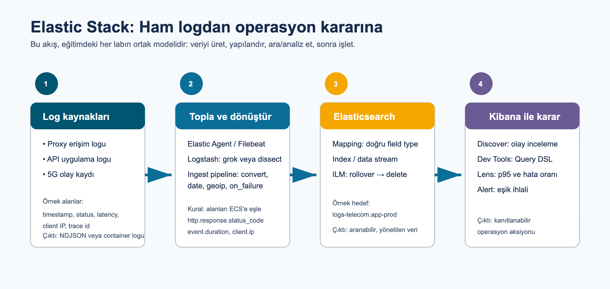
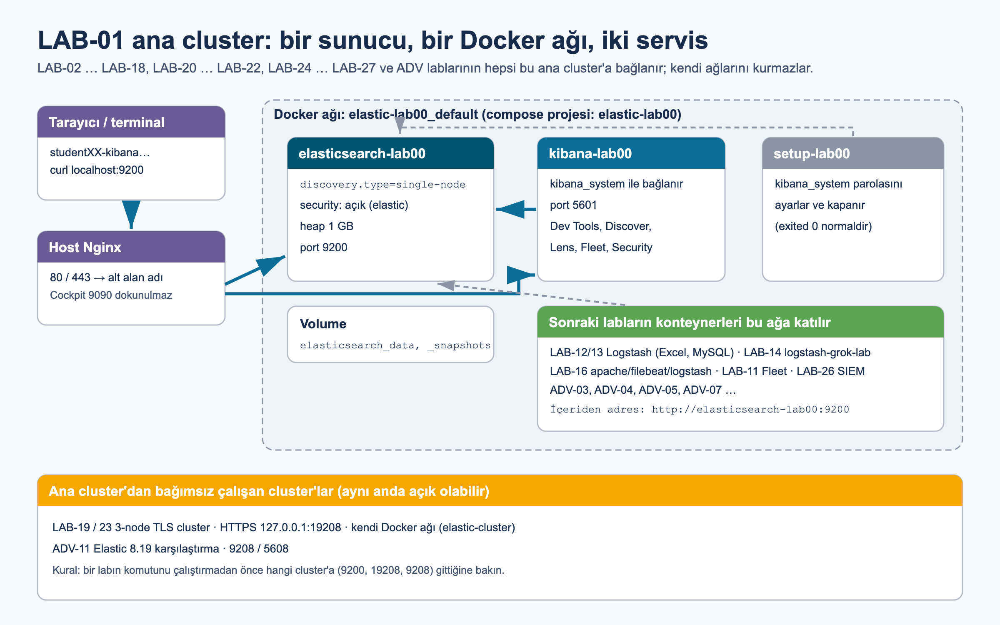
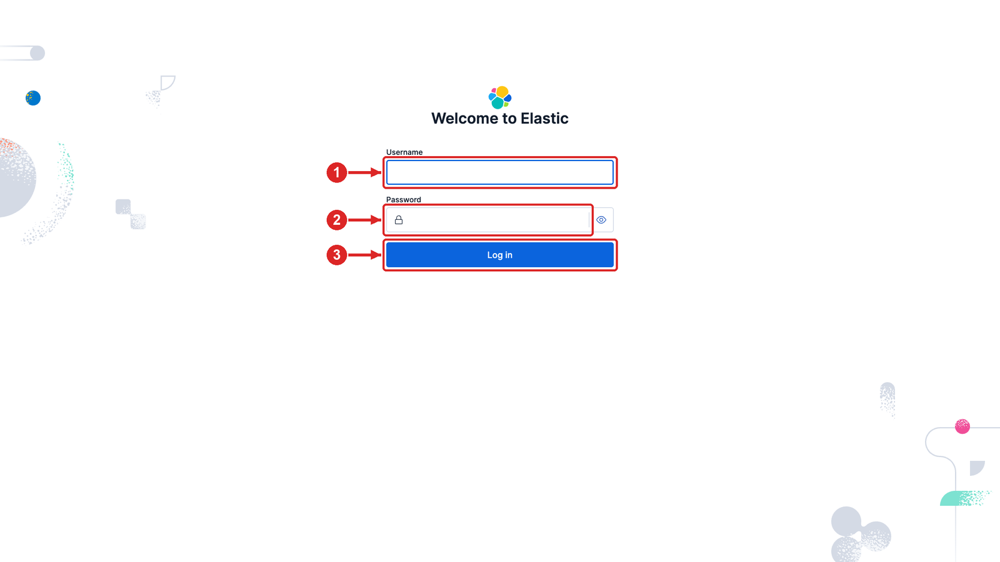
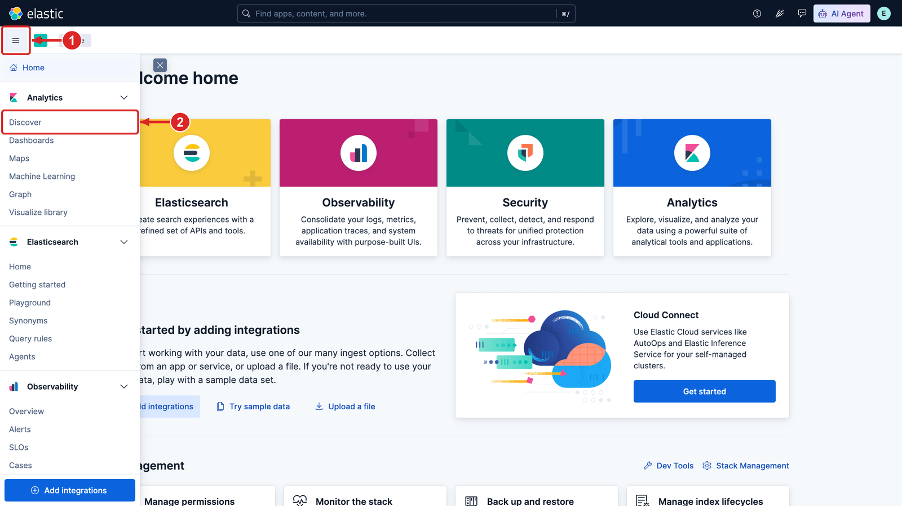
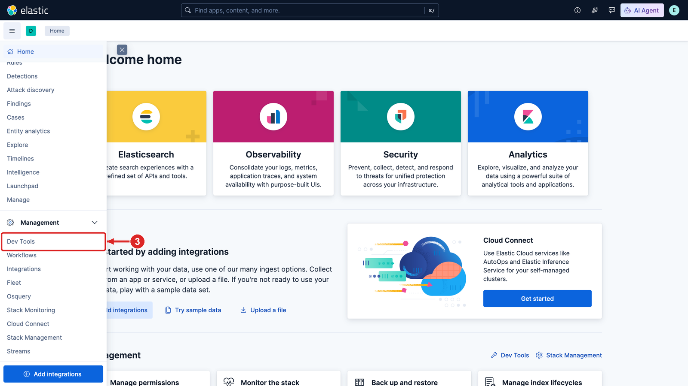
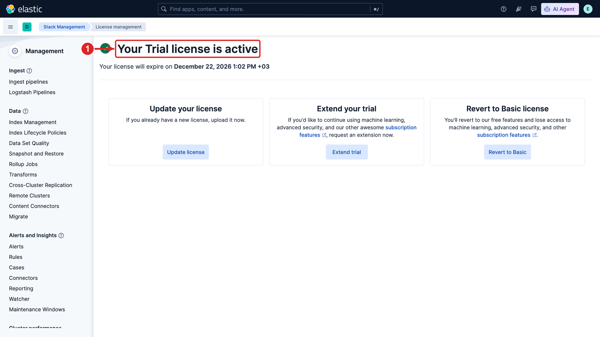

# LAB-01 — Kurulum ve Erişim: Elasticsearch ve Kibana'yı ayağa kaldırmak

| Kullanılan Araçlar | Açık / Kullanılan Portlar |
|---|---|
| Docker Compose, Elasticsearch 9.5.5, Kibana 9.5.5, curl, jq | 9200 (Elasticsearch), 5601 (Kibana); host Nginx 80/443 ve Cockpit 9090 dokunulmaz |

---

## Bu lab ne öğretiyor?

Sonraki bütün lablar verisini aynı Elasticsearch'e yazar ve aynı Kibana'dan bakar. Bu ortak
yere **ana cluster** diyoruz. Bu labda ana cluster'ı kuruyor, Elasticsearch'e ilk isteği gönderiyor,
Kibana'ya hem IP:port hem alan adıyla giriyor, 30 günlük deneme lisansını açıyor; son olarak bir ayarı
API'den değiştirip geri alıyor, loglara bakıyor ve `elastic` parolasını yönetiyoruz.





---

## İki kurulum yolu

1. **[Linux'a kurulum: APT paketi ve systemd](../../docs/UBUNTU_NATIVE_LINUX_KURULUM_REHBERI.md)**
2. **Docker ile kurulum:** aşağıdaki adımlar. Sonraki bütün lablar bu kurulumu kullanır.

> **Önce Linux'a kurulum yaptıysanız** paketle kurulan servisleri durdurun. İki kurulum da aynı `9200` ve
> `5601` portlarını kullanır; native Elasticsearch ve Kibana açıkken Docker container'ları bu portlara
> bağlanamaz ve `port is already allocated` hatasıyla açılmaz. `disable`, sunucu yeniden başladığında
> servislerin kendiliğinden açılıp portları yeniden almasını önler. Native kurulum yapmadıysanız komut bir şey
> değiştirmez:
>
> <!-- runner:run -->
> ```bash
> sudo systemctl stop kibana elasticsearch 2>/dev/null; sudo systemctl disable kibana elasticsearch 2>/dev/null
> sudo ss -tlnp | grep -E ':(9200|5601) ' || echo "9200 ve 5601 boş"
> ```
>
> Çıktının son satırı `9200 ve 5601 boş` olmalı. Bir satır listeleniyorsa portu hâlâ bir süreç tutuyordur;
> satırdaki süreç adı hangisi olduğunu söyler.

---

## Ön Koşullar

- Ubuntu 24.04 sunucu, en az 4 CPU ve 8 GB RAM (önerilen 16 GB). Docker, Docker Compose,
  `git`, `curl` ve `jq` kurulu.
- `9200` ve `5601` portları boş olmalı. Kaynakları, Docker'ı ve portları kontrol edin:

CPU sayısını ve toplam RAM'i yazdırın:

```bash
echo "CPU: $(nproc)  RAM: $(free -g | awk '/^Mem/ {print $2}') GB"
```

Docker ve Docker Compose kurulu mu:

```bash
docker --version && docker compose version
```

`9200` ve `5601` portlarını başka bir süreç dinliyor mu (boşsa `9200 ve 5601 boş` yazar):

```bash
sudo ss -tlnp | grep -E ':(9200|5601) ' || echo "9200 ve 5601 boş"
```

<!-- OLC: on-kosul -->

`free -g` toplam RAM'i GB'ın tam kısmıyla verir; 16 GB'lık bir sunucu `15` gösterebilir. Port satırı
listeleniyorsa yukarıdaki uyarıdaki komutla native servisleri durdurun.

- Repoyu sunucuya indirin (bir kez):

```bash
git clone https://gitlab.com/devops-monitoring/elastic.git ~/elastic
cd ~/elastic/labs/LAB-01-kurulum-kontrol
```

---

## Kavramlar: ana cluster nedir?

| Parça | Ne yapar |
|---|---|
| `elasticsearch-lab00` | Veriyi saklar ve arar. Sonraki labların container'ları ona `http://elasticsearch-lab00:9200` adıyla ulaşır. |
| `kibana-lab00` | Tarayıcıdan kullandığımız arayüz: Discover, Dev Tools, panolar. |
| `setup-lab00` | Bir kez çalışıp çıkar: Kibana'nın bağlanacağı `kibana_system` kullanıcısına parola verir. |
| `elastic-lab00_default` ağı | Sonraki labların container'ları bu Docker ağına katılır; Elasticsearch'ü adıyla bulur. |

Kimlik bilgisi: kullanıcı `elastic`, parola `DevOps2026!` (kaynağı `starter/.env`). Güvenlik
açıktır; parolasız istek `401` döner.

---

## Config dosyaları: hangi satır ne işe yarıyor?

`starter/docker-compose.yml` dosyasının kritik bloğu:

```yaml
  elasticsearch:
    container_name: elasticsearch-lab00
    environment:
      - discovery.type=single-node
      - xpack.security.enabled=true
      - ELASTIC_PASSWORD=${ELASTIC_PASSWORD:-DevOps2026!}
      - ES_JAVA_OPTS=-Xms1g -Xmx1g
      - path.repo=/usr/share/elasticsearch/snapshots
  kibana:
    environment:
      - SERVER_PUBLICBASEURL=${KIBANA_PUBLIC_BASE_URL:-http://localhost:5601}
      - ELASTICSEARCH_USERNAME=kibana_system
```

- `container_name: elasticsearch-lab00`: Sonraki lablar bu adı kullanır; değiştirirseniz onların
  ayarları kırılır.
- `discovery.type=single-node`: Elasticsearch başka node aramaz, tek başına cluster olur.
- `xpack.security.enabled=true` ve `ELASTIC_PASSWORD`: Kimlik doğrulamayı açar ve `elastic`
  kullanıcısının parolasını verir.
- `ES_JAVA_OPTS=-Xms1g -Xmx1g`: Elasticsearch'e 1 GB heap ayırır. En küçük ve en büyük değer eşit
  verilir ki bellek çalışırken büyüyüp küçülmesin.
- `path.repo`: Snapshot (yedek) yazılabilecek klasör. Elasticsearch yalnız burada tanımlı
  klasörlere snapshot yazar; tanımlanmazsa dosya sistemine yedek alınamaz.
- `SERVER_PUBLICBASEURL`: Kibana'nın dışarıdan görünen adresi. Alarm e-postası ve Slack
  mesajlarındaki linkler bu adresle üretilir; verilmezse linkler `localhost` olur ve açılmaz.
- `ELASTICSEARCH_USERNAME=kibana_system`: Kibana 9 süper kullanıcı `elastic` ile bağlanmayı
  reddeder; kendi servis kullanıcısıyla bağlanır.

---

## Adım Adım Uygulama Rehberi

### 1. Sunucuyu hazırlayın

Elasticsearch, index dosyalarını belleğe eşler (mmap). Linux'un varsayılan eşleme sınırı (65530)
düşüktür; sınır 262144'ün altındaysa Elasticsearch açılmaz.

Sınırı hem çalışan sistemde yükseltin hem de `/etc/sysctl.d/` altına yazın ki sunucu yeniden başlayınca kalsın:

```bash
sudo sysctl -q -w vm.max_map_count=262144
echo "vm.max_map_count=262144" | sudo tee /etc/sysctl.d/99-elasticsearch.conf >/dev/null
```

Değerin uygulandığını okuyun:

```bash
cat /proc/sys/vm/max_map_count
```

Beklenen çıktı:

```text
262144
```

`/etc/sysctl.d/` altına yazdığımız için ayar sunucu yeniden başlasa da kalır.

### 2. Ana cluster'ı başlatın

Compose dosyasının klasörüne geçin ve Kibana'nın dış adresini sunucu adından üretin (sunucu adı `ornek01` ise
`https://ornek01-kibana.devopsatolyesi.com`); compose bu değişkeni okur:

```bash
cd ~/elastic/labs/LAB-01-kurulum-kontrol/starter
export KIBANA_PUBLIC_BASE_URL="https://$(hostname -s)-kibana.devopsatolyesi.com"
```

Cluster'ı başlatın. İlk çalıştırmada image'ları indirir (birkaç dakika), sonra Elasticsearch sağlıklı olunca
`setup`'ı, o bitince Kibana'yı başlatır:

```bash
docker compose up -d
```

Kibana'nın açılması komut bittikten sonra yaklaşık bir dakika daha sürer. Hazır olana kadar
her üç saniyede bir nokta basan döngü (en çok 5 dakika bekler):

```bash
timeout 300 bash -c 'until curl -s -u elastic:"DevOps2026!" http://127.0.0.1:5601/api/status | jq -e ".status.overall.level==\"available\"" >/dev/null 2>&1; do printf .; sleep 3; done'; echo " Kibana hazır"
```

Beklenen çıktı:

```text
.............. Kibana hazır
```

Üç container'ın durumuna bakın (`-a`: biten `setup` container'ı da görünsün):

```bash
docker compose ps -a --format "table {{.Name}}\t{{.Status}}"
```

Beklenen çıktı:

```text
NAME                  STATUS
elasticsearch-lab00   Up About a minute (healthy)
kibana-lab00          Up 52 seconds
setup-lab00           Exited (0) 52 seconds ago
```

`setup-lab00` için `Exited (0)` doğru durumdur: parolayı verip başarıyla çıktı. `Exited (1)`
görürseniz parola verilemedi demektir; `docker logs setup-lab00` nedenini yazar.

> [!NOTE]
> `export` yalnızca açık terminalde geçerlidir. Ana cluster'ı başka bir terminalden yeniden
> oluşturacaksanız önce `export` satırını tekrar çalıştırın; yoksa Kibana `localhost`'a döner.

### 3. Elasticsearch'e ilk istekleri gönderin

Parolasız istek reddedilir; güvenliğin açık olduğunu böyle görürsünüz:

```bash
curl -s -o /dev/null -w '%{http_code}\n' http://127.0.0.1:9200
```

Beklenen çıktı:

```text
401
```

Parolayla kök adres, node'un adını ve sürümünü verir:

```bash
curl -s -u elastic:'DevOps2026!' 'http://127.0.0.1:9200?filter_path=cluster_name,version.number,tagline&pretty'
```

Beklenen çıktı:

```text
{
  "cluster_name" : "docker-cluster",
  "version" : {
    "number" : "9.5.5"
  },
  "tagline" : "You Know, for Search"
}
```

`filter_path` yanıttan yalnız istediğimiz field'ları bırakır; uzun yanıtları okurken sık
kullanacağız. Şimdi cluster sağlığı. Kibana ilk açılışta kendi index'lerini oluşturur; bu
sırada sağlık birkaç saniye `yellow` görünür. `wait_for_status=green` isteği, cluster yeşile
dönene kadar (en çok `timeout=60s`) bekletir:

```bash
curl -s -u elastic:'DevOps2026!' 'http://127.0.0.1:9200/_cluster/health?wait_for_status=green&timeout=60s&filter_path=status,timed_out,number_of_nodes,unassigned_shards&pretty'
```

Beklenen çıktı:

```text
{
  "status" : "green",
  "timed_out" : false,
  "number_of_nodes" : 1,
  "unassigned_shards" : 0
}
```

- `green`: bütün shard'lar bir node'a yerleşmiş. Kibana'nın index'leri tek node'da replica
  istemez, bu yüzden boş ana cluster yeşildir.
- `timed_out: false`: yeşil durum süre dolmadan geldi. `true` olsaydı yanıt o anki rengi
  (`yellow`/`red`) gösterirdi; o zaman nedeni `_cluster/allocation/explain` API'siyle sorulur.
- Replica isteyen bir index açılırsa sağlık sarıya döner: tek node'da replica'yı yerleştirecek
  ikinci node yoktur.

Cluster'daki node'lar ve rolleri:

```bash
curl -s -u elastic:'DevOps2026!' 'http://127.0.0.1:9200/_cat/nodes?v&h=name,node.role,master,heap.percent'
```

Beklenen çıktı:

```text
name         node.role   master heap.percent
4f9d920003f7 cdfhilmrstw *                66
```

Tek node var ve bütün rolleri o taşıyor: `m` master, `d` data, `i` ingest (diğer harfler data
katmanları ve ML'dir). `*` bu node'un master olduğunu gösterir. Ad, container'ın adıdır; ad ve
heap yüzdesi sizde farklıdır.

Replica isteyen bir index açınca ne olur? Bir replica'lı küçük bir index açıp sağlığa ve
shard'larına bakın:

İndex'i 1 shard ve 1 replica ile oluşturun ve bu index'in sağlığını sorun (`-o /dev/null`: oluşturma yanıtı gerekmez):

```bash
curl -s -u elastic:'DevOps2026!' -X PUT 'http://127.0.0.1:9200/kurulum-replica' -H 'Content-Type: application/json' \
  -d '{"settings": {"number_of_shards": 1, "number_of_replicas": 1}}' -o /dev/null
curl -s -u elastic:'DevOps2026!' 'http://127.0.0.1:9200/_cluster/health/kurulum-replica?filter_path=status,unassigned_shards'; echo
```

Beklenen çıktı:

```text
{"status":"yellow","unassigned_shards":1}
```

Sağlık özet verir; hangi shard'ın sorunlu olduğunu ayrı bir komut gösterir:

```bash
curl -s -u elastic:'DevOps2026!' 'http://127.0.0.1:9200/_cat/shards/kurulum-replica?v&h=index,shard,prirep,state'
```

Beklenen çıktı:

```text
index           shard prirep state
kurulum-replica 0     p      STARTED
kurulum-replica 0     r      UNASSIGNED
```

`_cluster/health/<index>` sağlığı yalnız o index için verir; Kibana'nın kendi index'lerinin anlık durumu sayıyı
bulandırmaz. Primary (`p`) yerleşti, replica (`r`) atanamadı: Elasticsearch bir shard'ın kopyasını aynı node'a
koymaz. Veri okunur ve yazılır ama yedeği yoktur; sarı bunu söyler. Tek node'da replica'yı 0
yapın, sağlık yeşile döner; sonra index'i silin:

Replica sayısını 0 yapın ve cluster'ın yeşile dönmesini bekleyin (en çok 30 sn):

```bash
curl -s -u elastic:'DevOps2026!' -X PUT 'http://127.0.0.1:9200/kurulum-replica/_settings' -H 'Content-Type: application/json' \
  -d '{"index.number_of_replicas": 0}' -o /dev/null
curl -s -u elastic:'DevOps2026!' 'http://127.0.0.1:9200/_cluster/health?wait_for_status=green&timeout=30s&filter_path=status,unassigned_shards'; echo
```

Beklenen çıktı:

```text
{"status":"green","unassigned_shards":0}
```

Deneme index'ini silin:

```bash
curl -s -u elastic:'DevOps2026!' -X DELETE 'http://127.0.0.1:9200/kurulum-replica'; echo
```

Beklenen çıktı:

```text
{"acknowledged":true}
```

Sonraki lablarda bu yüzden index'leri `number_of_replicas: 0` ile açıyoruz.

### 4. Kibana'ya girin: IP:port ve alan adı

Aynı Kibana'ya iki yoldan ulaşılır: doğrudan sunucu IP'si ve portuyla, ya da Cloudflare + host
Nginx üzerinden alan adıyla (HTTPS). Adresleri sunucudan hesaplayın:

```bash
IP=$(curl -s https://api.ipify.org); H=$(hostname -s)
echo "Kibana       : http://$IP:5601   https://$H-kibana.devopsatolyesi.com"
echo "Elasticsearch: http://$IP:9200   https://$H-elastic.devopsatolyesi.com"
```

Beklenen çıktı:

```text
Kibana       : http://<sunucu-ip>:5601   https://<sunucu>-kibana.devopsatolyesi.com
Elasticsearch: http://<sunucu-ip>:9200   https://<sunucu>-elastic.devopsatolyesi.com
```

`<sunucu-ip>` yerine sunucunuzun IP'si, `<sunucu>` yerine sunucu adınız çıkar.

`api.ipify.org` sunucunun dışarıdan görünen IP'sini döndürür (`hostname -I` bulut sunucusunda iç
IP'yi verir, dışarıdan açılmaz). Adreslerden birini tarayıcıda açın ve `elastic` /
`DevOps2026!` ile giriş yapın:



İlk girişte çıkan karşılama kartında **Explore on my own** düğmesine basın. Kibana'nın bölümlerine
sol üstteki menüden (1) ulaşılır. En sık kullanılanlar **Discover** (2, Analytics altında) ve
**Dev Tools** (3, menünün en altında Management altında) kullanacağız:





<details>
<summary><strong>Alan adı açılmazsa / port kapalıysa</strong></summary>

- Alan adı `502` veriyorsa Kibana henüz hazır değildir; Adım 2'deki döngünün bitmesini bekleyin.
- Bulut firewall'u `5601`'i kapatmışsa alan adını kullanın ya da SSH tüneli açın (kendi
  bilgisayarınızda):

```bash
ssh -f -N -L 5601:127.0.0.1:5601 <KULLANICI>@<SUNUCU_IP>
```

Tarayıcıda `http://localhost:5601`. Tüneli kapatmak için:
`pkill -f "\-L 5601:127.0.0.1:5601"`.

</details>

### 5. 30 günlük deneme lisansını açın

Ana cluster ücretsiz **Basic** lisansla başlar. Bazı özellikler Basic'te yoktur: Slack/e-posta
alarm bildirimi, PDF rapor, field ve satır düzeyinde güvenlik, RRF hibrit arama. Deneme lisansı hepsini 30 gün açar. Deneme lisansını başlatın (`acknowledge=true`: deneme koşullarını kabul ettiğinizi bildirir):

```bash
curl -s -X POST -u elastic:'DevOps2026!' 'http://127.0.0.1:9200/_license/start_trial?acknowledge=true'; echo
```

Beklenen çıktı:

```text
{"acknowledged":true,"trial_was_started":true,"type":"trial"}
```

Lisansın türünü ve durumunu sorgulayın:

```bash
curl -s -u elastic:'DevOps2026!' 'http://127.0.0.1:9200/_license?filter_path=license.type,license.status&pretty'
```

Beklenen çıktı:

```text
{
  "license" : {
    "status" : "active",
    "type" : "trial"
  }
}
```

Lisansın `"type" : "trial"` ve `"status" : "active"` göstermesi yeterlidir; deneme lisansı açıktır. Aynı bilgiyi
Kibana'da **Stack Management › License Management** sayfasında görürsünüz:



### 6. Ayar, log ve parola

**Dinamik ayar.** Bazı ayarlar cluster çalışırken API ile değişir. `persistent` yeniden başlatmada kalır; `null` ayarı
varsayılana döndürür. Örnek: discovery modülünün log seviyesini `DEBUG` yapıp geri alın. Önce ayarı verin:

```bash
curl -s -X PUT -u elastic:'DevOps2026!' 'http://127.0.0.1:9200/_cluster/settings?filter_path=persistent' -H 'Content-Type: application/json' -d '{"persistent": {"logger.org.elasticsearch.discovery": "DEBUG"}}'; echo
```

Beklenen çıktı:

```text
{"persistent":{"logger":{"org":{"elasticsearch":{"discovery":"DEBUG"}}}}}
```

Ayarın kayıtlı olduğunu okuyun (`flat_settings`: ayarı tek satırlık anahtar olarak gösterir):

```bash
curl -s -u elastic:'DevOps2026!' 'http://127.0.0.1:9200/_cluster/settings?flat_settings&filter_path=persistent'; echo
```

Beklenen çıktı:

```text
{"persistent":{"logger.org.elasticsearch.discovery":"DEBUG"}}
```

`null` vererek ayarı varsayılana döndürün:

```bash
curl -s -X PUT -u elastic:'DevOps2026!' 'http://127.0.0.1:9200/_cluster/settings?filter_path=persistent' -H 'Content-Type: application/json' -d '{"persistent": {"logger.org.elasticsearch.discovery": null}}'; echo
```

Beklenen çıktı:

```text
{"persistent":{}}
```

Statik ayarlar (`cluster.name`, portlar, yollar) yalnız `elasticsearch.yml` ya da ortam değişkeniyle değişir ve
yeniden başlatma ister; API reddeder:

```bash
curl -s -X PUT -u elastic:'DevOps2026!' 'http://127.0.0.1:9200/_cluster/settings' -H 'Content-Type: application/json' -d '{"persistent": {"cluster.name": "yeni"}}' | jq -r .error.reason
```

Beklenen çıktı:

```text
persistent setting [cluster.name], not dynamically updateable
```

**Loglar.** Elasticsearch container'da JSON log yazar. Açılışta sürümü ve node'un hazır olduğunu (`started`) gösteren
satırlar:

```bash
docker logs elasticsearch-lab00 2>&1 | grep -m2 -E '"message":"(version\[|started \{)' | jq -r '."log.level" + "  " + .message[0:45]'
```

Beklenen çıktı:

```text
INFO  version[9.5.5], pid[191], build[docker/48acba
INFO  started {4f9d920003f7}{aht6XyPEQQ6ns3mBHH_ALA
```

Şu anki durumu görmek için son iki log satırı:

```bash
docker logs elasticsearch-lab00 --tail 2 2>&1 | jq -r '."log.level" + "  " + .message[0:60]'
```

Beklenen çıktı:

```text
INFO  users file [/usr/share/elasticsearch/config/users] changed.
INFO  users roles file [/usr/share/elasticsearch/config/users_role
```

`started` satırındaki node kimliği ve son iki satır sizde farklıdır. Elasticsearch açılmazsa nedeni
burada `ERROR` ya da `WARN` satırı olarak görünür.

**Parola.** `elastic` parolasını mevcut parolayla REST API'den değiştirip geri alın. Kibana `elastic` ile değil kendi
`kibana_system` kullanıcısıyla bağlandığı için etkilenmez:

Parolayı geçici bir değere değiştirin (boş `{}` yanıtı başarıdır) ve eski parolanın artık reddedildiğini görün:

```bash
curl -s -X POST -u elastic:'DevOps2026!' 'http://127.0.0.1:9200/_security/user/elastic/_password' -H 'Content-Type: application/json' -d '{"password": "Gecici2026!"}'; echo
curl -s -o /dev/null -w 'eski parola: %{http_code}\n' -u elastic:'DevOps2026!' http://127.0.0.1:9200
```

Beklenen çıktı:

```text
{}
eski parola: 401
```

Parolayı geri alın (bu kez geçici parolayla yetkilendiriyoruz) ve `DevOps2026!` ile girilebildiğini doğrulayın:

```bash
curl -s -X POST -u elastic:'Gecici2026!' 'http://127.0.0.1:9200/_security/user/elastic/_password' -H 'Content-Type: application/json' -d '{"password": "DevOps2026!"}'; echo
curl -s -o /dev/null -w 'DevOps2026!: %{http_code}\n' -u elastic:'DevOps2026!' http://127.0.0.1:9200
```

Beklenen çıktı:

```text
{}
DevOps2026!: 200
```

Sonraki bütün lablar `DevOps2026!` kullanır; parola son satırda `200` vermeli.

<details>
<summary><strong>Parolayı unutursanız</strong></summary>

Container içindeki araç yeni ve rastgele bir parola üretir (`-b` onay sormaz, `-s` yalnız parolayı basar). Onunla
parolayı yeniden `DevOps2026!` yapın:

Rastgele parolayı üretip `YENI` değişkenine alın; parolayı ekrana basmadan yalnız uzunluğunu yazdırın:

```bash
YENI=$(docker exec elasticsearch-lab00 bin/elasticsearch-reset-password -u elastic -b -s 2>/dev/null)
echo "rastgele parola: ${#YENI} karakter"
```

Beklenen çıktı:

```text
rastgele parola: 20 karakter
```

Rastgele parolayla girip parolayı `DevOps2026!` yapın ve yeni parolayı deneyin:

```bash
curl -s -X POST -u "elastic:$YENI" 'http://127.0.0.1:9200/_security/user/elastic/_password' -H 'Content-Type: application/json' -d '{"password": "DevOps2026!"}'; echo
curl -s -o /dev/null -w 'DevOps2026!: %{http_code}\n' -u elastic:'DevOps2026!' http://127.0.0.1:9200
```

Beklenen çıktı:

```text
{}
DevOps2026!: 200
```

Rastgele parolayı bellekten silin:

```bash
unset YENI
```

`-i` ile parolayı kendiniz yazarak da verebilirsiniz; o zaman komut sizden girdi bekler.

</details>

---

## Temizlik

Bu labın temizliği yoktur: ana cluster **eğitim boyunca açık kalır**, sonraki bütün lablar onu
kullanır. Sunucuyu kapatmanız gerekirse veriyi koruyarak durdurun:

```bash
cd ~/elastic/labs/LAB-01-kurulum-kontrol/starter && docker compose stop
```

Yeniden başlatmak için aynı klasörde `export` satırı ve `docker compose up -d`.
`docker compose down -v` ana cluster'ın **tüm verisini** (bütün labların index'leri dahil) siler;
eğitim sırasında kullanmayın.

---

Sonraki lab: **[LAB-02 — İlk Document'ler: curl, Dev Tools ve Discover](../LAB-02-ilk-belgeler/README.md)**
