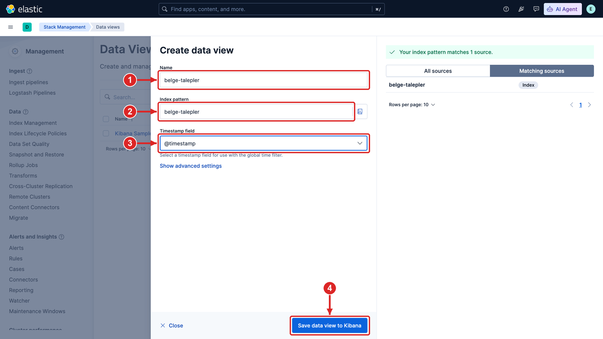
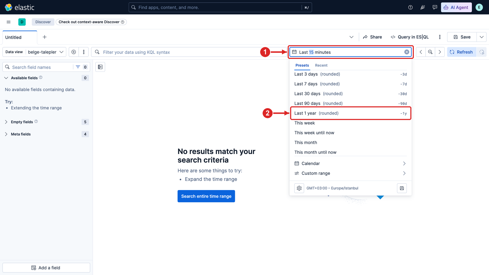
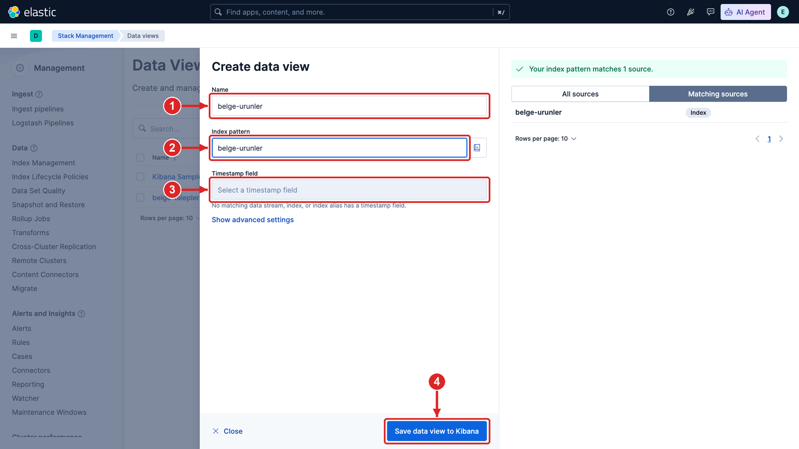
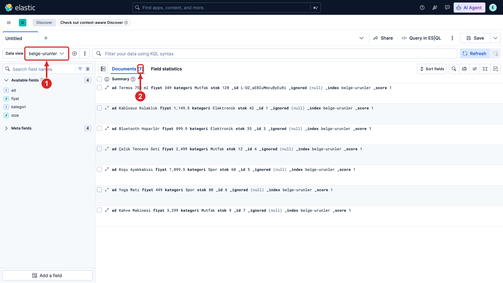

# LAB-02 — İlk Document'ler: curl, Dev Tools ve Discover

| Kullanılan Araçlar | Açık / Kullanılan Portlar |
|---|---|
| Kibana Dev Tools, curl, jq, Kibana Discover | 9200 (Elasticsearch), 5601 (Kibana) — LAB-01 ana cluster'ı |

---

## Bu lab ne öğretiyor?

- HTTP/JSON ile veri yazma
- Dev Tools ve curl kullanımı
- CRUD işlemleri
- Discover'da veri görüntüleme
- Tarih field'ı ve zaman çizelgesi

---

## Ön Koşullar

- LAB-01 ana cluster'ı çalışıyor (`elasticsearch-lab00`, `kibana-lab00`). LAB-01'i atladıysanız onun
  Adım 1-2'sini çalıştırın.
- Kibana'ya `elastic` / `DevOps2026!` ile girilmiş bir tarayıcı.

```bash
cd ~/elastic/labs/LAB-02-ilk-belgeler
```

---

## Kavramlar

- **index:** document'lerin toplandığı yer (veritabanındaki tablo gibi)
- **document:** tek bir JSON kaydı (satır gibi); içindeki anahtarlar **field**
- **`_id`:** document'in kimliği; vermezseniz Elasticsearch üretir
- **mapping:** field tipleri; vermezseniz Elasticsearch ilk değerden tahmin eder (dynamic mapping)

---

## Adım Adım Uygulama Rehberi

`http` bloklarını Kibana Dev Tools'a, `bash` bloklarını terminale yapıştırın.

### 1. Dev Tools'u açın

**Soru: Elasticsearch'e isteği nereden göndereceğiz?** Kibana menüsünden **Management › Dev Tools**'u açın.

- Kullanım verisi uyarısı çıkarsa: **Dismiss**
- Editördeki örnek istekleri silmek için: **Clear this input**
- **(1) Sol editör:** isteği buraya yazarsınız
- **(2) ▶ ya da `Ctrl+Enter`:** imlecin bulunduğu isteği gönderir
- **(3) Sağ panel:** yanıt burada görünür
- **İstek biçimi:** ilk satırda `METOT /yol`, altında gerekiyorsa JSON gövde
- **Parola yok:** Console, Kibana'ya giriş yaptığınız kullanıcıyla bağlanır


### 2. Document ekleyin: Dev Tools ve curl

**Soru: İlk document nasıl yazılır?**

**Index'i açın.** Index **shard**'lara bölünür. Asıl shard **primary**'dir; aynı verinin başka bir node'da tutulan eşi
**replica**'dır.
Küçük veri için tek shard yeter (`number_of_shards: 1`). Ana cluster tek node olduğu için replica'yı koyacak yer
yoktur; sayısını sıfır veriyoruz, yoksa index sarı (yellow) görünür:

```http
PUT /belge-urunler
{
  "settings": {
    "number_of_shards": 1,
    "number_of_replicas": 0
  }
}
```

```json
{"acknowledged": true, "shards_acknowledged": true, "index": "belge-urunler"}
```

<details>
<summary><strong>Shard boyutunu sınırlamak: 1 GB dolunca yeni index</strong></summary>

Index açarken shard boyutu verilmez; shard veri geldikçe büyür. Byte sınırı yoktur, tek sert sınır shard başına
2.147.483.519 document'tir. Önerilen boyut shard başına 10-50 GB'tır: çok büyük shard node'lar arasında yavaş
taşınır, arızadan sonra yavaş kurtarılır. Boyutu sınırlamanın yolu **rollover**'dır: primary shard 1 GB'a ulaşınca
yazma kendiliğinden yeni bir index'e geçer. Üç parça gerekir: politika, şablon, ilk index.

Kibana › Dev Tools'a yapıştırın. **Politika:** primary shard 1 GB olunca rollover yap:

```http
PUT _ilm/policy/belge-shard-1gb
{
  "policy": {
    "phases": {
      "hot": { "actions": { "rollover": { "max_primary_shard_size": "1gb" } } }
    }
  }
}
```

```json
{"acknowledged": true}
```

**Şablon:** `belge-loglar-*` adıyla açılan her index 1 shard alır ve bu politikaya bağlanır:

```http
PUT _index_template/belge-loglar
{
  "index_patterns": ["belge-loglar-*"],
  "template": {
    "settings": {
      "number_of_shards": 1,
      "number_of_replicas": 0,
      "index.lifecycle.name": "belge-shard-1gb",
      "index.lifecycle.rollover_alias": "belge-loglar"
    }
  }
}
```

```json
{"acknowledged": true}
```

**İlk index ve yazma adı:** uygulama hep `belge-loglar` adına (alias) yazar; alias yazmayı o anki index'e yönlendirir:

```http
PUT /belge-loglar-000001
{
  "aliases": { "belge-loglar": { "is_write_index": true } }
}
```

```json
{"acknowledged": true, "shards_acknowledged": true, "index": "belge-loglar-000001"}
```

**Oluşan index ne aldı?** Şablondan gelen ayarlar: shard ve replica sayısı, bağlı politika ve yazma adı:

```http
GET /belge-loglar-000001/_settings?filter_path=*.settings.index.number_of_shards,*.settings.index.number_of_replicas,*.settings.index.lifecycle
```

```json
{
  "belge-loglar-000001": {
    "settings": {
      "index": {
        "lifecycle": {
          "name": "belge-shard-1gb",
          "rollover_alias": "belge-loglar"
        },
        "number_of_shards": "1",
        "number_of_replicas": "0"
      }
    }
  }
}
```

Oluşan shard ve diskte kapladığı yer (index henüz boş):

```http
GET _cat/shards/belge-loglar-000001?v&h=index,shard,prirep,state,docs,store
```

```text
index               shard prirep state   docs store
belge-loglar-000001 0     p      STARTED    0  227b
```

`prirep` sütunundaki `p` primary demektir; `STARTED` shard'ın yazmaya hazır olduğunu gösterir.

Bir log yazın; alias onu `belge-loglar-000001`'e koyar:

```http
POST /belge-loglar/_doc?refresh=true&filter_path=_index,result
{ "mesaj": "ilk log" }
```

```json
{"_index": "belge-loglar-000001", "result": "created"}
```

**Kural şu an ne diyor?** `dry_run` koşulu hesaplar ama uygulamaz:

```http
POST /belge-loglar/_rollover?dry_run=true&filter_path=rolled_over,conditions
{ "conditions": { "max_primary_shard_size": "1gb" } }
```

```json
{"rolled_over": false, "conditions": {"[max_primary_shard_size: 1gb]": false}}
```

Shard 1 GB'ın altında, rollover yok. ILM bu kontrolü yaklaşık 10 dakikada bir kendisi yapar; sınır aşılınca yeni
index'i açar.

**Rollover'ı görün:** sınırı yalnız deneme için 1 KB'a indirin:

```http
POST /belge-loglar/_rollover?filter_path=old_index,new_index,rolled_over,conditions
{ "conditions": { "max_primary_shard_size": "1kb" } }
```

```json
{"old_index": "belge-loglar-000001", "new_index": "belge-loglar-000002", "rolled_over": true, "conditions": {"[max_primary_shard_size: 1kb]": true}}
```

```http
GET _cat/shards/belge-loglar-*?v&h=index,shard,prirep,docs,store&s=index
```

```text
index               shard prirep docs store
belge-loglar-000001 0     p         1 5.7kb
belge-loglar-000002 0     p         0  227b
```

- **`000001`:** sınırı (1 KB) aştı, artık yazılmaz; verisi yerinde kalır.
- **`000002`:** yeni yazma index'i; `belge-loglar` adına yazılan her şey buraya gider. `store` sizde farklı olabilir: yeni document diske birkaç saniyede yansır (227b ile birkaç kb arası).
- **Arama:** `belge-loglar-*` iki index'i birden arar.

</details>

**Dev Tools ile document ekleme.**

- **`PUT`:** `_id`'yi siz verirsiniz
- **`POST`:** `_id`'yi Elasticsearch üretir
- **`?filter_path=...`:** yanıtta yalnız yazdığınız field'lar kalır

```http
PUT /belge-urunler/_doc/1?filter_path=_id,_version,result
{
  "ad": "Kablosuz Kulaklık",
  "kategori": "Elektronik",
  "fiyat": 1299.5,
  "stok": 42
}
```

```json
{"_id": "1", "_version": 1, "result": "created"}
```

Aynı ürünü `_id` vermeden, `POST` ile ekleyin:

```http
POST /belge-urunler/_doc
{
  "ad": "Termos 750 ml",
  "kategori": "Mutfak",
  "fiyat": 349.00,
  "stok": 120
}
```

Yanıttaki `_id` 20 karakterlik rastgele bir değerdir (`"Xk3..."`). Veritabanından gelen kayıtlarda kendi
anahtarınızı `_id` yapın: aynı kayıt ikinci kez gelince yeni document açılmaz, eskisi güncellenir.

**curl ile document ekleme.** Aynı istek terminalden. Farkı: adres, kullanıcı/parola ve `Content-Type` başlığı
açıkça yazılır:

```bash
curl -s -u elastic:'DevOps2026!' -X PUT 'http://127.0.0.1:9200/belge-urunler/_doc/2?filter_path=_id,result' \
  -H 'Content-Type: application/json' \
  -d '{"ad": "Akıllı Saat", "kategori": "Elektronik", "fiyat": 2199.00, "stok": 18}'; echo
```

Beklenen çıktı:

```text
{"_id":"2","result":"created"}
```

İkisi aynı REST API'yi çağırır: Dev Tools denemek için, curl betik ve otomasyon için.

### 3. Okuyun, güncelleyin, silin

**Soru: Yazdığımız document'i nasıl okur, değiştirir, sileriz?**

**Okuyun.** Document'i `_id`'siyle getirin:

```http
GET /belge-urunler/_doc/1?filter_path=_version,found,_source
```

```json
{
  "_version": 1,
  "found": true,
  "_source": {
    "ad": "Kablosuz Kulaklık",
    "kategori": "Elektronik",
    "fiyat": 1299.5,
    "stok": 42
  }
}
```

`_source`, gönderdiğiniz JSON'un aynısıdır.

**Güncelleyin.** Yalnız bazı field'ları değiştirmek için `_update`:

```http
POST /belge-urunler/_update/1?filter_path=_version,result
{
  "doc": {
    "fiyat": 1149.5
  }
}
```

```json
{"_version": 2, "result": "updated"}
```

`_version` her değişiklikte bir artar.

**Silin.** Silin, sonra okumayı deneyin:

```http
DELETE /belge-urunler/_doc/2?filter_path=result
```

```json
{"result": "deleted"}
```


<!-- runner:expect-fail -->
```http
GET /belge-urunler/_doc/2?filter_path=found
```

```json
{"found": false}
```

<details>
<summary><strong>Document varsa üzerine yazmamak: <code>_create</code></strong></summary>

`PUT _doc` aynı `_id` varsa document'i değiştirir. "Yalnızca yoksa ekle" için `_create` kullanılır;
document varsa `409` hatası döner:

```bash
curl -s -u elastic:'DevOps2026!' -X PUT 'http://127.0.0.1:9200/belge-urunler/_create/1' \
  -H 'Content-Type: application/json' -d '{"ad": "Kablosuz Kulaklık (yeni)"}' \
  | jq -c '{status, type: .error.type, reason: .error.reason}'
```

Beklenen çıktı:

```text
{"status":409,"type":"version_conflict_engine_exception","reason":"[1]: version conflict, document already exists (current version [2])"}
```

Hata yanıtı uzundur (`root_cause`, `index_uuid`...); `jq` yalnız üç field'ı gösterir. Hata
yanıtlarında `filter_path` uygulanmaz, bu yüzden burada `jq` kullandık.

</details>

<details>
<summary><strong>Okumanın diğer yolları: <code>HEAD</code>, <code>_source</code>, <code>_mget</code></strong></summary>

**Var mı? `HEAD`.** Uygulama yalnız "bu `_id` var mı" diye soruyorsa document'in tamamını çekmesine gerek yoktur. `HEAD` isteği gövde
döndürmez, yalnız durum kodu: `200` var, `404` yok. Dev Tools'a yapıştırın:

```http
HEAD /belge-urunler/_doc/1
```

Yanıt panelinde gövde yerine yalnız durum yazar: `200 - OK`. Olmayan bir `_id` deneyin:

<!-- runner:expect-fail -->
```http
HEAD /belge-urunler/_doc/99
```

Bu kez durum `404 - Not Found`. Terminalden aynı kontrol, yalnız durum kodunu yazdırarak:

```bash
curl -s -o /dev/null -w '%{http_code}\n' -I -u elastic:'DevOps2026!' 'http://127.0.0.1:9200/belge-urunler/_doc/1'
curl -s -o /dev/null -w '%{http_code}\n' -I -u elastic:'DevOps2026!' 'http://127.0.0.1:9200/belge-urunler/_doc/99'
```

Beklenen çıktı:

```text
200
404
```

Aynı istek index için de çalışır (`HEAD /belge-urunler`): index'i açmadan önce varlığını kontrol etmek
için kullanılır.

**Yalnız document: `_source`.** Adımın başındaki `GET _doc` isteğinde yanıtı `filter_path` ile kısalttık. Filtrelenmemiş yanıtta ürünün yanında
`_index`, `_id`, `_version`, `_seq_no` gibi Elasticsearch'ün kendi bilgileri de gelir. Ürün sayfası yalnız ürünü
gösterecekse bu bilgilere ihtiyaç yoktur; `_source` adresi yalnız sizin gönderdiğiniz JSON'u döndürür:

```http
GET /belge-urunler/_source/1
```

```json
{"ad": "Kablosuz Kulaklık", "kategori": "Elektronik", "fiyat": 1149.5, "stok": 42}
```

Liste sayfası ise yalnız ad ve fiyatı gösterir; stok ve kategori gereksizdir. Document'ler büyüdükçe gereksiz
field'lar ağda boşuna taşınır. `_source_includes` yalnız istediğiniz field'ları getirir:

```http
GET /belge-urunler/_source/1?_source_includes=ad,fiyat
```

```json
{"ad": "Kablosuz Kulaklık", "fiyat": 1149.5}
```

Tersi de olur: `?_source_excludes=stok,kategori` bu iki field'ı çıkarır, aynı sonucu verir.

**Birden fazla document: `_mget`.** Sepet sayfası birkaç ürünü birlikte gösterecek. Her ürün için ayrı `GET`, ürün sayısı kadar istek demektir;
`_mget` hepsini tek istekte getirir. Örnekteki `99` bilerek verilmiş, olmayan bir `_id`:

```http
POST /belge-urunler/_mget?filter_path=docs._id,docs.found,docs._source.ad
{
  "ids": ["1", "99"]
}
```

```json
{
  "docs": [
    {"_id": "1", "found": true, "_source": {"ad": "Kablosuz Kulaklık"}},
    {"_id": "99", "found": false}
  ]
}
```

Olmayan ürün isteğin tamamını bozmaz: o satırda `found: false` döner, diğer ürünler yine gelir.

</details>

<details>
<summary><strong>Sürüm kontrolü: <code>if_seq_no</code> ve <code>version_type=external</code></strong></summary>

**İki kişi aynı document'i güncellerse: `if_seq_no`.** Senaryo: iki kişi kulaklığın fiyatını aynı anda düzenliyor. Ayşe ürünü ekranında açar. O sırada Mehmet fiyatı
değiştirip kaydeder. Ayşe ekranındaki eski bilgiyle kaydederse Mehmet'in değişikliği kimseye haber verilmeden
kaybolur.

Elasticsearch her yazma işlemine artan bir sıra numarası verir; document'in `_seq_no`'su onu son değiştiren
işlemin numarasıdır. Güncellerken okuduğunuz numarayı `if_seq_no` ile gönderirseniz, document siz okuduktan sonra
değişmişse güncelleme reddedilir. `_primary_term` tek node'lu cluster'da hep `1`'dir, olduğu gibi gönderilir.

Kulaklığın şu anki numarasını okuyun:

```http
GET /belge-urunler/_doc/1?filter_path=_seq_no,_primary_term
```

```json
{"_seq_no": 3, "_primary_term": 1}
```

Ayşe ürünü, ilk eklendiği anda (numara `0`) açmıştı. Onun yerine bu eski numarayla kaydetmeyi deneyin. Hata
yanıtı uzundur; `jq` üç field'ı gösterir:

```bash
curl -s -u elastic:'DevOps2026!' -X POST 'http://127.0.0.1:9200/belge-urunler/_update/1?if_seq_no=0&if_primary_term=1' \
  -H 'Content-Type: application/json' -d '{"doc": {"fiyat": 999}}' \
  | jq -c '{status, type: .error.type, reason: .error.reason}'
```

Beklenen çıktı:

```text
{"status":409,"type":"version_conflict_engine_exception","reason":"[1]: version conflict, required seqNo [0], primary term [1]. current document has seqNo [3] and primary term [1]"}
```

`409`: Elasticsearch "sen `0`'ı okudun, document şimdi `3`'te" diyor. Ayşe'nin kaydı yazılmadı, Mehmet'in
değişikliği korundu. Doğrusu, ürünü yeniden okuyup güncel numarayla kaydetmektir; numara `3` olunca güncelleme geçer:

```http
POST /belge-urunler/_update/1?if_seq_no=3&if_primary_term=1&filter_path=_version,result
{
  "doc": {
    "fiyat": 1099.5
  }
}
```

```json
{"_version": 3, "result": "updated"}
```

**Sürüm numarasını dış sistem verirse: `version_type=external`.** Ürünler bir veritabanından aktarılıyor ve her kaydın veritabanında bir sürüm numarası var. Aktarım sırası
karışır da eski sürüm yenisinden sonra gelirse, eski bilgi yenisini ezmemelidir. `version_type=external` ile
sürüm numarasını Elasticsearch değil siz verirsiniz; Elasticsearch yalnız elindekinden büyük sürümü kabul eder.
Bu kutu kendi index'ini açar:

```http
PUT /belge-surum
{ "settings": { "number_of_replicas": 0 } }
```

```json
{"acknowledged": true, "shards_acknowledged": true, "index": "belge-surum"}
```

Veritabanındaki sürüm 5'i yazın:

```http
PUT /belge-surum/_doc/m1?version=5&version_type=external&filter_path=_version,result
{ "ad": "Kablosuz Kulaklık", "fiyat": 1299.5 }
```

```json
{"_version":5,"result":"created"}
```

Geç kalan eski sürüm 3 gelir:

<!-- runner:expect-fail -->
```http
PUT /belge-surum/_doc/m1?version=3&version_type=external&filter_path=_version,result
{ "ad": "Kablosuz Kulaklık", "fiyat": 999 }
```

```json
{
  "error": {
    "root_cause": [
      {
        "type": "version_conflict_engine_exception",
        "reason": "[m1]: version conflict, current version [5] is higher or equal to the one provided [3]",
        "index_uuid": "W_6V4Dj2TpynkUTc377gEA",
        "shard": "0",
        "index": "belge-surum"
      }
    ],
    "type": "version_conflict_engine_exception",
    "reason": "[m1]: version conflict, current version [5] is higher or equal to the one provided [3]",
    "index_uuid": "W_6V4Dj2TpynkUTc377gEA",
    "shard": "0",
    "index": "belge-surum"
  },
  "status": 409
}
```

`409`: elindeki sürüm (5) gelenden (3) büyük, eski kayıt reddedildi. `index_uuid` sizde farklıdır. Yeni sürüm 7
gelince kabul edilir:

```http
PUT /belge-surum/_doc/m1?version=7&version_type=external&filter_path=_version,result
{ "ad": "Kablosuz Kulaklık", "fiyat": 1199.5 }
```

```json
{"_version":7,"result":"updated"}
```

```http
GET /belge-surum/_source/m1
```

```json
{"ad":"Kablosuz Kulaklık","fiyat":1199.5}
```

`_version` artık veritabanındaki sürümle aynıdır. `if_seq_no` "ben okuduktan sonra değişti mi?" diye sorar;
`version_type=external` "gelen kayıt elimdekinden yeni mi?" diye sorar.

**`retry_on_conflict`:** `_update` içeride oku-değiştir-yaz yapar; arada başka bir yazma olursa çakışır. `?retry_on_conflict=3`
verilirse Elasticsearch yeniden okuyup en çok 3 kez kendisi dener (sayaç gibi mevcut değere göre güncellemelerde).

</details>

### 4. Toplu yükleme: `_bulk`

**Soru: Çok sayıda document'i tek tek mi göndereceğiz?** Document'leri tek tek göndermek her biri için ayrı HTTP isteği demektir. `_bulk` çok document'i tek
istekte yükler. Gövdesi **NDJSON**'dur (newline-delimited JSON): her satır kendi başına tam bir JSON'dur,
satırlar yeni satırla ayrılır ve dosya da yeni satırla biter. Elasticsearch gövdeyi tek parça çözmeden satır
satır okur; binlerce document belleği şişirmeden işlenir. Her document iki satırdır:

- **eylem satırı:** ne yapılacak, nereye: `{ "index": { "_index": "belge-urunler", "_id": "3" } }`
- **document satırı:** document'in kendisi: `{ "ad": "Bluetooth Hoparlör", ... }`

Eylem `index` (yaz, varsa üzerine yaz), `create` (yalnız yoksa yaz), `update` (kısmi güncelle) ya da `delete`
(yalnız eylem satırı, document satırı yok) olabilir.

Önce örnek veri dosyasını oluşturun (5 ürün, her biri eylem satırı + document satırı):

```bash
mkdir -p sample-data
cat > sample-data/urunler.ndjson << 'EOF'
{ "index": { "_index": "belge-urunler", "_id": "3" } }
{ "ad": "Bluetooth Hoparlör", "kategori": "Elektronik", "fiyat": 899.90, "stok": 35 }
{ "index": { "_index": "belge-urunler", "_id": "4" } }
{ "ad": "Çelik Tencere Seti", "kategori": "Mutfak", "fiyat": 2499.00, "stok": 12 }
{ "index": { "_index": "belge-urunler", "_id": "5" } }
{ "ad": "Koşu Ayakkabısı", "kategori": "Spor", "fiyat": 1899.50, "stok": 60 }
{ "index": { "_index": "belge-urunler", "_id": "6" } }
{ "ad": "Yoga Matı", "kategori": "Spor", "fiyat": 449.00, "stok": 80 }
{ "index": { "_index": "belge-urunler", "_id": "7" } }
{ "ad": "Kahve Makinesi", "kategori": "Mutfak", "fiyat": 3299.00, "stok": 9 }
EOF
```

Dosyayı `_bulk` ile yükleyin, ardından index'teki document sayısına bakın:

```bash
curl -s -u elastic:'DevOps2026!' -X POST 'http://127.0.0.1:9200/_bulk?refresh=true&filter_path=errors,items.*.result' \
  -H 'Content-Type: application/x-ndjson' --data-binary @sample-data/urunler.ndjson | jq -c
curl -s -u elastic:'DevOps2026!' 'http://127.0.0.1:9200/belge-urunler/_count?filter_path=count'; echo
```

Beklenen çıktı:

```text
{"errors":false,"items":[{"index":{"result":"created"}},{"index":{"result":"created"}},{"index":{"result":"created"}},{"index":{"result":"created"}},{"index":{"result":"created"}}]}
{"count":7}
```

- **`--data-binary`:** satır sonlarını korur; `-d` silerdi ve NDJSON bozulurdu.
- **`errors: false`:** hiçbir satır reddedilmedi; `true` olsaydı nedeni `items` içinde yazardı.
- **`refresh=true`:** yüklenenler aramada hemen görünsün diye.
- **`_count` → 7:** 3 eklendi, 1 silindi, 5 geldi.

<details>
<summary><strong>Kimliği bilinen document'leri aramak: <code>ids</code></strong></summary>

`_mget` bir `_id` listesini okur; aynı listeyi arama olarak da isteyebilirsiniz: `ids` sorgusu. Fark: `GET` ve
`_mget` document'i yazıldığı an görür, arama ise yalnız refresh edilmiş document'leri görür. Bu yüzden örnek,
`refresh=true` ile yüklenen bu adımın sonunda. Olmayan `_id` (`99`) sonuçta görünmez:

```http
GET /belge-urunler/_search?filter_path=hits.hits._id,hits.hits._source.ad
{ "query": { "ids": { "values": ["1", "3", "99"] } } }
```

```json
{"hits":{"hits":[{"_id":"1","_source":{"ad":"Kablosuz Kulaklık"}},{"_id":"3","_source":{"ad":"Bluetooth Hoparlör"}}]}}
```

Arama olduğu için başka koşullarla birleşir. Listedekilerden yalnız 1000 TL ve üstü olanlar:

```http
GET /belge-urunler/_search?filter_path=hits.hits._id,hits.hits._source.ad
{
  "query": { "bool": { "filter": [
    { "ids":   { "values": ["1", "3", "99"] } },
    { "range": { "fiyat": { "gte": 1000 } } }
  ] } }
}
```

```json
{"hits":{"hits":[{"_id":"1","_source":{"ad":"Kablosuz Kulaklık"}}]}}
```

</details>

<details>
<summary><strong>Refresh: yazılan document aramada ne zaman görünür?</strong></summary>

Elasticsearch yeni document'i önce bellekte tutar; aramaya açılması **refresh** ile olur (varsayılan
saniyede bir). Farkı görmek için önce otomatik refresh'i kapatın (`refresh_interval: -1`):

```http
PUT /belge-urunler/_settings
{
  "index": { "refresh_interval": "-1" }
}
```

Refresh kapalıyken yeni bir document ekleyin:

```http
PUT /belge-urunler/_doc/90
{
  "ad": "Deneme Ürünü",
  "kategori": "Test",
  "fiyat": 1,
  "stok": 1
}
```

Hemen sayın:

```http
GET /belge-urunler/_count?filter_path=count
```

```json
{"count": 7}
```

Document yazıldı (`result: created`) ama arama hâlâ 7 sayıyor. `_id` ile okuma ise refresh'i
beklemez:

```http
GET /belge-urunler/_doc/90?filter_path=found
```

```json
{"found": true}
```

Elle refresh yapıp tekrar sayın, sonra ayarı varsayılana döndürüp deneme document'ini silin:

```http
POST /belge-urunler/_refresh
```

Refresh'ten sonra tekrar sayın:

```http
GET /belge-urunler/_count?filter_path=count
```

```json
{"count": 8}
```

`refresh_interval`'ı varsayılana döndürün (`null`):

```http
PUT /belge-urunler/_settings
{
  "index": { "refresh_interval": null }
}
```

Deneme document'ini silin:

```http
DELETE /belge-urunler/_doc/90?refresh=true&filter_path=result
```

Toplu yüklemede refresh'i geçici kapatmak yüklemeyi hızlandırır; gerçek zamanlı aramada ise
varsayılan bir saniye yeterlidir. `?refresh=true` yalnız o isteği beklettiği için testlerde ve
bu labda kullanıldı; yoğun yazmada her isteğe eklenmez.

</details>

### 5. Zaman damgalı veri: destek talepleri

**Soru: Zamanı olan veride field tipleri nasıl seçilir?** Bu kez her document'te olayın zamanı olan `@timestamp` field'ı var. `tarih_tr` aynı zamanı Türkçe biçimde
(`21.11.2026 13:15`) taşır. Dosyayı oluşturun (8 talep, her biri eylem satırı + document satırı):

```bash
cat > sample-data/talepler.ndjson << 'EOF'
{"index":{"_index":"belge-talepler","_id":"T1000"}}
{"@timestamp":"2026-11-21T10:15:00Z","tarih_tr":"21.11.2026 13:15","kanal":"web","konu":"Şifre sıfırlama","sure_dk":5}
{"index":{"_index":"belge-talepler","_id":"T1001"}}
{"@timestamp":"2026-11-20T13:40:00Z","tarih_tr":"20.11.2026 16:40","kanal":"mobil","konu":"Fatura itirazı","sure_dk":8}
{"index":{"_index":"belge-talepler","_id":"T1002"}}
{"@timestamp":"2026-11-19T08:05:00Z","tarih_tr":"19.11.2026 11:05","kanal":"telefon","konu":"Kargo gecikmesi","sure_dk":11}
{"index":{"_index":"belge-talepler","_id":"T1003"}}
{"@timestamp":"2026-11-18T15:30:00Z","tarih_tr":"18.11.2026 18:30","kanal":"e-posta","konu":"Uygulama hatası","sure_dk":14}
{"index":{"_index":"belge-talepler","_id":"T1004"}}
{"@timestamp":"2026-11-17T09:50:00Z","tarih_tr":"17.11.2026 12:50","kanal":"web","konu":"Şifre sıfırlama","sure_dk":17}
{"index":{"_index":"belge-talepler","_id":"T1005"}}
{"@timestamp":"2026-11-16T12:20:00Z","tarih_tr":"16.11.2026 15:20","kanal":"mobil","konu":"Fatura itirazı","sure_dk":20}
{"index":{"_index":"belge-talepler","_id":"T1006"}}
{"@timestamp":"2026-11-15T07:45:00Z","tarih_tr":"15.11.2026 10:45","kanal":"telefon","konu":"Kargo gecikmesi","sure_dk":23}
{"index":{"_index":"belge-talepler","_id":"T1007"}}
{"@timestamp":"2026-11-14T16:10:00Z","tarih_tr":"14.11.2026 19:10","kanal":"e-posta","konu":"Uygulama hatası","sure_dk":26}
EOF
```

`@timestamp` UTC'dir (`Z`), `tarih_tr` Türkiye saatidir (UTC+3).

Index'i yalnız ayarla açıp (tek node: replica 0) document'leri yükleyin; field tiplerini
Elasticsearch'e bırakıyoruz:

```bash
curl -s -u elastic:'DevOps2026!' -X PUT 'http://127.0.0.1:9200/belge-talepler' -H 'Content-Type: application/json' \
  -d '{"settings": {"number_of_replicas": 0}}'; echo
curl -s -u elastic:'DevOps2026!' -X POST 'http://127.0.0.1:9200/_bulk?refresh=true&filter_path=errors' \
  -H 'Content-Type: application/x-ndjson' --data-binary @sample-data/talepler.ndjson; echo
```

Beklenen çıktı:

```text
{"acknowledged":true,"shards_acknowledged":true,"index":"belge-talepler"}
{"errors":false}
```

Elasticsearch field'lara hangi tipi verdi? `jq` her field'ı tipiyle tek satırda gösterir:

```bash
curl -s -u elastic:'DevOps2026!' 'http://127.0.0.1:9200/belge-talepler/_mapping' \
  | jq -c '.["belge-talepler"].mappings.properties | to_entries[] | {(.key): .value.type, keyword: (.value.fields.keyword.type // "-")}'
```

Beklenen çıktı:

```text
{"@timestamp":"date","keyword":"-"}
{"kanal":"text","keyword":"keyword"}
{"konu":"text","keyword":"keyword"}
{"sure_dk":"long","keyword":"-"}
{"tarih_tr":"text","keyword":"keyword"}
```

- **`@timestamp` → `date`:** ISO 8601 biçimi (`2026-11-21T10:15:00Z`) tarih olarak tanındı.
- **`tarih_tr` → `text`:** `21.11.2026 13:15` varsayılan bir tarih biçimi değil, düz metin kaldı; bu field'la
  zaman aralığı sorgulanamaz. Çözüm: mapping'de tarih `format`'ı vermek.
- **`kanal`, `konu` → `text` + `.keyword`:** hem kelimeyle aranır hem tam değerle gruplanır.

### 6. Discover: yüklediğimiz veriyi arayüzde görmek

**Soru: Yüklediğimiz index'leri Discover'da nasıl görürüz?**

Discover index'i doğrudan açmaz; önce bir **data view** tanımlanır.

- **Data view:** Kibana'nın hangi index'lere bakacağını ve (varsa) zaman field'ını söyleyen tanım.
- **Neden ayrı?** Veri index'te kalır; data view yalnız bakış açısıdır. Silmek veriyi silmez, `belge-*` gibi bir
  desenle birden çok index'e birlikte bakabilir.

**a) Zaman field'lı data view**

1. **Stack Management › Data Views › Create data view**
2. Name: `belge-talepler` (1)
3. Index pattern: `belge-talepler` (2)
4. Timestamp field: `@timestamp` (3). Listede yalnız `date` tipli field'lar çıkar; `tarih_tr` bu yüzden yok.
5. **Save data view to Kibana** (4)



**Discover**'ı açın, sol üstteki **Data view** listesinden `belge-talepler`'i seçin.

- Varsayılan aralık **Last 15 minutes**: talepler geçmiş tarihli olduğu için liste boş görünür.
- Zaman kutusuna (1) tıklayın, **Presets** listesinden **Last 1 year** (2) seçin:



Document sayısı 8 olur (3); histogram talepleri Kasım ayında gösterir (4):


Zaman field'lı data view'da zaman seçici bir filtredir: aralığın dışındaki document index'te olsa da
listelenmez. "Veri yüklendi ama Discover boş" durumunun en sık nedeni budur.

**b) Zaman field'sız data view**

1. Aynı yoldan Name ve Index pattern: `belge-urunler`
2. Timestamp field kutusu kapalı gelir (3): bu index'te `date` tipli field yok.
3. Kaydedin (4).



Discover'da `belge-urunler`'i seçin (1): zaman kutusu ve histogram kaybolur, 7 document'in hepsi
listelenir (2).



| | Zaman field'lı (`belge-talepler`) | Zaman field'sız (`belge-urunler`) |
|---|---|---|
| Uygun veri | log, olay, sipariş, talep: "ne zaman oldu" önemli | katalog, müşteri, ayar: zamandan bağımsız |
| Zaman seçici | var; aralık dışı document gizlenir | yok |
| Histogram | var | yok |

<details>
<summary><strong>İsteğe bağlı: güncelleme kalıpları (upsert, script ve toplu işlem)</strong></summary>

**Soru: Uygulamalar document'leri en sık nasıl günceller?** Bir mağazanın stok index'i üzerinde, uygulamaların en sık yaptığı güncellemeleri Dev Tools'ta deneyin. Bu bölüm
kendi index'ini (`belge-stok`) açar; önceki adımların verisine dokunmaz.

```http
PUT /belge-stok
{ "settings": { "number_of_replicas": 0 } }
```

```json
{"acknowledged": true, "shards_acknowledged": true, "index": "belge-stok"}
```

**`_bulk` 200 döndü diye her satır yazılmış değildir.** İki ürün ekleyin; üçüncü satır `create` ile `p1`'i
yeniden eklemeye çalışsın (`create` "yalnız yoksa ekle" demektir):

```http
POST /belge-stok/_bulk?refresh=true&filter_path=errors,items.*._id,items.*.status,items.*.result,items.*.error.type
{"index":{"_id":"p1"}}
{"ad":"Kablosuz Mouse","stok":40,"satis":0}
{"index":{"_id":"p2"}}
{"ad":"USB Bellek","stok":5,"satis":0}
{"create":{"_id":"p1"}}
{"ad":"Kablosuz Mouse","stok":1,"satis":0}
```

```json
{"errors":true,"items":[{"index":{"_id":"p1","result":"created","status":201}},{"index":{"_id":"p2","result":"created","status":201}},{"create":{"_id":"p1","status":409,"error":{"type":"version_conflict_engine_exception"}}}]}
```

İstek bütün olarak başarılıdır; ama `errors: true` ve üçüncü satırın `status: 409` değeri o satırın yazılmadığını
söyler. `_bulk` sonrası her zaman `errors` field'ına bakın.

**Upsert: varsa güncelle, yoksa oluştur.** Uygulama ürünün index'te olup olmadığını bilmeden stok bilgisini
gönderiyor. `doc` ürün varsa uygulanacak değişikliktir, `upsert` ürün yoksa yazılacak document'tir. `p3` henüz yok:

```http
POST /belge-stok/_update/p3?filter_path=result,_version
{
  "doc":    { "stok": 12 },
  "upsert": { "ad": "Klavye", "stok": 12, "satis": 0 }
}
```

```json
{"_version":1,"result":"created"}
```

Aynı isteği yeni stokla bir kez daha gönderin; bu kez ürün var, yalnız `doc` uygulanır:

```http
POST /belge-stok/_update/p3?filter_path=result,_version
{
  "doc":    { "stok": 15 },
  "upsert": { "ad": "Klavye", "stok": 12, "satis": 0 }
}
```

```json
{"_version":2,"result":"updated"}
```

Değeri zaten aynı olan bir güncelleme yazılmaz; Elasticsearch `noop` döner ve `_version` artmaz:

```http
POST /belge-stok/_update/p3?filter_path=result,_version
{ "doc": { "stok": 15 } }
```

```json
{"_version":2,"result":"noop"}
```

**Script: mevcut değere göre güncelleme.** İki USB bellek satıldı: stok 2 azalmalı, satış 2 artmalı. Yeni değeri
uygulamada hesaplayıp göndermek, o arada başka bir satış olursa yanlış sonuç verir. Script hesabı Elasticsearch'te,
document'in o anki değeri üzerinde yapar. `ctx._source` document'in kendisi, `params` dışarıdan verilen değerdir:

```http
POST /belge-stok/_update/p2?filter_path=result,_version
{
  "script": {
    "source": "ctx._source.stok -= params.adet; ctx._source.satis += params.adet",
    "params": { "adet": 2 }
  }
}
```

```json
{"_version":2,"result":"updated"}
```

Ürünün yeni hâline bakın:

```http
GET /belge-stok/_source/p2
```

```json
{"ad":"USB Bellek","stok":3,"satis":2}
```

<details>
<summary><strong><code>refresh=wait_for</code>: yazdığım hemen aranabilsin mi?</strong></summary>

Yazılan document yaklaşık bir saniye sonra aramada görünür. Bu labda
`?refresh=true` ile hemen görünür yaptık; bu her istekte zorla yenileme yapar ve yoğun yazmada yavaştır.
`?refresh=wait_for` zorlamaz, bir sonraki olağan yenilemeyi bekleyip öyle döner:

```http
POST /belge-stok/_update/p1?refresh=wait_for&filter_path=result
{ "script": { "source": "ctx._source.satis += 1" } }
```

```json
{"result":"updated"}
```

</details>

**`_update_by_query`: koşula uyan bütün document'leri güncellemek.** Stoğu 10'un altına düşen ürünleri
`azaliyor: true` diye işaretleyeceğiz. Toplu değişiklikten önce aynı sorguyla kaç document etkileneceğine bakın:

```http
GET /belge-stok/_count?filter_path=count
{ "query": { "range": { "stok": { "lt": 10 } } } }
```

```json
{"count":1}
```

Aynı sorguya uyan ürünleri işaretleyin:

```http
POST /belge-stok/_update_by_query?refresh=true&filter_path=total,updated
{
  "query":  { "range": { "stok": { "lt": 10 } } },
  "script": { "source": "ctx._source.azaliyor = true" }
}
```

```json
{"total":1,"updated":1}
```

İşaretlenen ürünü görün:

```http
GET /belge-stok/_search?filter_path=hits.hits._id,hits.hits._source
{ "query": { "term": { "azaliyor": true } } }
```

```json
{"hits":{"hits":[{"_id":"p2","_source":{"satis":2,"ad":"USB Bellek","azaliyor":true,"stok":3}}]}}
```

<details>
<summary><strong><code>_delete_by_query</code>: koşula uyan bütün document'leri silmek</strong></summary>

Hiç satılmamış ürünleri kaldıralım. Silme geri
alınmaz; önce sayın:

```http
GET /belge-stok/_count?filter_path=count
{ "query": { "term": { "satis": 0 } } }
```

```json
{"count":1}
```

Aynı sorguya uyan ürünleri silin:

```http
POST /belge-stok/_delete_by_query?refresh=true&filter_path=total,deleted
{ "query": { "term": { "satis": 0 } } }
```

```json
{"total":1,"deleted":1}
```

Kalan ürünler (satışa göre sıralı):

```http
GET /belge-stok/_search?filter_path=hits.hits._id,hits.hits._source.ad
{ "sort": [ { "satis": "asc" } ] }
```

```json
{"hits":{"hits":[{"_id":"p1","_source":{"ad":"Kablosuz Mouse"}},{"_id":"p2","_source":{"ad":"USB Bellek"}}]}}
```

Satışı olmayan `p3` (Klavye) silindi; `p1` (bir satış) ve `p2` (iki satış) kaldı.

</details>

</details>

## Temizlik

Sonraki lablar bu index'leri kullanmaz. Yalnız bu labın index'lerini ve data view'larını siler;
ana cluster'a dokunmaz:

```bash
./teardown.sh
```

Beklenen çıktı:

```text
index belge-urunler -> 200
index belge-talepler -> 200
index belge-stok -> 200
index belge-surum -> 200
index belge-loglar-000001 -> 200
index belge-loglar-000002 -> 200
sablon belge-loglar -> 200
politika belge-shard-1gb -> 200
data view 45812d4a-33f2-4a3d-a07b-db3924da030b -> 200
data view c10ba3c2-1831-4139-85e1-c5566465963a -> 200
```

Data view id'leri arayüzde rastgele üretildiği için sizde farklıdır. Shard boyutu kutusunu yapmadıysanız
`belge-loglar` index satırları çıkmaz, şablon ve politika `404` verir.

Labı aynı sunucuda yeniden yapacaksanız başlamadan önce `./teardown.sh` çalıştırın; README'deki sayılar temiz
başlangıca göredir.

---

Sonraki lab: **[LAB-03 — Mapping ve Analyzer: Field Tipleri ve Türkçe Metin](../LAB-03-mapping-analyzer/README.md)**
