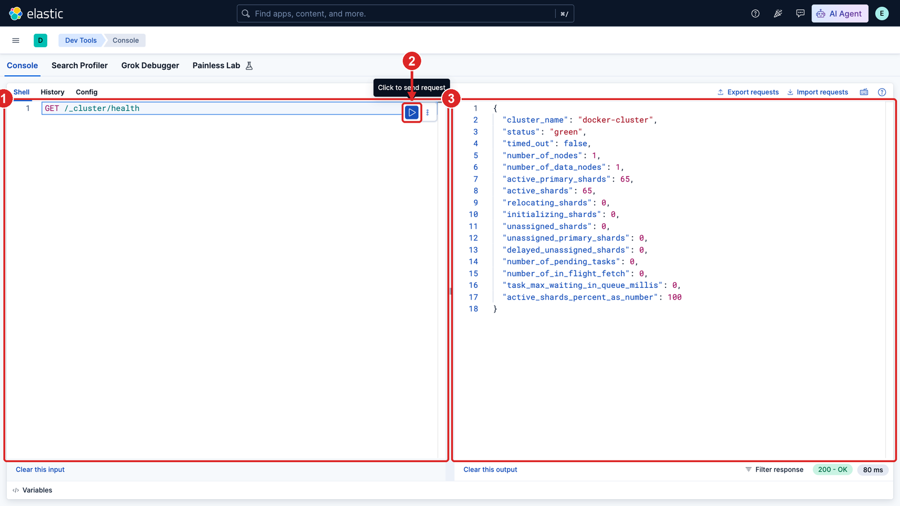
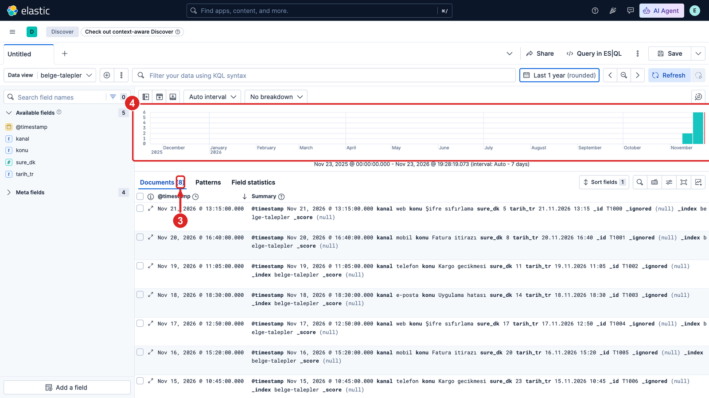

# LAB-02 — İlk Document'ler: curl, Dev Tools ve Discover

| Kullanılan Araçlar | Açık / Kullanılan Portlar |
|---|---|
| Kibana Dev Tools, curl, jq, Kibana Discover | 9200 (Elasticsearch), 5601 (Kibana) — LAB-01 ana cluster'ı |

---

## Bu lab ne öğretiyor?

- HTTP/JSON ile veri yazma
- Dev Tools ve curl kullanımı
- CRUD işlemleri
- Discover'da veri görüntüleme
- Tarih field'ı ve zaman çizelgesi

---

## Ön Koşullar

- LAB-01 ana cluster'ı çalışıyor (`elasticsearch-lab00`, `kibana-lab00`). LAB-01'i atladıysanız onun
  Adım 1-2'sini çalıştırın.
- Kibana'ya `elastic` / `DevOps2026!` ile girilmiş bir tarayıcı.

```bash
cd ~/elastic/labs/LAB-02-ilk-belgeler
```

---

## Kavramlar: index, document, `_id`

| Kavram | Ne demek | İlişkisel veritabanında yakın karşılığı |
|---|---|---|
| index | Aynı türden document'lerin toplandığı ad | tablo |
| document | Tek bir JSON kaydı | satır |
| field | Document'teki bir anahtar (`ad`, `fiyat`) | sütun |
| `_id` | Document'in index içindeki kimliği; verilmezse Elasticsearch üretir | birincil anahtar |
| mapping | Her field'ın tipi (`text`, `keyword`, `date`, `float`) | şema |
| inverted index | Her terimin hangi document'lerde geçtiğini tutan dizin; arama bunun üzerinden yapılır | kitabın arkasındaki dizin |
| data view | Kibana'nın bir ya da birden çok index'e nasıl bakacağını tutan tanım; veri taşımaz | view (görünüm) |

Fark: index'i ve mapping'i önceden tanımlamak zorunlu değildir. İlk document geldiğinde Elasticsearch
index'i açar ve field tiplerini değerden tahmin eder (dynamic mapping). Bu kolaylık, Adım 5'te
göreceğimiz tarih tuzağının da kaynağıdır.

---

## Adım Adım Uygulama Rehberi

### 1. Dev Tools'u açın

Kibana menüsünden **Management › Dev Tools**'u açın.

- Kullanım verisi uyarısı çıkarsa: **Dismiss**
- Editördeki örnek istekleri silmek için: **Clear this input**
- **(1) Sol editör:** isteği buraya yazarsınız
- **(2) ▶ ya da `Ctrl+Enter`:** imlecin bulunduğu isteği gönderir
- **(3) Sağ panel:** yanıt burada görünür
- **İstek biçimi:** ilk satırda `METOT /yol`, altında gerekiyorsa JSON gövde
- **Parola yok:** Console, Kibana'ya giriş yaptığınız kullanıcıyla bağlanır

{width=75%}

Bu labda `http` bloklarını Dev Tools'a, `bash` bloklarını terminale yapıştırın.

### 2. Document ekleyin: Dev Tools ve curl

**Index'i açın.** Index **shard**'lara bölünür: asıl shard'a **primary**, başka bir node'daki kopyasına **replica** denir.
Küçük veri için tek shard yeter (`number_of_shards: 1`). Ana cluster tek node olduğu için replica'yı koyacak yer
yoktur; sayısını sıfır veriyoruz, yoksa index sarı (yellow) görünür:

```http
PUT /belge-urunler
{
  "settings": {
    "number_of_shards": 1,
    "number_of_replicas": 0
  }
}
```

```json
{"acknowledged": true, "shards_acknowledged": true, "index": "belge-urunler"}
```

**Dev Tools ile document ekleme.** `_id`'yi siz verirseniz `PUT`, Elasticsearch üretsin isterseniz `POST` kullanılır. İsteğin sonundaki
`?filter_path=...` yanıttan yalnız yazdığınız field'ları bırakır; yanıt kısa ve okunur kalır:

```http
PUT /belge-urunler/_doc/1?filter_path=_id,_version,result
{
  "ad": "Kablosuz Kulaklık",
  "kategori": "Elektronik",
  "fiyat": 1299.5,
  "stok": 42
}
```

```json
{"_id": "1", "_version": 1, "result": "created"}
```

Aynı ürünü `_id` vermeden, `POST` ile ekleyin:

```http
POST /belge-urunler/_doc
{
  "ad": "Termos 750 ml",
  "kategori": "Mutfak",
  "fiyat": 349.00,
  "stok": 120
}
```

İkinci yanıtta `_id` yerine `"_id": "Xk3...` gibi 20 karakterlik rastgele bir değer görürsünüz.
Veritabanından gelen kayıtlarda kendi anahtarınızı `_id` yapmak, aynı kaydın iki kez
yüklenmesini önler (aynı `_id` ikinci kez gelince yeni document açılmaz, eskisi güncellenir).

**curl ile document ekleme.** Aynı istek terminalden `curl` ile. Dev Tools'tan farkı: adres ve kullanıcı/parola açıkça yazılır,
JSON gövdesi için `Content-Type` başlığı verilir:

```bash
curl -s -u elastic:'DevOps2026!' -X PUT 'http://127.0.0.1:9200/belge-urunler/_doc/2?filter_path=_id,result' \
  -H 'Content-Type: application/json' \
  -d '{"ad": "Akıllı Saat", "kategori": "Elektronik", "fiyat": 2199.00, "stok": 18}'; echo
```

Beklenen çıktı:

```text
{"_id":"2","result":"created"}
```

Dev Tools ile curl aynı REST API'yi çağırır: Dev Tools denemek için, curl betik ve otomasyon için
pratiktir.

### 3. Okuyun, güncelleyin, silin

Document'i `_id`'siyle okuyun:

```http
GET /belge-urunler/_doc/1?filter_path=_version,found,_source
```

```json
{
  "_version": 1,
  "found": true,
  "_source": {
    "ad": "Kablosuz Kulaklık",
    "kategori": "Elektronik",
    "fiyat": 1299.5,
    "stok": 42
  }
}
```

`_source`, gönderdiğiniz JSON'un aynısıdır. Yalnız bazı field'ları güncellemek için `_update`:

```http
POST /belge-urunler/_update/1?filter_path=_version,result
{
  "doc": {
    "fiyat": 1149.5
  }
}
```

```json
{"_version": 2, "result": "updated"}
```

`_version` her değişiklikte bir artar.

Silme ve silindiğini kontrol etme:

```http
DELETE /belge-urunler/_doc/2?filter_path=result
```

```json
{"result": "deleted"}
```

Silinen document'i okumayı deneyin:

<!-- runner:expect-fail -->
```http
GET /belge-urunler/_doc/2?filter_path=found
```

```json
{"found": false}
```

<details>
<summary><strong>Document varsa üzerine yazmamak: <code>_create</code></strong></summary>

`PUT _doc` aynı `_id` varsa document'i değiştirir. "Yalnızca yoksa ekle" için `_create` kullanılır;
document varsa `409` hatası döner:

```bash
curl -s -u elastic:'DevOps2026!' -X PUT 'http://127.0.0.1:9200/belge-urunler/_create/1' \
  -H 'Content-Type: application/json' -d '{"ad": "Kablosuz Kulaklık (yeni)"}' \
  | jq -c '{status, type: .error.type, reason: .error.reason}'
```

Beklenen çıktı:

```text
{"status":409,"type":"version_conflict_engine_exception","reason":"[1]: version conflict, document already exists (current version [2])"}
```

Hata yanıtı uzundur (`root_cause`, `index_uuid`...); `jq` yalnız üç field'ı gösterir. Hata
yanıtlarında `filter_path` uygulanmaz, bu yüzden burada `jq` kullandık.

</details>

<details>
<summary><strong>Document var mı? Gövdesiz kontrol: <code>HEAD</code></strong></summary>

Uygulama yalnız "bu `_id` var mı" diye soruyorsa document'in tamamını çekmesine gerek yoktur. `HEAD` isteği gövde
döndürmez, yalnız durum kodu: `200` var, `404` yok. Dev Tools'a yapıştırın:

```http
HEAD /belge-urunler/_doc/1
```

Yanıt panelinde gövde yerine yalnız durum yazar: `200 - OK`. Olmayan bir `_id` deneyin:

<!-- runner:expect-fail -->
```http
HEAD /belge-urunler/_doc/99
```

Bu kez durum `404 - Not Found`. Terminalden aynı kontrol, yalnız durum kodunu yazdırarak:

```bash
curl -s -o /dev/null -w '%{http_code}\n' -I -u elastic:'DevOps2026!' 'http://127.0.0.1:9200/belge-urunler/_doc/1'
curl -s -o /dev/null -w '%{http_code}\n' -I -u elastic:'DevOps2026!' 'http://127.0.0.1:9200/belge-urunler/_doc/99'
```

Beklenen çıktı:

```text
200
404
```

Aynı istek index için de çalışır (`HEAD /belge-urunler`): index'i açmadan önce varlığını kontrol etmek
için kullanılır.

</details>

<details>
<summary><strong>Yalnız document'in kendisi: <code>_source</code> ve field seçimi</strong></summary>

Adımın başındaki `GET _doc` isteğinde yanıtı `filter_path` ile kısalttık. Süzülmemiş yanıtta ürünün yanında
`_index`, `_id`, `_version`, `_seq_no` gibi Elasticsearch'ün kendi bilgileri de gelir. Ürün sayfası yalnız ürünü
gösterecekse bu bilgilere ihtiyaç yoktur; `_source` adresi yalnız sizin gönderdiğiniz JSON'u döndürür:

```http
GET /belge-urunler/_source/1
```

```json
{"ad": "Kablosuz Kulaklık", "kategori": "Elektronik", "fiyat": 1149.5, "stok": 42}
```

Liste sayfası ise yalnız ad ve fiyatı gösterir; stok ve kategori gereksizdir. Document'ler büyüdükçe gereksiz
field'lar ağda boşuna taşınır. `_source_includes` yalnız istediğiniz field'ları getirir:

```http
GET /belge-urunler/_source/1?_source_includes=ad,fiyat
```

```json
{"ad": "Kablosuz Kulaklık", "fiyat": 1149.5}
```

Tersi de olur: `?_source_excludes=stok,kategori` bu iki field'ı çıkarır, aynı sonucu verir.

</details>

<details>
<summary><strong>Birden fazla document'i tek istekte okumak: <code>_mget</code></strong></summary>

Sepet sayfası birkaç ürünü birlikte gösterecek. Her ürün için ayrı `GET`, ürün sayısı kadar istek demektir;
`_mget` hepsini tek istekte getirir. Örnekteki `99` bilerek verilmiş, olmayan bir `_id`:

```http
POST /belge-urunler/_mget?filter_path=docs._id,docs.found,docs._source.ad
{
  "ids": ["1", "99"]
}
```

```json
{
  "docs": [
    {"_id": "1", "found": true, "_source": {"ad": "Kablosuz Kulaklık"}},
    {"_id": "99", "found": false}
  ]
}
```

Olmayan ürün isteğin tamamını bozmaz: o satırda `found: false` döner, diğer ürünler yine gelir.

</details>

<details>
<summary><strong>İki kişi aynı document'i güncellerse: <code>if_seq_no</code></strong></summary>

Senaryo: iki kişi kulaklığın fiyatını aynı anda düzenliyor. Ayşe ürünü ekranında açar. O sırada Mehmet fiyatı
değiştirip kaydeder. Ayşe ekranındaki eski bilgiyle kaydederse Mehmet'in değişikliği kimseye haber verilmeden
kaybolur.

Elasticsearch her yazma işlemine artan bir sıra numarası verir; document'in `_seq_no`'su onu son değiştiren
işlemin numarasıdır. Güncellerken okuduğunuz numarayı `if_seq_no` ile gönderirseniz, document siz okuduktan sonra
değişmişse güncelleme reddedilir. `_primary_term` tek node'lu cluster'da hep `1`'dir, olduğu gibi gönderilir.

Kulaklığın şu anki numarasını okuyun:

```http
GET /belge-urunler/_doc/1?filter_path=_seq_no,_primary_term
```

```json
{"_seq_no": 3, "_primary_term": 1}
```

Ayşe ürünü, ilk eklendiği anda (numara `0`) açmıştı. Onun yerine bu eski numarayla kaydetmeyi deneyin. Hata
yanıtı uzundur; `jq` üç field'ı gösterir:

```bash
curl -s -u elastic:'DevOps2026!' -X POST 'http://127.0.0.1:9200/belge-urunler/_update/1?if_seq_no=0&if_primary_term=1' \
  -H 'Content-Type: application/json' -d '{"doc": {"fiyat": 999}}' \
  | jq -c '{status, type: .error.type, reason: .error.reason}'
```

Beklenen çıktı:

```text
{"status":409,"type":"version_conflict_engine_exception","reason":"[1]: version conflict, required seqNo [0], primary term [1]. current document has seqNo [3] and primary term [1]"}
```

`409`: Elasticsearch "sen `0`'ı okudun, document şimdi `3`'te" diyor. Ayşe'nin kaydı yazılmadı, Mehmet'in
değişikliği korundu. Doğrusu, ürünü yeniden okuyup güncel numarayla kaydetmektir; numara `3` olunca güncelleme geçer:

```http
POST /belge-urunler/_update/1?if_seq_no=3&if_primary_term=1&filter_path=_version,result
{
  "doc": {
    "fiyat": 1099.5
  }
}
```

```json
{"_version": 3, "result": "updated"}
```

</details>

<details>
<summary><strong>Sürüm numarasını dış sistem verirse: <code>version_type=external</code></strong></summary>

Ürünler bir veritabanından aktarılıyor ve her kaydın veritabanında bir sürüm numarası var. Aktarım sırası
karışır da eski sürüm yenisinden sonra gelirse, eski bilgi yenisini ezmemelidir. `version_type=external` ile
sürüm numarasını Elasticsearch değil siz verirsiniz; Elasticsearch yalnız elindekinden büyük sürümü kabul eder.
Bu kutu kendi index'ini açar:

```http
PUT /belge-surum
{ "settings": { "number_of_replicas": 0 } }
```

```json
{"acknowledged": true, "shards_acknowledged": true, "index": "belge-surum"}
```

Veritabanındaki sürüm 5'i yazın:

```http
PUT /belge-surum/_doc/m1?version=5&version_type=external&filter_path=_version,result
{ "ad": "Kablosuz Kulaklık", "fiyat": 1299.5 }
```

```json
{"_version":5,"result":"created"}
```

Geç kalan eski sürüm 3 gelir:

<!-- runner:expect-fail -->
```http
PUT /belge-surum/_doc/m1?version=3&version_type=external&filter_path=_version,result
{ "ad": "Kablosuz Kulaklık", "fiyat": 999 }
```

```json
{
  "error": {
    "root_cause": [
      {
        "type": "version_conflict_engine_exception",
        "reason": "[m1]: version conflict, current version [5] is higher or equal to the one provided [3]",
        "index_uuid": "W_6V4Dj2TpynkUTc377gEA",
        "shard": "0",
        "index": "belge-surum"
      }
    ],
    "type": "version_conflict_engine_exception",
    "reason": "[m1]: version conflict, current version [5] is higher or equal to the one provided [3]",
    "index_uuid": "W_6V4Dj2TpynkUTc377gEA",
    "shard": "0",
    "index": "belge-surum"
  },
  "status": 409
}
```

`409`: elindeki sürüm (5) gelenden (3) büyük, eski kayıt reddedildi. `index_uuid` sizde farklıdır. Yeni sürüm 7
gelince kabul edilir:

```http
PUT /belge-surum/_doc/m1?version=7&version_type=external&filter_path=_version,result
{ "ad": "Kablosuz Kulaklık", "fiyat": 1199.5 }
```

```json
{"_version":7,"result":"updated"}
```

```http
GET /belge-surum/_source/m1
```

```json
{"ad":"Kablosuz Kulaklık","fiyat":1199.5}
```

`_version` artık veritabanındaki sürümle aynıdır. `if_seq_no` "ben okuduktan sonra değişti mi?" diye sorar;
`version_type=external` "gelen kayıt elimdekinden yeni mi?" diye sorar.

</details>

### 4. Toplu yükleme: `_bulk`

Document'leri tek tek göndermek her biri için ayrı HTTP isteği demektir. `_bulk` çok document'i tek
istekte yükler. Gövdesi **NDJSON**'dur (newline-delimited JSON): her satır kendi başına tam bir JSON'dur,
satırlar yeni satırla ayrılır ve dosya da yeni satırla biter. Elasticsearch gövdeyi tek parça çözmeden satır
satır okur; binlerce document belleği şişirmeden işlenir. Her document iki satırdır:

- **eylem satırı:** ne yapılacak, nereye: `{ "index": { "_index": "belge-urunler", "_id": "3" } }`
- **document satırı:** document'in kendisi: `{ "ad": "Bluetooth Hoparlör", ... }`

Eylem `index` (yaz, varsa üzerine yaz), `create` (yalnız yoksa yaz), `update` (kısmi güncelle) ya da `delete`
(yalnız eylem satırı, document satırı yok) olabilir.

Önce örnek veri dosyasını oluşturun (5 ürün, her biri eylem satırı + document satırı):

```bash
mkdir -p sample-data
cat > sample-data/urunler.ndjson << 'EOF'
{ "index": { "_index": "belge-urunler", "_id": "3" } }
{ "ad": "Bluetooth Hoparlör", "kategori": "Elektronik", "fiyat": 899.90, "stok": 35 }
{ "index": { "_index": "belge-urunler", "_id": "4" } }
{ "ad": "Çelik Tencere Seti", "kategori": "Mutfak", "fiyat": 2499.00, "stok": 12 }
{ "index": { "_index": "belge-urunler", "_id": "5" } }
{ "ad": "Koşu Ayakkabısı", "kategori": "Spor", "fiyat": 1899.50, "stok": 60 }
{ "index": { "_index": "belge-urunler", "_id": "6" } }
{ "ad": "Yoga Matı", "kategori": "Spor", "fiyat": 449.00, "stok": 80 }
{ "index": { "_index": "belge-urunler", "_id": "7" } }
{ "ad": "Kahve Makinesi", "kategori": "Mutfak", "fiyat": 3299.00, "stok": 9 }
EOF
```

İlk dört satıra bakın:

```bash
head -4 sample-data/urunler.ndjson
```

Beklenen çıktı:

```text
{ "index": { "_index": "belge-urunler", "_id": "3" } }
{ "ad": "Bluetooth Hoparlör", "kategori": "Elektronik", "fiyat": 899.90, "stok": 35 }
{ "index": { "_index": "belge-urunler", "_id": "4" } }
{ "ad": "Çelik Tencere Seti", "kategori": "Mutfak", "fiyat": 2499.00, "stok": 12 }
```

Dosyayı `_bulk` ile yükleyin, ardından index'teki document sayısına bakın:

```bash
curl -s -u elastic:'DevOps2026!' -X POST 'http://127.0.0.1:9200/_bulk?refresh=true&filter_path=errors,items.*.result' \
  -H 'Content-Type: application/x-ndjson' --data-binary @sample-data/urunler.ndjson | jq -c
curl -s -u elastic:'DevOps2026!' 'http://127.0.0.1:9200/belge-urunler/_count?filter_path=count'; echo
```

Beklenen çıktı:

```text
{"errors":false,"items":[{"index":{"result":"created"}},{"index":{"result":"created"}},{"index":{"result":"created"}},{"index":{"result":"created"}},{"index":{"result":"created"}}]}
{"count":7}
```

- `--data-binary`: dosyayı satır sonlarıyla birlikte gönderir. `-d` satır sonlarını silerdi ve
  NDJSON bozulurdu.
- `errors: false`: hiçbir document reddedilmedi. `true` olsaydı hangi satırın neden reddedildiği
  `items` içinde yazardı; `_bulk` bir satır hatalı diye diğerlerini geri almaz.
- `filter_path=errors,items.*.result`: yanıtta yalnız genel hata durumu ve her satırın sonucu kalır; `jq -c`
  yanıtı tek satırda gösterir.
- `refresh=true`: yüklenen document'lerin aramada hemen görünmesi için (aşağıdaki not).
- `_count`: index'teki document sayısını verir.
- Sayım 7: Adım 2'deki 3 document, Adım 3'te silinen 1, `_bulk` ile gelen 5.

<details>
<summary><strong>Kimliği bilinen document'leri aramak: <code>ids</code></strong></summary>

`_mget` bir `_id` listesini okur; aynı listeyi arama olarak da isteyebilirsiniz: `ids` sorgusu. Fark: `GET` ve
`_mget` document'i yazıldığı an görür, arama ise yalnız refresh edilmiş document'leri görür. Bu yüzden örnek,
`refresh=true` ile yüklenen bu adımın sonunda. Olmayan `_id` (`99`) sonuçta görünmez:

```http
GET /belge-urunler/_search?filter_path=hits.hits._id,hits.hits._source.ad
{ "query": { "ids": { "values": ["1", "3", "99"] } } }
```

```json
{"hits":{"hits":[{"_id":"1","_source":{"ad":"Kablosuz Kulaklık"}},{"_id":"3","_source":{"ad":"Bluetooth Hoparlör"}}]}}
```

Arama olduğu için başka koşullarla birleşir. Listedekilerden yalnız 1000 TL ve üstü olanlar:

```http
GET /belge-urunler/_search?filter_path=hits.hits._id,hits.hits._source.ad
{
  "query": { "bool": { "filter": [
    { "ids":   { "values": ["1", "3", "99"] } },
    { "range": { "fiyat": { "gte": 1000 } } }
  ] } }
}
```

```json
{"hits":{"hits":[{"_id":"1","_source":{"ad":"Kablosuz Kulaklık"}}]}}
```

</details>

<details>
<summary><strong>Refresh: yazılan document aramada ne zaman görünür?</strong></summary>

Elasticsearch yeni document'i önce bellekte tutar; aramaya açılması **refresh** ile olur (varsayılan
saniyede bir). Farkı görmek için önce otomatik refresh'i kapatın (`refresh_interval: -1`):

```http
PUT /belge-urunler/_settings
{
  "index": { "refresh_interval": "-1" }
}
```

Refresh kapalıyken yeni bir document ekleyin:

```http
PUT /belge-urunler/_doc/90
{
  "ad": "Deneme Ürünü",
  "kategori": "Test",
  "fiyat": 1,
  "stok": 1
}
```

Hemen sayın:

```http
GET /belge-urunler/_count?filter_path=count
```

```json
{"count": 7}
```

Document yazıldı (`result: created`) ama arama hâlâ 7 sayıyor. `_id` ile okuma ise refresh'i
beklemez:

```http
GET /belge-urunler/_doc/90?filter_path=found
```

```json
{"found": true}
```

Elle refresh yapıp tekrar sayın, sonra ayarı varsayılana döndürüp deneme document'ini silin:

```http
POST /belge-urunler/_refresh
```

Refresh'ten sonra tekrar sayın:

```http
GET /belge-urunler/_count?filter_path=count
```

```json
{"count": 8}
```

`refresh_interval`'ı varsayılana döndürün (`null`):

```http
PUT /belge-urunler/_settings
{
  "index": { "refresh_interval": null }
}
```

Deneme document'ini silin:

```http
DELETE /belge-urunler/_doc/90?refresh=true&filter_path=result
```

Toplu yüklemede refresh'i geçici kapatmak yüklemeyi hızlandırır; gerçek zamanlı aramada ise
varsayılan bir saniye yeterlidir. `?refresh=true` yalnız o isteği beklettiği için testlerde ve
bu labda kullanıldı; yoğun yazmada her isteğe eklenmez.

</details>

### 5. Zaman damgalı veri: destek talepleri

Bu kez her document'te olayın zamanı olan `@timestamp` field'ı var. Son 7 güne yayılmış 24 destek
talebini kabukta üretiyoruz; `date -d "-N hours"` her talebe 7 saat arayla geriye giden bir zaman
verir. `tarih_tr` field'ı aynı zamanı Türkçe biçimde (`21.11.2026 14:30`) taşır. Kanal ve konu `i%4` ile dört
değer arasında sırayla döner; satırlar `~/talepler.ndjson` dosyasına yazılır. Her talep iki satırdır (eylem +
document), yani dosya yine NDJSON'dur:

```bash
kanallar=(web mobil telefon e-posta); konular=("Şifre sıfırlama" "Fatura itirazı" "Kargo gecikmesi" "Uygulama hatası")
for i in $(seq 0 23); do
  ts=$(date -u -d "-$((i*7)) hours" +%Y-%m-%dT%H:%M:%SZ)
  tr=$(date -d "-$((i*7)) hours" +"%d.%m.%Y %H:%M")
  echo "{\"index\":{\"_index\":\"belge-talepler\",\"_id\":\"T$((1000+i))\"}}"
  echo "{\"@timestamp\":\"$ts\",\"tarih_tr\":\"$tr\",\"kanal\":\"${kanallar[i%4]}\",\"konu\":\"${konular[i%4]}\",\"sure_dk\":$((5+i*3%40))}"
done > ~/talepler.ndjson
head -2 ~/talepler.ndjson
```

Beklenen çıktı:

```text
{"index":{"_index":"belge-talepler","_id":"T1000"}}
{"@timestamp":"2026-11-21T10:15:30Z","tarih_tr":"21.11.2026 13:15","kanal":"web","konu":"Şifre sıfırlama","sure_dk":5}
```

Zamanlar komutu çalıştırdığınız ana göre üretilir; sizin değerleriniz farklı olur. `@timestamp`
UTC'dir (`Z`), `tarih_tr` sunucunun yerel saatidir.

Index'i yalnız ayarla açıp (tek node: replica 0) document'leri yükleyin; field tiplerini
Elasticsearch'e bırakıyoruz:

```bash
curl -s -u elastic:'DevOps2026!' -X PUT 'http://127.0.0.1:9200/belge-talepler' -H 'Content-Type: application/json' \
  -d '{"settings": {"number_of_replicas": 0}}'; echo
curl -s -u elastic:'DevOps2026!' -X POST 'http://127.0.0.1:9200/_bulk?refresh=true&filter_path=errors' \
  -H 'Content-Type: application/x-ndjson' --data-binary @"$HOME/talepler.ndjson"; echo
```

Beklenen çıktı:

```text
{"acknowledged":true,"shards_acknowledged":true,"index":"belge-talepler"}
{"errors":false}
```

Elasticsearch field'lara hangi tipi verdi? `jq` her field'ı tipiyle tek satırda gösterir:

```bash
curl -s -u elastic:'DevOps2026!' 'http://127.0.0.1:9200/belge-talepler/_mapping' \
  | jq -c '.["belge-talepler"].mappings.properties | to_entries[] | {(.key): .value.type, keyword: (.value.fields.keyword.type // "-")}'
```

Beklenen çıktı:

```text
{"@timestamp":"date","keyword":"-"}
{"kanal":"text","keyword":"keyword"}
{"konu":"text","keyword":"keyword"}
{"sure_dk":"long","keyword":"-"}
{"tarih_tr":"text","keyword":"keyword"}
```

- `@timestamp` → `date`: değer ISO 8601 biçiminde (`2026-11-21T11:30:00Z`) olduğu için
  Elasticsearch tarih olarak tanıdı.
- `tarih_tr` → `text`: `21.11.2026 14:30` varsayılan tarih biçimlerinden biri değil; aynı zamanı
  taşısa da düz metin sayıldı. Bu field'la tarih aralığı sorgulanamaz, zaman çizelgesi çizilemez.
  Excel ve veritabanından gelen tarihlerde bu sık olur; çözüm mapping'de tarih `format`'ı vermek ya da
  veriyi Logstash `date` filtresiyle dönüştürmektir.
- `kanal`, `konu` → `text` + `.keyword`: metin hem kelime kelime aranabilsin (`text`) hem de
  tam değeriyle gruplanabilsin (`keyword`) diye iki biçimde saklanır.

### 6. Discover: zaman field'lı ve zaman field'sız data view

Discover bir index'e doğrudan değil, bir **data view** üzerinden bakar. Data view, hangi
index(ler)in okunacağını ve (varsa) hangi field'ın zaman field'ı olduğunu söyler. **Index** veriyi Elasticsearch'te
tutar; **data view** yalnız Kibana'nın ona nasıl bakacağını söyler. Data view'ı silmek veriyi silmez; `belge-*` gibi bir
desenle birden çok index'e birlikte bakabilir.

**a) Zaman field'lı data view.** **Stack Management › Data Views › Create data view**: Name
`belge-talepler` (1), Index pattern `belge-talepler` (2), Timestamp field `@timestamp` (3),
**Save data view to Kibana** (4). Timestamp listesinde `tarih_tr` çıkmaz; listede yalnız `date`
tipli field'lar bulunur.

{width=75%}

Discover'ı açın ve sol üstteki **Data view** listesinden `belge-talepler`'i seçin. Varsayılan
zaman aralığı **Last 15 minutes**'tır; talepler 7 saat arayla üretildiği için bu aralıkta en çok
bir talep görünür. Zaman kutusuna (1) tıklayıp **Presets** listesinden **Last 7 days** (2) seçin:

{width=75%}

Document sayısı 24 olur (3) ve histogram talepleri günlere dağılmış gösterir (4):

{width=75%}

Zaman field'lı data view'da zaman seçici bir filtredir: aralığın dışındaki document index'te olsa da
listelenmez. "Veri yüklendi ama Discover boş" durumunun en sık nedeni budur.

**b) Zaman field'sız data view.** Aynı yoldan Name ve Index pattern `belge-urunler` ile yeni data
view açın. Bu index'te `date` tipli field olmadığı için Timestamp field kutusu kapalı gelir ve altında
"No matching data stream, index, or index alias has a timestamp field" yazar (3). Kaydedin (4).

{width=75%}

Discover'da `belge-urunler`'i seçin (1): zaman kutusu ve histogram kaybolur, 7 document'in hepsi
listelenir (2).

{width=75%}

| | Zaman field'lı (`belge-talepler`) | Zaman field'sız (`belge-urunler`) |
|---|---|---|
| Uygun veri | log, olay, sipariş, talep: "ne zaman oldu" önemli | katalog, müşteri, ayar: zamandan bağımsız |
| Zaman seçici | var; aralık dışı document gizlenir | yok |
| Histogram | var | yok |

---

### 7. Güncelleme kalıpları: upsert, script ve toplu işlem

Bir mağazanın stok index'i üzerinde, uygulamaların en sık yaptığı güncellemeleri Dev Tools'ta deneyin. Bu adım
kendi index'ini (`belge-stok`) açar; önceki adımların verisine dokunmaz.

```http
PUT /belge-stok
{ "settings": { "number_of_replicas": 0 } }
```

```json
{"acknowledged": true, "shards_acknowledged": true, "index": "belge-stok"}
```

**`_bulk` 200 döndü diye her satır yazılmış değildir.** İki ürün ekleyin; üçüncü satır `create` ile `p1`'i
yeniden eklemeye çalışsın (`create` "yalnız yoksa ekle" demektir):

```http
POST /belge-stok/_bulk?refresh=true&filter_path=errors,items.*._id,items.*.status,items.*.result,items.*.error.type
{"index":{"_id":"p1"}}
{"ad":"Kablosuz Mouse","stok":40,"satis":0}
{"index":{"_id":"p2"}}
{"ad":"USB Bellek","stok":5,"satis":0}
{"create":{"_id":"p1"}}
{"ad":"Kablosuz Mouse","stok":1,"satis":0}
```

```json
{"errors":true,"items":[{"index":{"_id":"p1","result":"created","status":201}},{"index":{"_id":"p2","result":"created","status":201}},{"create":{"_id":"p1","status":409,"error":{"type":"version_conflict_engine_exception"}}}]}
```

İstek bütün olarak başarılıdır; ama `errors: true` ve üçüncü satırın `status: 409` değeri o satırın yazılmadığını
söyler. `_bulk` sonrası her zaman `errors` field'ına bakın.

**Upsert: varsa güncelle, yoksa oluştur.** Uygulama ürünün index'te olup olmadığını bilmeden stok bilgisini
gönderiyor. `doc` ürün varsa uygulanacak değişikliktir, `upsert` ürün yoksa yazılacak document'tir. `p3` henüz yok:

```http
POST /belge-stok/_update/p3?filter_path=result,_version
{
  "doc":    { "stok": 12 },
  "upsert": { "ad": "Klavye", "stok": 12, "satis": 0 }
}
```

```json
{"_version":1,"result":"created"}
```

Aynı isteği yeni stokla bir kez daha gönderin; bu kez ürün var, yalnız `doc` uygulanır:

```http
POST /belge-stok/_update/p3?filter_path=result,_version
{
  "doc":    { "stok": 15 },
  "upsert": { "ad": "Klavye", "stok": 12, "satis": 0 }
}
```

```json
{"_version":2,"result":"updated"}
```

Değeri zaten aynı olan bir güncelleme yazılmaz; Elasticsearch `noop` döner ve `_version` artmaz:

```http
POST /belge-stok/_update/p3?filter_path=result,_version
{ "doc": { "stok": 15 } }
```

```json
{"_version":2,"result":"noop"}
```

**Script: mevcut değere göre güncelleme.** İki USB bellek satıldı: stok 2 azalmalı, satış 2 artmalı. Yeni değeri
uygulamada hesaplayıp göndermek, o arada başka bir satış olursa yanlış sonuç verir. Script hesabı Elasticsearch'te,
document'in o anki değeri üzerinde yapar. `ctx._source` document'in kendisi, `params` dışarıdan verilen değerdir:

```http
POST /belge-stok/_update/p2?filter_path=result,_version
{
  "script": {
    "source": "ctx._source.stok -= params.adet; ctx._source.satis += params.adet",
    "params": { "adet": 2 }
  }
}
```

```json
{"_version":2,"result":"updated"}
```

Ürünün yeni hâline bakın:

```http
GET /belge-stok/_source/p2
```

```json
{"ad":"USB Bellek","stok":3,"satis":2}
```

<details>
<summary><strong><code>refresh=wait_for</code>: yazdığım hemen aranabilsin mi?</strong></summary>

Yazılan document yaklaşık bir saniye sonra aramada görünür. Bu labda
`?refresh=true` ile hemen görünür yaptık; bu her istekte zorla yenileme yapar ve yoğun yazmada yavaştır.
`?refresh=wait_for` zorlamaz, bir sonraki olağan yenilemeyi bekleyip öyle döner:

```http
POST /belge-stok/_update/p1?refresh=wait_for&filter_path=result
{ "script": { "source": "ctx._source.satis += 1" } }
```

```json
{"result":"updated"}
```

</details>

**`_update_by_query`: koşula uyan bütün document'leri güncellemek.** Stoğu 10'un altına düşen ürünleri
`azaliyor: true` diye işaretleyeceğiz. Toplu değişiklikten önce aynı sorguyla kaç document etkileneceğine bakın:

```http
GET /belge-stok/_count?filter_path=count
{ "query": { "range": { "stok": { "lt": 10 } } } }
```

```json
{"count":1}
```

Aynı sorguya uyan ürünleri işaretleyin:

```http
POST /belge-stok/_update_by_query?refresh=true&filter_path=total,updated
{
  "query":  { "range": { "stok": { "lt": 10 } } },
  "script": { "source": "ctx._source.azaliyor = true" }
}
```

```json
{"total":1,"updated":1}
```

İşaretlenen ürünü görün:

```http
GET /belge-stok/_search?filter_path=hits.hits._id,hits.hits._source
{ "query": { "term": { "azaliyor": true } } }
```

```json
{"hits":{"hits":[{"_id":"p2","_source":{"satis":2,"ad":"USB Bellek","azaliyor":true,"stok":3}}]}}
```

<details>
<summary><strong><code>_delete_by_query</code>: koşula uyan bütün document'leri silmek</strong></summary>

Hiç satılmamış ürünleri kaldıralım. Silme geri
alınmaz; önce sayın:

```http
GET /belge-stok/_count?filter_path=count
{ "query": { "term": { "satis": 0 } } }
```

```json
{"count":1}
```

Aynı sorguya uyan ürünleri silin:

```http
POST /belge-stok/_delete_by_query?refresh=true&filter_path=total,deleted
{ "query": { "term": { "satis": 0 } } }
```

```json
{"total":1,"deleted":1}
```

Kalan ürünler (satışa göre sıralı):

```http
GET /belge-stok/_search?filter_path=hits.hits._id,hits.hits._source.ad
{ "sort": [ { "satis": "asc" } ] }
```

```json
{"hits":{"hits":[{"_id":"p1","_source":{"ad":"Kablosuz Mouse"}},{"_id":"p2","_source":{"ad":"USB Bellek"}}]}}
```

Satışı olmayan `p3` (Klavye) silindi; `p1` (bir satış) ve `p2` (iki satış) kaldı.

</details>

## Temizlik

Sonraki lablar bu index'leri kullanmaz. Yalnız bu labın index'lerini ve data view'larını siler;
ana cluster'a dokunmaz:

```bash
./teardown.sh
```

Beklenen çıktı:

```text
index belge-urunler -> 200
index belge-talepler -> 200
index belge-stok -> 200
index belge-surum -> 200
data view 45812d4a-33f2-4a3d-a07b-db3924da030b -> 200
data view c10ba3c2-1831-4139-85e1-c5566465963a -> 200
```

Data view id'leri arayüzde rastgele üretildiği için sizde farklıdır.

Labı aynı sunucuda yeniden yapacaksanız başlamadan önce `./teardown.sh` çalıştırın; README'deki sayılar temiz
başlangıca göredir.

---

Sonraki lab: **[LAB-03 — Mapping ve Analyzer: Field Tipleri ve Türkçe Metin](../LAB-03-mapping-analyzer/README.md)**
