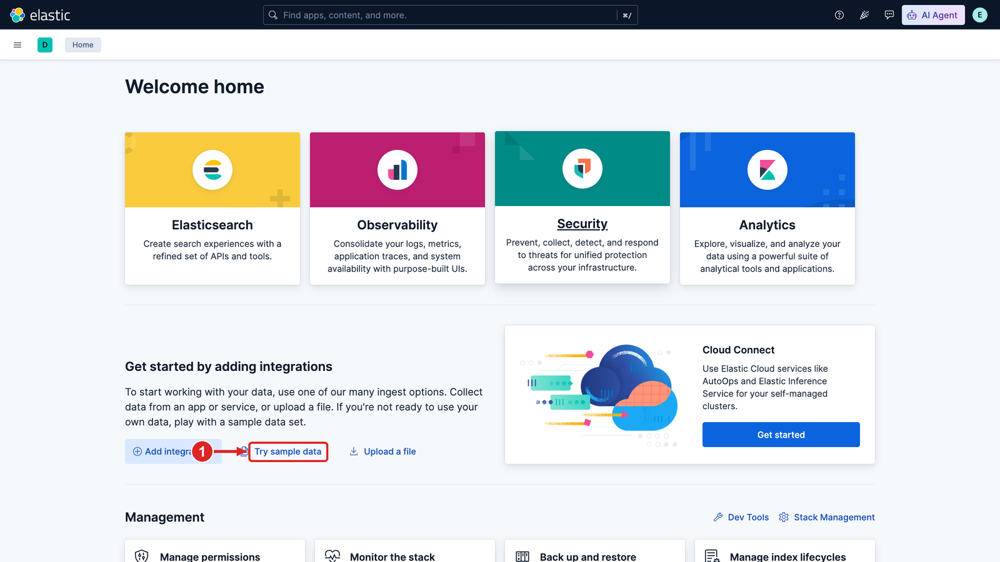
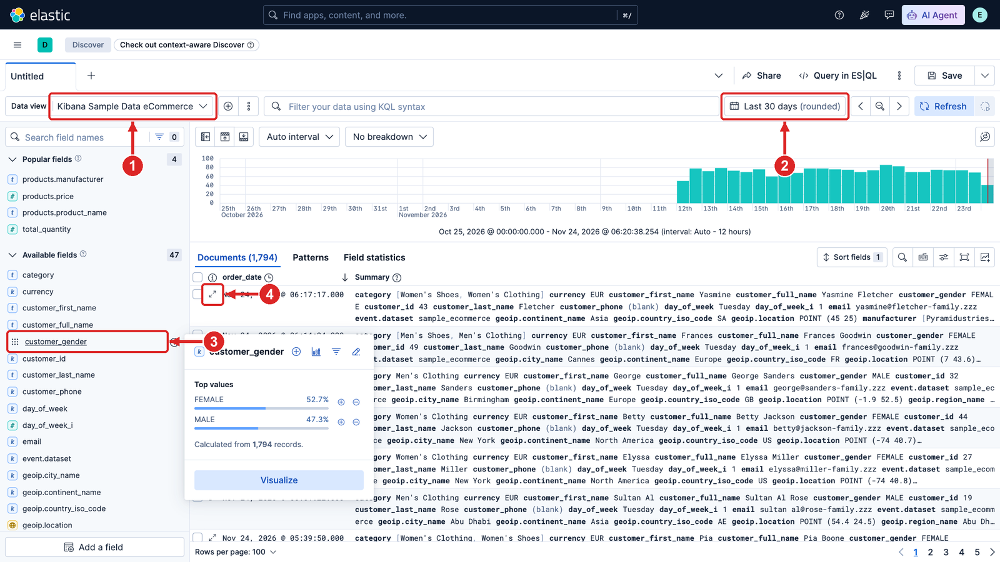
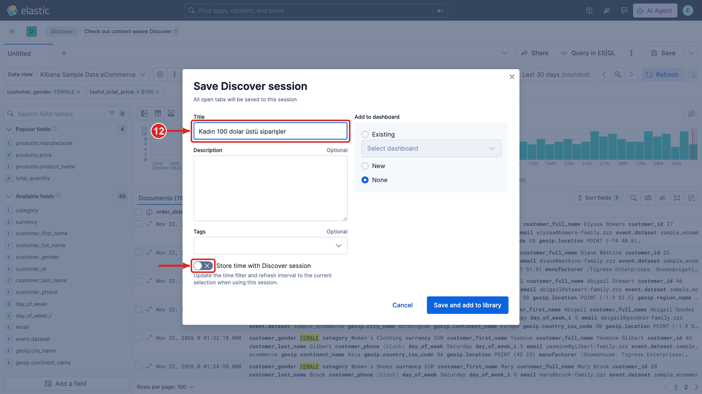
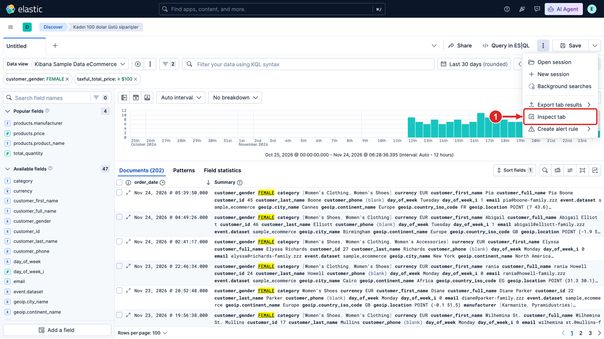

# LAB-04 — Discover ve KQL: Veriye Soru Sorarak Bakmak

| Kullanılan Araçlar | Açık / Kullanılan Portlar |
|---|---|
| Kibana Discover, KQL, filtreler, Inspect; Kibana örnek verisi (eCommerce) | 9200 (Elasticsearch), 5601 (Kibana) — LAB-01 ana cluster'ı |

---

## Bu lab ne öğretiyor?

Bir yöneticinin sorusu "son 30 günde 100 dolardan pahalı kadın müşteri siparişleri kaç?" gibidir. Discover
bu soruyu kod yazmadan cevaplar: doğru data view, doğru zaman aralığı ve tek satırlık bir KQL sorgusu.

Bu labda Kibana'nın örnek e-ticaret verisini yükleyecek, Discover'da gezinecek, soruları KQL'e çevirecek,
aynı koşulu tıklayarak filtreyle kuracak, aramayı kaydedecek ve Kibana'nın arkada Elasticsearch'e gönderdiği
Query DSL'i Inspect ile göreceğiz.


---

## Ön Koşullar

- Önce kurulu olmalı: LAB-01 ana cluster'ı; Kibana'ya `elastic` / `DevOps2026!` ile girilmiş bir tarayıcı.
- Önceki labı atladıysanız: LAB-01'in Adım 1-2'si yeterli; LAB-02'nin verisi bu labda kullanılmaz.

```bash
cd ~/elastic/labs/LAB-04-discover-kql
```

Kibana adresini sunucuda hesaplayın:

```bash
IP=$(curl -s https://api.ipify.org); H=$(hostname -s)
echo "Kibana: http://$IP:5601   https://$H-kibana.devopsatolyesi.com"
```

Beklenen çıktı:

```text
Kibana: http://<IP>:5601   https://<host>-kibana.devopsatolyesi.com
```

---

## Kavramlar: KQL

| Yazım | Anlamı | Örnek |
|---|---|---|
| `field : değer` | field bu değeri içerir | `customer_gender : "FEMALE"` |
| `field : "iki kelime"` | ifade bu sırayla geçer | `category : "Women's Clothing"` |
| `>`, `>=`, `<`, `<=` | sayı ve tarih aralığı | `taxful_total_price > 100` |
| `and`, `or`, `not`, `( )` | koşulları birleştirir | `day_of_week : (Saturday or Sunday)` |
| `*` | joker; `field : *` field'ı olanlar | `customer_first_name : Ed*` |

KQL yalnız süzer: sayma, gruplama ve sıralama Lens, aggregation ve ES|QL'in işidir. Discover
her sorguya zaman kutusunu da ekler: sonuç sayısı **sorgu + zaman aralığıdır**.

---

## Adım Adım Uygulama Rehberi

### 1. Örnek e-ticaret verisini ekleyin

Kibana ana sayfasında **Try sample data** (1) bağlantısına basın:



Açılan **Sample data** sekmesinde **Sample eCommerce orders** kartındaki **Install data** (2) düğmesine basın.
Kurulum bitince düğme **View data** olur:


Kibana `kibana_sample_data_ecommerce` index'ini, aynı adlı data view'ı ve hazır panoları kurar. Kaç sipariş
geldiğini ve hangi tarih aralığında olduğunu kontrol edin: `size=0` document getirmez, yalnız özet döner;
`track_total_hits` sayıyı tam verir; `min` / `max` en eski ve en yeni `order_date`'i bulur; `date +%F` bugünün
tarihidir:

```bash
curl -s -u elastic:'DevOps2026!' 'http://127.0.0.1:9200/kibana_sample_data_ecommerce/_search?size=0&filter_path=hits.total.value,aggregations' \
  -H 'Content-Type: application/json' -d '{"track_total_hits": true, "aggs": {"ilk": {"min": {"field": "order_date"}}, "son": {"max": {"field": "order_date"}}}}' \
  | jq -r '"siparis: \(.hits.total.value)  ilk: \(.aggregations.ilk.value_as_string[0:10])  son: \(.aggregations.son.value_as_string[0:10])"'
date +%F
```

Beklenen çıktı:

```text
siparis: 4675  ilk: 2026-11-12  son: 2026-12-12
2026-11-22
```

Kibana örnek veriyi 1 replica ile açar. Tek node'lu ana cluster'da replica'nın konacağı ikinci node yoktur, cluster
yellow kalır. Replica'yı 0'a çekin:

```bash
curl -s -u elastic:'DevOps2026!' -X PUT 'http://127.0.0.1:9200/kibana_sample_data_ecommerce/_settings' -H 'Content-Type: application/json' -d '{"index.number_of_replicas": 0}'; echo
curl -s -u elastic:'DevOps2026!' 'http://127.0.0.1:9200/_cluster/health/kibana_sample_data_ecommerce?wait_for_status=green&timeout=30s&filter_path=status'; echo
```

Beklenen çıktı:

```text
{"acknowledged":true}
{"status":"green"}
```

Örnek verinin tarihleri yükleme gününe göre kaydırılır. Bu koşuda veri 2026-11-22'de yüklendi: ilk sipariş 10
gün önce, son sipariş 20 gün sonra. Discover'da **Last 30 days** yalnız geçmiş kısmı gösterir (bu koşuda 4675'in
1497'si); sayılar yükleme gününe göre sizde farklıdır.

### 2. Discover'da gezinin

**Discover**'ı açın. **Data view** listesinden **Kibana Sample Data eCommerce**'i (1), zaman kutusundan
**Last 30 days**'i (4) seçin. Soldaki field listesinde (6) `customer_gender`'a tıklayın: en sık değerler ve
oranları görünür. Bir satırın başındaki genişletme düğmesi (10) document'in bütün field'larını açar:



Üstteki sayı, seçili zaman aralığındaki document sayısıdır; histogram da aynı document'leri güne göre
sayar.

### 3. Soruyu KQL'e çevirin

**Soru:** Son 30 günde 100 dolardan pahalı kadın müşteri siparişleri kaç?

**KQL:** arama çubuğuna (2) yazıp Enter'a basın:

```text
customer_gender : "FEMALE" and taxful_total_price > 100
```

**Ekranda:** **Documents** sekmesindeki sayı (8) cevaptır; histogram yalnız bu siparişleri gösterir:


Sorgunun parçaları: `customer_gender : "FEMALE"` bir `keyword` field'ında tam değer, `taxful_total_price > 100`
sayı aralığı, `and` ikisinin birlikte sağlanması. "Son 30 gün" sorguda değil zaman kutusundadır.

Aynı yöntemle birkaç soru daha (zaman aralığı yine **Last 30 days**):

| Soru | KQL | Document (bu koşuda) |
|---|---|---:|
| Ürün adında "jacket" geçen siparişler | `products.product_name : jacket` | 130 |
| Women's Shoes kategorisi (tam değer) | `category.keyword : "Women's Shoes"` | 377 |
| Tutarı 50 ile 100 dolar arası | `taxful_total_price >= 50 and taxful_total_price <= 100` | 676 |
| Adı "Ed" ile başlayan müşteriler | `customer_first_name.keyword : Ed*` | 23 |
| Hafta sonu siparişleri | `day_of_week : (Saturday or Sunday)` | 440 |
| Men's Clothing içermeyen siparişler | `not category.keyword : "Men's Clothing"` | 835 |

Ana sorgu bu koşuda **156** document buldu.

- Metin field'ı (`products.product_name`) kelimelere bölünmüştür; `jacket` adında "jacket" geçen ürünleri
  bulur. `keyword` field'ı (`category.keyword`) bölünmez; değer birebir yazılır.
- `not` field'ı hiç olmayan document'leri de getirir; sonucu bir document açarak doğrulayın.
- Joker (`Ed*`) küçük veride rahattır; büyük index'te baştaki joker (`*windows`) pahalıdır.

### 4. Aynı koşul, tıklayarak: filtre

Arama çubuğunu temizleyin. Filtre ekleme düğmesine (3) basın; **Field** `customer_gender`, **Operator** `is`,
**Value** `FEMALE` seçip **Add filter**'a basın. İkinci filtre: `taxful_total_price`, `is between`, alt sınır
`100`, üst sınır boş:


Filtreler çubuğun altında birer etiket olur. Document sayısını Adım 3'teki KQL sayısıyla karşılaştırın:

| Yol | Koşul | Document (bu koşuda) |
|---|---|---:|
| KQL (Adım 3) | `taxful_total_price > 100` | 156 |
| Filtre | `taxful_total_price: ≥ $100` | 168 |

Fark tutarı tam 100 olan siparişlerdir: **is between** alt sınırı dahil eder (`>= 100`), KQL'deki `> 100`
etmez. Etikete tıklayıp filtreyi geçici olarak kapatabilir (**Temporarily disable**) ya da tersine
çevirebilirsiniz (**Exclude results**):


### 5. Aramayı kaydedin

Sağ üstte **Save** düğmesine basın; açılan pencerede başlığa (12) `Kadın 100 dolar üstü siparişler` yazıp
**Save and add to library** ile kaydedin.
Kaydedilen arama (Discover session) data view'ı, sorguyu ve filtreleri tutar; **Open** ile yeniden açılır ve
panoya eklenebilir:



**Store time with Discover session** anahtarı varsayılan olarak kapalıdır: kayıtlı arama açıldığında o anki
zaman kutusu geçerlidir. Açarsanız seçili zaman aralığı da aramayla saklanır.

### 6. Arkada ne gidiyor? Inspect

Kibana KQL'i ve filtreleri Elasticsearch'e Query DSL olarak gönderir. Görmek için sağ üstteki **⋮**
menüsünden **Inspect tab** (13):



Açılan **Inspector**'da **Request** (14) sekmesi gönderilen isteği (15) gösterir:


Filtreler bir `bool` sorgusunun `filter` bölümüne dönüşmüştür: zaman kutusu `order_date` üzerinde bir `range`,
`customer_gender` filtresi bir `match_phrase` (kelimeleri yazıldığı sırayla arar), fiyat filtresi bir `range`
(`gte: 100`: 100 ve üstü).

<details>
<summary><strong>Alıştırma: soru → KQL</strong></summary>

Data view **Kibana Sample Data eCommerce**, zaman **Last 30 days**. Önce kendiniz yazın, sonra cevapla
karşılaştırın; sayıyı ve en az bir document'i kontrol edin.

| # | Soru | KQL | Ne kontrol edilir? |
|---:|---|---|---|
| 1 | Men's Clothing kategorisindeki siparişler | `category : "Men's Clothing"` | İfade araması; sayı |
| 2 | Toplamı 100-200 arası siparişler | `taxful_total_price >= 100 and taxful_total_price <= 200` | Sınırlar dahil |
| 3 | Üç ve daha çok ürünlü siparişler | `total_quantity >= 3` | Sayı field'ı |
| 4 | E-postası olan siparişler | `email : *` | Field varlığı |
| 5 | Men's Clothing ya da Men's Shoes | `category : ("Men's Clothing" or "Men's Shoes")` | Aynı field'da `or` |
| 6 | Men's Clothing ve en az üç ürün | `category : "Men's Clothing" and total_quantity >= 3` | `and` |
| 7 | Women's Clothing olmayan siparişler | `not category : "Women's Clothing"` | `not` |
| 8 | Hafta sonu verilen, 50 doların altındaki siparişler | `day_of_week : (Saturday or Sunday) and taxful_total_price < 50` | Parantez ve aralık |

</details>

---

## Temizlik

Yalnız bu labın kayıtlı aramasını (**Kadın 100 dolar üstü siparişler**) siler. Örnek e-ticaret verisi
sonraki lablarda kullanılır, silinmez:

```bash
./teardown.sh
```

Beklenen çıktı:

```text
kayitli arama (Kadın 100 dolar üstü siparişler) -> 1
```

Labı aynı sunucuda yeniden yapacaksanız başlamadan önce `./teardown.sh` çalıştırın; README'deki sayılar temiz
başlangıca göredir.

---

Sonraki lab: **[LAB-05 — Query DSL: Elasticsearch'e Doğrudan Soru Sormak](../LAB-05-query-dsl/README.md)**
