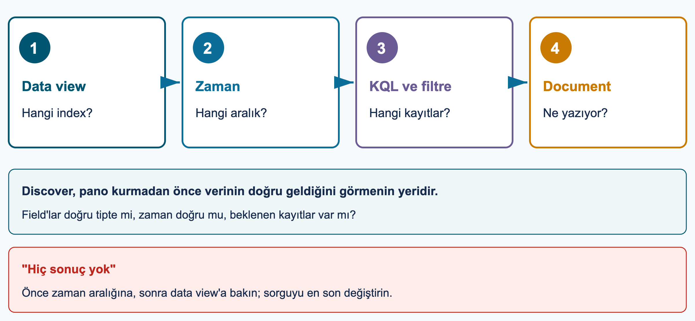
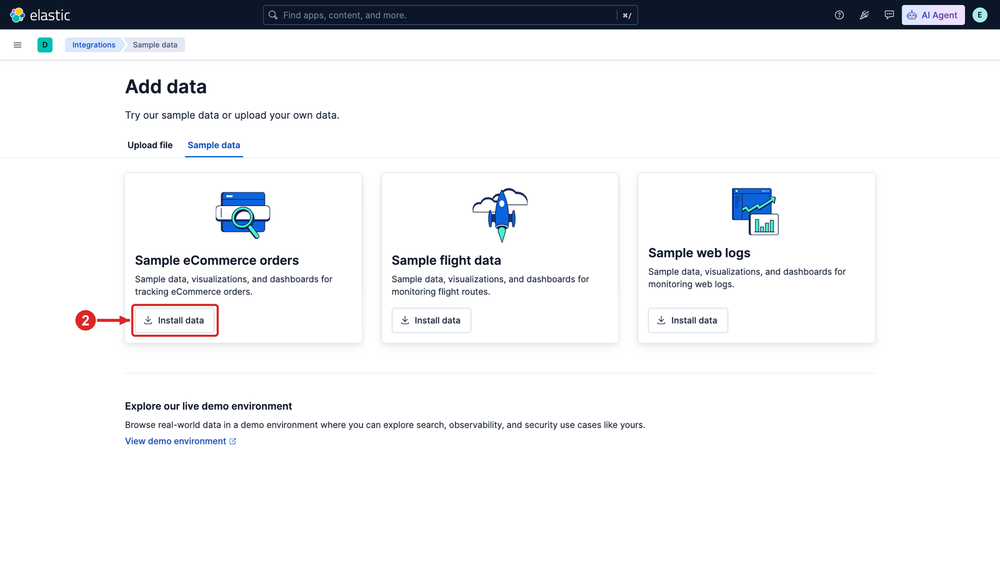
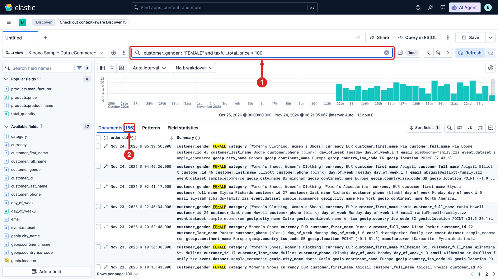
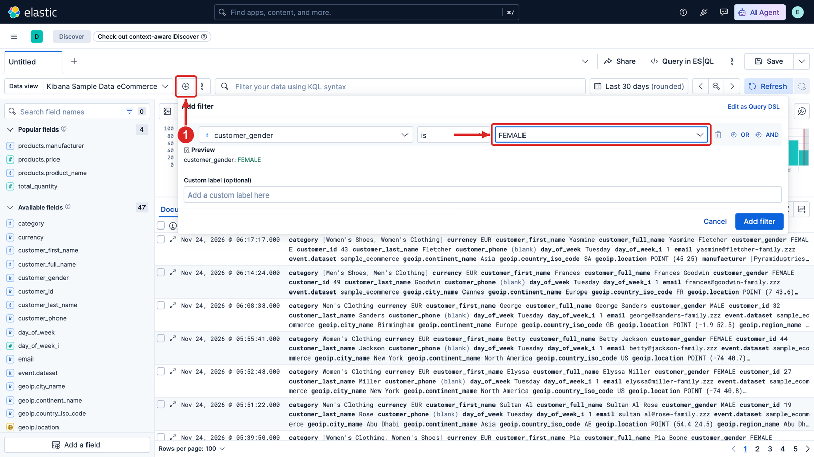
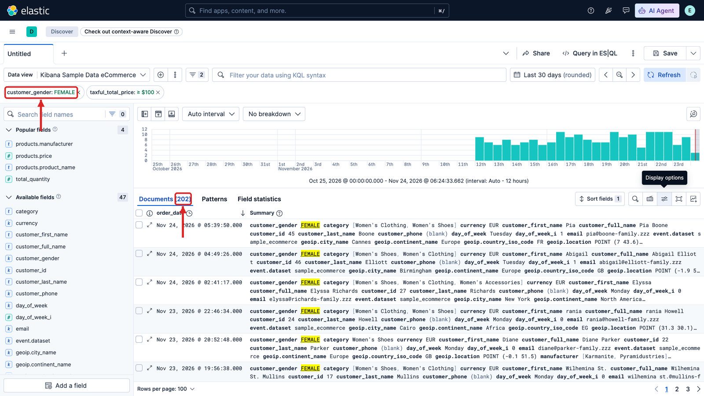
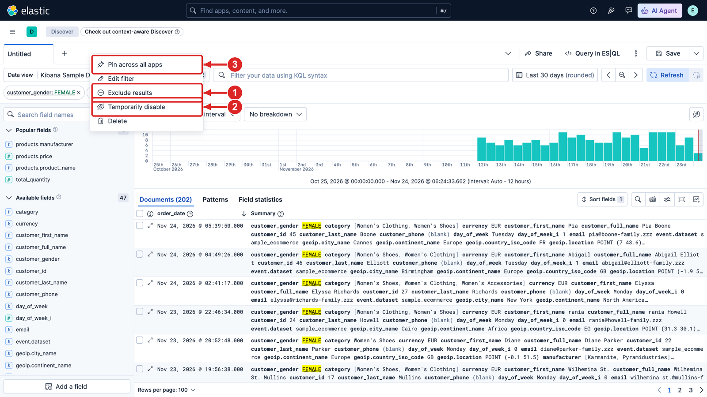
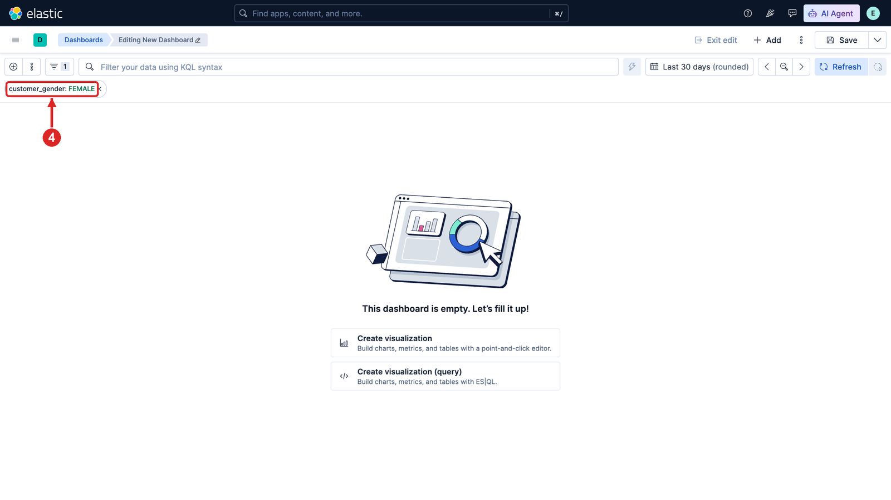
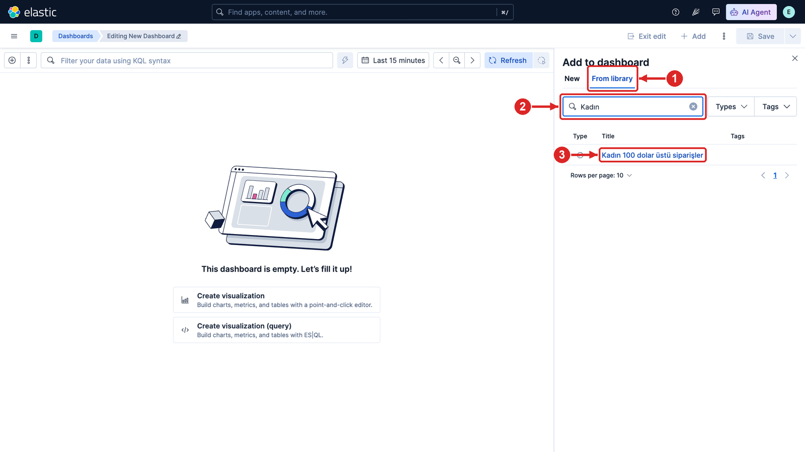
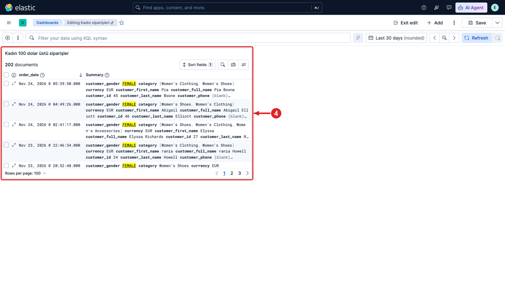
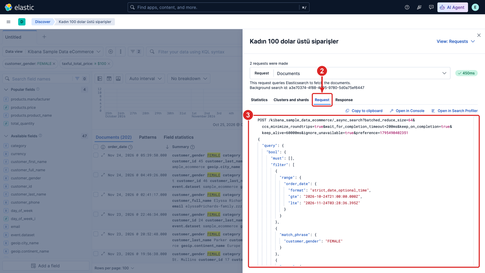

# LAB-04 — Discover ve KQL: Veriye Soru Sorarak Bakmak

| Kullanılan Araçlar | Açık / Kullanılan Portlar |
|---|---|
| Kibana Discover, KQL, filtreler, Inspect; Kibana örnek verisi (eCommerce) | 9200 (Elasticsearch), 5601 (Kibana) — LAB-01 ana cluster'ı |

---

## Bu lab ne öğretiyor?

- Kibana'nın örnek e-ticaret verisini yüklemek
- Discover'da gezinmek: data view, zaman aralığı, field listesi
- Soruyu KQL'e çevirmek; aynı koşulu filtreyle kurmak
- Aramayı kaydetmek; arkada giden Query DSL'i Inspect ile görmek



---

## Ön Koşullar

- Önce kurulu olmalı: LAB-01 ana cluster'ı; Kibana'ya `elastic` / `DevOps2026!` ile girilmiş bir tarayıcı.
- Önceki labı atladıysanız: LAB-01'in Adım 1-2'si yeterli; LAB-02'nin verisi bu labda kullanılmaz.

```bash
cd ~/elastic/labs/LAB-04-discover-kql
```

Kibana adresini sunucuda hesaplayın:

```bash
IP=$(curl -s https://api.ipify.org); H=$(hostname -s)
echo "Kibana: http://$IP:5601   https://$H-kibana.devopsatolyesi.com"
```

Beklenen çıktı:

```text
Kibana: http://<IP>:5601   https://<host>-kibana.devopsatolyesi.com
```

---

## Kavramlar

- **KQL (Kibana Query Language):** Discover'daki arama çubuğuna yazılan dil. Hangi document'lerin listeleneceğini
  seçer. Saymak, toplamak, gruplamak (örneğin "kategori başına sipariş sayısı") KQL'in işi değildir; bunlar için
  Lens, aggregation ya da ES|QL kullanılır.
- **`field : değer`:** field'da bu değer geçen document'ler: `customer_gender : "FEMALE"`. Tırnak içinde birden çok
  kelime varsa kelimeler yan yana ve bu sırayla aranır: `category : "Women's Clothing"`.
- **`>`, `>=`, `<`, `<=`:** sayı ve tarih aralığı: `taxful_total_price > 100` (100 dolardan pahalı siparişler).
- **`and`, `or`, `not`, `( )`:** koşulları birleştirir: `day_of_week : (Saturday or Sunday)` (cumartesi ya da pazar).
- **`*` (joker):** `customer_first_name : Ed*` adı "Ed" ile başlayanlar; `email : *` email field'ı dolu olanlar.

---

## Adım Adım Uygulama Rehberi

### 1. Örnek e-ticaret verisini ekleyin

**Soru: Discover'ı hangi veriyle deneyeceğiz?** Kibana'nın hazır örnek e-ticaret verisiyle: binlerce sipariş,
tarihleri bugüne göre kaydırılmış.

1. Kibana ana sayfasında **Try sample data** (1):


2. **Sample eCommerce orders** kartında **Install data** (2). Kurulum bitince düğme **View data** olur:



Kibana `kibana_sample_data_ecommerce` index'ini, aynı adlı data view'ı ve hazır panoları kurar.

**Kaç sipariş geldi, hangi tarihler?**

- **`size=0`:** document getirmez, yalnız özet döner
- **`track_total_hits`:** sayıyı tam verir
- **`min` / `max`:** en eski ve en yeni `order_date`; `date +%F` bugünün tarihi

```bash
curl -s -u elastic:'DevOps2026!' 'http://127.0.0.1:9200/kibana_sample_data_ecommerce/_search?size=0&filter_path=hits.total.value,aggregations' \
  -H 'Content-Type: application/json' -d '{"track_total_hits": true, "aggs": {"ilk": {"min": {"field": "order_date"}}, "son": {"max": {"field": "order_date"}}}}' \
  | jq -r '"siparis: \(.hits.total.value)  ilk: \(.aggregations.ilk.value_as_string[0:10])  son: \(.aggregations.son.value_as_string[0:10])"'
date +%F
```

Beklenen çıktı:

```text
siparis: 4675  ilk: 2026-11-12  son: 2026-12-12
2026-11-23
```

**Replica'yı 0'a çekin.** Kibana örnek veriyi 1 replica ile açar; tek node'da replica'yı koyacak yer yok, cluster
yellow kalır:

```bash
curl -s -u elastic:'DevOps2026!' -X PUT 'http://127.0.0.1:9200/kibana_sample_data_ecommerce/_settings' -H 'Content-Type: application/json' -d '{"index.number_of_replicas": 0}'; echo
curl -s -u elastic:'DevOps2026!' 'http://127.0.0.1:9200/_cluster/health/kibana_sample_data_ecommerce?wait_for_status=green&timeout=30s&filter_path=status'; echo
```

Beklenen çıktı:

```text
{"acknowledged":true}
{"status":"green"}
```

**Tarihler kaydırılır:** veri yükleme gününe göre 10 gün geriye, 20 gün ileriye yayılır. **Last 30 days** yalnız
geçmiş kısmı gösterir (bu koşuda 4675'in 1794'ü); sayılar sizde farklıdır.

### 2. Discover'da gezinin

**Soru: Discover ekranında nereye bakarız?**

1. **Discover**'ı açın; **Data view**: **Kibana Sample Data eCommerce** (1)
2. Zaman kutusu: **Last 30 days** (2)
3. Field listesinde (3) `customer_gender`'a tıklayın: en sık değerler ve oranları görünür
4. Bir satırın başındaki genişletme simgesi (4) document'in bütün field'larını açar
5. **Field statistics** sekmesi: sorgu yazmadan her field'ın değer dağılımını gösterir


Üstteki sayı seçili zaman aralığındaki document sayısıdır; histogram aynı document'leri güne göre sayar.

### 3. Soruyu KQL'e çevirin

**Soru:** Son 30 günde 100 dolardan pahalı kadın müşteri siparişleri kaç?

**KQL:** arama çubuğuna (1) yazıp Enter'a basın:

```text
customer_gender : "FEMALE" and taxful_total_price > 100
```

**Ekranda:** **Documents** sekmesindeki sayı (2) cevaptır; histogram yalnız bu siparişleri gösterir:



- **`customer_gender : "FEMALE"`:** `keyword` field'ında tam değer
- **`taxful_total_price > 100`:** sayı aralığı; **`and`** ikisi birlikte
- **"Son 30 gün"** sorguda değil, zaman kutusunda

Aynı yöntemle birkaç soru daha (zaman aralığı yine **Last 30 days**):

| Soru | KQL | Document (bu koşuda) |
|---|---|---:|
| Ürün adında "jacket" geçen siparişler | `products.product_name : jacket` | 150 |
| Women's Shoes kategorisi (tam değer) | `category.keyword : "Women's Shoes"` | 438 |
| Tutarı 50 ile 100 dolar arası | `taxful_total_price >= 50 and taxful_total_price <= 100` | 794 |
| Adı "Ed" ile başlayan müşteriler | `customer_first_name.keyword : Ed*` | 25 |
| Hafta sonu siparişleri | `day_of_week : (Saturday or Sunday)` | 575 |
| Men's Clothing içermeyen siparişler | `not category.keyword : "Men's Clothing"` | 975 |

Ana sorgu bu koşuda **186** document buldu.

- **Metin field'ı** (`products.product_name`) kelimelere bölünür; `jacket` adında geçen ürünleri bulur.
  **`keyword` field'ı** (`category.keyword`) bölünmez; değer birebir yazılır.
- **`not`** field'ı hiç olmayan document'leri de getirir; bir document açarak doğrulayın.
- **Joker** (`Ed*`) küçük veride rahattır; baştaki joker (`*windows`) büyük index'te pahalıdır.

### 4. Aynı koşul, tıklayarak: filtre

**Soru: Aynı koşulu yazmadan, tıklayarak kurabilir miyiz?**

1. Arama çubuğunu temizleyin
2. Filtre ekleme simgesi (1): **Field** `customer_gender`, **Operator** `is`, **Value** `FEMALE`, **Add filter**
3. İkinci filtre: `taxful_total_price`, `is between`, alt sınır `100`, üst sınır boş



Filtreler çubuğun altında birer etiket olur. Document sayısını Adım 3'teki KQL sayısıyla karşılaştırın:

| Yol | Koşul | Document (bu koşuda) |
|---|---|---:|
| KQL (Adım 3) | `taxful_total_price > 100` | 186 |
| Filtre | `taxful_total_price: ≥ $100` | 202 |

- **Fark neden?** Tutarı tam 100 olan siparişler: **is between** alt sınırı dahil eder (`>= 100`), KQL'deki `> 100` etmez.



**Etiket menüsü.** Filtreyi silmeden değiştirmek için `customer_gender: FEMALE` etiketine tıklayın; bir menü açılır:



| Menü | Ne olur | Document (bu koşuda) | Geri almak |
|---|---|---:|---|
| **Exclude results** (1) | Koşul tersine döner, etiket `NOT customer_gender: FEMALE` olur | 167 | **Include results** |
| **Temporarily disable** (2) | Etiket üstü çizili kalır, yalnız tutar filtresi çalışır | 369 | **Re-enable** |
| **Pin across all apps** (3) | Filtre başka uygulamalarda da durur | 202 | **Unpin** |

- **Sayıların toplamı:** kadın 202 + kadın olmayan 167 = 369, yani cinsiyet filtresi kapalıyken gelen sayı.
- **Pin'i deneyin:** sol menüden **Dashboards › Create dashboard**. Pinli filtre yeni panonun üstünde de durur (4).
  Adres çubuğuna yeni adres yazarak giderseniz pin taşınmaz; sol menüden geçin. Sonra Discover'a dönüp (tarayıcının
  geri düğmesi) **Unpin** deyin; filtre yeniden yalnız bu aramanın olur.



### 5. Aramayı kaydedin

**Soru: Bu aramayı yarın yeniden nasıl açarız?** Kaydederek.

1. Sağ üstte **Save**
2. Başlık (1): `Kadın 100 dolar üstü siparişler`
3. **Save and add to library**

Kaydedilen arama (Discover session) data view'ı, sorguyu ve filtreleri tutar; **Open** ile açılır, panoya eklenebilir:


**Store time with Discover session** varsayılan olarak kapalıdır: kayıtlı arama açılınca o anki zaman kutusu geçerlidir.
Açarsanız zaman aralığı da aramayla saklanır.


<details>
<summary><strong>Kayıtlı aramayı panoya eklemek</strong></summary>

Kayıtlı arama bir pano paneli olabilir: panoda document listesi olarak görünür ve panonun zaman seçicisine uyar.

1. **Dashboards › Create dashboard**, sonra **Add › From library** (1)
2. Arama kutusuna (2) `Kadın` yazın; **Kadın 100 dolar üstü siparişler**'e (3) tıklayın; panel eklenir, pencereyi kapatın:



3. Zaman aralığı **Last 30 days**; sağ üstten **Save**, başlık `Kadın siparişleri`, **Save**. Panel (4) aramanın KQL'i ve iki
   filtresiyle gelir:



- **Bağlı panel:** arama değişirse (Discover'da yeniden **Save**) panodaki panel de değişir.
- **Sayma ve grafik:** kayıtlı arama liste verir; "kaç tane" ve grafik için Lens panelleri kullanılır.

</details>

### 6. Arkada ne gidiyor? Inspect

**Soru: Kibana Elasticsearch'e ne gönderiyor?** KQL ve filtreler Query DSL'e çevrilir.

1. Sağ üstteki **⋮** menüsü → **Inspect tab** (1)


2. **Inspector**'da **Request** (2): gönderilen istek (3)



Filtreler bir `bool` sorgusunun `filter` bölümüne dönüştü:

- **Zaman kutusu:** `order_date` üzerinde `range`
- **`customer_gender`:** `match_phrase` (kelimeleri yazıldığı sırayla arar)
- **Fiyat:** `range` (`gte: 100`: 100 ve üstü)

<details>
<summary><strong>Alıştırma: soru → KQL</strong></summary>

Data view **Kibana Sample Data eCommerce**, zaman **Last 30 days**. Önce kendiniz yazın, sonra cevapla
karşılaştırın; sayıyı ve en az bir document'i kontrol edin.

| # | Soru | KQL | Ne kontrol edilir? |
|---:|---|---|---|
| 1 | Men's Clothing kategorisindeki siparişler | `category : "Men's Clothing"` | İfade araması; sayı |
| 2 | Toplamı 100-200 arası siparişler | `taxful_total_price >= 100 and taxful_total_price <= 200` | Sınırlar dahil |
| 3 | Üç ve daha çok ürünlü siparişler | `total_quantity >= 3` | Sayı field'ı |
| 4 | E-postası olan siparişler | `email : *` | Field varlığı |
| 5 | Men's Clothing ya da Men's Shoes | `category : ("Men's Clothing" or "Men's Shoes")` | Aynı field'da `or` |
| 6 | Men's Clothing ve en az üç ürün | `category : "Men's Clothing" and total_quantity >= 3` | `and` |
| 7 | Women's Clothing olmayan siparişler | `not category : "Women's Clothing"` | `not` |
| 8 | Hafta sonu verilen, 50 doların altındaki siparişler | `day_of_week : (Saturday or Sunday) and taxful_total_price < 50` | Parantez ve aralık |

</details>

---

## Temizlik

Yalnız bu labın kayıtlı aramasını (**Kadın 100 dolar üstü siparişler**) ve kutudaki **Kadın siparişleri** panosunu siler. Örnek e-ticaret verisi
sonraki lablarda kullanılır, silinmez:

```bash
./teardown.sh
```

Beklenen çıktı:

```text
pano (Kadın siparişleri) -> 1
kayitli arama (Kadın 100 dolar üstü siparişler) -> 1
```

Kutuyu yapmadıysanız pano satırında `0` yazar.

Labı aynı sunucuda yeniden yapacaksanız başlamadan önce `./teardown.sh` çalıştırın; README'deki sayılar temiz
başlangıca göredir.

---

Sonraki lab: **[LAB-05 — Query DSL: Elasticsearch'e Doğrudan Soru Sormak](../LAB-05-query-dsl/README.md)**
