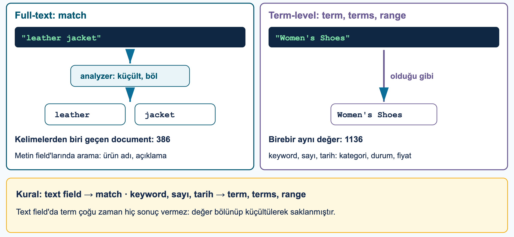

# LAB-05 — Query DSL: Elasticsearch'e Doğrudan Soru Sormak

| Kullanılan Araçlar | Açık / Kullanılan Portlar |
|---|---|
| Kibana Dev Tools (Query DSL), curl, jq | 9200 (Elasticsearch), 5601 (Kibana) — LAB-01 ana cluster'ı |

---

## Bu lab ne öğretiyor?

Discover'daki KQL sorgusu Elasticsearch'e Query DSL olarak gider (Discover'da **Inspect** ile görülebilir).
Uygulamalar, betikler ve panolar da Elasticsearch'le bu dille konuşur. Bu labda aynı e-ticaret verisinde
tam değer ve metin aramasını ayıracak, koşulları `bool` ile birleştirecek, sonuçları sıralayıp
sayfalayacak ve sonuçların neden o sırada geldiğini (skor) göreceğiz. Lab bir soruyla biter: aynı isim
neden bir sorguda bulunur, ötekinde bulunmaz?



---

## Ön Koşullar

- Önce kurulu olmalı: LAB-01 ana cluster'ı ve LAB-04'teki örnek e-ticaret verisi (`kibana_sample_data_ecommerce`, 4675 sipariş).
- Önceki labı atladıysanız: LAB-04'ün Adım 1'ini yapın (örnek veriyi ekler).

```bash
cd ~/elastic/labs/LAB-05-query-dsl
```


---

## Kavramlar: iki tür sorgu

| Tür | Sorgular | Aranan değere ne olur? | Ne için |
|---|---|---|---|
| Term-level | `term`, `terms`, `range`, `exists` | Olduğu gibi aranır | Tam değer: kategori, durum, tarih, sayı |
| Full-text | `match`, `match_phrase` | Field'ın analyzer'ından geçer (küçük harf, kelimelere bölme) | Metin içinde arama: ürün adı, açıklama |

Sorgu iki yerde durabilir: `must` (eşleşmeli ve skora katılır) ya da `filter` (eşleşmeli ama skora
katılmaz). Skor gerekmiyorsa `filter` kullanılır: skor hesaplanmadığı için daha hızlıdır ve sonucu
önbelleğe alınır.

---

## Adım Adım Uygulama Rehberi

Bu labda `http` bloklarını Kibana › Dev Tools'a, `bash` bloklarını terminale yapıştırın.

### 1. Bir arama isteği ve yanıtı

En pahalı iki sipariş; yalnız üç field:

```http
GET /kibana_sample_data_ecommerce/_search?filter_path=took,hits.total.value,hits.hits._score,hits.hits._source
{
  "size": 2,
  "_source": ["customer_full_name", "category", "taxful_total_price"],
  "sort": [ { "taxful_total_price": "desc" } ],
  "query": { "match_all": {} }
}
```

```json
{
  "took": 23,
  "hits": {
    "total": {
      "value": 4675
    },
    "hits": [
      {
        "_score": null,
        "_source": {
          "category": [
            "Men's Clothing"
          ],
          "customer_full_name": "Wagdi Shaw",
          "taxful_total_price": 2249.92
        }
      },
      {
        "_score": null,
        "_source": {
          "category": [
            "Men's Clothing",
            "Men's Shoes",
            "Men's Accessories"
          ],
          "customer_full_name": "Sultan Al Bryan",
          "taxful_total_price": 392.96
        }
      }
    ]
  }
}
```

- `took`: milisaniye. `hits.total.value`: koşula uyan document sayısı (`match_all`: hepsi). `size` yalnız
  kaçının döneceğini sınırlar.
- `hits.hits`: dönen document'ler; `_source` istenen field'lar. `sort` verilince `_score` hesaplanmaz
  (`null`).
- Yalnız sayı gerekiyorsa `_count` kullanılır; sonraki adımlar böyle sayar.

### 2. Tam değer: `term`, `terms`, `range`, `exists`

Dört sorgu da değeri olduğu gibi arar ve `_count` ile yalnız eşleşen document sayısını döndürür; her birinin ne
yaptığı blokların altında:

```http
GET /kibana_sample_data_ecommerce/_count?filter_path=count
{ "query": { "term": { "category.keyword": "Women's Shoes" } } }
```

```json
{"count":1136}
```

`terms`: değerlerden biri (hafta sonu günleri):

```http
GET /kibana_sample_data_ecommerce/_count?filter_path=count
{ "query": { "terms": { "day_of_week": ["Saturday", "Sunday"] } } }
```

```json
{"count":1350}
```

`range`: tutarı 50 ile 100 dolar arası:

```http
GET /kibana_sample_data_ecommerce/_count?filter_path=count
{ "query": { "range": { "taxful_total_price": { "gte": 50, "lte": 100 } } } }
```

```json
{"count":2092}
```

`exists`: doğum tarihi field'ı olan siparişler:

```http
GET /kibana_sample_data_ecommerce/_count?filter_path=count
{ "query": { "exists": { "field": "customer_birth_date" } } }
```

```json
{"count":0}
```

- `term`: tek tam değer. `category.keyword` kategorinin bölünmemiş hâlidir; büyük-küçük harf ve kesme
  işareti dahil birebir yazılır.
- `terms`: değerlerden biri (SQL'deki `IN`).
- `range`: `gt`, `gte`, `lt`, `lte`. Tarihte de çalışır: `"order_date": { "gte": "now-7d" }`.
- `exists`: field'ı olan document'ler. `customer_birth_date` bu veride hiç dolu değildir; `0` "field yok"
  demektir, sorgu hatası değil.

<details>
<summary><strong>Ön ek ile tam değer: <code>prefix</code></strong></summary>

`prefix` bir `keyword` değerinin başını arar; KQL'deki `Ed*` ile aynı iştir ve o da analyzer'dan geçmez:

```http
GET /kibana_sample_data_ecommerce/_count?filter_path=count
{ "query": { "prefix": { "customer_first_name.keyword": "Ed" } } }
```

```json
{"count":100}
```

Bu veride "Ed" ile başlayan tek ad "Eddie"dir. Harfe duyarlıdır: `"ed"` yazsaydınız sonuç 0 olurdu, çünkü
`keyword` değeri harfi harfine saklar.

</details>

### 3. Metin: `match`, `operator`, `match_phrase`

Ürün adında "leather jacket" geçen siparişler. `match` aranan metni de analyzer'dan geçirir ve kelimelerden
**herhangi biri** geçen document'i bulur:

```http
GET /kibana_sample_data_ecommerce/_count?filter_path=count
{ "query": { "match": { "products.product_name": "leather jacket" } } }
```

```json
{"count":386}
```

İki kelime birlikte geçsin (`operator: and`) ya da yan yana ve bu sırayla geçsin (`match_phrase`):

```http
GET /kibana_sample_data_ecommerce/_count?filter_path=count
{ "query": { "match": { "products.product_name": { "query": "leather jacket", "operator": "and" } } } }
```

```json
{"count":30}
```

Kelimeler yan yana ve bu sırayla (`match_phrase`):

```http
GET /kibana_sample_data_ecommerce/_count?filter_path=count
{ "query": { "match_phrase": { "products.product_name": "leather jacket" } } }
```

```json
{"count":30}
```

`and` ile `match_phrase` burada aynı sayıyı verir, çünkü bu veride iki kelime hep yan yana geçer. "jacket
leather" yazsaydınız `and` yine bulur, `match_phrase` bulmazdı.

<details>
<summary><strong>İfade aramasında esneklik: <code>slop</code> ve <code>match_phrase_prefix</code></strong></summary>

Ürün adları "Bomber Jacket - black" biçimindedir: renk sonda. Kullanıcı "black jacket" yazarsa ifade araması
kelimeleri bu sırayla bulamaz:

```http
GET /kibana_sample_data_ecommerce/_count?filter_path=count
{ "query": { "match_phrase": { "products.product_name": "black jacket" } } }
```

```json
{"count":0}
```

`slop`, kelimelerin yerinden kaç adım oynayabileceğidir. İki kelimenin sırasını değiştirmek 2 adımdır:

```http
GET /kibana_sample_data_ecommerce/_count?filter_path=count
{ "query": { "match_phrase": { "products.product_name": { "query": "black jacket", "slop": 2 } } } }
```

```json
{"count":120}
```

Arama kutusunda kullanıcı yazmayı bitirmeden de ifade aranabilir. `match_phrase_prefix` son kelimeyi ön ek sayar
("jac" → "jacket"); `match_phrase` ise "jac" diye bir kelime arar:

```http
GET /kibana_sample_data_ecommerce/_count?filter_path=count
{ "query": { "match_phrase_prefix": { "products.product_name": "leather jac" } } }
```

```json
{"count":30}
```

```http
GET /kibana_sample_data_ecommerce/_count?filter_path=count
{ "query": { "match_phrase": { "products.product_name": "leather jac" } } }
```

```json
{"count":0}
```

</details>

### 4. Koşulları birleştirmek: `bool`

`bool` dört bölümden oluşur. Ceket arayan kadın müşterilerin pazar dışındaki siparişleri; hafta içi
olanlar öne çıksın:

```http
GET /kibana_sample_data_ecommerce/_search?filter_path=hits.total.value,hits.hits._score,hits.hits._source
{
  "size": 3,
  "_source": ["customer_full_name", "day_of_week", "taxful_total_price"],
  "query": {
    "bool": {
      "must":     [ { "match": { "products.product_name": "jacket" } } ],
      "filter":   [ { "term":  { "customer_gender": "FEMALE" } } ],
      "must_not": [ { "term":  { "day_of_week": "Sunday" } } ],
      "should":   [ { "terms": { "day_of_week": ["Monday", "Tuesday", "Wednesday"] } } ]
    }
  }
}
```

```json
{"hits": {
  "total": {"value": 70},
  "hits": [
    {"_score": 4.0605783, "_source": {"customer_full_name": "Elyssa Hubbard", "day_of_week": "Wednesday", "taxful_total_price": 32.99}},
    {"_score": 3.8639812, "_source": {"customer_full_name": "Mary Richards", "day_of_week": "Monday", "taxful_total_price": 73.98}},
    {"_score": 3.8639812, "_source": {"customer_full_name": "Wilhemina St. Massey", "day_of_week": "Tuesday", "taxful_total_price": 55.98}}
  ]
}}
```

`should` olmadan aynı sorgu da 70 document bulur, ama ilk üç sırası farklıdır:

| | `should` yok | `should` var (Pazartesi-Çarşamba) |
|---|---|---|
| `hits.total.value` | 70 | 70 |
| 1 | Betty Brady, Friday (3.47) | Elyssa Hubbard, Wednesday (4.06) |
| 2 | Elyssa Hubbard, Wednesday (3.06) | Mary Richards, Monday (3.86) |
| 3 | Mary Richards, Monday (2.86) | Wilhemina St. Massey, Tuesday (3.86) |

- `must`: eşleşmeli ve skoru belirler. `filter`: eşleşmeli, skoru değiştirmez. `must_not`: eşleşmemeli.
- `should`: `must` varken eşleşirse yalnız skoru artırır; bu yüzden ilk sonuçlar Pazartesi-Çarşamba.
- `must` yoksa `should` koşullarından en az biri eşleşmelidir. Kaçının eşleşeceğini
  `minimum_should_match` belirler:

```http
GET /kibana_sample_data_ecommerce/_count?filter_path=count
{
  "query": {
    "bool": {
      "should": [
        { "term":  { "customer_gender": "FEMALE" } },
        { "range": { "taxful_total_price": { "gt": 100 } } },
        { "term":  { "day_of_week": "Saturday" } }
      ],
      "minimum_should_match": 2
    }
  }
}
```

```json
{"count":834}
```

Üç koşuldan en az ikisini sağlayan siparişler. `minimum_should_match: 1` olsaydı herhangi biri yeterdi.

### 5. Sıralama ve sayfalama

Sonuçları tutara göre sıralayıp beşerli sayfalar hâlinde alın. İkinci sayfa (`from: 5`):

```http
GET /kibana_sample_data_ecommerce/_search?filter_path=hits.hits._source
{
  "from": 5,
  "size": 5,
  "_source": ["order_id", "taxful_total_price"],
  "sort": [ { "taxful_total_price": "desc" }, { "order_id": "asc" } ],
  "query": { "term": { "customer_gender": "FEMALE" } }
}
```

```json
{"hits": {
  "hits": [
    {"_source": {"order_id": 727629, "taxful_total_price": 249.96}},
    {"_source": {"order_id": 728363, "taxful_total_price": 242.96}},
    {"_source": {"order_id": 729864, "taxful_total_price": 242.96}},
    {"_source": {"order_id": 723558, "taxful_total_price": 241.96}},
    {"_source": {"order_id": 733089, "taxful_total_price": 233.96}}
  ]
}}
```

- `from` atlanacak, `size` döndürülecek document sayısıdır. Sayfa 3: `from: 10`.
- İkinci `sort` anahtarı (`order_id`) eşit tutarlı siparişlerin sırasını sabitler; yoksa sayfa sınırında
  aynı document iki sayfada görünebilir.
- `from + size` varsayılan olarak 10.000'i geçemez. Derin sayfalamada `search_after` kullanılır: sonraki sayfa,
  önceki sayfanın son document'inin `sort` değerinden başlar.

### 6. Sonuçlar neden bu sırada? Skor

Skoru küçük bir örnekte görelim. Dört ürün başlığı yükleyin:

```bash
curl -s -u elastic:'DevOps2026!' -X PUT 'http://127.0.0.1:9200/arama-skor' -H 'Content-Type: application/json' \
  -d '{"settings": {"number_of_shards": 1, "number_of_replicas": 0}, "mappings": {"properties": {"baslik": {"type": "text"}}}}'; echo
printf '%s\n' \
  '{"index":{"_id":"1"}}' '{"baslik":"Kablosuz Kulaklık"}' \
  '{"index":{"_id":"2"}}' '{"baslik":"Kablosuz Kulaklık ve Şarj Kutusu Seti"}' \
  '{"index":{"_id":"3"}}' '{"baslik":"Kablolu Kulaklık"}' \
  '{"index":{"_id":"4"}}' '{"baslik":"Kablosuz Mouse"}' \
| curl -s -u elastic:'DevOps2026!' -X POST 'http://127.0.0.1:9200/arama-skor/_bulk?refresh=true&filter_path=errors' \
  -H 'Content-Type: application/x-ndjson' --data-binary @-; echo
```

Beklenen çıktı:

```text
{"acknowledged":true,"shards_acknowledged":true,"index":"arama-skor"}
{"errors":false}
```

İki arama yapın:

```bash
for q in "kablosuz kulaklık" "kulaklık seti"; do
  echo "== $q"
  curl -s -u elastic:'DevOps2026!' -H 'Content-Type: application/json' 'http://127.0.0.1:9200/arama-skor/_search?filter_path=hits.hits' \
    -d "{\"query\": {\"match\": {\"baslik\": \"$q\"}}}" | jq -r '.hits.hits[] | "\(._score * 100 | round / 100)  \(._source.baslik)"'
done
```

Beklenen çıktı:

```text
== kablosuz kulaklık
0.83  Kablosuz Kulaklık
0.51  Kablosuz Kulaklık ve Şarj Kutusu Seti
0.41  Kablolu Kulaklık
0.41  Kablosuz Mouse
== kulaklık seti
1.11  Kablosuz Kulaklık ve Şarj Kutusu Seti
0.41  Kablosuz Kulaklık
0.41  Kablolu Kulaklık
```

Aynı iki arama Dev Tools'ta. `jq` olmadan skorlar yuvarlanmadan görünür:

```http
GET /arama-skor/_search?filter_path=hits.hits._score,hits.hits._source
{ "query": { "match": { "baslik": "kablosuz kulaklık" } } }
```

```json
{"hits":{"hits":[{"_score":0.8259841,"_source":{"baslik":"Kablosuz Kulaklık"}},{"_score":0.50624835,"_source":{"baslik":"Kablosuz Kulaklık ve Şarj Kutusu Seti"}},{"_score":0.41299206,"_source":{"baslik":"Kablolu Kulaklık"}},{"_score":0.41299206,"_source":{"baslik":"Kablosuz Mouse"}}]}}
```

İkinci arama, "kulaklık seti":

```http
GET /arama-skor/_search?filter_path=hits.hits._score,hits.hits._source
{ "query": { "match": { "baslik": "kulaklık seti" } } }
```

```json
{"hits":{"hits":[{"_score":1.1075566,"_source":{"baslik":"Kablosuz Kulaklık ve Şarj Kutusu Seti"}},{"_score":0.41299206,"_source":{"baslik":"Kablosuz Kulaklık"}},{"_score":0.41299206,"_source":{"baslik":"Kablolu Kulaklık"}}]}}
```

Elasticsearch her eşleşen document'e bir skor verir (BM25). Skoru üç şey belirler:

- **Field kısalığı:** ilk aramada 1 ve 2 aynı iki kelimeyi içerir; kısa başlık önde.
- **Kelimenin nadirliği:** ikinci aramada "seti" yalnız bir document'te geçer; nadir kelimenin eşleşmesi
  değerlidir, uzun başlık bu yüzden en üste çıkar.
- **Kelime sıklığı:** kelime field'da çok geçerse skor artar, ama artış doyar.

<details>
<summary><strong>Skorun hesabı: <code>_explain</code></strong></summary>

```bash
curl -s -u elastic:'DevOps2026!' -H 'Content-Type: application/json' 'http://127.0.0.1:9200/arama-skor/_explain/1' \
  -d '{"query": {"match": {"baslik": "kablosuz kulaklık"}}}' \
  | jq -r '.explanation | .. | objects | select(has("description")) | "\(.value)  \(.description)"' | head -13
```

Beklenen çıktı:

```text
0.8259841  sum of:
0.41299206  weight(baslik:kablosuz in 0) [PerFieldSimilarity], result of:
0.41299206  score(freq=1.0), computed as boost * idf * tf from:
2.2  boost
0.35667494  idf, computed as log(1 + (N - n + 0.5) / (n + 0.5)) from:
3  n, number of documents containing term
4  N, total number of documents with field
0.5263158  tf, computed as freq / (freq + k1 * (1 - b + b * dl / avgdl)) from:
1.0  freq, occurrences of term within document
1.2  k1, term saturation parameter
0.75  b, length normalization parameter
2.0  dl, length of field
3.0  avgdl, average length of field
```

Dev Tools'ta aynı istek. `filter_path` yalnız en üst iki seviyeyi bırakır: toplam skor ve her kelimenin payı:

```http
GET /arama-skor/_explain/1?filter_path=explanation.value,explanation.description,explanation.details.value,explanation.details.description
{ "query": { "match": { "baslik": "kablosuz kulaklık" } } }
```

```json
{"explanation":{"value":0.8259841,"description":"sum of:","details":[{"value":0.41299206,"description":"weight(baslik:kablosuz in 0) [PerFieldSimilarity], result of:"},{"value":0.41299206,"description":"weight(baslik:kulaklık in 0) [PerFieldSimilarity], result of:"}]}}
```

`filter_path`'i silerseniz hesabın bütün ağacı (`boost`, `idf`, `tf` ve alt değerleri) görünür.

Toplam skor iki terimin skorunun toplamıdır. `n` ve `N` nadirliği (idf), `dl` ve `avgdl` field uzunluğunu,
`freq` sıklığı (tf) verir: `skor = 2.2 × idf × tf`.

</details>

### 7. Aynı isim neden bulunmuyor?

Müşteri adını üç biçimde arayın:

```http
GET /kibana_sample_data_ecommerce/_count?filter_path=count
{ "query": { "match": { "customer_full_name": "Eddie Underwood" } } }
```

```json
{"count":158}
```

Aynı adı `text` field'ında `term` ile:

```http
GET /kibana_sample_data_ecommerce/_count?filter_path=count
{ "query": { "term": { "customer_full_name": "Eddie Underwood" } } }
```

```json
{"count":0}
```

Aynı adı `.keyword` alt field'ında `term` ile:

```http
GET /kibana_sample_data_ecommerce/_count?filter_path=count
{ "query": { "term": { "customer_full_name.keyword": "Eddie Underwood" } } }
```

```json
{"count":1}
```

Aynı isim `term` ile `customer_full_name`'de bulunmuyor, `.keyword`'de bulunuyor; `match` ise adında "eddie"
**ya da** "underwood" geçen herkesi getiriyor. Nedeni mapping'dir: `customer_full_name`
kelimelere bölünüp küçük harfle saklanır, `.keyword` tek parça saklanır.

---

## Temizlik

Örnek e-ticaret verisi sonraki lablarda kullanılır, silinmez. Yalnız skor index'i silinir:

```bash
./teardown.sh
```

Beklenen çıktı:

```text
index arama-skor -> 200
```

Labı aynı sunucuda yeniden yapacaksanız başlamadan önce `./teardown.sh` çalıştırın; README'deki sayılar temiz
başlangıca göredir.

---

Sonraki lab: **[LAB-06 — Arama Deneyimi: Otomatik Tamamlama, Yazım Hatası, Eş Anlamlılar](../LAB-06-arama-deneyimi/README.md)**
