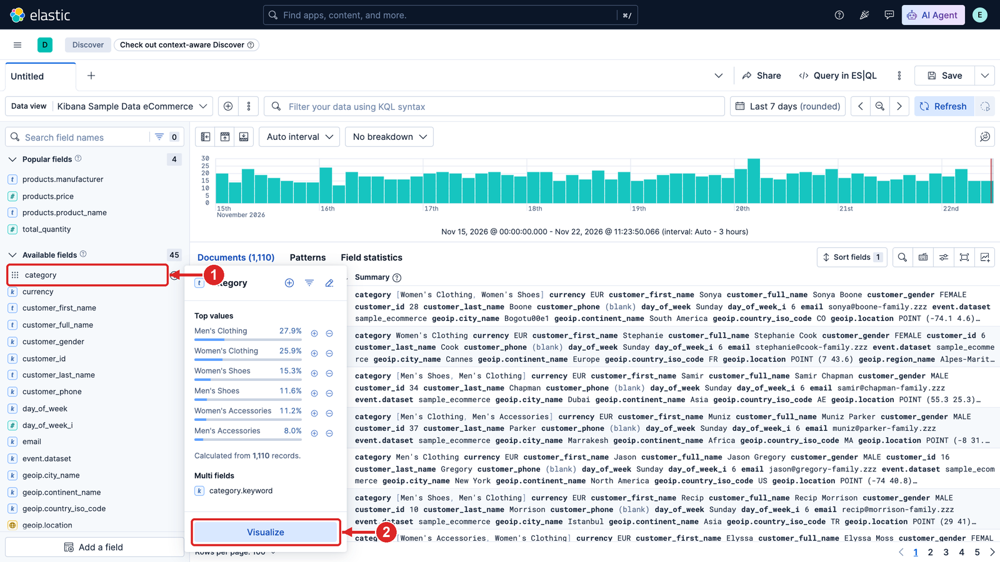
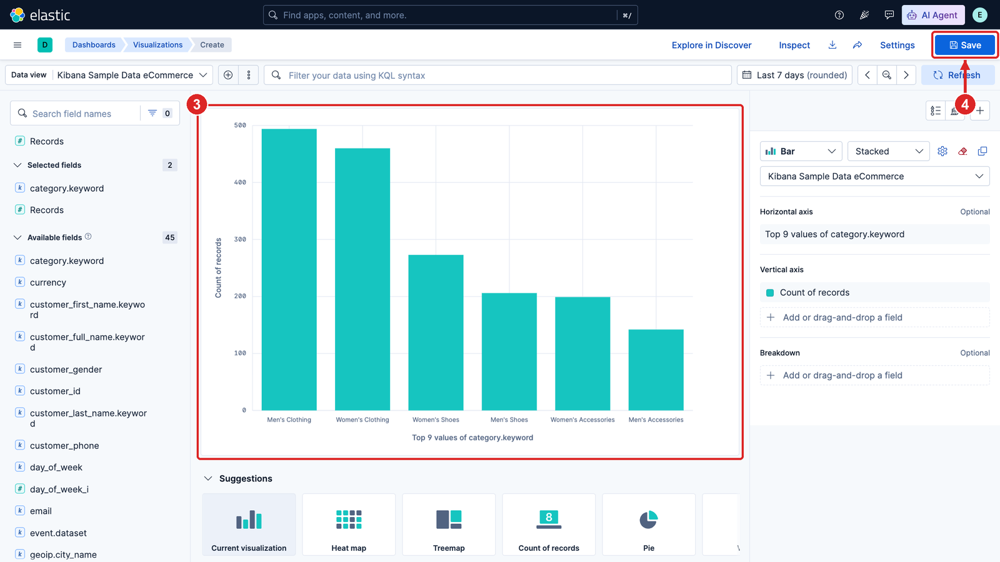
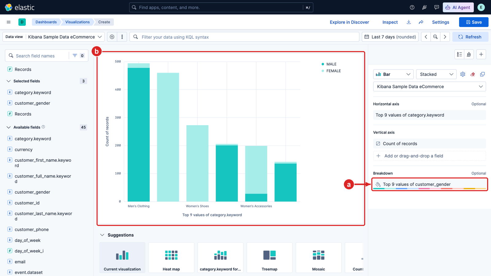
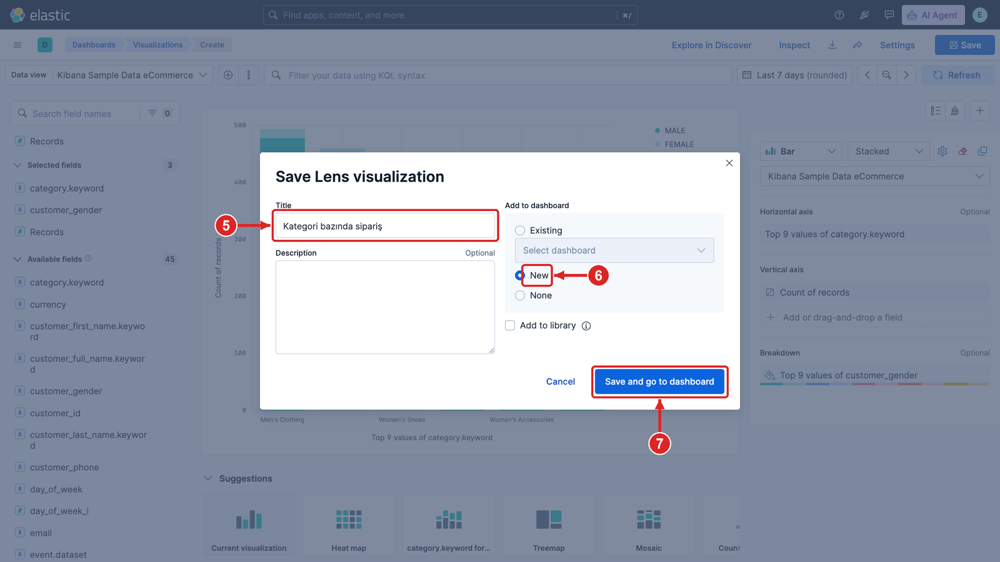
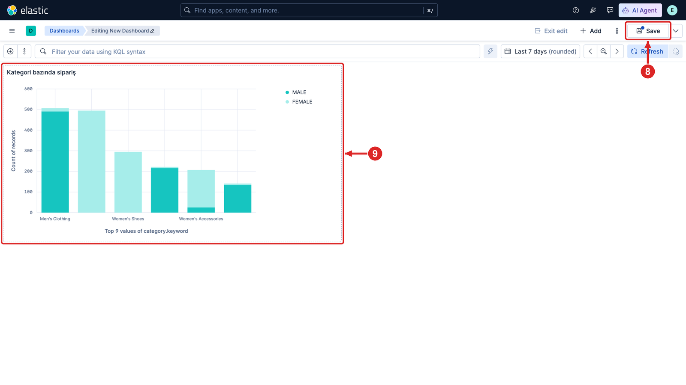
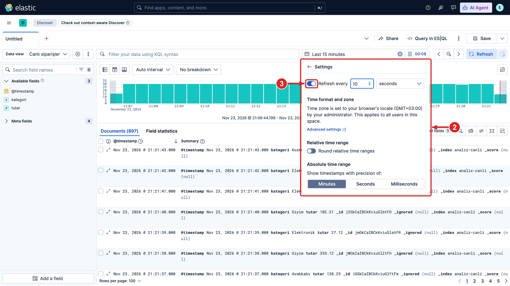
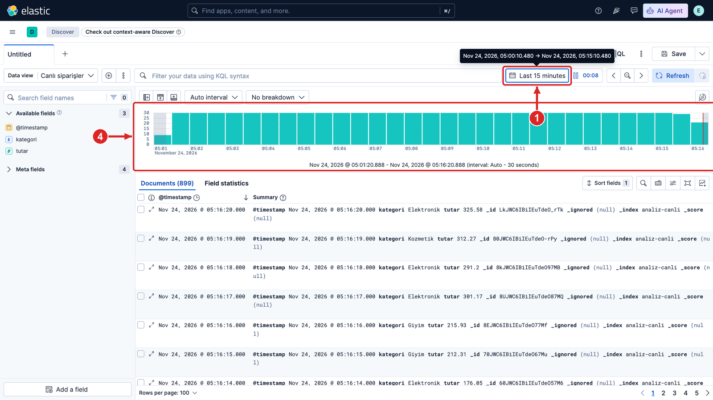
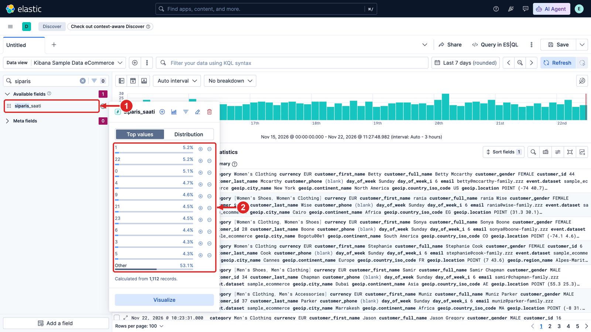

# LAB-07 — Aggregation ve Lens Panosu: Veriden Rapor Çıkarmak

| Kullanılan Araçlar | Açık / Kullanılan Portlar |
|---|---|
| Kibana Dev Tools, Lens, Dashboard | 9200 (Elasticsearch), 5601 (Kibana) — LAB-01 ana cluster'ı |

---

## Bu lab ne öğretiyor?

Arama "hangi document'ler?" sorusunu cevaplar; rapor ise "kaç tane, toplam ne kadar, hangi grupta,
hangi gün?" diye sorar. Elasticsearch bu soruları document'leri tek tek döndürmeden, aggregation ile
hesaplar. Bu labda aynı e-ticaret verisinde ciro, kategori bazında ortalama sepet ve günlük satış
çıkaracak; bir e-ticaret sitesindeki filtre panelini kuracak ve sonucu Lens ile bir panoya koyacağız.
Son iki adımda canlı bir sipariş akışını son 15 dakikada izleyecek ve veriyi panoya hazırlayacağız.

---

## Ön Koşullar

- LAB-01 ana cluster'ı çalışıyor.
- LAB-04'teki örnek e-ticaret verisi yüklü (`kibana_sample_data_ecommerce`, 4675 sipariş).
  LAB-04'ü atladıysanız onun Adım 1'ini yapın.

```bash
cd ~/elastic/labs/LAB-07-aggregation-lens
```

---

## Kavramlar: iki tür aggregation

| Tür | Ne yapar | Örnek |
|---|---|---|
| Metric | Bir sayı hesaplar | `sum` (toplam), `avg` (ortalama), `cardinality` (farklı değer sayısı) |
| Bucket | Document'leri gruplara (bucket) ayırır | `terms` (değere göre), `date_histogram` (zamana göre), `range` (aralığa göre) |

Bucket'ların içine metric konur: "her kategori için ortalama sepet". Aggregation `keyword`, sayı ve
tarih field'larında çalışır; `text` field'ında çalışmaz, çünkü metin token'lara bölünmüştür ve bütün değer tek parça olarak saklanmaz.

---

## Adım Adım Uygulama Rehberi

Bu labda `http` bloklarını Kibana › Dev Tools'a, `bash` bloklarını terminale yapıştırın.

### 1. Tek sayılar: metric aggregation

Toplam ciro, ortalama sepet ve kaç farklı müşteri olduğu. `size: 0` document listesini döndürmez;
yalnız hesap sonucu gelir:

```http
GET /kibana_sample_data_ecommerce/_search?filter_path=aggregations
{
  "size": 0,
  "aggs": {
    "ciro":      { "sum":         { "field": "taxful_total_price" } },
    "ort_sepet": { "avg":         { "field": "taxful_total_price" } },
    "musteri":   { "cardinality": { "field": "customer_id" } }
  }
}
```

```json
{
  "aggregations": {
    "ciro": {
      "value": 350884.12890625
    },
    "ort_sepet": {
      "value": 75.05542864304813
    },
    "musteri": {
      "value": 46
    }
  }
}
```

Her aggregation'a bir ad verilir (`ciro`, `ort_sepet`, `musteri`); yanıt aynı adlarla gelir.
`cardinality` yaklaşık sayar: milyonlarca farklı değerde bellek harcamamak için az bir hata payını
kabul eder; küçük veride sonuç kesindir.

### 2. Gruplamak: bucket ve iç içe aggregation

En çok sipariş alan üç kategori ve her birinde ortalama sepet:

```http
GET /kibana_sample_data_ecommerce/_search?filter_path=aggregations
{
  "size": 0,
  "aggs": {
    "kategori": {
      "terms": { "field": "category.keyword", "size": 3 },
      "aggs": {
        "ort_sepet": { "avg": { "field": "taxful_total_price" } }
      }
    }
  }
}
```

```json
{
  "aggregations": {
    "kategori": {
      "doc_count_error_upper_bound": 0,
      "sum_other_doc_count": 2346,
      "buckets": [
        {
          "key": "Men's Clothing",
          "doc_count": 2024,
          "ort_sepet": {
            "value": 73.81122043292984
          }
        },
        {
          "key": "Women's Clothing",
          "doc_count": 1903,
          "ort_sepet": {
            "value": 70.99312352207042
          }
        },
        {
          "key": "Women's Shoes",
          "doc_count": 1136,
          "ort_sepet": {
            "value": 92.8513836927817
          }
        }
      ]
    }
  }
}
```

- `terms` field değerine göre gruplar ve en kalabalık `size` grubu döndürür. `category.keyword`
  kullanılır: gruplama tam değerle yapılır.
- `doc_count`: gruptaki sipariş sayısı. İçteki `ort_sepet` yalnız o grubun document'leriyle hesaplanır.
- `sum_other_doc_count`: listeye girmeyen gruplardaki document sayısı. `doc_count_error_upper_bound`:
  çok shard'lı index'te sayımın en fazla ne kadar eksik olabileceği. Her shard kendi en iyi
  gruplarını hesaplar, koordinatör node bunları birleştirir; tek shard'da hata 0'dır.

Zamana göre gruplamak için `date_histogram`. Son yedi günün günlük sipariş sayısı ve cirosu:

```http
GET /kibana_sample_data_ecommerce/_search?filter_path=aggregations.gun.buckets.key_as_string,aggregations.gun.buckets.doc_count
{
  "size": 0,
  "query": { "range": { "order_date": { "gte": "now-7d/d", "lt": "now/d" } } },
  "aggs": {
    "gun": {
      "date_histogram": { "field": "order_date", "calendar_interval": "day", "format": "yyyy-MM-dd" }
    }
  }
}
```

```json
{
  "aggregations": {
    "gun": {
      "buckets": [
        {
          "key_as_string": "2026-11-14",
          "doc_count": 141
        },
        {
          "key_as_string": "2026-11-15",
          "doc_count": 151
        },
        {
          "key_as_string": "2026-11-16",
          "doc_count": 143
        },
        {
          "key_as_string": "2026-11-17",
          "doc_count": 143
        },
        {
          "key_as_string": "2026-11-18",
          "doc_count": 142
        },
        {
          "key_as_string": "2026-11-19",
          "doc_count": 161
        },
        {
          "key_as_string": "2026-11-20",
          "doc_count": 144
        }
      ]
    }
  }
}
```

Örnek verinin tarihleri yükleme gününe göre kaydırıldığı için sizin tarih ve sayılarınız farklı
olur; yedi gün, gün başına 140-160 sipariş görürsünüz. `now-7d/d` "yedi gün önce, günün başına
yuvarlanmış" demektir.

### 3. Filtre paneli: seçilen marka listeyi daraltmasın

E-ticaret sitesinde "shirt" arayan kullanıcı soldaki listeden bir marka seçer. Sonuçlar o markaya
daralmalı, ama marka listesi bütün markaları ve sayılarını göstermeye devam etmeli; yoksa kullanıcı
başka markayı seçemez. `post_filter` tam bunu yapar: aggregation hesaplandıktan **sonra** yalnız
sonuç listesine uygulanır.

```http
GET /kibana_sample_data_ecommerce/_search?filter_path=hits.total.value,aggregations.marka.buckets
{
  "size": 0,
  "query":       { "match": { "products.product_name": "shirt" } },
  "post_filter": { "term":  { "manufacturer.keyword": "Elitelligence" } },
  "aggs": {
    "marka": { "terms": { "field": "manufacturer.keyword", "size": 4 } }
  }
}
```

```json
{
  "hits": {
    "total": {
      "value": 503
    }
  },
  "aggregations": {
    "marka": {
      "buckets": [
        {
          "key": "Elitelligence",
          "doc_count": 503
        },
        {
          "key": "Low Tide Media",
          "doc_count": 500
        },
        {
          "key": "Oceanavigations",
          "doc_count": 330
        },
        {
          "key": "Pyramidustries",
          "doc_count": 161
        }
      ]
    }
  }
}
```

- `hits.total.value` (503): yalnız seçilen markanın shirt siparişleri; sonuç listesi daraldı.
- `marka`: "shirt" arayan bütün siparişlerde markalar; seçim listeyi daraltmadı. Uygulama bu
  sayıları filtre panelinde, sonuçları ortada gösterir.
- Aynı filtre `query` içine konsaydı marka listesinde yalnız Elitelligence kalırdı.

### 4. Lens ile pano

Aynı soruyu tıklayarak grafiğe ve panoya çevirelim.

1. Discover'da `Kibana Sample Data eCommerce` data view'ını ve **Last 7 days** zaman aralığını seçin.
   Varsayılan **Last 15 minutes** aralığında grafik boş kalır.
2. Soldaki field listesinde `category` field'ına (1) tıklayın, açılan pencerede **Visualize** (2):



3. Lens, kategori başına sipariş sayısını bar grafiği olarak açar (3). Yatay eksen kategoriler
   (`Top values of category.keyword`), dikey eksen kayıt sayısıdır. Sağ üstten **Save** (4):



   Sağ paneldeki **Breakdown** (a) kutusuna tıklayıp `customer_gender` seçin: her çubuk cinsiyete
   göre iki renge bölünür (b). Breakdown, grafiğe ikinci bir gruplama ekler:



4. Title alanına `Kategori bazında sipariş` (5) yazın, **Add to dashboard** altında **New** (6)
   seçin, **Save and go to dashboard** (7):



5. Pano açılır ve grafik ilk panel olarak eklenir. Sağ üstteki **Save** (8) ile panoya
   `Satış özeti` adını verip kaydedin:



Pano kaydedildikten sonra **Dashboards** listesinden açılır; zaman aralığı değişince bütün paneller
birlikte güncellenir. Aynı yolla ciro ya da günlük satış panelleri eklenir: Lens'te dikey eksene
`taxful_total_price` field'ını sürükleyip **Sum** seçmek "kategori bazında ciro" grafiğini verir.

### 5. Gerçek zamanlı: canlı sipariş akışı

Yazılan bir document hemen aranmaz; Elasticsearch varsayılan olarak saniyede bir **refresh** yapar
ve document ancak o zaman aramaya girer. Canlı veri için bir index açıp bunu görün:

```bash
curl -s -u elastic:'DevOps2026!' -X PUT 'http://127.0.0.1:9200/analiz-canli' -H 'Content-Type: application/json' -d '{
  "settings": { "number_of_shards": 1, "number_of_replicas": 0, "refresh_interval": "1s" },
  "mappings": { "properties": { "@timestamp": { "type": "date" }, "kategori": { "type": "keyword" }, "tutar": { "type": "float" } } } }' -o /dev/null
curl -s -u elastic:'DevOps2026!' -X POST 'http://127.0.0.1:9200/analiz-canli/_doc' -H 'Content-Type: application/json' \
  -d '{"@timestamp": "'"$(date -u +%FT%TZ)"'", "kategori": "Giyim", "tutar": 50}' -o /dev/null
curl -s -u elastic:'DevOps2026!' 'http://127.0.0.1:9200/analiz-canli/_count?filter_path=count'; echo
curl -s -u elastic:'DevOps2026!' -X POST 'http://127.0.0.1:9200/analiz-canli/_doc?refresh=wait_for&filter_path=result' -H 'Content-Type: application/json' \
  -d '{"@timestamp": "'"$(date -u +%FT%TZ)"'", "kategori": "Giyim", "tutar": 75}'; echo
curl -s -u elastic:'DevOps2026!' 'http://127.0.0.1:9200/analiz-canli/_count?filter_path=count'; echo
```

Beklenen çıktı:

```text
{"count":0}
{"result":"created"}
{"count":2}
```

İlk document yazıldı ama `_count` 0 döndü: refresh henüz olmadı. `refresh=wait_for` isteği document aramaya
girene kadar bekler; ardından iki document de görünür. "Gerçek zamanlı" bu yüzden "yaklaşık 1 saniye içinde"
demektir.

Şimdi son 15 dakikayı saniyede bir siparişle doldurun ve 10 dakika sürecek canlı akışı arka planda başlatın:

```bash
python3 scripts/canli_siparis.py gecmis
nohup python3 scripts/canli_siparis.py canli 600 > /dev/null 2>&1 &
```

Beklenen çıktı:

```text
gecmis 15 dakika: 900 siparis, hata: False
```

Gerçek zamanlı panonun sorusu: son 15 dakikada dakika başına kaç sipariş geldi?

```bash
curl -s -u elastic:'DevOps2026!' 'http://127.0.0.1:9200/analiz-canli/_search?size=0' -H 'Content-Type: application/json' -d '{
  "query": { "range": { "@timestamp": { "gte": "now-15m" } } },
  "aggs": { "dakika": { "date_histogram": { "field": "@timestamp", "fixed_interval": "1m" } } } }' | jq -c '[.aggregations.dakika.buckets[].doc_count]'
```

Beklenen çıktı:

```text
[23,60,60,60,60,60,60,60,60,60,60,60,60,60,60,37]
```

Her dakika 60 sipariş; ilk ve son kova yarımdır, çünkü 15 dakikalık pencere dakika sınırına denk gelmez.
Sorguyu birkaç saniye sonra tekrar çalıştırın: canlı akış son kovayı büyütür (sayılar sizde farklıdır).

Aynı akışı Kibana'da izlemek için bir data view açın:

```http
POST kbn:/api/data_views/data_view
{ "data_view": { "id": "analiz-canli", "title": "analiz-canli", "name": "Canlı siparişler", "timeFieldName": "@timestamp" } }
```

Discover'da `Canlı siparişler` data view'ını seçin, zaman aralığını **Last 15 minutes** (1) yapın. Zaman
kutusunu yeniden açıp **Settings** (2) sekmesinde **Refresh every** anahtarını (3) açın ve değeri
`10 seconds` yapın:



Histogram (4) her 10 saniyede kendiliğinden yenilenir ve sağ uçtaki çubuk büyür:




### 6. Pano için veri hazırlama: doğru tip ve runtime field

Grafikler aggregation'dan beslenir ve aggregation `text` field'da çalışmaz. `category` hem `text` hem
`category.keyword` olarak index'lenmiştir; ikisiyle de gruplamayı deneyin:

```bash
for f in category category.keyword; do
  curl -s -u elastic:'DevOps2026!' 'http://127.0.0.1:9200/kibana_sample_data_ecommerce/_search?size=0' -H 'Content-Type: application/json' \
    -d '{"aggs": {"k": {"terms": {"field": "'$f'", "size": 1}}}}' | jq -c --arg f "$f" '{field: $f, status, ilk: .aggregations.k.buckets[0].key, hata: .error.root_cause[0].reason[0:60]}'
done
```

Beklenen çıktı:

```text
{"field":"category","status":400,"ilk":null,"hata":"Fielddata is disabled on [category] in [kibana_sample_data_e"}
{"field":"category.keyword","status":null,"ilk":"Men's Clothing","hata":null}
```

Lens bu yüzden `category` yerine `Top values of category.keyword` kullanır. Veride olmayan bir değer
gerekiyorsa (örneğin siparişin saati) veriyi yeniden yazmadan **runtime field** tanımlanır; değer sorgu
anında script ile hesaplanır:

```http
GET kibana_sample_data_ecommerce/_search?size=0&filter_path=aggregations
{
  "runtime_mappings": { "siparis_saati": { "type": "long", "script": "emit(doc['order_date'].value.getHour())" } },
  "aggs": { "saat": { "terms": { "field": "siparis_saati", "size": 3 } } }
}
```

```json
{"aggregations":{"saat":{"doc_count_error_upper_bound":0,"sum_other_doc_count":4048,"buckets":[{"key":16,"doc_count":211},{"key":3,"doc_count":210},{"key":1,"doc_count":206}]}}}
```

Saat UTC'dir. Aynı field'ı data view'a eklerseniz Discover ve Lens onu sıradan bir field gibi görür:

```http
POST kbn:/api/data_views/data_view/ff959d40-b880-11e8-a6d9-e546fe2bba5f/runtime_field
{ "name": "siparis_saati", "runtimeField": { "type": "long", "script": { "source": "emit(doc['order_date'].value.getHour())" } } }
```

Discover'da `Kibana Sample Data eCommerce` data view'ını açın; field listesinde `siparis_saati` (1) görünür,
tıklayınca en sık saatler gelir (2):



Runtime field her sorguda yeniden hesaplanır; sık kullanılan bir değer büyük veride yavaşlatır. O zaman
field mapping'e eklenip veri ingest pipeline ile yazılırken doldurulur.

---

## Temizlik

Örnek veri sonraki lablarda kullanılır, silinmez. Bu labın oluşturduğu panoyu, canlı akışı, `analiz-canli`
index'ini ve data view'ını, örnek data view'a eklenen `siparis_saati` field'ını siler. Lens grafiği panonun
içinde kaydedildiği için onunla birlikte gider:

```bash
./teardown.sh
```

Beklenen çıktı:

```text
dashboard 'Satış özeti' -> 200
canli siparis akisi -> durduruldu
runtime field siparis_saati -> 200
data view analiz-canli -> 200
index analiz-canli -> 200
```

Labı aynı sunucuda yeniden yapacaksanız başlamadan önce `./teardown.sh` çalıştırın; README'deki sayılar temiz
başlangıca göredir.

---

Sonraki lab: **[LAB-08 — ES|QL ve SQL: Pipeline ile Sorgu ve SQL Köprüsü](../LAB-08-esql-sql/README.md)**
