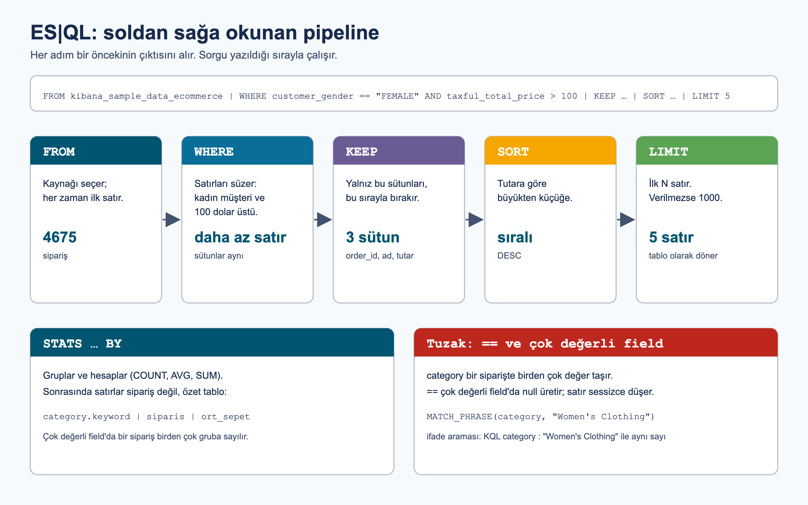
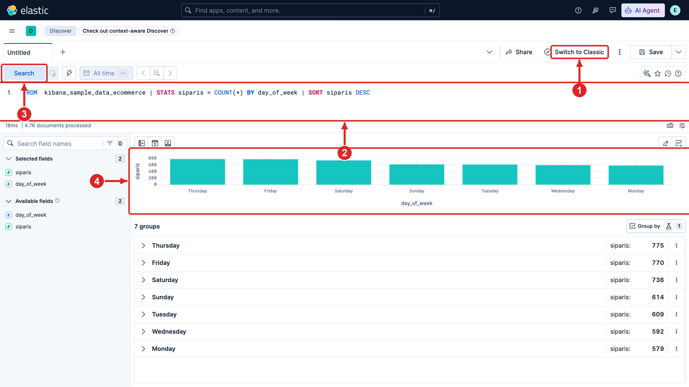

# LAB-08 — ES|QL ve SQL: Pipeline ile Sorgu ve SQL Köprüsü

| Kullanılan Araçlar | Açık / Kullanılan Portlar |
|---|---|
| Kibana Dev Tools (ES\|QL, SQL API), Discover (ES\|QL modu) | 9200 (Elasticsearch), 5601 (Kibana) — LAB-01 ana cluster'ı |

---

## Bu lab ne öğretiyor?

Query DSL güçlüdür ama okunması zordur: "son siparişlerden kadın müşterilerin 100 dolar üstü olanlarını
tutara göre sırala, beşini göster" sorusu iç içe JSON olur. ES|QL aynı soruyu soldan sağa okunan bir
pipeline olarak yazar: kaynak, süz, sütun seç, sırala. SQL bilenler için de `_sql` API'si vardır.

Bu labda e-ticaret verisini ES|QL ile süzecek, gruplayacak ve yeni sütun hesaplayacak; çok değerli bir
field'ın sessizce yanlış sonuç verdiği tuzağı görecek; aynı soruyu Discover'da ES|QL moduyla ve SQL ile
soracak, SQL'in arkadaki Query DSL'ini `_sql/translate` ile göreceğiz.

{width=60%}

---

## Ön Koşullar

- Önce kurulu olmalı: LAB-01 ana cluster'ı ve LAB-04'teki örnek e-ticaret verisi (`kibana_sample_data_ecommerce`, 4675 sipariş).
- Önceki labı atladıysanız: LAB-04'ün Adım 1'ini yapın (örnek veriyi ekler).

```bash
cd ~/elastic/labs/LAB-08-esql-sql
curl -s -u elastic:'DevOps2026!' 'http://127.0.0.1:9200/kibana_sample_data_ecommerce/_count?filter_path=count'; echo
```

Beklenen çıktı:

```text
{"count":4675}
```

---

## Kavramlar: ES|QL pipeline'ı

| Komut | Ne yapar | SQL karşılığı |
|---|---|---|
| `FROM` | Kaynağı seçer; her zaman ilk satır | `FROM` |
| `WHERE` | Satırları süzer | `WHERE` |
| `KEEP` | Yalnız bu sütunları, bu sırayla bırakır | `SELECT a, b` |
| `SORT` / `LIMIT` | Sıralar / satır sayısını sınırlar (varsayılan 1000) | `ORDER BY` / `LIMIT` |
| `STATS … BY` | Gruplar ve hesaplar; sonra satırlar özet tablodur | `GROUP BY` |
| `EVAL` | Yeni sütun hesaplar | `SELECT ifade AS ad` |

Her adım bir öncekinin çıktısını alır. Dev Tools'ta `POST /_query?format=txt`, sonucu tablo olarak verir.

---

## Adım Adım Uygulama Rehberi

Bu labda `http` bloklarını Kibana › Dev Tools'a yapıştırın.

### 1. İlk pipeline: süz, seç, sırala

Kadın müşterilerin 100 dolardan pahalı siparişleri, en pahalı beşi:

```http
POST /_query?format=txt
{
  "query": """
    FROM kibana_sample_data_ecommerce
    | WHERE customer_gender == "FEMALE" AND taxful_total_price > 100
    | KEEP order_id, customer_full_name, taxful_total_price
    | SORT taxful_total_price DESC
    | LIMIT 5
  """
}
```

Beklenen çıktı:

```text
   order_id    |customer_full_name |taxful_total_price
---------------+-------------------+------------------
731279         |Elyssa Hart        |344.0
724489         |Elyssa Turner      |343.0
730725         |Rabbia Al Maldonado|283.0
731245         |Elyssa Hart        |265.0
727629         |Rabbia Al Sharp    |250.0
```

`WHERE` iki koşulu `AND` ile birleştirir; `customer_gender` ve `taxful_total_price` tek değerli field'lardır,
`==` ve `>` doğrudan çalışır. Aynı koşul LAB-04'teki KQL sorgusudur (`customer_gender : "FEMALE" and
taxful_total_price > 100`). Kaç sipariş olduğunu `STATS` söyler (zaman sınırı yok, bütün index; LAB-04'teki 156 yalnız son 30 gündü):

```http
POST /_query?format=txt
{ "query": "FROM kibana_sample_data_ecommerce | WHERE customer_gender == \"FEMALE\" AND taxful_total_price > 100 | STATS siparis = COUNT(*)" }
```

Beklenen çıktı:

```text
    siparis
---------------
469
```

### 2. Tuzak: çok değerli field

Bir sipariş birden çok kategoriye ait olabilir; `category` çok değerlidir:

```http
POST /_query?format=txt
{ "query": "FROM kibana_sample_data_ecommerce | EVAL n = MV_COUNT(category) | STATS siparis = COUNT(*) BY n | SORT n" }
```

Beklenen çıktı:

```text
    siparis    |       n
---------------+---------------
2057           |1
2504           |2
112            |3
2              |4
```

"Women's Clothing içeren siparişler" sorusunu üç biçimde sayın:

```http
POST /_query?format=txt
{ "query": "FROM kibana_sample_data_ecommerce | WHERE category == \"Women's Clothing\" | STATS esit = COUNT(*)" }
```

```http
POST /_query?format=txt
{ "query": "FROM kibana_sample_data_ecommerce | WHERE MATCH(category, \"Women's Clothing\") | STATS match = COUNT(*)" }
```

```http
POST /_query?format=txt
{ "query": "FROM kibana_sample_data_ecommerce | WHERE MATCH_PHRASE(category, \"Women's Clothing\") | STATS match_phrase = COUNT(*)" }
```

Beklenen çıktı:

```text
esit           : 768
match          : 4425
match_phrase   : 1903
```

Üç sorgunun tek satırlık sonucu yan yana yazıldı.

- `==`: çok değerli bir field'ı karşılaştırmak `null` üretir ve o satır sessizce düşer; yalnız tek
  kategorili siparişler sayılır. Hata gelmez, sonuç eksik gelir.
- `MATCH`: metin araması; "clothing" kelimesi Men's Clothing'i, "women's" Women's Shoes'u da yakalar.
- `MATCH_PHRASE`: ifade yan yana geçmeli; doğru sayı. Discover'da KQL `category : "Women's Clothing"`
  ile aynıdır.

### 3. Gruplamak ve yeni sütun: `STATS` ve `EVAL`

Kategori bazında sipariş sayısı ve ortalama sepet (LAB-07'deki `terms` + `avg` sorusu):

```http
POST /_query?format=txt
{ "query": "FROM kibana_sample_data_ecommerce | STATS siparis = COUNT(*), ort_sepet = ROUND(AVG(taxful_total_price), 2) BY category.keyword | SORT siparis DESC | LIMIT 3" }
```

Beklenen çıktı:

```text
    siparis    |   ort_sepet   |category.keyword
---------------+---------------+----------------
2024           |73.81          |Men's Clothing
1903           |70.99          |Women's Clothing
1136           |92.85          |Women's Shoes
```

`category.keyword` da çok değerlidir: iki kategorili bir sipariş iki gruba birden sayılır; grupların toplamı
4675'ten büyüktür. Adım 2'deki tuzağın gruplamadaki karşılığıdır.

`EVAL` yeni sütun üretir; sonra o sütunla gruplanabilir. Sepeti üç bantlara ayıralım:

```http
POST /_query?format=txt
{
  "query": """
    FROM kibana_sample_data_ecommerce
    | EVAL bant = CASE(taxful_total_price < 50, "1: 50 alti", taxful_total_price < 100, "2: 50-100", "3: 100 ve ustu")
    | STATS siparis = COUNT(*), ciro = ROUND(SUM(taxful_total_price)) BY bant
    | SORT bant
  """
}
```

Beklenen çıktı:

```text
    siparis    |     ciro      |     bant
---------------+---------------+---------------
1633           |62647.0        |1: 50 alti
2036           |147294.0       |2: 50-100
1006           |140944.0       |3: 100 ve ustu
```

### 4. Discover'da ES|QL

Discover'da sağ üstteki **Query in ES|QL** düğmesi Discover'ı ES|QL moduna alır; düğmenin yerinde artık
**Switch to Classic** (1) görünür. Sorgu kutusuna (2) şunu yazıp **Search**'e (3) basın:

```text
FROM kibana_sample_data_ecommerce | STATS siparis = COUNT(*) BY day_of_week | SORT siparis DESC
```

{width=75%}

Sonuç grafik (4) ve altında gruplar olarak gelir. Zaman kutusu **All time** olduğu için sayılar Adım 5'teki
SQL ile aynıdır (Thursday 775, Friday 770…); zaman aralığı daraltılırsa sorgu yalnız o aralığı sayar. Klasik
Discover'a **Switch to Classic** (1) ile dönülür.

### 5. Aynı soru SQL ile

`_sql` API'si veriyi SQL ile sorgular. Gün bazında sipariş sayısı, ilk üç gün:

```http
POST /_sql?format=txt
{ "query": "SELECT day_of_week, COUNT(*) AS siparis FROM kibana_sample_data_ecommerce GROUP BY day_of_week ORDER BY siparis DESC LIMIT 3" }
```

Beklenen çıktı:

```text
  day_of_week  |    siparis
---------------+---------------
Thursday       |775
Friday         |770
Saturday       |736
```

SQL'de çok değerli bir field'ı seçmek hata verir; `category` yerine tek değerli field'larla çalışın.
`_sql` ve ES|QL aynı veriyi okur, sayılar aynıdır.

### 6. SQL'in arkasındaki Query DSL: `_sql/translate`

Elasticsearch SQL'i Query DSL'e çevirip çalıştırır. Çeviriyi görmek için:

```http
POST /_sql/translate
{ "query": "SELECT customer_full_name, taxful_total_price FROM kibana_sample_data_ecommerce WHERE customer_gender = 'FEMALE' AND taxful_total_price > 100 ORDER BY taxful_total_price DESC LIMIT 5" }
```

```json
{
  "size": 5,
  "query": {
    "bool": {
      "must": [
        {
          "term": {
            "customer_gender": {
              "value": "FEMALE"
            }
          }
        },
        {
          "range": {
            "taxful_total_price": {
              "gt": 100,
              "boost": 1.0
            }
          }
        }
      ],
      "boost": 1.0
    }
  },
  "_source": false,
  "fields": [
    {
      "field": "customer_full_name"
    },
    {
      "field": "taxful_total_price"
    }
  ],
  "sort": [
    {
      "taxful_total_price": {
        "order": "desc",
        "missing": "_first",
        "unmapped_type": "half_float"
      }
    }
  ],
  "track_total_hits": -1
}
```

`WHERE` bir `bool` sorgusuna (`term` + `range`), `ORDER BY` bir `sort`'a, `LIMIT` `size`'a dönüşür:
LAB-05'te elle yazdığınız Query DSL'in aynısı. ES|QL ise Query DSL'e çevrilmez; kendi motoruyla çalışır.

---

## Temizlik

Bu lab yalnız okur, kaynak oluşturmaz; temizlenecek bir şey yoktur. Örnek e-ticaret verisi sonraki
lablarda kullanılır.

---

Sonraki lab: **[LAB-09 — İlişkisel Veriyi Modellemek: Denormalize, nested, join ve LOOKUP JOIN](../LAB-09-iliskisel-veri-modelleme/README.md)**
