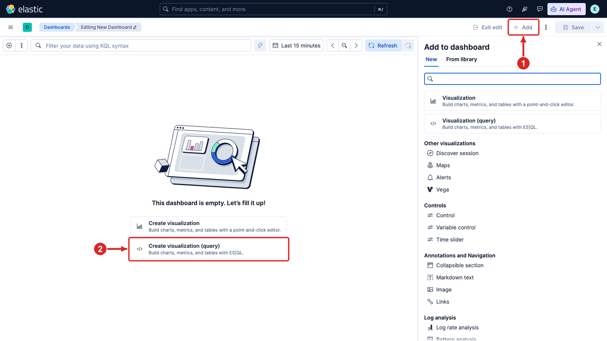
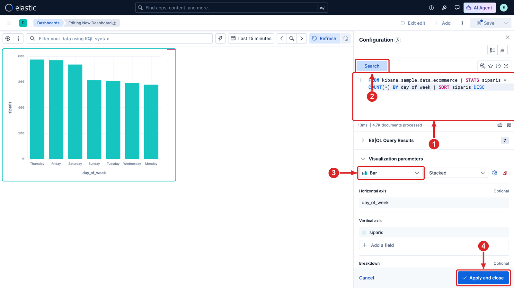
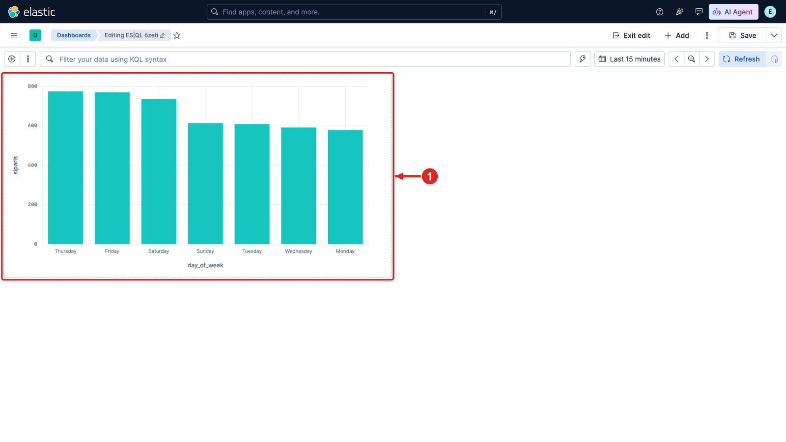

# LAB-08 — ES|QL ve SQL: Pipeline ile Sorgu ve SQL Köprüsü

| Kullanılan Araçlar | Açık / Kullanılan Portlar |
|---|---|
| Kibana Dev Tools (ES\|QL, SQL API), Discover (ES\|QL modu) | 9200 (Elasticsearch), 5601 (Kibana) — LAB-01 ana cluster'ı |

---

## Bu lab ne öğretiyor?

- ES|QL: soruyu soldan sağa okunan bir pipeline olarak yazmak
- Filtrelemek, gruplamak, yeni sütun hesaplamak (`WHERE`, `STATS`, `EVAL`)
- Çok değerli field'ın sessizce yanlış sonuç verdiği tuzak
- Discover'da ES|QL ve sonucu panoya eklemek
- Aynı soru SQL ile; SQL'in arkasındaki Query DSL


---

## Ön Koşullar

- Önce kurulu olmalı: LAB-01 ana cluster'ı ve LAB-04'teki örnek e-ticaret verisi (`kibana_sample_data_ecommerce`, 4675 sipariş).
- Önceki labı atladıysanız: LAB-04'ün Adım 1'ini yapın (örnek veriyi ekler).

```bash
cd ~/elastic/labs/LAB-08-esql-sql
curl -s -u elastic:'DevOps2026!' 'http://127.0.0.1:9200/kibana_sample_data_ecommerce/_count?filter_path=count'; echo
```

Beklenen çıktı:

```text
{"count":4675}
```

---

## Kavramlar

- **ES|QL:** Elasticsearch'ün pipeline sorgu dili; komutlar `|` ile bağlanır, her komut bir öncekinin tablosunu alır
- **`FROM` · `WHERE` · `KEEP`:** kaynak (hep ilk satır) · satırları filtreler · yalnız bu sütunları bırakır
- **`SORT` · `LIMIT`:** sıralar · satır sayısını sınırlar (verilmezse en çok 1000 satır)
- **`STATS … BY` · `EVAL`:** gruplar ve hesaplar (SQL'deki `GROUP BY`) · yeni sütun hesaplar
- **Dev Tools'ta:** `POST /_query?format=txt` sonucu tablo olarak verir

---

## Adım Adım Uygulama Rehberi

`http` bloklarını Kibana › Dev Tools'a yapıştırın.

### 1. İlk pipeline: filtrele, seç, sırala

**Soru: Bir soruyu ES|QL ile nasıl yazarız?** Kadın müşterilerin 100 dolardan pahalı siparişleri, en pahalı beşi:

```http
POST /_query?format=txt
{
  "query": """
    FROM kibana_sample_data_ecommerce
    | WHERE customer_gender == "FEMALE" AND taxful_total_price > 100
    | KEEP order_id, customer_full_name, taxful_total_price
    | SORT taxful_total_price DESC
    | LIMIT 5
  """
}
```

Beklenen çıktı:

```text
   order_id    |customer_full_name |taxful_total_price
---------------+-------------------+------------------
731279         |Elyssa Hart        |344.0
724489         |Elyssa Turner      |343.0
730725         |Rabbia Al Maldonado|283.0
731245         |Elyssa Hart        |265.0
727629         |Rabbia Al Sharp    |250.0
```

- **`WHERE`:** iki koşulu `AND` ile birleştirir; iki field da tek değerli, `==` ve `>` doğrudan çalışır.
- **Aynı soru KQL'de:** `customer_gender : "FEMALE" and taxful_total_price > 100`.

**Kaç sipariş?** `STATS` sayar; zaman sınırı yok, bütün index:

```http
POST /_query?format=txt
{ "query": "FROM kibana_sample_data_ecommerce | WHERE customer_gender == \"FEMALE\" AND taxful_total_price > 100 | STATS siparis = COUNT(*)" }
```

Beklenen çıktı:

```text
    siparis
---------------
469
```

### 2. Tuzak: çok değerli field

**Soru: Bir field birden çok değer taşırsa ne olur?** Bir sipariş birden çok kategoriye ait olabilir; `category`
çok değerlidir:

```http
POST /_query?format=txt
{ "query": "FROM kibana_sample_data_ecommerce | EVAL n = MV_COUNT(category) | STATS siparis = COUNT(*) BY n | SORT n" }
```

Beklenen çıktı:

```text
    siparis    |       n
---------------+---------------
2057           |1
2504           |2
112            |3
2              |4
```

**"Women's Clothing içeren siparişler" sorusunu üç biçimde sayın:**

```http
POST /_query?format=txt
{ "query": "FROM kibana_sample_data_ecommerce | WHERE category == \"Women's Clothing\" | STATS esit = COUNT(*)" }
```

```http
POST /_query?format=txt
{ "query": "FROM kibana_sample_data_ecommerce | WHERE MATCH(category, \"Women's Clothing\") | STATS match = COUNT(*)" }
```

```http
POST /_query?format=txt
{ "query": "FROM kibana_sample_data_ecommerce | WHERE MATCH_PHRASE(category, \"Women's Clothing\") | STATS match_phrase = COUNT(*)" }
```

Beklenen çıktı:

```text
esit           : 768
match          : 4425
match_phrase   : 1903
```

Üç sorgunun tek satırlık sonucu yan yana yazıldı.

- **`==` (768):** çok değerli field'da `null` üretir, satır sessizce düşer; yalnız tek kategorili siparişler sayılır.
  Hata gelmez, sonuç eksik gelir.
- **`MATCH` (4425):** metin araması; "clothing" Men's Clothing'i, "women's" Women's Shoes'u da yakalar.
- **`MATCH_PHRASE` (1903):** ifade yan yana geçmeli; doğru sayı. KQL'deki `category : "Women's Clothing"` ile aynı.

### 3. Gruplamak ve yeni sütun: `STATS` ve `EVAL`

**Soru: Gruplamak ve yeni sütun üretmek nasıl olur?**

**`STATS … BY`:** kategori bazında sipariş sayısı ve ortalama sepet:

```http
POST /_query?format=txt
{ "query": "FROM kibana_sample_data_ecommerce | STATS siparis = COUNT(*), ort_sepet = ROUND(AVG(taxful_total_price), 2) BY category.keyword | SORT siparis DESC | LIMIT 3" }
```

Beklenen çıktı:

```text
    siparis    |   ort_sepet   |category.keyword
---------------+---------------+----------------
2024           |73.81          |Men's Clothing
1903           |70.99          |Women's Clothing
1136           |92.85          |Women's Shoes
```

**Gruplamada da aynı tuzak:** `category.keyword` çok değerli; iki kategorili sipariş iki gruba birden sayılır, grupların
toplamı 4675'ten büyük çıkar.

**`EVAL`:** yeni sütun üretir, sonra onunla gruplanır. `CASE(koşul, değer, koşul, değer, aksi)` ilk tutan koşulun
değerini verir. Sepeti üç banda ayıralım:

```http
POST /_query?format=txt
{
  "query": """
    FROM kibana_sample_data_ecommerce
    | EVAL bant = CASE(taxful_total_price < 50, "1: 50 alti", taxful_total_price < 100, "2: 50-100", "3: 100 ve ustu")
    | STATS siparis = COUNT(*), ciro = ROUND(SUM(taxful_total_price)) BY bant
    | SORT bant
  """
}
```

Beklenen çıktı:

```text
    siparis    |     ciro      |     bant
---------------+---------------+---------------
1633           |62647.0        |1: 50 alti
2036           |147294.0       |2: 50-100
1006           |140944.0       |3: 100 ve ustu
```

### 4. Discover'da ES|QL

**Soru: ES|QL'i arayüzden nasıl kullanırız?**

1. **Discover**'da sağ üstteki **Query in ES|QL**: Discover ES|QL moduna geçer; yerinde **Switch to Classic** (1) görünür
2. Sorgu kutusuna (2) şunu yazın, **Search** (3):

```text
FROM kibana_sample_data_ecommerce | STATS siparis = COUNT(*) BY day_of_week | SORT siparis DESC
```


- **Sonuç:** grafik (4) ve altında gruplar. Zaman kutusu **All time** olduğu için sayılar Adım 5'teki SQL ile aynıdır
  (Thursday 775, Friday 770…); aralık daraltılırsa sorgu yalnız o aralığı sayar.
- **Klasik Discover'a dönüş:** **Switch to Classic** (1).

<details>
<summary><strong>ES|QL sorgusunu panoya eklemek</strong></summary>

Bir ES|QL sorgusu panoda doğrudan panel olur; Lens'te eksen seçmeye gerek kalmaz.

1. **Dashboards › Create dashboard**, sonra **Add** (1) › **Visualization (query)** (2):



2. Sorgu kutusuna (1) Adım 4'teki sorguyu yazın, **Search** (2). Kibana sonuca uygun grafiği seçer; türünü (3)
   değiştirebilirsiniz. **Apply and close** (4):



3. Sağ üstten **Save**: başlık `ES|QL özeti`, **Save**. Panel (1) panoda durur:



SQL sorgusunun panoya doğrudan eklenme yolu yoktur; aynı soru ES|QL'e çevrilip eklenir.

</details>

### 5. Aynı soru SQL ile

**Soru: SQL bilenler ne yapar?** `_sql` API'si veriyi SQL ile sorgular. Gün bazında sipariş sayısı, ilk üç gün:

```http
POST /_sql?format=txt
{ "query": "SELECT day_of_week, COUNT(*) AS siparis FROM kibana_sample_data_ecommerce GROUP BY day_of_week ORDER BY siparis DESC LIMIT 3" }
```

Beklenen çıktı:

```text
  day_of_week  |    siparis
---------------+---------------
Thursday       |775
Friday         |770
Saturday       |736
```

- **Kısıt:** SQL'de çok değerli bir field'ı seçmek hata verir; tek değerli field'larla çalışın.
- **Sayılar aynı:** `_sql` ve ES|QL aynı veriyi okur.

### 6. SQL'in arkasındaki Query DSL: `_sql/translate`

**Soru: SQL arkada neye dönüşür?** Elasticsearch SQL'i Query DSL'e çevirip çalıştırır. Çeviriyi görmek için:

```http
POST /_sql/translate
{ "query": "SELECT customer_full_name, taxful_total_price FROM kibana_sample_data_ecommerce WHERE customer_gender = 'FEMALE' AND taxful_total_price > 100 ORDER BY taxful_total_price DESC LIMIT 5" }
```

```json
{
  "size": 5,
  "query": {
    "bool": {
      "must": [
        {
          "term": {
            "customer_gender": {
              "value": "FEMALE"
            }
          }
        },
        {
          "range": {
            "taxful_total_price": {
              "gt": 100,
              "boost": 1.0
            }
          }
        }
      ],
      "boost": 1.0
    }
  },
  "_source": false,
  "fields": [
    {
      "field": "customer_full_name"
    },
    {
      "field": "taxful_total_price"
    }
  ],
  "sort": [
    {
      "taxful_total_price": {
        "order": "desc",
        "missing": "_first",
        "unmapped_type": "half_float"
      }
    }
  ],
  "track_total_hits": -1
}
```

- **`WHERE`** → `bool` (`term` + `range`) · **`ORDER BY`** → `sort` · **`LIMIT`** → `size`; Query DSL'de elle yazdığınızın aynısı.
- **ES|QL** Query DSL'e çevrilmez; kendi motoruyla çalışır.

---

## Temizlik

Örnek e-ticaret verisi sonraki lablarda kullanılır, silinmez. Yalnız Adım 4'teki kutuda oluşturduğunuz `ES|QL özeti`
panosunu siler:

```bash
./teardown.sh
```

Beklenen çıktı:

```text
dashboard 'ES|QL özeti' -> 200
```

Kutuyu yapmadıysanız çıktı boştur.

---

Sonraki lab: **[LAB-09 — İlişkisel Veriyi Modellemek: Denormalize, nested, join ve LOOKUP JOIN](../LAB-09-iliskisel-veri-modelleme/README.md)**
