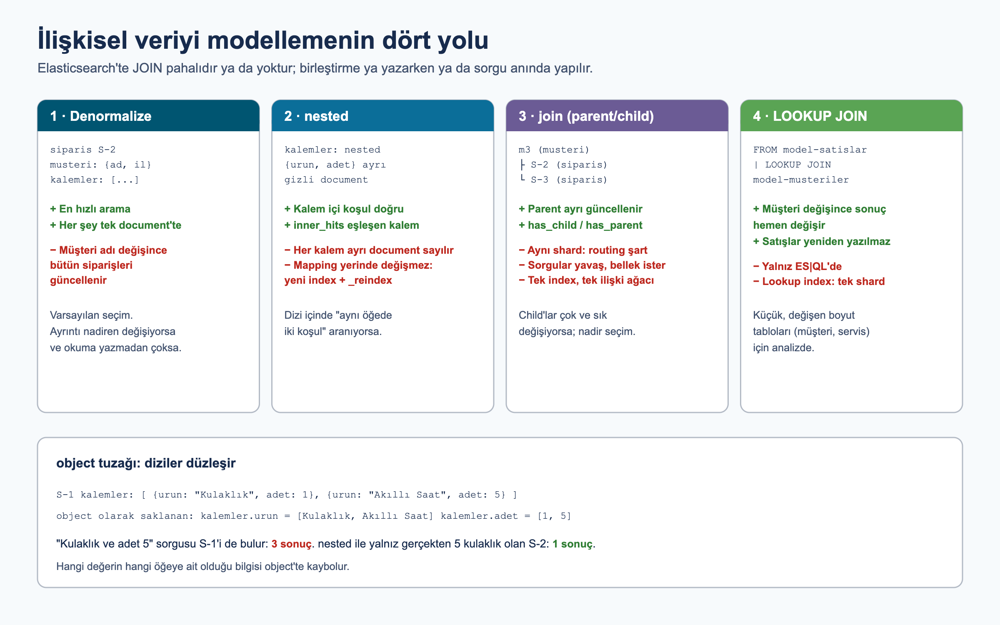

# LAB-09 — İlişkisel Veriyi Modellemek: Denormalize, nested, join ve LOOKUP JOIN

| Kullanılan Araçlar | Açık / Kullanılan Portlar |
|---|---|
| Kibana Dev Tools, `_bulk`, `_update_by_query`, `_reindex`, alias, ES\|QL `LOOKUP JOIN` | 9200 / 5601 — LAB-01 ana cluster'ı |

---

## Bu lab ne öğretiyor?

Veritabanında müşteri, sipariş ve sipariş kalemi ayrı tablolardır, JOIN ile birleşir. Elasticsearch'te aynı
5 müşteri ve 6 siparişi dört biçimde kurup aynı soruyu soruyoruz:

- **Denormalize:** müşteri siparişin içinde; okuma hızlı, değişiklik pahalı
- **`nested`:** dizideki her öğe kendi içinde eşleşir; mapping değişikliği için `_reindex` ve alias geçişi
- **`join`:** müşteri ve sipariş ayrı document, aynı shard'da
- **ES|QL `LOOKUP JOIN`:** müşteri tablosu sorgu anında birleşir



---

## Ön Koşullar

- Önce kurulu olmalı: LAB-01 ana cluster'ı.
- Önceki labı atladıysanız: sorun değil; bu lab başka laba bağlı değildir, örnek veri `sample-data/` altındadır.

```bash
cd ~/elastic/labs/LAB-09-iliskisel-veri-modelleme
```

Kibana adresini sunucuda hesaplayın:

```bash
IP=$(curl -s https://api.ipify.org); H=$(hostname -s)
echo "Kibana: http://$IP:5601   https://$H-kibana.devopsatolyesi.com"
```

Beklenen çıktı:

```text
Kibana: http://<IP>:5601   https://<host>-kibana.devopsatolyesi.com
```

---

## Kavramlar

- **Denormalize document:** birleştirme yazarken yapılır; varsayılan seçim. Bedeli: müşteri adı değişince bütün siparişleri yeniden yazılır
- **`object` (varsayılan):** dizideki nesneleri düzleştirir; hangi değerin hangi öğeye ait olduğu kaybolur
- **`nested`:** dizideki her öğe ayrı gizli document; "aynı öğede iki koşul" doğru çalışır. Var olan field `nested`'a çevrilemez
- **`join` (parent/child):** müşteri (parent) ve sipariş (child) aynı index'te ayrı document; `routing` şart, sorgular yavaş
- **ES|QL `LOOKUP JOIN`:** küçük, değişen tablo (müşteri, ürün) sorgu anında birleşir; sağ taraf `index.mode: lookup` index'i
- **Alias:** index'e takma ad; uygulama alias'ı kullanır, arkadaki index değişse de fark etmez

---

## Adım Adım Uygulama Rehberi

`http` blokları **Kibana › Dev Tools**'a, `bash` blokları terminale yapıştırılır.

### 1. Denormalize document: müşteri siparişin içinde

**Soru: Müşteri siparişin içinde olursa ne kazanırız, ne öderiz?** Siparişi müşterisi ve kalemleriyle tek
document olarak yazıyoruz. Index'in adı `model-siparisler-v1`; uygulama ise `model-siparisler` alias'ını kullanır
(Adım 3'te işe yarar):

```http
PUT /model-siparisler-v1
{
  "settings": { "number_of_shards": 1, "number_of_replicas": 0 },
  "aliases": { "model-siparisler": {} },
  "mappings": {
    "properties": {
      "siparis_id": { "type": "keyword" }, "durum": { "type": "keyword" },
      "tutar": { "type": "scaled_float", "scaling_factor": 100 },
      "musteri":  { "properties": { "id": { "type": "integer" }, "ad": { "type": "keyword" }, "il": { "type": "keyword" } } },
      "kalemler": { "properties": { "urun": { "type": "keyword" }, "adet": { "type": "integer" } } }
    }
  }
}
```

**Örnek veriyi oluşturun:** 6 sipariş (`sample-data/siparisler.ndjson`):

```bash
mkdir -p sample-data
cat > sample-data/siparisler.ndjson << 'EOF'
{"index": {"_id": "S-1"}}
{"siparis_id": "S-1", "durum": "kargoda", "tutar": 12294.5, "musteri": {"id": 1, "ad": "Ağaoğlu Yapı", "il": "İstanbul"}, "kalemler": [{"urun": "Kulaklık", "adet": 1}, {"urun": "Akıllı Saat", "adet": 5}]}
{"index": {"_id": "S-2"}}
{"siparis_id": "S-2", "durum": "hazırlanıyor", "tutar": 6497.5, "musteri": {"id": 3, "ad": "Öztürk Gıda", "il": "İzmir"}, "kalemler": [{"urun": "Kulaklık", "adet": 5}]}
{"index": {"_id": "S-3"}}
{"siparis_id": "S-3", "durum": "teslim edildi", "tutar": 698.0, "musteri": {"id": 3, "ad": "Öztürk Gıda", "il": "İzmir"}, "kalemler": [{"urun": "Termos", "adet": 2}]}
{"index": {"_id": "S-4"}}
{"siparis_id": "S-4", "durum": "kargoda", "tutar": 3998.8, "musteri": {"id": 2, "ad": "Şimşek Lojistik", "il": "Ankara"}, "kalemler": [{"urun": "Akıllı Saat", "adet": 1}, {"urun": "Hoparlör", "adet": 2}]}
{"index": {"_id": "S-5"}}
{"siparis_id": "S-5", "durum": "teslim edildi", "tutar": 28499.9, "musteri": {"id": 5, "ad": "Güneş Enerji", "il": "Antalya"}, "kalemler": [{"urun": "Dizüstü Bilgisayar", "adet": 1}]}
{"index": {"_id": "S-6"}}
{"siparis_id": "S-6", "durum": "kargoda", "tutar": 4344.0, "musteri": {"id": 3, "ad": "Öztürk Gıda", "il": "İzmir"}, "kalemler": [{"urun": "Kulaklık", "adet": 2}, {"urun": "Termos", "adet": 5}]}
EOF
```

```bash
curl -s -u elastic:'DevOps2026!' -H 'Content-Type: application/x-ndjson' -X POST \
  'http://127.0.0.1:9200/model-siparisler-v1/_bulk?refresh=true&filter_path=errors' --data-binary @sample-data/siparisler.ndjson; echo
```

Beklenen çıktı:

```text
{"errors":false}
```

**Okuma kolay:** İzmir'deki müşterinin siparişleri tek sorguyla, JOIN olmadan gelir:

```http
GET /model-siparisler/_search?filter_path=hits.total.value,hits.hits._id
{ "query": { "term": { "musteri.il": "İzmir" } } }
```

```json
{"hits":{"total":{"value":3},"hits":[{"_id":"S-2"},{"_id":"S-3"},{"_id":"S-6"}]}}
```

**Değişiklik pahalı:** müşteri adı değişince o müşterinin bütün siparişleri yeniden yazılır (`_update_by_query`):

```http
POST /model-siparisler/_update_by_query?refresh=true&filter_path=total,updated
{
  "query": { "term": { "musteri.id": 3 } },
  "script": { "source": "ctx._source.musteri.ad = params.ad", "params": { "ad": "Öztürk Gıda A.Ş." } }
}
```

```json
{"total":3,"updated":3}
```

- **3 document güncellendi:** gerçek sistemde bir müşterinin on binlerce siparişi olabilir.

### 2. object tuzağı: dizideki öğeler düzleşir

**Soru: Dizideki öğeler neden karışır?** "İçinde 5 adet kulaklık olan siparişler" sorusunu soralım. Doğru cevap
yalnız S-2'dir:

```http
GET /model-siparisler/_search?filter_path=hits.total.value,hits.hits._id
{ "query": { "bool": { "filter": [ { "term": { "kalemler.urun": "Kulaklık" } }, { "term": { "kalemler.adet": 5 } } ] } } }
```

```json
{"hits":{"total":{"value":3},"hits":[{"_id":"S-1"},{"_id":"S-2"},{"_id":"S-6"}]}}
```

- **3 sonuç, 2'si yanlış:** S-1'de 1 kulaklık ve 5 akıllı saat, S-6'da 2 kulaklık ve 5 termos var.
- **Neden:** `object` diziyi `kalemler.urun = [Kulaklık, Akıllı Saat]` ve `kalemler.adet = [1, 5]` olarak düzleştirir;
  hangi adedin hangi ürüne ait olduğu kaybolur.

**Çözüm `nested`, ama var olan field'ın tipi değiştirilemez:**

```bash
curl -s -u elastic:'DevOps2026!' -X PUT 'http://127.0.0.1:9200/model-siparisler-v1/_mapping' \
  -H 'Content-Type: application/json' -d '{"properties": {"kalemler": {"type": "nested"}}}' \
  | jq -c '{status, type: .error.type, reason: .error.reason}'
```

Beklenen çıktı:

```text
{"status":400,"type":"illegal_argument_exception","reason":"can't merge a non-nested mapping [kalemler] with a nested mapping"}
```

<details>
<summary><strong>Anahtarları önceden bilinmeyen nesne: <code>flattened</code></summary>

Ürün özellikleri ürüne göre değişir: saatte `kordon`, kulaklıkta `baglanti`, sandalyede `malzeme`. `object`
olsa her yeni anahtar mapping'e yeni bir field olarak eklenir; binlerce anahtar mapping'i şişirir (mapping
explosion). `flattened` bütün nesneyi tek field olarak tutar:

```http
PUT /model-urun-ozellik
{
  "settings": { "number_of_shards": 1, "number_of_replicas": 0 },
  "mappings": { "properties": { "urun": { "type": "keyword" }, "ozellikler": { "type": "flattened" } } }
}
```

Önce örnek veri dosyasını oluşturun: `sample-data/urun-ozellik.ndjson`

```bash
mkdir -p sample-data
cat > sample-data/urun-ozellik.ndjson << 'EOF'
{"index": {"_id": "u1"}}
{"urun": "Akıllı Saat", "ozellikler": {"renk": "siyah", "kordon": "silikon", "garanti_ay": "24"}}
{"index": {"_id": "u2"}}
{"urun": "Kulaklık", "ozellikler": {"renk": "beyaz", "baglanti": "bluetooth", "garanti_ay": "12"}}
{"index": {"_id": "u3"}}
{"urun": "Ofis Sandalyesi", "ozellikler": {"renk": "siyah", "malzeme": "file", "garanti_ay": "9"}}
EOF
```

```bash
curl -s -u elastic:'DevOps2026!' -H 'Content-Type: application/x-ndjson' -X POST \
  'http://127.0.0.1:9200/model-urun-ozellik/_bulk?refresh=true&filter_path=errors' --data-binary @sample-data/urun-ozellik.ndjson; echo
curl -s -u elastic:'DevOps2026!' 'http://127.0.0.1:9200/model-urun-ozellik/_mapping?filter_path=*.mappings.properties'; echo
```

Beklenen çıktı:

```text
{"errors":false}
{"model-urun-ozellik":{"mappings":{"properties":{"ozellikler":{"type":"flattened"},"urun":{"type":"keyword"}}}}}
```

Üç ürünün yedi farklı anahtarı mapping'de tek field'dır. **Tam değer araması çalışır:**

```http
GET /model-urun-ozellik/_search?filter_path=hits.hits._source.urun
{ "_source": ["urun"], "query": { "term": { "ozellikler.renk": "siyah" } } }
```

```json
{"hits":{"hits":[{"_source":{"urun":"Akıllı Saat"}},{"_source":{"urun":"Ofis Sandalyesi"}}]}}
```

**Bedeli:** bütün değerler `keyword` gibi saklanır. "Garantisi 10 aydan uzun" aralık sorgusu 9 aylık
sandalyeyi de getirir, çünkü değerler metin olarak karşılaştırılır (`"9"` > `"10"`):

```http
GET /model-urun-ozellik/_search?filter_path=hits.hits._source
{ "_source": ["urun", "ozellikler.garanti_ay"], "query": { "range": { "ozellikler.garanti_ay": { "gte": "10" } } } }
```

```json
{"hits":{"hits":[{"_source":{"urun":"Akıllı Saat","ozellikler":{"garanti_ay":"24"}}},{"_source":{"urun":"Kulaklık","ozellikler":{"garanti_ay":"12"}}},{"_source":{"urun":"Ofis Sandalyesi","ozellikler":{"garanti_ay":"9"}}}]}}
```

Sayıyla hesaplanacak ya da tam metinle aranacak field'lar ayrı, tipli field'larda tutulur; `flattened`
etiket ve özellik gibi yalnız filtrelenen field'lar içindir.

</details>

### 3. nested: yeni index, `_reindex` ve alias geçişi

**Soru: Field tipini nasıl değiştiririz?** Doğru mapping'le yeni bir index açıyoruz; tek fark `kalemler`'in
`nested` olması:

```http
PUT /model-siparisler-v2
{
  "settings": { "number_of_shards": 1, "number_of_replicas": 0 },
  "mappings": {
    "properties": {
      "siparis_id": { "type": "keyword" }, "durum": { "type": "keyword" },
      "tutar": { "type": "scaled_float", "scaling_factor": 100 },
      "musteri":  { "properties": { "id": { "type": "integer" }, "ad": { "type": "keyword" }, "il": { "type": "keyword" } } },
      "kalemler": { "type": "nested", "properties": { "urun": { "type": "keyword" }, "adet": { "type": "integer" } } }
    }
  }
}
```

**`_reindex`:** document'leri eski index'ten yenisine kopyalar:

```http
POST /_reindex?refresh=true&filter_path=total,created,failures
{ "source": { "index": "model-siparisler-v1" }, "dest": { "index": "model-siparisler-v2" } }
```

```json
{"total":6,"created":6,"failures":[]}
```

**Alias geçişi:** alias'ı tek işlemde yeni index'e çevirin:

```http
POST /_aliases
{
  "actions": [
    { "remove": { "index": "model-siparisler-v1", "alias": "model-siparisler" } },
    { "add":    { "index": "model-siparisler-v2", "alias": "model-siparisler" } }
  ]
}
```

- **Kesintisiz:** uygulama hep `model-siparisler` adını kullanır; iki eylem tek işlemde olduğundan alias hiçbir an
  boşta kalmaz.

**`nested` sorgusu:** aynı soruyu tekrar sorun; `path` dizinin adı, `inner_hits` hangi kalemin eşleştiğini gösterir:

```http
GET /model-siparisler/_search?filter_path=hits.total.value,hits.hits._id,hits.hits._index,hits.hits.inner_hits.*.hits.hits._source
{
  "_source": false,
  "query": {
    "nested": {
      "path": "kalemler",
      "query": { "bool": { "filter": [ { "term": { "kalemler.urun": "Kulaklık" } }, { "term": { "kalemler.adet": 5 } } ] } },
      "inner_hits": {}
    }
  }
}
```

```json
{"hits":{"total":{"value":1},"hits":[{"_index":"model-siparisler-v2","_id":"S-2","inner_hits":{"kalemler":{"hits":{"hits":[{"_source":{"urun":"Kulaklık","adet":5}}]}}}}]}}
```

- **Sonuç 3'ten 1'e indi:** `_index`, document'in artık `v2`'den geldiğini gösteriyor.

### 4. join field'ı: müşteri ve sipariş ayrı document'ler

**Soru: Müşteri ve sipariş ayrı document olursa?** Müşteri (parent) ve sipariş (child) aynı index'te ayrı
document'lerdir; aralarındaki bağı `join` field'ı kurar:

```http
PUT /model-musteri-siparis
{
  "settings": { "number_of_shards": 1, "number_of_replicas": 0 },
  "mappings": {
    "properties": {
      "ad": { "type": "keyword" }, "il": { "type": "keyword" },
      "siparis_id": { "type": "keyword" }, "durum": { "type": "keyword" },
      "tutar": { "type": "scaled_float", "scaling_factor": 100 },
      "iliski": { "type": "join", "relations": { "musteri": "siparis" } }
    }
  }
}
```

**Örnek veriyi oluşturun** (`sample-data/musteri-siparis.ndjson`): önce müşteriler (`"iliski": {"name": "musteri"}`),
sonra siparişler (`"iliski": {"name": "siparis", "parent": "m3"}` ve `"routing": "m3"`):

```bash
mkdir -p sample-data
cat > sample-data/musteri-siparis.ndjson << 'EOF'
{"index": {"_id": "m1"}}
{"ad": "Ağaoğlu Yapı", "il": "İstanbul", "iliski": {"name": "musteri"}}
{"index": {"_id": "m2"}}
{"ad": "Şimşek Lojistik", "il": "Ankara", "iliski": {"name": "musteri"}}
{"index": {"_id": "m3"}}
{"ad": "Öztürk Gıda", "il": "İzmir", "iliski": {"name": "musteri"}}
{"index": {"_id": "m4"}}
{"ad": "Çınar Eğitim", "il": "Bursa", "iliski": {"name": "musteri"}}
{"index": {"_id": "m5"}}
{"ad": "Güneş Enerji", "il": "Antalya", "iliski": {"name": "musteri"}}
{"index": {"_id": "S-1", "routing": "m1"}}
{"siparis_id": "S-1", "durum": "kargoda", "tutar": 12294.5, "iliski": {"name": "siparis", "parent": "m1"}}
{"index": {"_id": "S-2", "routing": "m3"}}
{"siparis_id": "S-2", "durum": "hazırlanıyor", "tutar": 6497.5, "iliski": {"name": "siparis", "parent": "m3"}}
{"index": {"_id": "S-3", "routing": "m3"}}
{"siparis_id": "S-3", "durum": "teslim edildi", "tutar": 698.0, "iliski": {"name": "siparis", "parent": "m3"}}
{"index": {"_id": "S-4", "routing": "m2"}}
{"siparis_id": "S-4", "durum": "kargoda", "tutar": 3998.8, "iliski": {"name": "siparis", "parent": "m2"}}
{"index": {"_id": "S-5", "routing": "m5"}}
{"siparis_id": "S-5", "durum": "teslim edildi", "tutar": 28499.9, "iliski": {"name": "siparis", "parent": "m5"}}
{"index": {"_id": "S-6", "routing": "m3"}}
{"siparis_id": "S-6", "durum": "kargoda", "tutar": 4344.0, "iliski": {"name": "siparis", "parent": "m3"}}
EOF
```

```bash
curl -s -u elastic:'DevOps2026!' -H 'Content-Type: application/x-ndjson' -X POST \
  'http://127.0.0.1:9200/model-musteri-siparis/_bulk?refresh=true&filter_path=errors' --data-binary @sample-data/musteri-siparis.ndjson; echo
```

Beklenen çıktı:

```text
{"errors":false}
```

- **`routing`:** siparişin `routing` değeri müşterisinin `_id`'sidir; parent ve child'lar aynı shard'da olmalıdır.

**`has_child`:** kargoda siparişi olan müşteriler:

```http
GET /model-musteri-siparis/_search?filter_path=hits.hits._source.ad
{ "_source": ["ad"], "query": { "has_child": { "type": "siparis", "query": { "term": { "durum": "kargoda" } } } } }
```

```json
{"hits":{"hits":[{"_source":{"ad":"Ağaoğlu Yapı"}},{"_source":{"ad":"Şimşek Lojistik"}},{"_source":{"ad":"Öztürk Gıda"}}]}}
```

**`has_parent`:** İzmir'deki müşterinin siparişleri:

```http
GET /model-musteri-siparis/_search?filter_path=hits.hits._source.siparis_id
{ "_source": ["siparis_id"], "query": { "has_parent": { "parent_type": "musteri", "query": { "term": { "il": "İzmir" } } } } }
```

```json
{"hits":{"hits":[{"_source":{"siparis_id":"S-2"}},{"_source":{"siparis_id":"S-3"}},{"_source":{"siparis_id":"S-6"}}]}}
```

- **Kazanç:** müşteri tek document; adı değişince yalnız o document güncellenir.
- **Bedel:** `routing` verilmeyen sipariş `[routing] is missing for join field [iliski]` hatasıyla reddedilir;
  `has_child` sorguları büyük veride yavaşlar. Bu yüzden `join` nadir seçilir.

### 5. ES|QL LOOKUP JOIN: müşteri tablosu sorgu anında birleşir

**Soru: Değişen müşteri tablosu sorgu anında nasıl birleşir?** Müşteriler ayrı bir **lookup** index'inde,
satışlarda yalnız `musteri_id` var:

```http
PUT /model-musteriler
{
  "settings": { "index.mode": "lookup", "number_of_replicas": 0 },
  "mappings": { "properties": { "musteri_id": { "type": "integer" }, "ad": { "type": "keyword" }, "il": { "type": "keyword" }, "segment": { "type": "keyword" } } }
}
```

```http
PUT /model-satislar
{
  "settings": { "number_of_shards": 1, "number_of_replicas": 0 },
  "mappings": { "properties": { "siparis_id": { "type": "keyword" }, "musteri_id": { "type": "integer" }, "tutar": { "type": "scaled_float", "scaling_factor": 100 } } }
}
```

**Örnek veriyi oluşturun:** 5 müşteri, 6 satış (`sample-data/musteriler.ndjson`, `sample-data/satislar.ndjson`):

```bash
mkdir -p sample-data
cat > sample-data/musteriler.ndjson << 'EOF'
{"index": {"_id": "1"}}
{"musteri_id": 1, "ad": "Ağaoğlu Yapı", "il": "İstanbul", "segment": "kurumsal"}
{"index": {"_id": "2"}}
{"musteri_id": 2, "ad": "Şimşek Lojistik", "il": "Ankara", "segment": "kurumsal"}
{"index": {"_id": "3"}}
{"musteri_id": 3, "ad": "Öztürk Gıda", "il": "İzmir", "segment": "bireysel"}
{"index": {"_id": "4"}}
{"musteri_id": 4, "ad": "Çınar Eğitim", "il": "Bursa", "segment": "kurumsal"}
{"index": {"_id": "5"}}
{"musteri_id": 5, "ad": "Güneş Enerji", "il": "Antalya", "segment": "bireysel"}
EOF
cat > sample-data/satislar.ndjson << 'EOF'
{"index": {"_id": "S-1"}}
{"siparis_id": "S-1", "musteri_id": 1, "tutar": 12294.5}
{"index": {"_id": "S-2"}}
{"siparis_id": "S-2", "musteri_id": 3, "tutar": 6497.5}
{"index": {"_id": "S-3"}}
{"siparis_id": "S-3", "musteri_id": 3, "tutar": 698.0}
{"index": {"_id": "S-4"}}
{"siparis_id": "S-4", "musteri_id": 2, "tutar": 3998.8}
{"index": {"_id": "S-5"}}
{"siparis_id": "S-5", "musteri_id": 5, "tutar": 28499.9}
{"index": {"_id": "S-6"}}
{"siparis_id": "S-6", "musteri_id": 3, "tutar": 4344.0}
EOF
```

```bash
for f in musteriler satislar; do
  curl -s -u elastic:'DevOps2026!' -H 'Content-Type: application/x-ndjson' -X POST \
    "http://127.0.0.1:9200/model-$f/_bulk?refresh=true&filter_path=errors" --data-binary @sample-data/$f.ndjson; echo
done
```

Beklenen çıktı:

```text
{"errors":false}
{"errors":false}
```

- **`index.mode: lookup`:** index'i tek shard'lı tutar ve `LOOKUP JOIN`'in sağ tarafı olmasına izin verir.

**İl başına ciro:** `LOOKUP JOIN … ON musteri_id` her satışa müşterinin `il`'ini ekler:

```http
POST /_query?format=txt
{ "query": "FROM model-satislar | LOOKUP JOIN model-musteriler ON musteri_id | STATS ciro = SUM(tutar), siparis = COUNT(*) BY il | SORT ciro DESC" }
```

Beklenen çıktı:

```text
     ciro      |    siparis    |      il
---------------+---------------+---------------
28499.9        |1              |Antalya
12294.5        |1              |İstanbul
11539.5        |3              |İzmir
3998.8         |1              |Ankara
```

**Müşteri taşınırsa:** Öztürk Gıda Manisa'ya taşınsın. Değişen yalnız müşteri tablosundaki bir document:

```http
POST /model-musteriler/_update/3?refresh=true&filter_path=result
{ "doc": { "il": "Manisa" } }
```

```json
{"result":"updated"}
```

Aynı sorguyu tekrar çalıştırın:

```http
POST /_query?format=txt
{ "query": "FROM model-satislar | LOOKUP JOIN model-musteriler ON musteri_id | STATS ciro = SUM(tutar), siparis = COUNT(*) BY il | SORT ciro DESC" }
```

Beklenen çıktı:

```text
     ciro      |    siparis    |      il
---------------+---------------+---------------
28499.9        |1              |Antalya
12294.5        |1              |İstanbul
11539.5        |3              |Manisa
3998.8         |1              |Ankara
```

- **İzmir → Manisa:** satış document'lerine hiç dokunmadan sonuç değişti; birleştirme sorgu anında yapılıyor.
  Adım 1'de aynı tür değişiklik 3 document'i yeniden yazdırmıştı.

---

## Temizlik

Yalnız bu labın `model-*` index'lerini siler; alias index'le birlikte gider. Ana cluster'a dokunmaz:

```bash
./teardown.sh
```

Beklenen çıktı:

```text
index model-siparisler-v1 -> 200
index model-siparisler-v2 -> 200
index model-urun-ozellik -> 200
index model-musteri-siparis -> 200
index model-musteriler -> 200
index model-satislar -> 200
```

Labı aynı sunucuda yeniden yapacaksanız başlamadan önce `./teardown.sh` çalıştırın; README'deki sayılar temiz
başlangıca göredir.

---

Sonraki lab: **[LAB-10 — Filebeat ve Metricbeat: Sunucudan ve Container'lardan Log ve Metrik Toplamak](../LAB-10-filebeat-metricbeat/README.md)**
