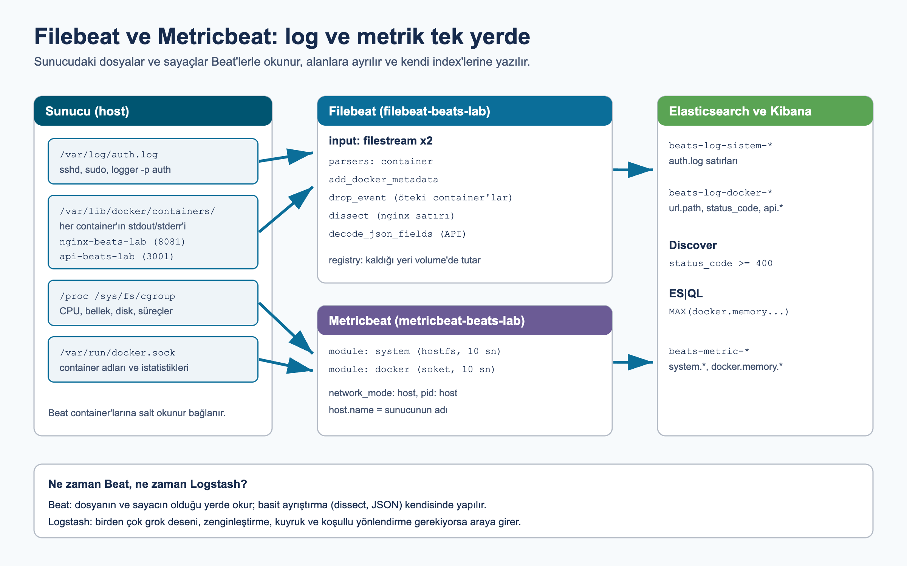
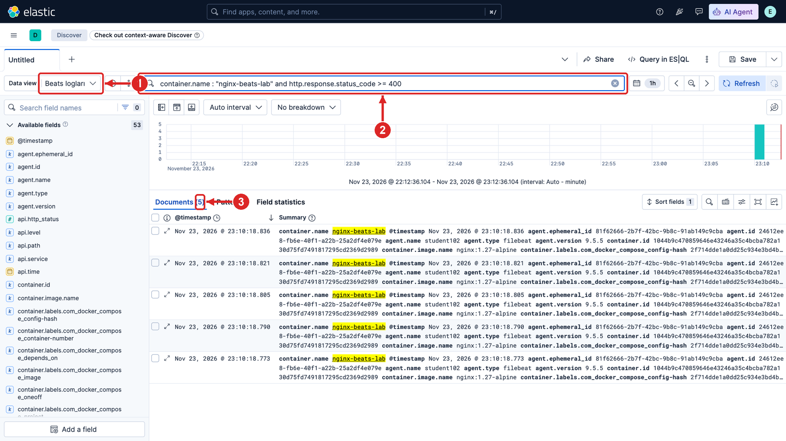

# LAB-10 — Filebeat ve Metricbeat: Sunucudan ve Container'lardan Log ve Metrik Toplamak

| Kullanılan Araçlar | Açık / Kullanılan Portlar |
|---|---|
| Filebeat 9.5.5, Metricbeat 9.5.5, Docker, Kibana Dev Tools ve Discover | `127.0.0.1:8081` (demo nginx), `127.0.0.1:3001` (demo API), 9200 / 5601 (ana cluster) |

---

## Bu lab ne öğretiyor?

"Hangi container 404 üretiyor, o sırada hangisi en çok bellek kullanıyor?" sorusu için dosyalara ve çekirdeğe
dağılmış log ve metriklerin tek yerde, field'lara ayrılmış hâlde olması gerekir:

- **Filebeat:** host'un `auth.log`'unu ve iki demo servisin container loglarını toplamak
- **Processor'lar:** nginx satırını Filebeat'te field'lara ayırmak (`dissect`), container adını eklemek
- **Metricbeat:** host ve container CPU/bellek metrikleri
- **Discover:** 404 üreten istekleri tek sorguyla bulmak



---

## Ön Koşullar

- Önce kurulu olmalı: LAB-01 ana cluster'ı. `127.0.0.1:8081` ve `127.0.0.1:3001` boş olmalı; dört container
  birlikte yaklaşık 700 MB RAM kullanır.
- Önceki labı atladıysanız: sorun değil; veriyi bu labın kendi container'ları üretir.

```bash
cd ~/elastic/labs/LAB-10-filebeat-metricbeat
```

---

## Kavramlar

- **Beat:** tek işe odaklı, hafif veri toplayıcı; veriyi okuduğu makinede çalışır ve Elasticsearch'e (ya da Logstash'e) yazar
- **Filebeat:** log dosyalarını satır satır okur; kaldığı yeri `registry`'de tutar, kapanıp açılınca aynı satırı iki kez göndermez
- **Metricbeat:** modüllerle (`system`, `docker`…) metrikleri belirli aralıkla (`period`) ölçer
- **Input · processor · output:** ne okunacak · olay yazılmadan önce ne değişecek · nereye yazılacak
- **Beat mi Logstash mı:** basit ayrıştırma (`dissect`, JSON çözme) Beat'te yapılır; grok, birden çok desen ya da olayları farklı hedeflere yönlendirme gerekirse Logstash (Beat'te grok yok, tek output var)

---

## Config dosyaları: hangi satır ne işe yarıyor?

`config/filebeat.yml` (container input'u):

```yaml
- type: filestream
  paths: ["/var/lib/docker/containers/*/*.log"]
  parsers:
    - container: ~
  index: "beats-log-docker-%{+yyyy.MM.dd}"
  processors:
    - add_docker_metadata: ~
    - drop_event:
        when.not.or:
          - equals.container.name: nginx-beats-lab
          - equals.container.name: api-beats-lab
    - dissect:
        when.equals.container.name: nginx-beats-lab
        tokenizer: '%{source.ip} - %{} [%{}] "%{http.request.method} %{url.path} %{}" %{http.response.status_code|integer} %{}'
```

- Docker, her container'ın stdout/stderr'ini `/var/lib/docker/containers/<id>/<id>-json.log` dosyasına
  JSON olarak yazar. `container` parser'ı bu JSON'u açar; asıl satır `message` olur.
- `add_docker_metadata`: dosya adındaki id'den `container.name` ve `container.image.name` ekler.
- `drop_event`: sunucudaki öteki container'ların (Elasticsearch, Kibana) logları bu labda gereksiz.
- `dissect`: nginx satırını boşluk ve tırnaklara göre böler; `|integer` durum kodunu sayı yapar.
- `index`: her input kendi index'ine yazar. Container'ın içinde `/hostfs/var/log` host'un `/var/log`
  klasörüdür (salt okunur bağlandı).

`config/metricbeat.yml` ve compose'daki karşılığı:

```yaml
- module: system
  period: 10s
  hostfs: "/hostfs"
  metricsets: ["cpu", "memory", "load", "process"]
- module: docker
  hosts: ["unix:///var/run/docker.sock"]
  metricsets: ["container", "cpu", "memory"]
```

- Metricbeat container'da çalıştığı için host'un `/proc` ve `/sys/fs/cgroup`'u `/hostfs` altına bağlandı
  ve `hostfs` ile gösterildi. Yoksa container'ın kendi CPU ve belleğini ölçer.
- Compose'da iki Beat de `network_mode: host` ve Metricbeat `pid: host` ile çalışır: host'un ağını, adını
  ve süreçlerini görür; Elasticsearch'e `127.0.0.1:9200` ile bağlanır. `docker` modülü Docker
  soketinden container başına CPU ve bellek okur.

---

## Adım Adım Uygulama Rehberi

### 1. Index şablonları

**Soru: Beat'in yazacağı index'lerin mapping'ini kim belirler?** Beats'in kendi şablonu yüzlerce field içerir ve
data stream ister. Burada iki küçük şablonu biz kuruyoruz (`setup.template.enabled: false`): metin field'ları
`keyword` olur, yalnız `message` aranabilir metindir.

Kibana › Dev Tools'a yapıştırın:

```http
PUT _index_template/beats-log
{
  "index_patterns": ["beats-log-*"],
  "template": {
    "settings": { "number_of_shards": 1, "number_of_replicas": 0 },
    "mappings": {
      "dynamic_templates": [ { "metin": { "match_mapping_type": "string", "mapping": { "type": "keyword" } } } ],
      "properties": { "message": { "type": "text" }, "http.response.status_code": { "type": "integer" } }
    }
  }
}
```

```json
{"acknowledged":true}
```

```http
PUT _index_template/beats-metric
{
  "index_patterns": ["beats-metric-*"],
  "template": {
    "settings": { "number_of_shards": 1, "number_of_replicas": 0 },
    "mappings": { "dynamic_templates": [ { "metin": { "match_mapping_type": "string", "mapping": { "type": "keyword" } } } ] }
  }
}
```

```json
{"acknowledged":true}
```

### 2. Demo servisleri ve Filebeat'i başlatın

**Soru: Container logları Elasticsearch'e nasıl gelir?** İki demo servisi (nginx, API) ve Filebeat'i başlatın:

```bash
docker compose up -d nginx api filebeat
timeout 120 bash -c 'until curl -s -o /dev/null 127.0.0.1:3001/api/pay && curl -s -o /dev/null 127.0.0.1:8081/; do printf .; sleep 2; done'; echo " servisler hazır"
```

Beklenen çıktı:

```text
. servisler hazır
```

**Trafik üretin:** betik servislere sabit sayıda istek atar ve host'un `auth.log`'una 5 deneme satırı yazar.
`RUN` bu koşunun etiketidir; Adım 4'te satırları onunla bulacağız:

```bash
export RUN=$(date +%H%M%S)
./scripts/trafik.sh
```

Beklenen çıktı:

```text
  nginx      20 200
  nginx       5 404
  api        10 200
  api         3 500
  auth.log: 5 satir (etiket beats-lab-194014)
```

**Bekleyin:** Filebeat dosyaları birkaç saniyede bir tarar. 40 isteğin hepsi (betiğin 38'i ve hazır olma
kontrolünün 2'si) Elasticsearch'e gelene kadar bekleyin:

```bash
timeout 120 bash -c 'until [ "$(curl -s -u elastic:"DevOps2026!" "http://127.0.0.1:9200/beats-log-docker-*/_count?q=http.response.status_code:*%20OR%20api.http_status:*" | jq .count)" -ge 40 ]; do printf .; sleep 3; done'; echo
curl -s -u elastic:'DevOps2026!' 'http://127.0.0.1:9200/_cat/indices/beats-log-*?h=index&s=index'
```

Beklenen çıktı:

```text
...
beats-log-docker-2026.11.21
beats-log-sistem-2026.11.21
```

- **İki index:** container logları `beats-log-docker-*`, host logu `beats-log-sistem-*`; tarih sizde farklıdır.

### 3. Önce ve sonra: nginx satırı

**Soru: Filebeat ham satırı nasıl field'lara ayırdı?**

**Önce:** Docker'ın diske yazdığı ham satır (Docker'ın dosyaları root'a aittir, `sudo` gerekir):

```bash
ID=$(docker inspect -f '{{.Id}}' nginx-beats-lab)
sudo grep '"GET /yok' /var/lib/docker/containers/$ID/$ID-json.log | grep -m1 '"stream":"stdout"'
```

Beklenen çıktı:

```text
{"log":"172.19.0.1 - - [21/Nov/2026:16:27:30 +0000] \"GET /yok HTTP/1.1\" 404 153 \"-\" \"curl/8.5.0\" \"-\"\n","stream":"stdout","time":"2026-11-21T16:27:30.69017799Z"}
```

- **İki satır:** nginx her 404 için `stderr`'e bir hata satırı da yazar; `grep` erişim satırını (`stdout`) seçer.

**Sonra:** Elasticsearch'teki document:

```bash
curl -s -u elastic:'DevOps2026!' 'http://127.0.0.1:9200/beats-log-docker-*/_search?q=url.path:%22/yok%22&size=1' \
  | jq -c '.hits.hits[0]._source | {"container.name": .container.name, "source.ip": .source.ip, "http.request.method": .http.request.method, "url.path": .url.path, "http.response.status_code": .http.response.status_code}'
```

Beklenen çıktı:

```text
{"container.name":"nginx-beats-lab","source.ip":"172.19.0.1","http.request.method":"GET","url.path":"/yok","http.response.status_code":404}
```

| Ham satırda | Document'te | Nasıl |
|---|---|---|
| `{"log":"... GET /yok ... 404 ...","stream":"stdout"}` | `message` | `container` parser |
| Dosya adındaki container id | `container.name: nginx-beats-lab` | `add_docker_metadata` |
| `GET`, `/yok`, `404` | `http.request.method`, `url.path`, `http.response.status_code` (sayı) | `dissect` |

- **`172.19.0.1`:** Docker ağının geçidi; istek host'tan port yönlendirmesiyle geldi.

**API logu:** API container'ı zaten JSON yazdığı için `decode_json_fields` satırı `api.*` field'larına açar.
Servis başına durum kodları:

```bash
curl -s -u elastic:'DevOps2026!' 'http://127.0.0.1:9200/beats-log-docker-*/_search?size=0' -H 'Content-Type: application/json' \
  -d '{"aggs":{"nginx":{"terms":{"field":"http.response.status_code"}},"api":{"terms":{"field":"api.http_status"}}}}' \
  | jq -c '.aggregations | {nginx: [.nginx.buckets[] | {(.key|tostring): .doc_count}] | add, api: [.api.buckets[] | {(.key|tostring): .doc_count}] | add}'
```

Beklenen çıktı:

```text
{"nginx":{"200":21,"404":5},"api":{"200":11,"500":3}}
```

- **21 ve 11:** betiğin 20 ve 10 isteğine Adım 2'deki hazır olma kontrolünün birer isteği eklenir.

### 4. Host logu: auth.log

**Soru: Host'un kendi log dosyası da toplanıyor mu?** Aynı Filebeat host'un `auth.log` dosyasını da okur. Bu
koşunun 5 satırı index'e düşene kadar bekleyip dosyadaki sıralarıyla (`log.offset`) gösterin:

```bash
timeout 60 bash -c "until [ \"\$(curl -s -u elastic:'DevOps2026!' 'http://127.0.0.1:9200/beats-log-sistem-*/_count?q=message:%22beats-lab-$RUN%22' | jq .count)\" -ge 5 ]; do printf .; sleep 2; done"; echo
curl -s -u elastic:'DevOps2026!' "http://127.0.0.1:9200/beats-log-sistem-*/_search?q=message:%22beats-lab-$RUN%22&size=5&sort=log.offset" \
  | jq -r '.hits.hits[]._source | "\(.host.name) | \(.message)"'
```

Beklenen çıktı:

```text

<host> | 2026-11-21T19:40:14.626963+03:00 <host> beats-lab-194014: deneme oturumu 1
<host> | 2026-11-21T19:40:14.631526+03:00 <host> beats-lab-194014: deneme oturumu 2
<host> | 2026-11-21T19:40:14.634231+03:00 <host> beats-lab-194014: deneme oturumu 3
<host> | 2026-11-21T19:40:14.637414+03:00 <host> beats-lab-194014: deneme oturumu 4
<host> | 2026-11-21T19:40:14.640656+03:00 <host> beats-lab-194014: deneme oturumu 5
```

- **`host.name`:** sunucunuzun adı; saat ve etiket sizde farklıdır.
- **Eski satırlar da var:** Filebeat dosyayı baştan okur; index'te sunucunun eski oturum kayıtları (SSH girişleri,
  `sudo`) ve labı daha önce yaptıysanız eski deneme satırları da vardır.
- **`registry`:** Filebeat kapanıp açılırsa kaldığı yerden devam eder; aynı satırı iki kez göndermez.

### 5. Metricbeat: host ve container metrikleri

**Soru: Hangi container en çok bellek kullanıyor?** Metricbeat'i başlatın; ilk bellek ölçümleri gelene kadar bekleyin:

```bash
docker compose up -d metricbeat
timeout 120 bash -c 'until [ "$(curl -s -u elastic:"DevOps2026!" "http://127.0.0.1:9200/beats-metric-*/_count?q=metricset.name:memory%20AND%20docker.memory.usage.total:*" | jq .count)" -ge 5 ]; do printf .; sleep 3; done'; echo
```

Beklenen çıktı:

```text
.....
```

**En çok bellek kullanan üç container**, ES|QL ile:

```http
POST _query?format=txt
{ "query": "FROM beats-metric-* | WHERE metricset.name == \"memory\" AND docker.memory.usage.total IS NOT NULL | STATS bellek_mb = ROUND(MAX(docker.memory.usage.total) / 1048576) BY container.name | SORT bellek_mb DESC | LIMIT 3" }
```

Beklenen çıktı:

```text
   bellek_mb   |  container.name   
---------------+-------------------
1986           |elasticsearch-lab00
1168           |kibana-lab00       
62             |filebeat-beats-lab 
```

- **Değerler sizde farklıdır;** Elasticsearch genellikle en üsttedir.
- **Host metrikleri:** aynı index'te `system.cpu.total.norm.pct` (CPU) ve `system.memory.actual.used.pct` (bellek)
  10 saniyede bir gelir.

### 6. Discover: 404 üreten istekler

**Soru: Toplanan loglarda arayüzden nasıl ararız?** Kibana adresini sunucuda hesaplayın:

```bash
IP=$(curl -s https://api.ipify.org); H=$(hostname -s)
echo "Kibana: http://$IP:5601   https://$H-kibana.devopsatolyesi.com"
```

Beklenen çıktı:

```text
Kibana: http://<IP>:5601   https://<host>-kibana.devopsatolyesi.com
```

**Data view:** log index'leri için bir data view kurun (Dev Tools):

```http
POST kbn:/api/data_views/data_view
{ "data_view": { "id": "beats-log", "title": "beats-log-*", "name": "Beats logları", "timeFieldName": "@timestamp" } }
```

**Discover**'da `Beats logları` data view'ını (1) seçin, zaman aralığını **Last 1 hour** yapın ve sorgu
çubuğuna (2) yazın:

```text
container.name : "nginx-beats-lab" and http.response.status_code >= 400
```



- **Beş document (3):** `trafik.sh`'nin attığı `/yok` istekleri.

<details>
<summary><strong>Filebeat'i container yerine sunucuya paketle kurmak</strong></summary>

Container kullanılmayan sunucularda Beat, Elastic'in APT deposundan paket olarak kurulur ve systemd
servisi olarak çalışır. Sürüm ana cluster'la aynı tutulur:

```bash
curl -fsSL https://artifacts.elastic.co/GPG-KEY-elasticsearch | sudo gpg --dearmor --yes -o /usr/share/keyrings/elasticsearch-keyring.gpg
echo "deb [signed-by=/usr/share/keyrings/elasticsearch-keyring.gpg] https://artifacts.elastic.co/packages/9.x/apt stable main" \
  | sudo tee /etc/apt/sources.list.d/elastic-9.x.list >/dev/null
sudo apt-get update -qq && sudo DEBIAN_FRONTEND=noninteractive apt-get install -y -qq filebeat=9.5.5 >/dev/null 2>&1
filebeat version
```

Beklenen çıktı:

```text
filebeat version 9.5.5 (amd64), libbeat 9.5.5 [b80bf8464fba72f582cefed91dd72909eb7116db built 2026-09-30 21:46:05 +0000 UTC] (FIPS-distribution: false)
```

Config `/etc/filebeat/filebeat.yml`'dir; `sudo filebeat test config` ve `sudo filebeat test output`
ayarı ve Elasticsearch bağlantısını sınar, `sudo systemctl enable --now filebeat` servisi başlatır. Burada
servisi başlatmayın: aynı dosyaları container'daki Filebeat zaten okuyor. Paketi ve config'ini
kaldırmak için (`purge`; APT deposu tanımı kalır):

```bash
sudo DEBIAN_FRONTEND=noninteractive apt-get purge -y -qq filebeat >/dev/null 2>&1 && echo "filebeat kaldırıldı"
```

Beklenen çıktı:

```text
filebeat kaldırıldı
```

</details>

---

## Temizlik

Yalnız bu labın dört container'ını ve Filebeat registry volume'ünü, `beats-*` index'lerini, iki şablonu
ve data view'ı siler. Ana cluster'a dokunmaz; `auth.log`'a yazılan 5 satır sistem logu olduğu için kalır:

```bash
./teardown.sh
```

<details>
<summary><strong>Çıktının tamamı (10 satır)</strong></summary>

```text
Container filebeat-beats-lab Removed
Container nginx-beats-lab Removed
Container metricbeat-beats-lab Removed
Container api-beats-lab Removed
Volume beats-lab_filebeat-data Removed
Network beats-lab_default Removed
index'ler -> 200
sablon beats-log -> 200
sablon beats-metric -> 200
data view beats-log -> 200
```

</details>

Labı aynı sunucuda yeniden yapacaksanız başlamadan önce `./teardown.sh` çalıştırın; README'deki sayılar temiz
başlangıca göredir.

---

Sonraki lab: **[LAB-11 — Fleet Server ve Elastic Agent: Tek Ajan, Merkezi Politika](../LAB-11-fleet-elastic-agent/README.md)**
