# LAB-11 — Fleet Server ve Elastic Agent: Tek Ajan, Merkezi Politika

| Kullanılan Araçlar | Açık / Kullanılan Portlar |
|---|---|
| Elastic Agent 9.5.5 (Fleet Server + yönetilen ajan), Kibana Fleet, Docker Compose | `127.0.0.1:8220` (Fleet Server, yalnız sunucudan), 9200 / 5601 — LAB-01 ana cluster'ı |

---

## Bu lab ne öğretiyor?

Beats ile her Beat ayrı YAML ve servis demektir; 50 sunucuda hangi ayarın çalıştığını kimse bilemez. Fleet ayarı
Kibana'ya taşır: sunucuda tek program (**Elastic Agent**) çalışır, ne toplayacağını Kibana'daki **agent policy** söyler.

- **Fleet'i Kibana'dan kurmak:** output, Fleet Server, politika ve token'lar; token'ları compose'a elle vermek
- **Politikayı Kibana'dan değiştirmek:** sunucuya girmeden ayarın ajana gitmesi (revision)
- **Add integrations:** Nginx loglarını eklemek, integration'ın hazır panosu
- **CPU yükü:** kısa bir yükü Lens panosunda görmek

Kibana'daki her tıklama kırmızı kutu ve numarayla gösterilir.


---

## Ön Koşullar

- Önce kurulu olmalı: LAB-01 ana cluster'ı. `127.0.0.1:8220` portu boş olmalı; iki ajan container'ı birlikte
  yaklaşık 1 GB RAM kullanır. Adım 7 `stress-ng` paketini `sudo apt-get` ile kurar.
- Önceki labı atladıysanız: sorun değil; LAB-10'a bağlı değildir, veriyi ajan sunucudan toplar.

```bash
cd ~/elastic/labs/LAB-11-fleet-elastic-agent
```

Kibana adresini sunucuda hesaplayın:

```bash
IP=$(curl -s https://api.ipify.org); H=$(hostname -s)
echo "Kibana: http://$IP:5601   https://$H-kibana.devopsatolyesi.com"
```

Beklenen çıktı:

```text
Kibana: http://<IP>:5601   https://<host>-kibana.devopsatolyesi.com
```

---

## Kavramlar

- **Elastic Agent:** her sunucuda çalışan tek program; politikayı uygular, veriyi **doğrudan Elasticsearch'e** yazar
- **Agent policy:** ajanın ne toplayacağının listesi; her değişiklikte **revision**'ı bir artar
- **Integration:** bir kaynağın hazır toplama ayarı (System, Nginx…); panolarını ve ingest pipeline'larını da getirir
- **Fleet (Kibana):** politikaları ve integration'ları yönetilen arayüz
- **Fleet Server:** ajanların düzenli sorduğu (check-in) sunucu; yeni politikayı ajana verir, veri taşımaz
- **Output:** ajanların veriyi yazdığı Elasticsearch adresi
- **Service token:** Fleet Server'ın Elasticsearch'e bağlanma kimliği. **Enrollment token:** ajanın hangi
  politikaya kaydolacağını belirleyen anahtar
- **Namespace:** data stream adının son parçası, ortamı ya da ekibi ayırır: `<tür>-<veri seti>-<namespace>` → `logs-system.auth-fleetlab`

---

## Config dosyaları: hangi satır ne işe yarıyor?

`docker-compose.yml` (izleme ajanı):

```yaml
    user: root
    volumes:
      - /var/log:/var/log:ro
      - /proc:/hostfs/proc:ro
      - /sys/fs/cgroup:/hostfs/sys/fs/cgroup:ro
    environment:
      - FLEET_ENROLL=1
      - FLEET_URL=https://fleet-server:8220
      - FLEET_ENROLLMENT_TOKEN=${FLEET_ENROLLMENT_TOKEN}
      - FLEET_INSECURE=true     # Fleet Server kendi imzali sertifikayla acilir (yalniz lab)
```

- `volumes`: sunucunun log dizini ve `/proc`'u salt okunur bağlanır. Bağlanmazsa ajan yalnız kendi
  container'ını görür; sunucunun SSH girişleri ve süreçleri gelmez.
- `user: root`: `/var/log/auth.log` yalnız `root` ve `adm` grubunca okunur.
- `${FLEET_ENROLLMENT_TOKEN}`: değer `.env` dosyasından gelir; Adım 1'de Kibana'dan kopyalayıp Adım 2'de
  oraya yazacaksınız. Fleet Server servisi de `${FLEET_SERVER_SERVICE_TOKEN}`'ı aynı dosyadan alır.
- `FLEET_INSECURE=true`: Fleet Server'ın kendi imzalı sertifikası doğrulanmaz; üretimde CA verilir.

Fleet Server servisinde `FLEET_SERVER_POLICY_ID=fleet-server-policy` yazar: Kibana'nın Adım 1'de açacağı Fleet
Server politikasının id'si budur.

---

## Adım Adım Uygulama Rehberi

### 1. Fleet'i Kibana'dan hazırlayın

**Soru: Ajan çalışmadan önce Fleet'te ne hazır olmalı?** Dört şey: ajanların veriyi yazacağı adres (output),
Fleet Server ve onun service token'ı, ajanın politikası, o politikanın enrollment token'ı. Hepsi Kibana › Fleet'te.

<details>
<summary><strong>Arayüz yerine betikle yapmak isterseniz</strong></summary>

Betik bu adımdaki her şeyi API ile yapar ve iki token'ı `.env`'e yazar (Adım 2 de yapılmış olur). Token'lar
ekrana basılmaz. Çalıştırdıktan sonra doğrudan Adım 3'e geçin:

<!-- runner:skip -->
```bash
python3 scripts/setup_fleet.py
```

```text
output                 : http://elasticsearch-lab00:9200
fleet server adresi    : https://fleet-server:8220
Fleet Server politikasi: Fleet Server Policy (fleet-server-policy), service token alindi
Linux politikasi       : Lab Linux sunucu (namespace fleetlab, system-lab, hostfs=/hostfs)
enrollment token       : alindi
.env                   : yazildi
```

</details>

**1.1 Fleet'i açın.** Sol üstteki menü düğmesine (1) tıklayın, **Management** altında **Fleet**'i (2) seçin:

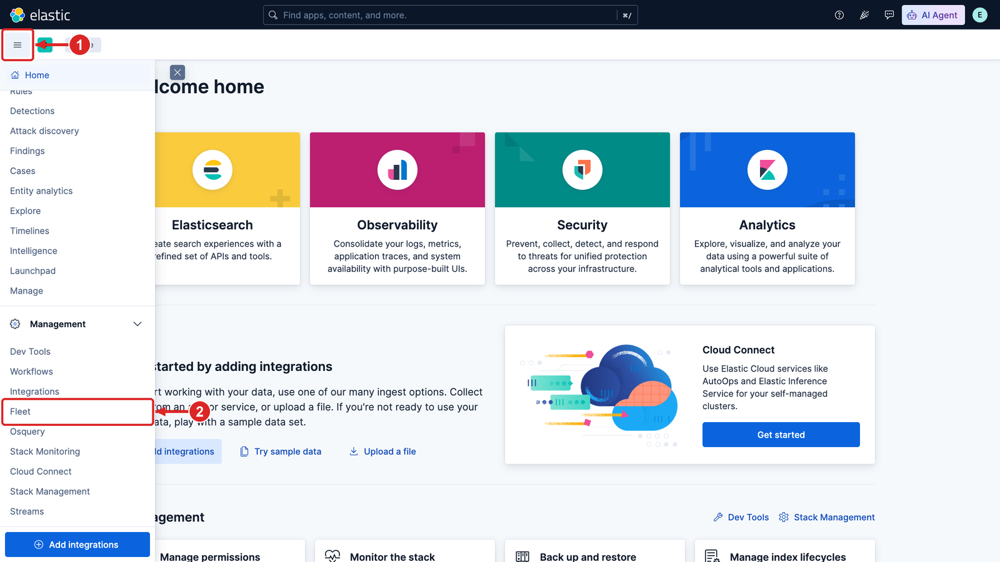

**1.2 Output: veri nereye yazılacak?** Varsayılan adres `http://localhost:9200`'dür; ajan container'ında
`localhost` container'ın kendisidir ve veri hiçbir yere gitmez. Ana cluster'ın Docker ağındaki adını verin.
**Settings** sekmesine (1) tıklayın, **Outputs** tablosunda `default` satırının kalem düğmesine (2) basın:

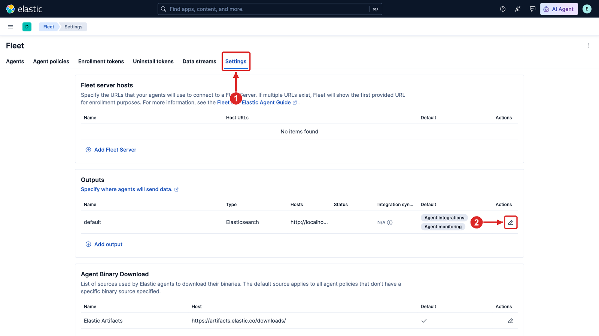

**Hosts** (1) kutusuna `http://elasticsearch-lab00:9200` yazın ve **Save and apply settings** (2):

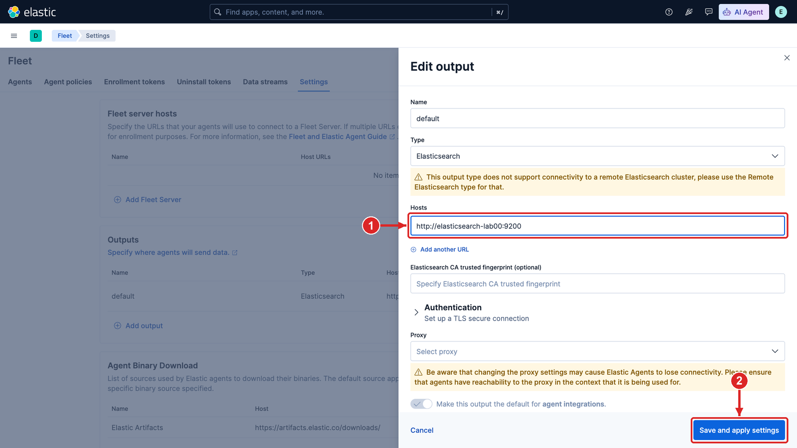

Labı daha önce yaptıysanız adres zaten `http://elasticsearch-lab00:9200`'dür ve düğme pasif kalır: değişiklik yok demektir, pencereyi **Cancel** ile kapatıp 1.3'e geçin.

Onay penceresi çıkarsa **Save and deploy** (1):

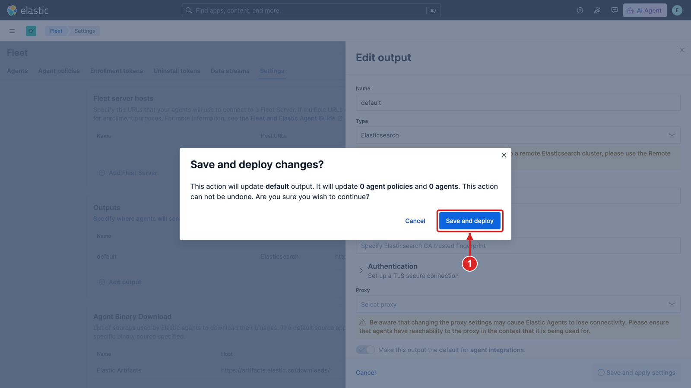

**1.3 Fleet Server: politika ve service token.** **Agents** sekmesi (1) henüz Fleet Server olmadığını söyler;
**Add Fleet Server**'a (2) tıklayın:

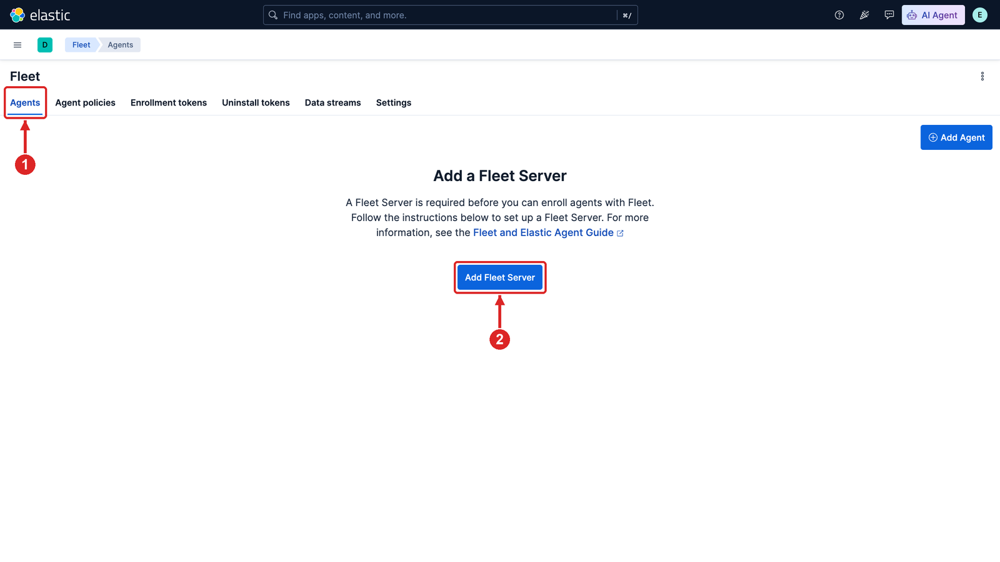

**Quick Start** (1) sekmesinde **Name** (2) `Lab Fleet Server`, **URL** (3) `https://fleet-server:8220` yazın
(ajanların Fleet Server'a Docker ağında ulaşacağı adres) ve **Generate Fleet Server policy** (4):

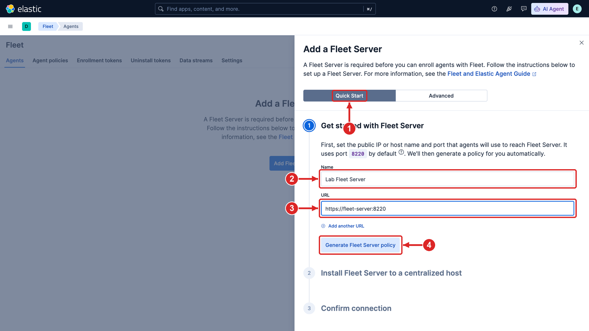

Kibana `fleet-server-policy` adlı politikayı ve bir service token üretir, ikisini bir kurulum komutunda gösterir.
Komutu **çalıştırmayın**: Fleet Server'ı paket olarak değil, Adım 3'te container olarak kuracağız. Yalnız
`--fleet-server-service-token=` sonrasındaki değeri (1) kopyalayıp bir kenara not edin (`AAEAA` ile başlar).
`--fleet-server-policy=fleet-server-policy` (2) compose dosyasındaki politika id'siyle aynıdır:

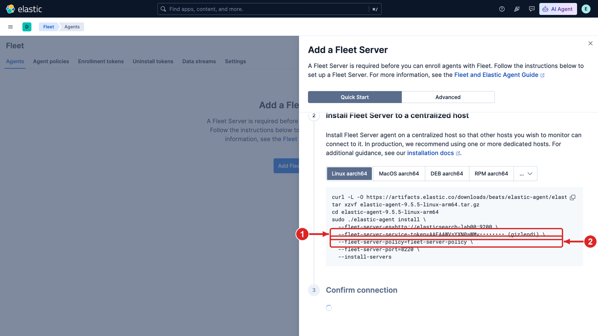

Görüntüde token gizlendi; sizin ekranınızda tamamı görünür. **Dikkat:** komut satırı ekranın sağında kesilir. Token 90 karakterdir; seçerken satırın sonuna kadar gidin, yalnız görünen kısmı kopyalamayın. Pencereyi sağ üstteki **X** ile kapatın. 3. adım
(Confirm connection) Fleet Server container'ı açılınca kendiliğinden tamamlanır.

Quick Start'ın politikası ajan izlemeyi (monitoring) açık getirir. Açık kalırsa Fleet Server ilk dakikalarda
`localhost:9200`'e yazmaya çalışır ve 5 dakikaya kadar `degraded` görünür; bu labda gereksiz yüktür, kapatın.
**Agent policies** sekmesinde (1) **Fleet Server Policy**'ye (2) tıklayın:

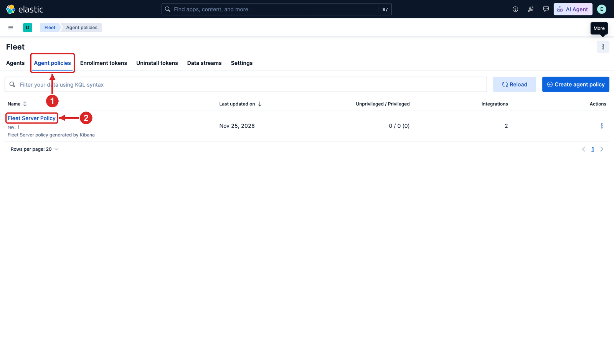

**Settings** sekmesi (1):

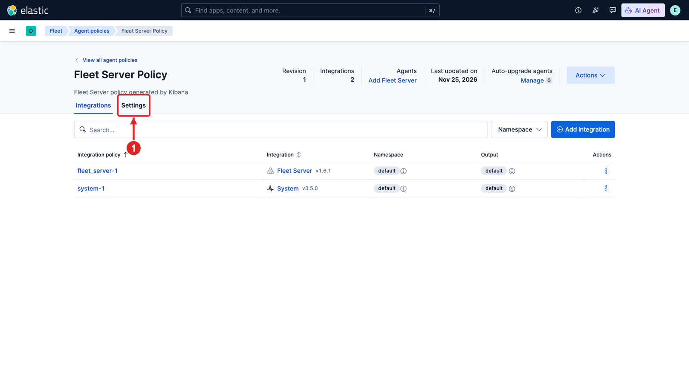

Aşağı kaydırın; **Collect agent logs** (1) ve **Collect agent metrics** (2) işaretlerini kaldırıp **Save
changes** (3):

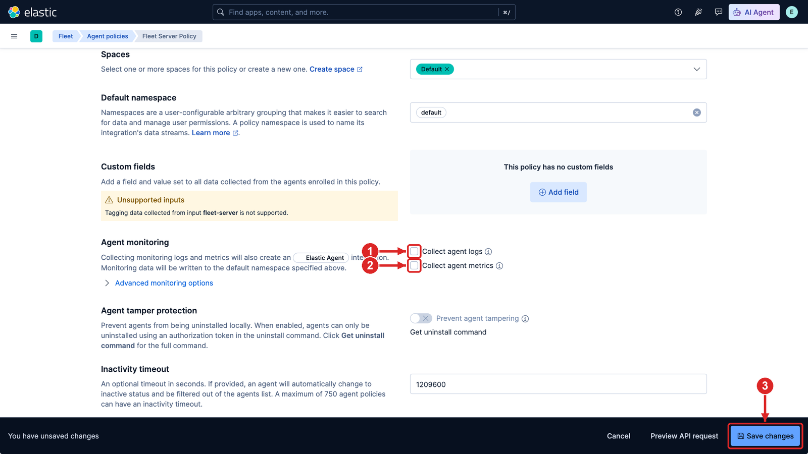

**1.4 Ajanın politikası.** **Agent policies** sekmesi (1), **Create agent policy** (2):

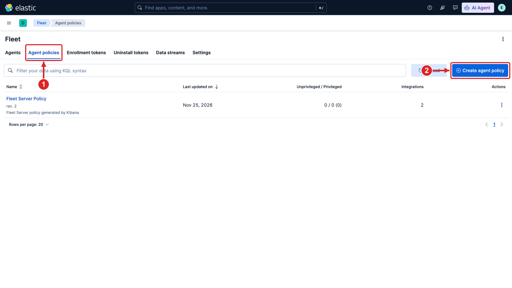

**Name** (1) `Lab Linux sunucu`. **Collect system logs and metrics** (2) işaretli kalsın: politikaya System
integration'ını ekler. Sonra **Advanced options** (3):

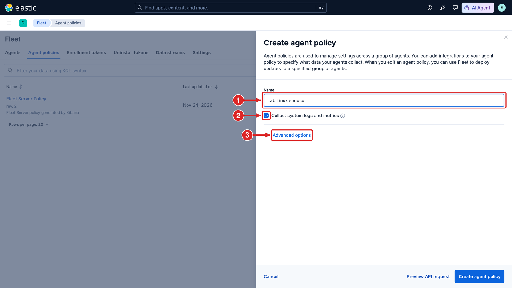

**Default namespace** (1) kutusundaki `default`'u **x** ile silin, `fleetlab` yazıp Enter'a basın. Bu labın
data stream'leri `-fleetlab` ile biter:

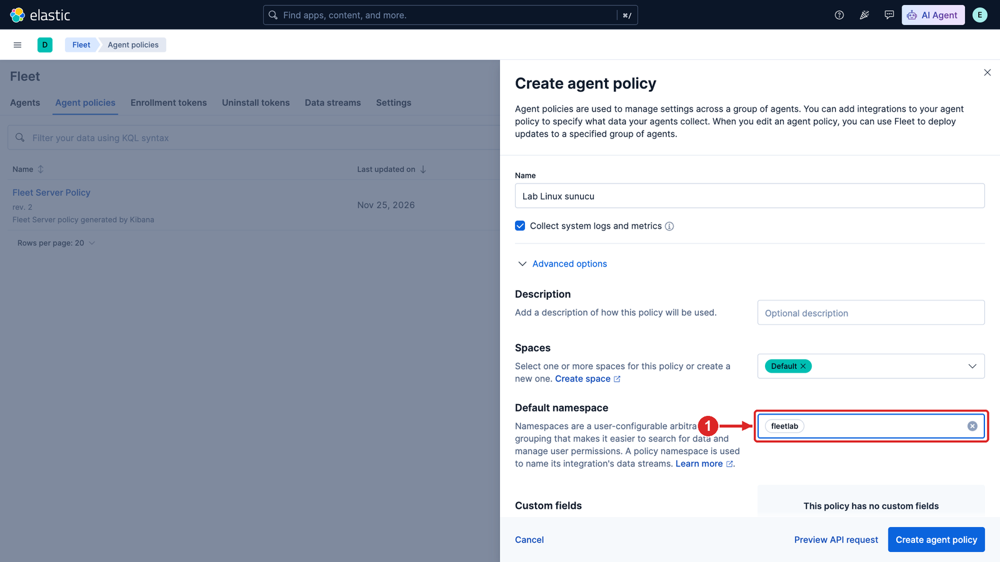

Aşağı kaydırın. **Collect agent logs** (1) ve **Collect agent metrics** (2) işaretlerini kaldırın: ajanın kendi
loglarını toplamak bu labda gereksiz yük olur. **Create agent policy** (3):

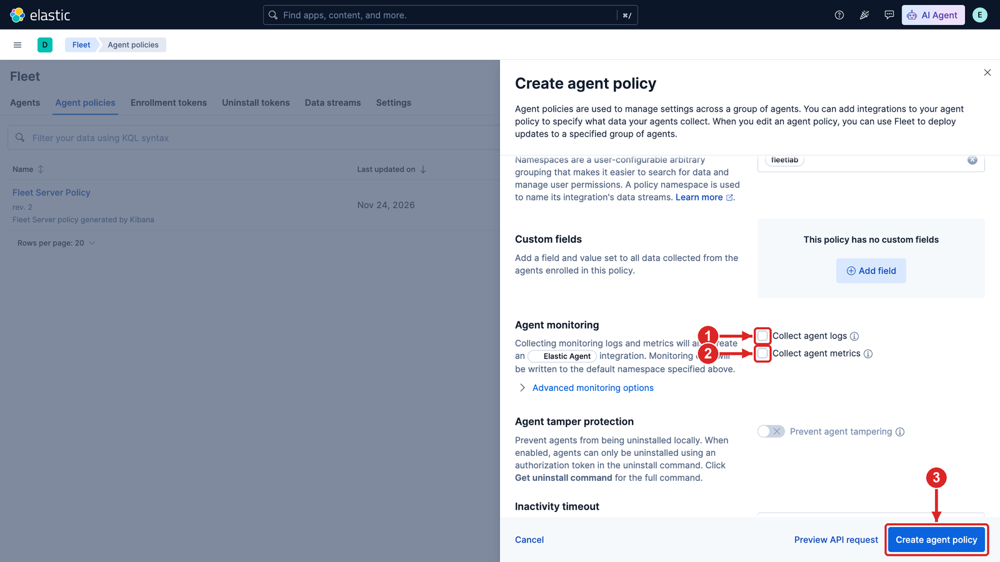

**1.5 System integration'ı: sunucunun `/proc`'u.** Ajan container'da çalışır; metrikleri container'ın değil,
bağlanan `/hostfs/proc`'tan okumalı. Listede **Lab Linux sunucu**'ya (1) tıklayın:

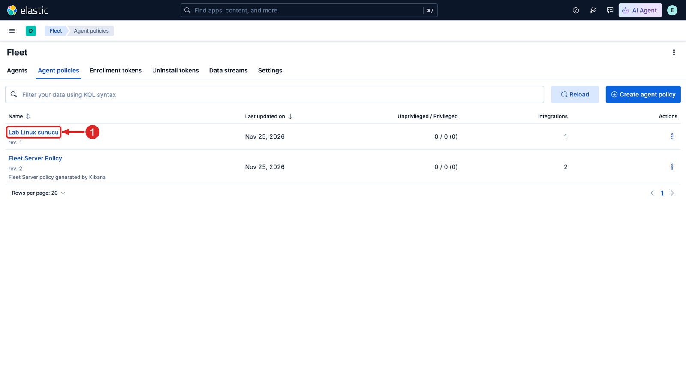

Politikadaki `system-` ile başlayan integration'a (1) tıklayın (numarası sizde farklı olabilir):

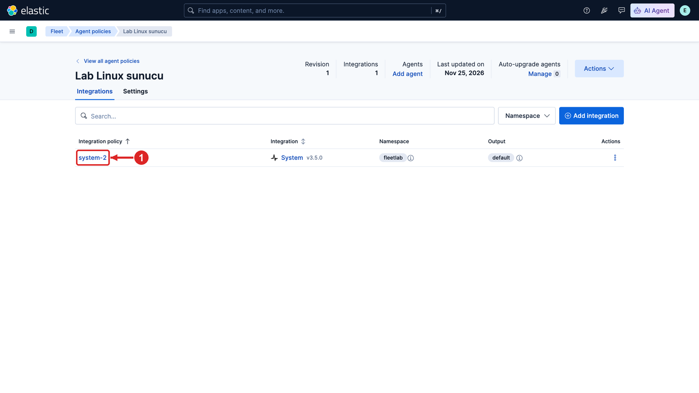

**Integration name** (1) kutusuna `system-lab` yazın (sonraki adımlar bu adı kullanır):

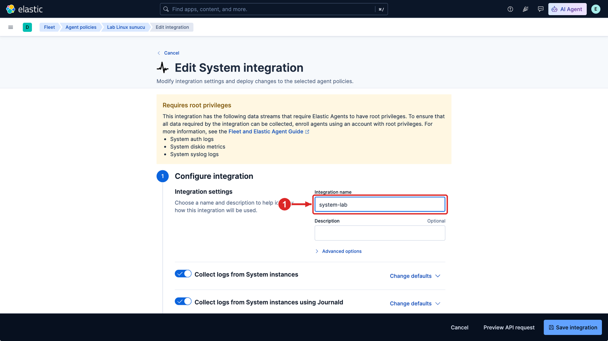

Aşağıda **Collect metrics from System instances** satırının **Change defaults**'una (1) tıklayın:

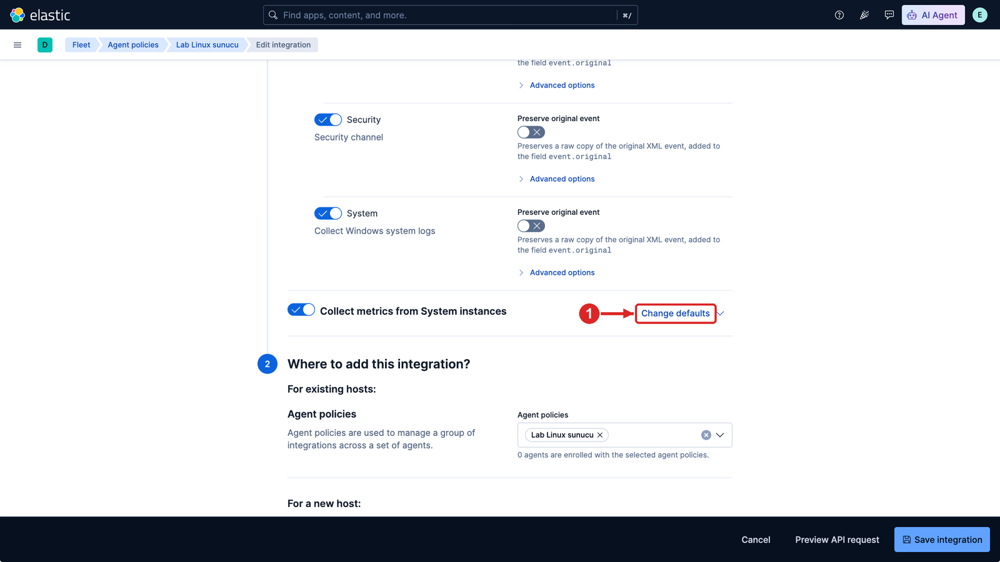

**Proc Filesystem Directory** (1) kutusuna `/hostfs` yazın ve sağ alttaki **Save integration** (2):

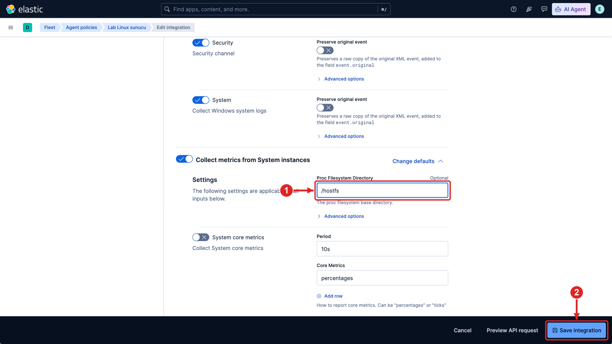

**1.6 Enrollment token.** **Enrollment tokens** sekmesinde (1) **Lab Linux sunucu** satırının göz düğmesi (2)
token'ı gösterir, kopyala düğmesi (3) panoya alır. Kopyalayıp bunu da not edin:

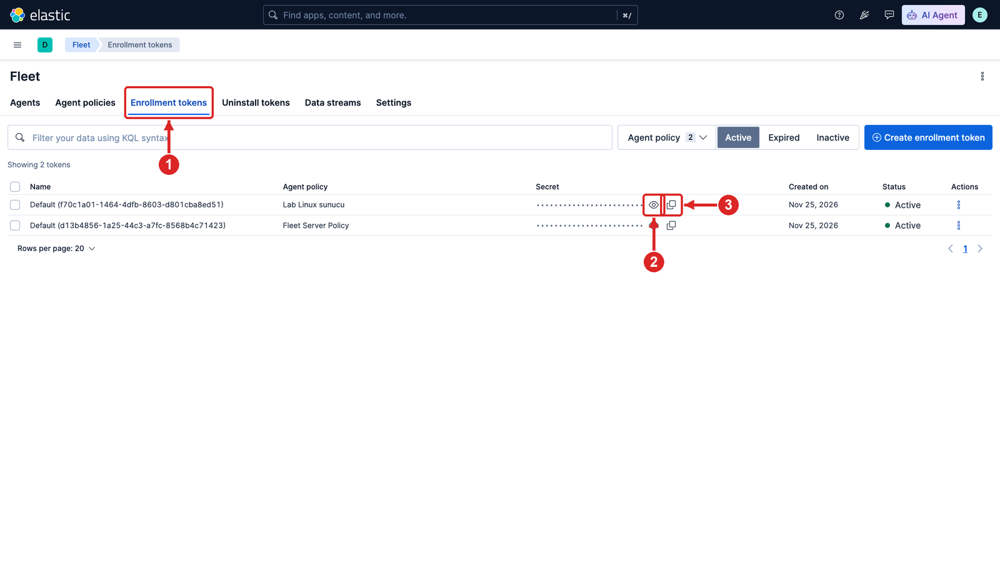

`Fleet Server Policy` satırındaki token'ı kullanmayın: o, Fleet Server'ın kendi politikasına kaydeder.

### 2. Token'ları compose'a verin: `.env`

**Soru: Container'lar token'ları nereden alır?** `docker compose` lab dizinindeki `.env` dosyasını kendiliğinden
okur ve `${...}` değişkenlerine koyar. Örnek dosyayı kopyalayıp açın:

```bash
cp .env.example .env
nano .env
```

İki satırdaki `buraya-...` kısmını Adım 1'de kopyaladığınız değerlerle değiştirin (tırnak ve boşluk yok):

```text
FLEET_SERVER_SERVICE_TOKEN=AAEAAWVsYXN0aWMvZmxlZXQtc2VydmVyL3Rva2VuLT...
FLEET_ENROLLMENT_TOKEN=<Enrollment tokens sekmesinden kopyaladığınız değer>
```

`Ctrl+O`, Enter ile kaydedin, `Ctrl+X` ile çıkın. Değerleri ekrana basmadan uzunluklarına bakın:

```bash
awk -F= '/^FLEET/ {print $1, length($2), "karakter"}' .env
```

Beklenen çıktı:

```text
FLEET_SERVER_SERVICE_TOKEN 90 karakter
FLEET_ENROLLMENT_TOKEN 58 karakter
```

- **Uzunluk 20'nin altındaysa** (`buraya-...` kalmışsa) değer yapışmamıştır; ajan kaydolamaz.
- **Service token 90 değilse** (örneğin 26) token kesik kopyalanmıştır. Fleet Server Elasticsearch'e bağlanamaz, Adım 3'teki bekleme zaman aşımına uğrar. Düzeltmesi Adım 3'ün altındaki kutuda.
- **`.env` git'e girmez** (`.gitignore`); token'lar parola gibidir, paylaşılmaz.

### 3. Fleet Server ve ajanı başlatın

**Soru: Ajan Fleet'e nasıl kaydolur?** İki container'ı başlatın; Fleet Server service token'la Elasticsearch'e
bağlanır, ajan enrollment token'la Fleet Server'a kaydolur:

```bash
docker compose up -d
```

**Bekleyin:** Fleet Server açılır, ajan ona kaydolur ve ilk politikayı uygular; ikisinin de `online` olması
yaklaşık 1 dakika sürer:

```bash
timeout 300 bash -c 'until [ "$(curl -s -u elastic:"DevOps2026!" "http://127.0.0.1:5601/api/fleet/agents?perPage=50" | jq "[.items[] | select((.local_metadata.host.hostname | test(\"^(fleet-server|linux-agent-01)$\")) and .status == \"online\")] | length")" -ge 2 ]; do printf .; sleep 5; done'; echo
curl -s -u elastic:'DevOps2026!' 'http://127.0.0.1:5601/api/fleet/agents?perPage=50' \
  | jq -r '.items[] | select(.local_metadata.host.hostname | test("^(fleet-server|linux-agent-01)$")) | "\(.local_metadata.host.hostname)  \(.status)"'
```

Beklenen çıktı:

```text
..........................
fleet-server  online
linux-agent-01  online
```

Satırların sırası sizde farklı olabilir.

<details>
<summary><strong>Noktalar 5 dakika sürüp ajanlar online olmuyorsa</strong></summary>

**1. Fleet Server yeniden başlayıp duruyor mu?**

```bash
docker ps --format '{{.Names}}  {{.Status}}' | grep -E 'fleet-server-lab|agent-fleet-lab'
docker inspect -f '{{.Name}} restart={{.RestartCount}}' fleet-server-lab agent-fleet-lab
docker logs fleet-server-lab 2>&1 | grep -oE 'security_exception: unable to authenticate|timed out waiting for Fleet Server to start' | sort -u | grep . || echo "hata yok"
```

Sağlıklı durumda iki `restart` de 0'dır ve son satır `hata yok` yazar. Sorunlu durumda `fleet-server-lab` birkaç saniyedir açıktır (`Up 11 seconds`), ajan ise dakikalardır; `restart`
sayısı 0'dan büyüktür ve log'da iki ifade görünür:

```text
agent-fleet-lab  Up 6 minutes
fleet-server-lab  Up 11 seconds
/fleet-server-lab restart=3
/agent-fleet-lab restart=0
security_exception: unable to authenticate
timed out waiting for Fleet Server to start
```

- **`security_exception` (401):** Elasticsearch service token'ı tanımıyor. En sık neden kesik kopyalanan
  token'dır; Adım 2'deki uzunluk kontrolü 90 yerine daha küçük bir sayı gösterir.
- **İlk dakikadaki `localhost:9200 … connection refused` satırları normaldir:** ajan politikayı almadan önce
  varsayılan adresi dener, politika gelince `elasticsearch-lab00`'a geçer.

**2. Çözüm: yeni service token'ı doğrudan `.env`'ye yazın.** Değer ekrana basılmaz, kopyalama hatası olmaz:

<!-- runner:skip -->
```bash
T=$(curl -s -u elastic:'DevOps2026!' -H 'kbn-xsrf: true' -X POST http://127.0.0.1:5601/api/fleet/service_tokens | jq -r .value)
sed -i "s|^FLEET_SERVER_SERVICE_TOKEN=.*|FLEET_SERVER_SERVICE_TOKEN=$T|" .env
awk -F= '/^FLEET/ {print $1, length($2), "karakter"}' .env
docker compose up -d fleet-server
```

Beklenen çıktı:

```text
FLEET_SERVER_SERVICE_TOKEN 90 karakter
FLEET_ENROLLMENT_TOKEN 58 karakter
 Container fleet-server-lab Recreated
 Container fleet-server-lab Starting
 Container fleet-server-lab Started
```

`.env` değişince compose yalnız Fleet Server container'ını yeniden kurar; ajan kendiliğinden yeniden bağlanır.
Yukarıdaki bekleme komutunu tekrar çalıştırın; düzeltmeden sonra iki ajan 67 saniyede `online` oldu.

**3. Hâlâ olmuyorsa iki ayara bakın:**

```bash
curl -s -u elastic:'DevOps2026!' http://127.0.0.1:5601/api/fleet/outputs | jq -r '.items[] | select(.is_default) | .hosts[]'
curl -s -u elastic:'DevOps2026!' http://127.0.0.1:5601/api/fleet/agent_policies/fleet-server-policy | jq -c '.item.monitoring_enabled'
```

Beklenen çıktı:

```text
http://elasticsearch-lab00:9200
[]
```

- **Adres `localhost:9200` ise** Adım 1.2'deki output kaydedilmemiştir; ajanlar online olur ama veri gelmez.
- **`["logs","metrics"]` ise** Adım 1.3'te izleme kapatılmamıştır; Fleet Server ilk 5 dakika `degraded` görünür.

</details>

**Arayüzde:** **Fleet › Agents**: `linux-agent-01` (1) **Lab Linux sunucu**, `fleet-server` (2) **Fleet Server
Policy** politikasında, ikisi de `Healthy`. **Last activity** birkaç saniye öncesini gösterir: ajanlar düzenli
check-in yapıyor.

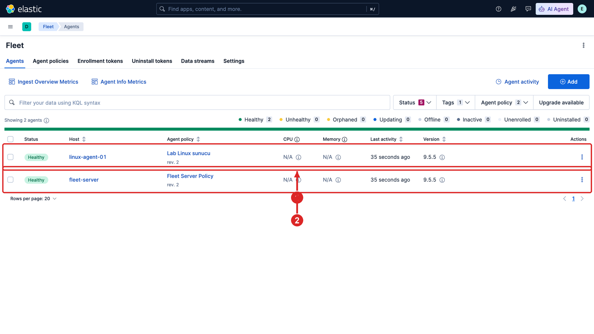

### 4. Önce ve sonra: ajan sunucuyu mu görüyor, container'ı mı?

**Soru: Container'daki ajan sunucuyu nasıl görür?** Bağlama (volume) olmasa container'ın `/var/log`'unda yalnız
image'ın kendi birkaç dosyası olurdu. Bağlamayla aynı dizin sunucunun dizinidir:

```bash
curl -s -u elastic:'DevOps2026!' 'http://127.0.0.1:5601/api/fleet/package_policies?perPage=50' \
  | jq -r '.items[] | select(.name == "system-lab") | "\(.name)  hostfs=\([.inputs[] | select(.type == "system/metrics") | .vars["system.hostfs"].value][0] // "-")"'
docker exec agent-fleet-lab elastic-agent status
docker exec agent-fleet-lab ls /var/log | grep -E '^(syslog|auth\.log)$'
```

Beklenen çıktı:

```text
system-lab  hostfs=/hostfs
┌─ fleet
│  └─ status: (HEALTHY) Connected
└─ elastic-agent
   └─ status: (HEALTHY) Running
auth.log
syslog
```

- **`hostfs=/hostfs`:** Adım 1.5'teki ayar; metrikler sunucunun `/proc`'undan okunur.
- **`elastic-agent status`:** ajan Fleet'e bağlı ve sağlıklı olduğunu kendisi söyler.

**Veri geliyor mu?** Süreç metriklerinin gelmesini bekleyip iki log veri setinin document sayısına ve son 5
dakikada en çok görülen süreçlere bakın:

```bash
timeout 180 bash -c 'until [ "$(curl -s -u elastic:"DevOps2026!" http://127.0.0.1:9200/metrics-system.process-fleetlab/_count | jq .count 2>/dev/null)" -gt 0 ] 2>/dev/null; do printf .; sleep 5; done'; echo
for ds in system.syslog system.auth; do printf '%-14s ' "$ds"; curl -s -u elastic:'DevOps2026!' "http://127.0.0.1:9200/logs-$ds-fleetlab/_count" | jq .count; done
curl -s -u elastic:'DevOps2026!' 'http://127.0.0.1:9200/metrics-system.process-fleetlab/_search?size=0' -H 'Content-Type: application/json' \
  -d '{"query": {"range": {"@timestamp": {"gte": "now-5m"}}}, "aggs": {"p": {"terms": {"field": "process.name", "size": 6}}}}' | jq -c '[.aggregations.p.buckets[].key]'
```

Beklenen çıktı:

```text

system.syslog  23085
system.auth    36765
["java","MainThread","pytorch_inferen","dockerd","containerd","metricbeat"]
```

| | Bağlama yok (yalnız container) | Bağlamayla (bu lab) |
|---|---|---|
| `/var/log` | image'ın kendi dosyaları; `syslog`, `auth.log` yok | sunucunun log dizini |
| `logs-system.auth-fleetlab` | 0 document | sunucunun SSH ve `sudo` kayıtları |
| `metrics-system.process-*` | yalnız `elastic-agent` ve alt bileşenleri | sunucudaki bütün süreçler: `dockerd`, ana cluster'ın `java`'sı… |

- **Sayılar sizde farklıdır:** ajan dosyaları baştan okur; sayılar ve süreç listesi sunucunun yaşına ve yüküne bağlıdır.
- **`auth` kayıtları:** internete açık sunucularda çoğu başarısız SSH denemeleridir.
- **`pytorch_inferen`:** Elasticsearch'in makine öğrenmesi süreci; ana cluster'ın bir parçasıdır.
- **Kısa süreç adları:** çekirdek süreç adlarını 15 karakterde keser.

### 5. Politikayı Kibana'dan canlı değiştirin

**Soru: Ayar sunucuya girmeden nasıl değişir?** Her politika değişikliği revision'ı bir artırır; ajan yeni
revision'ı bir sonraki check-in'de alır. **Önce:** politikanın ve ajanın revision'ı (politika adla bulunur;
arayüzde açılan politikanın id'si rastgeledir):

```bash
POL=$(curl -s -u elastic:'DevOps2026!' 'http://127.0.0.1:5601/api/fleet/agent_policies?perPage=50' | jq -r '.items[] | select(.name == "Lab Linux sunucu") | .id')
curl -s -u elastic:'DevOps2026!' "http://127.0.0.1:5601/api/fleet/agent_policies/$POL" | jq '.item.revision'
curl -s -u elastic:'DevOps2026!' 'http://127.0.0.1:5601/api/fleet/agents?perPage=50' | jq --arg p "$POL" '[.items[] | select(.policy_id == $p) | .policy_revision][0]'
```

Beklenen çıktı:

```text
2
2
```

**Kibana'da** süreç metriklerinin toplanma aralığını değiştirin:

1. Menüden **Fleet**'i açın. **Agent policies** (1) sekmesinde **Lab Linux sunucu**'ya (2) tıklayın:

   

2. `system-lab` integration'ına (1) tıklayın:

   

3. **Collect metrics from System instances** satırında **Change defaults**'a tıklayın. **System process
   metrics** satırının **Period** değerini (1) `10s` yerine `30s` yapın ve **Save integration** (2):

   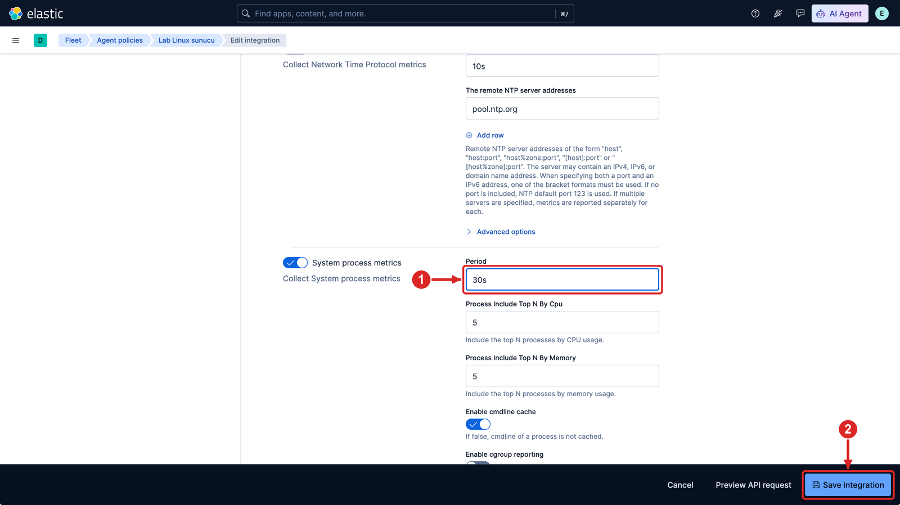

4. Onay penceresinde **Save and deploy changes** (1); pencere değişikliğin kaç ajanı etkileyeceğini söyler:

   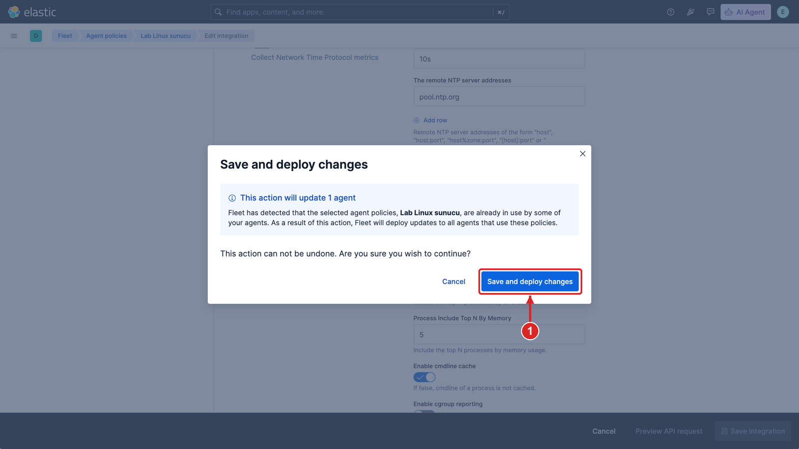

**Sonra:** ajanın yeni revision'a geçmesini bekleyin:

```bash
POL=$(curl -s -u elastic:'DevOps2026!' 'http://127.0.0.1:5601/api/fleet/agent_policies?perPage=50' | jq -r '.items[] | select(.name == "Lab Linux sunucu") | .id')
curl -s -u elastic:'DevOps2026!' "http://127.0.0.1:5601/api/fleet/agent_policies/$POL" | jq '.item.revision'
POL="$POL" timeout 120 bash -c 'until [ "$(curl -s -u elastic:"DevOps2026!" "http://127.0.0.1:5601/api/fleet/agents?perPage=50" | jq --arg p "$POL" "[.items[] | select(.policy_id == \$p) | .policy_revision][0]")" = 3 ]; do printf .; sleep 2; done'; echo
curl -s -u elastic:'DevOps2026!' 'http://127.0.0.1:5601/api/fleet/agents?perPage=50' | jq --arg p "$POL" '[.items[] | select(.policy_id == $p) | .policy_revision][0]'
```

Beklenen çıktı:

```text
3

3
```

- **2 → 3:** ajan birkaç saniye içinde yetişti; sunucuya girilmedi, container yeniden başlatılmadı.

### 6. Kibana'dan integration ekleyin: Nginx

**Soru: Yeni bir kaynağı toplamaya nasıl başlarız?** Aynı politikaya Kibana'nın **Integrations** sayfasından
Nginx'i ekliyoruz. Sunucudaki Nginx (80/443) her isteği `/var/log/nginx/access.log`'a yazar; ajan `/var/log`'u
zaten okuyor, yeni bir bağlama gerekmez.

1. Menü düğmesine (1) tıklayın, **Management** altında **Integrations**'ı (2) seçin:

   

2. Arama kutusuna (1) `nginx` yazın ve **Nginx (ECS)** kartını (2) açın:

   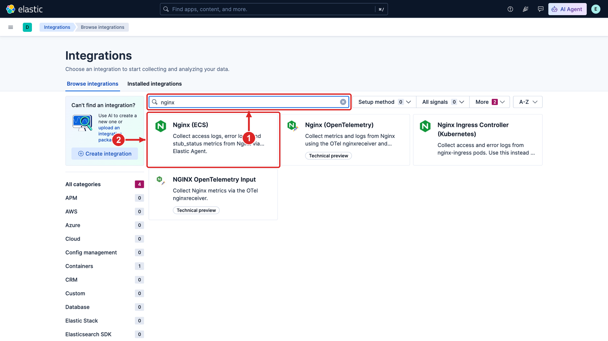

3. Sağ üstte **Add Nginx (ECS)** (1):

   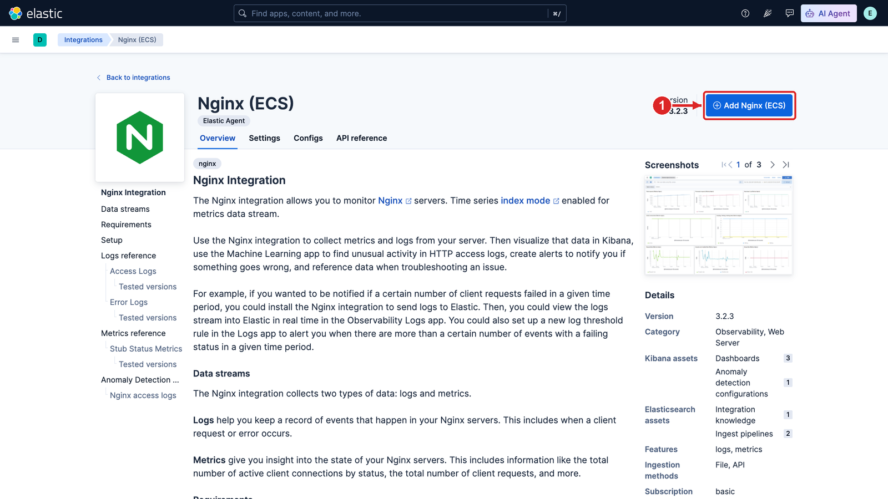

4. **Integration name** (1) `nginx-lab`. Sunucunun Nginx'inde metrik ucu (`stub_status`) yok:
   **Collect metrics from Nginx instances** anahtarını (2) kapatın, yalnız loglar kalsın:

   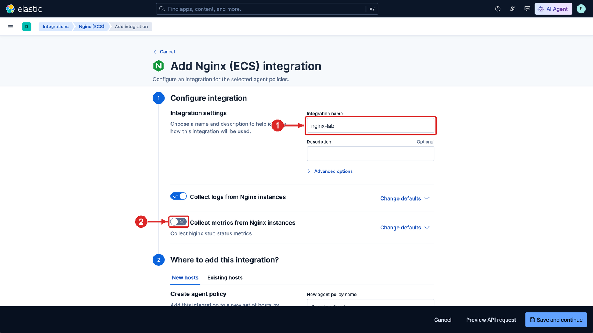

5. **Where to add this integration?** altında **Existing hosts** (1), **Agent policies** listesinden
   **Lab Linux sunucu** (2), sonra **Save and continue** (3):

   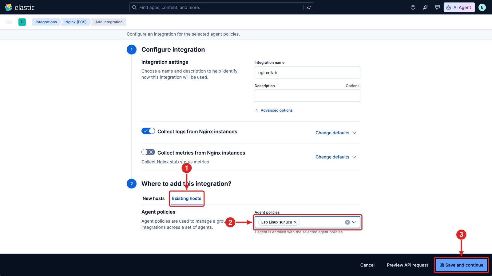

6. Onay penceresinde **Save and deploy changes** (1):

   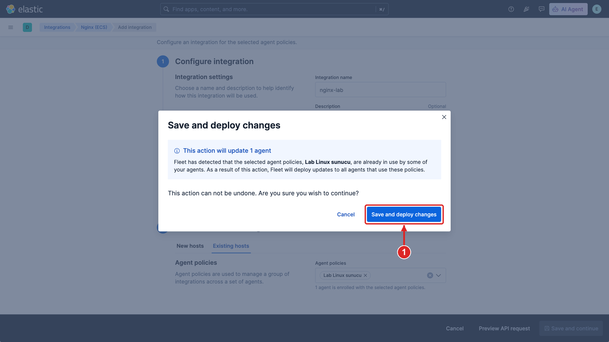

**Nginx logları geliyor mu?** Politika revision'ı yine artar; ajan yetişince loglar gelir:

```bash
timeout 180 bash -c 'until [ "$(curl -s -u elastic:"DevOps2026!" http://127.0.0.1:9200/logs-nginx.access-fleetlab/_count | jq .count 2>/dev/null)" -gt 0 ] 2>/dev/null; do printf .; sleep 5; done'; echo
POL=$(curl -s -u elastic:'DevOps2026!' 'http://127.0.0.1:5601/api/fleet/agent_policies?perPage=50' | jq -r '.items[] | select(.name == "Lab Linux sunucu") | .id')
curl -s -u elastic:'DevOps2026!' 'http://127.0.0.1:5601/api/fleet/package_policies?perPage=50' \
  | jq -r --arg p "$POL" '.items[] | select(.policy_id == $p) | "\(.name)  \(.package.name)  namespace=\(if (.namespace // "") == "" then "politikadan" else .namespace end)"' | sort
curl -s -u elastic:'DevOps2026!' 'http://127.0.0.1:5601/api/fleet/agents?perPage=50' | jq --arg p "$POL" '[.items[] | select(.policy_id == $p) | .policy_revision][0]'
```

Beklenen çıktı:

```text
nginx-lab  nginx  namespace=politikadan
system-lab  system  namespace=politikadan
4
```

- **`namespace=politikadan`:** integration'lar namespace'i kendileri vermez, politikanınkini (`fleetlab`) alır.

**Önce ve sonra:** sunucunun ham satırı ve aynı türden bir isteğin ajanın yazdığı hâli. Integration'ın ingest
pipeline'ı satırı ECS field'larına ayırır:

```bash
sudo tail -1 /var/log/nginx/access.log | cut -c1-120
curl -s -u elastic:'DevOps2026!' 'http://127.0.0.1:9200/logs-nginx.access-fleetlab/_search?size=1&sort=@timestamp:desc&filter_path=hits.hits._source' \
  | jq -c '.hits.hits[0]._source | {ip: .source.address, method: .http.request.method, kod: .http.response.status_code, url: .url.original[0:40], tarayici: .user_agent.name}'
```

Beklenen çıktı:

```text
78.153.140.39 - - [24/Nov/2026:22:50:56 +0300] "POST / HTTP/1.1" 200 1524 "-" "Mozilla/5.0 (Windows NT 10.0; Win64; x64)
{"ip":"78.153.140.39","method":"GET","kod":301,"url":"/.env","tarayici":"Chrome"}
```

- **Sizde farklıdır:** istekler, IP'ler ve URL sunucunun Nginx trafiğine bağlıdır.

<details>
<summary><strong>Tek node'da yellow kalmasın: replica 0</strong></summary>

Yeni data stream'ler de 1 replica ile açılır; tek node'lu ana cluster yellow kalmasın diye labın bütün data
stream'lerinin replica'sını 0'a çekin:

```bash
curl -s -u elastic:'DevOps2026!' -X PUT 'http://127.0.0.1:9200/*-fleetlab,logs-elastic_agent.status_change-default/_settings' \
  -H 'Content-Type: application/json' -d '{"index.number_of_replicas": 0}'; echo
curl -s -u elastic:'DevOps2026!' 'http://127.0.0.1:9200/_cluster/health/*-fleetlab,logs-elastic_agent.status_change-default?wait_for_status=green&timeout=30s&filter_path=status'; echo
```

```json
{"acknowledged":true}
{"status":"green"}
```

Ayar mevcut backing index'lere uygulanır; rollover ile açılacak yeni index yine 1 replica alır. Üretimde çözüm
ikinci node'dur.

</details>

<details>
<summary><strong>Data stream'ler ve Fleet'in kendi index'leri</strong></summary>

Ajan her veri setini ayrı bir data stream'e yazar; hepsinin sonu namespace'tir:

```bash
curl -s -u elastic:'DevOps2026!' 'http://127.0.0.1:9200/_data_stream/*-fleetlab?filter_path=data_streams.name' | jq -c '[.data_streams[].name] | sort'
curl -s -u elastic:'DevOps2026!' 'http://127.0.0.1:9200/_cat/indices/.fleet-agents*,.fleet-policies*?h=index'
```

Beklenen çıktı:

```text
["logs-nginx.access-fleetlab","logs-nginx.error-fleetlab","logs-system.auth-fleetlab","logs-system.syslog-fleetlab","metrics-system.cpu-fleetlab","metrics-system.diskio-fleetlab","metrics-system.filesystem-fleetlab","metrics-system.fsstat-fleetlab","metrics-system.load-fleetlab","metrics-system.memory-fleetlab","metrics-system.network-fleetlab","metrics-system.process-fleetlab","metrics-system.process.summary-fleetlab","metrics-system.socket_summary-fleetlab","metrics-system.uptime-fleetlab"]
.fleet-policies-7
.fleet-agents-7
```

- `logs-*` ve `metrics-*`: ajanın topladığı veri. Namespace (`fleetlab`) bu labın verisini aynı integration'ı
  kullanan başka ortamlardan ayırır; temizlik yalnız bunları siler.
- `.fleet-agents` her ajanın kaydını (son check-in, politika, revision), `.fleet-policies` politikaların revision
  geçmişini tutar. Fleet Server bu index'lerle çalışır.

</details>

<details>
<summary><strong>Integration'ın hazır panosunu açmak</strong></summary>

Integration yalnız veri toplama ayarı değildir; kurulunca kendi hazır panolarını, index şablonlarını ve ingest
pipeline'larını da getirir. Pano kurmadan veriye hemen bakmanın en kısa yolu budur.

1. Menüden **Integrations**'ı açın. **Installed integrations** (1) sekmesinde **Nginx (ECS)** (2):

   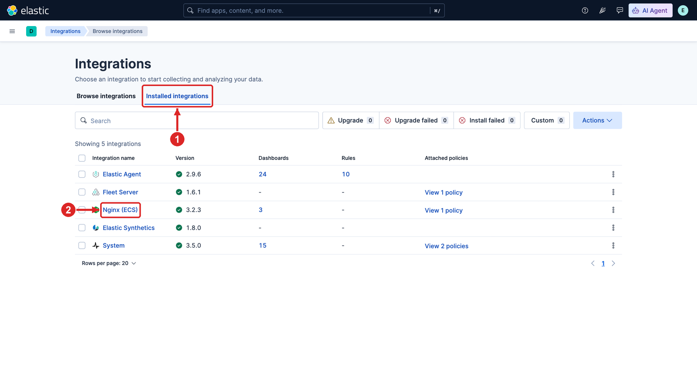

2. **Assets** sekmesi (1), **Dashboards** altında **[Logs Nginx] Overview** (2):

   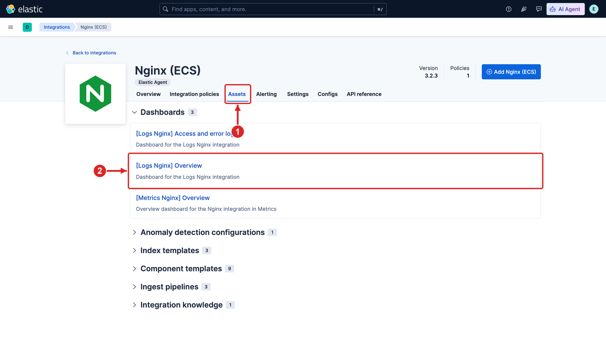

3. Zaman seçicisini (1) açıp **Last 7 days**'i (2) seçin:

   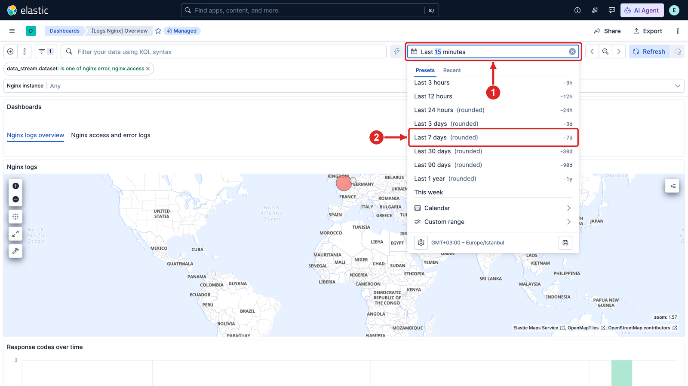

4. Harita ziyaretçilerin ülkesini, alttaki paneller durum kodlarını ve en çok istenen adresleri gösterir:

   ![Hazır pano: [Logs Nginx] Overview](../../assets/screenshots/LAB-11/06j-nginx-hazir-pano.png)

- **Managed:** hazır panolar integration'a aittir, doğrudan değiştirilmez; değiştirmek için panonun menüsünden kopyası
  (**Duplicate**) alınır.
- **Başka integration'lar:** System, MySQL, Apache gibi her integration'ın **Assets** sekmesinde kendi panoları vardır.

</details>

### 7. CPU yükü ve Lens panosu

**Soru: Bir yük metriklere ve panoya nasıl yansır?** System integration'ı CPU'yu 10 saniyede bir
`metrics-system.cpu-fleetlab`'e yazar. `stress-ng` ile kısa ve sınırlı bir yük vereceğiz: 4 çekirdekten 2'si, %80 yük,
90 saniye; süre dolunca kendiliğinden biter ve bellek kullanmaz.

```bash
sudo DEBIAN_FRONTEND=noninteractive apt-get install -y -qq stress-ng >/dev/null 2>&1; stress-ng --version | cut -d' ' -f1-3
nproc
```

Beklenen çıktı:

```text
stress-ng, version 0.17.06
4
```

**Önce, yük, sonra:** yükten önceki 2 dakikanın ortalaması, 90 saniyelik yük, yük bitince son 80 saniyenin
ortalaması (`system.cpu.total.norm.pct`: bütün çekirdeklerin ortalaması). 80 saniyelik pencere yükün içinde kalır:

```bash
curl -s -u elastic:'DevOps2026!' 'http://127.0.0.1:9200/metrics-system.cpu-fleetlab/_search?size=0' -H 'Content-Type: application/json' \
  -d '{"query": {"range": {"@timestamp": {"gte": "now-2m"}}}, "aggs": {"o": {"avg": {"field": "system.cpu.total.norm.pct"}}}}' | jq '"yukten once: %\(.aggregations.o.value * 100 | floor)"'
stress-ng --cpu 2 --cpu-load 80 --timeout 90s --metrics-brief 2>&1 | grep -E 'dispatching|successful' | sed 's/.*\] //'
curl -s -u elastic:'DevOps2026!' 'http://127.0.0.1:9200/metrics-system.cpu-fleetlab/_search?size=0' -H 'Content-Type: application/json' \
  -d '{"query": {"range": {"@timestamp": {"gte": "now-80s"}}}, "aggs": {"o": {"avg": {"field": "system.cpu.total.norm.pct"}}}}' | jq '"yuk sirasinda: %\(.aggregations.o.value * 100 | floor)"'
```

Beklenen çıktı:

```text
"yukten once: %22"
dispatching hogs: 2 cpu
successful run completed in 1 min, 30.03 secs
"yuk sirasinda: %55"
```

- **Fark önemli:** yüzdeler sunucunun o anki yüküne göre sizde farklıdır; 4 çekirdeğin 2'si %80'de olunca ortalama
  yaklaşık 40 puan artar. Ölçümde 22'den 55'e çıktı: ana cluster ve öteki lablar da CPU kullanıyordu.

**Panoya koyun:** aynı veriyi Lens ile çizin.

1. Menü düğmesine (1) tıklayın, **Analytics** altında **Dashboards**'u (2) seçin:

   

2. **Create dashboard** (1):

   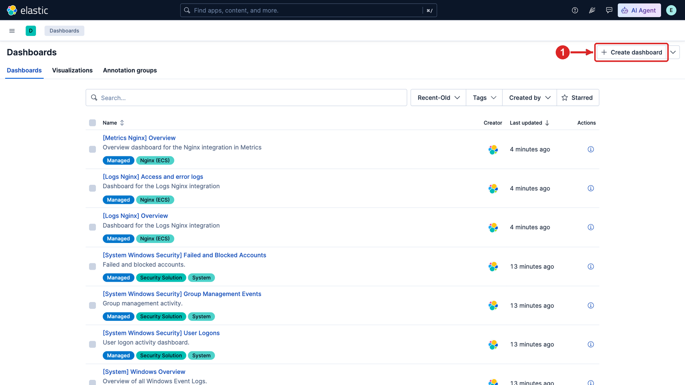

3. Boş panoda **Create visualization** (1); Lens açılır:

   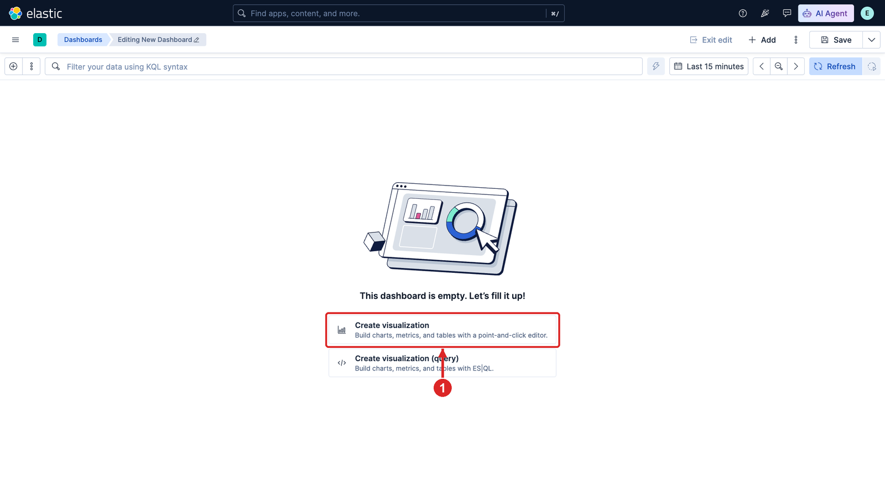

4. Sol üstteki data view düğmesine (1) tıklayın, `metrics-*` yazıp **metrics-\*** (2) seçin:

   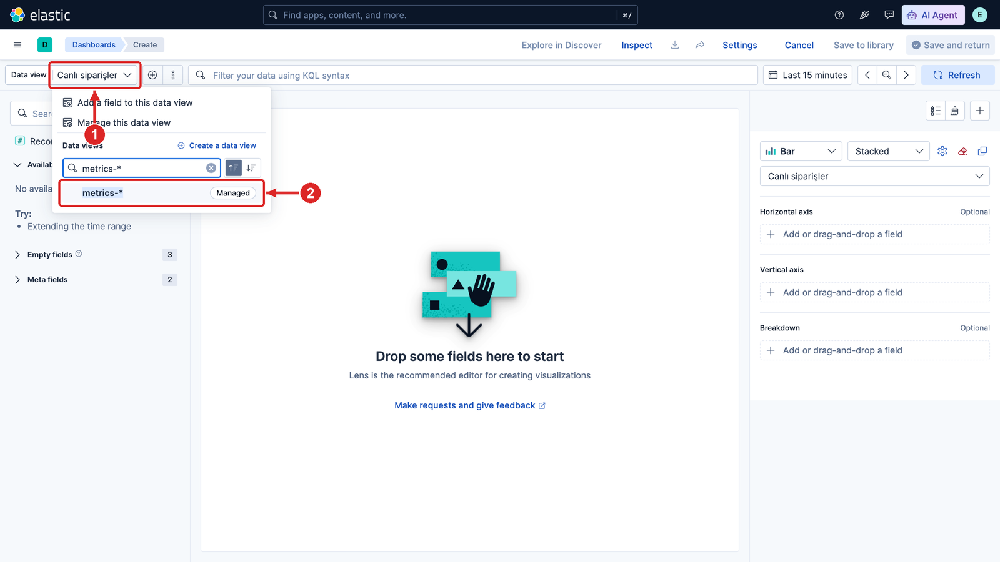

5. Zaman seçicisinden **Last 15 minutes**'ı seçin. Sorgu kutusuna (1)
   `data_stream.dataset : "system.cpu" and data_stream.namespace : "fleetlab"` yazıp Enter'a basın. Field arama
   kutusuna (2) `total.norm` yazın, `system.cpu.total.norm.pct`'nin **+** düğmesine (3) basın; zamana göre bir
   **Line** grafiği gelir:

   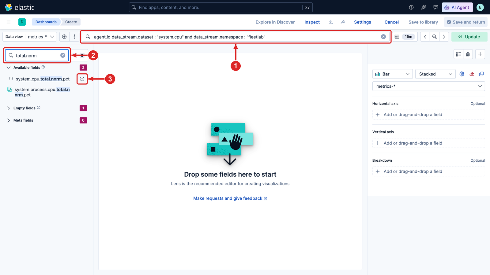

6. Sağda **Median of system.cpu.total.norm.pct**'ye (1) tıklayın:

   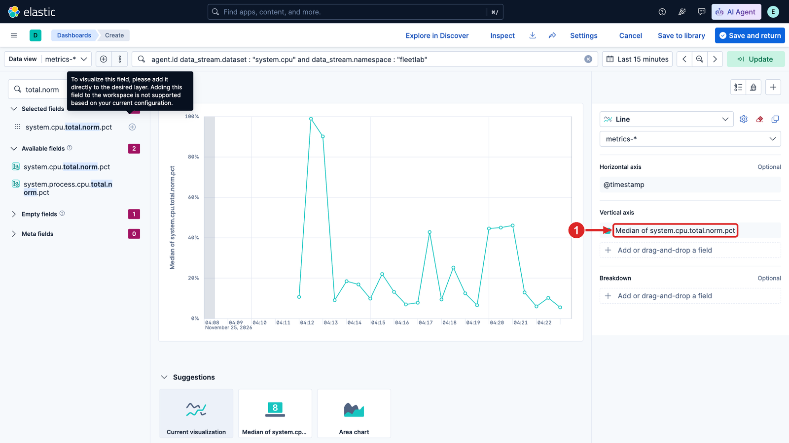

7. **Average** (1) seçin, **Name** kutusuna (2) `Sunucu CPU (%)` yazın ve **Close** (3):

   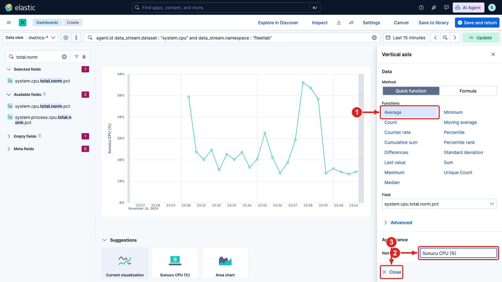

8. Sağ üstte **Save and return** (1); grafik panoya eklenir:

   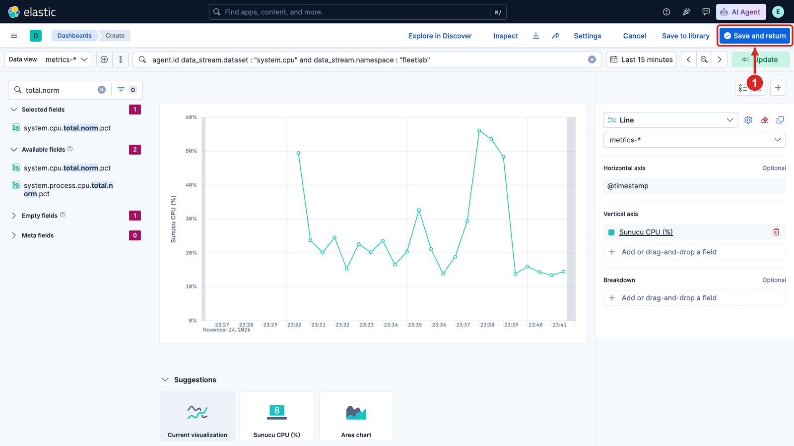

9. Panonun **Save** düğmesine basın. **Title** (1) `Sunucu CPU (Fleet)`, **Store time with dashboard** (2) açık
   (pano her açılışta son 15 dakikayı göstersin), **Save** (3):

   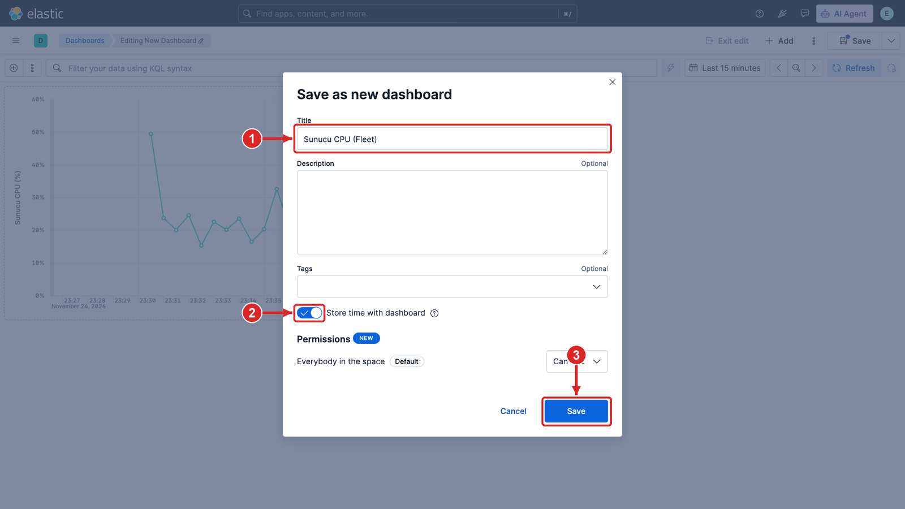

   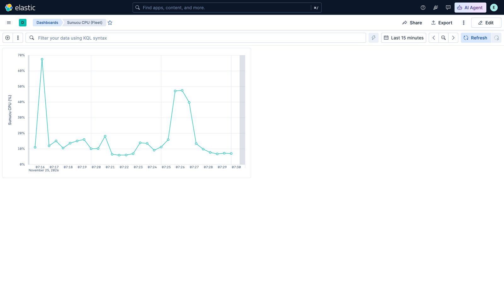

- **Yük penceresi:** çizgide yükün başladığı ve bittiği an görünür; sayılar sunucunun o anki işine göre sizde farklıdır.

---

## Temizlik

Yalnız bu labın container'larını, Fleet'teki ajan kayıtlarını, **Fleet Server Policy** ve **Lab Linux sunucu**
politikalarını (içindeki integration'larla), Fleet Server'ın service token'larını, labın Fleet Server adresini,
labın data stream'lerini, **Sunucu CPU (Fleet)** panosunu, labın kurduğu integration paketlerini (Nginx, System, Fleet Server, Elastic Agent; hazır panoları, şablonları ve pipeline'larıyla) ve `.env` dosyasını siler. Ana cluster'a, Fleet'in
output ayarına ve host Nginx'e dokunmaz. `stress-ng` süreci süresi dolunca kendiliğinden biter; paket sunucuda
kalır (`sudo apt-get remove stress-ng` ile kaldırılır):

```bash
./teardown.sh
```

<details>
<summary><strong>Çıktının tamamı (10 satır)</strong></summary>

```text
Container agent-fleet-lab Removed
Container fleet-server-lab Removed
ajan kaydi kaldirildi -> 2
politika Lab Linux sunucu -> 200
politika Fleet Server Policy -> 200
service token -> 1 silindi
fleet server adresi -> 200
data stream -> 200
pano (Sunucu CPU (Fleet)) -> 1
integration paketi -> 4 kaldirildi
```

`4`: Nginx, System, Fleet Server ve Elastic Agent paketleri; kurulmamış paket sayılmaz (örneğin betik yolunda Adım 6'yı yapmadıysanız 2).

</details>

Labı aynı sunucuda yeniden yapacaksanız başlamadan önce `./teardown.sh` çalıştırın; README'deki sayılar temiz
başlangıca göredir.

---

Sonraki lab: **[LAB-12 — Excel Verisini Logstash ile Aktarmak: Türkçe Biçimli CSV'yi Doğru Tiplerle Index'lemek](../LAB-12-logstash-excel/README.md)**
