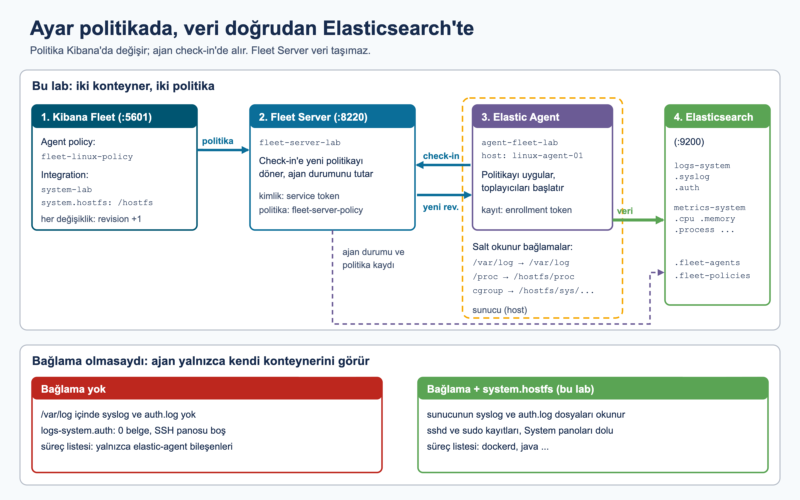
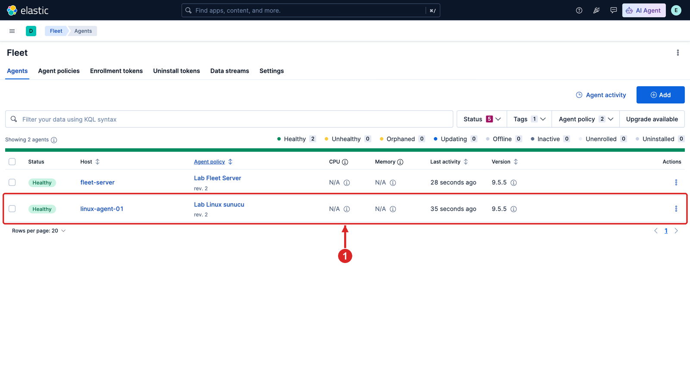
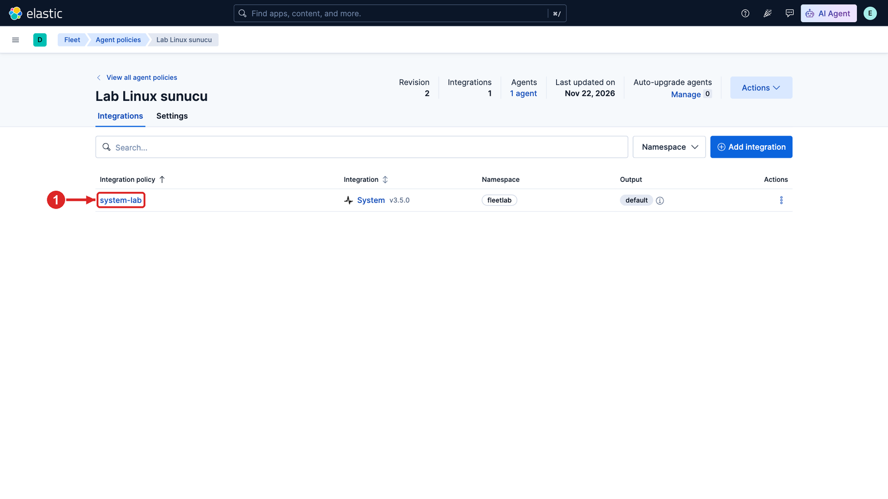
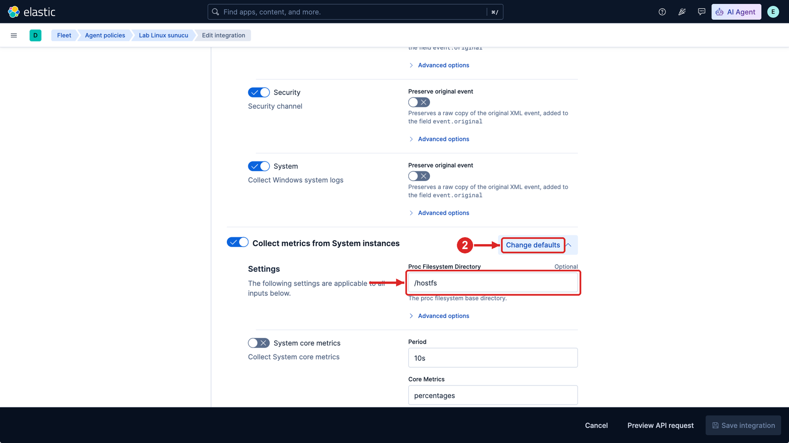
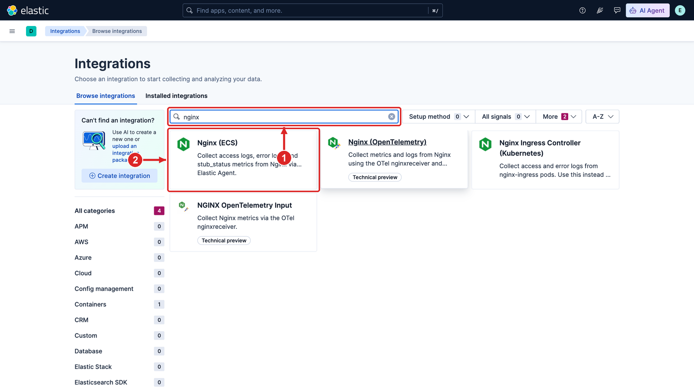
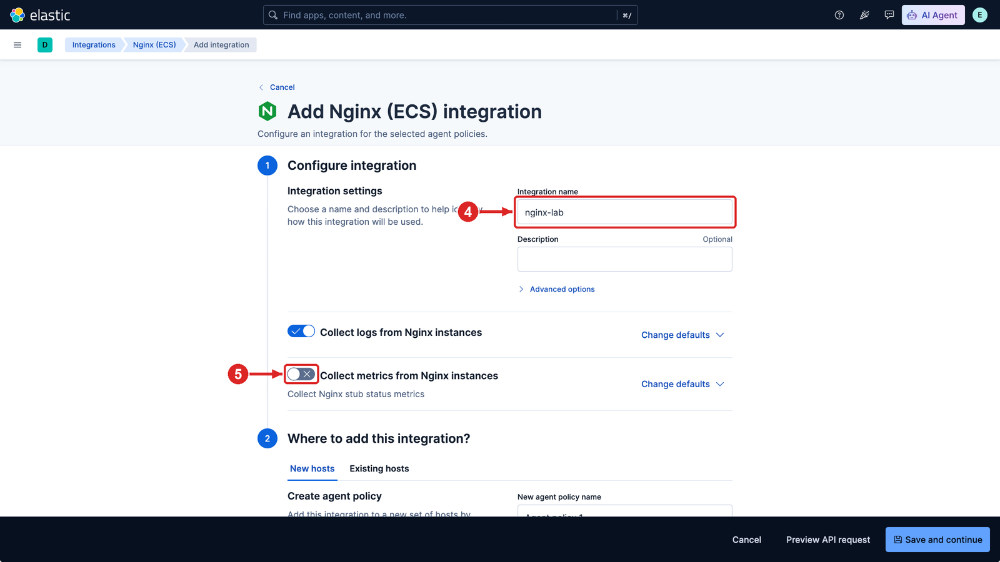
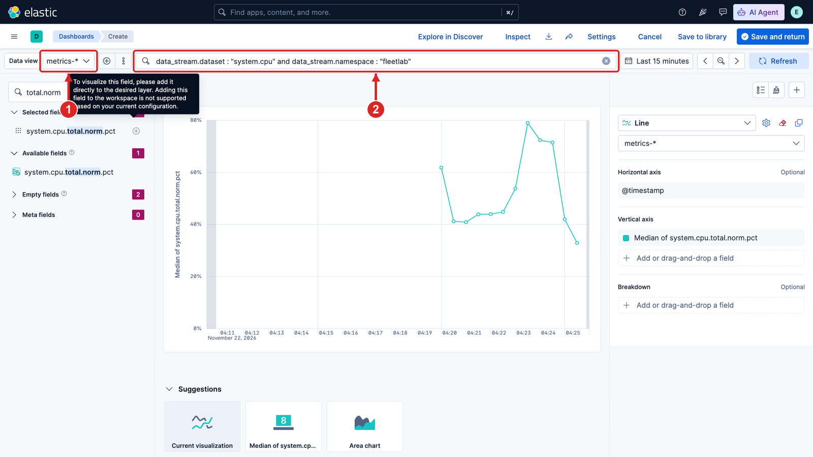
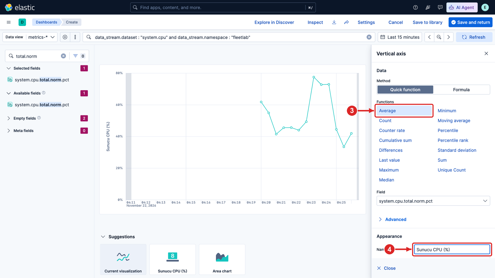
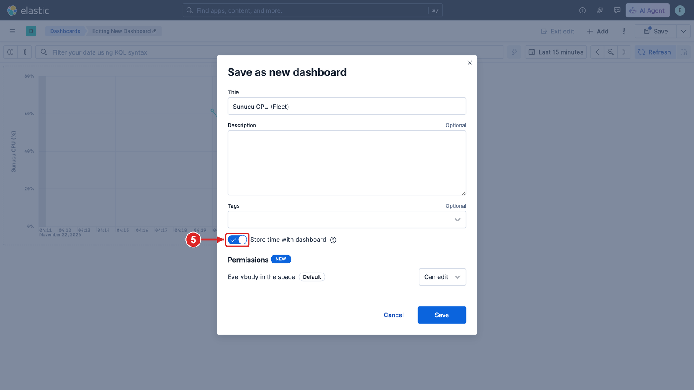
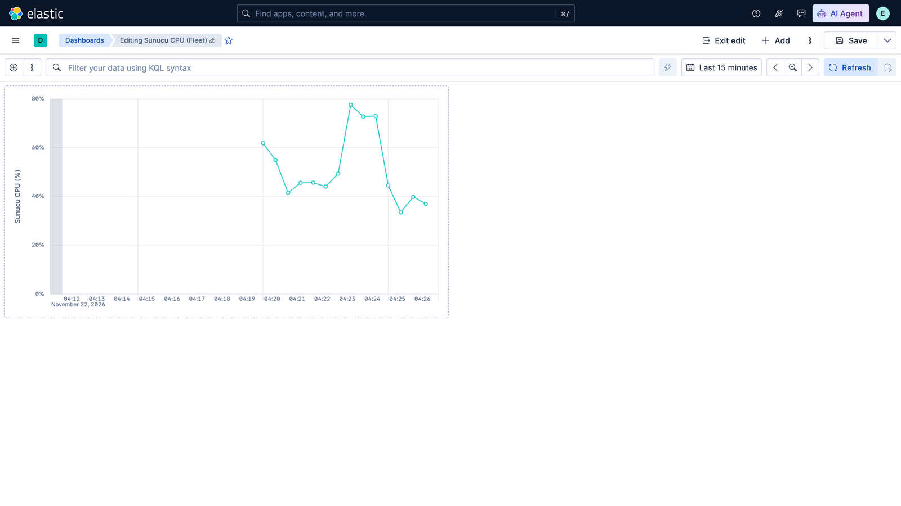

# LAB-11 — Fleet Server ve Elastic Agent: Tek Ajan, Merkezi Politika

| Kullanılan Araçlar | Açık / Kullanılan Portlar |
|---|---|
| Elastic Agent 9.5.5 (Fleet Server + yönetilen ajan), Kibana Fleet, Docker Compose | `127.0.0.1:8220` (Fleet Server, yalnız sunucudan), 9200 / 5601 — LAB-01 ana cluster'ı |

---

## Bu lab ne öğretiyor?

Bir sunucuyu Beats ile izlemek her Beat için ayrı bir YAML dosyası ve servis demektir; ayarı değiştirmek
için sunucuya girip dosyayı düzenlemek gerekir. 50 sunucuda hangi sunucuda hangi ayarın çalıştığını kimse
bilemez. Fleet ayarı sunucudan alıp Kibana'ya taşır: sunucuda tek bir program (**Elastic Agent**) çalışır,
ne toplayacağını Kibana'daki **agent policy** söyler.

Bu labda Fleet Server ve bir ajanı container olarak kuracak, ajanın sunucuyu izlediğini gösterecek, politikayı
Kibana'dan değiştirecek, **Add integrations** ile Nginx loglarını ekleyecek ve CPU'ya kısa bir yük verip bir
Lens panosunda göreceğiz.

{width=60%}

---

## Ön Koşullar

- LAB-01 ana cluster'ı çalışıyor. LAB-01'i atladıysanız onun Adım 1-2'sini çalıştırın.
- `127.0.0.1:8220` portu boş olmalı. İki ajan container'ı birlikte yaklaşık 1 GB RAM kullanır. Adım 7 `stress-ng`
  paketini `sudo apt-get` ile kurar.

```bash
cd ~/elastic/labs/LAB-11-fleet-elastic-agent
```

Kibana adresini sunucuda hesaplayın:

```bash
IP=$(curl -s https://api.ipify.org); H=$(hostname -s)
echo "Kibana: http://$IP:5601   https://$H-kibana.devopsatolyesi.com"
```

Beklenen çıktı:

```text
Kibana: http://<IP>:5601   https://<host>-kibana.devopsatolyesi.com
```

---

## Kavramlar: Fleet'te kim ne yapar?

| Parça | Ne yapar | Bu labda |
|---|---|---|
| Kibana Fleet | Politikaları ve integration'ları tutar; her değişiklikte politikanın **revision**'ı artar | `fleet-linux-policy` |
| Fleet Server | Ajanların düzenli sorduğu (check-in) sunucu; yeni politikayı ajana verir | `fleet-server-lab`, port 8220 |
| Elastic Agent | Politikayı uygular, veriyi **doğrudan Elasticsearch'e** yazar | `agent-fleet-lab` (`linux-agent-01`) |
| Integration | Bir kaynağın hazır toplama ayarı (System, Nginx…) | `system-lab` |
| Namespace | Data stream adının son parçası; ortamı ya da ekibi ayırır | `fleetlab` |

Fleet Server veri taşımaz: ayar Fleet Server'dan gelir, veri ajandan Elasticsearch'e gider. Data stream adları
`<tür>-<veri seti>-<namespace>` biçimindedir: `logs-system.auth-fleetlab`.

---

## Config dosyaları: hangi satır ne işe yarıyor?

`docker-compose.yml` (izleme ajanı):

```yaml
    user: root
    volumes:
      - /var/log:/var/log:ro
      - /proc:/hostfs/proc:ro
      - /sys/fs/cgroup:/hostfs/sys/fs/cgroup:ro
    environment:
      - FLEET_ENROLL=1
      - FLEET_URL=https://fleet-server:8220
      - FLEET_ENROLLMENT_TOKEN=${FLEET_ENROLLMENT_TOKEN}
      - FLEET_INSECURE=true     # Fleet Server kendi imzali sertifikayla acilir (yalniz lab)
```

- `volumes`: sunucunun log dizini ve `/proc`'u salt okunur bağlanır. Bağlanmazsa ajan yalnız kendi
  container'ını görür; sunucunun SSH girişleri ve süreçleri gelmez.
- `user: root`: `/var/log/auth.log` yalnız `root` ve `adm` grubunca okunur.
- `FLEET_ENROLLMENT_TOKEN`: ajanın hangi politikaya kaydolacağını belirleyen token (Adım 1 üretir).
- `FLEET_INSECURE=true`: Fleet Server'ın kendi imzalı sertifikası doğrulanmaz; üretimde CA verilir.

`scripts/setup_fleet.py` System integration'ını eklerken `system.hostfs: /hostfs` ayarını verir: metrik
toplayıcılar `/proc` yerine sunucunun bağlanan `/hostfs/proc`'unu okur.

---

## Adım Adım Uygulama Rehberi

### 1. Fleet'i hazırlayın

Betik Fleet Server için bir service token üretir, Fleet'in output'unu ana cluster'a yönlendirir, iki politika
açar ve ajanın kayıt token'ını alır. Token'lar `.env.fleet` dosyasına yazılır, ekrana basılmaz:

```bash
python3 scripts/setup_fleet.py
```

<details>
<summary><strong>Çıktının tamamı (7 satır)</strong></summary>

```text
service token          : uretildi (elastic/fleet-server/fleet-lab-token)
output                 : http://elasticsearch-lab00:9200
fleet server adresi    : https://fleet-server:8220
paketler               : fleet_server, system
politikalar            : fleet-server-policy, fleet-linux-policy (namespace fleetlab)
enrollment token       : alindi
.env.fleet             : yazildi
```

</details>

İlk çalıştırma paketleri indirdiği için yaklaşık 40 saniye sürer.

### 2. Fleet Server ve ajanı başlatın

```bash
docker compose --env-file .env.fleet up -d
```

Fleet Server açılır, ajan ona kaydolur ve ilk politikayı uygular; ikisinin de `online` olması yaklaşık 1
dakika sürer:

```bash
timeout 300 bash -c 'until [ "$(curl -s -u elastic:"DevOps2026!" "http://127.0.0.1:5601/api/fleet/agents?perPage=50" | jq "[.items[] | select((.policy_id | test(\"^fleet-\")) and .status == \"online\")] | length")" -ge 2 ]; do printf .; sleep 5; done'; echo
curl -s -u elastic:'DevOps2026!' 'http://127.0.0.1:5601/api/fleet/agents?perPage=50' \
  | jq -r '.items[] | select(.policy_id | test("^fleet-")) | "\(.local_metadata.host.hostname)  \(.policy_id)  \(.status)"'
```

Beklenen çıktı:

```text
..........................
fleet-server  fleet-server-policy  online
linux-agent-01  fleet-linux-policy  online
```

Satırların sırası sizde farklı olabilir.

Aynı listeyi **Management › Fleet › Agents**'ta görün: `linux-agent-01` satırında (1) durum `Healthy`,
politika `Lab Linux sunucu`. **Last activity** birkaç saniye öncesini gösterir: ajan düzenli check-in yapıyor.

{width=75%}

### 3. Politikada ne var?

Ajanın ne topladığını politikadaki integration'lar belirler:

```bash
curl -s -u elastic:'DevOps2026!' 'http://127.0.0.1:5601/api/fleet/package_policies?perPage=50' \
  | jq -r '.items[] | select(.policy_id | test("^fleet-")) | "\(.name)  \(.policy_id)  hostfs=\([.inputs[] | select(.type == "system/metrics") | .vars["system.hostfs"].value][0] // "-")"'
docker exec agent-fleet-lab elastic-agent status
```

Beklenen çıktı:

```text
system-lab  fleet-linux-policy  hostfs=/hostfs
fleet_server-lab  fleet-server-policy  hostfs=-
┌─ fleet
│  └─ status: (HEALTHY) Connected
└─ elastic-agent
   └─ status: (HEALTHY) Running
```

`system-lab` sunucunun loglarını ve metriklerini toplar; `hostfs=/hostfs` metriklerin sunucudan okunmasını
sağlar. `elastic-agent status` ajanın Fleet'e bağlı ve sağlıklı olduğunu kendisi söyler.

### 4. Önce ve sonra: ajan sunucuyu mu görüyor, container'ı mı?

Bağlama olmasa container'ın `/var/log`'unda yalnız image'ın kendi birkaç dosyası olurdu. Bağlamayla aynı dizin
sunucunun dizinidir:

```bash
docker exec agent-fleet-lab ls /var/log | grep -E '^(syslog|auth\.log)$'
```

Beklenen çıktı:

```text
auth.log
syslog
```

Süreç metriklerinin gelmesini bekleyip iki log veri setinin document sayısına ve son 5 dakikada en çok görülen
süreçlere bakın:

```bash
timeout 180 bash -c 'until [ "$(curl -s -u elastic:"DevOps2026!" http://127.0.0.1:9200/metrics-system.process-fleetlab/_count | jq .count 2>/dev/null)" -gt 0 ] 2>/dev/null; do printf .; sleep 5; done'; echo
for ds in system.syslog system.auth; do printf '%-14s ' "$ds"; curl -s -u elastic:'DevOps2026!' "http://127.0.0.1:9200/logs-$ds-fleetlab/_count" | jq .count; done
curl -s -u elastic:'DevOps2026!' 'http://127.0.0.1:9200/metrics-system.process-fleetlab/_search?size=0' -H 'Content-Type: application/json' \
  -d '{"query": {"range": {"@timestamp": {"gte": "now-5m"}}}, "aggs": {"p": {"terms": {"field": "process.name", "size": 6}}}}' | jq -c '[.aggregations.p.buckets[].key]'
```

Beklenen çıktı:

```text

system.syslog  9250
system.auth    3521
["MainThread","java","kthreadd","kworker/R-rcu_gp","kworker/R-sync_wq","pool_workqueue_release"]
```

| | Bağlama yok (yalnız container) | Bağlamayla (bu lab) |
|---|---|---|
| `/var/log` | image'ın kendi dosyaları; `syslog`, `auth.log` yok | sunucunun log dizini |
| `logs-system.auth-fleetlab` | 0 document | sunucunun SSH ve `sudo` kayıtları |
| `metrics-system.process-*` | yalnız `elastic-agent` ve alt bileşenleri | sunucudaki bütün süreçler: `dockerd`, ana cluster'ın `java`'sı… |

Ajan dosyaları baştan okur; sayılar ve süreç listesi sunucunun yaşına ve o anki yüküne göre sizde farklıdır. İnternete açık sunucularda `auth`
kayıtlarının çoğu başarısız SSH denemeleridir. Süreç adları çekirdekte 15 karakterde kesilir.

### 5. Politikayı Kibana'dan canlı değiştirin

Her politika değişikliği politikanın revision'ını bir artırır; ajan yeni revision'ı bir sonraki check-in'de
alır. Önce iki değer:

```bash
curl -s -u elastic:'DevOps2026!' 'http://127.0.0.1:5601/api/fleet/agent_policies/fleet-linux-policy' | jq '.item.revision'
curl -s -u elastic:'DevOps2026!' 'http://127.0.0.1:5601/api/fleet/agents?perPage=50' | jq '[.items[] | select(.policy_id == "fleet-linux-policy") | .policy_revision][0]'
```

Beklenen çıktı:

```text
2
2
```

Şimdi Kibana'da süreç metriklerinin toplanma aralığını değiştirin:

1. **Management › Fleet › Agent policies**'te **Lab Linux sunucu** politikasını açın ve `system-lab`
   integration'ına (1) tıklayın.

   {width=75%}

2. **Collect metrics from System instances** satırında **Change defaults**'a (2) tıklayın. Altında
   **Proc Filesystem Directory** değeri `/hostfs`'tir: betiğin verdiği ayar.

   {width=75%}

3. **System process metrics** satırının **Period** değerini (3) `10s` yerine `30s` yapın ve sağ alttaki
   **Save integration**'a (4) basın.

   {width=75%}

4. Onay penceresinde **Save and deploy changes**'e (5) basın; pencere değişikliğin kaç ajanı etkileyeceğini söyler.

   {width=75%}

Ajanın yeni revision'a geçmesini bekleyin:

```bash
curl -s -u elastic:'DevOps2026!' 'http://127.0.0.1:5601/api/fleet/agent_policies/fleet-linux-policy' | jq '.item.revision'
timeout 120 bash -c 'until [ "$(curl -s -u elastic:"DevOps2026!" "http://127.0.0.1:5601/api/fleet/agents?perPage=50" | jq "[.items[] | select(.policy_id == \"fleet-linux-policy\") | .policy_revision][0]")" = 3 ]; do printf .; sleep 2; done'; echo
curl -s -u elastic:'DevOps2026!' 'http://127.0.0.1:5601/api/fleet/agents?perPage=50' | jq '[.items[] | select(.policy_id == "fleet-linux-policy") | .policy_revision][0]'
```

Beklenen çıktı:

```text
3

3
```

Politika 2'den 3'e çıktı, ajan birkaç saniye içinde yetişti. Sunucuya girilmedi, container yeniden başlatılmadı.

### 6. Kibana'dan integration ekleyin: Nginx

System integration'ı betik ekledi. Şimdi aynı politikaya Kibana'nın **Add integrations** akışıyla bir tane daha
ekleyeceğiz. Sunucudaki Nginx (80/443) her isteği `/var/log/nginx/access.log`'a yazar; ajan `/var/log`'u zaten
okuyor, yeni bir bağlama gerekmez.

1. Kibana ana sayfasında **Add integrations**'a basın, arama kutusuna `nginx` yazın (1) ve **Nginx (ECS)**
   kartını (2) açın; sonra **Add Nginx (ECS)** (3).

   {width=75%}

2. **Integration name** `nginx-lab` (4). Sunucunun Nginx'inde metrik ucu (`stub_status`) yok:
   **Collect metrics from Nginx instances** anahtarını (5) kapatın, yalnız loglar kalsın.

   {width=75%}

3. **Where to add this integration?** altında **Existing hosts** (6), **Agent policies** listesinden
   **Lab Linux sunucu** (7), sonra **Save and continue** (8). Onay penceresinde **Save and deploy changes**.

   {width=75%}

Politika revision'ı yine artar; ajan yetişince Nginx logları gelir:

```bash
timeout 180 bash -c 'until [ "$(curl -s -u elastic:"DevOps2026!" http://127.0.0.1:9200/logs-nginx.access-fleetlab/_count | jq .count 2>/dev/null)" -gt 0 ] 2>/dev/null; do printf .; sleep 5; done'; echo
curl -s -u elastic:'DevOps2026!' 'http://127.0.0.1:5601/api/fleet/package_policies?perPage=50' \
  | jq -r '.items[] | select(.policy_id == "fleet-linux-policy") | "\(.name)  \(.package.name)  namespace=\(if (.namespace // "") == "" then "politikadan" else .namespace end)"' | sort
curl -s -u elastic:'DevOps2026!' 'http://127.0.0.1:5601/api/fleet/agents?perPage=50' | jq '[.items[] | select(.policy_id == "fleet-linux-policy") | .policy_revision][0]'
```

Beklenen çıktı:

```text
nginx-lab  nginx  namespace=politikadan
system-lab  system  namespace=fleetlab
4
```

Önce ve sonra: sunucunun ham satırı ve aynı türden bir isteğin ajanın yazdığı hâli. Integration'ın ingest
pipeline'ı satırı ECS field'larına ayırır. `nginx-lab` namespace'i kendisi vermez, politikanınkini (`fleetlab`) alır:

```bash
sudo tail -1 /var/log/nginx/access.log | cut -c1-120
curl -s -u elastic:'DevOps2026!' 'http://127.0.0.1:9200/logs-nginx.access-fleetlab/_search?size=1&sort=@timestamp:desc&filter_path=hits.hits._source' \
  | jq -c '.hits.hits[0]._source | {ip: .source.address, method: .http.request.method, kod: .http.response.status_code, url: .url.original[0:40], tarayici: .user_agent.name}'
```

Beklenen çıktı:

```text
185.242.226.111 - - [22/Nov/2026:04:13:13 +0300] "GET / HTTP/1.1" 200 1471 "-" "Mozilla/5.0 (Windows NT 10.0; Win64; x64
{"ip":"188.114.102.252","method":"GET","kod":200,"url":"/api/console/autocomplete_entities?field","tarayici":"Chrome"}
```

İstekler, IP'ler ve URL sizde farklıdır. Ajan dosyayı baştan okur; sayı sunucunun Nginx trafiğine bağlıdır.

<details>
<summary><strong>Tek node'da yellow kalmasın: replica 0</strong></summary>

Yeni data stream'ler de 1 replica ile açılır; tek node'lu ana cluster yellow kalmasın diye labın bütün data
stream'lerinin replica'sını 0'a çekin:

```bash
curl -s -u elastic:'DevOps2026!' -X PUT 'http://127.0.0.1:9200/*-fleetlab,logs-elastic_agent.status_change-default/_settings' \
  -H 'Content-Type: application/json' -d '{"index.number_of_replicas": 0}'; echo
curl -s -u elastic:'DevOps2026!' 'http://127.0.0.1:9200/_cluster/health/*-fleetlab,logs-elastic_agent.status_change-default?wait_for_status=green&timeout=30s&filter_path=status'; echo
```

```json
{"acknowledged":true}
{"status":"green"}
```

Ayar mevcut backing index'lere uygulanır; rollover ile açılacak yeni index yine 1 replica alır. Üretimde çözüm
ikinci node'dur.

</details>

<details>
<summary><strong>Data stream'ler ve Fleet'in kendi index'leri</strong></summary>

Ajan her veri setini ayrı bir data stream'e yazar; hepsinin sonu namespace'tir:

```bash
curl -s -u elastic:'DevOps2026!' 'http://127.0.0.1:9200/_data_stream/*-fleetlab?filter_path=data_streams.name' | jq -c '[.data_streams[].name] | sort'
curl -s -u elastic:'DevOps2026!' 'http://127.0.0.1:9200/_cat/indices/.fleet-agents*,.fleet-policies*?h=index'
```

Beklenen çıktı:

```text
["logs-nginx.access-fleetlab","logs-nginx.error-fleetlab","logs-system.auth-fleetlab","logs-system.syslog-fleetlab","metrics-system.cpu-fleetlab","metrics-system.diskio-fleetlab","metrics-system.filesystem-fleetlab","metrics-system.fsstat-fleetlab","metrics-system.load-fleetlab","metrics-system.memory-fleetlab","metrics-system.network-fleetlab","metrics-system.process-fleetlab","metrics-system.process.summary-fleetlab","metrics-system.socket_summary-fleetlab","metrics-system.uptime-fleetlab"]
.fleet-policies-7
.fleet-agents-7
```

- `logs-*` ve `metrics-*`: ajanın topladığı veri. Namespace (`fleetlab`) bu labın verisini aynı integration'ı
  kullanan başka ortamlardan ayırır; temizlik yalnız bunları siler.
- `.fleet-agents` her ajanın kaydını (son check-in, politika, revision), `.fleet-policies` politikaların revision
  geçmişini tutar. Fleet Server bu index'lerle çalışır.

</details>

### 7. CPU yükü ve Lens panosu

System integration'ı CPU'yu 10 saniyede bir `metrics-system.cpu-fleetlab`'e yazar. `stress-ng` ile kısa ve
sınırlı bir yük verip panoda görelim: 4 çekirdekten 2'si, %80 yük, 90 saniye; süre dolunca kendiliğinden
biter ve bellek kullanmaz.

```bash
sudo DEBIAN_FRONTEND=noninteractive apt-get install -y -qq stress-ng >/dev/null 2>&1; stress-ng --version | cut -d' ' -f1-3
nproc
```

Beklenen çıktı:

```text
stress-ng, version 0.17.06
4
```

Yükten önceki 2 dakikanın ortalaması, 90 saniyelik yük, yük bitince son 80 saniyenin ortalaması
(`system.cpu.total.norm.pct`: bütün çekirdeklerin ortalaması, yüzde). 80 saniyelik pencere yükün içinde kalır;
veri 10 saniyede bir geldiği için son ölçüm birkaç saniye geride olabilir:

```bash
curl -s -u elastic:'DevOps2026!' 'http://127.0.0.1:9200/metrics-system.cpu-fleetlab/_search?size=0' -H 'Content-Type: application/json' \
  -d '{"query": {"range": {"@timestamp": {"gte": "now-2m"}}}, "aggs": {"o": {"avg": {"field": "system.cpu.total.norm.pct"}}}}' | jq '"yukten once: %\(.aggregations.o.value * 100 | floor)"'
stress-ng --cpu 2 --cpu-load 80 --timeout 90s --metrics-brief 2>&1 | grep -E 'dispatching|successful' | sed 's/.*\] //'
curl -s -u elastic:'DevOps2026!' 'http://127.0.0.1:9200/metrics-system.cpu-fleetlab/_search?size=0' -H 'Content-Type: application/json' \
  -d '{"query": {"range": {"@timestamp": {"gte": "now-80s"}}}, "aggs": {"o": {"avg": {"field": "system.cpu.total.norm.pct"}}}}' | jq '"yuk sirasinda: %\(.aggregations.o.value * 100 | floor)"'
```

Beklenen çıktı:

```text
"yukten once: %10"
dispatching hogs: 2 cpu
successful run completed in 1 min, 30.02 secs
"yuk sirasinda: %46"
```

Yüzdeler sunucunun o anki yüküne göre sizde farklıdır (burada 2 çekirdek %80'de, 4 çekirdeğin ortalaması yaklaşık +%40 artar); önemli olan yükün farkıdır.

Şimdi aynı veriyi panoya koyun:

1. **Dashboards › Create dashboard › Create visualization**. Data view **metrics-\*** (1), sorgu kutusuna
   `data_stream.dataset : "system.cpu" and data_stream.namespace : "fleetlab"` (2). Soldaki listeden
   `system.cpu.total.norm.pct`'yi **+** ile ekleyin: zamana göre bir **Line** grafiği gelir.

   {width=75%}

2. Sağdaki **Median of system.cpu.total.norm.pct**'ye tıklayın, **Average** (3) seçin ve **Name** kutusuna
   `Sunucu CPU (%)` (4) yazın; **Close**, sonra **Save and return**.

   {width=75%}

3. Panoyu **Save** ile `Sunucu CPU (Fleet)` adıyla kaydedin; **Store time with dashboard** (5) açık olsun, pano
   her açılışta son 15 dakikayı göstersin.

   {width=75%}

   {width=75%}

Çizgide yükün başladığı ve bittiği an görünür. Bu sunucuda yükten önce %44, yük sırasında %75 ölçüldü: 4 çekirdeğin
2'si %80 yüklenince ortalama yaklaşık 30-40 puan artar. Sunucunun o anki işine göre sayılar sizde farklıdır.

---

## Temizlik

Yalnız bu labın container'larını, Fleet'teki ajan kayıtlarını, iki politikasını (içindeki `system-lab` ve
`nginx-lab` ile), service token'ını, `fleetlab` namespace'li data stream'lerini ve **Sunucu CPU (Fleet)**
panosunu siler. Ana cluster'a, Fleet'in genel ayarlarına ve host Nginx'e dokunmaz. `stress-ng` süreci süresi
dolunca kendiliğinden biter; paket sunucuda kalır (`sudo apt-get remove stress-ng` ile kaldırılır):

```bash
./teardown.sh
```

<details>
<summary><strong>Çıktının tamamı (8 satır)</strong></summary>

```text
Container agent-fleet-lab Removed
Container fleet-server-lab Removed
ajan kaydi kaldirildi -> 2
politika fleet-linux-policy -> 200
politika fleet-server-policy -> 200
servis token -> 200
data stream (fleetlab) -> 200
pano (Sunucu CPU (Fleet)) -> 1
```

</details>

Labı aynı sunucuda yeniden yapacaksanız başlamadan önce `./teardown.sh` çalıştırın; README'deki sayılar temiz
başlangıca göredir.

---

Sonraki lab: **[LAB-12 — Excel Verisini Logstash ile Aktarmak: Türkçe Biçimli CSV'yi Doğru Tiplerle Index'lemek](../LAB-12-logstash-excel/README.md)**
