# LAB-12 — Excel Verisini Logstash ile Aktarmak: Türkçe Biçimli CSV'yi Doğru Tiplerle Index'lemek

| Kullanılan Araçlar | Açık / Kullanılan Portlar |
|---|---|
| Logstash 9.5.5 (`file` input, `csv`, `mutate`, `date`), Kibana Dev Tools, Discover, `python3` | `127.0.0.1:9603` (Logstash API, yalnız sunucudan), 9200 / 5601 — LAB-01 ana cluster'ı |

---

## Bu lab ne öğretiyor?

Bir satış Excel'i CSV olarak kaydedilince `28.499,90` ve `09.01.2026` gibi değerler metin olarak
gelir. Elasticsearch bunları olduğu gibi alırsa ciro toplanamaz, tarih aralığıyla arama yapılamaz.

Bu labda:

- Excel dosyasını CSV'ye çevirip Logstash ile okuyacak, Türkçe biçimi sayıya ve tarihe çevireceğiz.
- Logstash'i yalnız kendi index'ine yazabilen bir kullanıcıyla bağlayacağız.
- Container yeniden başlayınca dosyanın yeniden okunmadığını ve çift kayıt oluşmadığını göreceğiz.
- Tek seferlik bir CSV'yi Logstash'siz, Kibana'dan yükleyeceğiz.

Kibana'daki her tıklama kırmızı kutu ve numarayla gösterilir.

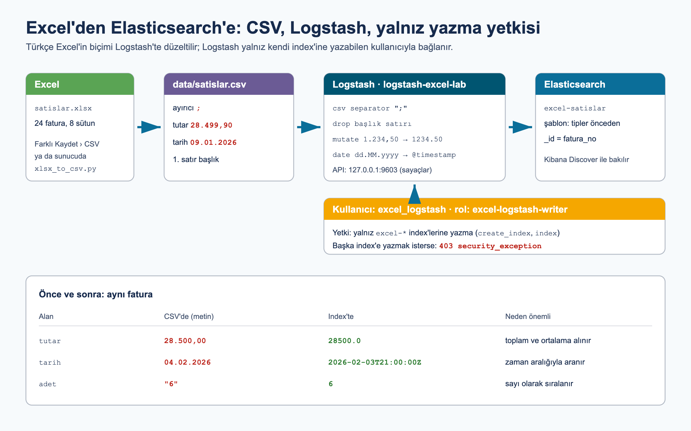

---

## Ön Koşullar

- LAB-01 ana cluster'ı çalışıyor. LAB-01'i atladıysanız onun Adım 1-2'sini çalıştırın.
- `127.0.0.1:9603` portu boş olmalı (Logstash API). Logstash yaklaşık 1 GB RAM kullanır.

```bash
cd ~/elastic/labs/LAB-12-logstash-excel
```


---

## Kavramlar: Türkçe Excel için ipuçları

| Excel'de | CSV'de | Elasticsearch'e olduğu gibi giderse | Logstash'te çözüm |
|---|---|---|---|
| Sütunlar | `;` ile ayrılır (Türkçe bölge ayarı) | Bütün satır tek field olur | `csv { separator => ";" }` |
| `28.499,90` | Binlik nokta, ondalık virgül | `text` olur, toplanamaz | Noktayı sil, virgülü noktaya çevir, `float` yap |
| `09.01.2026` | Gün.ay.yıl | `text` olur, zaman çizelgesinde yok | `date { match => ["tarih", "dd.MM.yyyy"] }` |
| Başlık satırı | İlk satır sütun adlarıdır | "Fatura No" adlı bir document olur | `drop {}` |

---

## Config dosyaları: hangi satır ne işe yarıyor?

`pipeline/excel.conf` (filtre bölümü):

```conf
csv {
  separator => ";"
  columns => ["fatura_no", "tarih", "musteri", "il", "urun", "adet", "birim_fiyat", "tutar"]
}
if [fatura_no] == "Fatura No" { drop {} }

mutate { gsub => ["birim_fiyat", "\.", "", "tutar", "\.", ""] }
mutate { gsub => ["birim_fiyat", ",", ".", "tutar", ",", "."] }
mutate { convert => { "adet" => "integer" "birim_fiyat" => "float" "tutar" => "float" } }

date {
  match => ["tarih", "dd.MM.yyyy"]
  timezone => "Europe/Istanbul"
}
```

- `columns`: Türkçe başlıklar yerine ASCII field adları verir; `drop` başlık satırını atar.
- Üç ayrı `mutate`: tek `mutate` bloğu içinde `convert`, `gsub`'dan **önce** çalışır. Aynı blokta
  yazılırsa `28.499,90` sayıya çevrilemez.
- `timezone`: Excel'deki tarih yerel saattir. `04.02.2026` İstanbul'da gece yarısıdır, yani UTC'de
  `2026-02-03T21:00`.

`pipeline/excel.conf` (giriş ve çıkış, kritik satırlar):

```conf
mode => "read"                                  # dosyayi bastan sona bir kez oku
file_completed_action => "log"                  # varsayilan "delete" dosyayi siler
document_id => "%{fatura_no}"                   # ayni dosya tekrar okunursa kopya belge olusmaz
manage_template => false                        # sablonu biz kurduk; kullanicinin yetkisi de yok
```

- `mode` ve `file_completed_action`: dosya bir kez okunur ve yerinde kalır; okunduğu bilgisi
  (`sincedb`) volume'de tutulur.
- `document_id`: fatura numarası document'in `_id`'si olur; Logstash yeniden başlayıp dosyayı yine okusa
  bile kopya document açılmaz.
- `manage_template => false`: şablonu Adım 3'te biz kuruyoruz; Logstash kullanıcısının şablon yetkisi yok.

---

## Adım Adım Uygulama Rehberi

### 1. Excel dosyasını CSV'ye çevirin

**Soru: Excel'in kaydettiği CSV neye benzer?**

Excel'de dosyayı **Farklı Kaydet** ile CSV olarak kaydettiğinizde Türkçe bölge ayarlı Excel sütunları
`;` ile ayırır. Sunucuda Excel olmadığı için aynı biçimi veren küçük bir betik kullanıyoruz (yalnız
Python'un standart kütüphanesi; paket kurmanız gerekmez):

```bash
python3 scripts/xlsx_to_csv.py sample-data/satislar.xlsx > data/satislar.csv
head -3 data/satislar.csv
wc -l < data/satislar.csv
```

Beklenen çıktı:

```text
Fatura No;Tarih;Müşteri;İl;Ürün;Adet;Birim Fiyat;Tutar
F-2026-1001;09.01.2026;Ağaoğlu Yapı;İstanbul;Dizüstü Bilgisayar;1;28.499,90;28.499,90
F-2026-1002;22.01.2026;Çınar Eğitim;Muğla;Bluetooth Hoparlör;8;899,90;7.199,20
25
```

Dikkat edilecek her şey bu satırlarda: `;` ayırıcı, `28.499,90`, `09.01.2026` ve başlık satırı. 25 satırın 24'ü fatura.

<details>
<summary><strong>Excel'den kaydettiğiniz dosyayı kullanmak</strong></summary>

Kendi CSV'nizi `data/satislar.csv` adıyla koyun ve önce kodlamasına bakın. Betiğin ürettiği dosya UTF-8'dir:

```bash
file data/satislar.csv
```

Beklenen çıktı:

```text
data/satislar.csv: Unicode text, UTF-8 text
```

Excel'in klasik CSV seçeneği dosyayı Windows-1254 kodlamasıyla ve CRLF satır sonlarıyla yazabilir
(`ISO-8859 text, with CRLF line terminators`). O zaman Türkçe harfler `M\xFC\xFEteri` gibi bozulur ve
son sütunun sonunda `\r` kalır. `pipeline/excel.conf`'ta `file` bloğuna kodlamayı, filtrelerin başına
`\r` temizliğini ekleyin:

```conf
codec => plain { charset => "Windows-1254" }
```

```conf
mutate { gsub => ["message", "\r$", ""] }
```

Excel'in **CSV UTF-8** seçeneğiyle kaydedilen dosyada bu iki ayar gerekmez.

</details>

### 2. Logstash için yalnız yazma yetkili kullanıcı

**Soru: Logstash Elasticsearch'e hangi yetkiyle bağlanmalı?**

Logstash'i `elastic` ile bağlamak, parolası bir config dosyasında duran süper kullanıcı demektir.
Bunun yerine yalnız `excel-*` index'lerine yazabilen bir rol ve kullanıcı açıyoruz.

Aşağıdaki `http` blokları **Kibana › Dev Tools**'a yapıştırılır:

```http
PUT /_security/role/excel-logstash-writer
{
  "cluster": ["monitor"],
  "indices": [
    { "names": ["excel-*"], "privileges": ["create_index", "index"] }
  ]
}
```

```json
{"role":{"created":true}}
```

```http
PUT /_security/user/excel_logstash
{
  "password": "Excel2026!",
  "roles": ["excel-logstash-writer"],
  "full_name": "Excel Logstash"
}
```

```json
{"created":true}
```

- `monitor`: Logstash açılışta cluster'ın sürümünü ve lisansını okur; bunun için gerekir.
- `create_index`, `index`: index açar ve document yazar. Silme, ayar değiştirme ve başka index yok.

<details>
<summary><strong>Dev Tools yerine arayüzden yapmak isterseniz</strong></summary>

Aynı rol ve kullanıcı **Stack Management › Roles / Users** sayfalarından da açılır. **İkisinden birini yapın:**
Dev Tools isteklerini çalıştırdıysanız bu kutuyu atlayın. Adlar ve parola birebir aynı olmalı; Logstash
`docker-compose.yml`'deki `excel_logstash` / `Excel2026!` ile bağlanır.

1. Sol üstteki menü düğmesine (1) tıklayın, **Management** altında **Stack Management**'ı (2) seçin:

   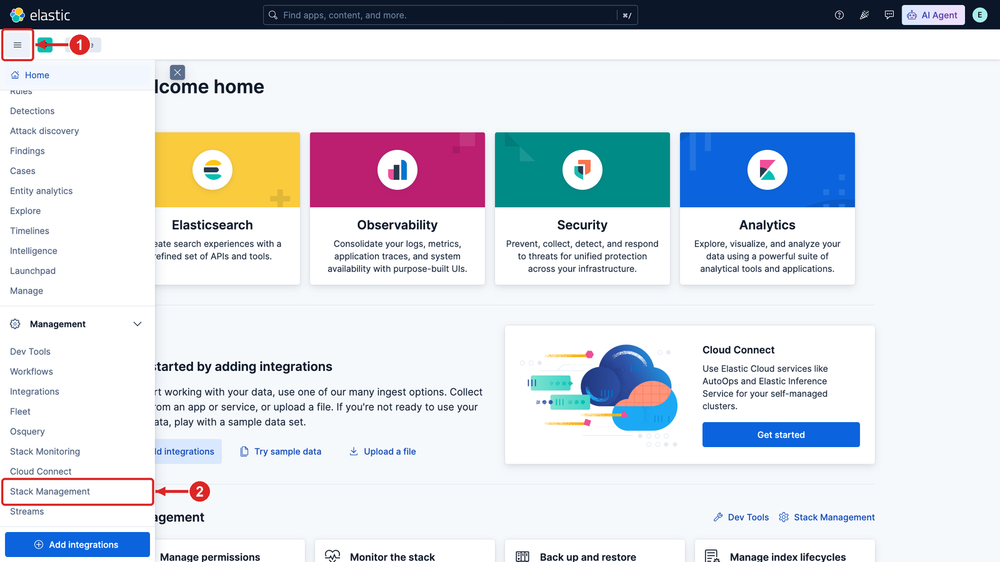

2. Soldaki listede **Security** altında **Roles** (1):

   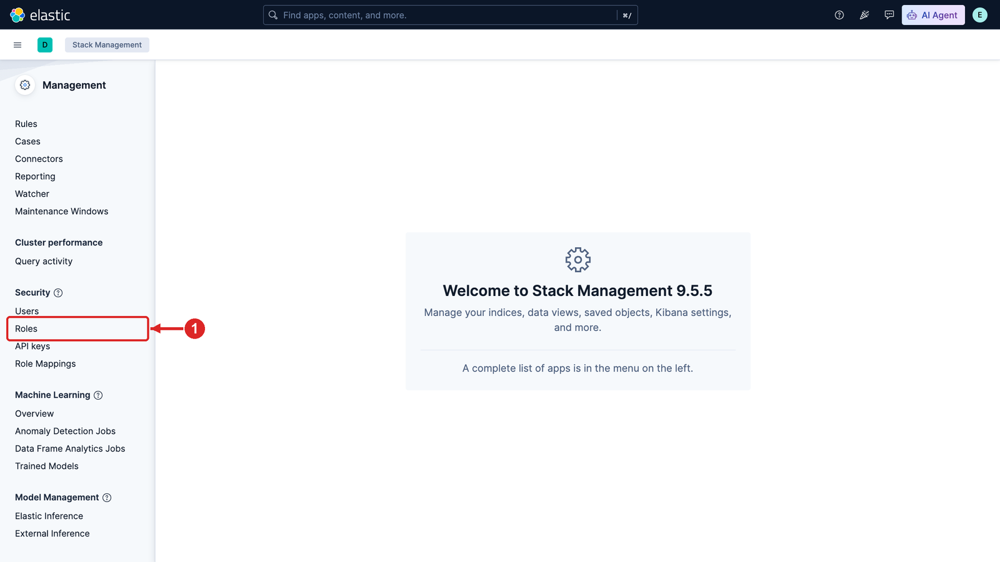

3. **Create role** (1):

   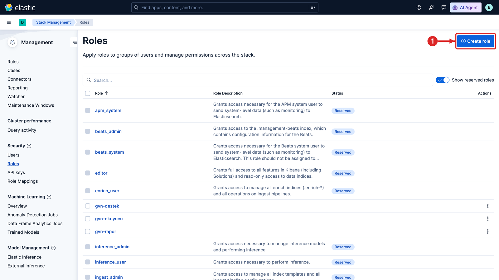

4. **Role name** (1) `excel-logstash-writer`. **Cluster privileges** (2) kutusuna `monitor` yazıp Enter:

   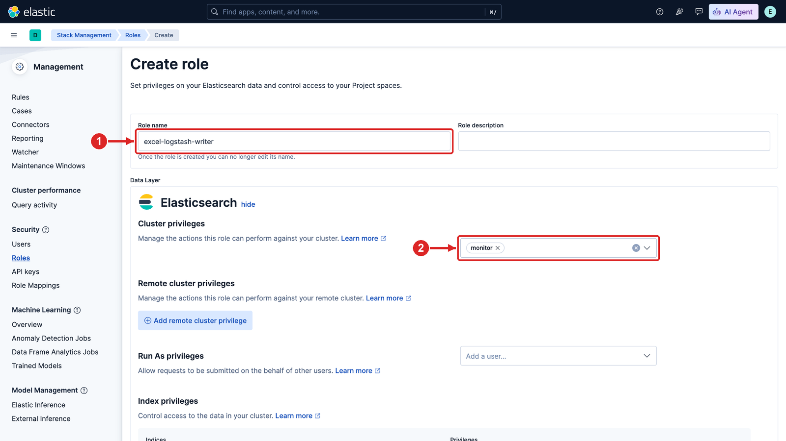

   Aşağı kaydırın. **Index privileges** altında **Indices** (1) kutusuna `excel-*` yazıp Enter; **Privileges** (2)
   kutusuna `create_index` yazıp Enter, sonra `index` yazıp Enter:

   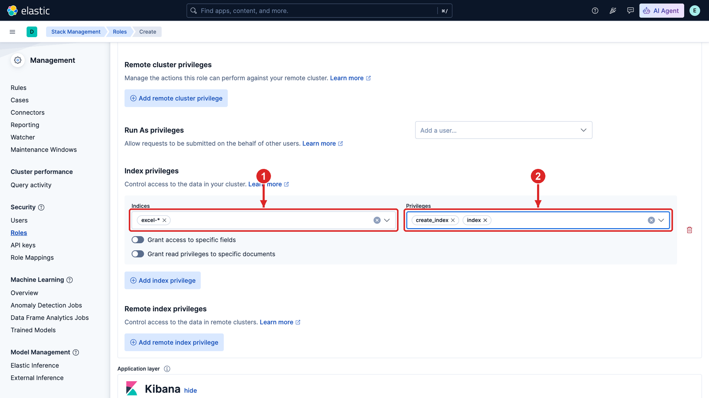

5. Sayfanın altındaki **Create role** (1):

   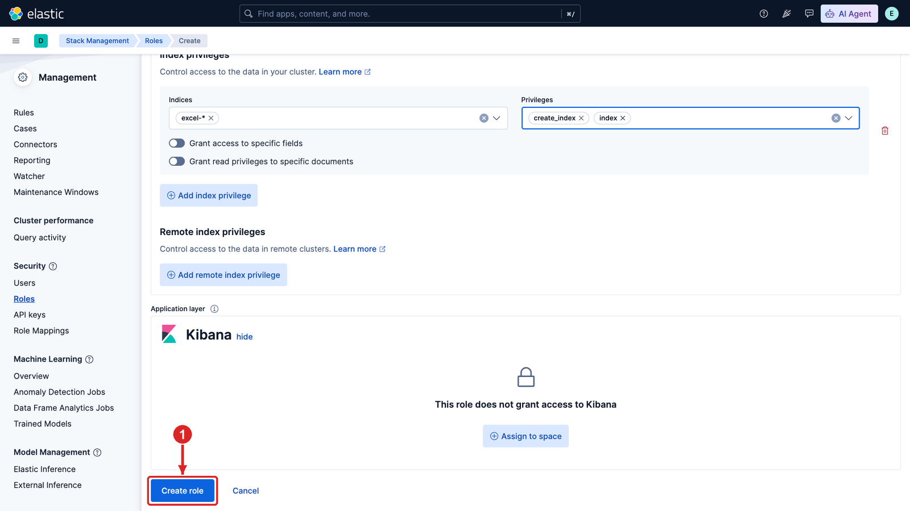

6. Soldaki listede **Users** (1), sonra **Create user** (2):

   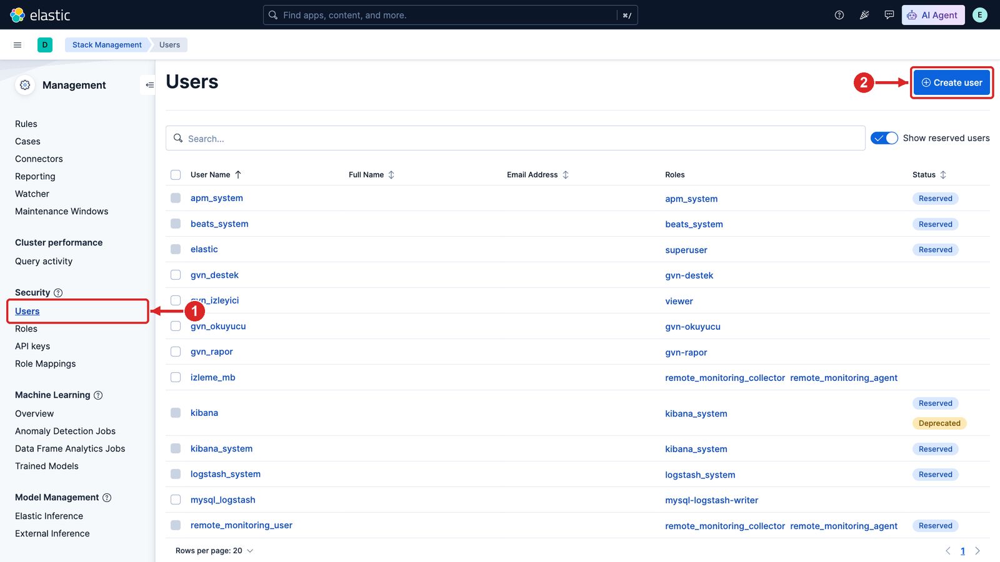

7. **Username** (1) `excel_logstash`, **Full name** (2) `Excel Logstash`, **Password** (3) ve **Confirm password**
   (4) `Excel2026!`, **Roles** (5) `excel-logstash-writer`; **Create user** (6):

   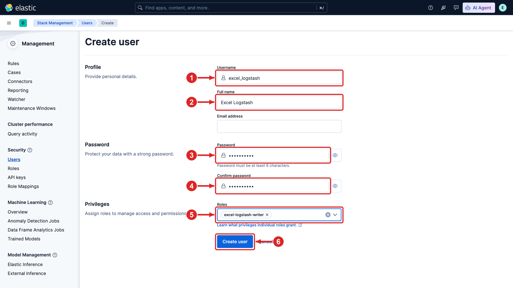

</details>

Yetkinin gerçekten sınırlı olduğunu terminalde bu kullanıcıyla başka bir index'e yazarak görün:

```bash
curl -s -u excel_logstash:'Excel2026!' -X PUT 'http://127.0.0.1:9200/belge-deneme/_doc/1' \
  -H 'Content-Type: application/json' -d '{"deneme": 1}' | jq -c '{status, type: .error.type}'
```

Beklenen çıktı:

```text
{"status":403,"type":"security_exception"}
```

### 3. Index şablonu: tipleri önceden söyleyin

**Soru: Field tiplerini Elasticsearch'in tahminine bırakmak neden yetmez?**

Şablon olmasa Elasticsearch tipleri ilk document'ten tahmin eder: Logstash sayıları düzeltmiş olsa da `il`
gibi field'lar `text` olur ve gruplamak için `.keyword` gerekir. Tipleri baştan veriyoruz:

```http
PUT /_index_template/excel-satislar
{
  "index_patterns": ["excel-satislar"],
  "template": {
    "settings": { "number_of_shards": 1, "number_of_replicas": 0 },
    "mappings": {
      "properties": {
        "@timestamp":  { "type": "date" },
        "fatura_no": { "type": "keyword" }, "tarih": { "type": "keyword" },
        "musteri":   { "type": "keyword" }, "il":    { "type": "keyword" },
        "urun":        { "type": "text", "fields": { "keyword": { "type": "keyword" } } },
        "adet":        { "type": "integer" },
        "birim_fiyat": { "type": "scaled_float", "scaling_factor": 100 },
        "tutar":       { "type": "scaled_float", "scaling_factor": 100 }
      }
    }
  }
}
```

```json
{"acknowledged":true}
```

`scaled_float` para için uygundur: değeri 100 ile çarpıp tam sayı olarak saklar, kuruş kaybolmaz.
Ham `tarih` metni `keyword` olarak kalır; arama ve zaman çizelgesi `@timestamp`'i kullanır.

### 4. Logstash'i başlatın

**Soru: Kaç satır okundu, kaçı Elasticsearch'e gitti?**

```bash
docker compose up -d
```

Logstash'in açılıp 24 faturayı yazması yaklaşık 30 saniye sürer. API'deki `out` sayacı 24 olana kadar
bekleyin, sonra üç sayaca bakın:

```bash
timeout 180 bash -c 'until [ "$(curl -s 127.0.0.1:9603/_node/stats/pipelines/main | jq .pipelines.main.events.out 2>/dev/null)" = 24 ]; do printf .; sleep 3; done'; echo
timeout 60 bash -c 'until [ "$(curl -s -u elastic:"DevOps2026!" http://127.0.0.1:9200/excel-satislar/_count | jq .count 2>/dev/null)" = 24 ]; do printf .; sleep 1; done'; echo
curl -s 127.0.0.1:9603/_node/stats/pipelines/main | jq -c '.pipelines.main.events | {in, filtered, out}'
```

Beklenen çıktı:

```text
.........
{"in":25,"filtered":25,"out":24}
```

İkinci bekleme, document'lerin Elasticsearch'te aranabilir olmasını bekler (yazılan document yaklaşık bir saniye sonra aramaya girer).

25 satır okundu ve filtrelerden geçti; biri (başlık) `drop` ile atıldığı için Elasticsearch'e 24 document
gitti. Logstash API'si `filter_path` desteklemez; field seçimini `jq` yapar.

**Container yeniden başlayınca dosya yine okunur mu?** Tekrarı iki katman birlikte engeller:

| Katman | Nerede | Ne yapar |
|---|---|---|
| `sincedb` | Logstash, `logstash-data` volume'ü | Hangi dosyanın nereye kadar okunduğunu yazar; okunmuş dosyayı yeniden okumaz |
| `document_id => "%{fatura_no}"` | Elasticsearch | Dosya yine okunsa bile aynı `_id`'li document'in üzerine yazar; kopya açılmaz |

Önce Logstash'i yeniden başlatın. Volume yerinde kaldığı için sincedb dosyayı "okundu" bilir. Bekleme 20 saniye
boyunca yeni satır okunup okunmadığına bakar:

```bash
docker compose restart logstash
timeout 120 bash -c 'until curl -s 127.0.0.1:9603/_node/stats/pipelines/main | jq -e .pipelines.main.events >/dev/null 2>&1; do printf .; sleep 3; done'; echo
timeout 20 bash -c 'until [ "$(curl -s 127.0.0.1:9603/_node/stats/pipelines/main | jq .pipelines.main.events.in)" -gt 0 ]; do sleep 2; done'; echo "20 sn beklendi"
curl -s 127.0.0.1:9603/_node/stats/pipelines/main | jq -c '.pipelines.main.events | {in, out}'
docker exec logstash-excel-lab cat /usr/share/logstash/data/okunan-dosyalar.log
curl -s -u elastic:'DevOps2026!' http://127.0.0.1:9200/excel-satislar/_count | jq .count
```

Beklenen çıktı:

```text
 Container logstash-excel-lab Restarting
 Container logstash-excel-lab Started
...............
20 sn beklendi
{"in":0,"out":0}
/data/satislar.csv
24
```

Yeni Logstash süreci tek satır okumadı (`in: 0`); `okunan-dosyalar.log` dosyanın ilk açılışta okunduğunu
gösterir, document sayısı 24'te kaldı.

Şimdi sincedb'yi de silin: `down -v` volume'ü kaldırır, Logstash dosyayı ilk kez görüyormuş gibi baştan okur.
Bu kez ikinci katman, `document_id`, çalışır:

```bash
docker compose down -v
docker compose up -d
timeout 180 bash -c 'until [ "$(curl -s 127.0.0.1:9603/_node/stats/pipelines/main | jq .pipelines.main.events.out 2>/dev/null)" = 24 ]; do printf .; sleep 3; done'; echo
curl -s -u elastic:'DevOps2026!' -X POST http://127.0.0.1:9200/excel-satislar/_refresh -o /dev/null
curl -s -u elastic:'DevOps2026!' http://127.0.0.1:9200/excel-satislar/_count | jq .count
curl -s -u elastic:'DevOps2026!' http://127.0.0.1:9200/excel-satislar/_doc/F-2026-1003 | jq -c '{_id, _version}'
```

Beklenen çıktı:

```text
 Container logstash-excel-lab Removed
 Volume logstash-excel-lab_logstash-data Removed
 ...
 Container logstash-excel-lab Started
...........
24
{"_id":"F-2026-1003","_version":2}
```

24 satır yeniden gönderildi ama document sayısı yine 24: her fatura kendi `_id`'sinin üzerine yazıldı, `_version`
1'den 2'ye çıktı. `document_id` olmasaydı Elasticsearch her satıra yeni bir `_id` verir, sayı 48 olurdu.

### 5. Önce ve sonra: aynı fatura

**Soru: CSV satırı document'e nasıl dönüştü?**

CSV'deki satır ve Elasticsearch'teki document:

```bash
grep F-2026-1003 data/satislar.csv
curl -s -u elastic:'DevOps2026!' 'http://127.0.0.1:9200/excel-satislar/_doc/F-2026-1003' \
  | jq -c '._source | {fatura_no, tarih, "@timestamp", adet, birim_fiyat, tutar}'
```

Beklenen çıktı:

```text
F-2026-1003;04.02.2026;Ağaoğlu Yapı;Eskişehir;Ofis Sandalyesi;6;4.750,00;28.500,00
{"fatura_no":"F-2026-1003","tarih":"04.02.2026","@timestamp":"2026-02-03T21:00:00.000Z","adet":6,"birim_fiyat":4750.0,"tutar":28500.0}
```

Metin olan `4.750,00` sayı `4750.0` oldu; `04.02.2026` İstanbul gece yarısı olarak `@timestamp`'e yazıldı.

Tutarların gerçekten sayı olduğunu en iyi bir toplam gösterir. İl başına ciro, en yüksek üç il:

```bash
curl -s -u elastic:'DevOps2026!' 'http://127.0.0.1:9200/excel-satislar/_search?size=0' -H 'Content-Type: application/json' \
  -d '{"aggs":{"il":{"terms":{"field":"il","size":3,"order":{"ciro":"desc"}},"aggs":{"ciro":{"sum":{"field":"tutar"}}}}}}' \
  | jq -c '.aggregations.il.buckets[] | {il: .key, fatura: .doc_count, ciro: .ciro.value}'
```

Beklenen çıktı:

```text
{"il":"İstanbul","fatura":4,"ciro":370498.7}
{"il":"Eskişehir","fatura":4,"ciro":114000.0}
{"il":"İzmir","fatura":4,"ciro":37383.0}
```

### 6. Discover'da bakın

**Soru: Faturalar Kibana'da nasıl aranır?**

Kibana adresini sunucuda hesaplayın:

```bash
IP=$(curl -s https://api.ipify.org); H=$(hostname -s)
echo "Kibana: http://$IP:5601   https://$H-kibana.devopsatolyesi.com"
```

1. Menüden **Management › Stack Management**'ı açın, soldaki listede **Data Views**'a (1) tıklayın:

   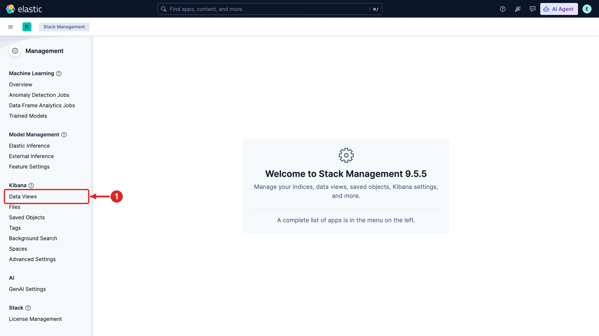

2. **Create data view** (1):

   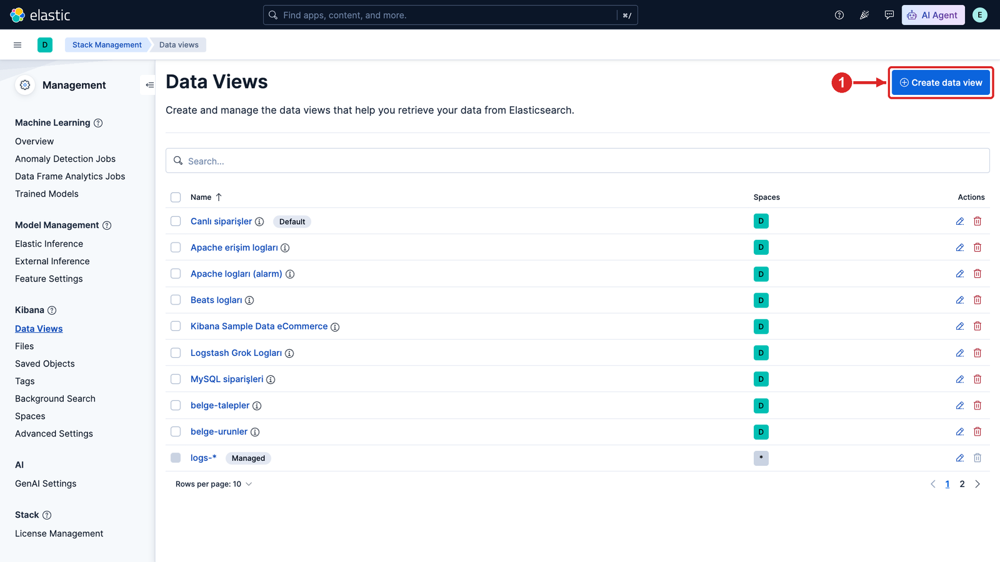

3. **Name** (1) `excel-satislar`, **Index pattern** (2) `excel-satislar`, **Timestamp field** (3) `@timestamp`,
   sonra **Save data view to Kibana** (4):

   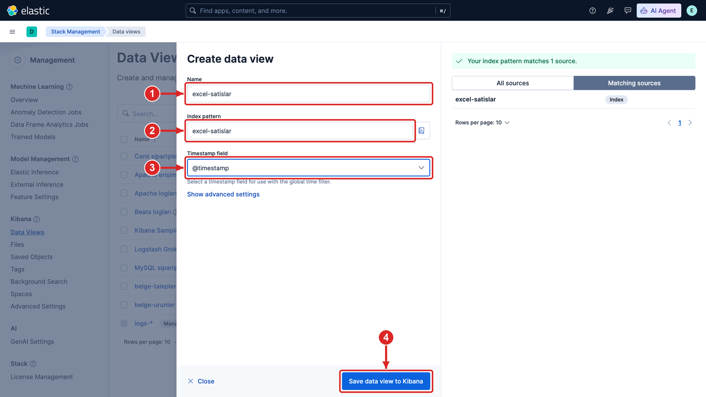

4. Menü düğmesine (1) tıklayın, **Analytics** altında **Discover**'ı (2) seçin:

   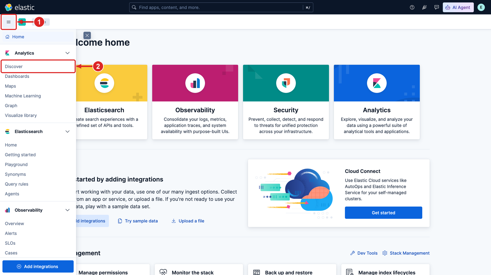

5. **Data view** düğmesine (1) tıklayın, arama kutusuna (2) `excel` yazıp **excel-satislar**'ı (3) seçin:

   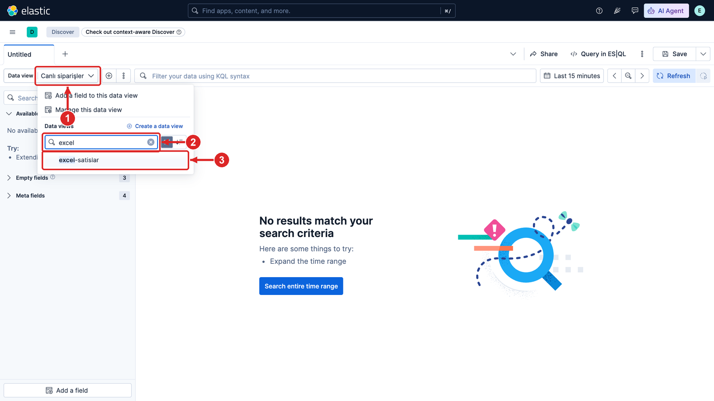

6. Zaman seçicisini (1) açıp **Last 1 year**'ı (2) seçin. Faturalar 2026 yılına yayılmıştır; varsayılan
   **Last 15 minutes** aralığında hiç document görünmez:

   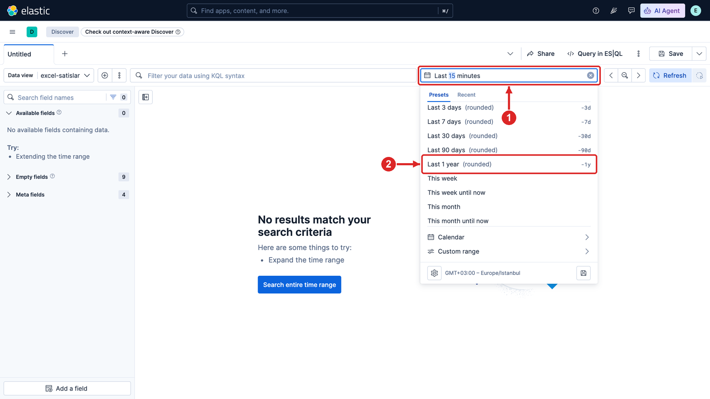

7. Arama çubuğuna (1) `il : "İstanbul"` yazıp Enter'a basın: document sayısı 4 olur (2):

   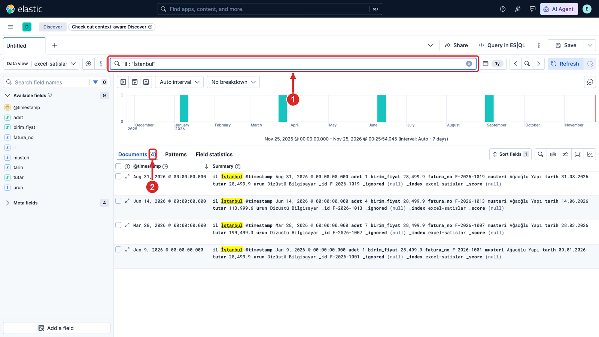

Faturaların tarihi sabittir (Ocak–Kasım 2026). Labı daha sonraki bir tarihte yapıyorsanız zaman
kutusunda daha geniş bir aralık seçin.


### 7. Tek seferlik dosya: CSV'yi Kibana'dan yüklemek ve düzeltmek

**Soru: Bir kez bakılacak dosya için Logstash kurmak şart mı?**

Elinizdeki bir CSV'yi bir kez bakmak için Elasticsearch'e koymanız gerekiyorsa Logstash kurmak gerekmez.
Kibana dosyayı okur, sütunları ve tarihi tanır, index'i ve mapping'i kendisi kurar. Örnek dosya bir Spring
Boot uygulamasının 2024 Şubat-Mart loglarıdır (2000 satır, sütunlar `event_date, log_level, logger, ...`).

Yükleme tarayıcıdan yapılır; dosya kendi bilgisayarınızda olmalı. Kendi bilgisayarınızın terminalinde:

<!-- runner:skip -->
```bash
scp student@<sunucu-ip>:~/elastic/labs/LAB-12-logstash-excel/sample-data/uygulama-loglari.csv .
```

1. Kibana ana sayfasında (sol üstteki **elastic** logosu) **Upload a file** (1):

   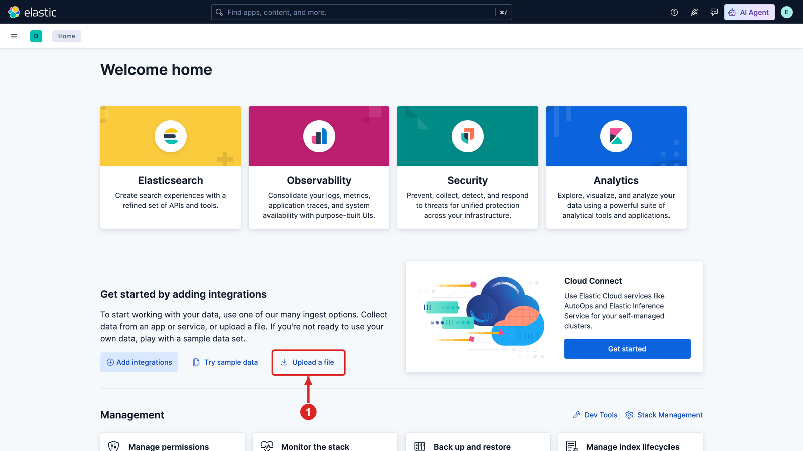

2. Dosya seçme alanına (1) tıklayıp indirdiğiniz `uygulama-loglari.csv`'yi seçin (ya da sürükleyip bırakın):

   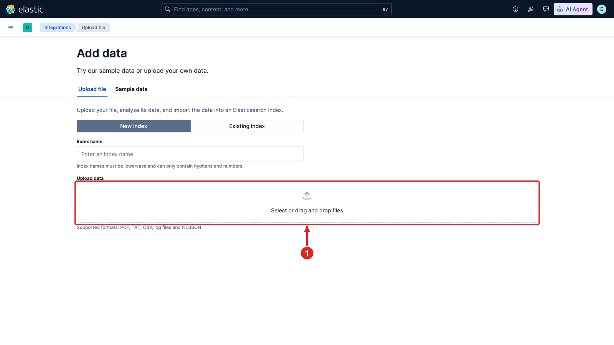

3. Kibana dosyayı okuyup önizlemeyi gösterir. **Index name** (1) kutusuna `excel-uygulama-loglari` yazın, sonra
   **Mappings** (2) sekmesine tıklayın:

   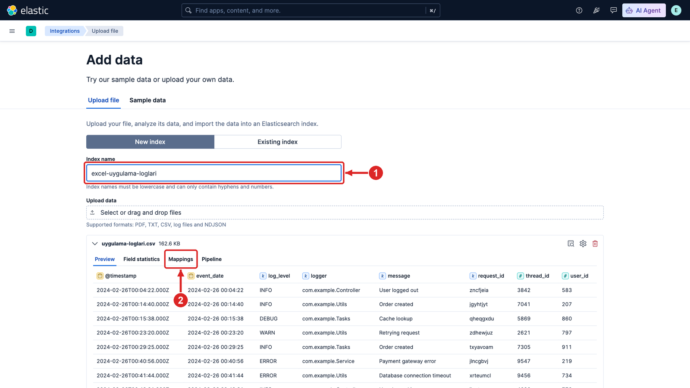

4. **Mappings** (1) Kibana'nın önerdiği tipleri gösterir: `event_date`'i tarih olarak tanıdı ve ondan bir
   `@timestamp` üretti (önizleme `@timestamp`'i saat dilimi göstermeden yazar):

   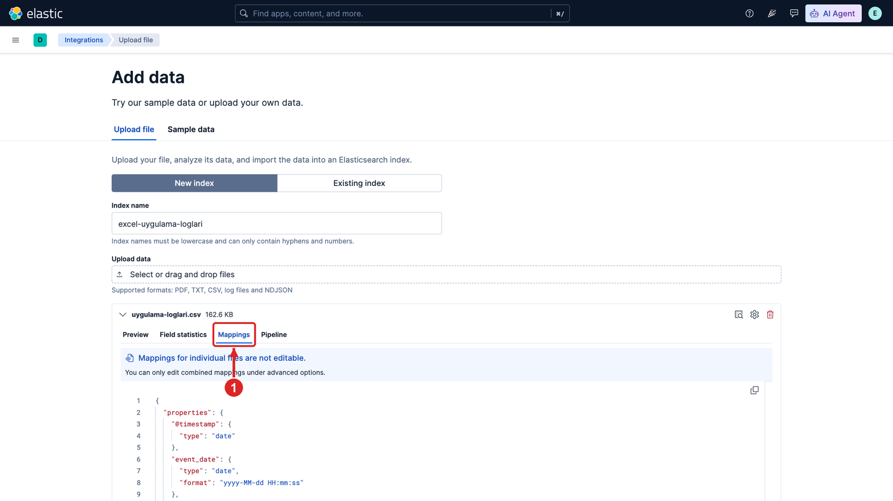

5. Altta **Advanced options**'ı açın: **Create data view** (1) işaretli kalsın; **Customize index settings** (2)
   ile ayarları yüklemeden önce değiştirebilirsiniz. Bu sefer varsayılanla devam edip adımın sonunda
   düzelteceğiz. **Import** (3):

   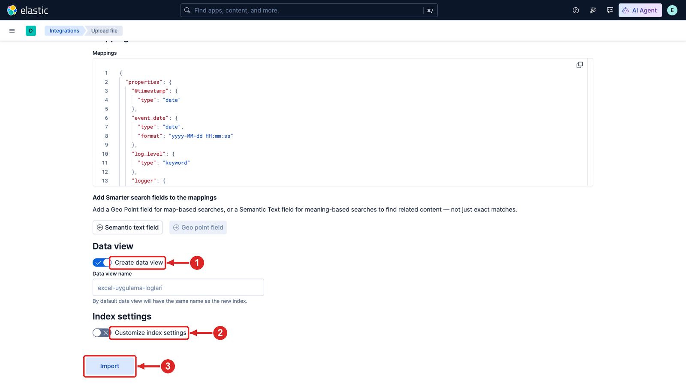

6. Yükleme bitince Discover'da açma ve index'i yönetme bağlantıları (1) gelir:

   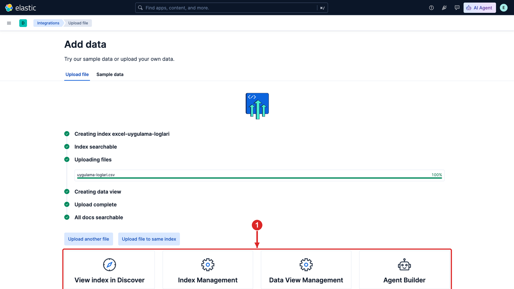

| | Kibana › Upload file | Logstash (Adım 1-6) |
|---|---|---|
| Ne zaman | Tek seferlik dosya, hızlı bakış | Düzenli gelen dosya, tekrar eden aktarım |
| Biçim | Kendisi tanır: `09.01.2026`'yı tarih bilir, `28.499,90`'ı sayı değil metin (`keyword`) yapar | Her dönüşümü siz yazarsınız |
| Mapping, data view | Kendisi kurar | Siz kurarsınız (Adım 3, 6) |
| `@timestamp` saat dilimi | Tarayıcınızın saat dilimi (`+03:00`); ofsetsiz `event_date` ise UTC sayılır, aynı satırda ikisi 3 saat farklı olur | Config'teki `timezone` |

#### Yüklenen veriyi düzeltmek: replica ve yıl

Kibana index'i varsayılan ayarla açar: 1 replica. Tek node'lu cluster'da replica yerleşemez, index
yellow kalır:

```bash
curl -s -u elastic:'DevOps2026!' 'http://127.0.0.1:9200/_cat/indices/excel-uygulama-loglari?h=index,docs.count,rep,health'
```

Beklenen çıktı:

```text
excel-uygulama-loglari 2000 1 yellow
```

Kibana › Dev Tools'a yapıştırın:

```http
PUT excel-uygulama-loglari/_settings
{ "index": { "number_of_replicas": 0 } }
```

```json
{"acknowledged":true}
```

Loglar 2024 tarihli; bugünün panolarında görünmesi için yılı 2026'ya taşıyalım. Önce gün bazında dağılım:

```http
GET excel-uygulama-loglari/_search?size=0&filter_path=aggregations.gun.buckets.key_as_string,aggregations.gun.buckets.doc_count
{ "aggs": { "gun": { "date_histogram": { "field": "event_date", "calendar_interval": "day", "format": "yyyy-MM-dd" } } } }
```

```json
{"aggregations":{"gun":{"buckets":[{"key_as_string":"2024-02-26","doc_count":290},{"key_as_string":"2024-02-27","doc_count":275},{"key_as_string":"2024-02-28","doc_count":283},{"key_as_string":"2024-02-29","doc_count":274},{"key_as_string":"2024-03-01","doc_count":290},{"key_as_string":"2024-03-02","doc_count":294},{"key_as_string":"2024-03-03","doc_count":294}]}}}
```

`_update_by_query` her document'i bir script'ten geçirip yerinde günceller. Script yalnız yılı değiştirir:
saat ve saat dilimi aynı kalır. 2024 artık yıldır, 2026 değildir; `2026-02-29` geçersiz tarih olduğu
için document reddedilirdi, script onu 28 Şubat'a çevirir:

```http
POST excel-uygulama-loglari/_update_by_query?conflicts=proceed&refresh=true&filter_path=updated,failures
{
  "query": { "range": { "event_date": { "lt": "2025-01-01 00:00:00" } } },
  "script": { "lang": "painless",
    "source": "for (String f : ['@timestamp', 'event_date']) { def v = ctx._source[f]; if (v instanceof String && v.startsWith('2024-')) { String r = '2026' + v.substring(4); if (r.startsWith('2026-02-29')) { r = '2026-02-28' + r.substring(10); } ctx._source[f] = r; } }" }
}
```

```json
{"updated":2000,"failures":[]}
```

Aynı dağılım sorgusunu tekrar çalıştırın:

```http
GET excel-uygulama-loglari/_search?size=0&filter_path=aggregations.gun.buckets.key_as_string,aggregations.gun.buckets.doc_count
{ "aggs": { "gun": { "date_histogram": { "field": "event_date", "calendar_interval": "day", "format": "yyyy-MM-dd" } } } }
```

```json
{"aggregations":{"gun":{"buckets":[{"key_as_string":"2026-02-26","doc_count":290},{"key_as_string":"2026-02-27","doc_count":275},{"key_as_string":"2026-02-28","doc_count":557},{"key_as_string":"2026-03-01","doc_count":290},{"key_as_string":"2026-03-02","doc_count":294},{"key_as_string":"2026-03-03","doc_count":294}]}}}
```

Yıl 2026 oldu ve 29 Şubat bucket'ı yok: o günün 274 document'i 28 Şubat'a eklendi (283 + 274 = 557). Yükleme sırasında
çevirmek isteseydiniz aynı script bir ingest pipeline'a konur ve `index.default_pipeline` ayarıyla index'e
bağlanırdı.

---

## Temizlik

Yalnız bu labın Logstash konteynerini ve volume'ünü, `excel-satislar` ve `excel-uygulama-loglari`
index'lerini, şablonunu, iki data view'ını, rolünü ve kullanıcısını siler. Ana cluster'a ve diğer labların verisine dokunmaz:

```bash
./teardown.sh
```

Beklenen çıktı:

```text
Container logstash-excel-lab Removed
Volume logstash-excel-lab_logstash-data Removed
index excel-satislar -> 200
index excel-uygulama-loglari -> 200
sablon excel-satislar -> 200
kullanici excel_logstash -> 200
rol excel-logstash-writer -> 200
data view <id> -> 200
data view <id> -> 200
```

Data view id'leri arayüzde rastgele üretildiği için sizde farklıdır; Adım 6 ve Adım 7'nin iki data view'ı
silinir.

Labı aynı sunucuda yeniden yapacaksanız başlamadan önce `./teardown.sh` çalıştırın; README'deki sayılar temiz
başlangıca göredir.

---

Sonraki lab: **[LAB-13 — MySQL Verisini Logstash JDBC ile Aktarmak: JOIN'li Sorgu ve Artımlı Aktarım](../LAB-13-logstash-mysql-jdbc/README.md)**
