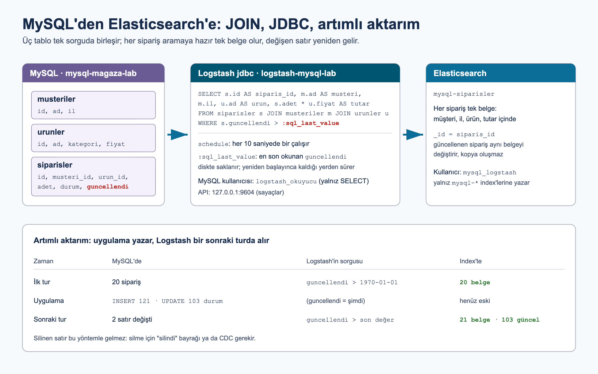
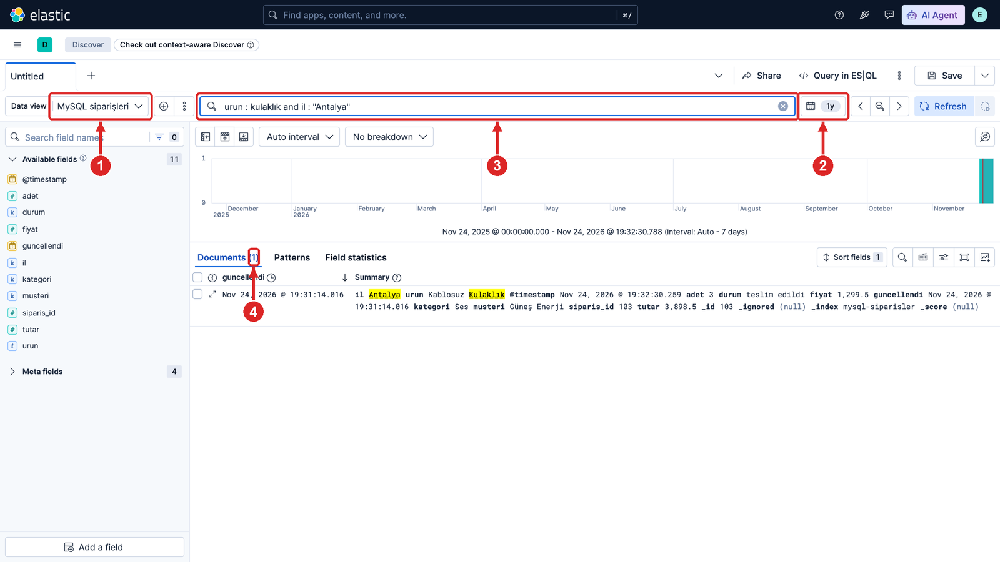
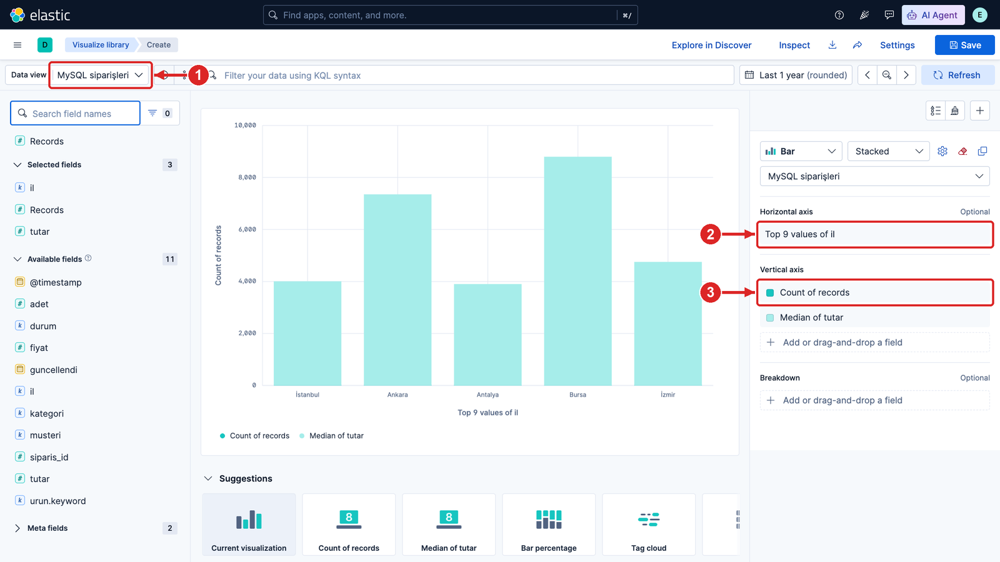
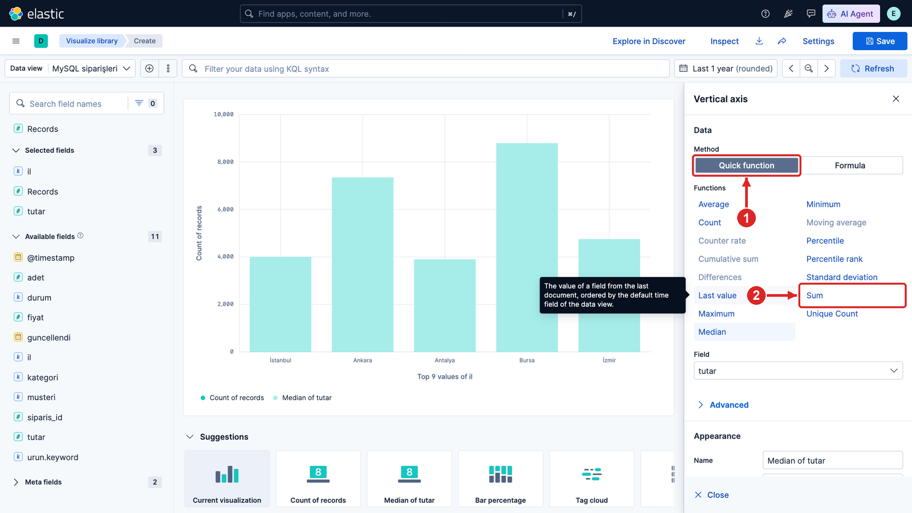
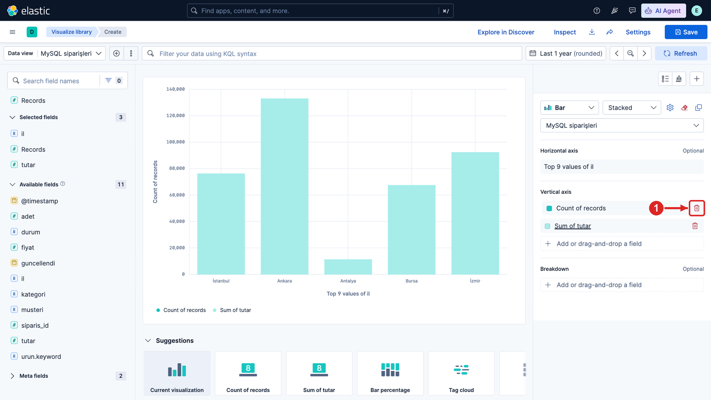
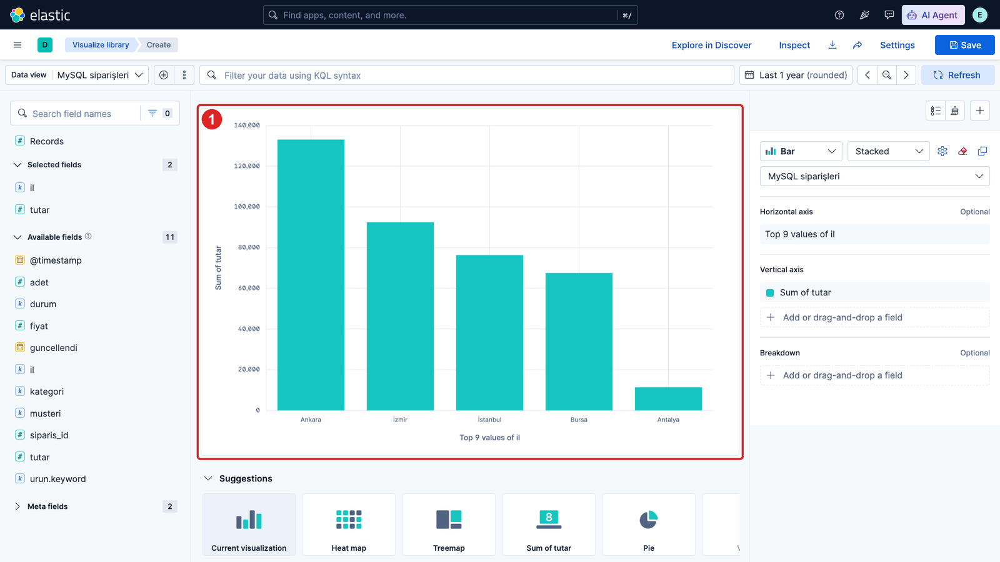
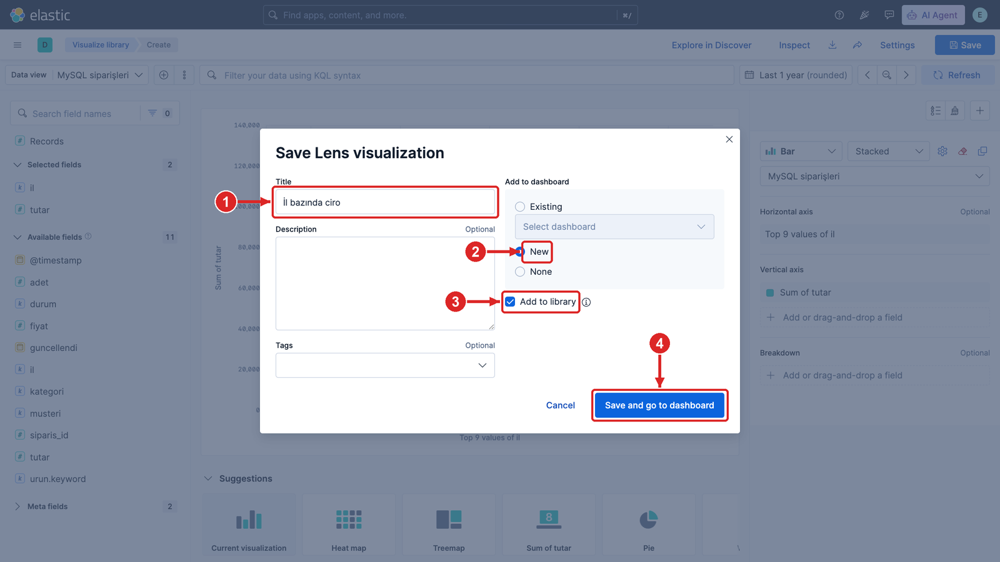
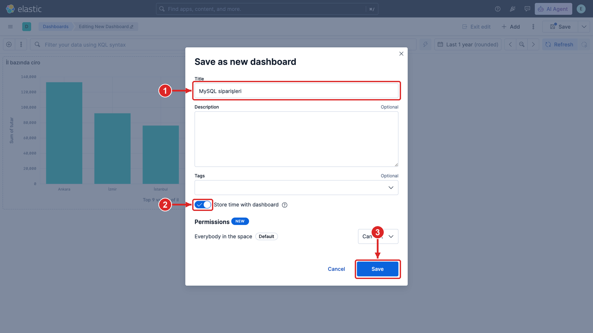
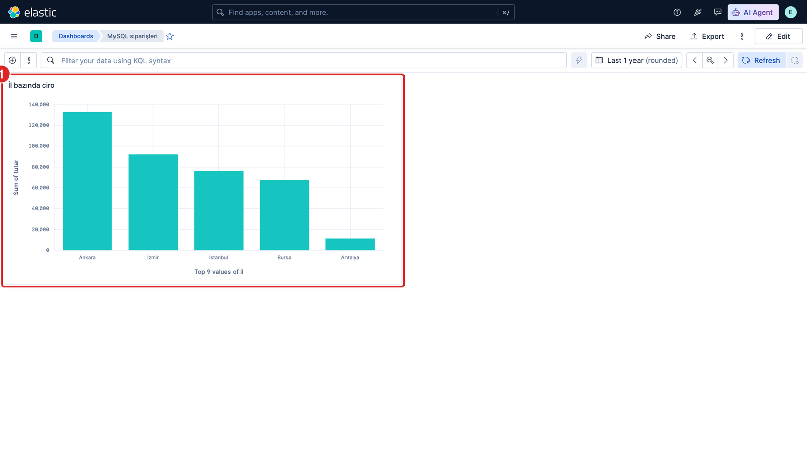

# LAB-13 — MySQL Verisini Logstash JDBC ile Aktarmak: JOIN'li Sorgu ve Artımlı Aktarım

| Kullanılan Araçlar | Açık / Kullanılan Portlar |
|---|---|
| MySQL 8.4, Logstash 9.5.5 (`jdbc` input), Kibana Dev Tools, ES\|QL | `127.0.0.1:9604` (Logstash API, yalnız sunucudan); MySQL host'a açılmaz; 9200 / 5601 — LAB-01 ana cluster'ı |

---

## Bu lab ne öğretiyor?

Bir mağaza veritabanında sipariş, müşteri ve ürün ayrı tablolardadır. "Antalya'daki müşterilerin
kulaklık siparişleri" sorusu için üç tablo birleştirilmelidir. Elasticsearch'te JOIN yoktur; bu yüzden
birleştirme veri aktarılırken yapılır ve her sipariş müşterisi ve ürünüyle birlikte tek document olur.

Bu labda Logstash'in `jdbc` input'u:

- JOIN'li tek bir SQL'i düzenli aralıklarla çalıştıracak.
- Yalnız değişen satırları alacak, aynı siparişi tekrar yazdığında kopya açmayacak.

Sonra aktarılan veride arama yapıp Kibana'da kısa bir rapor kuracağız. Kibana'daki her tıklama kırmızı kutu ve
numarayla gösterilir.



---

## Ön Koşullar

- LAB-01 ana cluster'ı çalışıyor. LAB-01'i atladıysanız onun Adım 1-2'sini çalıştırın.
- `127.0.0.1:9604` portu boş olmalı. MySQL ve Logstash birlikte yaklaşık 1,5 GB RAM kullanır; MySQL
  image'ı ilk seferde yaklaşık 1 GB indirilir.

```bash
cd ~/elastic/labs/LAB-13-logstash-mysql-jdbc
```


---

## Kavramlar: veritabanından aktarımın üç sorusu

| Soru | Cevap | Ayar |
|---|---|---|
| Üç tablo nasıl tek document olur? | SQL'de JOIN; her satır bir sipariş document'i | `statement` |
| Her seferinde bütün tablo mu okunur? | Hayır; son okunan zamandan sonra değişen satırlar | `:sql_last_value`, `tracking_column` |
| Değişen sipariş kopya mı açar? | Hayır; sipariş numarası document'in `_id`'si | `document_id` |

---

## Config dosyaları: hangi satır ne işe yarıyor?

`pipeline/mysql.conf` (kritik satırlar):

```conf
    statement => "
      SELECT s.id AS siparis_id, s.adet, s.durum, s.guncellendi,
             m.ad AS musteri, m.il, u.ad AS urun, u.kategori, u.fiyat,
             s.adet * u.fiyat AS tutar
      FROM siparisler s
      JOIN musteriler m ON m.id = s.musteri_id
      JOIN urunler u ON u.id = s.urun_id
      WHERE s.guncellendi > :sql_last_value
      ORDER BY s.guncellendi"
    use_column_value => true
    tracking_column => "guncellendi"
    tracking_column_type => "timestamp"
    schedule => "*/10 * * * * *"                    # her 10 saniyede bir
```

- `:sql_last_value`: Logstash'in son turda gördüğü en büyük `guncellendi` değeri. İlk turda
  `1970-01-01`'dir, yani bütün tablo okunur. Değer `data` volume'ündeki bir dosyada saklanır.
- `guncellendi`: tabloda `ON UPDATE CURRENT_TIMESTAMP(3)` ile tanımlı; satır her değişince kendiliğinden
  güncellenir. Uygulama bu sütunu güncellemiyorsa artımlı aktarım değişikliği göremez.
- `ORDER BY`: Logstash son satırın değerini sakladığı için sonuç zamana göre sıralı gelmeli.
- `schedule`: sorgunun ne zaman çalışacağı, cron biçiminde. Gerçek sistemde dakikada bir yeterlidir; labda
  beklememek için 10 saniye. Linux cron'u (`crontab`) 5 alanlıdır ve ilk alan **dakikadır**. Logstash'in
  `schedule`'ı 6 alan da kabul eder; 6 alan verilirse ilk alan **saniyedir**, gerisi cron'la aynıdır:

```text
*/10   *      *      *      *      *
 │     │      │      │      │      └─ haftanın günü (0-6, 0 = pazar)
 │     │      │      │      └──────── ay (1-12)
 │     │      │      └─────────────── ayın günü (1-31)
 │     │      └────────────────────── saat (0-23)
 │     └───────────────────────────── dakika (0-59)
 └─────────────────────────────────── saniye (0-59)  ← Linux cron'unda bu alan yok
```

`*` "her değer", `*/N` "N'de bir" demektir. Alan sayısı anlamı değiştirir: `*/10 * * * *` (5 alan) 10 dakikada
bir, `*/10 * * * * *` (6 alan) 10 saniyede bir çalışır.

<details>
<summary><strong>Başka schedule örnekleri</strong></summary>

| `schedule` | Ne zaman çalışır |
|---|---|
| `*/10 * * * * *` | Her 10 saniyede (bu lab) |
| `* * * * *` | Her dakika (5 alan: ilk alan dakika) |
| `*/5 * * * *` | 5 dakikada bir |
| `0 2 * * *` | Her gece 02:00'de |
| `30 8 * * 1-5` | Hafta içi her sabah 08:30'da (`1-5`: pazartesi-cuma) |

`schedule` hiç verilmezse sorgu Logstash açılınca yalnız bir kez çalışır.

</details>

`docker-compose.yml`'de MySQL servisinin `ports` satırı yoktur: veritabanı host'a açılmaz, Logstash ona
labın kendi Docker ağı üzerinden `mysql-magaza-lab:3306` adıyla bağlanır.

---

## Adım Adım Uygulama Rehberi

### 1. MySQL'i başlatın ve tablolara bakın

**Soru: Kaynak veritabanında veri nasıl dağılmış?**

```bash
docker compose up -d mysql
```

İlk açılışta MySQL `sql/01-magaza.sql`'i çalıştırıp tabloları doldurur; yaklaşık 20 saniye sürer:

```bash
timeout 180 bash -c 'until [ "$(docker inspect -f {{.State.Health.Status}} mysql-magaza-lab 2>/dev/null)" = healthy ]; do printf .; sleep 3; done'; echo
docker exec mysql-magaza-lab mysql --default-character-set=utf8mb4 -ulogstash_okuyucu -pOkuyucu2026! magaza \
  -e "SELECT s.id, s.musteri_id, s.urun_id, s.adet, s.durum FROM siparisler s WHERE s.id = 103;
      SELECT id, ad, il FROM musteriler WHERE id = 5; SELECT id, ad, fiyat FROM urunler WHERE id = 2;" 2>/dev/null
```

Beklenen çıktı:

```text
......
id	musteri_id	urun_id	adet	durum
103	5	2	3	kargoda
id	ad	il
5	Güneş Enerji	Antalya
id	ad	fiyat
2	Kablosuz Kulaklık	1299.50
```

103 numaralı sipariş üç tabloya dağılmış: siparişte yalnız `musteri_id` ve `urun_id` var. Müşterinin adı
ve ili, ürünün adı ve fiyatı başka tablolarda. `--default-character-set=utf8mb4` olmadan `mysql`
istemcisi Türkçe harfleri `G?ne?` gibi gösterir; veri doğru saklıdır, yalnız ekran bozulur.

Logstash'in kullanacağı `logstash_okuyucu` yalnız okuyabilir:

<!-- runner:expect-fail -->
```bash
docker exec mysql-magaza-lab mysql -ulogstash_okuyucu -pOkuyucu2026! magaza \
  -e "UPDATE siparisler SET durum = 'iptal' WHERE id = 101;" 2>&1 | grep -v Warning
```

Beklenen çıktı:

```text
ERROR 1142 (42000) at line 1: UPDATE command denied to user 'logstash_okuyucu'@'localhost' for table 'siparisler'
```

### 2. Elasticsearch tarafı: kullanıcı ve şablon

**Soru: Logstash hangi yetkiyle yazacak, field tipleri ne olacak?**

Logstash Elasticsearch'e yalnız `mysql-*` index'lerine yazabilen bir kullanıcıyla bağlanır. Kibana
adresini sunucuda hesaplayın:

```bash
IP=$(curl -s https://api.ipify.org); H=$(hostname -s)
echo "Kibana: http://$IP:5601   https://$H-kibana.devopsatolyesi.com"
```

Beklenen çıktı:

```text
Kibana: http://<IP>:5601   https://<host>-kibana.devopsatolyesi.com
```

Aşağıdaki `http` blokları **Kibana › Dev Tools**'a yapıştırılır:

```http
PUT /_security/role/mysql-logstash-writer
{
  "cluster": ["monitor"],
  "indices": [ { "names": ["mysql-*"], "privileges": ["create_index", "index"] } ]
}
```

```http
PUT /_security/user/mysql_logstash
{ "password": "Mysql2026!", "roles": ["mysql-logstash-writer"] }
```

```http
PUT /_index_template/mysql-siparisler
{
  "index_patterns": ["mysql-siparisler"],
  "template": {
    "settings": { "number_of_shards": 1, "number_of_replicas": 0 },
    "mappings": {
      "properties": {
        "siparis_id": { "type": "integer" }, "guncellendi": { "type": "date" },
        "durum": { "type": "keyword" }, "musteri": { "type": "keyword" },
        "il": { "type": "keyword" }, "kategori": { "type": "keyword" },
        "urun": { "type": "text", "fields": { "keyword": { "type": "keyword" } } },
        "adet": { "type": "integer" },
        "fiyat": { "type": "scaled_float", "scaling_factor": 100 },
        "tutar": { "type": "scaled_float", "scaling_factor": 100 }
      }
    }
  }
}
```

Yanıtlar sırasıyla `{"role":{"created":true}}`, `{"created":true}` ve `{"acknowledged":true}` olur.
`urun` hem `text` (kelimeyle arama) hem `urun.keyword` (gruplama) olarak index'lenir.

### 3. Sürücüyü indirin ve Logstash'i başlatın

**Soru: Logstash MySQL'e nasıl bağlanır?**

Logstash MySQL'e Java sürücüsüyle bağlanır. Sürücüyü Maven Central'dan indirip özetini doğrulayın:

```bash
curl -fsSL -o drivers/mysql-connector-j-8.4.0.jar \
  https://repo1.maven.org/maven2/com/mysql/mysql-connector-j/8.4.0/mysql-connector-j-8.4.0.jar
echo "b1bc0f47bcad26ad5f9bceefb63fcb920d868fca  drivers/mysql-connector-j-8.4.0.jar" | sha1sum -c
```

Beklenen çıktı:

```text
drivers/mysql-connector-j-8.4.0.jar: OK
```

```bash
docker compose up -d logstash
```

Logstash'in açılıp ilk turu çalıştırması yaklaşık 45 saniye sürer. 20 siparişin hepsi yazılana kadar
bekleyin:

```bash
timeout 240 bash -c 'until [ "$(curl -s 127.0.0.1:9604/_node/stats/pipelines/main | jq .pipelines.main.events.out 2>/dev/null)" = 20 ]; do printf .; sleep 3; done'; echo
curl -s 127.0.0.1:9604/_node/stats/pipelines/main | jq -c '.pipelines.main.events | {in, out}'
```

Beklenen çıktı:

```text
..............
{"in":20,"out":20}
```

### 4. Önce ve sonra: üç tablo, tek document

**Soru: Üç tablodaki satırlar tek document'te nasıl birleşti?**

Adım 1'de üç tabloya dağılmış olan 103 numaralı sipariş Elasticsearch'te:

```bash
curl -s -u elastic:'DevOps2026!' 'http://127.0.0.1:9200/mysql-siparisler/_doc/103' \
  | jq -c '._source | {siparis_id, musteri, il, urun, kategori, adet, fiyat, tutar, durum}'
```

Beklenen çıktı:

```text
{"siparis_id":103,"musteri":"Güneş Enerji","il":"Antalya","urun":"Kablosuz Kulaklık","kategori":"Ses","adet":3,"fiyat":1299.50,"tutar":3898.50,"durum":"kargoda"}
```

Müşterinin adı ve ili, ürünün adı ve fiyatı document'e girdi; `tutar` SQL'de `adet * fiyat` olarak hesaplandı.
Document sorulacak her şeyi içinde taşır; aramak için JOIN gerekmez. Bedeli: müşterinin adı değişirse o
müşterinin bütün siparişleri yeniden yazılmalıdır.

### 5. Artımlı aktarım: eklenen ve güncellenen satır

**Soru: Yeni ve değişen satırlar bir sonraki turda gelir mi, kopya oluşur mu?**

Logstash'in sakladığı son değer, ilk turda okunan en yeni siparişin zamanıdır:

```bash
docker exec logstash-mysql-lab cat /usr/share/logstash/data/sql_last_value.yml
```

Beklenen çıktı:

```text
--- 2026-11-20 12:07:00.000000000 Z
```

Uygulamanın yaptığı gibi yeni bir sipariş ekleyin ve 103'ün durumunu değiştirin. Burada uygulama
yerine `root` kullanıyoruz; `logstash_okuyucu` yazamaz:

```bash
docker exec mysql-magaza-lab mysql --default-character-set=utf8mb4 -uroot -pDevOps2026! magaza \
  -e "INSERT INTO siparisler (id, musteri_id, urun_id, adet, durum) VALUES (121, 2, 3, 2, 'hazırlanıyor');
      UPDATE siparisler SET durum = 'teslim edildi' WHERE id = 103;
      SELECT id, durum FROM siparisler WHERE id IN (103, 121);" 2>/dev/null
```

Beklenen çıktı:

```text
id	durum
103	teslim edildi
121	hazırlanıyor
```

Bir sonraki tur en çok 10 saniye sonra gelir. Document sayısı 21 olana kadar bekleyip iki siparişe bakın:

```bash
timeout 60 bash -c 'until [ "$(curl -s -u elastic:"DevOps2026!" http://127.0.0.1:9200/mysql-siparisler/_count | jq .count)" = 21 ]; do printf .; sleep 2; done'; echo
curl -s -u elastic:'DevOps2026!' 'http://127.0.0.1:9200/mysql-siparisler/_doc/103' | jq -c '._source | {siparis_id, durum}'
curl -s -u elastic:'DevOps2026!' 'http://127.0.0.1:9200/mysql-siparisler/_doc/121' | jq -c '._source | {siparis_id, musteri, urun, tutar, durum}'
curl -s 127.0.0.1:9604/_node/stats/pipelines/main | jq -c '.pipelines.main.events | {in, out}'
```

Beklenen çıktı:

```text
..
{"siparis_id":103,"durum":"teslim edildi"}
{"siparis_id":121,"musteri":"Şimşek Lojistik","urun":"Akıllı Saat","tutar":4398.00,"durum":"hazırlanıyor"}
{"in":22,"out":22}
```

- Sayaç 20'den 22'ye çıktı: yalnız değişen iki satır okundu, tablo baştan okunmadı.
- Document sayısı 21: 103 yeni document açmadı, `document_id` sayesinde var olan document güncellendi.
- `sql_last_value` artık güncellemenin zamanını gösterir (`cat` ile tekrar bakın; zaman sizde farklıdır).

Silinen bir satır bu yöntemle Elasticsearch'e yansımaz, çünkü silinen satır sorguda hiç görünmez.
Silmeleri taşımak için tabloda "silindi" bayrağı tutulur ya da değişiklik günlüğünü okuyan bir CDC aracı
kullanılır.

### 6. Aktarılan veride arama, aggregation ve ES|QL

**Soru: JOIN olmayan Elasticsearch'te bu siparişler nasıl sorulur?**

Lab başındaki soru: Antalya'daki müşterilerin kulaklık siparişleri. `urun` bir `text` field'ı olduğu için
"kulaklık" kelimesi "Kablosuz Kulaklık"ı bulur; `il` ise tam değerle filtrelenir:

```http
GET /mysql-siparisler/_search?filter_path=hits.total.value,hits.hits._source.siparis_id
{
  "_source": ["siparis_id"],
  "query": { "bool": { "must": { "match": { "urun": "kulaklık" } }, "filter": { "term": { "il": "Antalya" } } } }
}
```

```json
{"hits":{"total":{"value":1},"hits":[{"_source":{"siparis_id":103}}]}}
```

<details>
<summary><strong>Durum başına sipariş sayısı (aggregation)</strong></summary>

```http
GET /mysql-siparisler/_search?size=0&filter_path=aggregations.durum.buckets
{ "aggs": { "durum": { "terms": { "field": "durum" } } } }
```

```json
{"aggregations":{"durum":{"buckets":[{"key":"hazırlanıyor","doc_count":8},{"key":"teslim edildi","doc_count":8},{"key":"kargoda","doc_count":5}]}}}
```

</details>

İl başına ciro, ES|QL ile:

```http
POST /_query?format=txt
{ "query": "FROM mysql-siparisler | STATS ciro = SUM(tutar), siparis = COUNT(*) BY il | SORT ciro DESC | LIMIT 3" }
```

Beklenen çıktı:

```text
     ciro      |    siparis    |      il
---------------+---------------+---------------
133095.6       |4              |Ankara
92448.7        |3              |İzmir
76345.7        |8              |İstanbul
```

Ciroya Adım 5'te eklenen 121 numaralı sipariş de dahildir.

### 7. Kibana'da arama ve kısa rapor

**Soru: MySQL'den gelen siparişleri sorgu yazmadan nasıl arar ve raporlarız?**

Kibana bir index'i data view üzerinden gösterir. Zaman field'ı olarak `guncellendi` seçilir: `@timestamp`
Logstash'in satırı okuduğu andır, siparişin kendi zamanı `guncellendi`'dir.
Kibana › Dev Tools'a yapıştırın:

```http
POST kbn:/api/data_views/data_view
{ "data_view": { "id": "mysql-siparisler", "title": "mysql-siparisler", "name": "MySQL siparişleri", "timeFieldName": "guncellendi" } }
```

**Arama.** Menüden **Discover**'ı açın. Data view olarak **MySQL siparişleri**'ni (1) seçin, zaman aralığını
**Last 1 year** (2) yapın. Arama kutusuna (3) Adım 6'daki soruyu KQL ile yazıp Enter'a basın; 1 document gelir (4),
103 numaralı sipariş:

```text
urun : kulaklık and il : "Antalya"
```



**Rapor: il bazında ciro.**

1. Menüden **Visualize library › Create visualization › Visualization**. Data view **MySQL siparişleri** (1),
   zaman **Last 1 year**. Field listesinde `il` ve `tutar` field'larını aratıp **⊕** ile ekleyin: il yatay eksene (2),
   dikey eksene (3) Lens'in kendiliğinden koyduğu `Count of records` ile `Median of tutar` gelir:



2. Dikey eksendeki `Median of tutar`'a tıklayın. **Quick function** (1) altında **Sum**'ı (2) seçin, sonra **Close**:



3. Dikey eksende iki seri var; yalnız ciro kalsın. `Count of records` satırının üzerine gelin, sağında beliren çöp
   kutusu simgesine (1) tıklayın:



4. Grafik il başına toplam ciroyu gösterir (1); en yüksek üç il Adım 6'daki ES|QL sonucuyla aynıdır:



5. Sağ üstte **Save**: **Title** (1) `İl bazında ciro`, **Add to dashboard** altında **New** (2), **Add to library**
   (3) işaretli (grafik başka panolarda da kullanılabilsin), kaydet düğmesi (4):



6. Yeni panoda zaman aralığını **Last 1 year** yapın. Sağ üstte **Save**: **Title** (1) `MySQL siparişleri`,
   **Store time with dashboard** (2) açık, **Save** (3). Pano bir dahaki açılışta da son bir yılı gösterir:



7. **Exit edit** ile okuma moduna geçin; rapor hazır (1). MySQL'de bir sipariş değiştiğinde Logstash onu 10
   saniye içinde aktarır (`schedule`), pano yenilendiğinde grafik de değişir:



---

## Temizlik

Yalnız bu labın MySQL ve Logstash container'larını (volume'leriyle), `mysql-siparisler` index'ini ve
şablonunu, rolünü ve kullanıcısını, data view'ını ve ona bağlı Kibana nesnelerini (grafik, pano) siler. Ana cluster'a dokunmaz. İndirilen sürücü `drivers/` altında
kalır:

```bash
./teardown.sh
```

Beklenen çıktı:

```text
Container logstash-mysql-lab Removed
Container mysql-magaza-lab Removed
Volume logstash-mysql-lab_mysql-data Removed
Volume logstash-mysql-lab_logstash-data Removed
Network logstash-mysql-lab_magaza Removed
index mysql-siparisler -> 200
sablon mysql-siparisler -> 200
kullanici mysql_logstash -> 200
rol mysql-logstash-writer -> 200
Kibana nesneleri -> 2 silindi
data view mysql-siparisler -> 200
```

`2`, Adım 7'deki grafik ve panodur; Adım 7'yi yapmadıysanız `0` ve `404` görürsünüz.

Labı aynı sunucuda yeniden yapacaksanız başlamadan önce `./teardown.sh` çalıştırın; README'deki sayılar temiz
başlangıca göredir.

---

Sonraki lab: **[LAB-14 — Logstash ile Log Ayrıştırma: Grok ve Dissect](../LAB-14-logstash-grok-dissect/README.md)**
