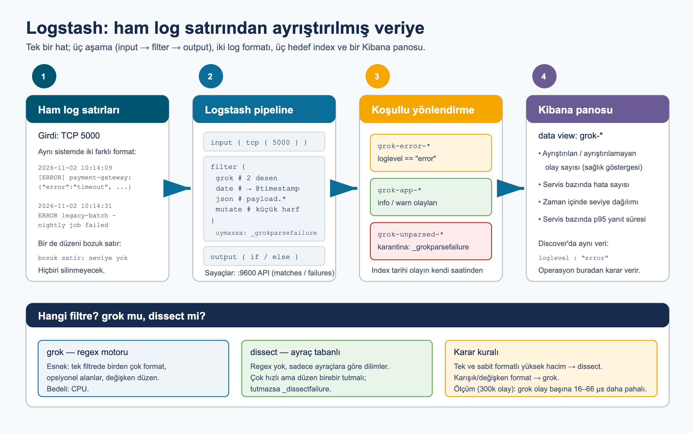
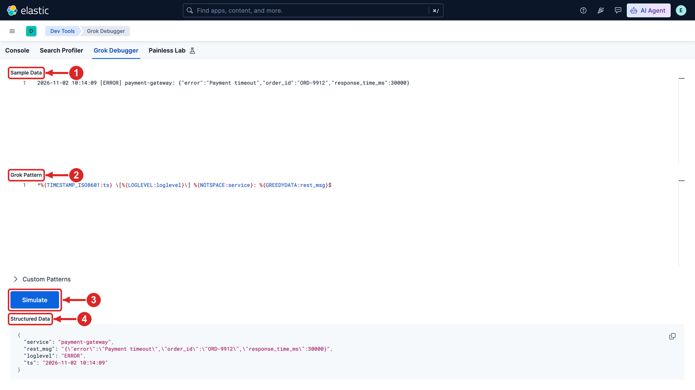
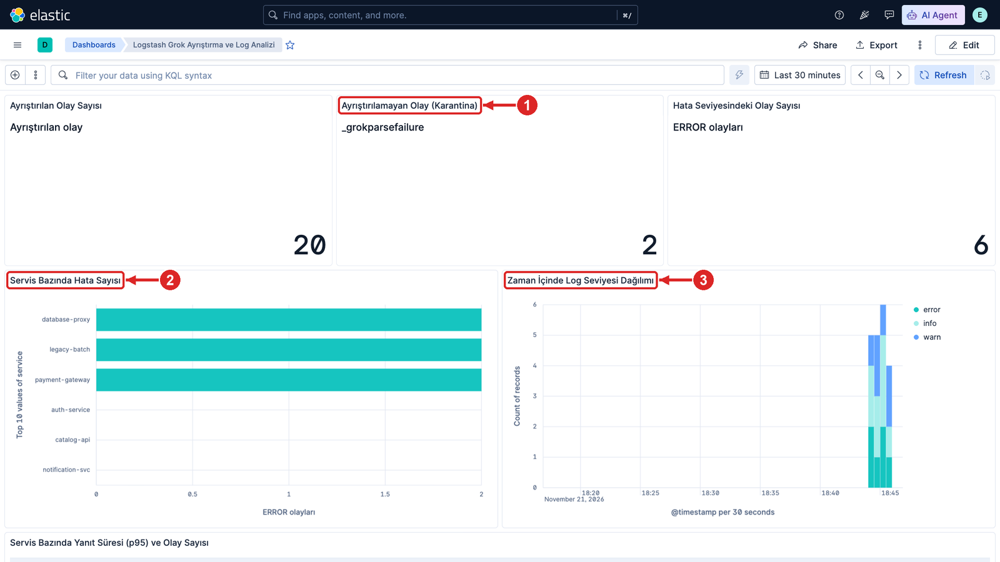
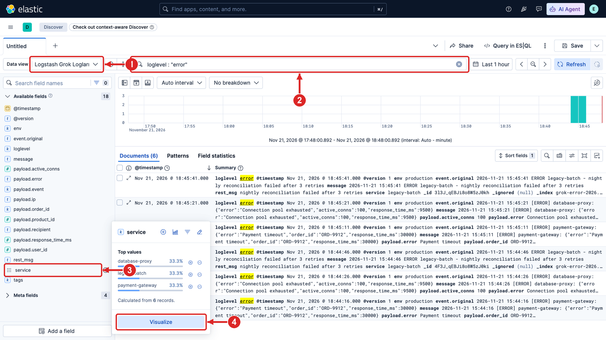
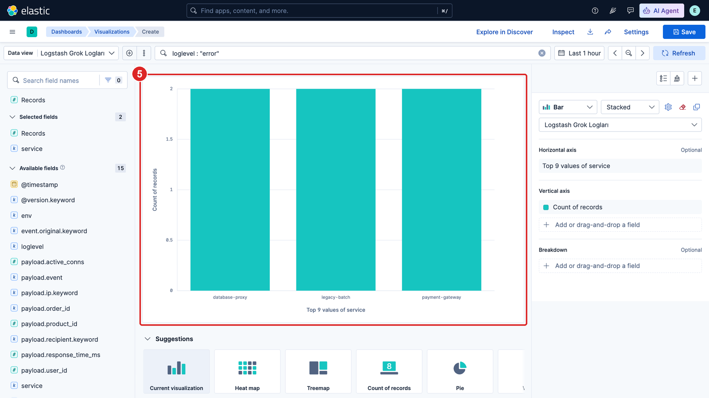
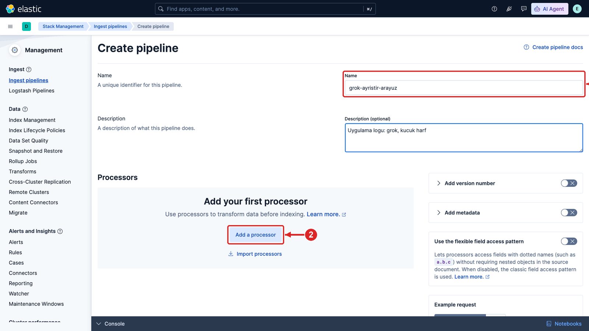
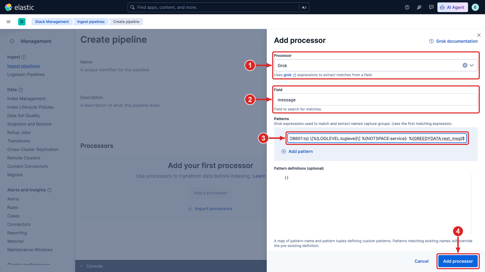
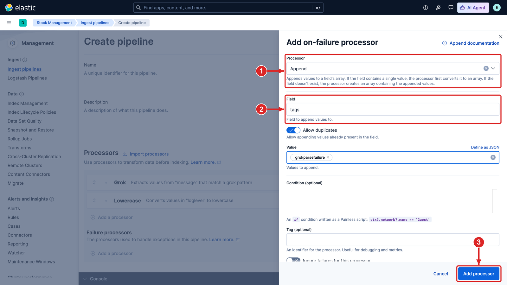
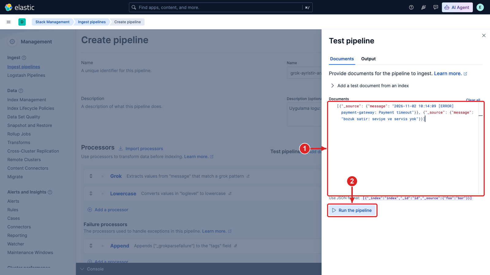
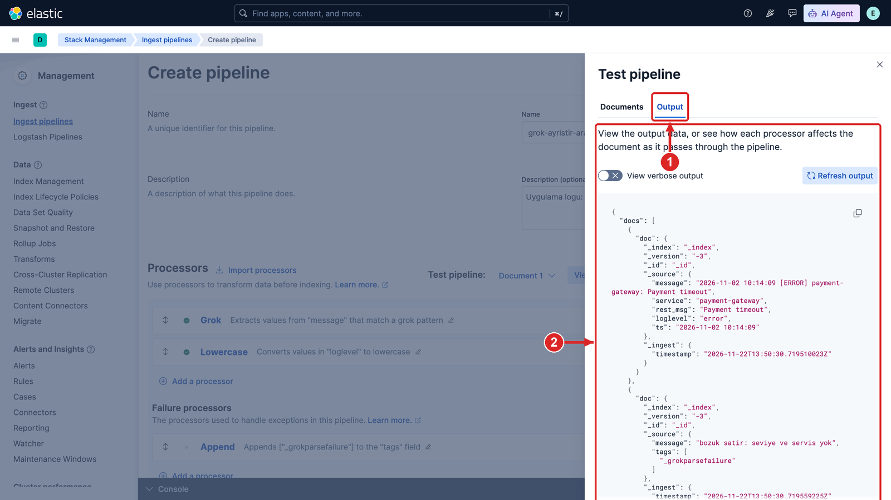

# LAB-14 — Logstash ile Log Ayrıştırma: Grok ve Dissect

| Kullanılan Araçlar | Açık / Kullanılan Portlar |
|---|---|
| Logstash 9.5.5, Kibana Grok Debugger, Docker Compose, jq | 5000 (ham log girdisi, TCP), 9600 (Logstash API), 9200 / 5601 (ana cluster) |

---

## Bu lab ne öğretiyor?

`2026-11-02 10:14:09 [ERROR] payment-gateway: {"error":"Payment timeout",...}` satırı Elasticsearch'e
olduğu gibi yazılırsa tek bir metin field'ı olur: "hangi servis kaç hata verdi?" ya da "ortalama yanıt
süresi ne?" diye sorulamaz. Bu labda Logstash'in `grok` filtresiyle satırı field'lara ayıracak, saatini
`@timestamp`'e taşıyacak, JSON gövdesini açacak ve olayı türüne göre üç ayrı index'e yönlendireceğiz.
Ayrıştırılamayan satırın kaybolmadığını görecek, aynı işi daha hızlı yapan `dissect` ile karşılaştıracağız.

{width=60%}

---

## Ön Koşullar

- LAB-01 ana cluster'ı çalışıyor. LAB-12'yi atladıysanız da lab çalışır: Logstash bu labın kendi
  container'ında kurulur.
- `5000` ve `9600` portları boş olmalı. İkisi de yalnız sunucunun içinden (`127.0.0.1`) erişilir.

```bash
cd ~/elastic/labs/LAB-14-logstash-grok-dissect
```

---

## Config dosyaları: hangi satır ne işe yarıyor?

`pipeline/logstash.conf` dosyasının kritik bloğu (filtre kısmı):

```conf
grok {
  match => {
    "message" => [
      "^%{TIMESTAMP_ISO8601:ts} \[%{LOGLEVEL:loglevel}\] %{NOTSPACE:service}: %{GREEDYDATA:rest_msg}$",
      "^%{TIMESTAMP_ISO8601:ts} %{LOGLEVEL:loglevel} %{NOTSPACE:service} - %{GREEDYDATA:rest_msg}$"
    ]
  }
}
if "_grokparsefailure" not in [tags] {
  date   { match => [ "ts", "yyyy-MM-dd HH:mm:ss" ] timezone => "UTC" target => "@timestamp" remove_field => [ "ts" ] }
  if [rest_msg] =~ /^\{.*\}$/ { json { source => "rest_msg" target => "payload" } }
  mutate { lowercase => [ "loglevel" ] add_field => { "env" => "production" } }
}
```

- `grok` desenleri sırayla dener, ilk eşleşende durur: tek filtre iki log biçimini yakalar. Hiçbiri
  eşleşmezse olay `_grokparsefailure` etiketi alır; silinmez.
- `date`: logun kendi saatini `@timestamp`'e yazar. Olmasa `@timestamp` olayın Logstash'e geldiği an olur.
- `json`: gövde JSON ise `payload.*` field'larına açar; `payload.response_time_ms` sayı olarak toplanabilir.
- `mutate`: seviyeyi küçük harfe çevirir (`ERROR`/`error` ayrımı kalkar), ortam etiketi ekler.
- Çıkış bölümü olayı üç index'e yollar: ayrıştırılamayanlar `grok-unparsed-*`, hatalar
  `grok-error-*`, diğerleri `grok-app-*`.

---

## Adım Adım Uygulama Rehberi

### 1. Şablonu kurun ve Logstash'i başlatın

Index şablonu `grok-*` index'lerinde field tiplerini sabitler (`service`, `loglevel` → `keyword`,
`payload.response_time_ms` → `integer`). Şablon olmasa tip ilk gelen document'e göre seçilir ve
`response_time_ms` bir kez metin gelirse ortalaması bir daha alınamaz.

```bash
./scripts/setup-indices.sh
docker compose up -d
```

Beklenen çıktı:

```text
{"acknowledged":true}
[+] Sablon hazir: grok-logs (grok-app-*, grok-error-*, grok-unparsed-*)
 ...
 Container logstash-grok-lab Started
```

Logstash'in Java sanal makinesi yaklaşık yarım dakikada açılır. Port (5000) Logstash hazır olmadan
açıldığı için, pipeline başlamadan gönderilen satırlar kaybolur. Pipeline'ın başladığı log satırını
bekleyin:

```bash
timeout 180 bash -c 'until docker compose logs logstash 2>/dev/null | grep -q "Pipeline started"; do printf .; sleep 3; done'; echo " hazır"
curl -s localhost:9600/_node/pipelines/main | jq -c '.pipelines.main | {workers, batch_size}'
```

Beklenen çıktı:

```text
......... hazır
{"workers":2,"batch_size":125}
```

Logstash API'si (`:9600`) `filter_path` desteklemez; field seçmek için `jq` kullanılır.

### 2. Deseni Grok Debugger'da deneyin

| Desen parçası | Anlamı |
|---|---|
| `%{TIMESTAMP_ISO8601:ts}` | Hazır desen + yakalanan field'ın adı (`ts`) |
| `\[` … `\]` | Köşeli parantez regex'te özel karakterdir, kaçışla yazılır |
| `%{LOGLEVEL:loglevel}` | `INFO`, `WARN`, `ERROR`… |
| `%{NOTSPACE:service}` | İlk boşluğa kadar olan kısım |
| `%{GREEDYDATA:rest_msg}` | Satırın geri kalanı |

Kibana adresini sunucuda hesaplayın:

```bash
IP=$(curl -s https://api.ipify.org); H=$(hostname -s)
echo "Kibana: http://$IP:5601   https://$H-kibana.devopsatolyesi.com"
```

Beklenen çıktı:

```text
Kibana: http://<IP>:5601   https://<host>-kibana.devopsatolyesi.com
```

Kibana menüsünden **Management › Dev Tools › Grok Debugger**. **Sample Data** (1) alanına bu satırı,
**Grok Pattern** (2) alanına `pipeline/logstash.conf`'taki ilk deseni yapıştırıp **Simulate** (3):

```text
2026-11-02 10:14:09 [ERROR] payment-gateway: {"error":"Payment timeout","order_id":"ORD-9912","response_time_ms":30000}
```

{width=75%}

Sonuç (4) dört field'dır: `ts`, `loglevel`, `service`, `rest_msg`. `ts` henüz metin, `rest_msg` tek parça;
bunları pipeline'daki `date` ve `json` filtreleri devralır. Eski biçimli bir satırı
(`… ERROR legacy-batch - …`) aynı desenle denerseniz sonuç boş gelir; ikinci desen bu yüzden var.

### 3. Logları gönderin ve yönlendirmeyi görün

`send-logs.sh` 11 satırlık örnek dosyayı TCP 5000'e gönderir ve zaman damgalarını "şimdi"ye kadar
uzanan bir zaman çizgisine yayar:

```bash
./scripts/send-logs.sh 2
curl -s -u elastic:'DevOps2026!' -X POST 'http://localhost:9200/grok-*/_refresh' -o /dev/null
curl -s -u elastic:'DevOps2026!' 'http://localhost:9200/_cat/indices/grok-*?h=index,docs.count&s=index'
```

Beklenen çıktı:

```text
[+] 22 satir gonderildi -> 127.0.0.1:5000 (raw-logs.txt, 5s araliklarla)
[i] Logstash isliyor . 22 olay Elasticsearch'e yazildi
grok-app-2026.11.21      14
grok-error-2026.11.21     6
grok-unparsed-2026.11.21  2
```

11 satır iki kez gönderildi: 22 olay. Index adındaki tarih gönderdiğiniz güne göre değişir. Üç sayı birlikte okunur: normal olaylar, ayrı
index'teki hatalar ve **ayrıştırılamayan ama kaybolmayan** satırlar. Aynı sağlık bilgisi grok
filtresinin sayaçlarında da vardır:

```bash
curl -s localhost:9600/_node/stats/pipelines/main \
  | jq -c '.pipelines.main.plugins.filters[] | select(.name=="grok") | {id, matches, failures}'
```

Beklenen çıktı:

```text
{"id":"grok_app_log","matches":20,"failures":2}
```

20 satır iki desenden birine uydu; 2 satır (dosyadaki bozuk satır, iki kez) hiçbirine uymadı. `failures`
artıyorsa desen yeni bir log biçimini kaçırıyor demektir.

### 4. Önce ve sonra: satır nasıl document'e dönüştü?

Hata index'inden JSON gövdeli bir document, yalnız ilgili field'larla:

```bash
curl -s -u elastic:'DevOps2026!' \
  'http://localhost:9200/grok-error-*/_search?q=service:payment-gateway&size=1&filter_path=hits.hits._source&_source=@timestamp,service,loglevel,env,payload' \
  | jq -c '.hits.hits[0]._source | {"@timestamp", service, loglevel, env, "payload.error": .payload.error, "payload.response_time_ms": .payload.response_time_ms}'
```

Beklenen çıktı:

```text
{"@timestamp":"2026-11-21T15:45:11.000Z","service":"payment-gateway","loglevel":"error","env":"production","payload.error":"Payment timeout","payload.response_time_ms":30000}
```

Saat, gönderdiğiniz ana göre değişir.

| Ham satırda | Document'te | Nasıl |
|---|---|---|
| `2026-11-02 10:14:09` (metin; betik bugünün saatini yazar) | `@timestamp` (tarih, UTC) | `date` |
| `[ERROR]` | `loglevel: error` | `grok` + `mutate` |
| `payment-gateway:` | `service` | `grok` |
| `{"error":…,"response_time_ms":30000}` | `payload.error`, `payload.response_time_ms` (sayı) | `json` |
| (yok) | `env: production` | `mutate` |

Ayrıştırılamayan satır karantina index'inde ham hâliyle durur:

```bash
curl -s -u elastic:'DevOps2026!' \
  'http://localhost:9200/grok-unparsed-*/_search?size=1&filter_path=hits.hits._source&_source=message,tags' \
  | jq -c '.hits.hits[0]._source | {message, tags}'
```

Beklenen çıktı:

```text
{"message":"2026-11-21 15:45:51 bozuk satir: seviye ve servis yok","tags":["_grokparsefailure"]}
```

`message` olduğu gibi korunduğu için desen düzeltilince satır yeniden işlenebilir.

### 5. Aynı işi dissect ile yapmak

`dissect` regex çalıştırmaz; satırı yalnız ayraçlara göre dilimler. Birinci biçimin karşılığı:

```conf
dissect { mapping => { "message" => "%{ts} [%{loglevel}] %{service}: %{rest_msg}" } }
```

Her field bir sonraki ayraca kadar okunur: `ts` ilk ` [` görülene kadar (tarih ve saat birlikte),
`loglevel` `]` işaretine kadar. `dissect` hızlıdır ama katıdır: düzen birebir tutmazsa olay
`_dissectfailure` alır; eski biçimli satırları (`… ERROR legacy-batch - …`) bu eşleme bölemez.

| Durum | Seçim |
|---|---|
| Tek, sabit biçim, yüksek hacim | `dissect` |
| Karışık, değişken ya da isteğe bağlı field'lı biçim | `grok` |
| İkisi birden | Önce `dissect`; `_dissectfailure` field'ları `grok`'a |

<details>
<summary><strong>Farkı ölçmek: dissect ve grok maliyeti</strong></summary>

Betik 300.000 olayı üç ayrı, tek seferlik Logstash container'ında işler: filtresiz (referans), yalnız
`dissect`, yalnız `grok`. Her geçişte Java açılışı (~35 sn) olduğu için mutlak süreler değil
**farklar** anlamlıdır. Toplam süre yaklaşık 2,5 dakikadır; sayılar sunucuya göre değişir.

```bash
./scripts/benchmark-dissect-vs-grok.sh
```

Beklenen çıktı:

```text
[+] 300000 olay x 3 gecis (her gecis ayri, tek seferlik konteynerde)
    referans (filtre yok) : 36.28 s
    yalniz dissect        : 41.01 s
    yalniz grok           : 60.91 s

    grok - dissect        : +19.90 s  ->  olay basina +66.3 us ek CPU
    dissect - referans    : +4.73 s  ->  olay basina +15.8 us ek CPU
```

Sayılar sunucuya ve koşuya göre değişir; anlamlı olan sıralamadır. Üç ayrı ölçümde grok olay başına
dissect'ten 12 µs ile 66 µs arası fazla CPU harcadı. Saniyede birkaç yüz satırda bu fark hissedilmez;
saniyede on binlerce satırda kaç worker gerektiğini belirler.

</details>

### 6. Kibana'da pano

`grok-*` data view'ını ve altı panelli bir panoyu kurun:

```bash
python3 scripts/provision_kibana.py
```

Beklenen çıktı:

```text
Kibana bekleniyor (http://localhost:5601) ...
[+] Data view hazir: Logstash Grok Logları (grok-*)
[+] Panel hazir: Ayrıştırılan Olay Sayısı
[+] Panel hazir: Ayrıştırılamayan Olay (Karantina)
[+] Panel hazir: Hata Seviyesindeki Olay Sayısı
[+] Panel hazir: Servis Bazında Hata Sayısı
[+] Panel hazir: Zaman İçinde Log Seviyesi Dağılımı
[+] Panel hazir: Servis Bazında Yanıt Süresi (p95) ve Olay Sayısı

[+] Pano kuruldu: Logstash Grok Ayrıştırma ve Log Analizi
    http://localhost:5601/app/dashboards#/view/grok-logstash-overview
```

Komutun yazdırdığı bağlantıyla ya da **Analytics › Dashboards** listesinden panoyu açın. Pano son 30
dakikaya kayıtlı açılır; logları daha önce gönderdiyseniz zaman aralığını genişletin.

{width=75%}

"Ayrıştırılamayan Olay" (1) panonun sağlık göstergesidir: sıfırdan büyükse desen bir log biçimini
kaçırıyordur. Servis bazında hata (2) ve zaman içinde seviye dağılımı (3) hangi servisin ne zaman sorun
çıkardığını gösterir. Listede `legacy-batch` de vardır: eski biçimli satır ikinci desenle ayrıştırılmıştır.

<details>
<summary><strong>"Servis bazında hata" panelini elle kurmak</strong></summary>

1. **Discover**'da data view olarak `Logstash Grok Logları`'nı (1) seçin, zaman aralığını **Last 1 hour**
   yapın, sorgu çubuğuna `loglevel : "error"` (2) yazıp Enter'a basın.
2. Field listesinde `service` field'ına (3) tıklayın, açılan pencerede **Visualize** (4):

{width=75%}

3. Lens, sorguyu koruyarak servis başına hata sayısını çizer (5). **Save** ile kaydedip **Add to
   dashboard** altında panoyu seçerek panele ekleyebilirsiniz.

{width=75%}

</details>


### 7. Aynı ayrıştırma Elasticsearch'te: ingest pipeline

Grok için Logstash şart değildir: Elasticsearch, document'i index'e yazmadan hemen önce **ingest pipeline**
ile işleyebilir. Pipeline processor'ların sırasıdır; grok, date, rename, convert gibi Logstash'teki
filtrelerin çoğunun karşılığı vardır. Ayrı bir servis kurmak gerekmez.

Kibana › Dev Tools'a yapıştırın. Birinci pipeline satırı ayrıştırır:

```http
PUT _ingest/pipeline/grok-ayristir
{
  "description": "LAB-14 log satirini ayristirir",
  "processors": [
    { "grok": { "field": "message",
        "patterns": ["^%{TIMESTAMP_ISO8601:ts} \\[%{LOGLEVEL:loglevel}\\] %{NOTSPACE:service}: %{GREEDYDATA:rest_msg}$"] } },
    { "date": { "field": "ts", "target_field": "@timestamp", "formats": ["yyyy-MM-dd HH:mm:ss"], "timezone": "UTC" } },
    { "rename": { "field": "loglevel", "target_field": "log.level" } },
    { "lowercase": { "field": "log.level" } },
    { "json": { "field": "rest_msg", "target_field": "payload", "if": "ctx.rest_msg.startsWith('{')" } },
    { "convert": { "field": "payload.response_time_ms", "type": "integer", "ignore_missing": true } },
    { "trim": { "field": "rest_msg" } }
  ],
  "on_failure": [ { "set": { "field": "tags", "value": ["_grokparsefailure"] } } ]
}
```

```json
{"acknowledged":true}
```

- `rename`: field'ı ECS adına (`log.level`) taşır. `convert`: metni sayıya çevirir; field yoksa
  (`ignore_missing`) atlar.
- `if`: processor yalnız koşul doğruysa çalışır; burada gövde JSON ise açılır.
- `on_failure`: bir processor hata verirse document reddedilmez, etiketlenir. Logstash'teki
  `_grokparsefailure` ile aynı fikirdir.

Document yazmadan önce `_simulate` ile deneyin; biri uyan, biri bozuk iki satır:

```http
POST _ingest/pipeline/grok-ayristir/_simulate?filter_path=docs.doc._source
{
  "docs": [
    { "_source": { "message": "2026-11-02 10:14:09 [ERROR] payment-gateway: {\"error\":\"Payment timeout\",\"response_time_ms\":\"30000\"}" } },
    { "_source": { "message": "bozuk satir: seviye ve servis yok" } }
  ]
}
```

```json
{"docs":[{"doc":{"_source":{"@timestamp":"2026-11-02T10:14:09.000Z","log":{"level":"error"},"payload":{"error":"Payment timeout","response_time_ms":30000},"service":"payment-gateway","message":"2026-11-02 10:14:09 [ERROR] payment-gateway: {\"error\":\"Payment timeout\",\"response_time_ms\":\"30000\"}","rest_msg":"{\"error\":\"Payment timeout\",\"response_time_ms\":\"30000\"}","ts":"2026-11-02 10:14:09"}}},{"doc":{"_source":{"message":"bozuk satir: seviye ve servis yok","tags":["_grokparsefailure"]}}}]}
```

Birinci document'te metin olan `"30000"` sayı oldu, seviye `log.level` altına taşındı; ikinci document reddedilmedi,
etiketlendi. `ts` ve `rest_msg` ara field'lardır, ikinci pipeline onları silecek.

Pipeline'ı yazarken kullanmak için `?pipeline=` verilir (index tek node'a uygun açılır):

```http
PUT grok-ingest
{ "settings": { "number_of_shards": 1, "number_of_replicas": 0 } }
```

```http
POST grok-ingest/_doc?pipeline=grok-ayristir&refresh=true&filter_path=result
{ "message": "2026-11-02 10:14:20 [ERROR] database-proxy: {\"error\":\"Connection pool exhausted\",\"response_time_ms\":\"9500\"}" }
```

```json
{"result":"created"}
```

İkinci pipeline artık gereksiz ara field'ları siler. Var olan document'lere `_update_by_query?pipeline=` ile
uygulanır; document'i yeniden göndermek gerekmez:

```http
PUT _ingest/pipeline/grok-temizle
{ "processors": [ { "remove": { "field": ["ts", "rest_msg"] } } ] }
```

```http
POST grok-ingest/_update_by_query?pipeline=grok-temizle&refresh=true&filter_path=updated
```

```json
{"updated":1}
```

```http
GET grok-ingest/_search?filter_path=hits.hits._source
```

```json
{"hits":{"hits":[{"_source":{"@timestamp":"2026-11-02T10:14:20.000Z","log":{"level":"error"},"payload":{"response_time_ms":9500,"error":"Connection pool exhausted"},"service":"database-proxy","message":"2026-11-02 10:14:20 [ERROR] database-proxy: {\"error\":\"Connection pool exhausted\",\"response_time_ms\":\"9500\"}"}}]}}
```

`ts` ve `rest_msg` gitti; ham `message` ise ileride yeniden işlemek için kaldı.

| | Logstash | Ingest pipeline |
|---|---|---|
| Nerede çalışır | Ayrı servis (container, JVM) | Elasticsearch'in içinde |
| Girdi | TCP, dosya, JDBC, Kafka… her yer | Yalnız Elasticsearch'e yazılan document |
| Kuyruk, DLQ, birden çok hedef | Var | Yok |
| Ne zaman | Çok kaynak, yoğun dönüşüm, yönlendirme | Beats, Agent ya da uygulama doğrudan yazıyorsa, basit dönüşüm |

<details>
<summary><strong>Kişisel veriyi yazmadan silmek: <code>remove</code> ve <code>on_failure</code></strong></summary>

`remove` kişisel veriyi index'e yazmadan siler. Ama önceki bir processor hata verirse `remove` hiç çalışmaz.
Aynı bozuk document'i iki kez simüle edin: önce `on_failure` yalnız etiket koyuyor, sonra silmeyi de tekrarlıyor:

```http
POST _ingest/pipeline/_simulate?filter_path=docs.doc._source.eposta,docs.doc._source.tags
{ "pipeline": { "processors": [ { "date": { "field": "ts", "formats": ["yyyy-MM-dd HH:mm:ss"] } }, { "remove": { "field": "eposta" } } ],
    "on_failure": [ { "set": { "field": "tags", "value": ["_pii_hata"] } } ] },
  "docs": [ { "_source": { "ts": "bozuk tarih", "eposta": "mehmet@ornek.com" } } ] }
POST _ingest/pipeline/_simulate?filter_path=docs.doc._source.eposta,docs.doc._source.tags
{ "pipeline": { "processors": [ { "date": { "field": "ts", "formats": ["yyyy-MM-dd HH:mm:ss"] } }, { "remove": { "field": "eposta" } } ],
    "on_failure": [ { "remove": { "field": "eposta", "ignore_missing": true } }, { "set": { "field": "tags", "value": ["_pii_hata"] } } ] },
  "docs": [ { "_source": { "ts": "bozuk tarih", "eposta": "mehmet@ornek.com" } } ] }
```

```json
{"docs":[{"doc":{"_source":{"eposta":"mehmet@ornek.com","tags":["_pii_hata"]}}}]}
{"docs":[{"doc":{"_source":{"tags":["_pii_hata"]}}}]}
```

İlk pipeline bozuk tarihte e-postayı index'e bırakırdı. İkincisi aynı silmeyi `on_failure`'da tekrarladığı için
e-posta yok, document yalnız etiketli. `_simulate` pipeline'ı kaydetmeden dener; temizlenecek kaynak oluşmaz.

</details>

<details>
<summary><strong>Aynı ingest pipeline'ı Kibana arayüzünden kurmak</strong></summary>

Dev Tools'taki `PUT _ingest/pipeline` isteğinin arayüz karşılığı **Stack Management › Ingest › Ingest Pipelines**
sayfasıdır. Burada `grok-ayristir-arayuz` adıyla, adlar çakışmasın diye ayrı bir pipeline kurun. **Create pipeline
› New pipeline** deyin, **Name**'e (1) adı yazın; processor'lar **Add a processor** (2) ile eklenir:

{width=75%}

1. **Add a processor**, **Processor** (1) listesinden **Grok**'u seçin. **Field** (2) `message`, **Patterns** (3)
   bu labdaki desen: `^%{TIMESTAMP_ISO8601:ts} \[%{LOGLEVEL:loglevel}\] %{NOTSPACE:service}: %{GREEDYDATA:rest_msg}$`.
   **Add processor** (4) ile ekleyin:

{width=75%}

2. Aynı şekilde **Lowercase** ekleyin, Field `loglevel` (seviyeyi küçük harfe çevirir).
3. Altta **Failure processors** bölümünün **Add a processor**'ünden **Append** ekleyin: Field `tags`, Value
   `_grokparsefailure`. Bir processor hata verirse document reddedilmez, bu etiketle gelir (Dev Tools'taki
   `on_failure` bloğunun karşılığı):

{width=75%}

4. Sağ üstte **Test pipeline › Add documents**: **Documents** (1) sekmesine iki document yazın, biri uyan satır, biri
   bozuk satır (`_simulate`'in arayüz karşılığı). **Run the pipeline** (2):

```json
[{"_source": {"message": "2026-11-02 10:14:09 [ERROR] payment-gateway: Payment timeout"}},
 {"_source": {"message": "bozuk satir: seviye ve servis yok"}}]
```

{width=75%}

5. **Output** sekmesi (1) her document'in sonucunu verir (2): ilkinde `ts`, `loglevel: "error"` (küçük harf),
   `service`, `rest_msg` field'ları vardır; ikincisi ayrışmaz ve `tags` içinde `_grokparsefailure` taşır.
   **View verbose output** her processor'ın document'i nasıl değiştirdiğini adım adım gösterir:

{width=75%}

Pipeline'ı kaydetmek için **Create pipeline**'a basın. Pipeline adı `grok-ayristir-arayuz`'dur; `./teardown.sh`
onu da siler. **Show request** düğmesi, arayüzün Elasticsearch'e göndereceği `PUT _ingest/pipeline` isteğini
gösterir: yukarıdaki Dev Tools adımının aynısıdır.

</details>

---

## Temizlik

Yalnız bu labın container'ını, `grok-*` index'lerini, şablonunu, üç ingest pipeline'ını ve Kibana nesnelerini siler; ana
cluster'a dokunmaz:

```bash
./teardown.sh
```

Beklenen çıktı:

```text
[1/4] Konteyner ve veri volume'u siliniyor
 Container logstash-grok-lab Removed
 Volume logstash-grok-lab_logstash-data Removed
[2/4] grok-* index'leri siliniyor
{"acknowledged":true}
  -> grok-error-2026.11.21,grok-app-2026.11.21,grok-unparsed-2026.11.21,grok-ingest
[3/4] Index sablonu siliniyor
{"acknowledged":true}
  -> pipeline grok-ayristir
  -> pipeline grok-temizle
  -> pipeline grok-ayristir-arayuz
[4/4] Kibana nesneleri siliniyor (pano, paneller, data view)
  -> pano, 6 panel ve data view kaldirildi
[+] Temizlik tamam.
```

Index adlarındaki tarih sizde farklıdır.

Labı aynı sunucuda yeniden yapacaksanız başlamadan önce `./teardown.sh` çalıştırın; README'deki sayılar temiz
başlangıca göredir.

---

Sonraki lab: **[LAB-15 — Logstash Operasyonu: Çoklu Pipeline, Persistent Queue ve Dead Letter Queue](../LAB-15-logstash-operasyonu/README.md)**
