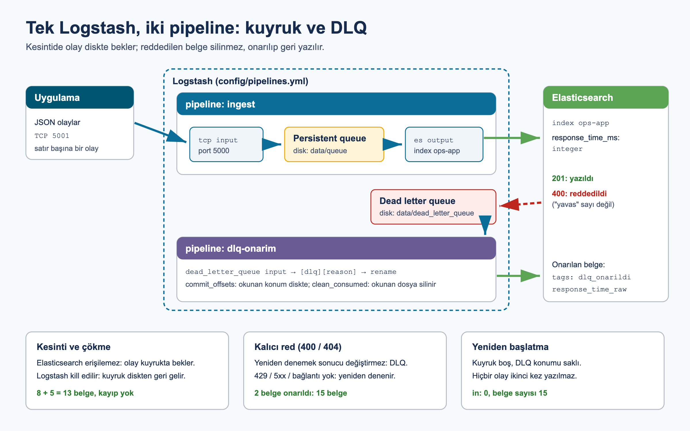

# LAB-15 — Logstash Operasyonu: Çoklu Pipeline, Persistent Queue ve Dead Letter Queue

| Kullanılan Araçlar | Açık / Kullanılan Portlar |
|---|---|
| Logstash 9.5.5 (`pipelines.yml`, persistent queue, DLQ), Logstash API, Kibana Dev Tools, jq | `127.0.0.1:5001` (olay girdisi), `127.0.0.1:9601` (Logstash API), 9200 / 5601 (ana cluster) |

---

## Bu lab ne öğretiyor?

Logstash'in önünde iki tehlike vardır. Elasticsearch'e ulaşamadığı sırada Logstash çökerse, bellekteki
olaylar kaybolur. Elasticsearch bir document'i reddederse (yanlış tipte field), o document sessizce düşer.
İkisi de "log geldi ama Kibana'da yok" şikâyetinin en sık sebebidir.

Bu labda tek Logstash'ta iki pipeline çalıştıracağız. `ingest` olayları alır; kuyruğu diskte
(persistent queue) tutulur ve reddedilen document'leri dead letter queue'ya (DLQ) yazar. `dlq-onarim`
DLQ'yu okur, document'i onarır ve yeniden yazar. Elasticsearch bağlantısını keserek bir çökmede hiçbir
olayın kaybolmadığını, reddedilen document'in de geri geldiğini sayılarla göreceğiz.



---

## Ön Koşullar

- LAB-01 ana cluster'ı çalışıyor. LAB-14'ü atladıysanız da lab çalışır; Logstash bu labın kendi
  container'ında kurulur.
- `127.0.0.1:5001` ve `127.0.0.1:9601` boş olmalı. Logstash yaklaşık 1 GB RAM kullanır.

```bash
cd ~/elastic/labs/LAB-15-logstash-operasyonu
```

---

## Kavramlar: hangi kuyruk neyi korur?

| | Memory queue (varsayılan) | Persistent queue (PQ) | Dead letter queue (DLQ) |
|---|---|---|---|
| Nerede durur | RAM | Disk (`data/queue`) | Disk (`data/dead_letter_queue`) |
| Neyi korur | Hiçbir şeyi | Henüz yazılamamış olayları | Elasticsearch'in reddettiği document'leri |
| Ne zaman devreye girer | — | Elasticsearch yavaş ya da erişilemez, Logstash çöker | Yanıt 400 veya 404 (mapping hatası, eksik index) |

Elasticsearch erişilemezse ya da 429/5xx dönerse Logstash yazmayı yeniden dener; olay DLQ'ya
düşmez, kuyrukta bekler. DLQ yalnız kalıcı reddi yakalar: tekrar denemek sonucu değiştirmez.

---

## Config dosyaları: hangi satır ne işe yarıyor?

`config/pipelines.yml`:

```yaml
- pipeline.id: ingest
  path.config: "/usr/share/logstash/pipeline/ingest.conf"
  queue.type: persisted
  dead_letter_queue.enable: true
  dead_letter_queue.flush_interval: 5000
- pipeline.id: dlq-onarim
  path.config: "/usr/share/logstash/pipeline/dlq-onarim.conf"
  pipeline.workers: 1
```

- Her pipeline kendi config dosyası, kuyruğu ve sayaçlarıyla çalışır; birinin yavaşlaması ötekini
  durdurmaz. Bu dosya varken `pipeline/` klasöründeki dosyalar tek pipeline'da birleştirilmez.
- `queue.type: persisted` yalnız `ingest` için açık. `dlq-onarim` zaten diskteki DLQ'dan okur.
- `flush_interval`: açık DLQ dosyası bu süre sonunda kapanır ve okunabilir olur. Varsayılan 5 dakikadır.

`pipeline/dlq-onarim.conf` (kritik satırlar):

```conf
dead_letter_queue {
  pipeline_id => "ingest"
  commit_offsets => true
  clean_consumed => true
}
mutate { add_field => { "[dlq][reason]" => "%{[@metadata][dead_letter_queue][reason]}" } }
mutate { rename => { "response_time_ms" => "response_time_raw" } add_tag => [ "dlq_onarildi" ] }
```

- `commit_offsets`: okunan konum diske yazılır. Yoksa her yeniden başlatmada DLQ baştan okunur ve
  aynı document'ler tekrar yazılır.
- `clean_consumed`: okunmuş DLQ dosyaları silinir; disk dolmaz.
- Red sebebi olayın metadata'sında gelir ve Elasticsearch'e yazılmaz; `[dlq][reason]` field'ına
  kopyalanır. `rename` onarımın kendisidir: sayı olmayan süre metin field'a taşınır.

---

## Adım Adım Uygulama Rehberi

### 1. Şablonu kurun ve iki pipeline'ı başlatın

`response_time_ms` field'ı `integer`. Bu tip, Adım 4'te sayı olmayan değeri reddedecek olan kuraldır.

Kibana adresini sunucuda hesaplayın:

```bash
IP=$(curl -s https://api.ipify.org); H=$(hostname -s)
echo "Kibana: http://$IP:5601   https://$H-kibana.devopsatolyesi.com"
```

Beklenen çıktı:

```text
Kibana: http://<IP>:5601   https://<host>-kibana.devopsatolyesi.com
```

Kibana › Dev Tools'a yapıştırın:

```http
PUT _index_template/ops-logs
{
  "index_patterns": ["ops-*"],
  "template": {
    "settings": { "number_of_shards": 1, "number_of_replicas": 0 },
    "mappings": {
      "properties": {
        "@timestamp":        { "type": "date" },
        "service":           { "type": "keyword" },
        "level":             { "type": "keyword" },
        "message":           { "type": "text" },
        "response_time_ms":  { "type": "integer" },
        "response_time_raw": { "type": "keyword" },
        "tags":              { "type": "keyword" },
        "dlq": { "properties": { "reason": { "type": "text" }, "error_type": { "type": "keyword" } } }
      }
    }
  }
}
```

```json
{"acknowledged":true}
```

Logstash'i başlatın ve iki pipeline'ın da yüklenmesini bekleyin (~30 sn):

```bash
docker compose up -d
timeout 180 bash -c 'until curl -s 127.0.0.1:9601/_node/pipelines | jq -e ".pipelines | length == 2" >/dev/null 2>&1; do printf .; sleep 3; done'; echo " hazır"
curl -s 127.0.0.1:9601/_node/stats/pipelines | jq -c '.pipelines | to_entries | sort_by(.key)[] | {id: .key, queue: .value.queue.type}'
```

Beklenen çıktı:

```text
.............. hazır
{"id":"dlq-onarim","queue":"memory"}
{"id":"ingest","queue":"persisted"}
```

### 2. Normal akış ve pipeline sayaçları

Önce gerekli dosyaları oluşturun: `scripts/gonder.sh`, `sample-data/olaylar.ndjson`

```bash
mkdir -p sample-data scripts
cat > scripts/gonder.sh << 'EOF'
#!/usr/bin/env bash
# Bir NDJSON dosyasini Logstash TCP girdisine (127.0.0.1:5001) gonderir ve ingest pipeline'inin
# cikis sayaci gonderilen olay kadar artana dek bekler. Satirlar sokete yazilinca betik biterdi;
# Logstash onlari birkac saniye sonra isler.
# Kullanim: ./scripts/gonder.sh <dosya.ndjson> [--beklemeden]
set -euo pipefail
API=http://127.0.0.1:9601
FILE="$1"
N=$(grep -c . "${FILE}")
out() { curl -s "${API}/_node/stats/pipelines/ingest" | jq -r '.pipelines.ingest.events.out // 0'; }
BEFORE=$(out)

# TCP girdisi pipeline'dan birkac saniye sonra acilir. Host portu (5001) Docker'da hep baglanti
# kabul eder; girdi henuz dinlemiyorsa veri sessizce kaybolur. Bu yuzden container icindeki 5000
# portunu yokluyoruz (en fazla 60 sn).
for _ in $(seq 1 30); do
  docker exec logstash-ops-lab bash -c ': > /dev/tcp/127.0.0.1/5000' 2>/dev/null && break
  sleep 2
done
exec 3<>/dev/tcp/127.0.0.1/5001
cat "${FILE}" >&3
exec 3>&-
echo "[+] ${N} olay gonderildi (${FILE##*/})"

[ "${2:-}" = "--beklemeden" ] && exit 0
printf '[i] Logstash isliyor '
for _ in $(seq 1 30); do
  [ "$(out)" -ge $((BEFORE + N)) ] && { echo " ${N} olay cikisa ulasti"; exit 0; }
  printf .; sleep 2
done
echo " zaman asimi: 'docker compose logs logstash' ile inceleyin" >&2
exit 1
EOF
cat > sample-data/olaylar.ndjson << 'EOF'
{"service":"auth-service","level":"info","response_time_ms":42,"message":"giris basarili"}
{"service":"catalog-api","level":"info","response_time_ms":37,"message":"urun listelendi"}
{"service":"payment-gateway","level":"error","response_time_ms":30000,"message":"odeme zaman asimi"}
{"service":"catalog-api","level":"warn","response_time_ms":1500,"message":"onbellek kacirildi"}
{"service":"auth-service","level":"info","response_time_ms":51,"message":"token yenilendi"}
{"service":"notification-svc","level":"info","response_time_ms":118,"message":"sms gonderildi"}
{"service":"payment-gateway","level":"info","response_time_ms":420,"message":"odeme onaylandi"}
{"service":"database-proxy","level":"error","response_time_ms":9500,"message":"baglanti havuzu dolu"}
EOF
chmod +x scripts/gonder.sh
```

`gonder.sh` dosyadaki satırları TCP 5001'e yollar ve `ingest`'in çıkış sayacı artana kadar bekler:

```bash
./scripts/gonder.sh sample-data/olaylar.ndjson
curl -s -u elastic:'DevOps2026!' 'http://127.0.0.1:9200/ops-app/_count?filter_path=count'; echo
curl -s 127.0.0.1:9601/_node/stats/pipelines/ingest | jq -c '.pipelines.ingest | {in: .events.in, out: .events.out, kuyrukta_veri: (.queue.queue_size_in_bytes > 1)}'
```

Beklenen çıktı:

```text
[+] 8 olay gonderildi (olaylar.ndjson)
[i] Logstash isliyor . 8 olay cikisa ulasti
{"count":8}
{"in":8,"out":8,"kuyrukta_veri":false}
```

`in` ve `out` eşit: her olay Elasticsearch'e yazıldı, kuyrukta bekleyen veri yok.

### 3. Elasticsearch'e ulaşılamazken Logstash çöksün

Ana cluster'ı durdurmadan yalnız Logstash'in Elasticsearch ağ bağlantısını kesiyoruz. Girdi portu ayrı
ağdan yayınlandığı için olaylar gelmeye devam eder:

Önce örnek veri dosyasını oluşturun: `sample-data/kesinti.ndjson`

```bash
mkdir -p sample-data
cat > sample-data/kesinti.ndjson << 'EOF'
{"service":"payment-gateway","level":"info","response_time_ms":380,"message":"kesinti sirasinda gelen odeme"}
{"service":"auth-service","level":"info","response_time_ms":47,"message":"kesinti sirasinda giris"}
{"service":"catalog-api","level":"info","response_time_ms":33,"message":"kesinti sirasinda listeleme"}
{"service":"auth-service","level":"warn","response_time_ms":900,"message":"kesinti sirasinda yavas giris"}
{"service":"notification-svc","level":"info","response_time_ms":101,"message":"kesinti sirasinda e-posta"}
EOF
```

```bash
docker network disconnect elastic-lab00_default logstash-ops-lab
./scripts/gonder.sh sample-data/kesinti.ndjson --beklemeden
timeout 60 bash -c 'until curl -s 127.0.0.1:9601/_node/stats/pipelines/ingest | jq -e ".pipelines.ingest | .events.in >= 13 and .queue.queue_size_in_bytes > 1" >/dev/null; do printf .; sleep 2; done'; echo
curl -s 127.0.0.1:9601/_node/stats/pipelines/ingest | jq -c '.pipelines.ingest | {in: .events.in, out: .events.out, kuyrukta_veri: (.queue.queue_size_in_bytes > 1)}'
```

Beklenen çıktı:

```text
[+] 5 olay gonderildi (kesinti.ndjson)
...
{"in":13,"out":8,"kuyrukta_veri":true}
```

Kuyruk boyutu istatistiği olay gelince birkaç saniye geç güncellenir; döngü onu da bekler.

5 olay alındı (`in` 13) ama yazılamadı (`out` 8). Persistent queue'da, yani diskte bekliyorlar (`kuyrukta_veri: true`). Şimdi Logstash'i çökertin (`kill`,
düzgün kapanmaya izin vermez) ve yeniden başlatın:

```bash
docker kill logstash-ops-lab >/dev/null && docker start logstash-ops-lab >/dev/null
timeout 180 bash -c 'until curl -s 127.0.0.1:9601/_node/pipelines | jq -e ".pipelines | length == 2" >/dev/null 2>&1; do printf .; sleep 3; done'; echo
curl -s 127.0.0.1:9601/_node/stats/pipelines/ingest | jq -c '.pipelines.ingest | {in: .events.in, out: .events.out}'
```

Beklenen çıktı:

```text
.........
{"in":0,"out":0}
```

Sayaçlar yeniden başlatmayla sıfırlandı; 5 olay diskteki kuyrukta bekliyor. Çökmeden hemen sonra kuyruk boyutu
istatistiği bir süre eksik görünebilir; olayların kaybolmadığının kanıtı aşağıdaki sayıdır. Bağlantıyı geri verin; bekleyen
olaylar kendiliğinden yazılır:

```bash
docker network connect elastic-lab00_default logstash-ops-lab
timeout 120 bash -c 'until [ "$(curl -s -u elastic:"DevOps2026!" "http://127.0.0.1:9200/ops-app/_count" | jq .count)" -ge 13 ]; do printf .; sleep 3; done'; echo
curl -s -u elastic:'DevOps2026!' 'http://127.0.0.1:9200/ops-app/_count?filter_path=count'; echo
```

Beklenen çıktı:

```text
..........
{"count":13}
```

8 + 5 = 13: çökme sırasında gelen olayların hiçbiri kaybolmadı. Memory queue ile bu 5 olay `kill`
anında giderdi.

### 4. Reddedilen document DLQ'ya düşer

`bozuk.ndjson`'daki iki olayda `response_time_ms` sayı değil (`"yavas"`, `"zaman asimi"`).
Elasticsearch ikisini 400 ile reddeder:

Önce örnek veri dosyasını oluşturun: `sample-data/bozuk.ndjson`

```bash
mkdir -p sample-data
cat > sample-data/bozuk.ndjson << 'EOF'
{"service":"payment-gateway","level":"warn","response_time_ms":"yavas","message":"sure sayi degil"}
{"service":"catalog-api","level":"error","response_time_ms":"zaman asimi","message":"sure sayi degil"}
EOF
```

```bash
./scripts/gonder.sh sample-data/bozuk.ndjson
curl -s 127.0.0.1:9601/_node/stats/pipelines/ingest \
  | jq -c '.pipelines.ingest.plugins.outputs[] | select(.id=="es_ops_app") | .documents | {successes, dlq_routed}'
```

Beklenen çıktı:

```text
[+] 2 olay gonderildi (bozuk.ndjson)
[i] Logstash isliyor . 2 olay cikisa ulasti
{"successes":5,"dlq_routed":2}
```

`dlq_routed: 2`: iki document silinmedi, DLQ dosyasına yazıldı. `successes` yeniden başlatmadan beri
yazılan document'lerdir (Adım 3'te kuyruktan gelen 5 olay).

### 5. DLQ'dan onarıp yeniden yazmak

`dlq-onarim` DLQ dosyası kapanınca (5 sn) document'leri okur. İki document'in `ops-app`'e geri yazılmasını
bekleyin:

```bash
timeout 60 bash -c 'until [ "$(curl -s 127.0.0.1:9601/_node/stats/pipelines/dlq-onarim | jq ".pipelines[\"dlq-onarim\"].events.out")" -ge 2 ]; do printf .; sleep 2; done'; echo
curl -s -u elastic:'DevOps2026!' -X POST 'http://127.0.0.1:9200/ops-app/_refresh' -o /dev/null
curl -s -u elastic:'DevOps2026!' 'http://127.0.0.1:9200/ops-app/_count?filter_path=count'; echo
```

Beklenen çıktı:

```text
..
{"count":15}
```

Önce ve sonra: gönderilen satır ve onarılmış document.

```bash
head -1 sample-data/bozuk.ndjson
curl -s -u elastic:'DevOps2026!' 'http://127.0.0.1:9200/ops-app/_search?q=tags:dlq_onarildi%20AND%20service:payment-gateway' \
  | jq -c '.hits.hits[0]._source | {service, response_time_raw, tags, error_type: .dlq.error_type}'
```

Beklenen çıktı:

```text
{"service":"payment-gateway","level":"warn","response_time_ms":"yavas","message":"sure sayi degil"}
{"service":"payment-gateway","response_time_raw":"yavas","tags":["dlq_onarildi"],"error_type":"document_parsing_exception"}
```

| Gönderilen | Document'te | Neden |
|---|---|---|
| `"response_time_ms":"yavas"` | `response_time_raw: "yavas"`, `response_time_ms` yok | `integer` field metni kabul etmez; değer kaybolmasın diye metin field'a taşındı |
| (yok) | `tags: ["dlq_onarildi"]` | Onarılan document'ler ayrıca sorgulanabilsin |
| (yok) | `dlq.error_type` | Red sebebi; hangi hatanın ne sıklıkla geldiğini gösterir |

### 6. Yeniden başlatınca bir şey tekrarlanır mı?

Düzgün bir yeniden başlatmada ne kuyruktaki ne de DLQ'daki olaylar ikinci kez yazılmalı:

```bash
docker compose restart
timeout 180 bash -c 'until curl -s 127.0.0.1:9601/_node/pipelines | jq -e ".pipelines | length == 2" >/dev/null 2>&1; do printf .; sleep 3; done'; echo
curl -s 127.0.0.1:9601/_node/stats/pipelines | jq -c '.pipelines | to_entries | sort_by(.key)[] | {id: .key, in: .value.events.in}'
curl -s -u elastic:'DevOps2026!' 'http://127.0.0.1:9200/ops-app/_count?filter_path=count'; echo
```

Beklenen çıktı:

```text
 Container logstash-ops-lab Started
................
{"id":"dlq-onarim","in":0}
{"id":"ingest","in":0}
{"count":15}
```

Document sayısı aynı kaldı. İki pipeline da hiçbir olayı yeniden işlemedi (`in: 0`); `dlq-onarim` DLQ'yu baştan okumadı: DLQ'daki konum
(`commit_offsets`) diskte saklanmıştı.

---

## Temizlik

Yalnız bu labın container'ını ve volume'ünü (kuyruk, DLQ), `ops-app` index'ini ve `ops-logs` şablonunu
siler; ana cluster'a dokunmaz:

```bash
./teardown.sh
```

Beklenen çıktı:

```text
Container logstash-ops-lab Removed
Volume logstash-ops-lab_logstash-data Removed
Network logstash-ops-lab_default Removed
index ops-app -> 200
sablon ops-logs -> 200
```

Labı aynı sunucuda yeniden yapacaksanız başlamadan önce `./teardown.sh` çalıştırın; README'deki sayılar temiz
başlangıca göredir.

---

Sonraki lab: **[LAB-16 — Kibana Pano Atölyesi: Visualize Library, Lens Aggregation'ları ve Ortak Panolar](../LAB-16-kibana-pano-atolyesi/README.md)**
