# LAB-16 — Kibana Pano Atölyesi: Visualize Library, Lens Aggregation'ları ve Ortak Panolar

| Kullanılan Araçlar | Açık / Kullanılan Portlar |
|---|---|
| Kibana Visualize library, Lens (formula, heat map, tablo), Dashboard, Controls | 9200 / 5601 (ana cluster) |

---

## Bu lab ne öğretiyor?

Gerçek bir panoda aynı grafik birden çok panoda kullanılır, her panel ayrı bir soruya cevap verir ve pano tek tıkla süzülür. Bir grafiği her
panoda yeniden çizmek, birinde düzeltip ötekinde unutmak demektir.

Bu labda bir mağazanın 7 günlük web sunucusu loglarından dört grafik kurup **Visualize library**'ye
kaydedecek, her grafiğin hangi aggregation'la çalıştığını görecek ve bunları bir panoda arayarak
birleştireceğiz. Logda bir arıza saklı: iki gün önce 14:00-16:00 arasında ödeme sayfası 500 döndü.

---

## Ön Koşullar

- LAB-01 ana cluster'ı çalışıyor.
- Önceki labları atladıysanız da lab çalışır: veri bu labın kendi betiğiyle gelir. Lens'te bir field'dan
  grafik çıkarmayı bildiğiniz varsayılır.

```bash
cd ~/elastic/labs/LAB-16-kibana-pano-atolyesi
```

Kibana adresini sunucuda hesaplayın:

```bash
IP=$(curl -s https://api.ipify.org); H=$(hostname -s)
echo "Kibana: http://$IP:5601   https://$H-kibana.devopsatolyesi.com"
```

Beklenen çıktı:

```text
Kibana: http://<IP>:5601   https://<host>-kibana.devopsatolyesi.com
```

---

## Kavramlar: Lens ve aggregation

Kibana'daki her grafik arka planda bir Elasticsearch aggregation'ıdır. Lens'te yatay eksen ya
da satırlar **bucket** (grupla), dikey eksen ya da değerler **metric** (hesapla) aggregation'ıdır:

| Lens'te | Aggregation | Bu labdaki soru |
|---|---|---|
| `@timestamp` yatay eksende | `date_histogram` | Trafik saatlere göre nasıl değişiyor? |
| Breakdown / satırlar: `url.path`, ülke | `terms` | Hangi sayfa, hangi ülke? |
| Count of records | Bucket'ın document sayısı (`doc_count`) | Kaç istek? |
| Median, Average, Percentile | `percentiles`, `avg` | Yanıt süresi ne kadar? |
| Formula | Birden çok metric'in hesabı | Hata oranı yüzde kaç? |

**Visualize library**: kaydedilmiş grafiklerin ortak deposu. Library'deki grafik panoya *bağlı* eklenir;
Library'de değiştirildiğinde onu kullanan bütün panolarda değişir.

---

## Adım Adım Uygulama Rehberi

### 1. Örnek veri

Betik, son 7 güne yayılmış 6000 erişim olayını `pano-apache` index'ine yazar (sabit tohum: sayılar
her seferinde aynıdır; tarihler labı yaptığınız güne göre kayar):

```bash
python3 scripts/veri_uret.py
```

Beklenen çıktı:

```text
[+] 6000 olay yazildi (pano-apache), hata: False
    durum kodu : 200=5612, 404=329, 500=59
    ilk 3 ulke : Turkey=3220, Germany=808, United States=483
```

Her olayda sayfa (`url.path`), durum kodu ve sınıfı (`2xx`/`4xx`/`5xx`), yanıt süresi
(`response_time_ms`), ülke ve şehir vardır. Data view'ı kurun (Kibana › Dev Tools):

```http
POST kbn:/api/data_views/data_view
{ "data_view": { "id": "pano-apache", "title": "pano-apache", "name": "Apache erişim logları", "timeFieldName": "@timestamp" } }
```

### 2. Visualize library ve grafik türleri

Kibana menüsünden **Analytics › Visualize library**'yi açın ve **Create visualization**'a (1) tıklayın:

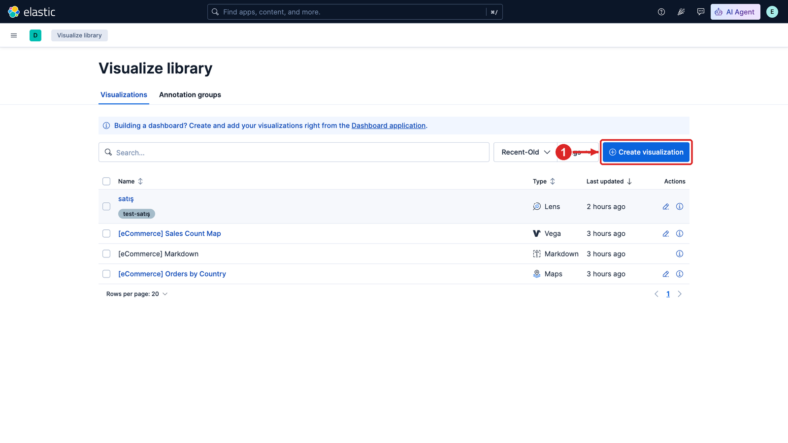{width=75%}

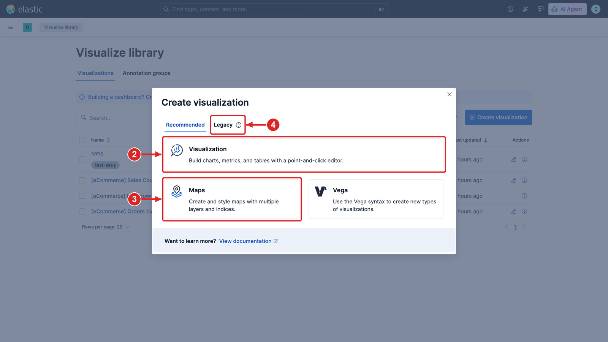{width=75%}

| Seçenek | Ne zaman |
|---|---|
| **Visualization** (2) — Lens | Varsayılan: sürükle-bırak ya da tıklayarak her grafik türü; bu labın konusu |
| **Maps** (3) | Konum field'ı (`geo_point`) olan veride harita, katmanlarla |
| **Vega** | Lens'in çizemediği özel grafik, JSON ile; nadiren |
| **Legacy** (4): Aggregation-based, TSVB | Eski panolarda karşınıza çıkar; yeni grafikte Lens kullanın |

<details>
<summary><strong>Legacy sekmesi: Aggregation-based ve TSVB</strong></summary>

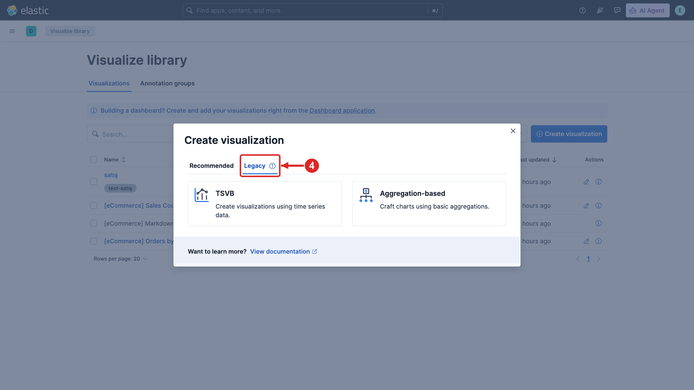{width=75%}

**Aggregation-based** (Area, Data table, Gauge, Goal, Heat map, Horizontal/Vertical bar, Line, Metric, Pie,
Tag cloud) Lens'ten önceki editördür; her türü Lens'te de vardır. Burada aggregation'ları tek tek seçersiniz
(Buckets › X-axis › Date histogram, Metrics › Count): Lens'in arka planda yaptığını açıkça gösterir.
**TSVB** zaman serisi için eski bir editördür. İkisi de yeni panolarda önerilmez.

</details>

Pencerede **Visualization**'ı seçin. Lens açılır.

### 3. Lens: zaman içinde istekler ve Library'ye kaydetme

Soru: trafik saatlere göre nasıl değişiyor, hatalar ne zaman artıyor?

1. Sol üstte data view olarak `Apache erişim logları`'nı (1) seçin, zaman aralığını **Last 7 days** yapın.
2. Field listesinde `@timestamp`'in (2) ve `http.response.status_class`'ın (3) üzerine gelip **+** ile
   ekleyin. Lens her durum sınıfı için bir çizgi çizer (4): yatay eksen `date_histogram`, renkler `terms`.

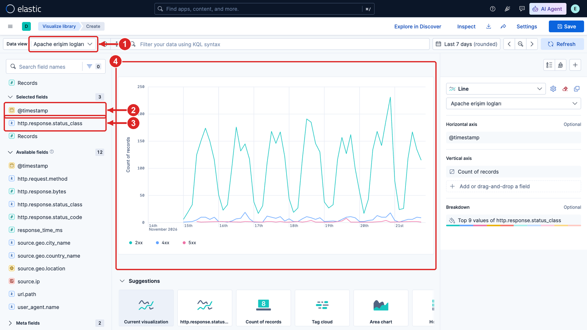{width=75%}

Gece-gündüz deseni görünür; `5xx` çizgisi iki gün önce öğleden sonra yükselir.

3. Grafik türü menüsünden (5) aynı veriyi Bar, Area, Table ya da Pie olarak görebilirsiniz; veri ve
   aggregation aynı kalır, yalnız gösterim değişir.

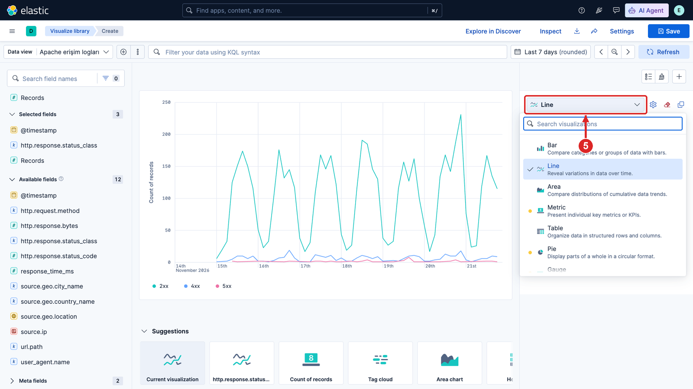{width=75%}

4. **Save**: Title `Zaman içinde istekler (durum sınıfı)` (6), **Add to library** (7) işaretli, **Save and
   add to library** (8). Add to dashboard seçimini **None** bırakın; panoyu Adım 5'te kuracağız.

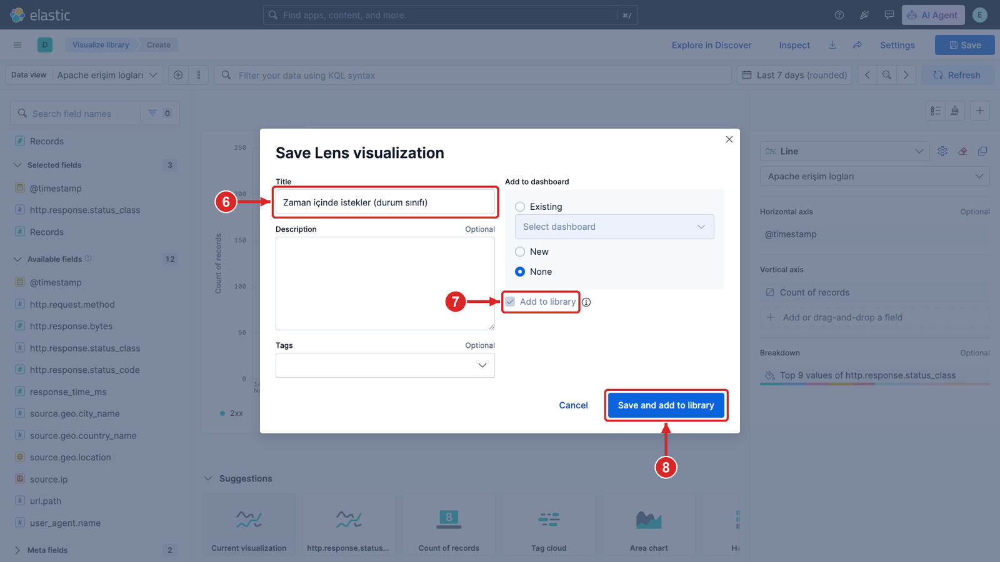{width=75%}

### 4. Üç soru, üç aggregation

Her grafik için **Analytics › Visualize library › Create visualization › Visualization** ile yeni bir Lens
açın, data view'ı ve **Last 7 days**'i seçin, grafik türünü (5) seçip field'ları **+** ile ekleyin. Her birini
Adım 3'teki gibi **Add to library** ile kaydedin.

**a) Tablo: ülke başına istek ve yanıt süresi.** Tür **Table**; field'lar `source.geo.country_name` (Lens kayıt
sayısı sütununu kendisi ekler) ve `response_time_ms`. Lens sayısal field'a **Median** uygular. Değer sütununa tıklayın: **Quick functions** (1)
Elasticsearch'in metric aggregation'larıdır. **Percentile**'ı (3) seçin (varsayılan 95. yüzdelik):
kullanıcıların %95'i bu süreden hızlı yanıt aldı demektir.

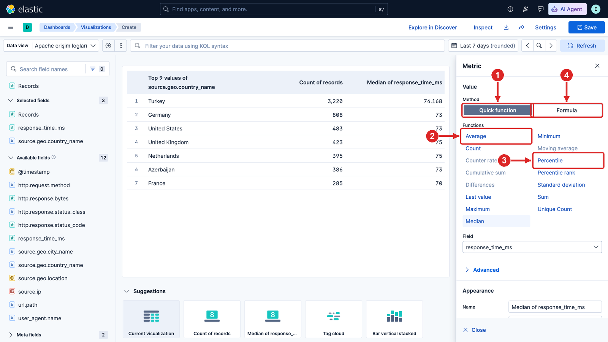{width=75%}

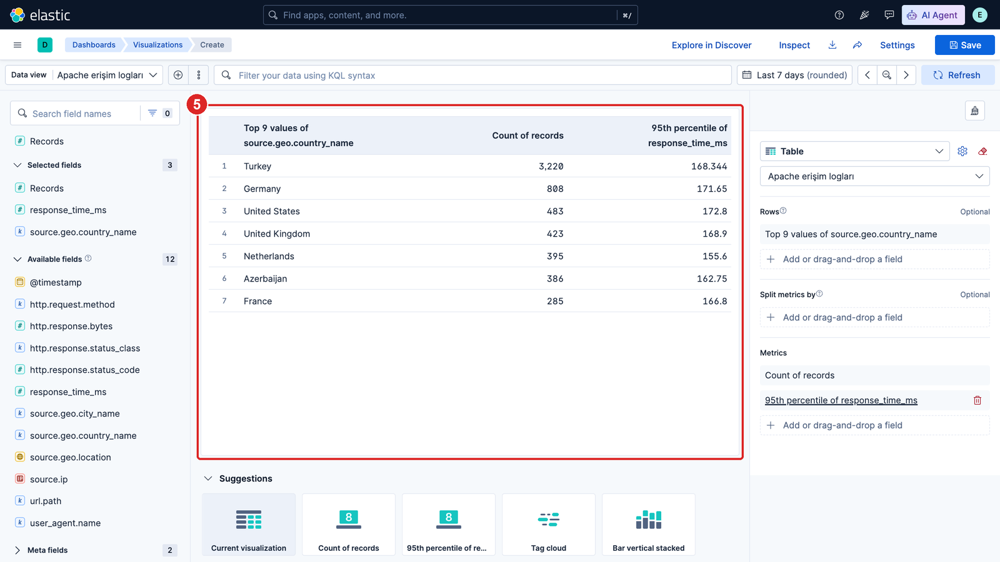{width=75%}

Kaydedin: `Ülke bazında istek ve yanıt süresi`.

**b) Heat map: hangi sayfa ne zaman yoğun.** Tür **Heat map**; field'lar `@timestamp` ve `url.path`. Her hücre
bir saat aralığındaki istek sayısıdır (6); iki `terms`/`date_histogram` bucket'ı bir arada.

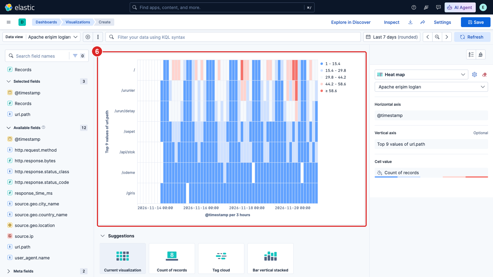{width=75%}

Kaydedin: `Sayfa ve saat yoğunluğu`.

**c) Metric + Formula: hata oranı.** Tür **Metric**; **Primary metric**'e tıklayın, **Formula** (7) sekmesine
geçip yazın (8):

```text
count(kql='http.response.status_class : "5xx"') / count() * 100
```

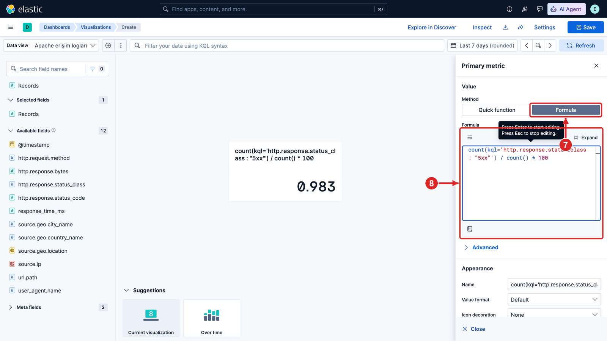{width=75%}

`count(kql=...)` yalnız sorguya uyan document'leri sayar; ikiye bölünüp 100 ile çarpılınca yüzde olur (9).

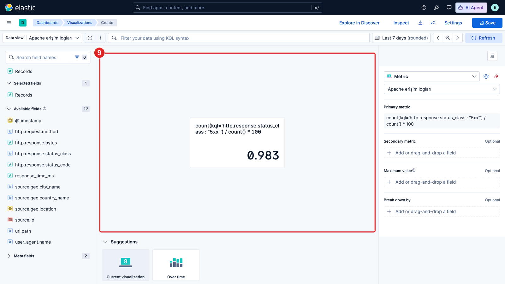{width=75%}

Kaydedin: `Hata oranı (5xx, %)`.

### 5. Pano: Library'den arayarak eklemek

**Analytics › Dashboards › Create dashboard**, zaman aralığı **Last 7 days**. Sağ üstte **Add**: açılan
pencerede **From library** (1) sekmesi Library'deki her şeyi listeler. Arama kutusuna (2) `istek` yazıp
Enter'a basın: başlığında bu kelime geçen grafikler kalır (3).

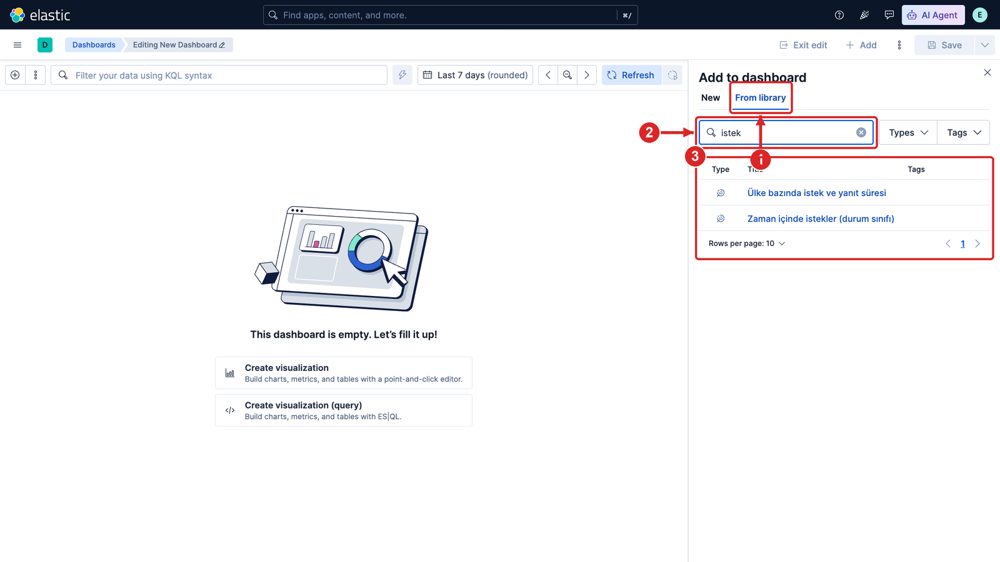{width=75%}

İki sonuca tıklayıp panoya ekleyin. Aynı yolla `yoğunluğu` ve `Hata oranı` diye arayıp kalan iki grafiği
ekleyin ve pencereyi kapatın. Library büyüdükçe arama, listeyi sayfa sayfa gezmekten hızlıdır. Paneller Library'ye bağlıdır: Library'deki grafik değişirse bu pano da
değişir. Bir panelin menüsündeki **Unlink from library** onu bu panoya özel bir kopyaya çevirir.

### 6. Control: panoyu tek tıkla süzmek

**Add › Control** ile bir açılır liste ekleyin. Field kutusuna `country` yazıp `source.geo.country_name`'i (4)
seçin, Control type **Options list** (5), **Save** (6):

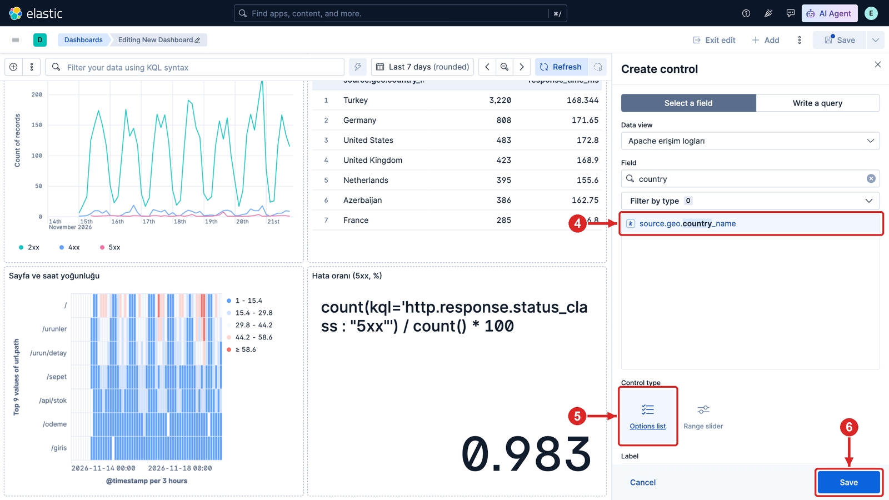{width=75%}

Panoyu **Save** ile `Apache atölye` adıyla kaydedin. Control'de (7) `Germany`'yi seçin: dört panel aynı anda
yalnız Almanya'dan gelen istekleri gösterir; tabloda tek satır kalır (8). Control, panonun her paneline aynı
filtreyi uygular. Sayısal field'lar için **Range slider** aynı işi aralıkla yapar (ör. `response_time_ms`).

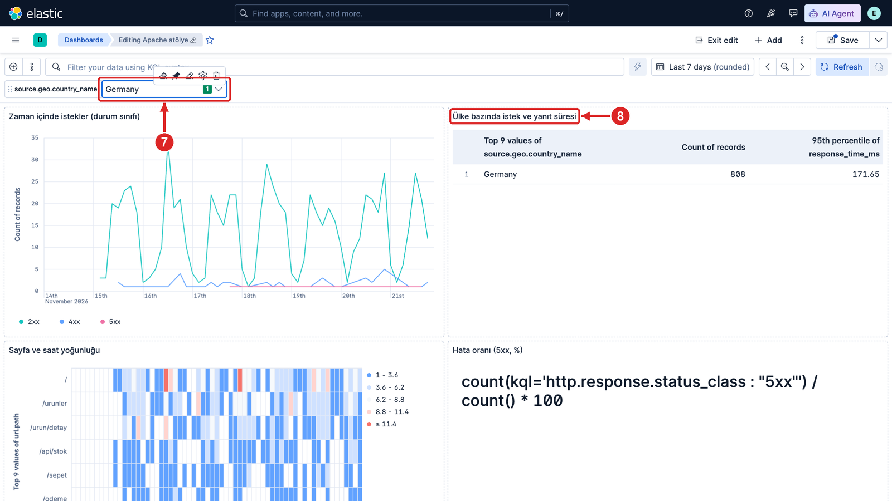{width=75%}

### 7. Panoyu kaydetmek, paylaşmak ve dışa aktarmak

**Zaman kaydı.** Yeni bir gizli pencerede Kibana'ya girip **Dashboards** listesinden `Apache atölye`'yi açın:
zaman aralığı **Last 15 minutes** gelir ve paneller `No results found` der. Pano, hangi zaman aralığıyla
açılacağını kaydetmediyse açılış anındaki genel zaman kutusunu kullanır. Kendi pencerenizde zaman aralığını
**Last 7 days** yapın, **Edit** deyin, sağ üstteki `⋮` menüsünden **Settings**'i açın ve **Store time with
dashboard** anahtarını (1) açıp **Apply** (2) ile onaylayın:

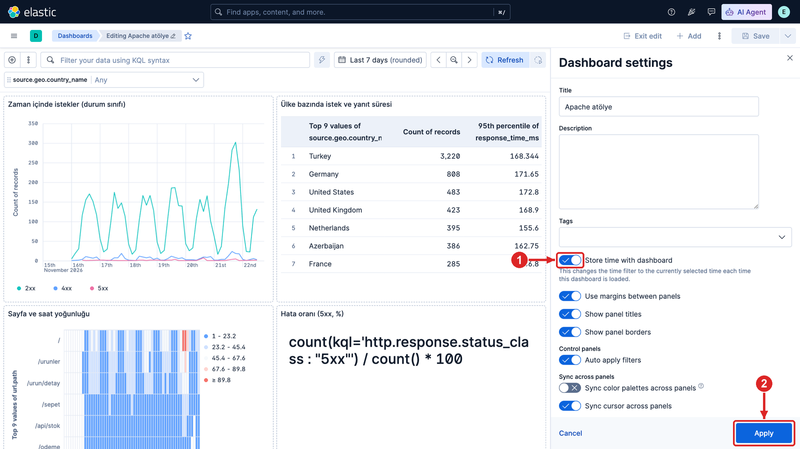{width=75%}

**Save**'e basıp **Exit edit** deyin. Aynı gizli pencerede panoyu yeniden açın: bu kez **Last 7 days** gelir ve
paneller veriyle dolar. Zaman aralığı panoyla birlikte saklanıyor.

**Share.** Okuyacak kişiye pano adresini vermek için **Share**: **Permissions** (1) bölümü, panoyu Space'teki
herkesin ne yapabileceğini söyler (varsayılan **Can edit**; **Can view** yalnız okutur). **Link** sekmesinde
**Use absolute time range** (2) kapalıyken bağlantıyı açan kişi, açtığı ana göre son 7 günü görür
(`7 days ago rounded to the day to now`); açıksa sabit tarih aralığını görür. **Copy link** (3) kısa bir adres
verir (`/app/r/s/<kod>`). **Embed** sekmesi aynı panoyu başka bir sayfaya gömmek içindir:

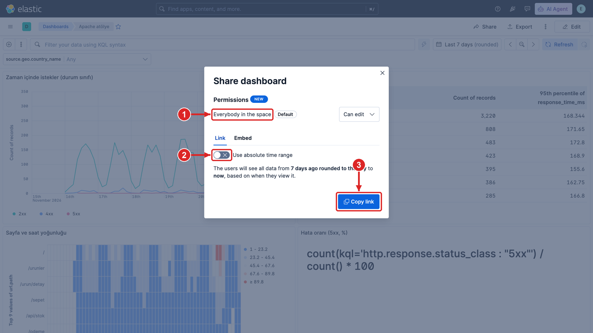{width=75%}

**Export.** **Export** menüsünde dört seçenek vardır (1-4):

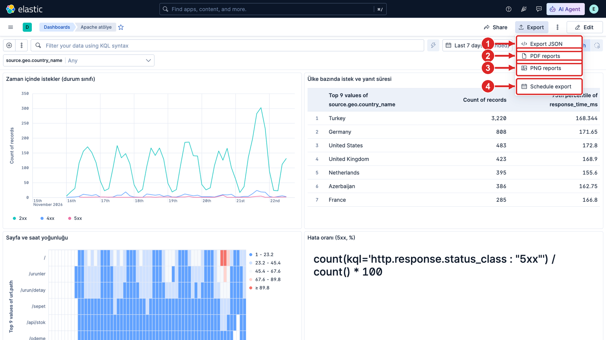{width=75%}

| Seçenek | Ne yapar |
|---|---|
| **Export JSON** (1) | Panonun tanımını JSON olarak gösterir (teknik önizleme); **Copy to clipboard** ya da **Open in Console** |
| **PDF reports** (2) | Panoyu PDF'e çevirir; **Print format** ile çok sayfalı çıktı. **Post URL**, aynı raporu betikten üretmek içindir |
| **PNG reports** (3) | Panoyu tek resme çevirir; **Post URL** burada da var |
| **Schedule export** (4) | Raporu saatlik, günlük, haftalık ya da aylık tekrarlatır; e-posta ile göndermek için bir e-posta connector'ı gerekir (yoksa pencere `Email connector hasn't been created yet` der) |

PDF ve PNG raporları ücretli lisans özelliğidir; LAB-01'de açtığınız deneme lisansıyla çalışır. Raporu gerçekten
üretmek ve Reporting sayfasından indirmek LAB-18'dedir. Panoyu başka bir Space'e ya da Kibana'ya taşımak
(`.ndjson` dosyası) LAB-17'dedir.

---

## Temizlik

Yalnız `pano-apache` index'ini ve şablonunu, data view'ı ve bu data view'a bağlı Kibana nesnelerini
(Library grafikleri, pano) siler; ana cluster'a dokunmaz:

```bash
./teardown.sh
```

Beklenen çıktı:

```text
index pano-apache -> 200
sablon pano-apache -> 200
Kibana nesneleri -> 5 silindi
data view pano-apache -> 200
```

`5`, arayüzde kurulan dört grafik ve panodur; kurmadığınız nesne silinmez.

Labı aynı sunucuda yeniden yapacaksanız başlamadan önce `./teardown.sh` çalıştırın; README'deki sayılar temiz
başlangıca göredir.

---

Sonraki lab: **[LAB-17 — Kibana Spaces ve Saved Objects: Panoları Düzenlemek ve Taşımak](../LAB-17-kibana-spaces-saved-objects/README.md)**
