# LAB-16 — Kibana Pano Atölyesi: Visualize Library, Lens Aggregation'ları ve Ortak Panolar

| Kullanılan Araçlar | Açık / Kullanılan Portlar |
|---|---|
| Kibana Visualize library, Lens (formula, heat map, tablo), Dashboard, Controls | 9200 / 5601 (ana cluster) |

---

## Bu lab ne öğretiyor?

Bir grafiği her panoda yeniden çizmek, birinde düzeltip ötekinde unutmak demektir. Bu labda bir mağazanın 7 günlük
web sunucusu loglarıyla:

- **Lens** ile dört grafik kurup her birinin hangi aggregation'la çalıştığını göreceğiz.
- Grafikleri **Visualize library**'ye kaydedip bir panoda birleştireceğiz.
- Panoyu bir **Control** ile tek tıkla filtreleyeceğiz.
- Panoyu zaman aralığıyla kaydedip paylaşacak ve dışa aktaracağız.

Logda bir arıza saklı: iki gün önce 14:00-16:00 arasında ödeme sayfası 500 döndü.

---

## Ön Koşullar

- LAB-01 ana cluster'ı çalışıyor.
- Önceki labları atladıysanız da lab çalışır: veri bu labın kendi betiğiyle gelir.

```bash
cd ~/elastic/labs/LAB-16-kibana-pano-atolyesi
```

Kibana adresini sunucuda hesaplayın:

```bash
IP=$(curl -s https://api.ipify.org); H=$(hostname -s)
echo "Kibana: http://$IP:5601   https://$H-kibana.devopsatolyesi.com"
```

Beklenen çıktı:

```text
Kibana: http://<IP>:5601   https://<host>-kibana.devopsatolyesi.com
```

---

## Kavramlar: Lens ve aggregation

- **Aggregation:** Kibana'daki her grafik arka planda bir Elasticsearch aggregation'ıdır.
- **Bucket:** gruplama; yatay eksen, satırlar ve Breakdown (`@timestamp` → `date_histogram`, sayfa ya da ülke → `terms`).
- **Metric:** her grupta yapılan hesap; dikey eksen ve değerler (Count of records, Median, Percentile).
- **Formula:** birden çok metric'le hesap; bu labda 5xx hata oranı.
- **Visualize library:** kaydedilmiş grafiklerin ortak deposu; Library'deki grafik değişince onu kullanan bütün panolar değişir.

---

## Adım Adım Uygulama Rehberi

### 1. Örnek veri

**Soru: Grafikler hangi veriden çizilecek?**

Betik, son 7 güne yayılmış 6000 erişim olayını `pano-apache` index'ine yazar (sabit tohum: sayılar her
seferinde aynıdır; tarihler labı yaptığınız güne göre kayar):

```bash
python3 scripts/veri_uret.py
```

Beklenen çıktı:

```text
[+] 6000 olay yazildi (pano-apache), hata: False
    durum kodu : 200=5612, 404=329, 500=59
    ilk 3 ulke : Turkey=3220, Germany=808, United States=483
```

Her olayda sayfa (`url.path`), durum kodu ve sınıfı (`2xx`/`4xx`/`5xx`), yanıt süresi (`response_time_ms`),
ülke ve şehir vardır. Grafikler bir data view üzerinden çizilir. Kibana › Dev Tools'a yapıştırın:

```http
POST kbn:/api/data_views/data_view
{ "data_view": { "id": "pano-apache", "title": "pano-apache", "name": "Apache erişim logları", "timeFieldName": "@timestamp" } }
```

Yanıt `{"data_view":{"id":"pano-apache",` ile başlar. `400` ve `Duplicate data view: Apache erişim logları` gelirse
data view zaten vardır; aynı data view'la devam edin.

### 2. Visualize library'yi açın

**Soru: Yeni bir grafiğe nereden başlanır?**

1. Sol üstteki menü düğmesine (1) tıklayın, **Analytics** altında **Visualize library**'yi (2) seçin:

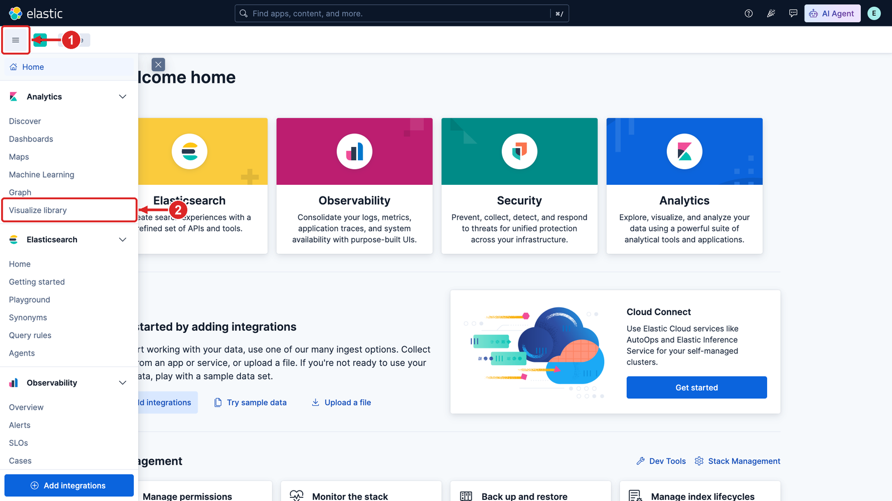

2. Sağ üstte **Create visualization** (1):

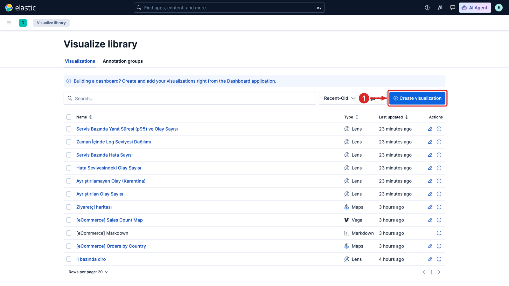

3. Açılan pencerede grafik türü seçilir. **Visualization**'a (1) tıklayın; Lens açılır:

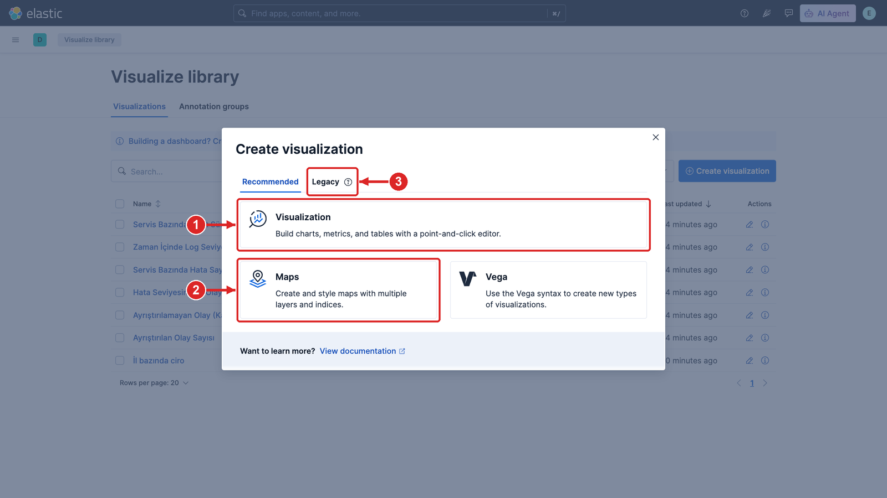

| Seçenek | Ne zaman |
|---|---|
| **Visualization** (1), yani Lens | Varsayılan: tıklayarak her grafik türü; bu labın konusu |
| **Maps** (2) | Konum field'ı (`geo_point`) olan veride harita |
| **Vega** | Lens'in çizemediği özel grafik, JSON ile; nadiren |
| **Legacy** (3) | Eski editörler; eski panolarda karşınıza çıkar |

<details>
<summary><strong>Legacy sekmesi: Aggregation-based ve TSVB</strong></summary>

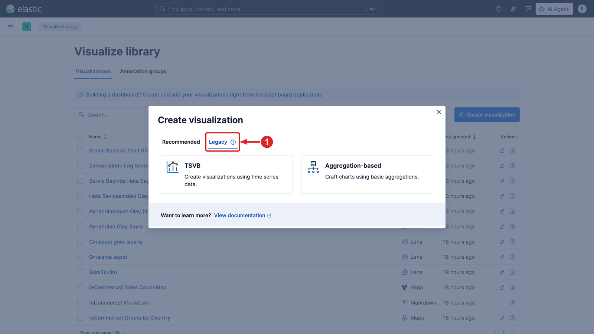

**Aggregation-based** (Area, Data table, Gauge, Heat map, Bar, Line, Metric, Pie, Tag cloud) Lens'ten önceki
editördür; her türü Lens'te de vardır. Aggregation'ları tek tek seçersiniz (Buckets › X-axis › Date histogram,
Metrics › Count): Lens'in arka planda yaptığını açıkça gösterir. **TSVB** eski bir zaman serisi editörüdür.
İkisi de yeni panolarda önerilmez.

</details>

### 3. İlk Lens grafiği: zaman içinde istekler

**Soru: Trafik saatlere göre nasıl değişiyor, hatalar ne zaman artıyor?**

1. Sol üstteki **Data view** kutusuna (1) tıklayın, listeden **Apache erişim logları**'nı (2) seçin:

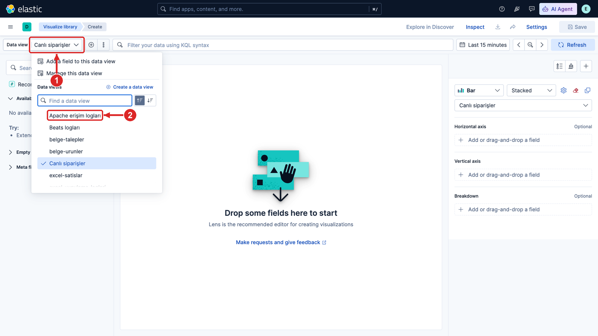

2. Sağ üstteki zaman kutusuna (1) tıklayın, listeden **Last 7 days**'i (2) seçin; görünmüyorsa listeyi aşağı
   kaydırın. Kutuda `Last 7 days (rounded)` yazar:

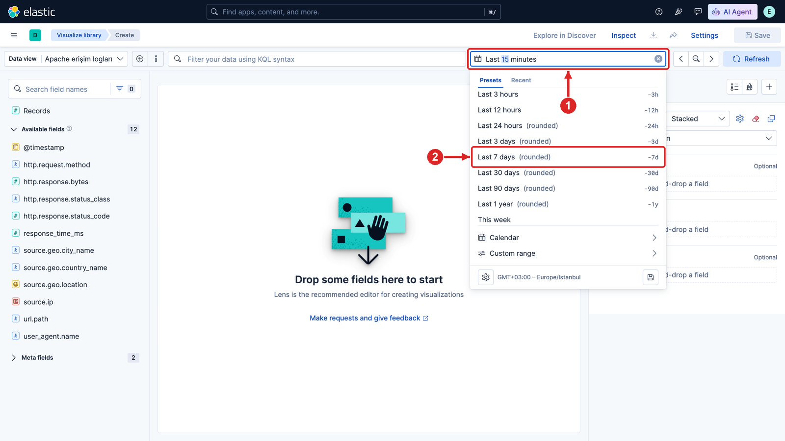

3. Lens ekranının parçaları:

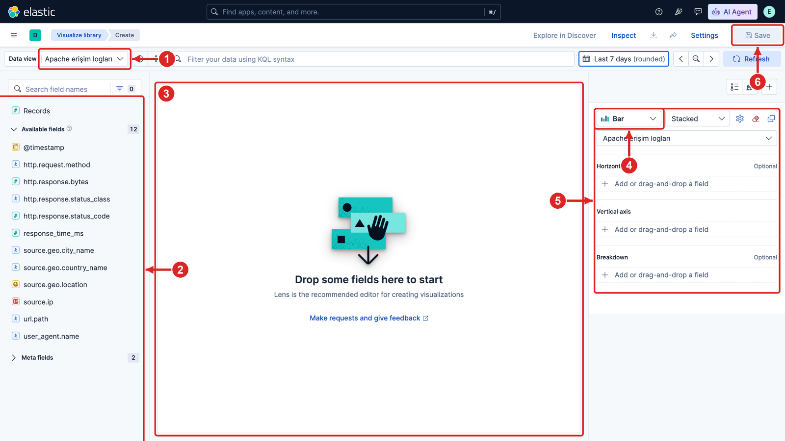

| No | Parça | Ne işe yarar |
|---|---|---|
| 1 | Data view | Hangi veriden çizileceği |
| 2 | Field listesi | Grafiğe eklenecek field'lar; üstteki kutuyla aranır |
| 3 | Çalışma alanı | Grafiğin kendisi |
| 4 | Grafik türü | Bar, Line, Table, Metric, Heat map... |
| 5 | Katman paneli | **Horizontal axis** (yatay eksen), **Vertical axis** (dikey eksen), **Breakdown** (renklere bölme) |
| 6 | Save | Grafiği kaydeder |

4. Field arama kutusuna (1) `timestamp` yazın. Listede kalan `@timestamp`'in üzerine gelin, sağında beliren
   **⊕** düğmesine (2) tıklayın:

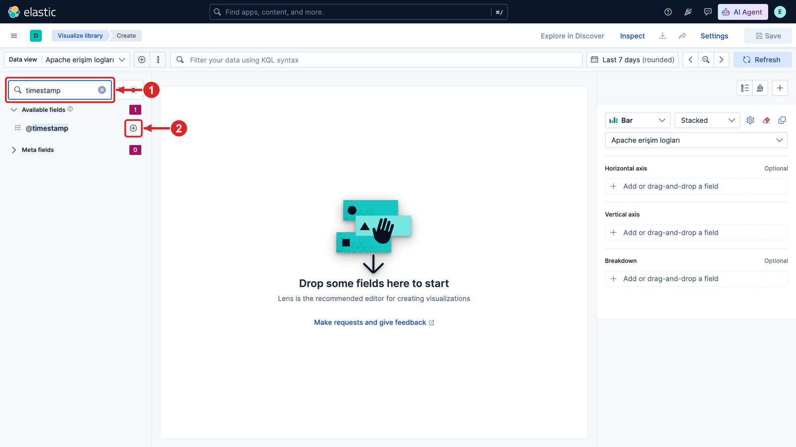

5. Lens zaman field'ını yatay eksene koydu (1), dikey eksene kendiliğinden **Count of records** (kayıt sayısı) (2)
   ekledi ve çizgi grafik çizdi (3). Gece-gündüz deseni görünür:

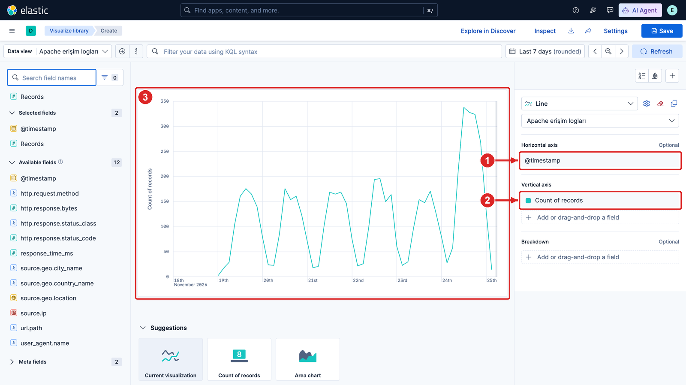

6. Aynı yolla arama kutusuna (1) `status_class` yazıp `http.response.status_class`'ın **⊕** düğmesine (2) tıklayın:

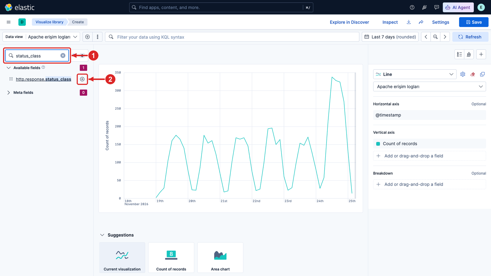

7. Field **Breakdown**'a girdi (1): grafik her durum sınıfı için ayrı çizgi çizer (2). `5xx` çizgisi iki gün önce
   öğleden sonra yükselir:

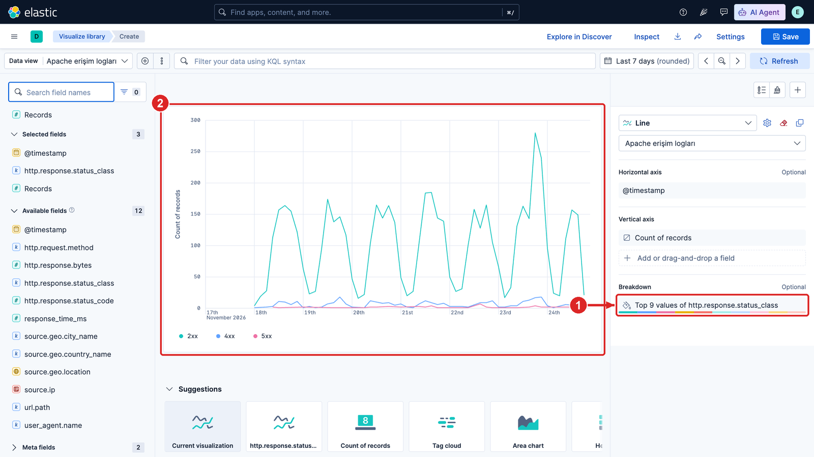

8. Grafik türü kutusu (1) aynı veriyi Bar, Area, Table ya da Pie olarak gösterir; veri ve aggregation aynı kalır.
   Denedikten sonra **Line**'a geri dönün:


9. Sağ üstte **Save**'e tıklayın. Pencerede:
   - **Title** (1): `Zaman içinde istekler (durum sınıfı)`
   - **Add to library** (2): işaretli
   - **Add to dashboard** altında **None** (3): panoyu Adım 5'te kuracağız
   - **Save and add to library** (4)

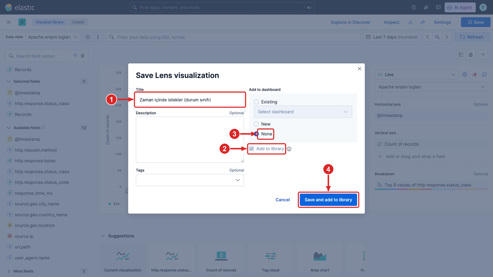

### 4. Üç soru, üç aggregation

**Soru: Hangi ülke ne kadar bekliyor, hangi sayfa ne zaman yoğun, hata oranı kaç?**

Her grafik için yeni bir Lens açın: **Visualize library › Create visualization › Visualization** (Adım 2).
Data view `Apache erişim logları`, zaman **Last 7 days** olmalı (Adım 3'ün 1-2. maddesi). Her birini Adım 3'ün
9. maddesindeki gibi **Add to library** ile kaydedin.

**a) Tablo: ülke başına istek ve yanıt süresi.**

1. Grafik türü kutusuna (1) tıklayın, arama kutusuna (2) `Table` yazın, **Table**'ı (3) seçin:


2. Adım 3'ün 4. maddesindeki gibi önce `source.geo.country_name`, sonra `response_time_ms` field'ını **⊕** ile
   ekleyin. Ülke **Rows**'a (1) girer, **Metrics**'e (2) kayıt sayısı ve `Median of response_time_ms` gelir (3):

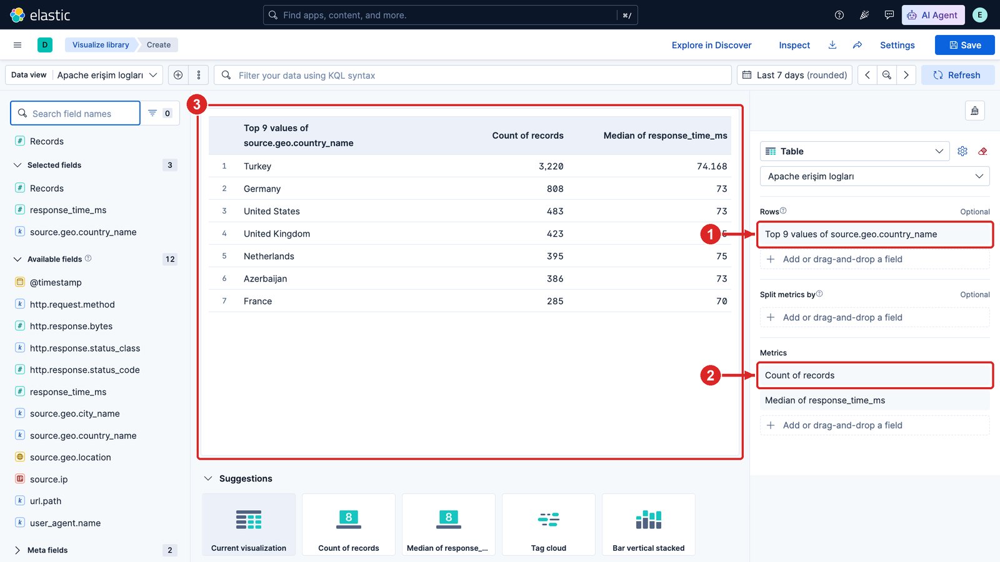

3. **Metrics** altında `Median of response_time_ms`'e tıklayın. Açılan panelde **Quick function** (1) seçili
   kalsın, **Percentile**'a (2) tıklayın (varsayılan 95. yüzdelik), sonra panelin altındaki **Close**:

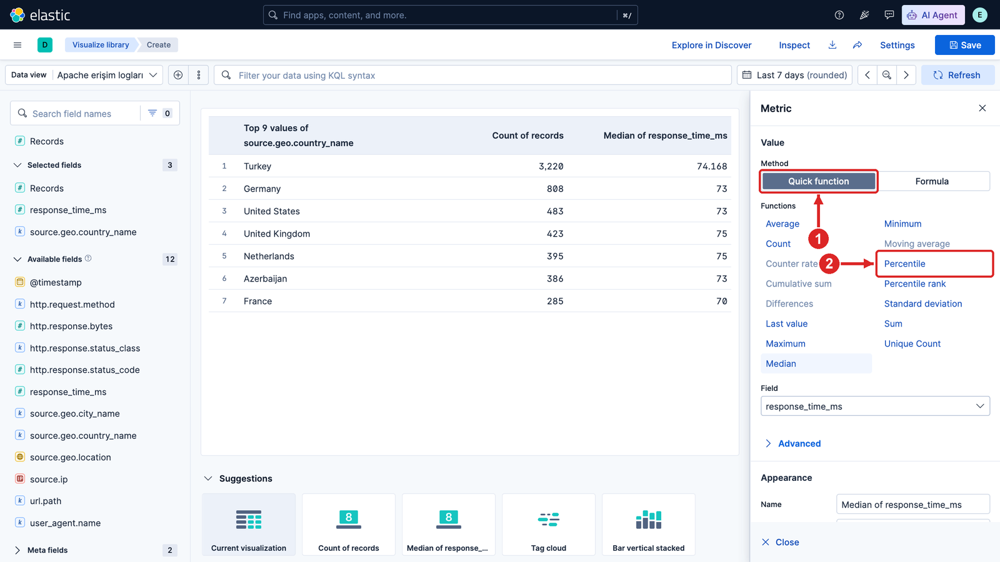

4. Sütun `95th percentile of response_time_ms` oldu (1): kullanıcıların %95'i bu süreden hızlı yanıt aldı.
   Kaydedin: `Ülke bazında istek ve yanıt süresi`.


**b) Heat map: hangi sayfa ne zaman yoğun.**

1. Grafik türü kutusu (1), arama (2) `Heat`, **Heat map** (3):


2. `@timestamp` ve `url.path` field'larını **⊕** ile ekleyin. Zaman yatay eksene (1), sayfa dikey eksene (2) girer;
   her hücre 3 saatlik bir aralıktaki istek sayısıdır (`@timestamp per 3 hours`); renk ölçeğinde mavi az, kırmızı yoğun demektir (3). Kaydedin: `Sayfa ve saat yoğunluğu`.

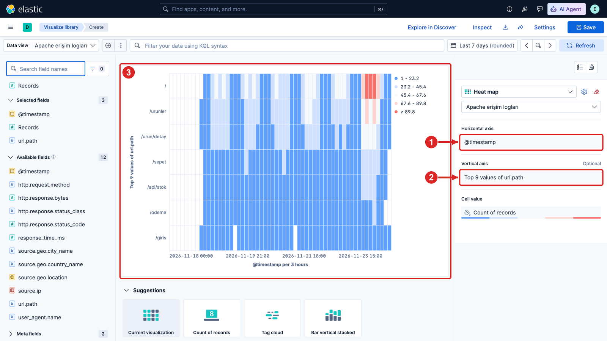

**c) Metric ve Formula: hata oranı.**

1. Grafik türü kutusu (1), arama (2) `Metric`, **Metric** (3):

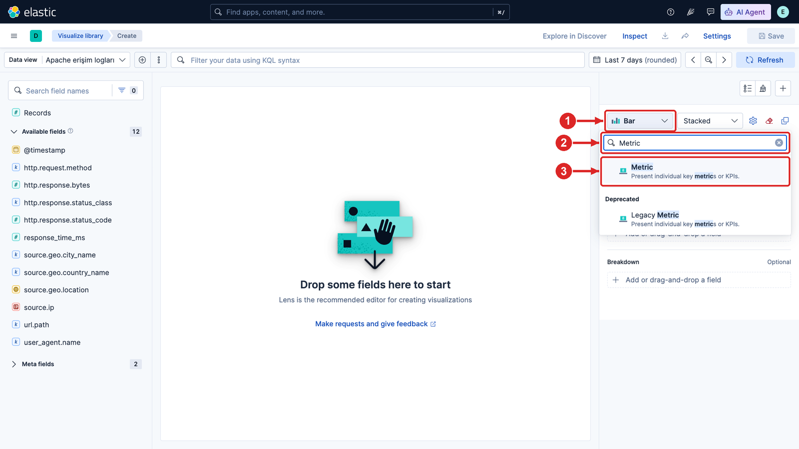

2. **Primary metric** altındaki **Add or drag-and-drop a field** satırına (1) tıklayın:

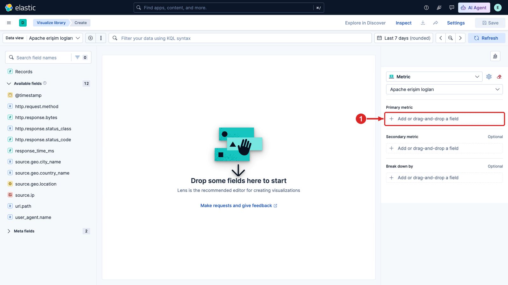

3. Açılan panelde **Formula** sekmesine (1) geçin, kutuya (2) aşağıdaki formülü yapıştırın. **Name** kutusuna (3)
   `Hata oranı (%)` yazın, sonra **Close**:

```text
count(kql='http.response.status_class : "5xx"') / count() * 100
```

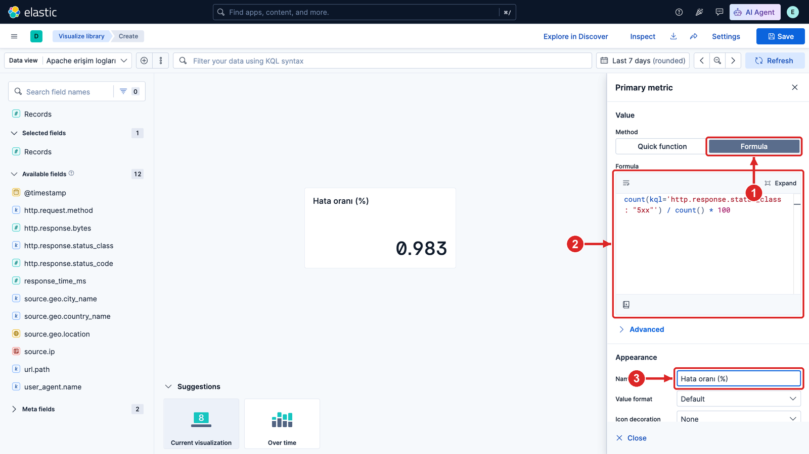

4. **Name** panelde sayının üstündeki etikettir; kaydederken verilen **Title** ise grafiğin Library'deki adıdır.
   `count(kql=...)` yalnız sorguya uyan document'leri sayar; toplama bölünüp 100 ile çarpılınca yüzde olur (1):
   6000 isteğin 59'u 5xx, yani yaklaşık 0,98. Kaydedin: `Hata oranı (5xx, %)`.

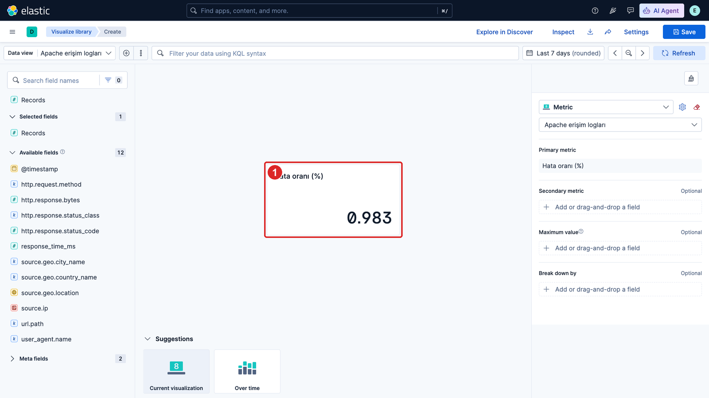

### 5. Pano: Library'den arayarak eklemek

**Soru: Dört grafiği tek ekranda nasıl birleştiririz?**

1. Menü düğmesi, **Analytics › Dashboards** (1):

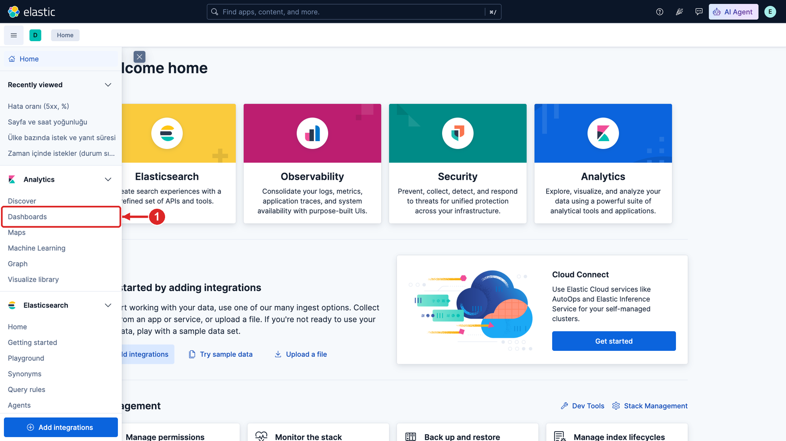

2. Sağ üstte **Create dashboard** (1). Boş pano açılır; zaman kutusundan **Last 7 days**'i seçin (Adım 3'teki gibi):

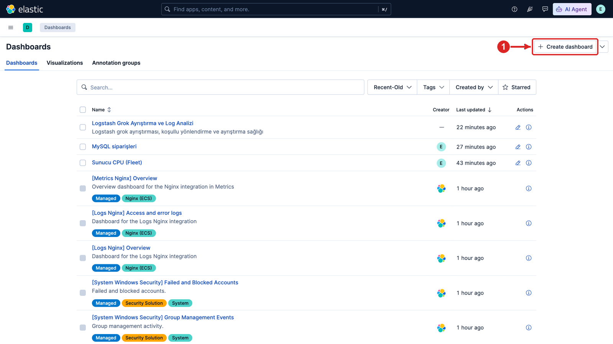

3. Sağ üstte **Add** (1):

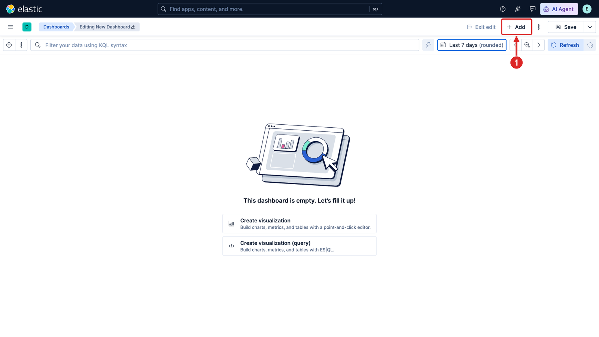

4. Sağda açılan panelde **From library** sekmesine (1) geçin. Arama kutusuna (2) `istek` yazıp Enter'a basın:
   başlığında bu kelime geçen iki grafik kalır. **Zaman içinde istekler (durum sınıfı)**'na (3) tıklayın:

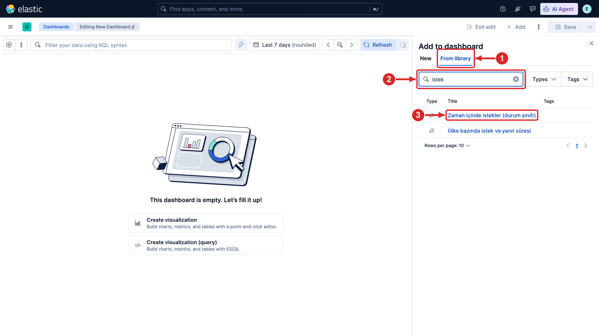

5. Grafik panoya panel olarak eklendi (1); sağdaki panel açık kalır:

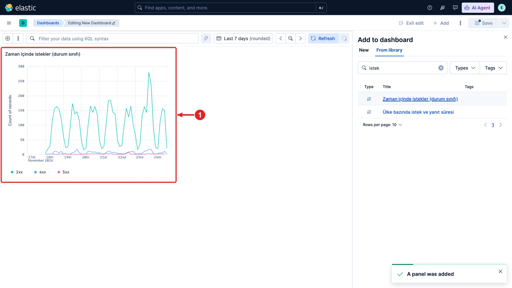

6. Aynı panelde **Ülke bazında istek ve yanıt süresi**'ne tıklayın. Sonra arama kutusuna `yoğunluğu` yazıp
   **Sayfa ve saat yoğunluğu**'na, `Hata oranı` yazıp **Hata oranı (5xx, %)**'na tıklayın. Paneli sağ üstteki
   **×** ile kapatın. Panoda dört panel olur (1-4):

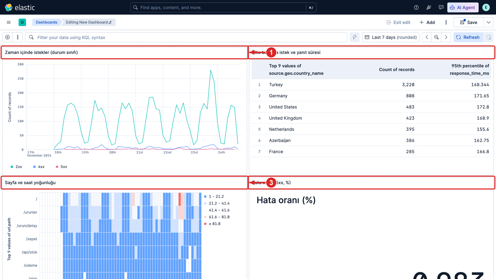

7. Panelin yerini ve boyunu değiştirmek için fareyi panelin üzerine getirin: başlıktaki tutamaçtan (1) sürükleyip
   taşıyın, sağ alt köşeden (2) çekip büyütün:

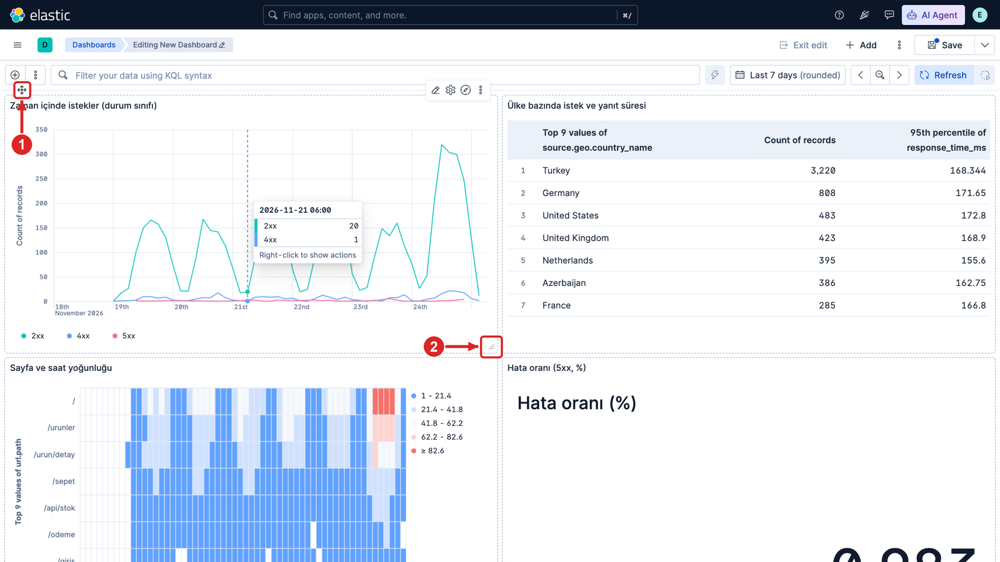

Paneller Library'ye bağlıdır: Library'deki grafik değişirse bu pano da değişir. Panelin `⋮` menüsündeki
**Unlink from library** onu bu panoya özel bir kopyaya çevirir. Library büyüdükçe arama, listeyi sayfa sayfa
gezmekten hızlıdır.

### 6. Control: panoyu tek tıkla filtrelemek

**Soru: Bütün panelleri aynı anda tek bir ülkeye nasıl indiririz?**

1. Sağ üstte **Add**, açılan panelde **Controls** altında **Control** (1):

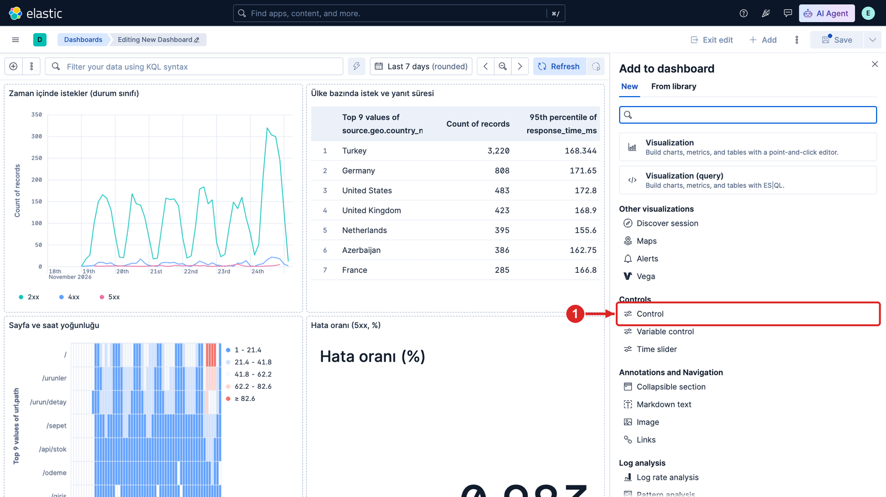

2. **Create control** panelinde **Field** arama kutusuna (1) `country` yazın, **source.geo.country_name**'i (2)
   seçin. **Control type** olarak **Options list** (3) seçili olsun, **Save** (4):

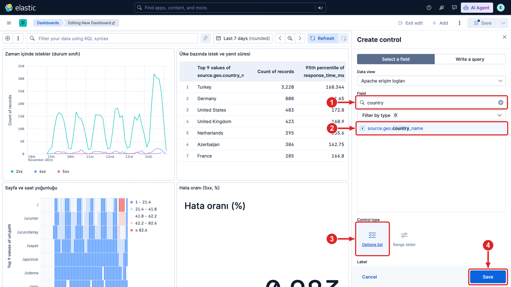

3. Panoyu kaydedin: sağ üstte **Save**, **Title** (1) `Apache atölye`, **Save** (2):

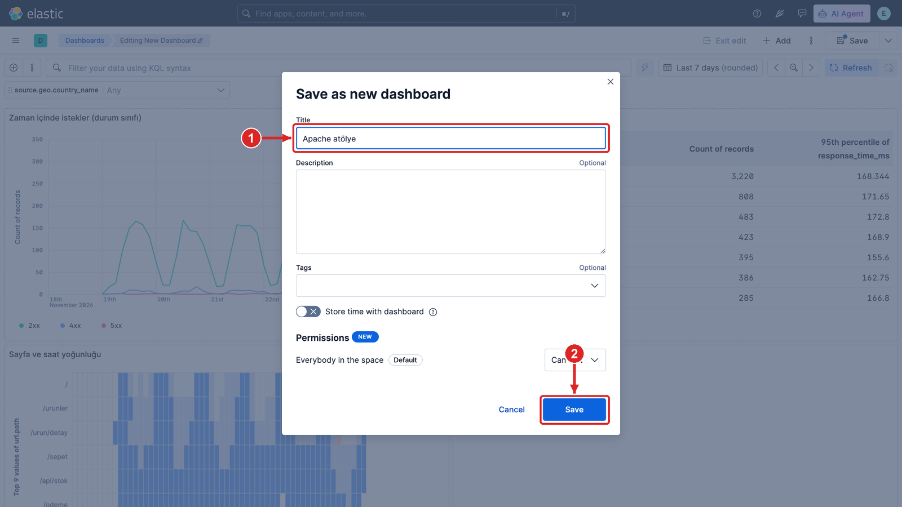

4. Panonun üstüne gelen açılır listeye (1) tıklayın, **Germany**'yi (2) işaretleyin, listenin dışına tıklayın:

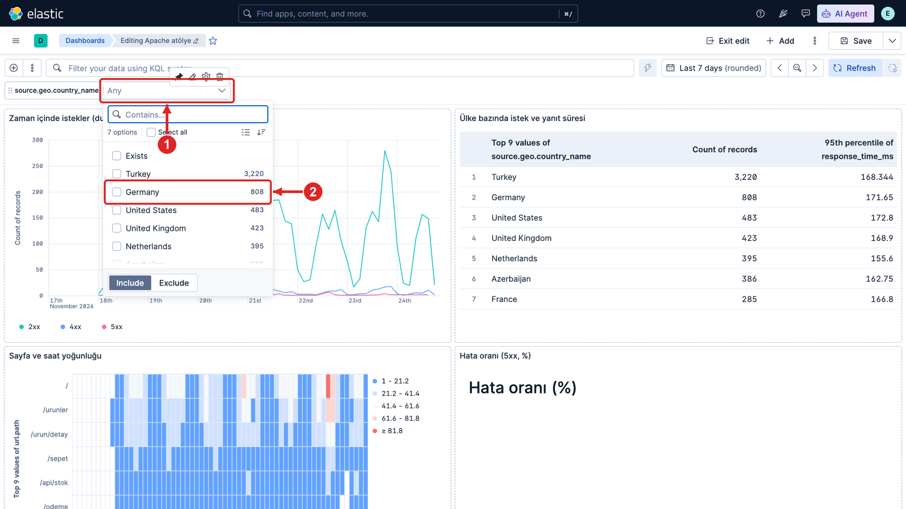

5. Control'de `Germany` yazar (1); dört panel aynı anda yalnız Almanya'dan gelen istekleri gösterir, tabloda tek
   satır kalır (2). Control panonun her paneline aynı filtreyi uygular. Seçimi kaldırmak için listeyi açıp
   işareti kaldırın. Sayısal field'da (ör. `response_time_ms`) **Control type** listesinde Options list'in yanındaki **Range slider**
   aynı işi aralıkla yapar (Adım 6'nın 2. maddesindeki görüntü).

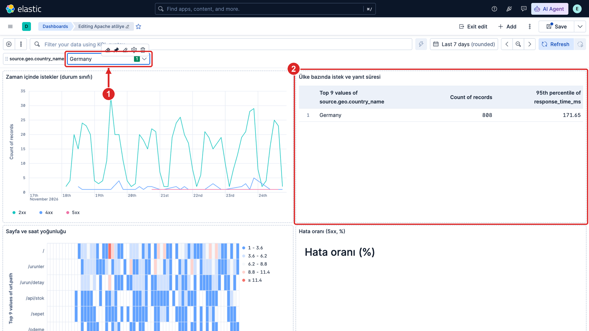

6. Kaydettikten sonra pano düzenleme modunda kalır. Açılır listeyi (1) açıp **Germany** işaretini kaldırın, sonra
   sağ üstte **Exit edit** (2). Pano kayıtlı hâline (filtresiz) döner ve okuma modunda açılır:

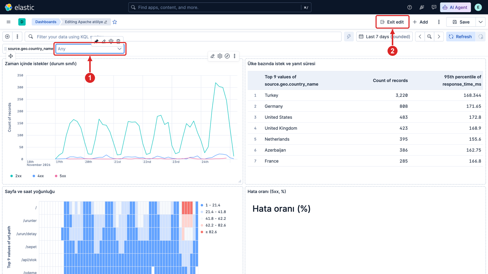

### 7. Panoyu kaydetmek, paylaşmak ve dışa aktarmak

**Soru: Panoyu açan başkası aynı şeyi görür mü?**

**Zaman kaydı.** Panoyu başka biri açınca hangi zaman aralığı gelir? Yeni bir gizli pencerede Kibana'ya girip
**Dashboards** listesinden `Apache atölye`'yi açın: zaman aralığı **Last 15 minutes** gelir ve paneller
`No results found` der. Pano zaman aralığını kaydetmediyse açılış anındaki genel zaman kutusunu kullanır. Kendi
pencerenizde:

1. Zaman aralığı **Last 7 days** iken sağ üstte **Edit** (1); pano yeniden düzenleme moduna geçer:

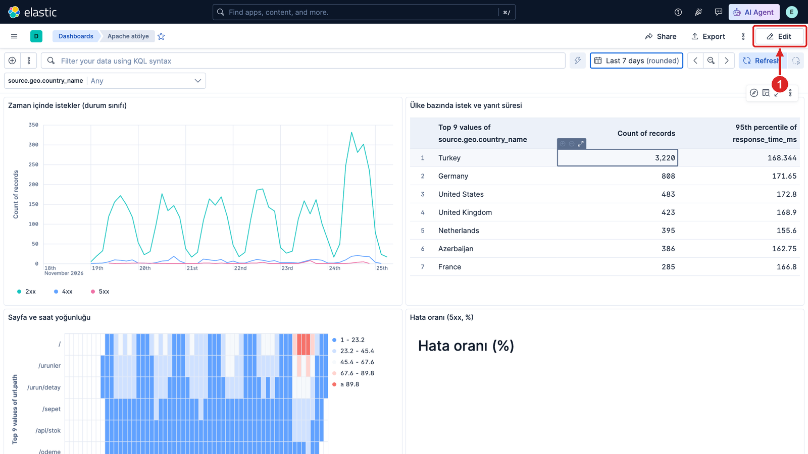

2. Sağ üstteki `⋮` düğmesi (1), **Settings** (2):

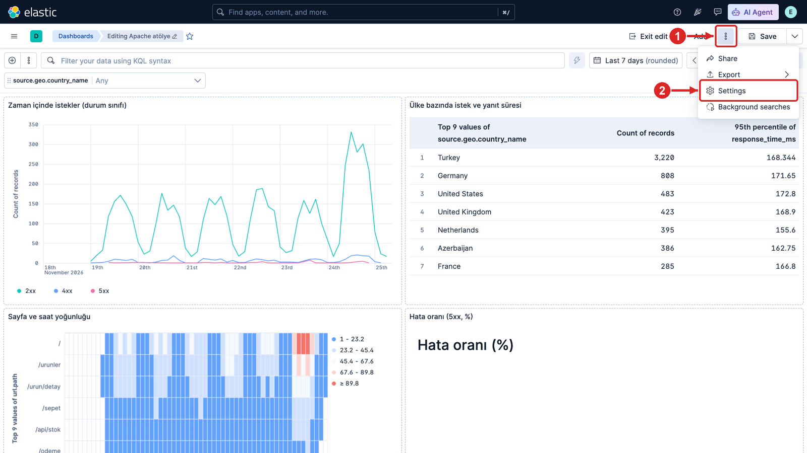

3. **Store time with dashboard** anahtarını (1) açın, **Apply** (2):

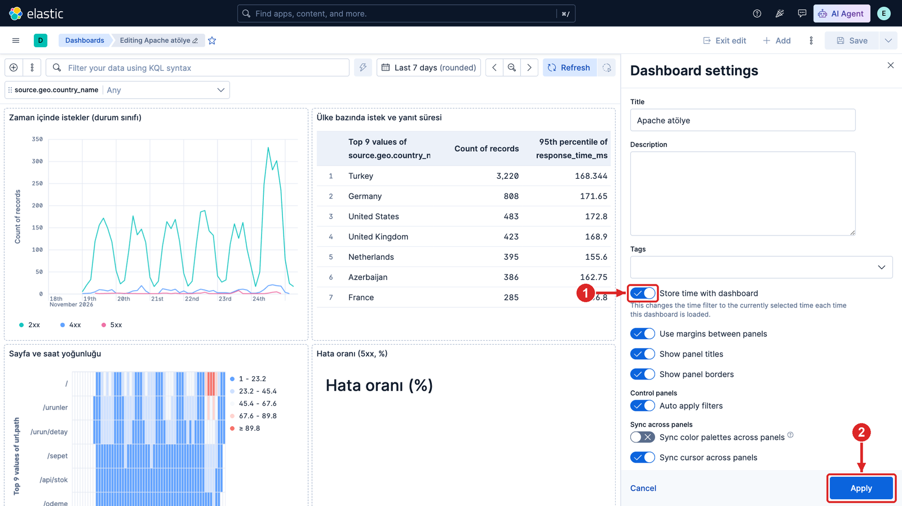

4. **Save** (1), sonra **Exit edit** (2):

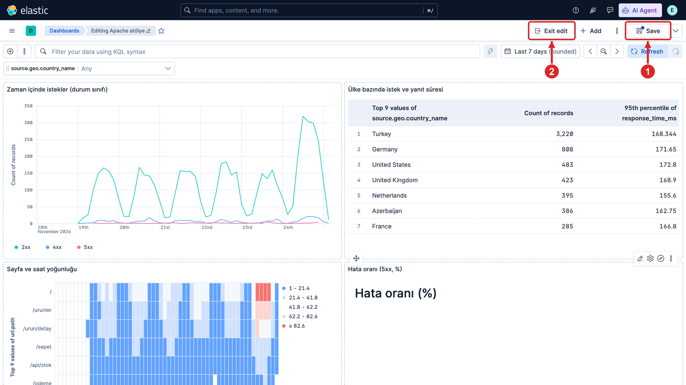

Gizli pencerede panoyu yeniden açın: bu kez zaman seçicisinde **Last 7 days** (1) gelir ve paneller veriyle dolar. Aynı
anahtar ilk kaydetme penceresinde de vardır (Adım 6'nın 3. maddesi).

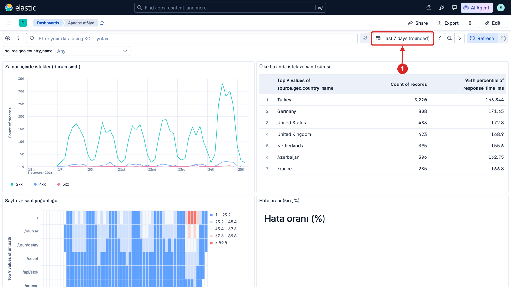

**Share.** Sağ üstte **Share**:

- **Permissions** (1): panoyu Space'teki herkesin ne yapabileceği (varsayılan **Can edit**; **Can view** yalnız okutur).
- **Use absolute time range** (2): kapalıyken bağlantıyı açan kişi açtığı ana göre son 7 günü görür
  (`7 days ago rounded to the day to now`); açıksa sabit tarih aralığını görür.
- **Copy link** (3): kısa bir adres verir (`/app/r/s/<kod>`). **Embed** sekmesi panoyu başka bir sayfaya gömmek içindir.

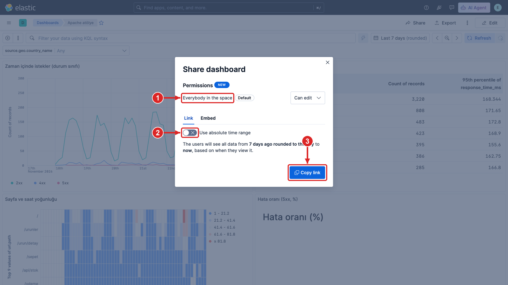

**Export.** Sağ üstte **Export**; dört seçenek vardır (1-4):

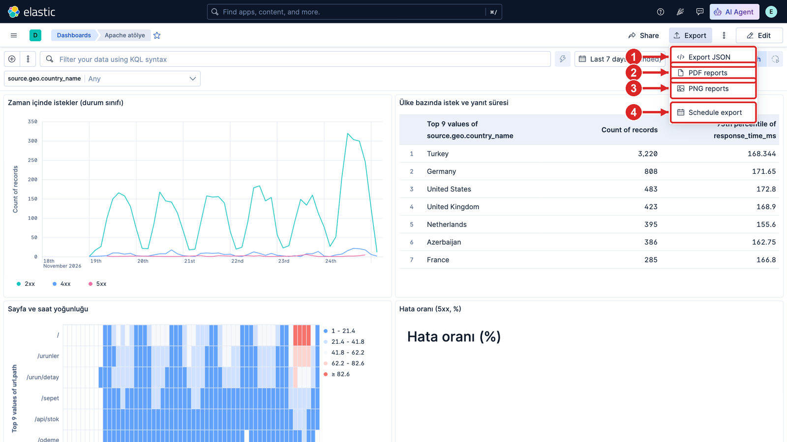

| Seçenek | Ne yapar |
|---|---|
| **Export JSON** (1) | Panonun tanımını JSON olarak gösterir; **Copy to clipboard** ya da **Open in Console** |
| **PDF reports** (2) | Panoyu PDF'e çevirir; **Print format** ile çok sayfalı çıktı. **Post URL** aynı raporu betikten üretmek içindir |
| **PNG reports** (3) | Panoyu tek resme çevirir |
| **Schedule export** (4) | Raporu saatlik, günlük, haftalık ya da aylık tekrarlatır; e-posta için bir e-posta connector'ı gerekir |

PDF ve PNG raporları ücretli lisans özelliğidir; ana cluster'da açık olan 30 günlük deneme lisansıyla çalışır.
Üretilen raporlar **Stack Management › Reporting** sayfasından indirilir.

---

## Temizlik

Yalnız `pano-apache` index'ini ve şablonunu, data view'ı ve bu data view'a bağlı Kibana nesnelerini (Library
grafikleri, pano) siler; ana cluster'a dokunmaz:

```bash
./teardown.sh
```

Beklenen çıktı:

```text
index pano-apache -> 200
sablon pano-apache -> 200
Kibana nesneleri -> 5 silindi
data view pano-apache -> 200
```

`5`, arayüzde kurulan dört grafik ve panodur; kurmadığınız nesne silinmez.

Labı aynı sunucuda yeniden yapacaksanız başlamadan önce `./teardown.sh` çalıştırın; README'deki sayılar temiz
başlangıca göredir.

---

Sonraki lab: **[LAB-17 — Kibana Spaces ve Saved Objects: Panoları Düzenlemek ve Taşımak](../LAB-17-kibana-spaces-saved-objects/README.md)**
