# LAB-17 — Kibana Spaces ve Saved Objects: Panoları Düzenlemek ve Taşımak

| Kullanılan Araçlar | Açık / Kullanılan Portlar |
|---|---|
| Kibana Spaces, feature visibility, Saved Objects (Copy to space, Export, Import) | 9200 / 5601 (ana cluster) |

---

## Bu lab ne öğretiyor?

Satış ekibi yalnız kendi panolarını görmek istiyor; Observability, Security ve Machine Learning menüleri onları
şaşırtıyor. Panoyu her ekip için yeniden çizmek de test ortamındaki panoyu üretime elle kurmak da zaman kaybı ve
hata kaynağıdır. Bu labda Kibana arayüzünden:

- Ekibe özel bir **Space** açıp menüsünü sadeleştireceğiz.
- Hazır bir panoyu ilişkili nesneleriyle başka bir Space'e kopyalayacağız.
- Aynı panoyu dosyaya **Export** edip üçüncü bir Space'e **Import** edeceğiz.
- Silinen bir nesneyi bu dosyadan geri getireceğiz.

Her tıklama kırmızı kutu ve numarayla gösterilir.

---

## Ön Koşullar

- LAB-01 ana cluster'ı çalışıyor.
- LAB-04'teki örnek e-ticaret verisi ve panosu yüklü (`[eCommerce] Revenue Dashboard`). LAB-04'ü
  atladıysanız onun Adım 1'ini yapın.

```bash
cd ~/elastic/labs/LAB-17-kibana-spaces-saved-objects
```

Kibana adresini sunucuda hesaplayın:

```bash
IP=$(curl -s https://api.ipify.org); H=$(hostname -s)
echo "Kibana: http://$IP:5601   https://$H-kibana.devopsatolyesi.com"
```

Beklenen çıktı:

```text
Kibana: http://<IP>:5601   https://<host>-kibana.devopsatolyesi.com
```

---

## Kavramlar: Space ve saved object

- **Space:** Kibana içinde ayrı çalışma alanı; kendi panoları, data view'ları ve menüsü vardır. Veri ortaktır, Space veriyi bölmez.
- **Feature visibility:** Space menüsünde hangi uygulamaların görüneceği. Yetki değildir; yetki rolle verilir (LAB-20).
- **Saved object:** Kibana'nın sakladığı her nesne: pano, Lens, harita, saved search, data view.
- **Referans:** pano panellerini ve data view'ını kimliğiyle gösterir; nesneler bir zincirdir. Pano tek başına taşınırsa açılmaz, bu yüzden ilişkili nesneler de seçilir.

---

## Adım Adım Uygulama Rehberi

### 1. Space oluşturmak

**Soru: Satış ekibine ayrı bir çalışma alanı nasıl açılır?**

1. Sol üstteki menü düğmesi (1), **Management** altında **Stack Management** (2):

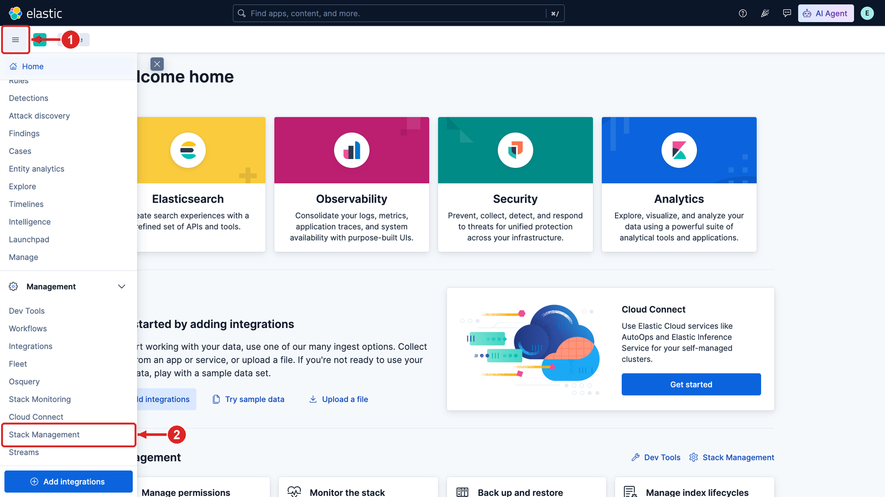

2. Soldaki listede **Kibana** altında **Spaces** (1):

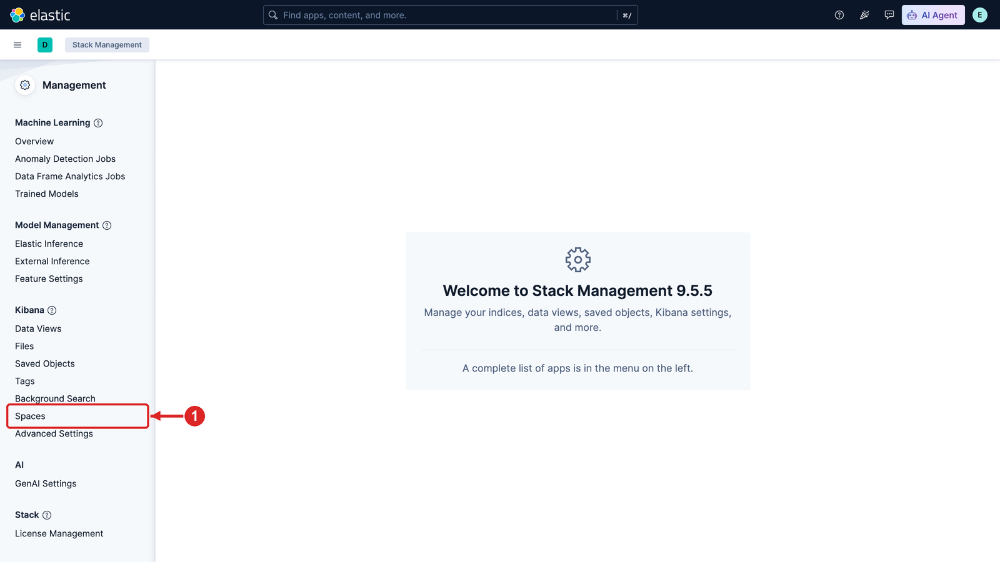

3. Sağ üstte **Create space** (1):

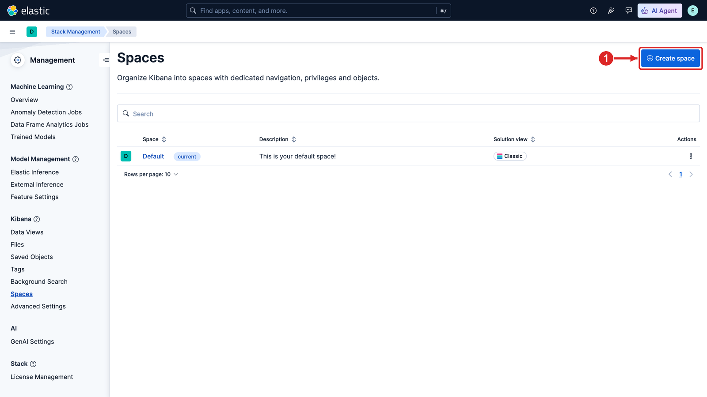

4. **Name** kutusuna `Satış ekibi` yazın. **URL identifier** addan kendiliğinden üretilir ama Türkçe harfleri
   tireye çevirir (`sat---ekibi`); kutuyu silip `satis-ekibi` yazın. Bu kimlik adreste görünür (`/s/satis-ekibi/`)
   ve sonradan değişmez. **Solution view** kutusunu açıp **Classic**'i (1) seçin: bütün uygulamalar açık gelir,
   menüyü Adım 2'de kendimiz sadeleştireceğiz:

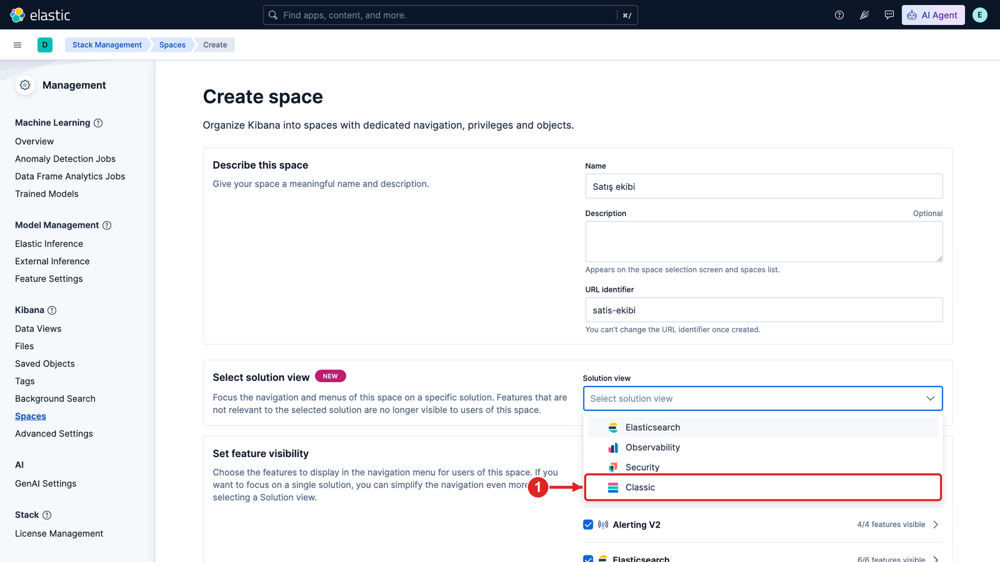

5. Formun üst kısmı şöyle olmalı: **Name** (1), **URL identifier** (2), **Solution view** (3). Elasticsearch,
   Observability ve Security görünümleri menüyü o çözüme göre hazır daraltır:

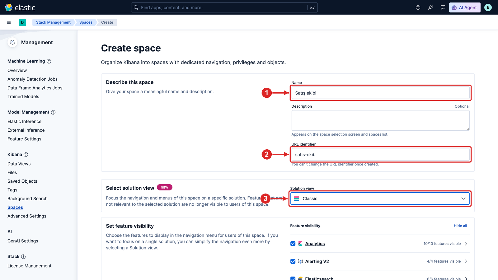

6. Sayfayı aşağı kaydırın. **Define an avatar** bölümünde **Initials** kutusuna (1) `SE` yazın, **Create space** (2):

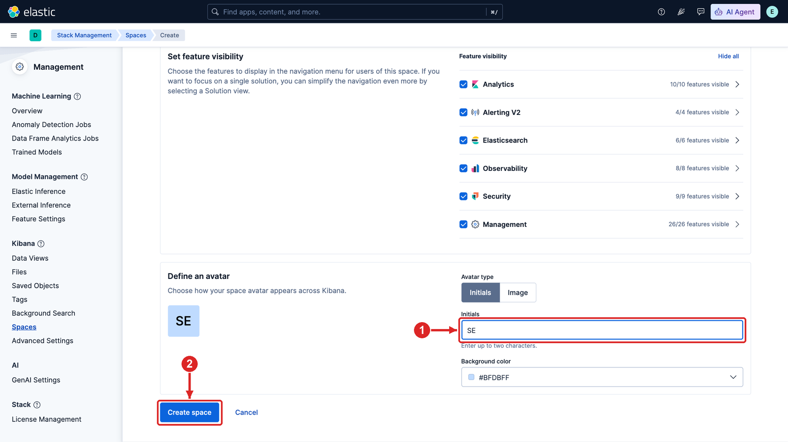

7. Spaces listesinde Default'un altında `Satış ekibi` (1) görünür:

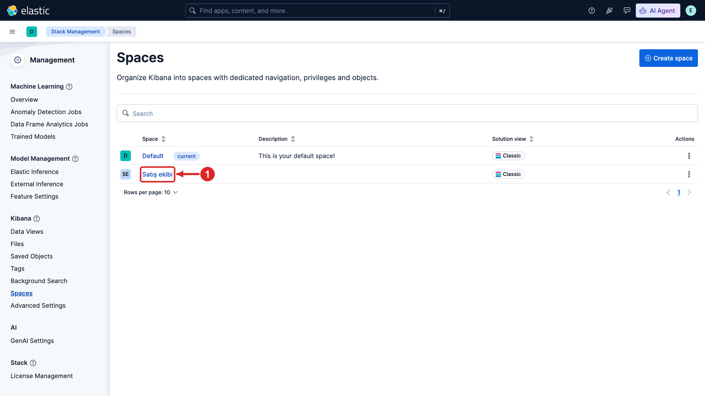

### 2. Menüyü sadeleştirmek: feature visibility

**Soru: Satış ekibinin menüsünden kullanmadıkları uygulamalar nasıl kaldırılır?**

1. Spaces listesinde `Satış ekibi`'ne tıklayın (önceki görüntüde 1). **Set feature visibility** bölümünde
   **Observability** (1) ve **Security** (2) kutularını kaldırın. **Analytics** satırını (3) açın, altındaki
   **Machine Learning** kutusunu (4) kaldırın:

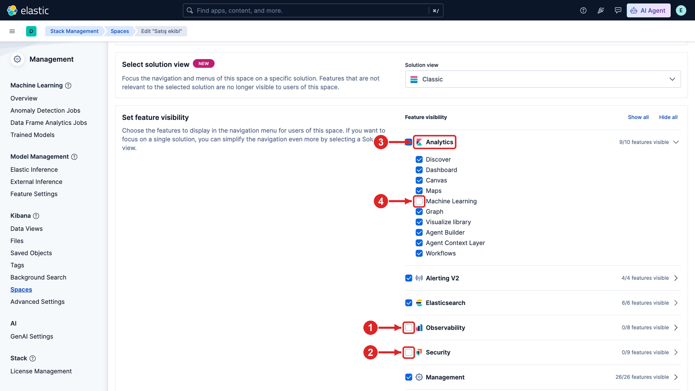

2. Sayfanın altında **Apply changes** (1):

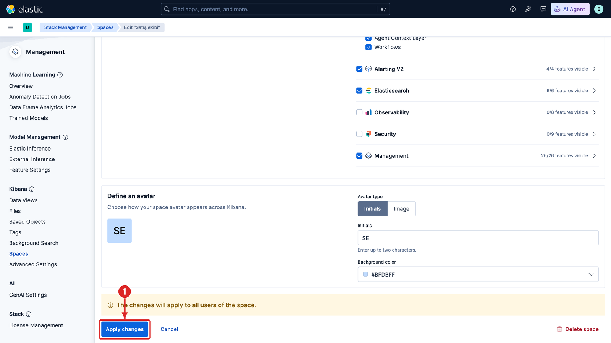

3. Onay penceresinde **Update space** (1); sayfa yeniden yüklenir:

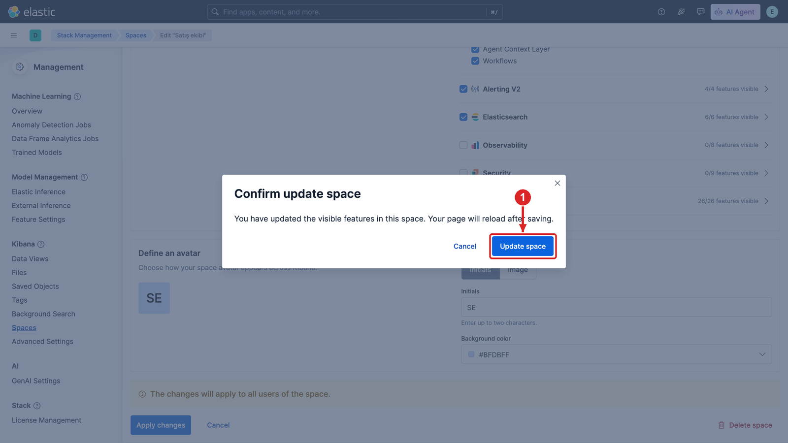

4. Karşılaştırma için önce Default Space'in menüsünü açın: sol üstteki **D** simgesi (1) şu anki Space'tir;
   menüde Observability, Security ve Machine Learning vardır:

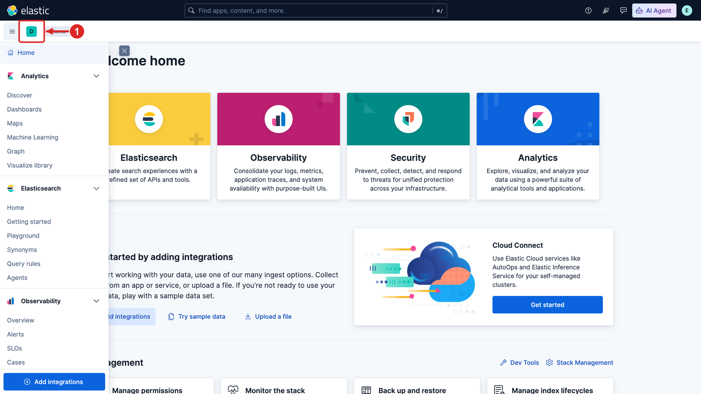

5. Space seçiciye (1) tıklayın, `Satış ekibi`'ni (2) seçin:

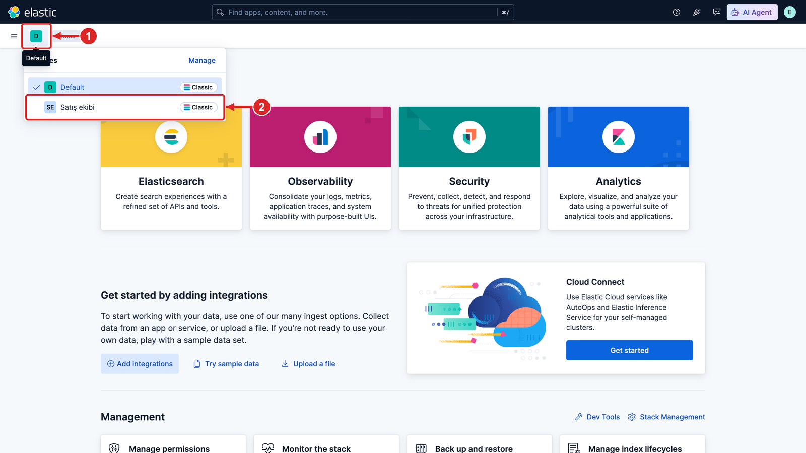

6. Menüyü açın: Space simgesi artık **SE** (1); menü kısaldı (2). Observability (APM, Logs, SLOs…), Security
   (Detections, Timelines…), Machine Learning, Alerts ve Cases yoktur; Analytics altında Discover, Dashboards ve
   Maps yerindedir. **Elasticsearch** ve **Management** bölümleri kalır; istenirse onlar da Adım 2'nin 1. maddesindeki
   listeden kapatılır (Stack Management menünün en altındadır):


Gizlemek yetki vermez, yetki de almaz. Bu Space'e giren kullanıcının neyi okuyup yazabileceğini rolü belirler;
rolü Space'e bağlamayı LAB-20'de yapacağız.

### 3. Panoyu başka bir Space'e kopyalamak

**Soru: Hazır bir panoyu yeniden çizmeden Satış ekibine nasıl veririz?**

Yeni Space boştur: panolar ve data view'lar Space'e aittir.

1. Space seçici (1), **Default** (2):

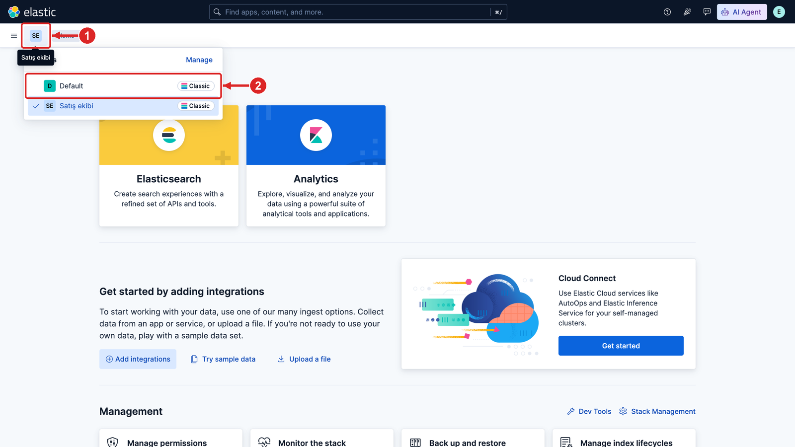

2. Menü, **Stack Management**, soldaki listede **Saved Objects** (1):

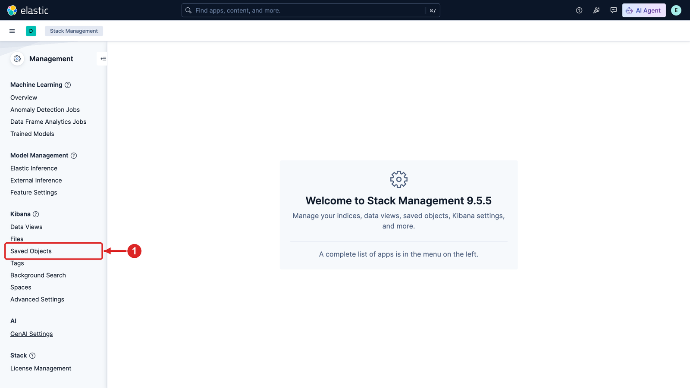

3. Arama kutusuna (1) `Revenue` yazıp Enter'a basın. `[eCommerce] Revenue Dashboard` satırının sonundaki **⋮**
   düğmesine (2) tıklayın:

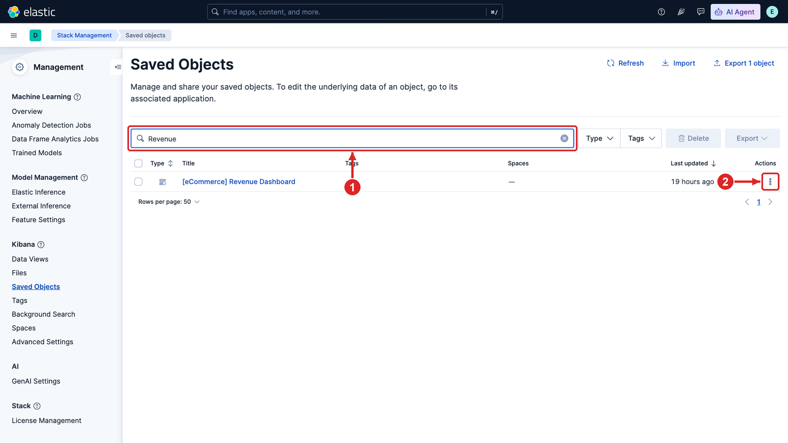

4. **Copy to spaces** (1):

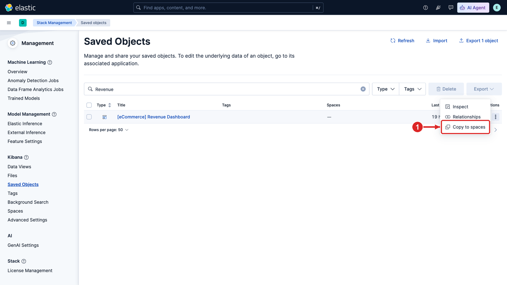

5. Pencerede **Select spaces** altında `Satış ekibi`'ni (1) işaretleyin, **Copy to 1 space** (2). Varsayılan seçenekler
   yeterlidir: **Create new objects with random IDs** kopyaları yeni kimlikle oluşturur, **Include related saved
   objects** işaretli ve değiştirilemez:

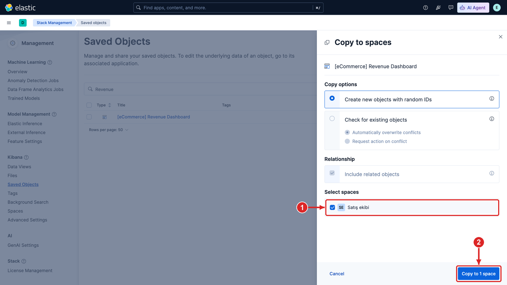

6. Sonuç: **Copied 5**. Pano ve ilişkili dört nesnesi (data view, saved search, harita, Markdown paneli) kopyalandı;
   ilişkili nesneler kopyalanmasaydı pano yeni Space'te boş panellerle açılırdı. **Finish** (1):

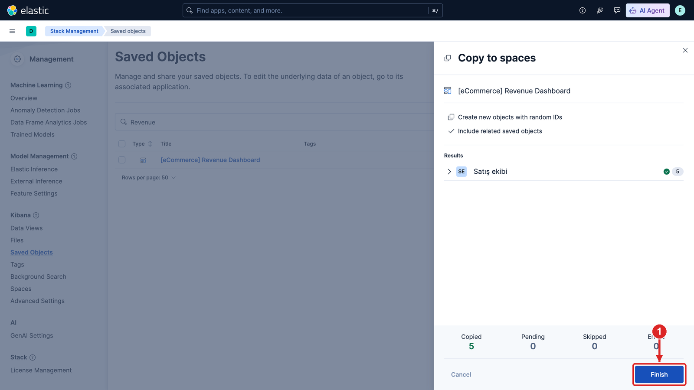

### 4. Export: panoyu dosyaya aktarmak

**Soru: Panoyu başka bir Kibana'ya taşımak ya da yedeklemek için ne yapılır?**

Copy to spaces aynı Kibana içinde çalışır. Başka bir Kibana'ya (örneğin testten üretime) taşımak ya da yedeklemek
için pano dosyaya aktarılır.

1. Saved Objects listesinde (arama: `Revenue`) pano satırının kutusunu (1) işaretleyin, tablonun üstündeki
   **Export** (2):

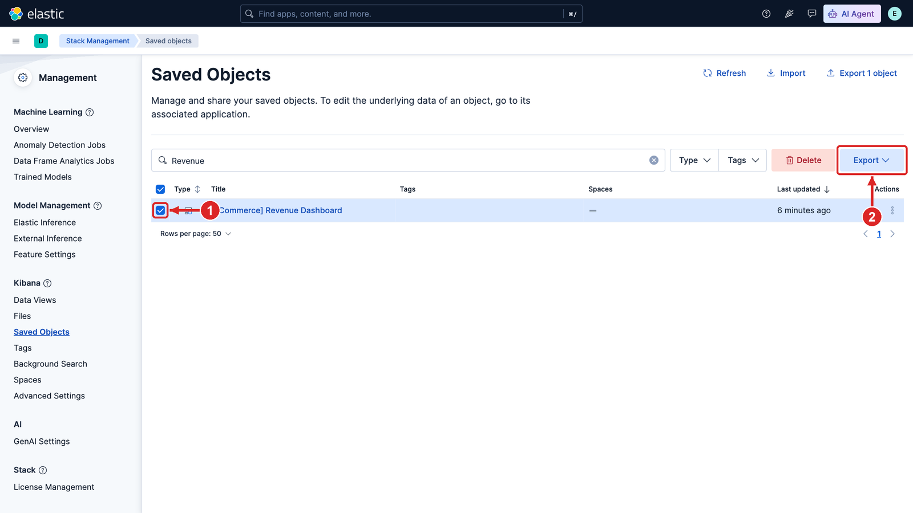

2. **Include related objects** (1) açık kalsın, **Export** (2):

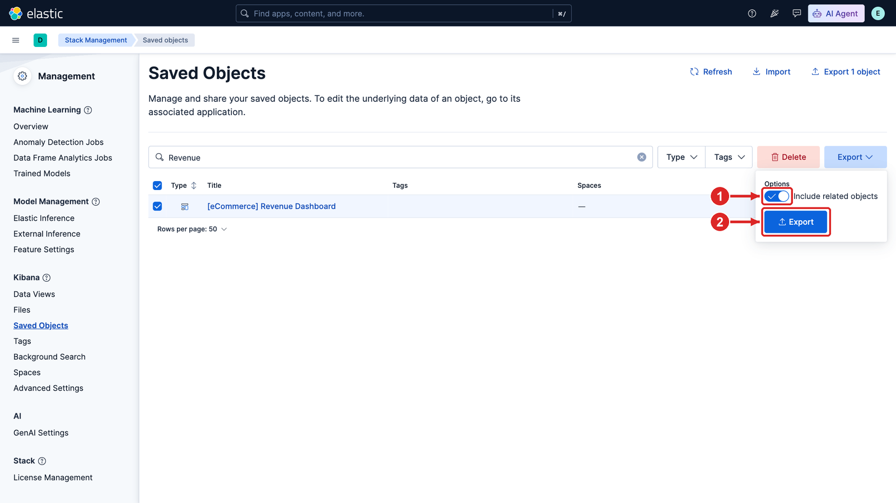

Tarayıcı `export.ndjson` dosyasını kendi bilgisayarınıza indirir. Her satır bir saved object'tir:

```text
index-pattern  kibana_sample_data_ecommerce
search         [eCommerce] Orders
map            [eCommerce] Orders by Country
visualization  [eCommerce] Markdown
dashboard      [eCommerce] Revenue Dashboard
               (son satır: exportedCount 5, missingRefCount 0)
```

Pano tek başına seçildi ama **Include related objects** onun gösterdiği dört nesneyi de dosyaya koydu.

### 5. Import: dosyayı üçüncü bir Space'e yüklemek

**Soru: İndirilen dosya başka bir Space'e nasıl yüklenir?**

Pazarlama ekibi için ikinci bir Space açın. Bu kez Kibana › Dev Tools'tan; arayüzdeki form aynı alanları doldurur:

```http
POST kbn:/api/spaces/space
{ "id": "pazarlama", "name": "Pazarlama", "initials": "PZ", "color": "#E7664C" }
```

1. Space seçici (1), **Pazarlama** (2):

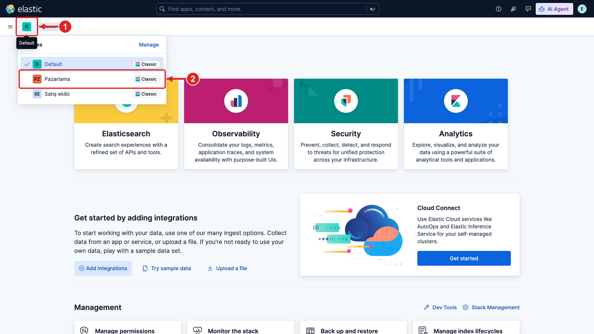

2. Menü, **Stack Management**, **Saved Objects** (Adım 3'ün 2. maddesi). Sağ üstte **Import** (1):

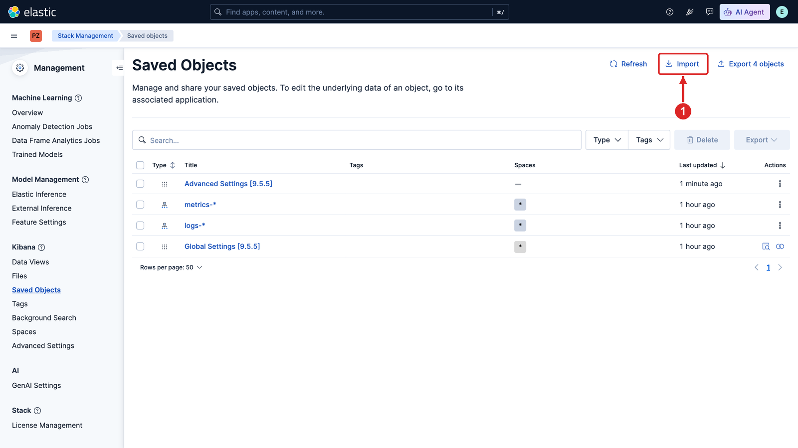

3. Sağda açılan panelde dosya kutusuna (1) indirdiğiniz `export.ndjson`'u sürükleyin ya da tıklayıp seçin.
   **Import options** (2) varsayılan hâliyle kalsın, **Import** (3):

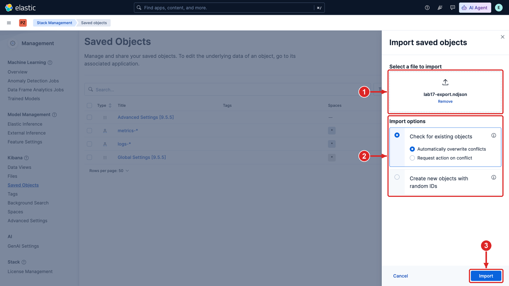

| Seçenek | Ne yapar |
|---|---|
| **Check for existing objects** (varsayılan) | Aynı kimlikte nesne varsa **Automatically overwrite conflicts** ile üzerine yazar ya da **Request action on conflict** ile sorar. Aynı panoyu güncellemek için |
| **Create new objects with random IDs** | Her nesneyi yeni kimlikle ekler, var olana dokunmaz. Aynı panonun ikinci kopyası için |

4. Sonuç: `5 objects imported`, `5 new`; Pazarlama boş olduğu için çakışma yoktu. **Done** (1):

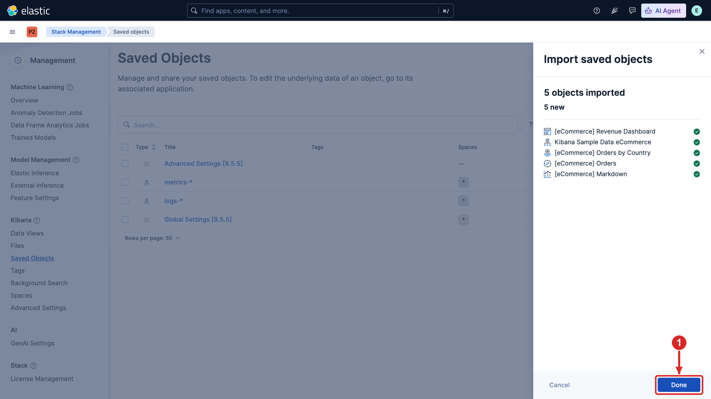

### 6. Doğrulama: panoyu Pazarlama Space'inde açmak

**Soru: İçe aktarılan pano gerçekten çalışıyor mu?**

1. Menü, **Analytics** altında **Dashboards** (1):


2. `[eCommerce] Revenue Dashboard` (1):

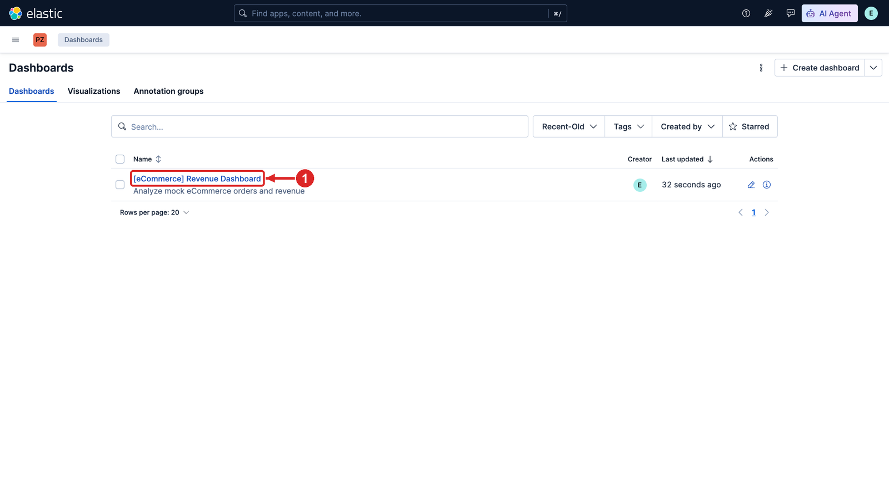

3. Sol üstte Space simgesi **PZ** (1); paneller veriyle gelir (2). Adres çubuğunda da Space vardır: `/s/pazarlama/`:

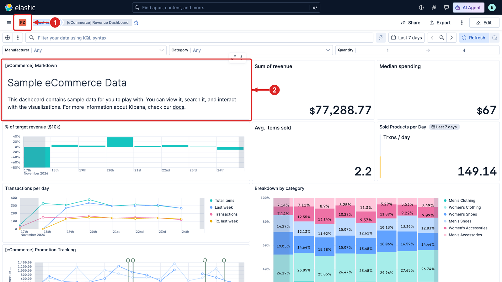

Üç Space'te üç ayrı pano kopyası var; biri değişince ötekiler değişmez. Veri ise tek: hepsi aynı
`kibana_sample_data_ecommerce` index'ini okur.

<details>
<summary><strong>Silinen bir nesneyi yedekten geri getirmek</strong></summary>

Adım 4'teki `export.ndjson` aynı zamanda bir yedektir. Pazarlama Space'inde deneyin; Default'taki pano etkilenmez.

1. **Silin.** Pazarlama'da **Stack Management › Saved Objects**, arama kutusuna `Orders by Country`. Haritanın
   kutusunu (1) işaretleyin, **Delete** (2):

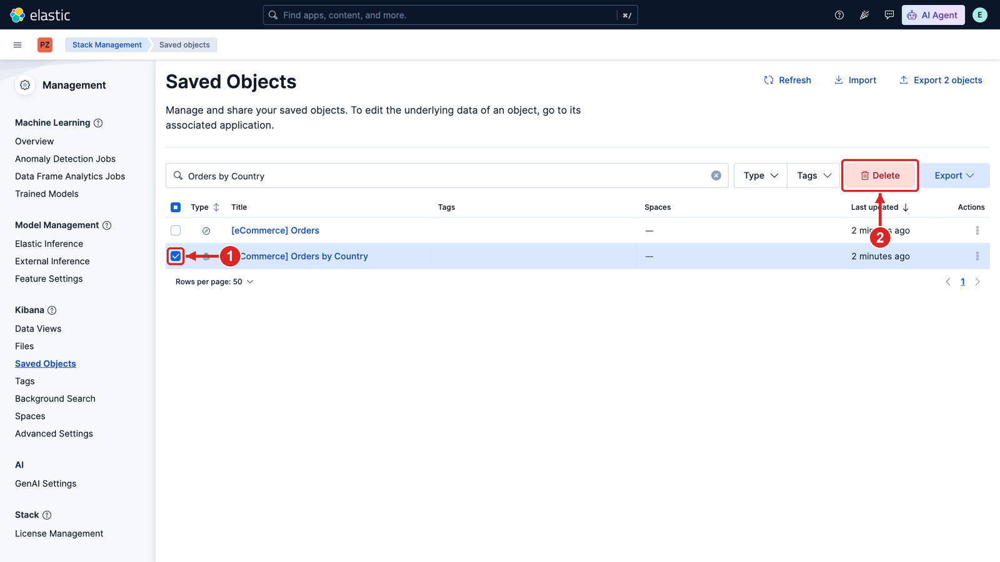

2. Onay penceresinde **Delete 1 object** (1):

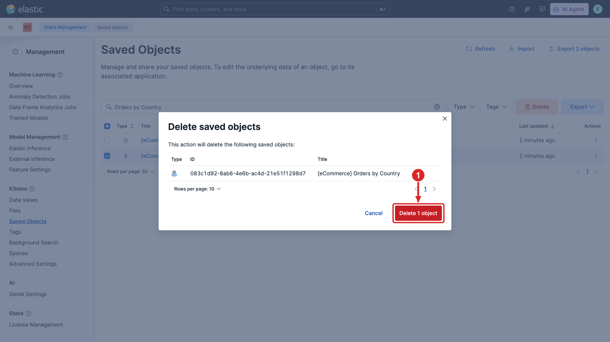

3. **Panoya bakın.** `[eCommerce] Revenue Dashboard`'u açın: harita paneli (1) boş kalır ve **Not Found** yazar:

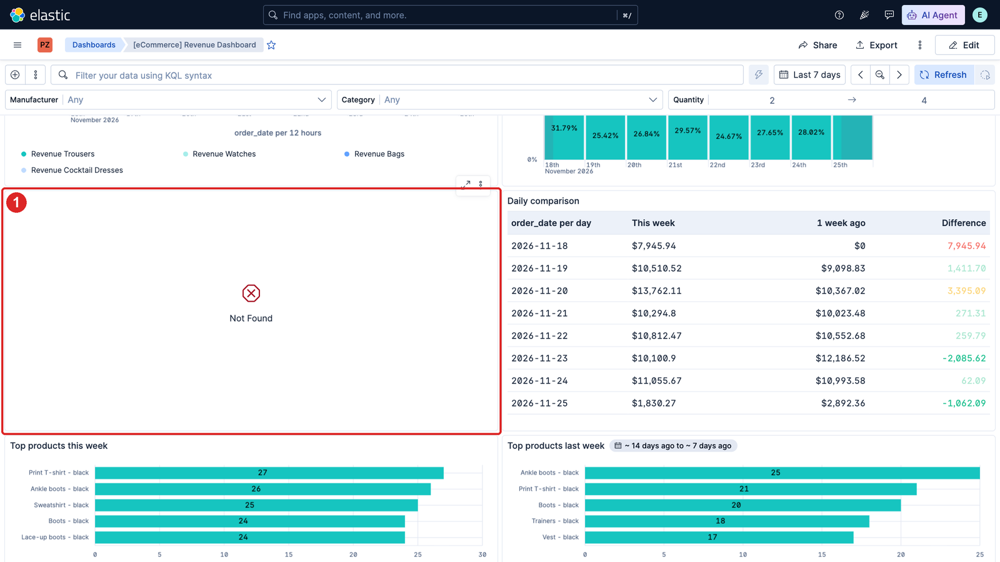

4. **Geri yükleyin.** Saved Objects › **Import**, aynı `export.ndjson` (1). Bu kez Space dolu; **Automatically
   overwrite conflicts** (2) seçili olsun, **Import** (3):

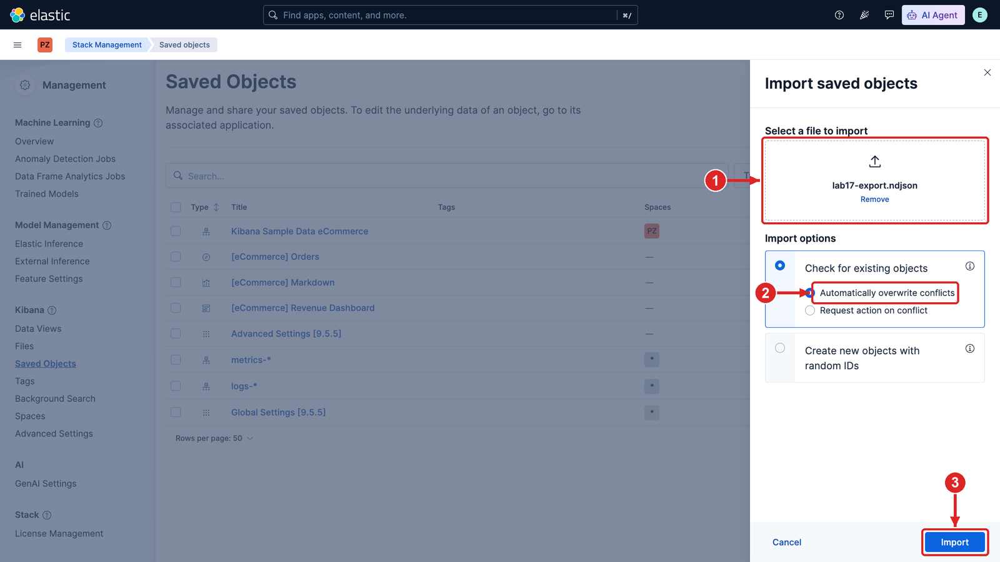

Sonuç `5 objects imported`, `1 new`, `4 overwritten` der: silinen harita yeni olarak geldi, öteki dördü dosyadaki
hâline döndü. Panoyu yeniden açın; bütün paneller veriyle gelir, harita paneli (1) yeniden doludur:

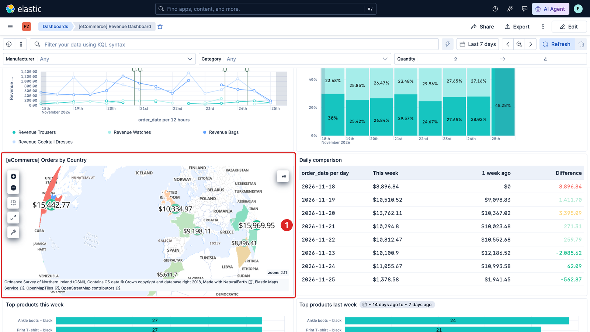

- **Request action on conflict** seçilirse var olan her nesne için tek tek sorulur.
- Önemli panoları değiştirmeden önce Export ile dosyaya alın.

</details>

<details><summary><strong>Aynı işler API ile: otomasyon</strong> (isteğe bağlı, arayüz adımlarından sonra)</summary>

Bu kutu arayüz adımlarının yerine değil, onlardan **sonra** yapılan isteğe bağlı bir alıştırmadır. Test ortamından
üretime taşımayı bir betiğe koymak için aynı üç işlem API ile yapılır. Panoyu ilişkili
nesneleriyle dışa aktarın, dosyadaki nesneleri sayın:

```bash
curl -s -u elastic:'DevOps2026!' -H 'kbn-xsrf: true' -H 'Content-Type: application/json' -X POST \
  'http://127.0.0.1:5601/api/saved_objects/_export' \
  -d '{"objects": [{"type": "dashboard", "id": "722b74f0-b882-11e8-a6d9-e546fe2bba5f"}], "includeReferencesDeep": true}' -o spaces-export.ndjson
jq -r 'select(.type) | .type' spaces-export.ndjson | sort | uniq -c
```

Beklenen çıktı:

```text
      1 dashboard
      1 index-pattern
      1 map
      1 search
      1 visualization
```

Dosyayı Pazarlama'ya içe aktarın (`overwrite=true`: aynı kimlikte olanın üzerine yazar) ve Default'tan
Satış ekibi'ne doğrudan kopyalayın. Adım 3'te arayüzle kopyaladıysanız Satış ekibi'nde aynı adlı ikinci bir pano
oluşur: arayüz yeni kimlikle kopyaladı, bu istek özgün kimlikle (`"createNewCopies": false`) kopyalar. Temizlik
ikisini de siler:

```bash
curl -s -u elastic:'DevOps2026!' -H 'kbn-xsrf: true' -X POST 'http://127.0.0.1:5601/s/pazarlama/api/saved_objects/_import?overwrite=true' \
  --form file=@spaces-export.ndjson | jq -c '{success, successCount}'
curl -s -u elastic:'DevOps2026!' -H 'kbn-xsrf: true' -H 'Content-Type: application/json' -X POST \
  'http://127.0.0.1:5601/api/spaces/_copy_saved_objects' \
  -d '{"spaces": ["satis-ekibi"], "objects": [{"type": "dashboard", "id": "722b74f0-b882-11e8-a6d9-e546fe2bba5f"}], "includeReferences": true, "overwrite": true, "createNewCopies": false}' \
  | jq -c '."satis-ekibi" | {success, successCount}'
```

Beklenen çıktı:

```text
{"success":true,"successCount":5}
{"success":true,"successCount":5}
```

</details>

---

## Temizlik

Yalnız bu labın iki Space'ini (`satis-ekibi`, `pazarlama`) ve içlerindeki kopyaları siler. Default Space'teki
örnek pano ve veri yerinde kalır:

```bash
./teardown.sh
```

Beklenen çıktı:

```text
space satis-ekibi -> 204
space pazarlama -> 204
```

Labı aynı sunucuda yeniden yapacaksanız başlamadan önce `./teardown.sh` çalıştırın; README'deki sayılar temiz
başlangıca göredir.

---

Sonraki lab: **[LAB-18 — Harita, Alerting ve Raporlama: Sorun Olunca Kibana Haber Versin](../LAB-18-alerting-raporlama/README.md)**
