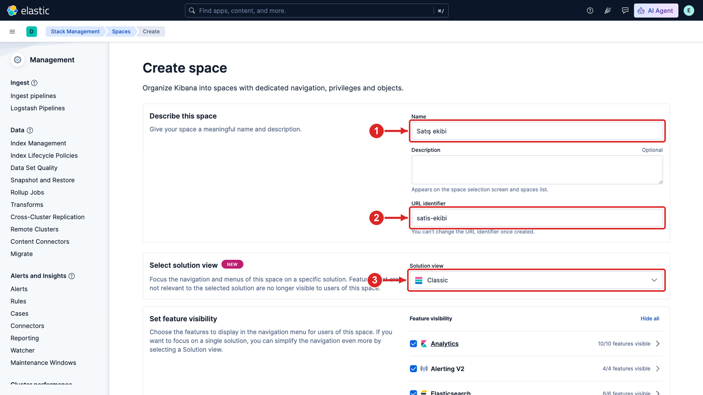
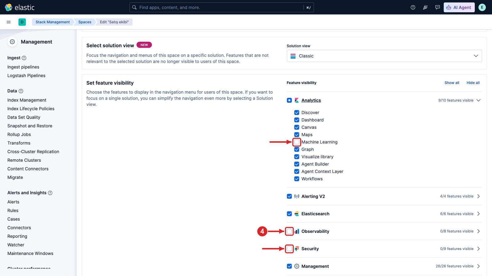
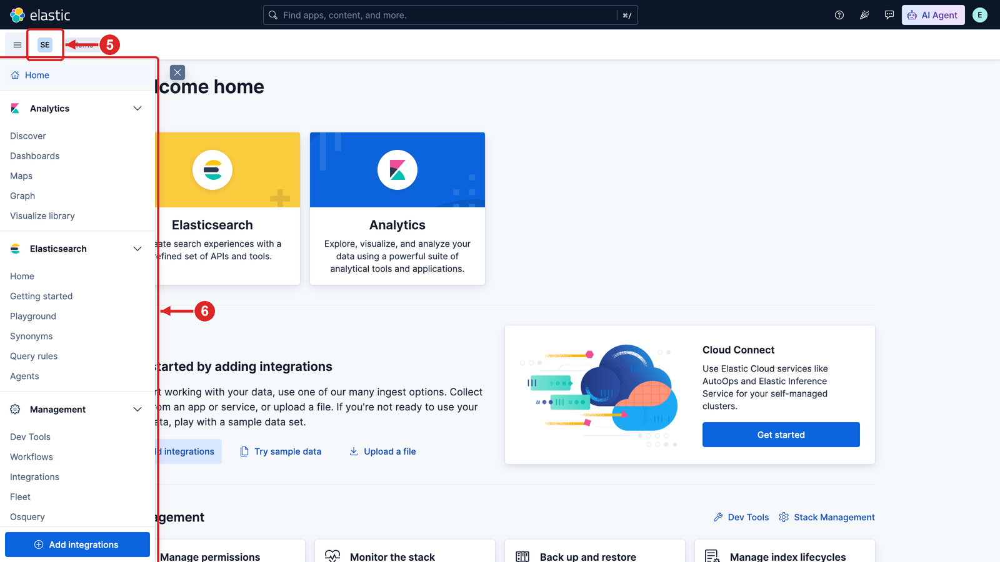
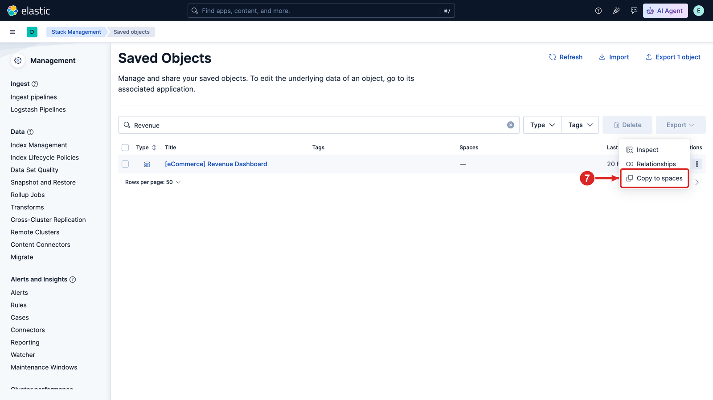
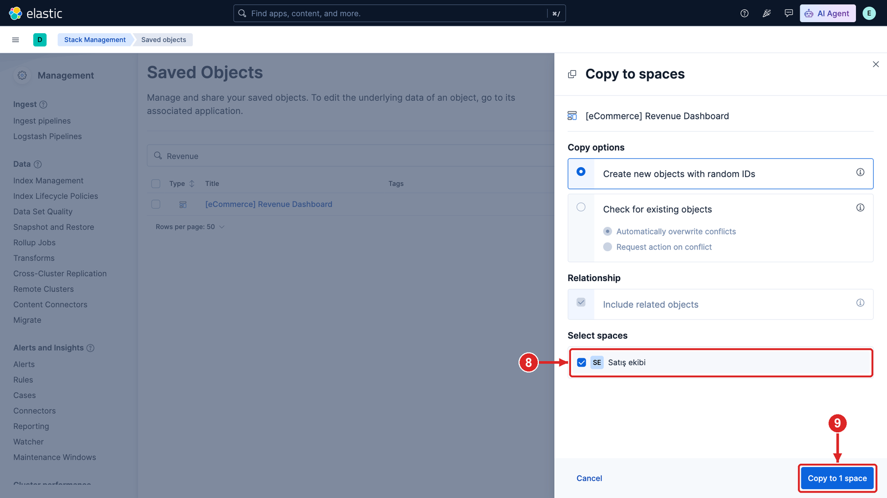
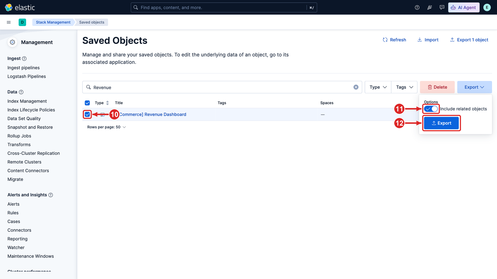
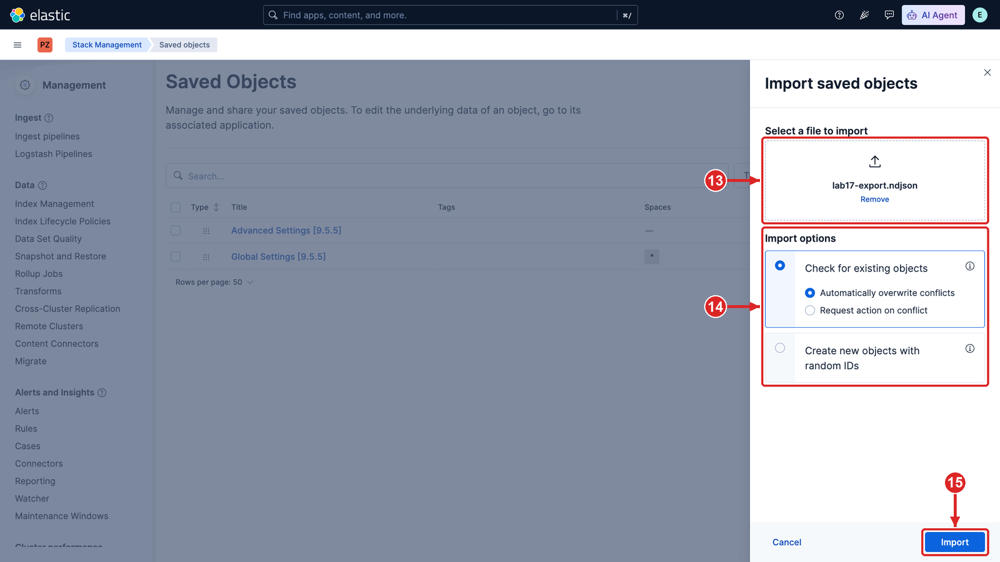
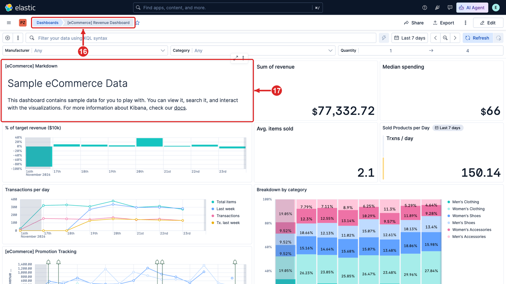
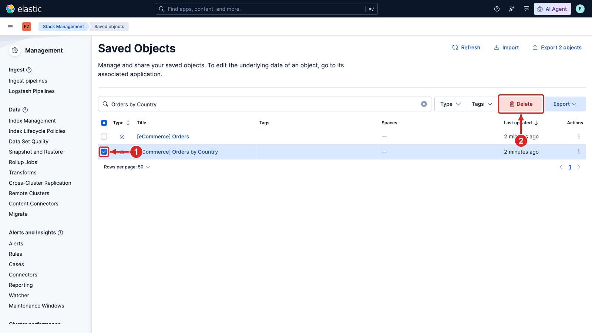
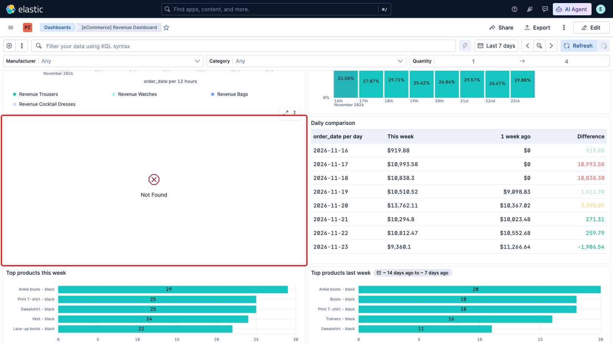

# LAB-17 — Kibana Spaces ve Saved Objects: Panoları Düzenlemek ve Taşımak

| Kullanılan Araçlar | Açık / Kullanılan Portlar |
|---|---|
| Kibana Spaces, feature visibility, Saved Objects (Copy to space, Export, Import) | 9200 / 5601 (ana cluster) |

---

## Bu lab ne öğretiyor?

Satış ekibi yalnız kendi panolarını görmek istiyor; Observability, Security ve Machine Learning menüleri
onları yalnız şaşırtıyor. Panoyu her ekip için yeniden çizmek de, test ortamında hazırlanan panoyu üretime
elle kurmak da hem zaman kaybı hem hata kaynağıdır.

Bu labda ekibe özel bir **Space** açacak, menüsünü sadeleştirecek, hazır bir panoyu Space'e kopyalayacak,
aynı panoyu dosyaya dışa aktarıp başka bir Space'e içe aktaracağız. Hepsi Kibana arayüzünden yapılır.

---

## Ön Koşullar

- LAB-01 ana cluster'ı çalışıyor.
- LAB-04'teki örnek e-ticaret verisi ve panosu yüklü (`[eCommerce] Revenue Dashboard`). LAB-04'ü
  atladıysanız onun Adım 1'ini yapın.

```bash
cd ~/elastic/labs/LAB-17-kibana-spaces-saved-objects
```

Kibana adresini sunucuda hesaplayın:

```bash
IP=$(curl -s https://api.ipify.org); H=$(hostname -s)
echo "Kibana: http://$IP:5601   https://$H-kibana.devopsatolyesi.com"
```

Beklenen çıktı:

```text
Kibana: http://<IP>:5601   https://<host>-kibana.devopsatolyesi.com
```

---

## Kavramlar: Space ve saved object

| Kavram | Ne demek | Bu labda |
|---|---|---|
| Space | Kibana içinde ayrı çalışma alanı: kendi panoları, data view'ları, menüsü. Veri ortaktır; Space veriyi bölmez | `Satış ekibi`, `Pazarlama` |
| Feature visibility | Space menüsünde hangi uygulamaların görüneceği. **Yetki değildir**: menüden gizlenen uygulamaya rol izin veriyorsa adresle girilebilir. Yetki rolle verilir (LAB-20) | Observability, Security, ML gizli |
| Saved object | Kibana'nın sakladığı her nesne: pano, Lens, harita, saved search, data view | örnek eCommerce panosu |
| Referans | Pano, panellerini ve data view'ını kimliğiyle gösterir; nesneler bir zincirdir | pano → harita, saved search → data view |

Panoyu tek başına taşırsanız panelleri ve data view'ı yoksa açılmaz; bu yüzden taşırken ilişkili
nesneler de seçilir.

---

## Adım Adım Uygulama Rehberi

### 1. Space oluşturmak

Kibana menüsünden **Stack Management › Spaces › Create space**. **Name** alanına `Satış ekibi` (1) yazın;
**URL identifier** (2) addan kendiliğinden üretilir, ama Türkçe harfleri tireye çevirir (`sat---ekibi`); kutuya
`satis-ekibi` yazın. Bu kimlik adreste görünür (`/s/satis-ekibi/`) ve sonradan değişmez. **Solution view**
(3) olarak **Classic** seçin: bütün uygulamalar açık gelir, menüyü bir sonraki adımda kendimiz sadeleştireceğiz.
(Elasticsearch, Observability ve Security görünümleri menüyü o çözüme göre hazır daraltır.) **Avatar** bölümünde
baş harfleri `SE` yapıp bir renk seçebilirsiniz.



Sayfanın altındaki **Create space** ile kaydedin. Spaces listesinde Default'un yanında `Satış ekibi` görünür.

### 2. Menüyü sadeleştirmek: feature visibility

Spaces listesinde `Satış ekibi`'ni açın. **Set feature visibility** bölümünde **Observability** ve
**Security** kategorilerinin kutusunu (4) kaldırın; **Analytics** kategorisini açıp **Machine Learning**'i de
kaldırın. **Apply changes** ile kaydedin:



Sol üstteki Space seçicisinden (5) `Satış ekibi`'ne geçin ve menüyü açın. Default Space'in menüsüyle
karşılaştırın:




Satış ekibi menüsünde Observability (APM, Logs, Infrastructure, SLOs…), Security (Detections, Timelines…),
Machine Learning, Alerts ve Cases yoktur; Discover, Dashboards, Maps ve Stack Management yerindedir.

Gizlemek yetki vermez, yetki de almaz. Bu Space'e giren kullanıcının neyi okuyup yazabileceğini rolü
belirler; rolü Space'e bağlamayı LAB-20'de yapacağız.

### 3. Panoyu başka bir Space'e kopyalamak

Yeni Space boştur: panolar ve data view'lar Space'e aittir. Default Space'e dönüp **Stack Management ›
Saved objects** açın. `[eCommerce] Revenue Dashboard` satırının sonundaki **Actions** menüsünden **Copy to
spaces** (7):



Açılan pencerede hedef olarak `Satış ekibi`'ni (8) seçin ve **Copy to 1 space** (9) deyin:



Pencerede sonuç olarak pano ve ilişkili dört nesnesi (data view, saved search, harita, Markdown paneli)
görünür; **Finish** ile kapatın. **Include related saved objects** varsayılan olarak açıktır: panonun panelleri
ve data view'ı da kopyalanır, yoksa pano yeni Space'te boş panellerle açılırdı.

### 4. Export: panoyu dosyaya aktarmak

Copy to space aynı Kibana içinde çalışır. Panoyu başka bir Kibana'ya (örneğin testten üretime) taşımak ya da
yedeklemek için dosyaya aktarılır. Saved objects listesinde (arama: `Revenue`) `[eCommerce] Revenue Dashboard` satırını işaretleyin
(10) ve tablonun üstünde **Delete**'in yanındaki **Export** düğmesine basın. Açılan kutuda **Include related objects** (11) açık kalsın; **Export** (12):



Tarayıcı `export.ndjson` dosyasını kendi bilgisayarınıza indirir. Her satır bir saved object'tir:

```text
index-pattern  kibana_sample_data_ecommerce
search         [eCommerce] Orders
map            [eCommerce] Orders by Country
visualization  [eCommerce] Markdown
dashboard      [eCommerce] Revenue Dashboard
               (son satır: exportedCount 5, missingRefCount 0)
```

Pano tek başına seçildi ama **Include related objects** onun gösterdiği dört nesneyi de dosyaya koydu.

### 5. Import: dosyayı üçüncü bir Space'e yüklemek

Pazarlama ekibi için ikinci bir Space açın. Bu kez API ile; arayüzdeki form aynı alanları doldurur:

```http
POST kbn:/api/spaces/space
{ "id": "pazarlama", "name": "Pazarlama", "initials": "PZ", "color": "#E7664C" }
```

Space seçicisinden `Pazarlama`'ya geçin, **Stack Management › Saved objects › Import**. İndirdiğiniz `export.ndjson` dosyasını (13) seçin. Çakışma seçenekleri (14):

- **Check for existing objects**: aynı kimlikte nesne varsa ne yapılacağını sorar ya da (**Automatically
  overwrite conflicts** işaretliyse) üzerine yazar. Aynı panoyu güncellemek için.
- **Create new objects with random IDs**: her nesneyi yeni kimlikle ekler; var olana dokunmaz. Aynı panonun
  ikinci bir kopyası için.

**Check for existing objects** seçili kalsın, **Import** (15):



Sonuç penceresi `5 objects imported`, `5 new` der; **Done** ile kapatın. Pazarlama Space'i boş olduğu için
çakışma yoktu.

### 6. Doğrulama: panoyu Pazarlama Space'inde açmak

Adres çubuğunda Space adresin içindedir. `http://<IP>:5601/s/pazarlama/app/dashboards` adresini açın ve
`[eCommerce] Revenue Dashboard`'u (16) tıklayın; paneller veriyle gelir (17):



Üç Space'te üç ayrı pano kopyası var; biri değişince ötekiler değişmez. Veri ise tek: hepsi aynı
`kibana_sample_data_ecommerce` index'ini okur.

<details>
<summary><strong>Silinen bir nesneyi yedekten geri getirmek</strong></summary>

Adım 4'teki `export.ndjson` aynı zamanda bir yedektir. Biri panodaki bir nesneyi yanlışlıkla silerse aynı dosyayla geri
gelir. Pazarlama Space'inde deneyin; Default'taki örnek pano etkilenmez.

**Silin.** Pazarlama'da **Stack Management › Saved objects**, arama: `Orders by Country`. Haritayı işaretleyin (1),
**Delete** (2), onay penceresinde yine **Delete**:



**Panoya bakın.** `[eCommerce] Revenue Dashboard`'u açın: harita paneli (3) boş kalır ve **Not Found** yazar:



**Geri yükleyin.** Saved objects › **Import**, aynı `export.ndjson` dosyası (4). Bu kez Space dolu, dosyadaki nesnelerin
çoğu zaten var: **Automatically overwrite conflicts** (5) seçin, **Import** (6):


Sonuç penceresi `5 objects imported`, `1 new`, `4 overwritten` der: silinen harita yeni olarak geldi, öteki dördü
dosyadaki hâline döndü. Panoyu yeniden açın; bütün paneller veriyle gelir.

- **Neden üzerine yaz?** **Request action on conflict** seçilirse her var olan nesne için tek tek sorulur.
- **Yedek alışkanlığı:** önemli panoları değiştirmeden önce Export ile dosyaya alın.

</details>

<details><summary><strong>Aynı işler API ile: otomasyon</strong></summary>

Test ortamından üretime taşımayı bir betiğe koymak için aynı üç işlem API ile yapılır. Panoyu ilişkili
nesneleriyle dışa aktarın, dosyadaki nesneleri sayın:

```bash
curl -s -u elastic:'DevOps2026!' -H 'kbn-xsrf: true' -H 'Content-Type: application/json' -X POST \
  'http://127.0.0.1:5601/api/saved_objects/_export' \
  -d '{"objects": [{"type": "dashboard", "id": "722b74f0-b882-11e8-a6d9-e546fe2bba5f"}], "includeReferencesDeep": true}' -o spaces-export.ndjson
jq -r 'select(.type) | .type' spaces-export.ndjson | sort | uniq -c
```

Beklenen çıktı:

```text
      1 dashboard
      1 index-pattern
      1 map
      1 search
      1 visualization
```

Dosyayı Pazarlama'ya içe aktarın (`overwrite=true`: aynı kimlikte olanın üzerine yazar) ve Default'tan
Satış ekibi'ne doğrudan kopyalayın:

```bash
curl -s -u elastic:'DevOps2026!' -H 'kbn-xsrf: true' -X POST 'http://127.0.0.1:5601/s/pazarlama/api/saved_objects/_import?overwrite=true' \
  --form file=@spaces-export.ndjson | jq -c '{success, successCount}'
curl -s -u elastic:'DevOps2026!' -H 'kbn-xsrf: true' -H 'Content-Type: application/json' -X POST \
  'http://127.0.0.1:5601/api/spaces/_copy_saved_objects' \
  -d '{"spaces": ["satis-ekibi"], "objects": [{"type": "dashboard", "id": "722b74f0-b882-11e8-a6d9-e546fe2bba5f"}], "includeReferences": true, "overwrite": true, "createNewCopies": false}' \
  | jq -c '."satis-ekibi" | {success, successCount}'
```

Beklenen çıktı:

```text
{"success":true,"successCount":5}
{"success":true,"successCount":5}
```

</details>

---

## Temizlik

Yalnız bu labın iki Space'ini (`satis-ekibi`, `pazarlama`) ve içlerindeki kopyaları siler. Default Space'teki
örnek pano ve veri yerinde kalır:

```bash
./teardown.sh
```

Beklenen çıktı:

```text
space satis-ekibi -> 204
space pazarlama -> 204
```

Labı aynı sunucuda yeniden yapacaksanız başlamadan önce `./teardown.sh` çalıştırın; README'deki sayılar temiz
başlangıca göredir.

---

Sonraki lab: **[LAB-18 — Harita, Alerting ve Raporlama: Sorun Olunca Kibana Haber Versin](../LAB-18-alerting-raporlama/README.md)**
