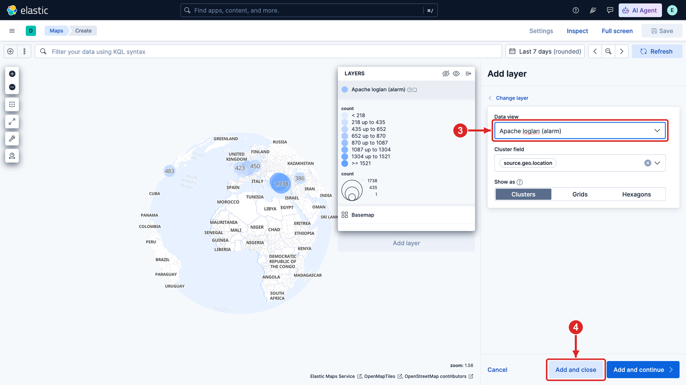
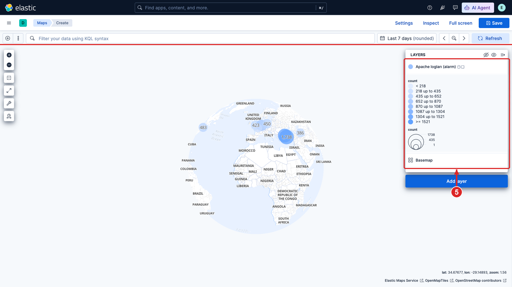
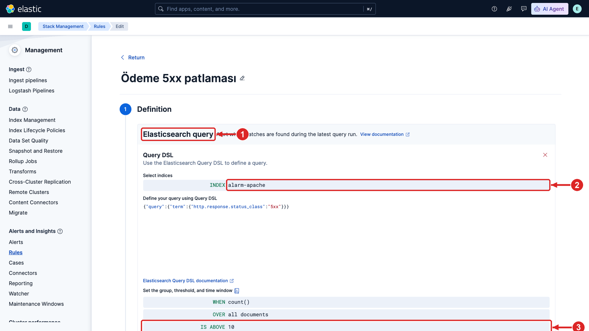
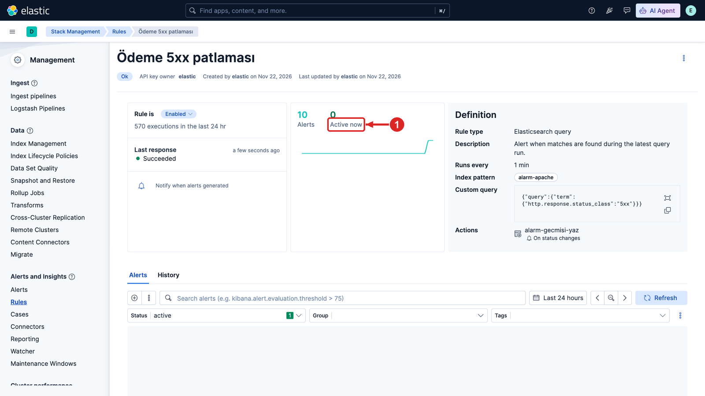
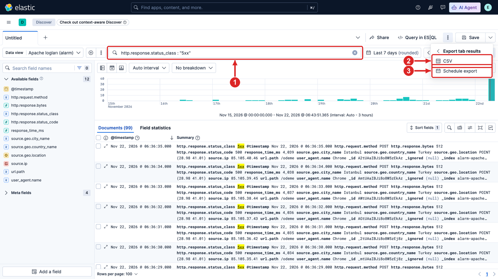
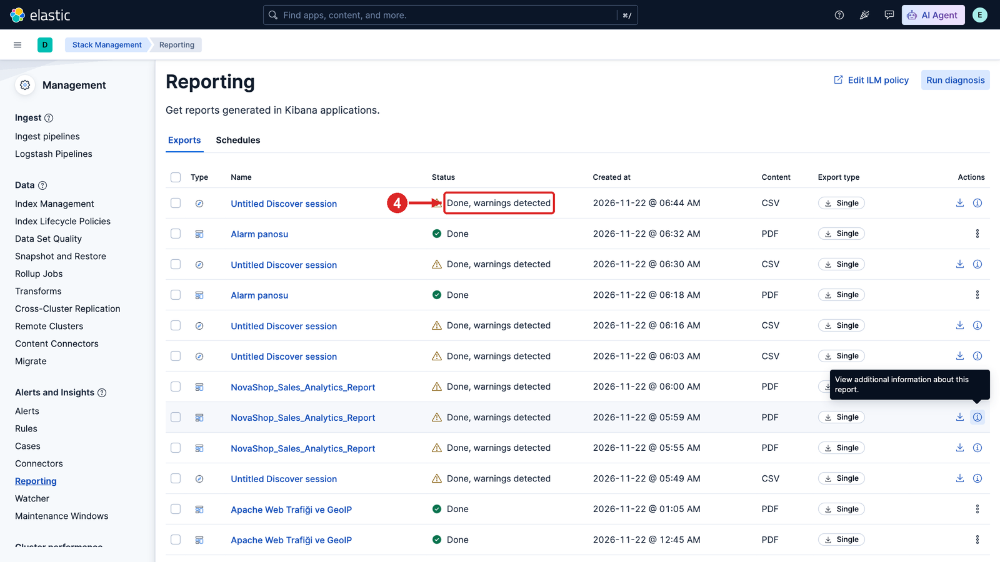
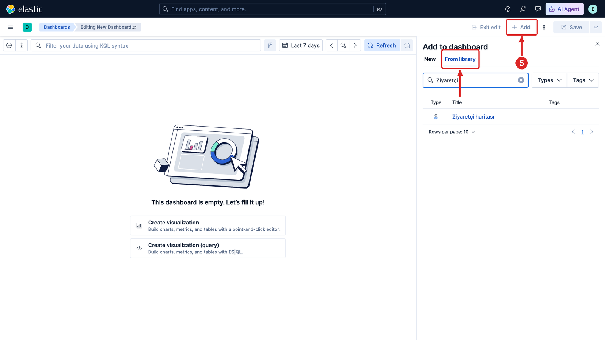
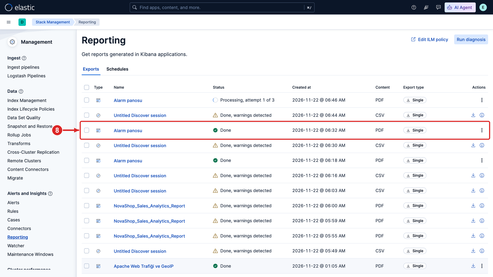
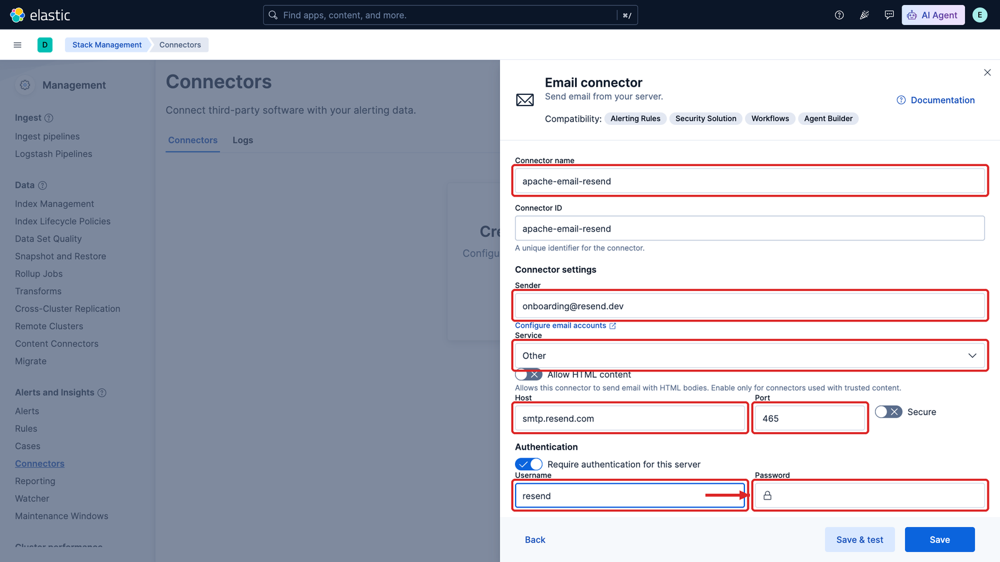

# LAB-18 — Harita, Alerting ve Raporlama: Sorun Olunca Kibana Haber Versin

| Kullanılan Araçlar | Açık / Kullanılan Portlar |
|---|---|
| Kibana Maps, `geo_distance`, Alerting (Elasticsearch query kuralı, Index connector), Reporting | 9200 / 5601 (ana cluster) |

---

## Bu lab ne öğretiyor?

Pano ancak biri bakarken işe yarar. Ödeme sayfası gece 03:00'te 500 dönmeye başlarsa, sabah panoyu açan
kişi sorunu saatler sonra görür. Ayrıca "sorun nerede?" sorusu çoğu zaman bir konum sorusudur: hatalar
hangi şehirden geliyor, şu merkeze 100 km içinde kaç kullanıcı var?

Bu labda web loglarını haritada gösterecek, konuma göre sorgulayacak, 5 dakikada 10'dan fazla 5xx
olunca tetiklenen bir kural kuracak, arızayı kendimiz üretip alarmın geldiğini ve geçmişe yazıldığını
izleyeceğiz; sonunda Discover sonucunu rapor olarak alacağız.

---

## Ön Koşullar

- LAB-01 ana cluster'ı çalışıyor ve trial lisans açık (raporlama için). LAB-16'yı atladıysanız da lab çalışır;
  veri bu labın kendi betiğiyle gelir.

```bash
cd ~/elastic/labs/LAB-18-alerting-raporlama
```

Kibana adresini sunucuda hesaplayın:

```bash
IP=$(curl -s https://api.ipify.org); H=$(hostname -s)
echo "Kibana: http://$IP:5601   https://$H-kibana.devopsatolyesi.com"
```

Beklenen çıktı:

```text
Kibana: http://<IP>:5601   https://<host>-kibana.devopsatolyesi.com
```

---

## Kavramlar: kural, connector, alarm

| Parça | Ne yapar | Bu labda |
|---|---|---|
| Kural (rule) | Belirli aralıkla bir sorgu çalıştırır, koşul sağlanınca alarm üretir | Son 5 dakikada 5xx sayısı 10'dan fazla mı? (her dakika) |
| Connector | Alarmın nereye gideceği | Index connector: `alarm-gecmisi` index'ine document |
| Action | Kural ile connector'ı bağlar; ne zaman ve hangi mesajla | Alarm açılınca bir kez yaz |
| Alarm (alert) | Koşul sağlandığı sürece **active**; koşul bitince **recovered** | 5xx patlaması sürdükçe açık, bitince kapanır |

Index connector gizli bilgi istemez ve alarm geçmişini aranabilir tutar. Slack ve e-posta aynı action
yapısıyla çalışır; ayrıntısı en sondaki `<details>` bölümündedir.

---

## Adım Adım Uygulama Rehberi

### 1. Veri

Bir mağazanın web sunucusu logu `alarm-apache` index'ine yazılır (6000 olay, son 7 gün, şehir ve
konum field'larıyla):

```bash
python3 scripts/veri_uret.py
```

Beklenen çıktı:

```text
[+] 6000 olay yazildi (alarm-apache), hata: False
    durum kodu : 200=5612, 404=329, 500=59
    ilk 3 ulke : Turkey=3220, Germany=808, United States=483
```

Data view'ı kurun (Kibana › Dev Tools):

```http
POST kbn:/api/data_views/data_view
{ "data_view": { "id": "alarm-apache", "title": "alarm-apache", "name": "Apache logları (alarm)", "timeFieldName": "@timestamp" } }
```

### 2. Harita: istekler nereden geliyor?

`source.geo.location` bir `geo_point` field'ıdır: enlem ve boylam. Kibana menüsünden **Analytics › Maps ›
Create map**, zaman aralığı **Last 7 days**, **Add layer**. **Clusters** (1) yakın noktaları sayıyla
gruplar; **Documents** (2) her document'i ayrı nokta çizer:


**Clusters**'ı seçin, data view olarak `Apache logları (alarm)` (3), **Add and close** (4):



Cluster'lar şehirlerde toplanır; sayı o bölgedeki istek sayısıdır (5). Haritayı **Save** ile `Ziyaretçi haritası`
adıyla kaydedin; Library'ye kaydedilir ve oradan panoya eklenebilir.



Aynı soru sorguyla: İstanbul merkezine 500 km içinde kaç istek var, bunların kaçı şehrin kendisinden (50 km)?

```http
GET alarm-apache/_search?size=0&filter_path=hits.total.value,aggregations.halka.buckets.key,aggregations.halka.buckets.doc_count
{
  "track_total_hits": true,
  "query": { "geo_distance": { "distance": "500km", "source.geo.location": { "lat": 41.01, "lon": 28.98 } } },
  "aggs": { "halka": { "geo_distance": { "field": "source.geo.location", "origin": { "lat": 41.01, "lon": 28.98 }, "unit": "km",
    "ranges": [ { "to": 50 }, { "from": 50, "to": 500 } ] } } }
}
```

```json
{"hits":{"total":{"value":3220}},"aggregations":{"halka":{"buckets":[{"key":"*-50.0","doc_count":1866},{"key":"50.0-500.0","doc_count":1354}]}}}
```

`geo_distance` sorgusu bir daireye düşen document'leri bulur; `geo_distance` aggregation'ı onları merkeze
uzaklığa göre halkalara ayırır. 50-500 km halkası Ankara ve İzmir'dir.

### 3. Connector: alarm nereye yazılsın?

Alarm geçmişini tutacak Index connector'ı kurun (Dev Tools):

```http
POST kbn:/api/actions/connector/alarm-gecmisi-yaz
{ "name": "alarm-gecmisi-yaz", "connector_type_id": ".index", "config": { "index": "alarm-gecmisi", "refresh": true } }
```

```json
{"id":"alarm-gecmisi-yaz","name":"alarm-gecmisi-yaz","config":{"index":"alarm-gecmisi","refresh":true,"executionTimeField":null},"connector_type_id":".index", ...}
```

Arayüzde aynı yer **Stack Management › Connectors › Create connector › Index**'tir.

### 4. Kural: 5 dakikada 10'dan fazla 5xx

```http
POST kbn:/api/alerting/rule/alarm-5xx
{
  "name": "Ödeme 5xx patlaması", "rule_type_id": ".es-query", "consumer": "stackAlerts", "schedule": { "interval": "1m" },
  "params": { "searchType": "esQuery", "index": ["alarm-apache"], "timeField": "@timestamp",
    "esQuery": "{\"query\":{\"term\":{\"http.response.status_class\":\"5xx\"}}}",
    "threshold": [10], "thresholdComparator": ">", "timeWindowSize": 5, "timeWindowUnit": "m",
    "size": 0, "aggType": "count", "groupBy": "all", "excludeHitsFromPreviousRun": false },
  "actions": [ { "id": "alarm-gecmisi-yaz", "group": "query matched",
    "params": { "documents": [ { "kural": "{{rule.name}}", "adet": "{{context.value}}", "kosul": "{{context.conditions}}", "zaman": "{{context.date}}" } ] },
    "frequency": { "summary": false, "notify_when": "onActionGroupChange", "throttle": null } } ]
}
```

```json
{"id":"alarm-5xx","enabled":true,"name":"Ödeme 5xx patlaması","tags":[],"rule_type_id":".es-query","consumer":"stackAlerts","schedule":{"interval":"1m"}, ...}
```

- `schedule` ve `timeWindowSize`: her dakika son 5 dakikaya bakılır. Pencere kısalırsa kısa patlamalar
  kaçmaz ama gürültü artar.
- `threshold` / `thresholdComparator`: 10'dan fazla. Normal günde 5 dakikada 5xx sayısı 0-1'dir.
- `notify_when: onActionGroupChange`: alarm açıldığında bir kez yazar; her dakika aynı mesajı tekrarlamaz.
- `{{context.value}}`, `{{context.conditions}}`: kuralın o anki ölçümü. Yanlış yazılan değişken hata
  vermez, boş gelir.

Kural **Stack Management › Rules** altında görünür; aynı kuralı arayüzden kurarken dolduracağınız
field'lar:




### 5. Arızayı üretin ve alarmı izleyin

Betik ödeme sayfasına son bir dakika içinde 40 tane 500 yazar:

```bash
python3 scripts/veri_uret.py --ariza
timeout 180 bash -c 'until [ "$(curl -s -u elastic:"DevOps2026!" http://127.0.0.1:9200/alarm-gecmisi/_count 2>/dev/null | jq .count 2>/dev/null)" -ge 1 ] 2>/dev/null; do printf .; sleep 5; done'; echo
curl -s -u elastic:'DevOps2026!' 'http://127.0.0.1:9200/alarm-gecmisi/_search?size=1' | jq -c '.hits.hits[0]._source'
```

Beklenen çıktı:

```text
[+] 40 adet 500 olayi yazildi (/odeme, son 1 dakika) -> alarm-apache
.
{"kural":"Ödeme 5xx patlaması","adet":"40","kosul":"Number of matching documents is greater than 10","zaman":"2026-11-21T18:09:42.867Z"}
```

Kural bir sonraki çalışmasında (en çok 1 dakika) eşiği aşan sayıyı gördü ve aksiyon document'i yazdı. Zaman
sizde farklıdır. Kural sayfasında bir aktif alarm görünür (1):



5 dakikalık pencere arızayı geride bırakınca alarm kendiliğinden kapanır:

```bash
timeout 600 bash -c 'until curl -s -u elastic:"DevOps2026!" -H "kbn-xsrf: true" http://127.0.0.1:5601/api/alerting/rule/alarm-5xx | jq -e ".last_run.alerts_count.recovered == 1" >/dev/null; do printf .; sleep 15; done'; echo
curl -s -u elastic:'DevOps2026!' -H 'kbn-xsrf: true' http://127.0.0.1:5601/api/alerting/rule/alarm-5xx | jq -c '.last_run.alerts_count'
```

Beklenen çıktı:

```text
....................
{"new":0,"ignored":0,"recovered":1,"active":0}
```

Ölçülen: arızadan sonra alarm yaklaşık 1 dakikada açıldı, 5 dakikalık pencere geçince 5-6 dakikada kapandı.
`notify_when: onActionGroupChange` olduğu için açılışta bir document yazıldı; her dakika tekrar yazılmadı.

### 6. Rapor: CSV ve PDF

Discover'da `Apache logları (alarm)` data view'ını seçin, zaman aralığı **Last 7 days**, sorgu (1):

```text
http.response.status_class : "5xx"
```

Üst menüde **⋮ › Export**: **CSV** (2) raporu hemen üretir; **Schedule export** (3) aynı raporu belirli
aralıkla e-postayla gönderir (e-posta connector'ı gerekir). **CSV**'yi seçip **Generate CSV**'ye basın:



Rapor arka planda hazırlanır; **Stack Management › Reporting**'de listelenir ve oradan indirilir (4). 99
satır: geçmişteki 59 hata ve arızanın 40'ı. **Done, warnings detected**: sütun adı `@timestamp` `@` ile
başlar; Excel böyle başlayan hücreyi formül sanabileceği için Kibana raporu işaretler.



**PDF: panonun çıktısı.** Yöneticiye giden rapor genelde panonun PDF'idir (deneme lisansı gerekir; LAB-01'de
açıldı). **Dashboards › Create dashboard**, üst menüde **Add** (5); açılan panelin kütüphane sekmesinde Adım 2'deki
`Ziyaretçi haritası`'nı seçin ve panoyu **Save** ile `Alarm panosu` adıyla kaydedin:



**Exit edit** ile düzenleme modundan çıkın; üst menüde **Export › PDF** (6), açılan pencerede **Export PDF** (7):


PDF arka planda bir tarayıcıyla çizilir; bu sunucuda birkaç dakika içinde hazırlandı (yaklaşık 490 KB, tek sayfa
olmayan bir pano için daha uzun sürer). **Stack Management › Reporting**'de **Alarm panosu** satırı **Done** olur, türü
**PDF** (8); **Download report** ile indirilir:



<details>
<summary><strong>Slack ve e-posta connector'ı</strong></summary>

Slack için Slack'te bir **Incoming Webhook** URL'i üretilir; Kibana'da **Stack Management › Connectors ›
Create connector › Slack** ile ad ve Webhook URL girilir:


E-posta için **Email** connector'ında gönderen adres, SMTP sunucusu (ör. `smtp.resend.com`, 465), kullanıcı
ve parola girilir:



Kurala ikinci bir action olarak eklenir; mesajda aynı değişkenler kullanılır
(`{{rule.name}}`, `{{context.value}}`, `{{context.link}}`). Linklerin dolu gelmesi için Kibana'da
`server.publicBaseUrl` tanımlı olmalıdır; yoksa `{{context.link}}` boş gelir. Webhook URL'i ve SMTP
parolası gizli bilgidir: ekran görüntüsüne, repoya ya da sohbete yapıştırılmaz.

</details>

---

## Temizlik

Yalnız bu labın kuralını, connector'ını, `alarm-apache` ve `alarm-gecmisi` index'lerini, şablonunu, data
view'ını ve haritasını siler; ana cluster'a dokunmaz. Reporting listesindeki rapor Kibana'nın kendi kaydıdır
ve kalır:

```bash
./teardown.sh
```

Beklenen çıktı:

```text
kural alarm-5xx -> 204
connector alarm-gecmisi-yaz -> 204
Kibana nesneleri -> 1 silindi
data view alarm-apache -> 200
index'ler -> 200
sablon alarm-apache -> 200
sablon alarm-gecmisi -> 200
```

`1`, Adım 2'de kaydedilen haritadır.

Labı aynı sunucuda yeniden yapacaksanız başlamadan önce `./teardown.sh` çalıştırın; README'deki sayılar temiz
başlangıca göredir.

---

Sonraki lab: **[LAB-19 — 3-Node TLS Cluster: Shard, Replica, Node Kaybı ve Yük Dengeleme](../LAB-19-3-node-tls-cluster/README.md)**
