# LAB-18 — Harita, Alerting ve Raporlama: Sorun Olunca Kibana Haber Versin

| Kullanılan Araçlar | Açık / Kullanılan Portlar |
|---|---|
| Kibana Maps, `geo_distance`, Alerting (Elasticsearch query kuralı, Index connector), Reporting | 9200 / 5601 (ana cluster) |

---

## Bu lab ne öğretiyor?

Pano ancak biri bakarken işe yarar: ödeme sayfası gece 03:00'te 500 dönmeye başlarsa sabah panoyu açan kişi sorunu
saatler sonra görür. "Sorun nerede?" sorusu da çoğu zaman bir konum sorusudur. Bu labda web loglarıyla:

- İstekleri **Maps** ile haritada gösterip konuma göre sorgulayacağız.
- 5 dakikada 10'dan fazla 5xx olunca tetiklenen bir **kural** kuracağız.
- Arızayı kendimiz üretip alarmın açıldığını, geçmişe yazıldığını ve kendiliğinden kapandığını izleyeceğiz.
- Sonucu **CSV** ve panonun **PDF** raporu olarak alacağız.

Her arayüz adımı kırmızı kutu ve numarayla gösterilir.

---

## Ön Koşullar

- LAB-01 ana cluster'ı çalışıyor ve trial lisans açık (raporlama için). LAB-16'yı atladıysanız da lab çalışır;
  veri bu labın kendi betiğiyle gelir.

```bash
cd ~/elastic/labs/LAB-18-alerting-raporlama
```

Kibana adresini sunucuda hesaplayın:

```bash
IP=$(curl -s https://api.ipify.org); H=$(hostname -s)
echo "Kibana: http://$IP:5601   https://$H-kibana.devopsatolyesi.com"
```

Beklenen çıktı:

```text
Kibana: http://<IP>:5601   https://<host>-kibana.devopsatolyesi.com
```

---

## Kavramlar: kural, connector, alarm

- **Kural (rule):** belirli aralıkla bir sorgu çalıştırır, koşul sağlanınca alarm üretir; burada her dakika "son 5 dakikada 5xx sayısı 10'dan fazla mı?".
- **Connector:** alarmın nereye gideceği; burada Index connector, `alarm-gecmisi` index'ine document yazar.
- **Action:** kuralı connector'a bağlar; ne zaman ve hangi mesajla yazılacağını söyler.
- **Alarm (alert):** koşul sürdükçe **active**, bitince **recovered** olur.

Index connector gizli bilgi istemez ve alarm geçmişini aranabilir tutar. Slack ve e-posta aynı action yapısıyla
çalışır; ayrıntısı en sondaki açılır kutudadır.

---

## Adım Adım Uygulama Rehberi

### 1. Veri

**Soru: Alarm hangi veriye bakacak?**

Bir mağazanın web sunucusu logu `alarm-apache` index'ine yazılır (6000 olay, son 7 gün, şehir ve
konum field'larıyla):

```bash
python3 scripts/veri_uret.py
```

Beklenen çıktı:

```text
[+] 6000 olay yazildi (alarm-apache), hata: False
    durum kodu : 200=5612, 404=329, 500=59
    ilk 3 ulke : Turkey=3220, Germany=808, United States=483
```

Data view'ı kurun. Kibana › Dev Tools'a yapıştırın:

```http
POST kbn:/api/data_views/data_view
{ "data_view": { "id": "alarm-apache", "title": "alarm-apache", "name": "Apache logları (alarm)", "timeFieldName": "@timestamp" } }
```

### 2. Harita: istekler nereden geliyor?

**Soru: İstekler hangi şehirlerden geliyor?**

`source.geo.location` bir `geo_point` field'ıdır: enlem ve boylam. Kibana Maps bu field'ı haritaya çizer.

1. Menü düğmesi (1), **Analytics** altında **Maps** (2):

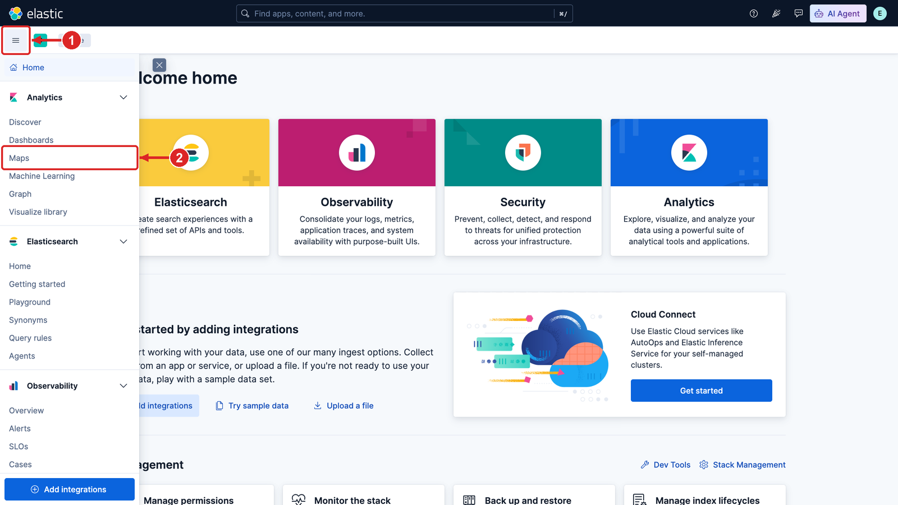

2. Sağ üstte **Create map** (1):

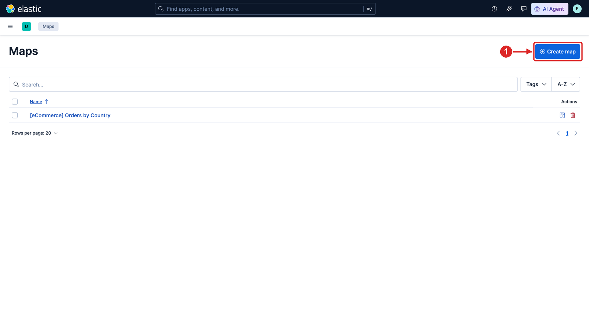

3. Zaman kutusunda **Last 7 days**'i seçin (1), sonra **Add layer** (2):

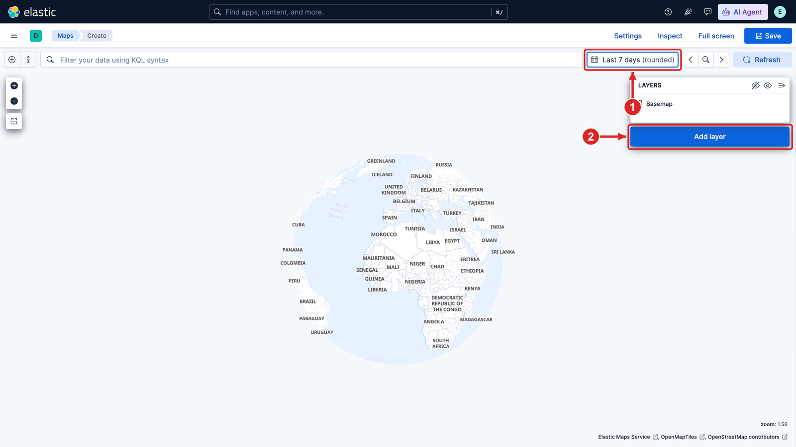

4. Katman türleri listelenir. **Clusters** (1) yakın noktaları sayıyla gruplar; **Documents** her document'i ayrı
   nokta çizer. **Clusters**'a tıklayın:

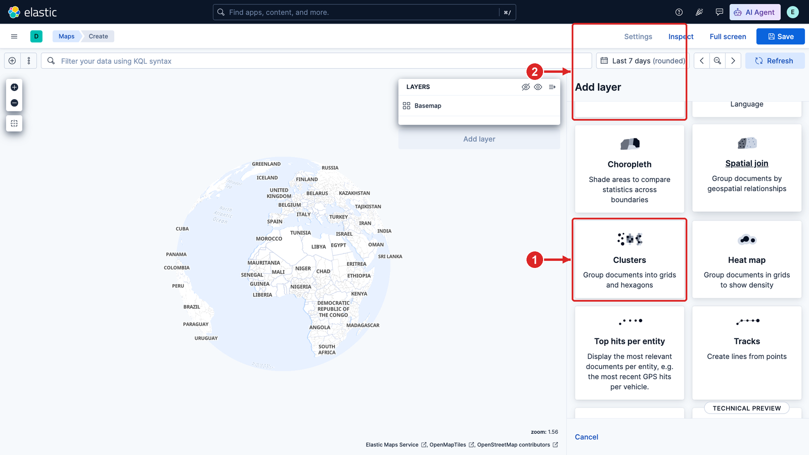

5. **Data view** kutusuna (1) `alarm` yazıp **Apache logları (alarm)**'ı seçin; **Cluster field** kendiliğinden
   `source.geo.location` olur. **Add and close** (2):

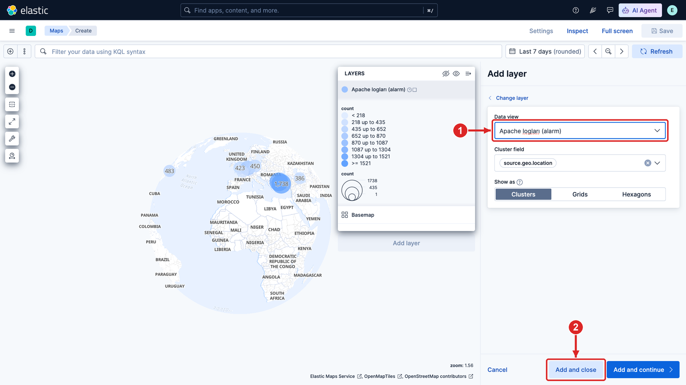

6. Cluster'lar şehirlerde toplanır; daire içindeki sayı o bölgedeki istek sayısıdır (2). Katman listesinde (1) yeni
   katman ve renk ölçeği görünür:

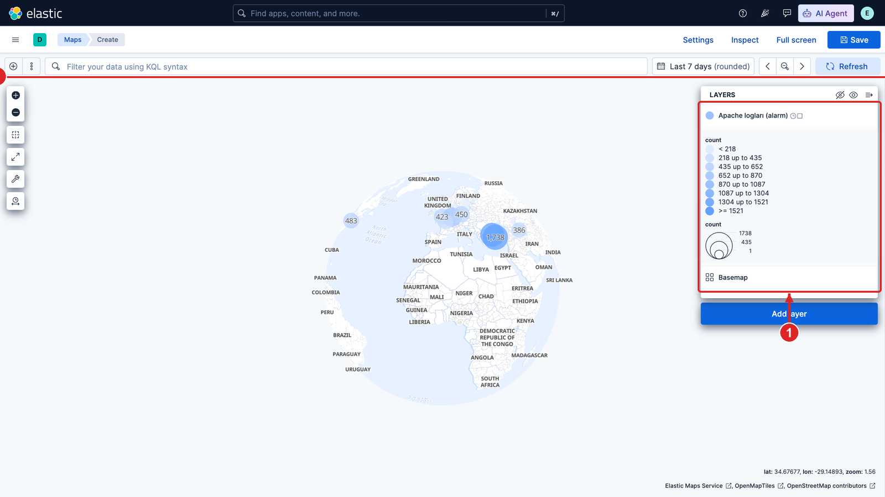

7. Sağ üstte **Save**: **Title** (1) `Ziyaretçi haritası`, **Add to dashboard** altında **None** (2), **Save and add to
   library** (3). Harita Library'ye kaydedilir; Adım 6'da panoya ekleyeceğiz:

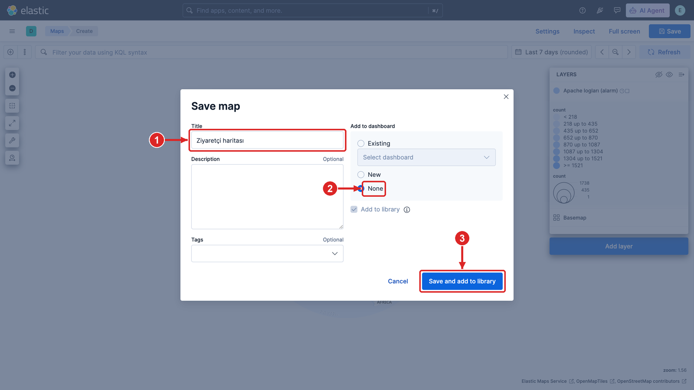

Aynı soru sorguyla: İstanbul merkezine 500 km içinde kaç istek var, bunların kaçı şehrin kendisinden (50 km)?

```http
GET alarm-apache/_search?size=0&filter_path=hits.total.value,aggregations.halka.buckets.key,aggregations.halka.buckets.doc_count
{
  "track_total_hits": true,
  "query": { "geo_distance": { "distance": "500km", "source.geo.location": { "lat": 41.01, "lon": 28.98 } } },
  "aggs": { "halka": { "geo_distance": { "field": "source.geo.location", "origin": { "lat": 41.01, "lon": 28.98 }, "unit": "km",
    "ranges": [ { "to": 50 }, { "from": 50, "to": 500 } ] } } }
}
```

```json
{"hits":{"total":{"value":3220}},"aggregations":{"halka":{"buckets":[{"key":"*-50.0","doc_count":1866},{"key":"50.0-500.0","doc_count":1354}]}}}
```

`geo_distance` sorgusu bir daireye düşen document'leri bulur; `geo_distance` aggregation'ı onları merkeze
uzaklığa göre halkalara ayırır. 50-500 km halkası Ankara ve İzmir'dir.

### 3. Connector: alarm nereye yazılsın?

**Soru: Alarm açılınca kayıt nereye düşsün?**

Alarm geçmişini tutacak Index connector'ı kurun. Kibana › Dev Tools'a yapıştırın:

```http
POST kbn:/api/actions/connector/alarm-gecmisi-yaz
{ "name": "alarm-gecmisi-yaz", "connector_type_id": ".index", "config": { "index": "alarm-gecmisi", "refresh": true } }
```

```json
{"id":"alarm-gecmisi-yaz","name":"alarm-gecmisi-yaz","config":{"index":"alarm-gecmisi","refresh":true,"executionTimeField":null},"connector_type_id":".index", ...}
```

Arayüzde aynı yer **Stack Management › Connectors › Create connector › Index**'tir.

### 4. Kural: 5 dakikada 10'dan fazla 5xx

**Soru: Kibana "çok fazla hata var" kararını nasıl verir?**

Kuralı Kibana › Dev Tools'tan kuruyoruz: tek istek her seferinde aynı kuralı kurar ve alanları tek bakışta gösterir.
Arayüzdeki **Create rule** formu aynı alanları doldurur; formun nerede olduğu bu adımın sonundaki açılır kutudadır:

```http
POST kbn:/api/alerting/rule/alarm-5xx
{
  "name": "Ödeme 5xx patlaması", "rule_type_id": ".es-query", "consumer": "stackAlerts", "schedule": { "interval": "1m" },
  "params": { "searchType": "esQuery", "index": ["alarm-apache"], "timeField": "@timestamp",
    "esQuery": "{\"query\":{\"term\":{\"http.response.status_class\":\"5xx\"}}}",
    "threshold": [10], "thresholdComparator": ">", "timeWindowSize": 5, "timeWindowUnit": "m",
    "size": 0, "aggType": "count", "groupBy": "all", "excludeHitsFromPreviousRun": false },
  "actions": [ { "id": "alarm-gecmisi-yaz", "group": "query matched",
    "params": { "documents": [ { "kural": "{{rule.name}}", "adet": "{{context.value}}", "kosul": "{{context.conditions}}", "zaman": "{{context.date}}" } ] },
    "frequency": { "summary": false, "notify_when": "onActionGroupChange", "throttle": null } } ]
}
```

```json
{"id":"alarm-5xx","enabled":true,"name":"Ödeme 5xx patlaması","tags":[],"rule_type_id":".es-query","consumer":"stackAlerts","schedule":{"interval":"1m"}, ...}
```

- `schedule` ve `timeWindowSize`: her dakika son 5 dakikaya bakılır. Pencere kısalırsa kısa patlamalar
  kaçmaz ama gürültü artar.
- `threshold` / `thresholdComparator`: 10'dan fazla. Normal günde 5 dakikada 5xx sayısı 0-1'dir.
- `notify_when: onActionGroupChange`: alarm açıldığında bir kez yazar; her dakika aynı mesajı tekrarlamaz.
- `{{context.value}}`, `{{context.conditions}}`: kuralın o anki ölçümü. Yanlış yazılan değişken hata
  vermez, boş gelir.

<details>
<summary><strong>Aynı kural arayüzde nerede görünür?</strong></summary>

Kuralı Dev Tools'la kurduk; arayüzden kurarken doldurulan alanlar aynıdır. Kuralın formunu açmak için:

1. Menü, **Stack Management**, soldaki listede **Alerts and Insights** altında **Rules** (1):

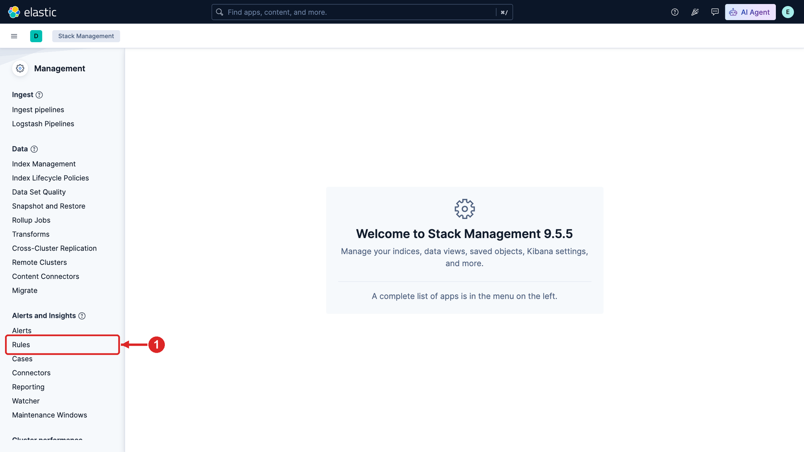

2. **Ödeme 5xx patlaması** (1):

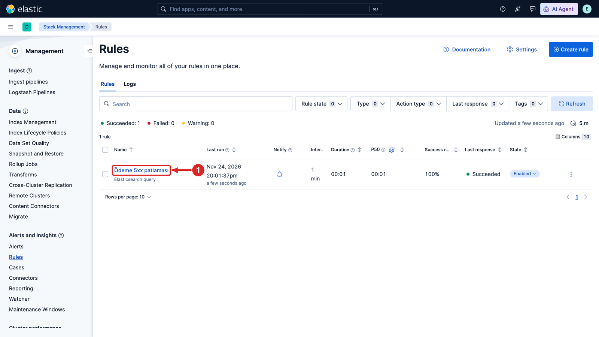

3. Sağ üstteki **⋮** düğmesi (1), **Edit rule** (2):

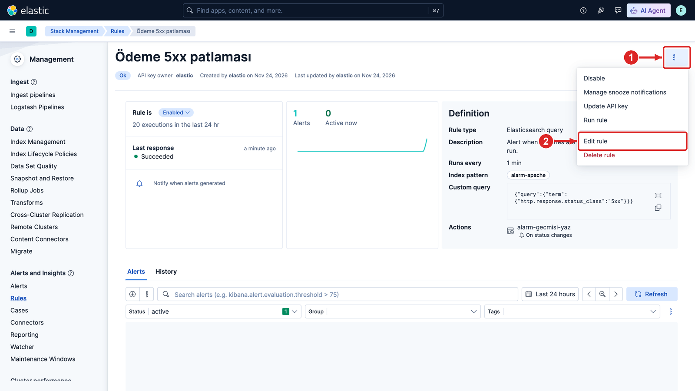

4. Formda kural türü **Elasticsearch query** (1), index `alarm-apache` (2) ve eşik **IS ABOVE 10** (3) görünür:


5. Aşağıda **Actions** bölümünde connector `alarm-gecmisi-yaz` (1) ve document'e yazılan mesaj vardır. Değişiklik
   yapmadan **Cancel** ile çıkın:

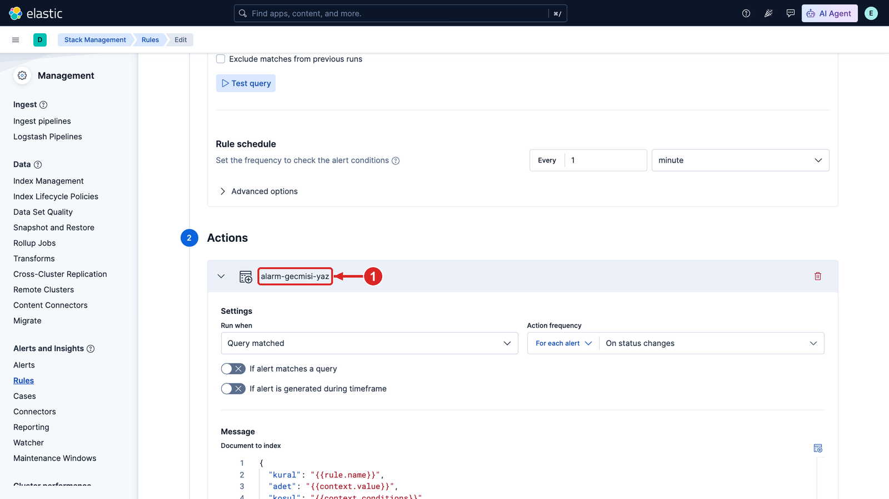

</details>

### 5. Arızayı üretin ve alarmı izleyin

**Soru: Arıza olunca alarm gerçekten açılıyor ve kapanıyor mu?**

Betik ödeme sayfasına son bir dakika içinde 40 tane 500 yazar:

```bash
python3 scripts/veri_uret.py --ariza
timeout 180 bash -c 'until [ "$(curl -s -u elastic:"DevOps2026!" http://127.0.0.1:9200/alarm-gecmisi/_count 2>/dev/null | jq .count 2>/dev/null)" -ge 1 ] 2>/dev/null; do printf .; sleep 5; done'; echo
curl -s -u elastic:'DevOps2026!' 'http://127.0.0.1:9200/alarm-gecmisi/_search?size=1' | jq -c '.hits.hits[0]._source'
```

Beklenen çıktı:

```text
[+] 40 adet 500 olayi yazildi (/odeme, son 1 dakika) -> alarm-apache
.
{"kural":"Ödeme 5xx patlaması","adet":"40","kosul":"Number of matching documents is greater than 10","zaman":"2026-11-21T18:09:42.867Z"}
```

Kural bir sonraki çalışmasında (en çok 1 dakika) eşiği aşan sayıyı gördü ve aksiyon document'i yazdı. Zaman
sizde farklıdır. **Stack Management › Rules › Ödeme 5xx patlaması** sayfasında **Active now** kutusunda 1 görünür (1):

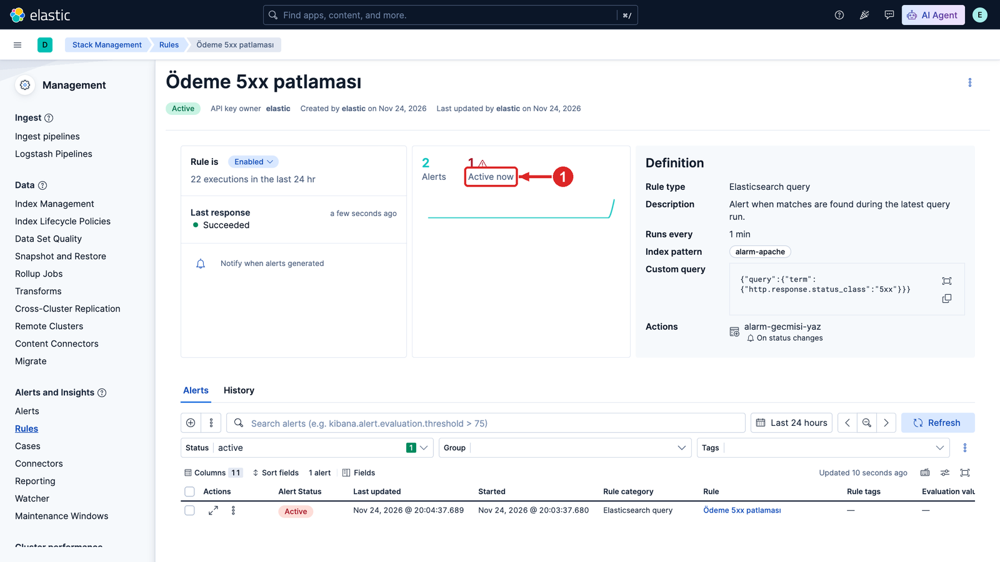

5 dakikalık pencere arızayı geride bırakınca alarm kendiliğinden kapanır:

```bash
timeout 600 bash -c 'until curl -s -u elastic:"DevOps2026!" -H "kbn-xsrf: true" http://127.0.0.1:5601/api/alerting/rule/alarm-5xx | jq -e ".last_run.alerts_count.recovered == 1" >/dev/null; do printf .; sleep 15; done'; echo
curl -s -u elastic:'DevOps2026!' -H 'kbn-xsrf: true' http://127.0.0.1:5601/api/alerting/rule/alarm-5xx | jq -c '.last_run.alerts_count'
```

Beklenen çıktı:

```text
....................
{"new":0,"ignored":0,"recovered":1,"active":0}
```

Ölçülen: arızadan sonra alarm yaklaşık 1 dakikada açıldı, 5 dakikalık pencere geçince 5-6 dakikada kapandı.
`notify_when: onActionGroupChange` olduğu için açılışta bir document yazıldı; her dakika tekrar yazılmadı.

### 6. Rapor: CSV ve PDF

**Soru: Hataların listesini ve panoyu yöneticiye nasıl göndeririz?**

**CSV: Discover sonucunun dosyası.**

1. Menüden **Discover**. Data view **Apache logları (alarm)** (1), zaman **Last 7 days**, arama kutusuna (2) aşağıdaki
   sorguyu yazıp Enter. 99 document gelir (3): geçmişteki 59 hata ve arızanın 40'ı:

```text
http.response.status_class : "5xx"
```

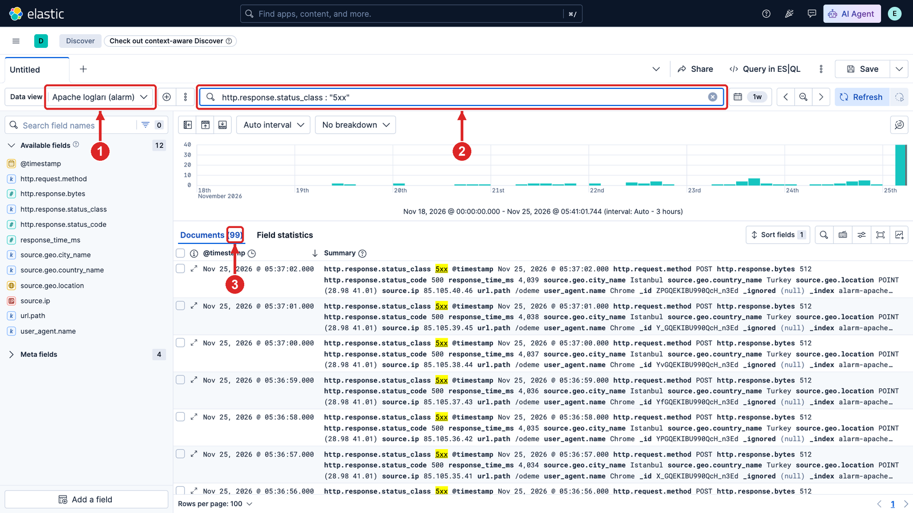

2. Sağ üstteki **⋮** düğmesi (1), **Export tab results** (2):

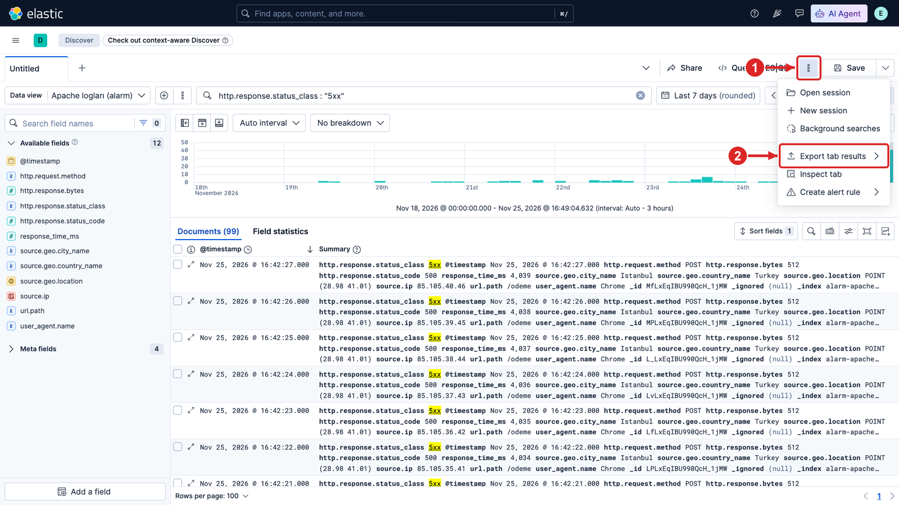

3. **CSV** (1) raporu hemen üretir; **Schedule export** (2) aynı raporu belirli aralıkla e-postayla gönderir (e-posta
   connector'ı gerekir). **CSV**'ye tıklayın:

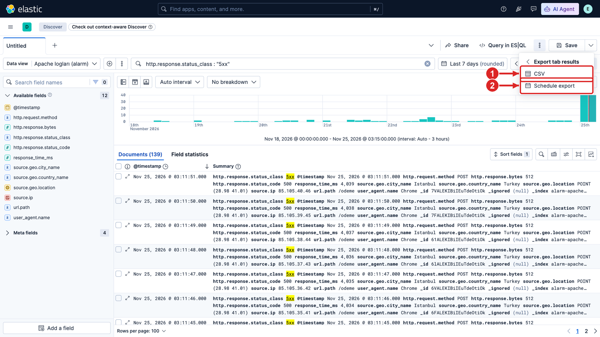

4. Sağdaki panelde **Generate CSV** (1). **Post URL** aynı raporu betikten üretmek içindir:

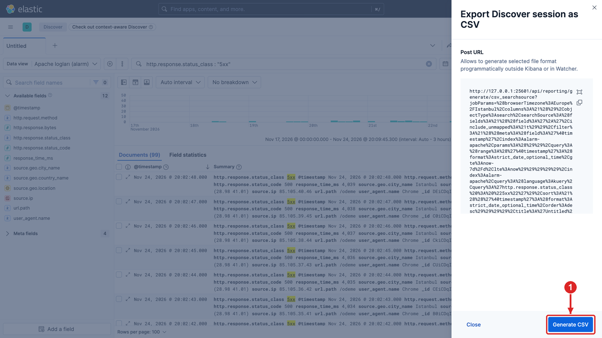

5. Rapor arka planda hazırlanır. Menü, **Stack Management**, **Alerts and Insights** altında **Reporting** (1):

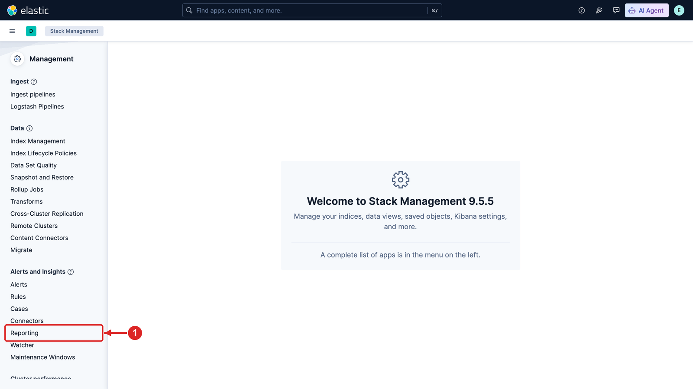

6. Rapor satırı (1) **Done, warnings detected** der; sağdaki indirme simgesiyle indirilir. Uyarının sebebi: sütun adı
   `@timestamp` `@` ile başlar, Excel böyle başlayan hücreyi formül sanabileceği için Kibana raporu işaretler:


**PDF: panonun çıktısı.** Yöneticiye giden rapor genelde panonun PDF'idir (deneme lisansı gerekir; LAB-01'de açıldı).

1. Menüden **Dashboards › Create dashboard**, zaman **Last 7 days**, sağ üstte **Add**. Açılan panelde **From library**
   (1), arama kutusuna (2) `Ziyaretçi` yazıp Enter, **Ziyaretçi haritası** (3); sonra paneli **×** ile kapatın:

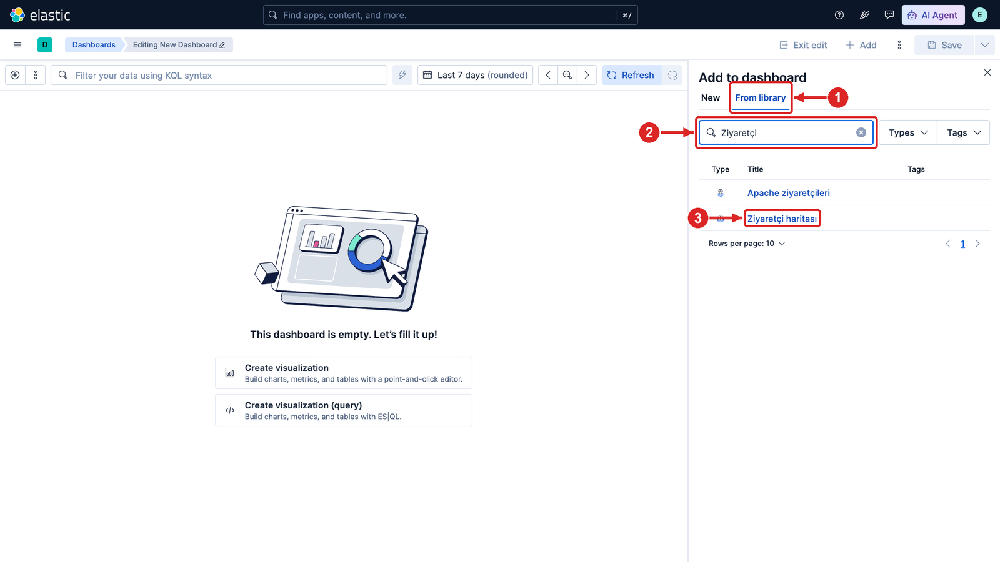

2. Sağ üstte **Save**: **Title** (1) `Alarm panosu`, **Save** (2):

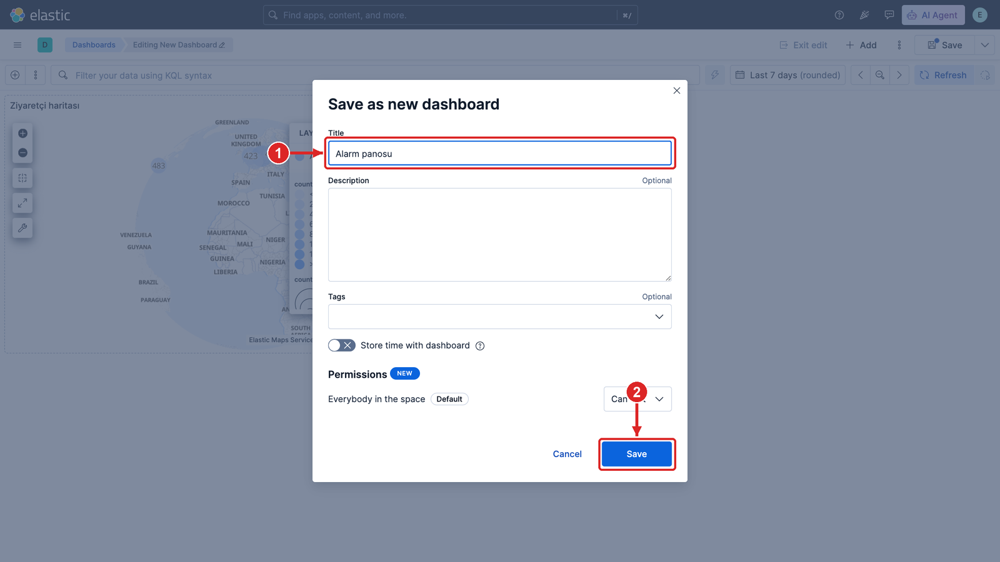

3. **Exit edit** (1) ile düzenleme modundan çıkın:

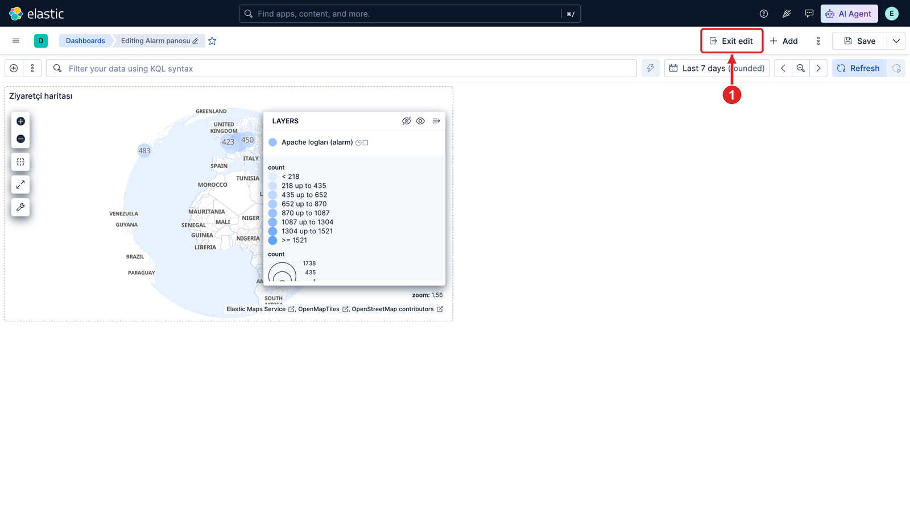

4. Sağ üstte **Export** (1), **PDF reports** (2):

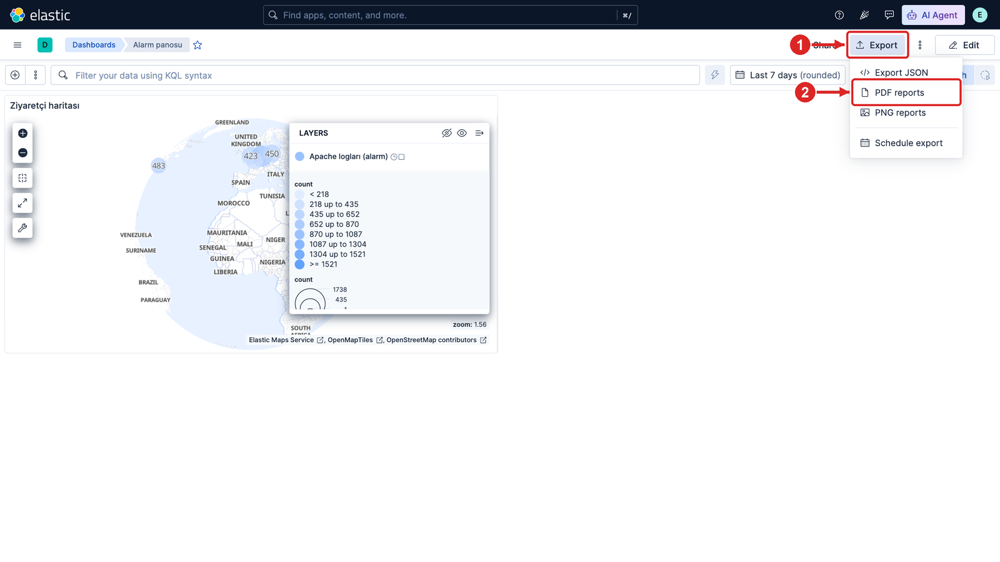

5. Sağdaki panelde **Export PDF** (1). **Print format** açılırsa çok sayfalı çıktı üretir:

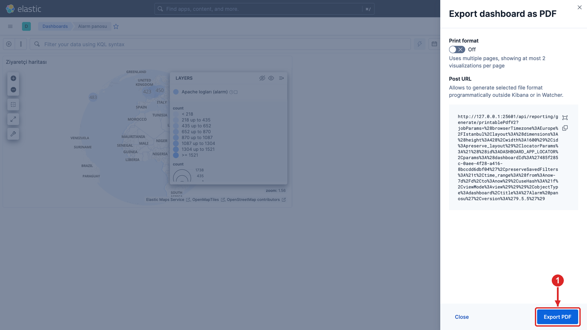

6. PDF arka planda bir tarayıcıyla çizilir; bu sunucuda birkaç dakikada hazırlandı. **Stack Management › Reporting**'de
   **Alarm panosu** satırı (1) **Done** olur, türü **PDF**; satır sonundaki menüden **Download report** ile indirilir:

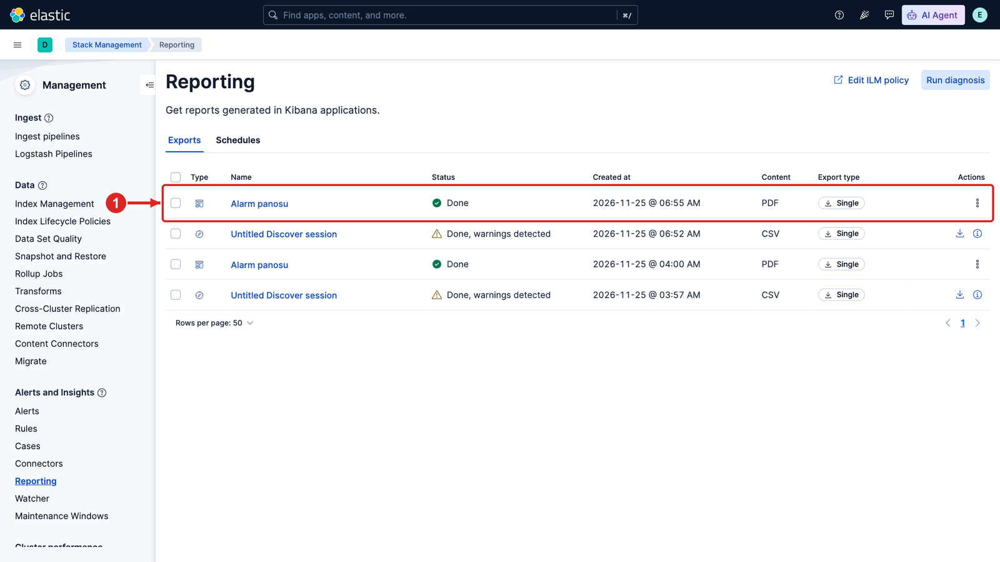

<details>
<summary><strong>Slack ve e-posta connector'ı</strong></summary>

Slack için Slack'te bir **Incoming Webhook** URL'i üretilir; Kibana'da **Stack Management › Connectors ›
Create connector › Slack** ile ad ve Webhook URL girilir:

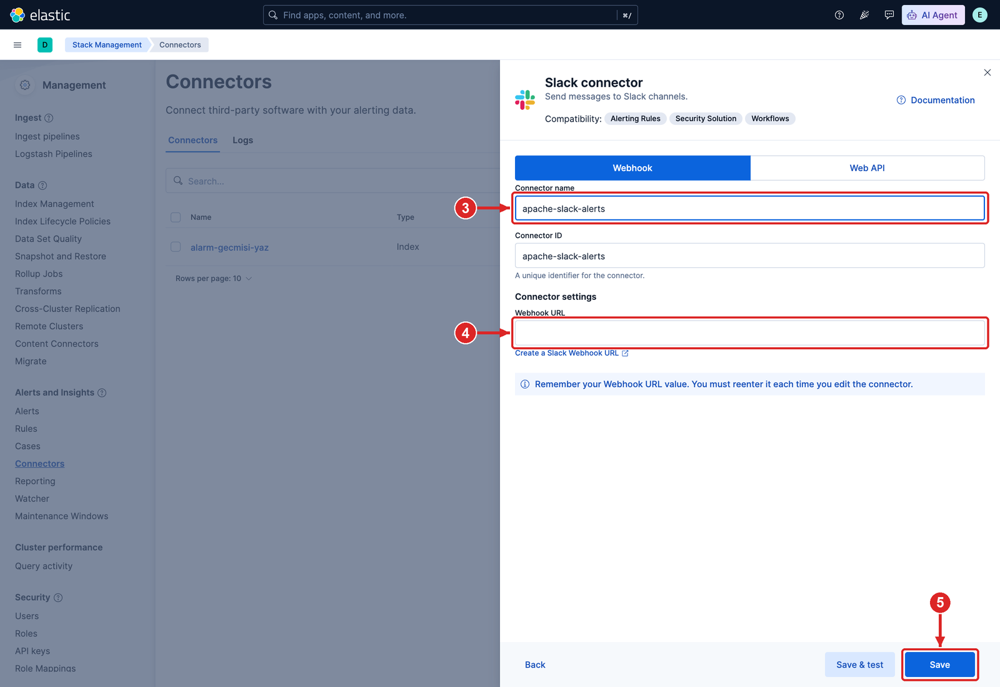

E-posta için **Email** connector'ında gönderen adres, SMTP sunucusu (ör. `smtp.resend.com`, 465), kullanıcı
ve parola girilir:


Kurala ikinci bir action olarak eklenir; mesajda aynı değişkenler kullanılır
(`{{rule.name}}`, `{{context.value}}`, `{{context.link}}`). Linklerin dolu gelmesi için Kibana'da
`server.publicBaseUrl` tanımlı olmalıdır; yoksa `{{context.link}}` boş gelir. Webhook URL'i ve SMTP
parolası gizli bilgidir: ekran görüntüsüne, repoya ya da sohbete yapıştırılmaz.

</details>

---

## Temizlik

Yalnız bu labın kuralını, connector'ını, `alarm-apache` ve `alarm-gecmisi` index'lerini, şablonunu, data
view'ını, haritasını ve panosunu siler; ana cluster'a dokunmaz. Reporting listesindeki rapor Kibana'nın kendi kaydıdır
ve kalır:

```bash
./teardown.sh
```

Beklenen çıktı:

```text
kural alarm-5xx -> 204
connector alarm-gecmisi-yaz -> 204
Kibana nesneleri -> 2 silindi
data view alarm-apache -> 200
index'ler -> 200
sablon alarm-apache -> 200
sablon alarm-gecmisi -> 200
```

`2`, Adım 2'deki harita ve Adım 6'daki `Alarm panosu`'dur; yapmadığınız adımın nesnesi sayılmaz.

Labı aynı sunucuda yeniden yapacaksanız başlamadan önce `./teardown.sh` çalıştırın; README'deki sayılar temiz
başlangıca göredir.

---

Sonraki lab: **[LAB-19 — 3-Node TLS Cluster: Shard, Replica, Node Kaybı ve Yük Dengeleme](../LAB-19-3-node-tls-cluster/README.md)**
