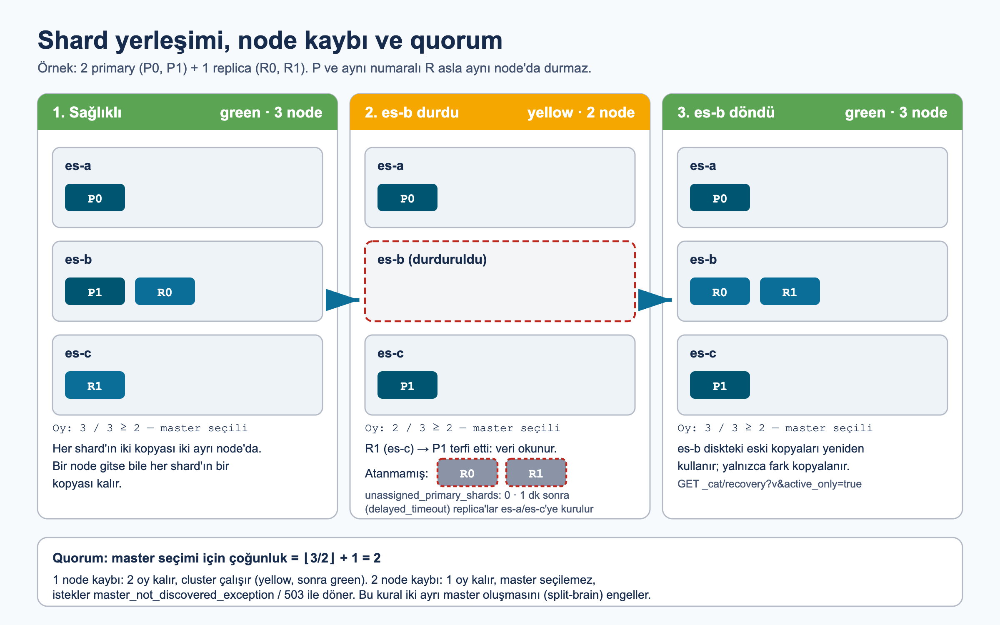
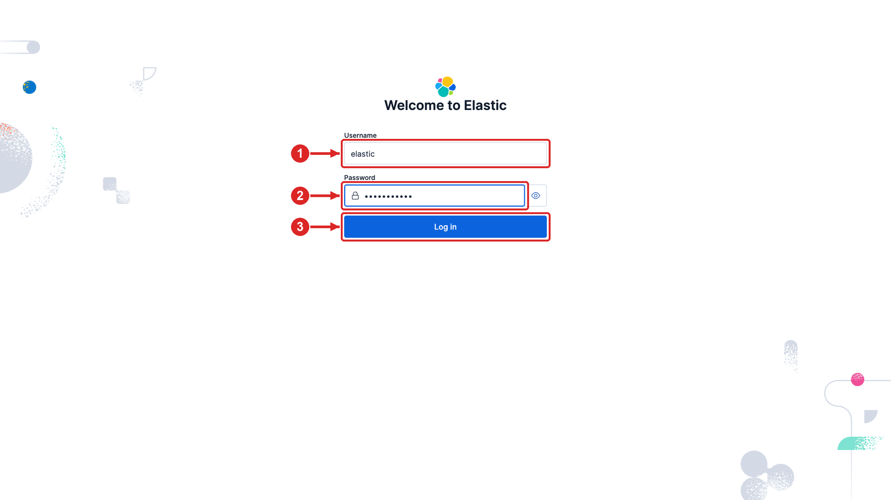
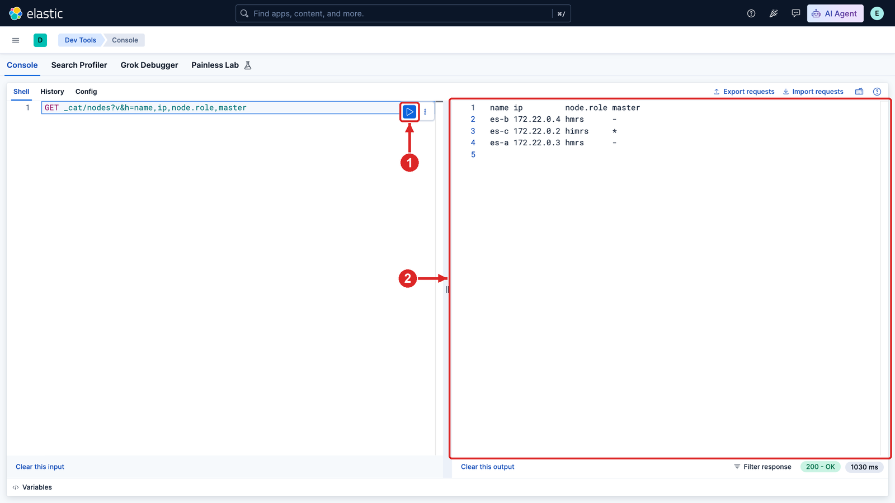

# LAB-19 — 3-Node TLS Cluster: Shard, Replica, Node Kaybı ve Yük Dengeleme

| Kullanılan Araçlar | Açık / Kullanılan Portlar |
|---|---|
| Docker Compose, Elasticsearch 9.5.5 (3 node), `elasticsearch-certutil`, `curl`, Python client | `127.0.0.1:19208` (cluster HTTPS, yalnız sunucudan), `127.0.0.1:15608` (isteğe bağlı Kibana, `kibana3` alt alan adı) |

---

## Bu lab ne öğretiyor?

Ana cluster tek node'dur: o node durursa veri erişilmez olur, replica'nın yerleşecek yeri yoktur. Üretimde en az üç
node kullanılır ve node'lar birbirleriyle TLS üzerinden konuşur. Bu labda:

- Kendi CA'sıyla TLS'li, üç node'lu bir cluster kuracağız.
- Shard ve replica'ların node'lara nasıl dağıldığını göreceğiz.
- Bir node'u gerçekten durdurup verinin okunmaya devam ettiğini kanıtlayacağız.
- Aramaların node'lar arasında nasıl paylaşıldığını ölçeceğiz.



---

## Ön Koşullar

- LAB-01 ana cluster'ı çalışıyor olabilir; bu cluster ondan bağımsızdır (ayrı port, ayrı Docker ağı). Önceki
  labları atladıysanız da lab çalışır.
- En az 5 GB boş RAM: üç node yaklaşık 3 GB, isteğe bağlı Kibana 1 GB kullanır. `127.0.0.1:19208` ve `9300`
  boş olmalı. Önce bakın:

```bash
cd ~/elastic/labs/LAB-19-3-node-tls-cluster
free -g | sed -n 2p
```

`available` sütunu en az 5 olmalı.

---

## Kavramlar: dağıtık cluster'da karar kuralları

- **Master-eligible node:** tek sayıda (3) olur; master seçimi için çoğunluk (quorum) gerekir, 3 node'da 2.
- **Primary shard:** sayısı index açılırken belirlenir, sonra değişmez; document'in hangi shard'a gideceği bu sayıyla hesaplanır.
- **Replica:** sayısı canlı değişir; primary ile aynı node'a konmaz, node düşünce kopya başka node'da kalsın diye.
- **TLS:** node'lar arası (transport) ve istemci (HTTP) trafiğini şifreler; ağdaki biri parolayı ve veriyi okuyamaz.

---

## Config dosyaları: hangi satır ne işe yarıyor?

`starter/docker-compose.yml` (bir node'un kritik satırları):

```yaml
      node.roles: master,data_content,data_hot,remote_cluster_client
      discovery.seed_hosts: es-a,es-b,es-c
      cluster.initial_master_nodes: es-a,es-b,es-c
      xpack.security.transport.ssl.enabled: 'true'
      xpack.security.transport.ssl.verification_mode: certificate
      xpack.security.http.ssl.enabled: 'true'
      xpack.security.http.ssl.certificate_authorities: certs/ca/ca.crt
```

- `node.roles`: es-a ve es-b bu satırla açılır; es-c'ye ayrıca `ingest` rolü verildi. Ingest pipeline'lar yalnız
  ingest rolündeki node'da çalışır.
- `discovery.seed_hosts`: node açılınca cluster'ı bulmak için hangi adreslere soracağı.
- `cluster.initial_master_nodes`: yalnız ilk açılışta, hangi node'ların ilk master seçimine katılacağı. Cluster
  kurulduktan sonra kullanılmaz. Üretimde ilk kurulumdan sonra bu satır config'ten kaldırılır: verisi silinmiş bir
  node bu ayarla yeniden açılırsa ayrı, ikinci bir cluster kurabilir. Labda compose dosyası tek seferlik kurulum
  için olduğundan satır yerinde kalır.
- `transport.ssl` (9300) node'lar arası, `http.ssl` (9200) istemci trafiğini şifreler. `verification_mode: certificate`
  karşı node'un sertifikasının lab CA'sıyla imzalandığını doğrular, adına bakmaz; `full` ikisine de bakar. Sertifikalar `setup`
  servisinin `elasticsearch-certutil` ile ürettiği lab CA'sıyla imzalıdır.

`starter/instances.yml` her node sertifikasının hangi adlara (`es-a`, `localhost`, `127.0.0.1`) geçerli olduğunu
söyler; istemci başka bir adla bağlanırsa sertifika reddedilir.

---

## Adım Adım Uygulama Rehberi

### 1. Parola dosyası ve üç node

**Soru: Üç node'lu bir cluster tek komutla nasıl açılır?**

Parola ve portlar `starter/.env` dosyasında durur (izni `600`, git'e girmez):

```bash
printf 'CLUSTER_ELASTIC_PASSWORD=DevOps2026!\nCLUSTER_PORT=19208\nCLUSTER_KIBANA_PORT=15608\n' > starter/.env
chmod 600 starter/.env
docker compose --env-file starter/.env -f starter/docker-compose.yml up -d --wait 2>&1 | grep -E "Healthy|Exited"
```

Beklenen çıktı:

```text
 Container elastic-cluster-setup-1 Exited
 Container elastic-cluster-es-b-1 Healthy
 Container elastic-cluster-es-c-1 Healthy
 Container elastic-cluster-es-a-1 Healthy
```

Önce `setup` servisi sertifikaları üretip kapanır (`Exited` normaldir), sonra üç node açılır. `--wait` hepsi
sağlıklı olana kadar bekler; yaklaşık 2 dakika sürer.

### 2. TLS'i üç denemeyle kanıtlayın

**Soru: Trafiğin gerçekten şifreli olduğunu nasıl görürüz?**

curl'ün cluster'ın sertifikasına güvenmesi için lab CA'sını hosta alın ve parolayı ortama yükleyin:

```bash
mkdir -p .ca
docker compose --env-file starter/.env -f starter/docker-compose.yml cp es-a:/usr/share/elasticsearch/config/certs/ca/ca.crt .ca/ca.crt 2>/dev/null
export CA="$PWD/.ca/ca.crt"; set -a; . starter/.env; set +a
```

Düz HTTP, CA'sız HTTPS ve CA'lı HTTPS:

<!-- runner:expect-fail -->
```bash
curl -sS http://127.0.0.1:19208/
```

Beklenen çıktı:

```text
curl: (52) Empty reply from server
```

<!-- runner:expect-fail -->
```bash
curl -sS https://127.0.0.1:19208/
```

Beklenen çıktı:

```text
curl: (60) SSL certificate problem: unable to get local issuer certificate
```

```bash
curl -s --cacert "$CA" -u "elastic:$CLUSTER_ELASTIC_PASSWORD" 'https://127.0.0.1:19208/_cluster/health?wait_for_status=green&timeout=60s&filter_path=cluster_name,status,number_of_nodes'; echo
```

```json
{"cluster_name":"elastic-cluster","status":"green","number_of_nodes":3}
```

Node TLS dışındaki bağlantıya cevap vermez. Bağlantı şifreli olsa da curl, sertifikayı kimin imzaladığını bilmeden
reddeder; `-k` ile bu kontrolü kapatmak "kim olduğunu bilmediğim bir sunucuya parola gönder" demektir. CA ile
bağlantı kurulur ve üç node aynı cluster'dadır. `wait_for_status=green`: node'lar açıldıktan sonra iç index'lerin
replica'ları birkaç saniye yerleşir; istek green olana kadar (en çok 60 sn) bekler.

### 3. Node'lar, roller ve master

**Soru: Hangi node ne iş yapıyor, master kim?**

```bash
curl -s --cacert "$CA" -u "elastic:$CLUSTER_ELASTIC_PASSWORD" 'https://127.0.0.1:19208/_cat/nodes?v&h=name,node.role,master,heap.max&s=name'
```

Beklenen çıktı:

```text
name node.role master heap.max
es-a hmrs      -         384mb
es-b hmrs      *         384mb
es-c himrs     -         384mb
```

- `node.role`: `m` master-eligible, `h` hot data, `s` content data, `r` remote cluster client; `es-c`'deki `i`
  ingest pipeline çalıştırabildiğini gösterir.
- `master` sütunundaki `*` seçilmiş master'dır; hangi node'un seçildiği her kurulumda değişebilir. Üç master-eligible node'dan ikisi ayakta oldukça yeni master
  seçilebilir; tek node kalırsa cluster isteklere `master_not_discovered_exception` ile cevap verir. İki ayrı
  master oluşması (split brain) böyle engellenir.

### 4. Shard ve replica dağılımı

**Soru: Bir index'in kopyaları node'lara nasıl dağılır?**

3 primary ve 1 replica'lı bir index açıp altı document yazın, green olunca shard'ların nerede durduğuna bakın:

```bash
curl -s --cacert "$CA" -u "elastic:$CLUSTER_ELASTIC_PASSWORD" -X PUT 'https://127.0.0.1:19208/cluster-urunler' \
  -H 'Content-Type: application/json' -d '{"settings": {"number_of_shards": 3, "number_of_replicas": 1}}' -o /dev/null
printf '%s\n' '{"index":{"_id":"1"}}' '{"ad":"Kablosuz Kulaklik"}' '{"index":{"_id":"2"}}' '{"ad":"Akilli Saat"}' \
  '{"index":{"_id":"3"}}' '{"ad":"Termos"}' '{"index":{"_id":"4"}}' '{"ad":"Klavye"}' '{"index":{"_id":"5"}}' '{"ad":"Fare"}' \
  '{"index":{"_id":"6"}}' '{"ad":"Hoparlor"}' | curl -s --cacert "$CA" -u "elastic:$CLUSTER_ELASTIC_PASSWORD" -X POST \
  'https://127.0.0.1:19208/cluster-urunler/_bulk?refresh=true&filter_path=errors' -H 'Content-Type: application/x-ndjson' --data-binary @-; echo
curl -s --cacert "$CA" -u "elastic:$CLUSTER_ELASTIC_PASSWORD" 'https://127.0.0.1:19208/_cluster/health/cluster-urunler?wait_for_status=green&timeout=60s&filter_path=status' -o /dev/null
curl -s --cacert "$CA" -u "elastic:$CLUSTER_ELASTIC_PASSWORD" 'https://127.0.0.1:19208/_cat/shards/cluster-urunler?h=shard,prirep,state,node&s=shard,prirep'
```

Beklenen çıktı:

```text
{"errors":false}
0 p STARTED es-a
0 r STARTED es-c
1 p STARTED es-c
1 r STARTED es-b
2 p STARTED es-b
2 r STARTED es-a
```

Her shard numarasının bir `p` (primary) ve bir `r` (replica) kopyası var ve ikisi hiçbir zaman aynı node'da değil.
Hangi kopyanın hangi node'a düştüğü sizde farklı olabilir. Replica sayısı canlı değişir, primary sayısı değişmez:

```bash
curl -s --cacert "$CA" -u "elastic:$CLUSTER_ELASTIC_PASSWORD" -X PUT 'https://127.0.0.1:19208/cluster-urunler/_settings' \
  -H 'Content-Type: application/json' -d '{"number_of_replicas": 2}'; echo
curl -s --cacert "$CA" -u "elastic:$CLUSTER_ELASTIC_PASSWORD" 'https://127.0.0.1:19208/_cluster/health/cluster-urunler?wait_for_status=green&timeout=60s&filter_path=status,active_shards'; echo
curl -s --cacert "$CA" -u "elastic:$CLUSTER_ELASTIC_PASSWORD" -X PUT 'https://127.0.0.1:19208/cluster-urunler/_settings' \
  -H 'Content-Type: application/json' -d '{"number_of_shards": 1}' | jq -c '{status, type: .error.type}'
curl -s --cacert "$CA" -u "elastic:$CLUSTER_ELASTIC_PASSWORD" -X PUT 'https://127.0.0.1:19208/cluster-urunler/_settings' \
  -H 'Content-Type: application/json' -d '{"number_of_replicas": 1}'; echo
```

```json
{"acknowledged":true}
{"status":"green","active_shards":9}
{"status":400,"type":"illegal_argument_exception"}
{"acknowledged":true}
```

2 replica ile her shard'ın üç kopyası üç ayrı node'dadır (3 × 3 = 9 aktif shard). Primary sayısını değiştirmek
için yeni bir index açılıp `_reindex` yapılır; `_split` katlarına, `_shrink` bölenlerine indirip çıkarabilir. Adım 5 için replica sayısı 1'e geri alındı.

### 5. Gerçek node kaybı

**Soru: Bir node düşerse veri okunmaya devam eder mi?**

`es-b`'yi durdurun ve cluster'a sorun:

```bash
docker compose --env-file starter/.env -f starter/docker-compose.yml stop es-b 2>&1 | grep Stopped
curl -s --cacert "$CA" -u "elastic:$CLUSTER_ELASTIC_PASSWORD" 'https://127.0.0.1:19208/_cluster/health?wait_for_nodes=2&timeout=60s&filter_path=status,number_of_nodes,unassigned_primary_shards'; echo
curl -s --cacert "$CA" -u "elastic:$CLUSTER_ELASTIC_PASSWORD" 'https://127.0.0.1:19208/cluster-urunler/_count?filter_path=count'; echo
```

Beklenen çıktı:

```text
 Container elastic-cluster-es-b-1 Stopped
{"status":"yellow","number_of_nodes":2,"unassigned_primary_shards":0}
{"count":6}
```

- Kalan iki node quorum'u sağladı; cluster cevap veriyor.
- `yellow` ama `unassigned_primary_shards: 0`: `es-b`'deki primary'lerin yerine öteki node'lardaki replica'lar
  primary oldu. Altı document'in hepsi okunuyor.
- Elasticsearch giden node'un geri gelmesini bir dakika bekler (`index.unassigned.node_left.delayed_timeout`);
  sonra eksik replica'ları kalan node'lara kurar ve cluster iki node'la da green olabilir.

Node'u geri getirin:

```bash
docker compose --env-file starter/.env -f starter/docker-compose.yml start es-b 2>&1 | grep Started
curl -s --cacert "$CA" -u "elastic:$CLUSTER_ELASTIC_PASSWORD" 'https://127.0.0.1:19208/_cluster/health?wait_for_nodes=3&wait_for_status=green&timeout=120s&filter_path=status,number_of_nodes'; echo
```

Beklenen çıktı:

```text
 Container elastic-cluster-setup-1 Started
 Container elastic-cluster-es-b-1 Started
{"status":"green","number_of_nodes":3}
```

`es-b` diskteki eski kopyalarını yeniden kullanır; yalnız aradaki fark kopyalanır. Green olması yaklaşık 45 saniye
sürer. `setup` servisi de yeniden başlar; sertifikalar zaten olduğu için hiçbir şey üretmeden kapanır.

### 6. Yük dengeleme: aramalar node'lara nasıl dağılır?

**Soru: Hep aynı node'a istek atınca iş yalnız ona mı kalır?**

İstekleri hep aynı adrese (`es-a`'nın portuna) gönderiyoruz. 30 aramadan önce ve sonra her node'un yürüttüğü shard
sorgusu sayısına bakın:

```bash
OLCUM='https://127.0.0.1:19208/_nodes/stats/indices/search?filter_path=nodes.*.name,nodes.*.indices.search.query_total'
ONCE=$(curl -s --cacert "$CA" -u "elastic:$CLUSTER_ELASTIC_PASSWORD" "$OLCUM" | jq -c '[.nodes[] | {(.name): .indices.search.query_total}] | add')
for i in $(seq 1 30); do curl -s --cacert "$CA" -u "elastic:$CLUSTER_ELASTIC_PASSWORD" 'https://127.0.0.1:19208/cluster-urunler/_search?size=0&request_cache=false' -o /dev/null; done
curl -s --cacert "$CA" -u "elastic:$CLUSTER_ELASTIC_PASSWORD" "$OLCUM" | jq -c --argjson o "$ONCE" '[.nodes[] | {(.name): (.indices.search.query_total - $o[.name])}] | add'
```

```json
{"es-a":57,"es-c":31,"es-b":2}
```

İsteği alan node koordinatör olur: aramayı index'in üç shard'ına dağıtır ve sonuçları birleştirir. Her shard için
primary ya da replica kopyalarından birini seçer (adaptive replica selection: o an en hızlı cevap veren). Toplam her
zaman 90'dır (30 arama × 3 shard); dağılım her ölçümde değişir. Az önce yeniden başlatılan `es-b`'nin payı çoğu zaman
küçük çıkar, çünkü cache'i soğuk, cevabı yavaştır; bu testte bir koşuda 30/30/30 eşit de dağıldı. Üretimde istemci de istekleri birden çok node'a (ya da önündeki bir load
balancer'a) gönderir; tek bir node'un adresi tek arıza noktası olur.

<details>
<summary><strong>Uygulamadan TLS ile bağlanmak: Python <code>ca_certs</code></strong></summary>

Python client'ı labın kendi sanal ortamına kurun; betik önce CA vermeden, sonra `ca_certs` ile bağlanır:

```bash
python3 -m venv .venv
.venv/bin/pip install -q -r app/requirements.txt
.venv/bin/python app/tls_baglan.py
```

Beklenen çıktı:

```text
CA yok    : TlsError (sertifika dogrulanamadi)
ca_certs  : elastic-cluster green 3 node
```

CA olmadan client sertifikayı doğrulayamaz ve `TlsError` verir; `ca_certs=".ca/ca.crt"` ile bağlanır. Üretimde
`verify_certs=False` kullanılmaz; CA dosyası uygulamayla birlikte dağıtılır.

</details>

<details>
<summary><strong>Bu cluster'a Kibana bağlamak (isteğe bağlı)</strong></summary>

Kibana `elastic` kullanıcısıyla bağlanamaz; `kibana_system` kullanıcısına parola verip Kibana'yı başlatın:

```bash
curl -s --cacert "$CA" -u "elastic:$CLUSTER_ELASTIC_PASSWORD" -X POST 'https://127.0.0.1:19208/_security/user/kibana_system/_password' \
  -H 'Content-Type: application/json' -d "{\"password\": \"$CLUSTER_ELASTIC_PASSWORD\"}"; echo
export CLUSTER_KIBANA_PUBLIC_BASE_URL="https://$(hostname -s)-kibana3.devopsatolyesi.com"
docker compose --env-file starter/.env -f starter/docker-compose.yml -f starter/docker-compose.kibana.yml up -d kibana 2>&1 | grep Started
timeout 300 bash -c 'until curl -s -u "elastic:$CLUSTER_ELASTIC_PASSWORD" http://127.0.0.1:15608/api/status | jq -e ".status.overall.level == \"available\"" >/dev/null 2>&1; do printf .; sleep 5; done'; echo
IP=$(curl -s https://api.ipify.org); H=$(hostname -s)
echo "Kibana (3-node): https://$H-kibana3.devopsatolyesi.com   (sunucudan: http://127.0.0.1:15608)"
```

Beklenen çıktı:

```text
{}
 Container elastic-cluster-setup-1 Started
 Container kibana-cluster Started
.............
Kibana (3-node): https://<host>-kibana3.devopsatolyesi.com   (sunucudan: http://127.0.0.1:15608)
```

Kibana yaklaşık 1,5 dakikada açılır ve sertifikayı paylaşılan `certs` volume'ünden okur.

1. Yazdırılan adresi açın. **Username** (1) `elastic`, **Password** (2) `DevOps2026!`, **Log in** (3). İlk girişte bir
   karşılama ekranı gelirse **Explore on my own** deyin:

   

2. Menü düğmesine (1) tıklayın, **Management** altında **Dev Tools**'u (2) seçin:

   

3. Bu Kibana 3-node cluster'a bağlıdır; Console'a yapıştırıp çalıştırın (1). Sonuçta (2) üç node ve master'ı (`*`)
   görürsünüz:

   ```http
   GET _cat/nodes?v&h=name,ip,node.role,master
   ```

    Native (APT ve systemd) kurulum ve dedicated rollü (`master`/`data`/`ingest`) Compose dosyası:
[Ubuntu 24.04'te 3-node kurulum](docs/UBUNTU-24-04-3NODE-CLUSTER-SETUP.md),
[rol tabanlı Compose](docs/DOCKER-COMPOSE-ROLES-VS-SINGLE-NODE.md).

</details>

---

## Temizlik

LAB-23 aynı cluster'ı kullanır; LAB-23'ü yapacaksanız temizliği sonra çalıştırın. Yalnız bu labın 3-node cluster'ını
ve Kibana'sını, volume'larını (veri, sertifikalar, snapshot deposu), CA kopyasını ve sanal ortamı siler; ana
cluster'a dokunmaz. `starter/.env` kalır:

```bash
./teardown.sh
```

<details>
<summary><strong>Çıktının tamamı (13 satır)</strong></summary>

```text
Container elastic-cluster-es-c-1 Removed
Container elastic-cluster-es-b-1 Removed
Container kibana-cluster Removed
Container elastic-cluster-es-a-1 Removed
Container elastic-cluster-setup-1 Removed
Volume elastic-cluster_snapshots Removed
Volume elastic-cluster_certs Removed
Volume elastic-cluster_data-b Removed
Network elastic-cluster_default Removed
Volume elastic-cluster_data-a Removed
Volume elastic-cluster_data-c Removed
.ca ve .venv silindi
konteyner kalmadi
```

</details>

Labı aynı sunucuda yeniden yapacaksanız başlamadan önce `./teardown.sh` çalıştırın; README'deki sayılar temiz
başlangıca göredir.

---

Sonraki lab: **[LAB-20 — Güvenlik ve Çok Ekipli Kibana: Rol, API Key, FLS/DLS ve Spaces](../LAB-20-guvenlik-cok-ekipli-kibana/README.md)**
