# LAB-20 — Güvenlik ve Çok Ekipli Kibana: Rol, API Key, FLS/DLS ve Spaces

| Kullanılan Araçlar | Açık / Kullanılan Portlar |
|---|---|
| Kibana Dev Tools, rol ve kullanıcı, API key, field ve satır düzeyinde güvenlik, Kibana Spaces, saved objects | 9200 / 5601 — LAB-01 ana cluster'ı |

---

## Bu lab ne öğretiyor?

Destek ve satış ekipleri aynı talep index'ini kullanıyor. Destek ekibi yalnız kendi taleplerini görmeli, müşterinin
e-posta ve telefonunu hiç görmemeli; web formu talep ekleyebilmeli ama okuyamamalı. Herkese `elastic` kullanıcısını
vermek bunların hiçbirini sağlamaz. Bu labda:

- En az yetkili bir rol ve kullanıcı, yalnız yazabilen bir API key kuracağız.
- Field ve satır düzeyinde güvenlikle e-posta ve telefonu gizleyip yalnız destek taleplerini göstereceğiz.
- Rolü ekibin Kibana Space'ine bağlayıp o kullanıcıyla gireceğiz.
- Yalnız panoları görebilen, hiçbir şeyi değiştiremeyen bir rapor kullanıcısı açacağız.

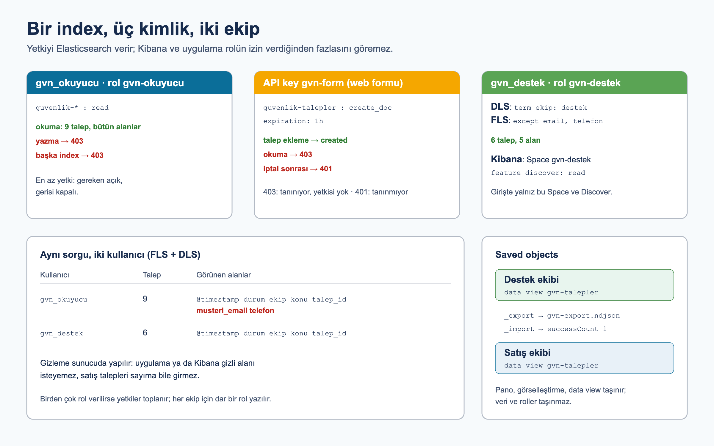

---

## Ön Koşullar

- LAB-01 ana cluster'ı çalışıyor ve trial lisans açık (LAB-01 son adımı). LAB-01'i atladıysanız onun
  Adım 1-2'sini ve trial adımını çalıştırın. Field ve satır düzeyinde güvenlik ücretli bir özelliktir.
- Adım 6 LAB-04'ün eCommerce örnek verisini ve panosunu kullanır. LAB-04'ü atladıysanız onun Adım 1'ini
  çalıştırın. Space kavramı LAB-17'dedir.

```bash
cd ~/elastic/labs/LAB-20-guvenlik-cok-ekipli-kibana
curl -s -u elastic:'DevOps2026!' 'http://127.0.0.1:9200/_license?filter_path=license.type,license.status' | jq -c .license
```

Beklenen çıktı:

```text
{"status":"active","type":"trial"}
```

Kibana adresini sunucuda hesaplayın:

```bash
IP=$(curl -s https://api.ipify.org); H=$(hostname -s)
echo "Kibana: http://$IP:5601   https://$H-kibana.devopsatolyesi.com"
```

Beklenen çıktı:

```text
Kibana: http://<IP>:5601   https://<host>-kibana.devopsatolyesi.com
```

---

## Kavramlar: kim, neye, ne kadar?

- **Rol:** hangi index'te hangi işlem (`read`, `index`…) yapılabileceği; burada `gvn-okuyucu` yalnız okur.
- **API key:** bir uygulamanın kimliği; süreli ve iptal edilebilir. `gvn-form` yalnız document ekler.
- **FLS (field level security):** document'in hangi field'larının görüneceği; e-posta ve telefon gizli.
- **DLS (document level security):** hangi document'lerin görüneceği; yalnız `ekip: destek`.
- **Space ve Kibana feature yetkisi:** rolün Kibana'da hangi Space'te hangi uygulamayı göreceği.
- **Yerleşik rol:** hazır yetki paketi; `viewer` her şeyi okur, hiçbir şeyi değiştiremez.

Kullanıcıya birden çok rol verilebilir; yetkiler toplanır. Bu yüzden her ekip için ayrı, dar bir rol yazılır.

---

## Adım Adım Uygulama Rehberi

Bu labdaki `http` blokları **Kibana › Dev Tools**'a, `bash` blokları terminale yapıştırılır. Dev Tools
istekleri `elastic` ile gider; başka kullanıcıyla deneme yaptığımız yerler `bash`'tir.

### 1. Veri ve en az yetkili rol

**Soru: Yalnız okuyabilen bir kullanıcı nasıl açılır?**

Sekiz talep yükleyin; her talepte ekip, konu, müşteri e-postası ve telefonu var:

Önce örnek veri dosyasını oluşturun: `sample-data/talepler.ndjson`

```bash
mkdir -p sample-data
cat > sample-data/talepler.ndjson << 'EOF'
{"index": {"_id": "T-101"}}
{"@timestamp": "2026-11-10T09:00:00Z", "talep_id": "T-101", "ekip": "destek", "konu": "Şifre sıfırlama", "durum": "acik", "musteri_email": "ayse.demir@ornek.com.tr", "telefon": "0532 000 01 01"}
{"index": {"_id": "T-102"}}
{"@timestamp": "2026-11-11T09:00:00Z", "talep_id": "T-102", "ekip": "satis", "konu": "Toplu alım teklifi", "durum": "acik", "musteri_email": "mehmet.kaya@ornek.com.tr", "telefon": "0533 000 02 02"}
{"index": {"_id": "T-103"}}
{"@timestamp": "2026-11-12T09:00:00Z", "talep_id": "T-103", "ekip": "destek", "konu": "Fatura görünmüyor", "durum": "kapali", "musteri_email": "elif.sahin@ornek.com.tr", "telefon": "0534 000 03 03"}
{"index": {"_id": "T-104"}}
{"@timestamp": "2026-11-13T09:00:00Z", "talep_id": "T-104", "ekip": "destek", "konu": "Kargo gecikmesi", "durum": "acik", "musteri_email": "can.yildiz@ornek.com.tr", "telefon": "0535 000 04 04"}
{"index": {"_id": "T-105"}}
{"@timestamp": "2026-11-14T09:00:00Z", "talep_id": "T-105", "ekip": "satis", "konu": "Kurumsal indirim", "durum": "kapali", "musteri_email": "zeynep.arslan@ornek.com.tr", "telefon": "0536 000 05 05"}
{"index": {"_id": "T-106"}}
{"@timestamp": "2026-11-15T09:00:00Z", "talep_id": "T-106", "ekip": "destek", "konu": "İade talebi", "durum": "acik", "musteri_email": "emre.celik@ornek.com.tr", "telefon": "0537 000 06 06"}
{"index": {"_id": "T-107"}}
{"@timestamp": "2026-11-16T09:00:00Z", "talep_id": "T-107", "ekip": "satis", "konu": "Bayilik başvurusu", "durum": "acik", "musteri_email": "selin.koc@ornek.com.tr", "telefon": "0538 000 07 07"}
{"index": {"_id": "T-108"}}
{"@timestamp": "2026-11-17T09:00:00Z", "talep_id": "T-108", "ekip": "destek", "konu": "Hesap kilitlendi", "durum": "kapali", "musteri_email": "burak.aydin@ornek.com.tr", "telefon": "0539 000 08 08"}
EOF
```

```bash
curl -s -u elastic:'DevOps2026!' -X PUT 'http://127.0.0.1:9200/guvenlik-talepler' -H 'Content-Type: application/json' -d '{
  "settings": { "number_of_shards": 1, "number_of_replicas": 0 },
  "mappings": { "properties": { "@timestamp": { "type": "date" }, "talep_id": { "type": "keyword" }, "ekip": { "type": "keyword" },
    "konu": { "type": "text" }, "durum": { "type": "keyword" }, "musteri_email": { "type": "keyword" }, "telefon": { "type": "keyword" } } } }' -o /dev/null
curl -s -u elastic:'DevOps2026!' -H 'Content-Type: application/x-ndjson' -X POST \
  'http://127.0.0.1:9200/guvenlik-talepler/_bulk?refresh=true&filter_path=errors' --data-binary @sample-data/talepler.ndjson; echo
```

Beklenen çıktı:

```text
{"errors":false}
```

Yalnız `guvenlik-*` index'lerini okuyabilen bir rol ve kullanıcı:

```http
PUT /_security/role/gvn-okuyucu
{ "indices": [ { "names": ["guvenlik-*"], "privileges": ["read"] } ] }
```

```http
PUT /_security/user/gvn_okuyucu
{ "password": "Guvenlik2026!", "roles": ["gvn-okuyucu"] }
```

Bu kullanıcıyla okuyun, yazmayı deneyin ve başka bir index'e bakın:

```bash
curl -s -u gvn_okuyucu:'Guvenlik2026!' 'http://127.0.0.1:9200/guvenlik-talepler/_count?filter_path=count'; echo
curl -s -u gvn_okuyucu:'Guvenlik2026!' -X POST 'http://127.0.0.1:9200/guvenlik-talepler/_doc' \
  -H 'Content-Type: application/json' -d '{"konu": "deneme"}' | jq -c '{status, type: .error.type}'
curl -s -u gvn_okuyucu:'Guvenlik2026!' 'http://127.0.0.1:9200/kibana_sample_data_ecommerce/_count' | jq -c '{status, type: .error.type}'
```

Beklenen çıktı:

```text
{"count":8}
{"status":403,"type":"security_exception"}
{"status":403,"type":"security_exception"}
```

Okuma çalışır; yazma ve başka index 403'tür. Rol yalnız gerekeni verir, gerisi kapalıdır.

### 2. Uygulama için yalnız yazabilen API key

**Soru: Bir uygulamaya parola vermeden nasıl yazma izni verilir?**

Web formu talep ekler ama hiçbir talebi okumamalıdır. Formun kimliği, yalnız `create_doc` yetkili ve bir saat
geçerli bir API key'dir:

```bash
FORM_KEY=$(curl -s -u elastic:'DevOps2026!' -X POST 'http://127.0.0.1:9200/_security/api_key' -H 'Content-Type: application/json' \
  -d '{"name": "gvn-form", "expiration": "1h", "role_descriptors": {"form": {"indices": [{"names": ["guvenlik-talepler"], "privileges": ["create_doc"]}]}}}' \
  | jq -r .encoded)
curl -s -H "Authorization: ApiKey $FORM_KEY" -X POST 'http://127.0.0.1:9200/guvenlik-talepler/_doc?refresh=true&filter_path=result' \
  -H 'Content-Type: application/json' -d '{"@timestamp": "2026-11-18T09:00:00Z", "talep_id": "T-109", "ekip": "destek", "konu": "Formdan gelen talep", "durum": "acik"}'; echo
curl -s -H "Authorization: ApiKey $FORM_KEY" 'http://127.0.0.1:9200/guvenlik-talepler/_count' | jq -c '{status, type: .error.type}'
```

Beklenen çıktı:

```text
{"result":"created"}
{"status":403,"type":"security_exception"}
```

Anahtar sızarsa hemen iptal edilir; iptalden sonra aynı anahtar 401 alır:

```bash
curl -s -u elastic:'DevOps2026!' -X DELETE 'http://127.0.0.1:9200/_security/api_key' -H 'Content-Type: application/json' \
  -d '{"name": "gvn-form"}' | jq -c '{invalidated: (.invalidated_api_keys | length)}'
curl -s -H "Authorization: ApiKey $FORM_KEY" -X POST 'http://127.0.0.1:9200/guvenlik-talepler/_doc' \
  -H 'Content-Type: application/json' -d '{"konu": "deneme"}' | jq -c '{status, type: .error.type}'
```

Beklenen çıktı:

```text
{"invalidated":1}
{"status":401,"type":"security_exception"}
```

403 "kim olduğunu biliyorum ama yetkin yok", 401 "seni tanımıyorum" demektir.

### 3. Field ve satır düzeyinde güvenlik

**Soru: Aynı index'te bazı field'ları ve bazı document'leri nasıl gizleriz?**

Destek ekibinin rolü: e-posta ve telefon field'ları görünmez (`field_security`), yalnız `ekip: destek` document'leri
görünür (`query`):

```http
PUT /_security/role/gvn-destek
{
  "indices": [ {
    "names": ["guvenlik-*"], "privileges": ["read", "view_index_metadata"],
    "field_security": { "grant": ["*"], "except": ["musteri_email", "telefon"] },
    "query": { "term": { "ekip": "destek" } }
  } ]
}
```

```http
PUT /_security/user/gvn_destek
{ "password": "Guvenlik2026!", "roles": ["gvn-destek"] }
```

Aynı sorgu, önce yalnız okuma yetkili kullanıcıyla, sonra destek kullanıcısıyla:

```bash
for u in gvn_okuyucu gvn_destek; do
  curl -s -u "$u:Guvenlik2026!" 'http://127.0.0.1:9200/guvenlik-talepler/_search?size=1&sort=talep_id&filter_path=hits.total.value,hits.hits._source' \
    | jq -c --arg u "$u" '{kullanici: $u, toplam: .hits.total.value, alanlar: (.hits.hits[0]._source | keys)}'
done
```

Beklenen çıktı:

```text
{"kullanici":"gvn_okuyucu","toplam":9,"alanlar":["@timestamp","durum","ekip","konu","musteri_email","talep_id","telefon"]}
{"kullanici":"gvn_destek","toplam":6,"alanlar":["@timestamp","durum","ekip","konu","talep_id"]}
```

Index'te Adım 2'deki form talebiyle birlikte 9 talep var. Destek kullanıcısı yalnız destek ekibine ait olanları görür ve document'lerde `musteri_email` ile
`telefon` field'ı hiç yoktur. Gizleme sunucuda yapılır; uygulama ya da Kibana bu field'ları isteyemez.

### 4. Kibana Space ve rolün Kibana yetkisi

**Soru: Destek ekibi Kibana'da yalnız kendi alanını nasıl görür?**

Destek ekibinin Space'ini açın. LAB-17'de Space'i arayüzden açtık; burada API ile:

```http
POST kbn:/api/spaces/space
{ "id": "gvn-destek", "name": "Destek ekibi" }
```

Destek rolüne Kibana yetkisi ekleyin: yalnız `Destek ekibi` Space'inde, yalnız Discover'ı okuma. Kibana'nın rol
API'si Elasticsearch bölümünü de ister; FLS ve DLS aynen kalır:

```http
PUT kbn:/api/security/role/gvn-destek
{
  "elasticsearch": { "indices": [ {
    "names": ["guvenlik-*"], "privileges": ["read", "view_index_metadata"],
    "field_security": { "grant": ["*"], "except": ["musteri_email", "telefon"] },
    "query": "{\"term\":{\"ekip\":\"destek\"}}"
  } ] },
  "kibana": [ { "spaces": ["gvn-destek"], "base": [], "feature": { "discover": ["read"] } } ]
}
```

Destek Space'ine bir data view koyun; adresteki `/s/gvn-destek` isteği o Space'e gönderir:

```http
POST kbn:/s/gvn-destek/api/data_views/data_view
{ "data_view": { "id": "gvn-talepler", "title": "guvenlik-talepler", "name": "Destek talepleri", "timeFieldName": "@timestamp" } }
```

<details>
<summary><strong>Rol arayüzde nasıl görünür?</strong> (yalnız bakın, değiştirmeyin)</summary>

Rolü Dev Tools'la kurduk; Kibana'da aynı alanlar bir formdur. `elastic` ile:

1. Menü, **Stack Management**, soldaki listede **Security** altında **Roles** (1):

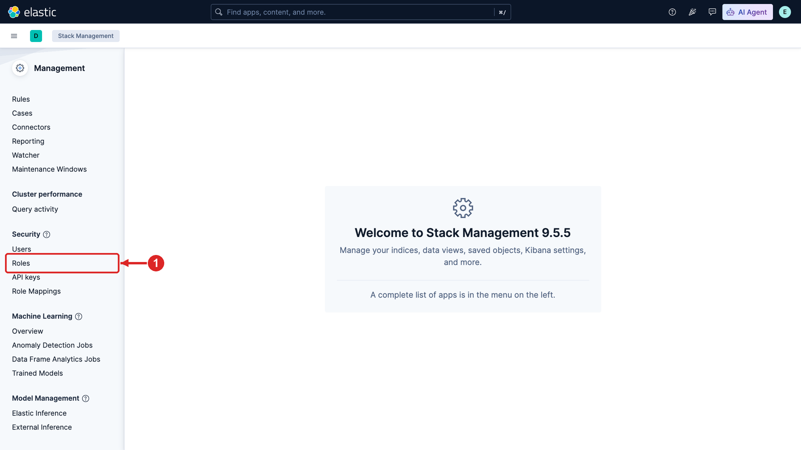

2. Listede **gvn-destek** (1):

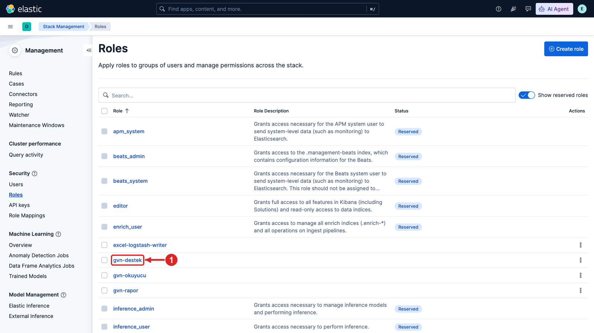

3. **Index privileges**: index deseni (1), izinler (2), **Denied fields** altında gizlenen field'lar (3) ve **Granted
   documents query** altında yalnız destek document'lerini bırakan sorgu (4):

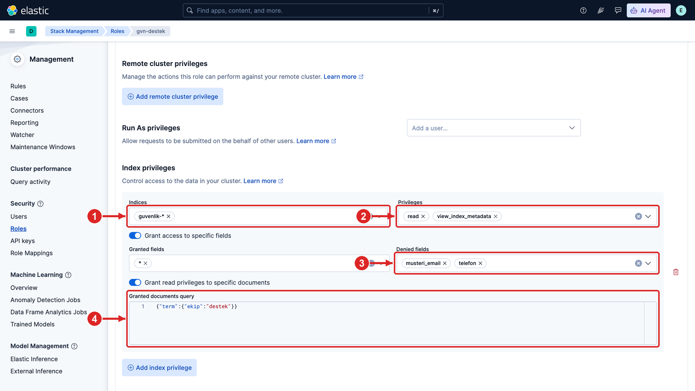

4. Aşağıda **Kibana** bölümü: Space `Destek ekibi` (1), yetki **Custom** (2); kalemle açınca yalnız Discover'ın
   okunabildiği görünür. Değiştirmeden **Cancel** ile çıkın:

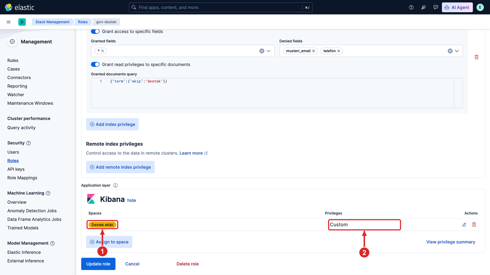

</details>

### 5. Destek kullanıcısıyla Kibana'ya girin

**Soru: Destek kullanıcısı Kibana'da neyi görür?**

1. Tarayıcıda gizli (incognito) bir pencere açıp Kibana adresine gidin. **Username** (1) `gvn_destek`, **Password** (2)
   `Guvenlik2026!`, **Log in** (3):

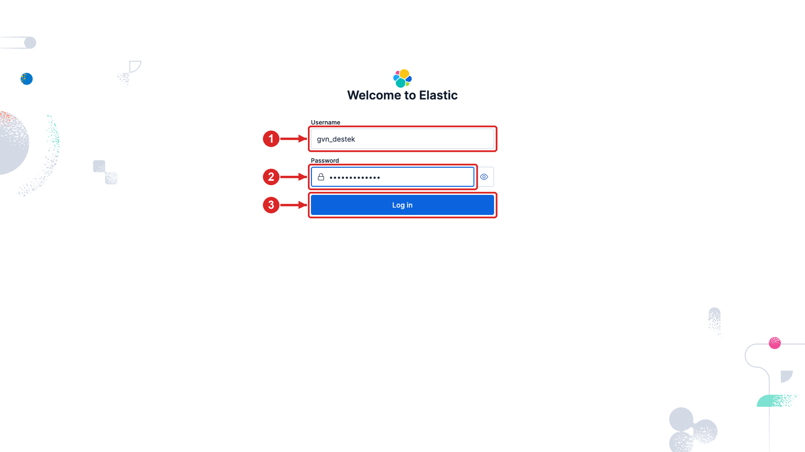

2. Kullanıcı doğrudan `Destek ekibi` Space'ine düşer: sol üstteki simge **De** (1), erişebildiği tek Space budur.
   Menüyü açın: yalnız **Discover** (2) vardır. Ona tıklayın:


3. Space'teki tek data view `Destek talepleri` seçili gelir. Zaman kutusuna (1) tıklayıp **Last 30 days**'i (2) seçin:

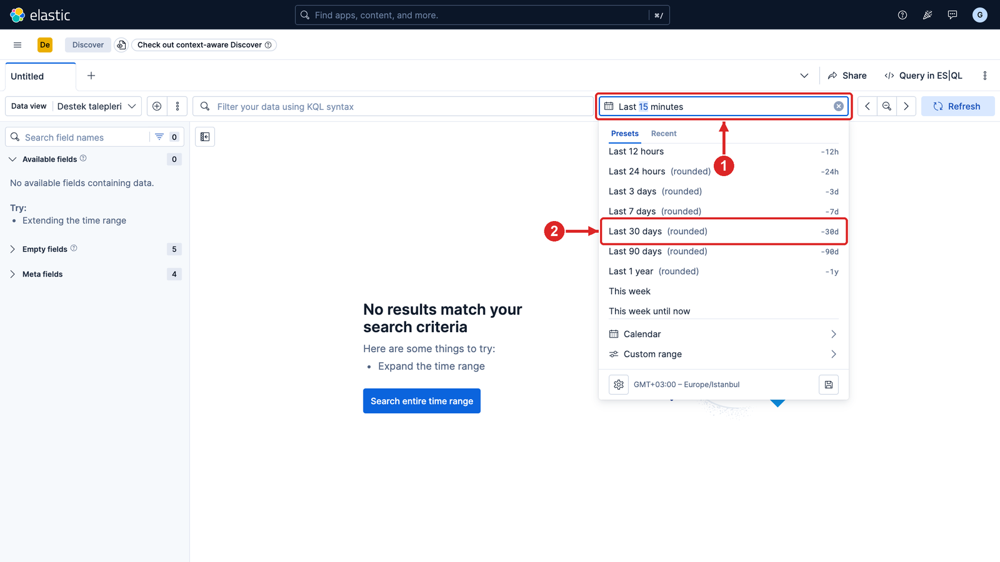

4. Document sayısı 6'dır (1): yalnız destek ekibinin talepleri. Field listesinde (2) `musteri_email` ve `telefon`
   yoktur; Kibana da Elasticsearch'teki rolün izin verdiğinden fazlasını göremez:

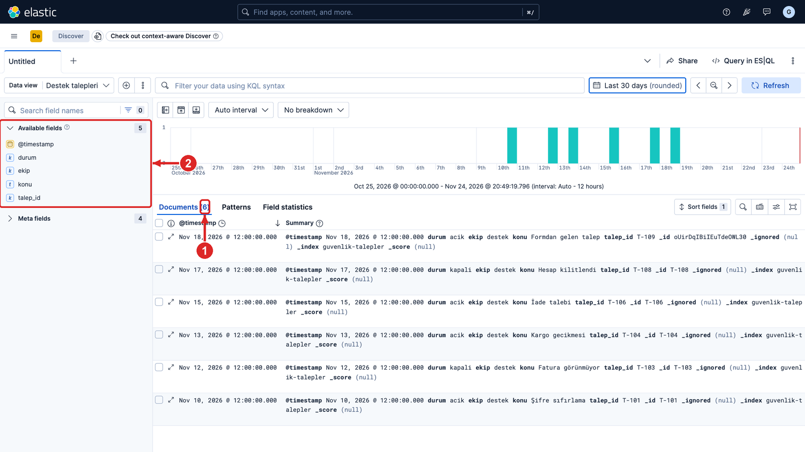

### 6. Yalnız rapor gören kullanıcı: `viewer` ve pano rolü

**Soru: Yönetim panoları görsün ama hiçbir şeyi değiştiremesin; nasıl?**

Yönetime panoları göstermek istiyoruz, ama kimse bir şey değiştirmemeli. İki yol var: yerleşik `viewer` rolü
ya da yalnız Dashboards uygulamasını açan dar bir rol:

```http
PUT /_security/user/gvn_izleyici
{ "password": "Guvenlik2026!", "roles": ["viewer"] }
```

```http
PUT kbn:/api/security/role/gvn-rapor
{
  "elasticsearch": { "indices": [ { "names": ["kibana_sample_data_ecommerce"], "privileges": ["read", "view_index_metadata"] } ] },
  "kibana": [ { "spaces": ["default"], "base": [], "feature": { "dashboard": ["read"] } } ]
}
```

```http
PUT /_security/user/gvn_rapor
{ "password": "Guvenlik2026!", "roles": ["gvn-rapor"] }
```

İki kullanıcıyla veriyi okuyun, bir document yazmayı ve Kibana API'siyle pano açmayı deneyin:

```bash
for u in gvn_izleyici gvn_rapor; do
  echo "$u: okuma $(curl -s -u "$u:Guvenlik2026!" 'http://127.0.0.1:9200/kibana_sample_data_ecommerce/_count' | jq .count)" \
    "yazma $(curl -s -o /dev/null -w '%{http_code}' -u "$u:Guvenlik2026!" -X POST 'http://127.0.0.1:9200/kibana_sample_data_ecommerce/_doc' -H 'Content-Type: application/json' -d '{"a": 1}')" \
    "pano $(curl -s -o /dev/null -w '%{http_code}' -u "$u:Guvenlik2026!" -H 'kbn-xsrf: true' -H 'Content-Type: application/json' -X POST 'http://127.0.0.1:5601/api/saved_objects/dashboard' -d '{"attributes": {"title": "deneme"}}')"
done
```

Beklenen çıktı:

```text
gvn_izleyici: okuma 4675 yazma 403 pano 403
gvn_rapor: okuma 4675 yazma 403 pano 403
```

İki kullanıcı da veriyi okur; document yazamaz, pano açamaz (403).

**viewer ile giriş.** Yeni bir gizli pencerede `gvn_izleyici` / `Guvenlik2026!` ile girin (Adım 5'in 1. maddesi).

1. `viewer` bütün Space'leri okuyabildiği için önce Space seçim ekranı gelir. **Default**'u (1) seçin:

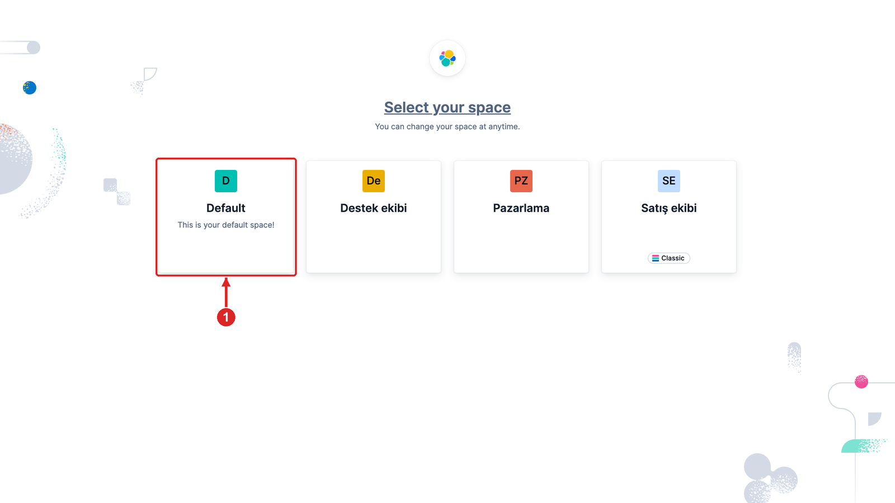

2. Menüyü açın (1): Discover, Dashboards, Maps, Machine Learning, Observability… hepsi vardır; `viewer` hepsini salt
   okunur açar. Yalnız rapor gösterilecekse bu fazladır:

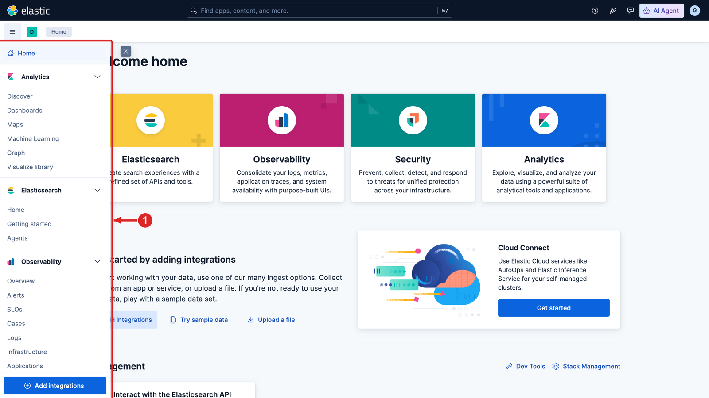

3. **Dashboards**'u açın. Listede çok pano olduğu için arama kutusuna (1) `Revenue` yazıp Enter'a basın,
   **[eCommerce] Revenue Dashboard**'a (2) tıklayın:

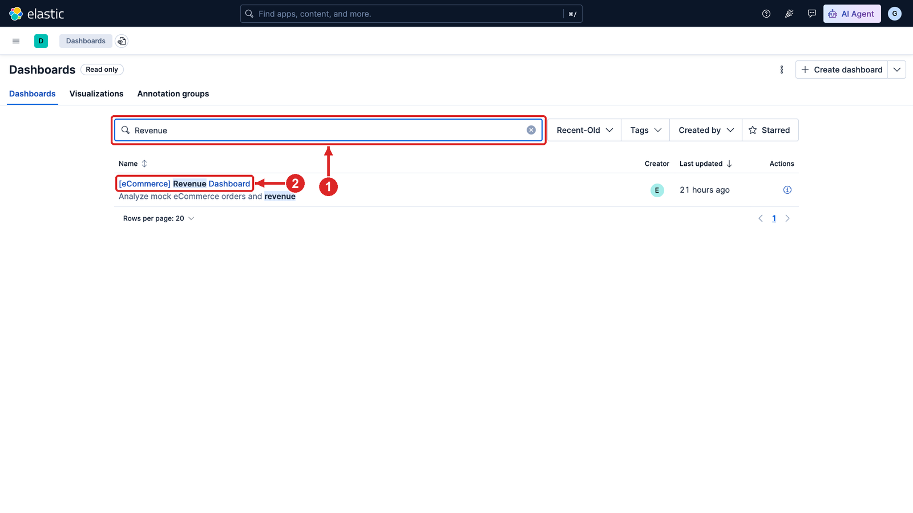

4. Pano açılır. Sağ üstte yalnız **Share** (1) ve **Export** (2) vardır; **Edit** düğmesi yoktur:

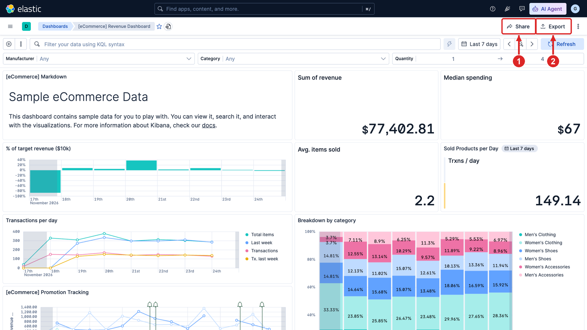

**gvn_rapor ile giriş.** Yeni bir gizli pencerede `gvn_rapor` / `Guvenlik2026!` ile girin. Tek Space'i Default
olduğu için doğrudan Home'a düşer.

1. Menüyü açın: yalnız **Dashboards** (1) vardır:

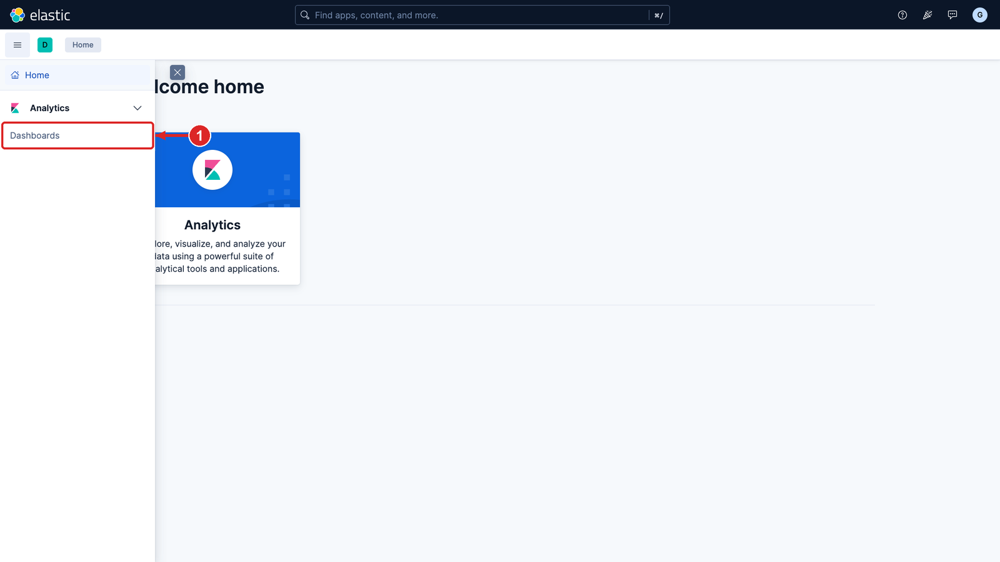

2. Aynı panoyu açın (3. maddedeki gibi). Yine yalnız **Share** ve **Export** (1) vardır:

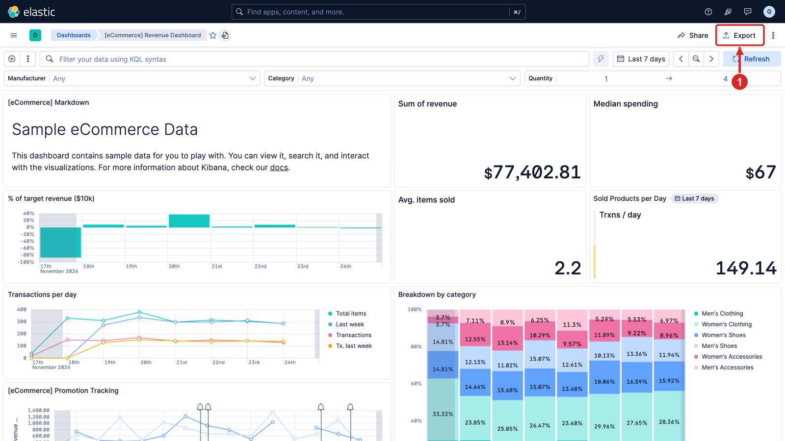

3. Adres çubuğunda adresin sonunu `/app/dev_tools` yapın: Kibana sayfayı açmaz (1). `/app/management` da
   `Application not found` verir:

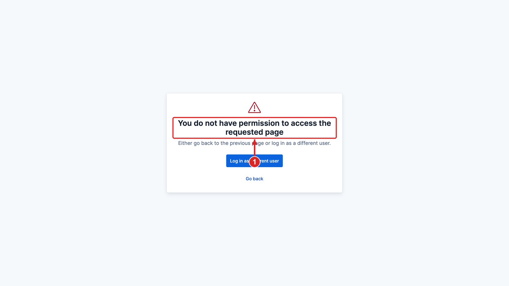

Yalnız rapor gösterilecek kullanıcıya `viewer` yerine böyle dar bir rol verilir: Kibana'da hangi uygulamayı
göreceğini rolün `kibana` bölümü, hangi veriyi okuyacağını `elasticsearch` bölümü belirler.

---

## Temizlik

Yalnız bu labın index'ini, `gvn-*` rollerini, `gvn_*` kullanıcılarını, API key'ini ve `gvn-destek` Space'ini
(içindeki data view'la) siler. `elastic` kullanıcısına, default Space'e, yerleşik `viewer` rolüne ve LAB-04'ün
örnek verisine dokunmaz:

```bash
./teardown.sh
```

Beklenen çıktı:

```text
space gvn-destek -> 204
kullanici gvn_okuyucu -> 200
kullanici gvn_destek -> 200
kullanici gvn_izleyici -> 200
kullanici gvn_rapor -> 200
rol gvn-okuyucu -> 200
rol gvn-destek -> 200
rol gvn-rapor -> 200
api key gvn-form -> {"invalidated":0}
index guvenlik-talepler -> 200
```

API key Adım 2'de iptal edildiği için burada `0` görünür.

Labı aynı sunucuda yeniden yapacaksanız başlamadan önce `./teardown.sh` çalıştırın; README'deki sayılar temiz
başlangıca göredir.

---

Sonraki lab: **[LAB-21 — Cluster Sağlığı ve API'ler: Yellow ve Red'in Nedenini Bulmak](../LAB-21-cluster-sagligi-api/README.md)**
