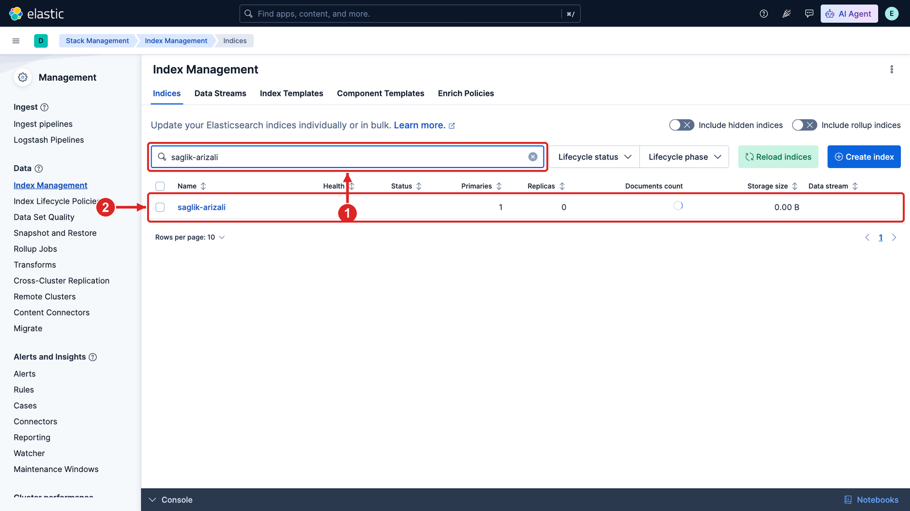

# LAB-21 — Cluster Sağlığı ve API'ler: Yellow ve Red'in Nedenini Bulmak

| Kullanılan Araçlar | Açık / Kullanılan Portlar |
|---|---|
| Kibana Dev Tools, `_cluster/health`, `_health_report`, `_cat` API'leri, allocation explain, rolling restart | 9200 (Elasticsearch), 5601 (Kibana) — LAB-01 ana cluster'ı; `19208` — LAB-19'un 3-node cluster'ı (Adım 7) |

---

## Bu lab ne öğretiyor?

Cluster sağlığı üç renkle özetlenir, ama renk nedeni söylemez. "Yellow" bir replica'nın yerleşemediğini,
"red" bir primary shard'ın yerleşemediğini, yani bir index'in verisine erişilemediğini gösterir. Bu
labda önce mevcut yellow'un, sonra bilerek ürettiğimiz bir red'in nedenini Elasticsearch'e soracak,
ikisini düzeltecek, disk dolduğunda index'in nasıl kilitlendiğini görecek ve "green ama sağlıklı
mı?" sorusu için kısa bir kontrol listesi çıkaracağız. Son adımda 3-node cluster'ı kesintisiz yeniden başlatacağız.

---

## Ön Koşullar

- LAB-01 ana cluster'ı çalışıyor.
- LAB-04'teki örnek e-ticaret verisi yüklü (`kibana_sample_data_ecommerce`). LAB-04'ü atladıysanız
  onun Adım 1'ini yapın; veri yoksa Adım 2'deki yellow görünmez, diğer adımlar yine çalışır.
- Adım 7 için LAB-19'daki 3-node cluster çalışıyor olmalı. LAB-19'u atladıysanız önce onun Adım 1, 2 ve 4'ünü çalıştırın.

```bash
cd ~/elastic/labs/LAB-21-cluster-sagligi-api
```

Adım 2'deki senaryo, örnek e-ticaret verisinin bir replica istemesine dayanır (önceki lablar ve bu labın Adım 2'si
replica'yı 0 yapar). Başlamadan replica sayısını 1 yapın:

```bash
curl -s -u elastic:'DevOps2026!' -X PUT 'http://127.0.0.1:9200/kibana_sample_data_ecommerce/_settings' \
  -H 'Content-Type: application/json' -d '{"index": {"number_of_replicas": 1}}'; echo
```

Beklenen çıktı:

```text
{"acknowledged":true}
```

---

## Kavramlar: üç renk

| Renk | Anlamı | Veri |
|---|---|---|
| `green` | Bütün primary ve replica shard'lar bir node'a yerleşmiş | Erişilir, yedekli |
| `yellow` | Primary'ler yerleşmiş, en az bir replica yerleşememiş | Erişilir, yedeksiz |
| `red` | En az bir primary yerleşememiş | O index'in (bir kısmının) verisine erişilemez |

Bir shard'ın neden yerleşmediğini **allocation explain** API'si söyler. Elasticsearch her node için
bir dizi kuralı (decider) denetler; yanıt hangi kuralın engellediğini yazar.

---

## Adım Adım Uygulama Rehberi

Bu labda `http` bloklarını Kibana › Dev Tools'a, `bash` bloklarını terminale yapıştırın.

### 1. Cluster'a ilk bakış

```http
GET /_cluster/health?filter_path=status,number_of_nodes,active_shards,unassigned_shards
```

```json
{"status": "yellow", "number_of_nodes": 1, "active_shards": 56, "unassigned_shards": 1}
```

`active_shards` sayısı yüklü verilere göre sizde farklıdır.

`_health_report` aynı soruyu konu konu (disk, shard, master, ILM...) cevaplar. Her konunun durumunu ve
bir cümlelik açıklamasını tek satırda görmek için:

```bash
curl -s -u elastic:'DevOps2026!' 'http://127.0.0.1:9200/_health_report' \
  | jq -r '.indicators | to_entries[] | "\(.value.status)\t\(.key)\t\(.value.symptom)"'
```

<details>
<summary><strong>Çıktının tamamı (10 satır)</strong></summary>

```text
green	master_is_stable	The cluster has a stable master node
green	repository_integrity	No snapshot repositories configured.
green	disk	The cluster has enough available disk space.
green	shards_capacity	The cluster has enough room to add new shards.
green	file_settings	No file-based setting changes have occurred
green	cluster_state_encryption	Cluster state encryption is not configured.
green	data_stream_lifecycle	Data streams are executing their lifecycles without issues
green	slm	No Snapshot Lifecycle Management policies configured
yellow	shards_availability	This cluster has 1 unavailable replica shard.
green	ilm	Index Lifecycle Management is running
```

</details>

Sorun yalnız `shards_availability` konusunda: bir replica yerleşemiyor. Replica az önce eklendiyse bu satır
bir süre `green … 1 creating replica shard` görünür; birkaç dakika sonra `yellow … unavailable` olur. Hangi index olduğunu
`_cat/shards` gösterir:

```bash
curl -s -u elastic:'DevOps2026!' 'http://127.0.0.1:9200/_cat/shards?h=index,shard,prirep,state,unassigned.reason' | grep -v STARTED
```

Beklenen çıktı:

```text
kibana_sample_data_ecommerce                                       0 r UNASSIGNED REPLICA_ADDED
```

`prirep` sütununda `p` primary, `r` replica'dır. `unassigned.reason` yalnız shard'ın ne zaman ortada
kaldığını söyler: `INDEX_CREATED` (index açılırken), `REPLICA_ADDED` (replica sonradan artırılınca),
`CLUSTER_RECOVERED` (cluster yeniden başlayınca). Nedenini söylemez; sizde bu üçünden biri görünür.

### 2. Yellow'un nedeni ve düzeltmesi

Elasticsearch'e bu replica'yı neden yerleştiremediğini sorun:

```http
GET /_cluster/allocation/explain?filter_path=current_state,node_allocation_decisions.deciders
{
  "index": "kibana_sample_data_ecommerce",
  "shard": 0,
  "primary": false
}
```

<details>
<summary><strong>Çıktının tamamı (14 satır)</strong></summary>

```json
{
  "current_state": "unassigned",
  "node_allocation_decisions": [
    {
      "deciders": [
        {
          "decider": "same_shard",
          "decision": "NO",
          "explanation": "a copy of this shard is already allocated to this node [[kibana_sample_data_ecommerce][0], node[aht6XyPEQQ6ns3mBHH_ALA], [P], s[STARTED], a[id=hv3pD6bKQ_GM_WKTU93tyg], failed_attempts[0]]"
        }
      ]
    }
  ]
}
```

</details>

`same_shard` kuralı `NO` diyor: bu shard'ın bir kopyası (primary) zaten o node'da. Replica, primary'nin başka bir
node'daki kopyasıdır; aynı node'a konmaz, çünkü node düşünce ikisi birden kaybolur. Ana cluster tek
node olduğu için replica hiçbir yere yerleşemez. Tek node'da doğru ayar replica sayısını sıfırlamaktır:

```http
PUT /kibana_sample_data_ecommerce/_settings
{ "number_of_replicas": 0 }
```

```http
GET /_cluster/health/kibana_sample_data_ecommerce?wait_for_status=green&timeout=30s&filter_path=status,unassigned_shards
```

```json
{"status": "green", "unassigned_shards": 0}
```

`/_cluster/health/<index>` yalnız o index'in sağlığını verir. Sunucuda başka bir yellow index varsa cluster
geneli yellow kalır; düzeltmenin işe yaradığını kendi index'inizde ölçmek bu yüzden daha güvenilirdir.

Çok node'lu cluster'da replica 1 bırakılır; yellow orada bir node'un düştüğünü ya da diskinin
dolduğunu gösterir. Replica sayısı her zaman değiştirilebilir, primary sayısı değiştirilemez.

### 3. Red üretmek: yerleşemeyen primary

Index'e "shard'ını yalnız `olmayan-node` adlı node'a koy" kuralı veriyoruz. Böyle bir node yok; gerçek
hayatta aynı durumu yanlış yazılmış bir yerleşim kuralı ya da kaybolmuş bir node üretir:

```http
PUT /saglik-arizali
{
  "settings": {
    "number_of_shards": 1,
    "number_of_replicas": 0,
    "index.routing.allocation.require._name": "olmayan-node"
  }
}
```

```json
{"acknowledged": true, "shards_acknowledged": false, "index": "saglik-arizali"}
```

```http
GET /_cluster/health/saglik-arizali?filter_path=status,unassigned_primary_shards
```

```json
{"status": "red", "unassigned_primary_shards": 1}
```

Index açıldı (`acknowledged: true`) ama `shards_acknowledged: false`: shard yerleşmedi.
Kibana'da **Stack Management › Index Management** listesinde arama kutusuna (1) `saglik-arizali` yazın;
bu index'in satırında (2) sağlık ve document sayısı sütunları boş kalır: shard hiçbir node'da olmadığı için
Elasticsearch bu index'in istatistiğini veremez. Listede sağlığı boş görünen bir index, red'in ilk işaretidir:



### 4. Red'in nedenini sormak ve düzeltmek

```http
GET /_cluster/allocation/explain?filter_path=current_state,node_allocation_decisions.deciders
{
  "index": "saglik-arizali",
  "shard": 0,
  "primary": true
}
```

<details>
<summary><strong>Çıktının tamamı (14 satır)</strong></summary>

```json
{
  "current_state": "unassigned",
  "node_allocation_decisions": [
    {
      "deciders": [
        {
          "decider": "filter",
          "decision": "NO",
          "explanation": "node does not match index setting [index.routing.allocation.require] filters [_name:\"olmayan-node\"]"
        }
      ]
    }
  ]
}
```

</details>

`filter` kuralı engelliyor ve açıklama hangi ayarın olduğunu yazıyor. Sık görülen kurallar:

| Decider | Ne demek | Çözüm |
|---|---|---|
| `filter` | Index'in `routing.allocation` kuralı node'u dışlıyor | Kuralı düzeltin ya da kaldırın |
| `same_shard` | Kopyası zaten o node'da (Adım 2) | Node ekleyin ya da replica'yı azaltın |
| `disk_threshold` | Node diski watermark sınırında (Adım 5) | Disk açın |

Kuralı kaldırın; shard hemen yerleşir:

```http
PUT /saglik-arizali/_settings
{ "index.routing.allocation.require._name": null }
```

```http
GET /_cluster/health/saglik-arizali?wait_for_status=green&timeout=30s&filter_path=status,timed_out
```

```json
{"status": "green", "timed_out": false}
```

Bir ayara `null` vermek onu varsayılanına döndürür. Node adı (`4f9d920003f7` gibi), shard ve node
kimlikleri sizde farklıdır.

### 5. Disk dolunca: index kilitlenir

Elasticsearch node diskini üç eşikle izler. Varsayılanlar:

```bash
curl -s -u elastic:'DevOps2026!' 'http://127.0.0.1:9200/_cluster/settings?include_defaults=true&filter_path=defaults.cluster.routing.allocation.disk.watermark.low,defaults.cluster.routing.allocation.disk.watermark.high,defaults.cluster.routing.allocation.disk.watermark.flood_stage' | jq -c '.defaults.cluster.routing.allocation.disk.watermark'
```

Beklenen çıktı:

```text
{"flood_stage":"95%","high":"90%","low":"85%"}
```

- `low` (%85): bu node'a yeni shard yerleştirilmez.
- `high` (%90): shard'lar bu node'dan başka node'lara taşınmaya başlar.
- `flood_stage` (%95): node'daki index'lere `read_only_allow_delete` bloğu konur; yazma durur,
  okuma ve silme sürer.

Diski doldurmadan flood stage'in index'e etkisini görmek için aynı bloğu elle koyalım:

```bash
curl -s -u elastic:'DevOps2026!' -X PUT 'http://127.0.0.1:9200/saglik-arizali/_settings' -H 'Content-Type: application/json' \
  -d '{"index.blocks.read_only_allow_delete": true}'; echo
curl -s -u elastic:'DevOps2026!' -X PUT 'http://127.0.0.1:9200/saglik-arizali/_doc/1' -H 'Content-Type: application/json' \
  -d '{"olay": "disk doldu"}' | jq -c '{status, type: .error.type}'
```

Beklenen çıktı:

```text
{"acknowledged":true}
{"status":429,"type":"cluster_block_exception"}
```

Yazma `429` ile reddedilir; hata mesajı flood-stage watermark'ı yazar. Bloğu kaldırın ve tekrar yazın:

```bash
curl -s -u elastic:'DevOps2026!' -X PUT 'http://127.0.0.1:9200/saglik-arizali/_settings' -H 'Content-Type: application/json' \
  -d '{"index.blocks.read_only_allow_delete": null}'; echo
curl -s -u elastic:'DevOps2026!' -X PUT 'http://127.0.0.1:9200/saglik-arizali/_doc/1?filter_path=result' -H 'Content-Type: application/json' \
  -d '{"olay": "disk acildi"}'; echo
```

Beklenen çıktı:

```text
{"acknowledged":true}
{"result":"created"}
```

Gerçek olayda önce disk açılır (eski index'ler silinir, disk büyütülür). Disk `high` eşiğinin altına
inince Elasticsearch bloğu kendisi kaldırır; elle kaldırmak yalnız disk açıldıktan sonra anlamlıdır.

### 6. Green ama sağlıklı mı?

Green yalnız shard'ların yerleştiğini söyler. Disk, bellek ve shard sayısı ayrıca izlenir:

```bash
curl -s -u elastic:'DevOps2026!' 'http://127.0.0.1:9200/_cat/allocation?v&h=node,shards,disk.percent,disk.avail'
curl -s -u elastic:'DevOps2026!' 'http://127.0.0.1:9200/_cat/nodes?v&h=name,heap.percent,ram.percent,cpu,node.role'
curl -s -u elastic:'DevOps2026!' 'http://127.0.0.1:9200/_cat/indices?v&h=index,health,pri,rep,docs.count,store.size&s=store.size:desc' | head -3
```

<details>
<summary><strong>Çıktının tamamı (7 satır)</strong></summary>

```text
node         shards disk.percent disk.avail
4f9d920003f7     59           14     82.1gb
name         heap.percent ram.percent cpu node.role
4f9d920003f7           21          42   8 cdfhilmrstw
index                                           health pri rep docs.count store.size
kibana_sample_data_ecommerce                    green    1   0       4675        4mb
.ds-.kibana_change_history-2026.11.21-000001    green    1   0         16    132.1kb
```

</details>

Sayılar sunucunuza ve yüklediğiniz verilere göre farklıdır; önemli olan sütunların ne söylediği:

| Kontrol | Nereden | Ne zaman sorun |
|---|---|---|
| Disk | `_cat/allocation` → `disk.percent` | %85'i geçince (low watermark) |
| Heap | `_cat/nodes` → `heap.percent` | Sürekli %85'in üstündeyse |
| Shard sayısı | `_health_report` → `shards_capacity` | Node başına çok sayıda küçük shard birikirse |
| Büyük index'ler | `_cat/indices` → `store.size` | Tek shard onlarca GB'ı geçerse |

### 7. Bakım: cluster'ı kesintisiz yeniden başlatmak (rolling restart)

Bir node'u güncellemek ya da yeniden başlatmak için durdurduğunuzda cluster, node'un taşıdığı replica'ları kalan
node'larda yeniden kurmaya kalkar; bu ağ ve disk yükü demektir ve node bir dakikada dönecekse boşunadır. Kısa bakımda
önce replica yerleşimini kapatırsınız (`primaries`: yalnız primary shard'lar yerleşir), node'u yeniden başlatır,
katılmasını bekler ve ayarı geri alırsınız. Bu adım LAB-19'daki 3-node cluster'ı kullanır; komutlar onun dizininden çalışır.

CA'yı ve parolayı shell'e yükleyin, yerleşimi kısıtlayın:

```bash
cd ../LAB-19-3-node-tls-cluster
export CA="$PWD/.ca/ca.crt"; set -a; . starter/.env; set +a
curl -s --cacert "$CA" -u "elastic:$CLUSTER_ELASTIC_PASSWORD" 'https://127.0.0.1:19208/_cluster/health?filter_path=status,number_of_nodes,unassigned_shards'; echo
curl -s --cacert "$CA" -u "elastic:$CLUSTER_ELASTIC_PASSWORD" -X PUT 'https://127.0.0.1:19208/_cluster/settings?filter_path=persistent' \
  -H 'Content-Type: application/json' -d '{"persistent": {"cluster.routing.allocation.enable": "primaries"}}'; echo
```

Beklenen çıktı:

```text
{"status":"green","number_of_nodes":3,"unassigned_shards":0}
{"persistent":{"cluster":{"routing":{"allocation":{"enable":"primaries"}}}}}
```

`es-b`'yi durdurun. Cluster iki node'la yellow olur ama veriye erişim sürer; kapalı yerleşim yüzünden eksik replica'lar
başka node'a kurulmaz (`unassigned_shards` bu yüzden yüksektir, sayı sizde farklıdır):

```bash
docker compose --env-file starter/.env -f starter/docker-compose.yml stop es-b 2>&1 | grep Stopped
curl -s --cacert "$CA" -u "elastic:$CLUSTER_ELASTIC_PASSWORD" 'https://127.0.0.1:19208/_cluster/health?wait_for_nodes=2&timeout=60s&filter_path=status,number_of_nodes,unassigned_shards'; echo
curl -s --cacert "$CA" -u "elastic:$CLUSTER_ELASTIC_PASSWORD" 'https://127.0.0.1:19208/cluster-urunler/_count?filter_path=count'; echo
```

Beklenen çıktı:

```text
 Container elastic-cluster-es-b-1 Stopped
{"status":"yellow","number_of_nodes":2,"unassigned_shards":35}
{"count":6}
```

Node'u başlatın ve cluster'a katılmasını bekleyin (`_cat/nodes` üç satır verene kadar):

```bash
docker compose --env-file starter/.env -f starter/docker-compose.yml start es-b 2>&1 | grep Started
timeout 180 bash -c 'until [ "$(curl -s --cacert "$CA" -u "elastic:$CLUSTER_ELASTIC_PASSWORD" "https://127.0.0.1:19208/_cat/nodes?h=name" | wc -l)" = 3 ]; do printf .; sleep 3; done'; echo
curl -s --cacert "$CA" -u "elastic:$CLUSTER_ELASTIC_PASSWORD" 'https://127.0.0.1:19208/_cat/nodes?v&h=name,master,node.role'
curl -s --cacert "$CA" -u "elastic:$CLUSTER_ELASTIC_PASSWORD" 'https://127.0.0.1:19208/_cluster/health?filter_path=status,number_of_nodes,unassigned_shards'; echo
```

Beklenen çıktı:

```text
 Container elastic-cluster-setup-1 Started
 Container elastic-cluster-es-b-1 Started
..............
name master node.role
es-c -      himrs
es-b -      hmrs
es-a *      hmrs
{"status":"yellow","number_of_nodes":3,"unassigned_shards":35}
```

`es-b` katıldı (üç node, `unassigned_shards` hâlâ 35) ama cluster yellow: yerleşim hâlâ kısıtlı. Ayarı `null` yaparak
varsayılana döndürün; replica'lar `es-b`'deki eski kopyalarından kısa sürede tamamlanır:

```bash
curl -s --cacert "$CA" -u "elastic:$CLUSTER_ELASTIC_PASSWORD" -X PUT 'https://127.0.0.1:19208/_cluster/settings?filter_path=persistent' \
  -H 'Content-Type: application/json' -d '{"persistent": {"cluster.routing.allocation.enable": null}}'; echo
curl -s --cacert "$CA" -u "elastic:$CLUSTER_ELASTIC_PASSWORD" 'https://127.0.0.1:19208/_cluster/health?wait_for_status=green&timeout=120s&filter_path=status,number_of_nodes,unassigned_shards'; echo
cd ../LAB-21-cluster-sagligi-api
```

Beklenen çıktı:

```text
{"persistent":{}}
{"status":"green","number_of_nodes":3,"unassigned_shards":0}
```

Bu koşuda node'un katılması yaklaşık 50 saniye, green'e dönüş ayarı geri aldıktan sonra yaklaşık 10 saniye sürdü
(sizde farklıdır). Ayarı geri almayı unutursanız cluster süresiz yellow kalır: bakım bitince `allocation.enable`
değerine bakmak kontrol listesinin parçasıdır. Üç node'u sırayla (her birinden sonra green bekleyerek) bu şekilde
yeniden başlatırsanız cluster hiç kesintisiz güncellenir.

---

## Temizlik

Bu labın index'ini siler. Örnek e-ticaret verisinin replica ayarı 0 kalır (tek node için doğru ayar):

```bash
./teardown.sh
```

Beklenen çıktı:

```text
index saglik-arizali -> 200
```

Labı aynı sunucuda yeniden yapacaksanız başlamadan önce `./teardown.sh` çalıştırın; README'deki sayılar temiz
başlangıca göredir.

---

Sonraki lab: **[LAB-22 — Index Yaşam Döngüsü: Template, Data Stream ve ILM ile Veriyi Kendiliğinden Yönetmek](../LAB-22-index-yasam-dongusu-ilm/README.md)**
