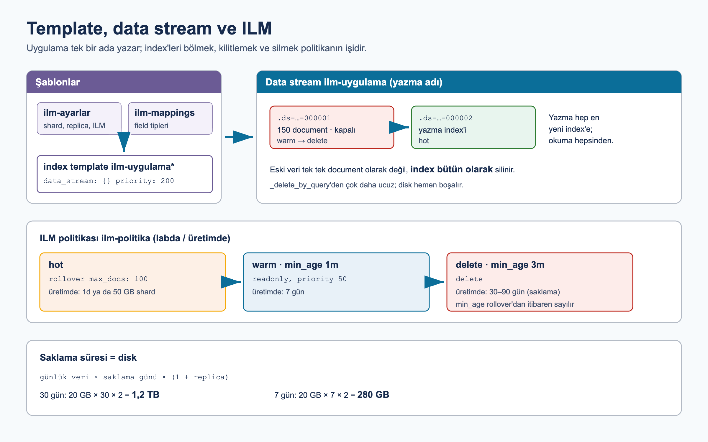

# LAB-22 — Index Yaşam Döngüsü: Template, Data Stream ve ILM ile Veriyi Kendiliğinden Yönetmek

| Kullanılan Araçlar | Açık / Kullanılan Portlar |
|---|---|
| Kibana Dev Tools, component ve index template, data stream, ILM, `_ilm/explain` | 9200 / 5601 — LAB-01 ana cluster'ı |

---

## Bu lab ne öğretiyor?

Log her gün büyür. Tek bir index'e yazılırsa shard'ı büyür, eski veri silinemez (document document silmek pahalıdır)
ve disk dolar. Çözüm, veriyi zamanla yeni index'lere bölmek ve eski index'i bütün olarak silmektir; bunu
elle yapmak yerine Elasticsearch'e bir politika olarak verilir.

Bu labda şablonla bir data stream kuracak, ILM politikasıyla rollover, warm ve delete fazlarını tetikleyecek
ve eski verinin kendiliğinden silinişini son duruma kadar izleyeceğiz.

{width=60%}

---

## Ön Koşullar

- LAB-01 ana cluster'ı çalışıyor. LAB-01'i atladıysanız onun Adım 1-2'sini çalıştırın.
- Lab yaklaşık 5 dakika boyunca ILM'in kontrol aralığını 10 saniyeye indirir (Adım 2); temizlik varsayılana
  döndürür.

```bash
cd ~/elastic/labs/LAB-22-index-yasam-dongusu-ilm
```

Kibana adresini sunucuda hesaplayın:

```bash
IP=$(curl -s https://api.ipify.org); H=$(hostname -s)
echo "Kibana: http://$IP:5601   https://$H-kibana.devopsatolyesi.com"
```

Beklenen çıktı:

```text
Kibana: http://<IP>:5601   https://<host>-kibana.devopsatolyesi.com
```

---

## Kavramlar: dört parça

| Parça | Ne yapar | Bu labda |
|---|---|---|
| Component template | Tekrar kullanılan ayar ya da mapping parçası | `ilm-ayarlar`, `ilm-mappings` |
| Index template | Hangi ada hangi parçaların uygulanacağı; data stream olup olmadığı | `ilm-uygulama*` |
| Data stream | Tek bir yazma adı; arkasında zamanla çoğalan gizli index'ler (`.ds-…`) | `ilm-uygulama` |
| ILM politikası | Index'in yaşına ya da boyutuna göre ne yapılacağı | `ilm-politika` |

Data stream'e yalnız document eklenir (`create`). Yazma hep en yeni arka plan index'ine gider; eski index'ler
okunur ve sonunda silinir.

---

## Adım Adım Uygulama Rehberi

Bu labdaki `http` blokları **Kibana › Dev Tools**'a, `bash` blokları terminale yapıştırılır.

### 1. Şablonları kurun

Ayarlar ve mapping iki ayrı component template'tir; başka şablonlar da aynı parçaları kullanabilir:

```http
PUT /_component_template/ilm-ayarlar
{ "template": { "settings": { "number_of_shards": 1, "number_of_replicas": 0, "index.lifecycle.name": "ilm-politika" } } }
```

```http
PUT /_component_template/ilm-mappings
{
  "template": { "mappings": { "properties": {
    "@timestamp": { "type": "date" }, "servis": { "type": "keyword" }, "seviye": { "type": "keyword" },
    "sure_ms": { "type": "long" }, "mesaj": { "type": "text" } } } }
}
```

Index template bu iki parçayı birleştirir ve `data_stream` satırıyla bu adın bir data stream olacağını söyler:

```http
PUT /_index_template/ilm-uygulama
{ "index_patterns": ["ilm-uygulama*"], "data_stream": {}, "composed_of": ["ilm-ayarlar", "ilm-mappings"], "priority": 200 }
```

Index açmadan, bu ada hangi ayarların uygulanacağını görün:

```http
POST /_index_template/_simulate_index/ilm-uygulama?filter_path=template.settings.index.lifecycle,template.settings.index.number_of_replicas,template.mappings.properties.servis
```

```json
{"template":{"settings":{"index":{"lifecycle":{"name":"ilm-politika"},"number_of_replicas":"0"}},"mappings":{"properties":{"servis":{"type":"keyword"}}}}}
```

`priority: 200`, yerleşik `logs-*-*` gibi şablonlarla çakışmada bizimkinin seçilmesini sağlar.

### 2. ILM politikası

```http
PUT /_ilm/policy/ilm-politika
{
  "policy": { "phases": {
    "hot":    { "actions": { "rollover": { "max_docs": 100 } } },
    "warm":   { "min_age": "1m", "actions": { "readonly": {}, "set_priority": { "priority": 50 } } },
    "delete": { "min_age": "3m", "actions": { "delete": {} } }
  } }
}
```

- `hot` / `rollover`: yazılan index 100 document'e ulaşınca yeni bir arka plan index'i açılır. Üretimde
  `max_age: 1d` ya da `max_primary_shard_size: 50gb` gibi değerler kullanılır.
- `warm`, `min_age: 1m`: rollover'dan 1 dakika sonra index salt okunur olur, önceliği düşer. Üretimde 7 gün gibi.
- `delete`, `min_age: 3m`: rollover'dan 3 dakika sonra index bütün olarak silinir. Üretimde saklama süresi
  (30, 90 gün).

ILM index'leri varsayılan olarak 10 dakikada bir kontrol eder. Fazları dakikalar içinde görmek için bu aralığı
10 saniyeye indiriyoruz; bu ayar cluster genelindedir ve bütün politikaları etkiler, temizlik geri alır:

```http
PUT /_cluster/settings
{ "persistent": { "indices.lifecycle.poll_interval": "10s" } }
```

### 3. Data stream'e yazın

150 olay gönderiyoruz. Data stream ilk document'le kendiliğinden açılır; işlem türü `create`'tir:

```bash
head -2 sample-data/olaylar-1.ndjson
curl -s -u elastic:'DevOps2026!' -H 'Content-Type: application/x-ndjson' -X POST \
  'http://127.0.0.1:9200/ilm-uygulama/_bulk?refresh=true&filter_path=errors' --data-binary @sample-data/olaylar-1.ndjson; echo
```

Beklenen çıktı:

```text
{"create": {}}
{"@timestamp": "2026-11-21T08:00:00Z", "servis": "odeme", "seviye": "info", "sure_ms": 20, "mesaj": "istek 1 tamamlandi"}
{"errors":false}
```

```http
GET /_data_stream/ilm-uygulama?filter_path=data_streams.name,data_streams.generation,data_streams.indices.index_name,data_streams.ilm_policy
```

```json
{"data_streams":[{"name":"ilm-uygulama","indices":[{"index_name":".ds-ilm-uygulama-2026.11.21-000001"}],"generation":1,"ilm_policy":"ilm-politika"}]}
```

Document'ler `ilm-uygulama` adına yazıldı ama gerçekte `.ds-ilm-uygulama-<tarih>-000001` index'inde duruyor.
Tarih sizde labı yaptığınız gündür.

### 4. Rollover: yeni arka plan index'i

İlk index'te 150 document var, eşik 100. ILM bir sonraki kontrolde (en çok birkaç kez 10 saniye) rollover yapar:

```bash
timeout 300 bash -c 'until [ "$(curl -s -u elastic:"DevOps2026!" http://127.0.0.1:9200/_data_stream/ilm-uygulama | jq .data_streams[0].generation)" = 2 ]; do printf .; sleep 5; done'; echo
curl -s -u elastic:'DevOps2026!' 'http://127.0.0.1:9200/_cat/indices/.ds-ilm-uygulama-*?h=index,docs.count&s=index'
```

Beklenen çıktı:

```text
..
.ds-ilm-uygulama-2026.11.21-000001 150
.ds-ilm-uygulama-2026.11.21-000002   0
```

Yeni gelen document'ler artık `000002`'ye yazılır; `000001` kapandı. Rollover'dan sonra index'in yaşı sayılmaya
başlar, warm ve delete fazlarının `min_age`'i bu andan itibaren işler.

### 5. warm: eski index salt okunur olur

Eski index'in warm fazını bitirmesini bekleyin (rollover'dan yaklaşık 1–2 dakika sonra) ve ayarlarına bakın:

```bash
timeout 400 bash -c 'until curl -s -u elastic:"DevOps2026!" http://127.0.0.1:9200/ilm-uygulama/_ilm/explain | jq -e "[.indices[] | select(.phase==\"warm\" and .step==\"complete\")] | length == 1" >/dev/null; do printf .; sleep 5; done'; echo
curl -s -u elastic:'DevOps2026!' 'http://127.0.0.1:9200/ilm-uygulama/_ilm/explain?filter_path=indices.*.phase,indices.*.step' | jq -c '.indices | to_entries | map({index: .key[-6:], phase: .value.phase, step: .value.step})'
curl -s -u elastic:'DevOps2026!' 'http://127.0.0.1:9200/.ds-ilm-uygulama-*-000001/_settings?filter_path=*.settings.index.blocks.write,*.settings.index.priority' | jq -c '.[].settings.index'
```

Beklenen çıktı:

```text
..............
[{"index":"000001","phase":"warm","step":"complete"},{"index":"000002","phase":"hot","step":"check-rollover-ready"}]
{"blocks":{"write":"true"},"priority":"50"}
```

`blocks.write: true`: eski index artık yazmaya kapalı, okumaya açık. `priority: 50`: node yeniden başladığında
önce yüksek öncelikli (hot) index'ler kurtarılır.

### 6. delete: eski veri kendiliğinden silinir

Rollover'dan yaklaşık 3–4 dakika sonra eski index silinir. Data stream'de tek index kalana kadar bekleyin:

```bash
timeout 600 bash -c 'until [ "$(curl -s -u elastic:"DevOps2026!" http://127.0.0.1:9200/_data_stream/ilm-uygulama | jq ".data_streams[0].indices | length")" = 1 ]; do printf .; sleep 5; done'; echo
curl -s -u elastic:'DevOps2026!' 'http://127.0.0.1:9200/_data_stream/ilm-uygulama?filter_path=data_streams.indices.index_name' | jq -c .
curl -s -u elastic:'DevOps2026!' 'http://127.0.0.1:9200/ilm-uygulama/_count?filter_path=count'; echo
```

Beklenen çıktı:

```text
............................
{"data_streams":[{"indices":[{"index_name":".ds-ilm-uygulama-2026.11.21-000002"}]}]}
{"count":0}
```

Bu koşuda rollover ilk kontrolde (10 sn), warm yaklaşık 70 sn, silme yaklaşık 3,5 dk sonra gerçekleşti;
labın tamamı 4 dakikadan kısa sürdü.

150 olay `000001` ile birlikte silindi; tek tek document silinmedi, index bütün olarak gitti. Bu, büyük veride
`_delete_by_query`'den çok daha ucuzdur.

Saklama süresi diski doğrudan belirler: **günlük veri × saklama günü × (1 + replica sayısı)**. Günde 20 GB
log, 30 gün saklama ve 1 replica yaklaşık 20 × 30 × 2 = 1,2 TB eder; saklamayı 7 güne indirmek bunu 280 GB'a
düşürür. Saklama süresini iş ihtiyacı belirler, ILM'in `delete` fazı uygular.

<details>
<summary><strong>Silmeden önce snapshot beklemek: <code>wait_for_snapshot</code></strong></summary>

Silinecek verinin bir yedeği olması gerekiyorsa `delete` fazının başına `wait_for_snapshot` eklenir. ILM,
belirtilen SLM politikası index'in snapshot'ını alana kadar silmeyi bekler. SLM politikası ve snapshot deposu
önceden var olmalıdır:

```json
"delete": {
  "min_age": "30d",
  "actions": {
    "wait_for_snapshot": { "policy": "gunluk-snapshot" },
    "delete": {}
  }
}
```

</details>

---

## Temizlik

Yalnız bu labın data stream'ini (arka plan index'leriyle), şablonlarını ve politikasını siler; ILM kontrol
aralığını varsayılana (10 dakika) döndürür. Ana cluster'daki diğer verilere dokunmaz:

```bash
./teardown.sh
```

Beklenen çıktı:

```text
data stream ilm-uygulama -> 200
index template ilm-uygulama -> 200
component template ilm-ayarlar -> 200
component template ilm-mappings -> 200
ILM politikasi ilm-politika -> 200
poll_interval varsayilan -> true
```

Labı aynı sunucuda yeniden yapacaksanız başlamadan önce `./teardown.sh` çalıştırın; README'deki sayılar temiz
başlangıca göredir.

---

Sonraki lab: **[LAB-23 — Cluster Operasyonu: Snapshot, SLM, Geri Yükleme ve Node Boşaltma](../LAB-23-cluster-operasyonu-snapshot/README.md)**
