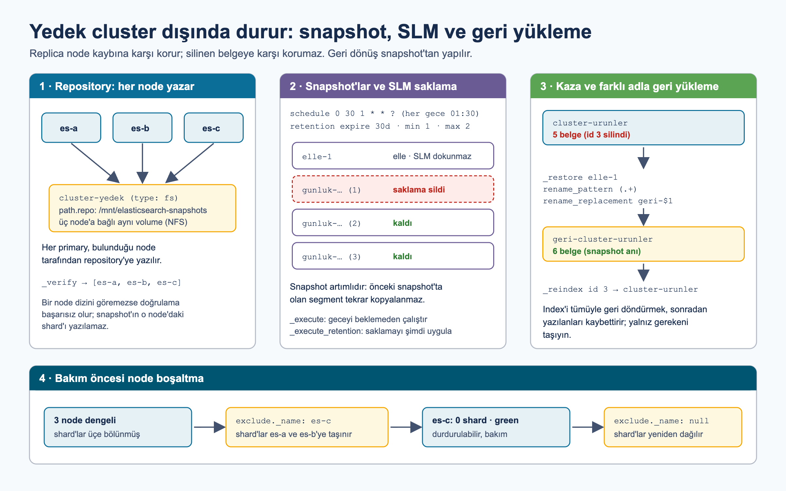

# LAB-23 — Cluster Operasyonu: Snapshot, SLM, Geri Yükleme ve Node Boşaltma

| Kullanılan Araçlar | Açık / Kullanılan Portlar |
|---|---|
| LAB-19'un 3-node TLS cluster'ı, snapshot repository (`fs`), SLM, `curl`, `jq` | `127.0.0.1:19208` (LAB-19 cluster'ı, HTTPS). Yeni port açılmaz. |

---

## Bu lab ne öğretiyor?

Replica, node kaybına karşı korur ama yanlışlıkla silinen document'e karşı korumaz: silme işlemi replica'lara da
aynen gider. Geri dönüş için cluster dışında, belirli bir ana ait bir kopya gerekir: snapshot.

Bu labda bir snapshot repository kuracak, elle snapshot alacak, bir document'i "kazayla" silip snapshot'tan farklı
adla geri yükleyecek, snapshot'ları SLM ile zamanlayıp saklama kuralıyla eskilerini sildirecek ve bakım öncesi bir
node'u shard'lardan boşaltacağız.

{width=60%}

---

## Ön Koşullar

- LAB-19'un 3-node cluster'ı çalışıyor ve `cluster-urunler` index'inde 6 document var.
- LAB-19'u atladıysanız önce onun Adım 1, 2 ve 4'ünü çalıştırın.

CA'yı ve parolayı bu kabuğa yükleyip cluster'a bakın:

```bash
cd ~/elastic/labs/LAB-23-cluster-operasyonu-snapshot
export CA="$(cd ../LAB-19-3-node-tls-cluster && pwd)/.ca/ca.crt"; set -a; . ../LAB-19-3-node-tls-cluster/starter/.env; set +a
curl -s --cacert "$CA" -u "elastic:$CLUSTER_ELASTIC_PASSWORD" 'https://127.0.0.1:19208/_cat/count/cluster-urunler?h=count'
```

Beklenen çıktı:

```text
6
```


---

## Kavramlar: snapshot ve SLM

| Kavram | Ne | Karar kuralı |
|---|---|---|
| Repository | Snapshot'ların yazıldığı yer: paylaşılan dizin (`fs`), S3, GCS, Azure | Her node aynı yere yazabilmeli; yoksa doğrulama başarısız olur |
| Snapshot | Seçilen index'lerin o anki segment dosyaları | Artımlıdır: önceki snapshot'ta olan segment tekrar kopyalanmaz |
| Restore | Snapshot'tan index'i geri açmak | Açık bir index'in üstüne yazılmaz; farklı adla açıp gerekeni taşıyın |
| SLM | Snapshot'ı zamanlayan ve eskilerini silen politika | Snapshot'ı elle almak unutulur; zamanlama ve saklama tek yerde durur |

---

## Config dosyaları: hangi satır ne işe yarıyor?

`../LAB-19-3-node-tls-cluster/starter/docker-compose.yml` (her node'da aynı):

```yaml
      path.repo: /mnt/elasticsearch-snapshots
    volumes:
    - snapshots:/mnt/elasticsearch-snapshots
```

- `path.repo`: `fs` türü repository'nin yalnız bu dizinin altında açılmasına izin verir. Elasticsearch'ü diskte
  istenen her yere yazdırmak böyle engellenir.
- `snapshots` volume'ü üç node'a da aynı dizin olarak bağlanır. Gerçek sunucularda bu, her node'a bağlanmış bir
  NFS paylaşımıdır; tek node'un yerel diski olursa öteki node'lar kendi shard'larını yazamaz.

---

## Adım Adım Uygulama Rehberi

### 1. Snapshot repository

```bash
curl -s --cacert "$CA" -u "elastic:$CLUSTER_ELASTIC_PASSWORD" -X PUT 'https://127.0.0.1:19208/_snapshot/cluster-yedek' \
  -H 'Content-Type: application/json' -d '{"type": "fs", "settings": {"location": "cluster-yedek"}}'; echo
curl -s --cacert "$CA" -u "elastic:$CLUSTER_ELASTIC_PASSWORD" -X POST 'https://127.0.0.1:19208/_snapshot/cluster-yedek/_verify' | jq -c '[.nodes[].name] | sort'
```

```json
{"acknowledged":true}
["es-a","es-b","es-c"]
```

`location`, `path.repo`'nun altındaki dizindir. `_verify` her node'a repository'ye bir deneme dosyası yazdırır;
listede üç node da var, yani her node kendi shard'ını yedekleyebilir.

### 2. Elle snapshot

```bash
curl -s --cacert "$CA" -u "elastic:$CLUSTER_ELASTIC_PASSWORD" -X PUT 'https://127.0.0.1:19208/_snapshot/cluster-yedek/elle-1?wait_for_completion=true' \
  -H 'Content-Type: application/json' -d '{"indices": "cluster-urunler", "include_global_state": false}' | jq -c '.snapshot | {snapshot, state, indices, shards}'
```

```json
{"snapshot":"elle-1","state":"SUCCESS","indices":["cluster-urunler"],"shards":{"total":3,"failed":0,"successful":3}}
```

- `wait_for_completion=true` snapshot bitene kadar bekler; büyük index'te bunu vermeyin ve durumu
  `_snapshot/cluster-yedek/elle-1` ile izleyin.
- `include_global_state: false`: cluster ayarları ve şablonlar snapshot'a girmez; yalnız index geri yüklenir.
- Üç shard'ın üçü de başarılı: her primary, bulunduğu node tarafından yazıldı.

### 3. Kaza ve farklı adla geri yükleme

Bir document'i "kazayla" silin:

```bash
curl -s --cacert "$CA" -u "elastic:$CLUSTER_ELASTIC_PASSWORD" -X POST 'https://127.0.0.1:19208/cluster-urunler/_delete_by_query?refresh=true&filter_path=deleted' \
  -H 'Content-Type: application/json' -d '{"query": {"ids": {"values": ["3"]}}}'; echo
```

```json
{"deleted":1}
```

Snapshot'taki index aynı adla açılamaz, çünkü `cluster-urunler` açık ve yazılmaya devam ediyor. `rename_pattern` ve
`rename_replacement` ile `geri-` önekiyle açın ve iki index'i sayın:

```bash
curl -s --cacert "$CA" -u "elastic:$CLUSTER_ELASTIC_PASSWORD" -X POST 'https://127.0.0.1:19208/_snapshot/cluster-yedek/elle-1/_restore?wait_for_completion=true&filter_path=snapshot.indices,snapshot.shards' \
  -H 'Content-Type: application/json' -d '{"indices": "cluster-urunler", "rename_pattern": "(.+)", "rename_replacement": "geri-$1"}'; echo
for i in cluster-urunler geri-cluster-urunler; do printf '%-22s ' "$i"; curl -s --cacert "$CA" -u "elastic:$CLUSTER_ELASTIC_PASSWORD" "https://127.0.0.1:19208/$i/_count" | jq .count; done
```

Beklenen çıktı:

```text
{"snapshot":{"indices":["geri-cluster-urunler"],"shards":{"total":3,"failed":0,"successful":3}}}
cluster-urunler        5
geri-cluster-urunler   6
```

`(.+)` index adının tamamını yakalar, `$1` onu yerine koyar. Canlı index 5 document, snapshot anı 6 document. Yalnız
eksik document'i `_reindex` ile canlı index'e geri taşıyın:

```bash
curl -s --cacert "$CA" -u "elastic:$CLUSTER_ELASTIC_PASSWORD" -X POST 'https://127.0.0.1:19208/_reindex?refresh=true&filter_path=created' \
  -H 'Content-Type: application/json' -d '{"source": {"index": "geri-cluster-urunler", "query": {"ids": {"values": ["3"]}}}, "dest": {"index": "cluster-urunler"}}'; echo
curl -s --cacert "$CA" -u "elastic:$CLUSTER_ELASTIC_PASSWORD" 'https://127.0.0.1:19208/cluster-urunler/_doc/3?filter_path=_source'; echo
```

```json
{"created":1}
{"_source":{"ad":"Termos"}}
```

Index'i tümüyle snapshot'a döndürmek, snapshot'tan sonra yazılan document'leri kaybettirir. Farklı adla açıp yalnız
gerekeni taşımak bu yüzden daha güvenlidir.

### 4. SLM: zamanlanmış snapshot ve saklama

Her gece 01:30'da `cluster-*` index'lerinin snapshot'ını alan bir politika kurun. Saklama kuralı: 30 günden eskiler
silinir, ama her zaman en az 1, en çok 2 snapshot kalır (laboratuvarda farkı görmek için küçük tutuldu):

```bash
curl -s --cacert "$CA" -u "elastic:$CLUSTER_ELASTIC_PASSWORD" -X PUT 'https://127.0.0.1:19208/_slm/policy/cluster-gunluk' \
  -H 'Content-Type: application/json' -d '{
    "schedule": "0 30 1 * * ?",
    "name": "<gunluk-{now/d}>",
    "repository": "cluster-yedek",
    "config": {"indices": ["cluster-*"], "include_global_state": false},
    "retention": {"expire_after": "30d", "min_count": 1, "max_count": 2}
  }'; echo
```

```json
{"acknowledged":true}
```

- `schedule` bir cron ifadesidir: saniye, dakika, saat, gün, ay, haftanın günü.
- `name` içindeki `{now/d}` günün tarihidir; SLM sonuna benzersiz bir ek koyar, aynı gün birden çok çalışma
  çakışmaz.

Geceyi beklemeden politikayı üç kez çalıştırın; her seferinde snapshot bitene kadar bekleyin:

```bash
for i in 1 2 3; do
  export AD=$(curl -s --cacert "$CA" -u "elastic:$CLUSTER_ELASTIC_PASSWORD" -X POST 'https://127.0.0.1:19208/_slm/policy/cluster-gunluk/_execute' | jq -r .snapshot_name)
  timeout 60 bash -c 'until curl -s --cacert "$CA" -u "elastic:$CLUSTER_ELASTIC_PASSWORD" "https://127.0.0.1:19208/_snapshot/cluster-yedek/$AD" | jq -e ".snapshots[0].state == \"SUCCESS\"" >/dev/null 2>&1; do sleep 1; done'
done
curl -s --cacert "$CA" -u "elastic:$CLUSTER_ELASTIC_PASSWORD" 'https://127.0.0.1:19208/_cat/snapshots/cluster-yedek?h=id,status&s=start_epoch'
```

Beklenen çıktı:

```text
elle-1                                   SUCCESS
gunluk-2026.11.21-ffwncwmtromlvfa1ucdgea SUCCESS
gunluk-2026.11.21-bjr-alh-taiodp6xhib2sg SUCCESS
gunluk-2026.11.21-qmtc148at2ayhvz0wgebgg SUCCESS
```

Dört snapshot var: elle aldığınız `elle-1` ve SLM'nin üç snapshot'ı (adların sonundaki ek sizde farklıdır). Saklama kuralı kendi zamanlamasıyla
(`slm.retention_schedule`, varsayılan her gün 01:30) çalışır; şimdi çalıştırın:

```bash
curl -s --cacert "$CA" -u "elastic:$CLUSTER_ELASTIC_PASSWORD" -X POST 'https://127.0.0.1:19208/_slm/_execute_retention'; echo
timeout 60 bash -c 'until [ "$(curl -s --cacert "$CA" -u "elastic:$CLUSTER_ELASTIC_PASSWORD" https://127.0.0.1:19208/_cat/snapshots/cluster-yedek?h=id | wc -l)" -le 3 ]; do sleep 2; done'
curl -s --cacert "$CA" -u "elastic:$CLUSTER_ELASTIC_PASSWORD" 'https://127.0.0.1:19208/_cat/snapshots/cluster-yedek?h=id,status&s=start_epoch'
```

Beklenen çıktı:

```text
{"acknowledged":true}
elle-1                                   SUCCESS
gunluk-2026.11.21-bjr-alh-taiodp6xhib2sg SUCCESS
gunluk-2026.11.21-qmtc148at2ayhvz0wgebgg SUCCESS
```

SLM'nin en eski snapshot'ı silindi, `max_count: 2` sağlandı. `elle-1` yerinde: saklama kuralı yalnız bu
politikanın aldığı snapshot'lara dokunur.

### 5. Bakım öncesi node boşaltma

Bir node'u yeniden başlatmadan ya da değiştirmeden önce shard'larını öteki node'lara taşıyın. Shard sayısı, sistem
index'leriyle birlikte node başına:

```bash
curl -s --cacert "$CA" -u "elastic:$CLUSTER_ELASTIC_PASSWORD" 'https://127.0.0.1:19208/_cat/allocation?h=node,shards&s=node'
curl -s --cacert "$CA" -u "elastic:$CLUSTER_ELASTIC_PASSWORD" -X PUT 'https://127.0.0.1:19208/_cluster/settings' \
  -H 'Content-Type: application/json' -d '{"persistent": {"cluster.routing.allocation.exclude._name": "es-c"}}' | jq -c .persistent
timeout 180 bash -c 'until [ "$(curl -s --cacert "$CA" -u "elastic:$CLUSTER_ELASTIC_PASSWORD" "https://127.0.0.1:19208/_cat/allocation/es-c?h=shards" | tr -d " ")" = 0 ]; do printf .; sleep 2; done'; echo
curl -s --cacert "$CA" -u "elastic:$CLUSTER_ELASTIC_PASSWORD" 'https://127.0.0.1:19208/_cat/allocation?h=node,shards&s=node'
curl -s --cacert "$CA" -u "elastic:$CLUSTER_ELASTIC_PASSWORD" 'https://127.0.0.1:19208/_cluster/health?filter_path=status'; echo
```

Beklenen çıktı:

```text
es-a 39
es-b 38
es-c 39
{"cluster":{"routing":{"allocation":{"exclude":{"_name":"es-c"}}}}}
...........
es-a 58
es-b 58
es-c  0
{"status":"green"}
```

Shard sayıları sistem index'lerine göre sizde biraz farklı olabilir; önemli olan `es-c`'nin 0'a inmesidir.
`exclude._name` hiçbir shard'ın `es-c`'de kalmamasını söyler; Elasticsearch shard'ları kopyalayıp taşır ve cluster
bu sırada green kalır. Artık `es-c` durdurulabilir; veri öteki iki node'dadır. Bakım bitince ayarı kaldırın,
shard'lar yeniden dağılır:

```bash
curl -s --cacert "$CA" -u "elastic:$CLUSTER_ELASTIC_PASSWORD" -X PUT 'https://127.0.0.1:19208/_cluster/settings' \
  -H 'Content-Type: application/json' -d '{"persistent": {"cluster.routing.allocation.exclude._name": null}}' | jq -c .persistent
timeout 180 bash -c 'until curl -s --cacert "$CA" -u "elastic:$CLUSTER_ELASTIC_PASSWORD" "https://127.0.0.1:19208/_cat/allocation?h=shards" | awk "{n[NR]=\$1} END {mn=n[1]; mx=n[1]; for (i in n) {if (n[i]<mn) mn=n[i]; if (n[i]>mx) mx=n[i]}; exit (mx-mn > 2)}"; do printf .; sleep 2; done'; echo
curl -s --cacert "$CA" -u "elastic:$CLUSTER_ELASTIC_PASSWORD" 'https://127.0.0.1:19208/_cat/allocation?h=node,shards&s=node'
```

Beklenen çıktı:

```text
{}
.....
es-a 38
es-b 38
es-c 38
```

Döngü, node'lar arasındaki fark en çok 2 shard olana kadar bekler; taşıma dalgalar hâlinde yapılır, "taşınan shard
yok" anı dengelendi anlamına gelmez. Ayar `persistent` olduğu için cluster yeniden başlasa da kalır; kaldırmayı
unutmak node'u kalıcı olarak boş bırakır.

<details>
<summary><strong>Segment ve translog: force merge, dayanıklılık ayarı</strong></summary>

Her `refresh` yeni bir segment açar. Artık yazılmayan bir index'te (eski aylar, arşiv) segmentleri tek segmentte
birleştirmek aramayı hızlandırır ve snapshot'ı küçültür. Beş ayrı yazımla beş segment oluşturun, index'i yazmaya
kapatıp birleştirin:

```bash
curl -s --cacert "$CA" -u "elastic:$CLUSTER_ELASTIC_PASSWORD" -X PUT 'https://127.0.0.1:19208/cluster-arsiv' \
  -H 'Content-Type: application/json' -d '{"settings": {"number_of_shards": 1, "number_of_replicas": 1}}' -o /dev/null
for i in 1 2 3 4 5; do printf '%s\n' '{"index":{}}' "{\"parti\": $i}" | curl -s --cacert "$CA" -u "elastic:$CLUSTER_ELASTIC_PASSWORD" -X POST \
  'https://127.0.0.1:19208/cluster-arsiv/_bulk?refresh=true' -H 'Content-Type: application/x-ndjson' --data-binary @- -o /dev/null; done
curl -s --cacert "$CA" -u "elastic:$CLUSTER_ELASTIC_PASSWORD" 'https://127.0.0.1:19208/cluster-arsiv/_stats/segments?filter_path=_all.primaries.segments.count'; echo
curl -s --cacert "$CA" -u "elastic:$CLUSTER_ELASTIC_PASSWORD" -X PUT 'https://127.0.0.1:19208/cluster-arsiv/_settings' \
  -H 'Content-Type: application/json' -d '{"index.blocks.write": true}'; echo
curl -s --cacert "$CA" -u "elastic:$CLUSTER_ELASTIC_PASSWORD" -X POST 'https://127.0.0.1:19208/cluster-arsiv/_forcemerge?max_num_segments=1&filter_path=_shards'; echo
curl -s --cacert "$CA" -u "elastic:$CLUSTER_ELASTIC_PASSWORD" 'https://127.0.0.1:19208/cluster-arsiv/_stats/segments?filter_path=_all.primaries.segments.count'; echo
```

```json
{"_all":{"primaries":{"segments":{"count":5}}}}
{"acknowledged":true}
{"_shards":{"total":2,"successful":2,"failed":0}}
{"_all":{"primaries":{"segments":{"count":1}}}}
```

Force merge yazılmaya devam eden index'te yapılmaz: birleşen dev segment silinen document'leri uzun süre taşır ve
yeniden birleştirilmesi pahalıdır. Yazmayı kapatmak (`index.blocks.write`) bunu garanti eder.

Translog, henüz segmente yazılmamış işlemlerin diskteki kaydıdır; node çökerse açılışta buradan geri oynatılır.
Ayarı görün:

```bash
curl -s --cacert "$CA" -u "elastic:$CLUSTER_ELASTIC_PASSWORD" 'https://127.0.0.1:19208/cluster-arsiv/_settings?include_defaults=true&filter_path=**.translog.durability,**.translog.sync_interval'; echo
```

```json
{"cluster-arsiv":{"defaults":{"index":{"translog":{"sync_interval":"5s","durability":"REQUEST"}}}}}
```

| `index.translog.durability` | Ne zaman diske yazar (fsync) | Çökmede |
|---|---|---|
| `request` (varsayılan) | Her istekte, cevap dönmeden önce | Onaylanan yazım kaybolmaz |
| `async` | `sync_interval`'da bir (varsayılan 5 sn) | Son 5 saniyede onaylanmış yazımlar kaybolabilir |

`async` yazmayı hızlandırır ama kaybı kabul etmek demektir; yalnız yeniden üretilebilen veride (ör. yeniden
yüklenebilecek bir toplu aktarım) düşünülür.

`elasticdump` gibi üçüncü parti araçlar index'i JSON dosyasına döker; resmi yedekleme yolu snapshot/restore'dur.

</details>

---

## Temizlik

Yalnız bu labın SLM politikasını, snapshot'larını, repository'sini, `geri-cluster-urunler` ve `cluster-arsiv` index'lerini ve node
boşaltma ayarını siler. 3-node cluster ve `cluster-urunler` LAB-19'a aittir ve çalışmaya devam eder; cluster'ı
kaldırmak için ardından `../LAB-19-3-node-tls-cluster/teardown.sh` çalıştırın. Ana cluster etkilenmez:

```bash
./teardown.sh
```

Beklenen çıktı:

```text
SLM politikasi cluster-gunluk -> 200
snapshot'lar (3) -> 200
repository cluster-yedek -> 200
index geri-cluster-urunler -> 200
index cluster-arsiv -> 200
node bosaltma ayari -> 200
```

Labı aynı sunucuda yeniden yapacaksanız başlamadan önce `./teardown.sh` çalıştırın; README'deki sayılar temiz
başlangıca göredir.

---

Sonraki lab: **[LAB-24 — Performans Teşhisi: Slow Log, Profile API ve Tasks ile Yavaş Sorguyu Bulmak](../LAB-24-performans-teshisi/README.md)**
