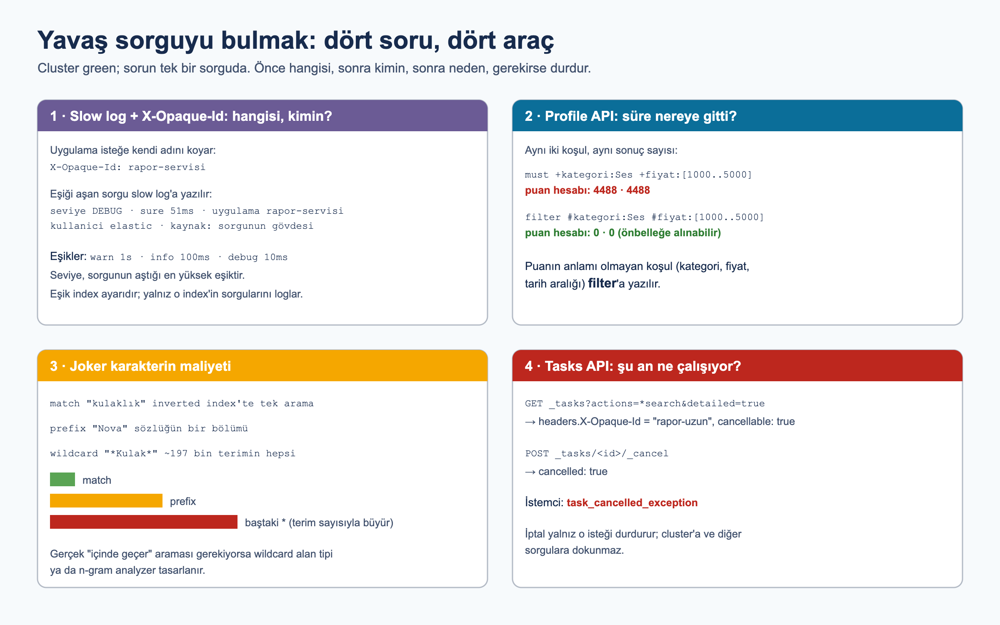
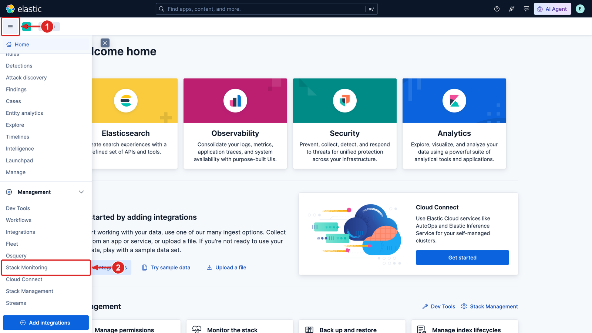
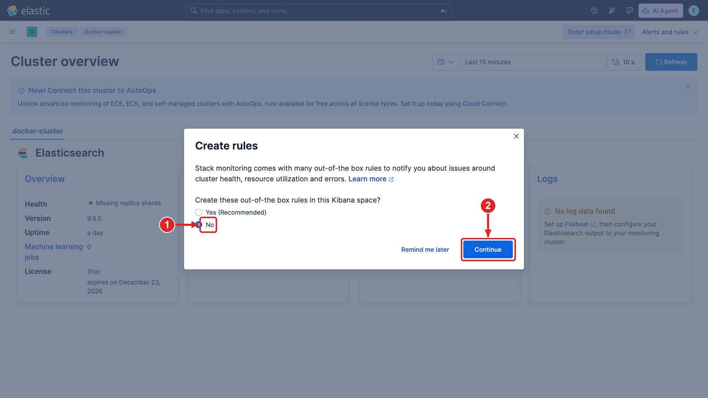
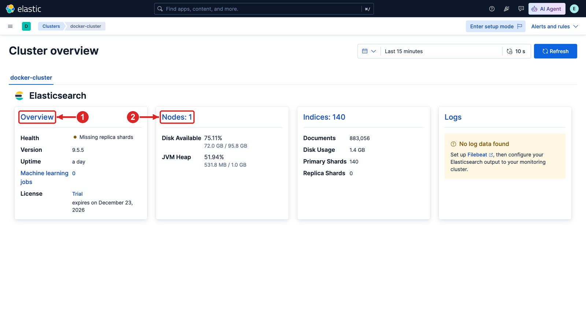
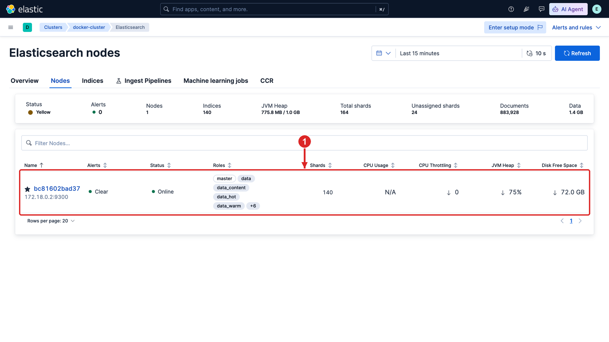

# LAB-24 — Performans Teşhisi: Slow Log, Profile API ve Tasks ile Yavaş Sorguyu Bulmak

| Kullanılan Araçlar | Açık / Kullanılan Portlar |
|---|---|
| Search slow log, `X-Opaque-Id`, Profile API, Tasks API, Metricbeat ile Stack Monitoring, Kibana Dev Tools | 9200 / 5601 — LAB-01 ana cluster'ı |

---

## Bu lab ne öğretiyor?

"Arama bazen çok yavaş" şikâyeti geldiğinde cluster genelde green'dir; sorun tek bir sorgudadır. Hangi sorgu,
hangi uygulamadan, ne kadar sürdü ve süresini nerede harcadı sorularının her biri ayrı bir araçla cevaplanır.

Bu labda 200 bin ürünlük bir index'te:

- Slow log ile yavaş sorguyu ve onu gönderen uygulamayı bulacağız.
- Profile API ile `must` ve `filter` farkını, joker karakterli sorgunun maliyetini ölçeceğiz.
- Uzun süren bir sorguyu Tasks API ile bulup iptal edeceğiz.
- Stack Monitoring ile cluster'ı sürekli izleyeceğiz.



---

## Ön Koşullar

- LAB-01 ana cluster'ı çalışıyor. LAB-01'i atladıysanız onun Adım 1-2'sini çalıştırın.
- Diğer lablara bağlı değildir; veri betikle üretilir. Adım 5'teki sorgu iptal edilene kadar bir işlemci çekirdeğini meşgul eder.

```bash
cd ~/elastic/labs/LAB-24-performans-teshisi
```

Kibana adresini sunucuda hesaplayın:

```bash
IP=$(curl -s https://api.ipify.org); H=$(hostname -s)
echo "Kibana: http://$IP:5601   https://$H-kibana.devopsatolyesi.com"
```

Beklenen çıktı:

```text
Kibana: http://<IP>:5601   https://<host>-kibana.devopsatolyesi.com
```

---

## Kavramlar: hangi soru, hangi araç?

| Soru | Araç | Ne verir |
|---|---|---|
| Hangi sorgular yavaş? | Search slow log | Eşiği aşan her sorgunun süresi, gövdesi, kullanıcısı |
| Hangi uygulama gönderdi? | `X-Opaque-Id` başlığı | Uygulamanın isteğe koyduğu etiket; slow log'da ve Tasks'ta görünür |
| Süre nereye gitti? | Profile API (`"profile": true`) | Sorgu ağacının her parçasının süresi ve çağrı sayıları |
| Şu an ne çalışıyor? | Tasks API | Çalışan istekler, süreleri; iptal |

Ölçülen süreler sunucuya ve o anki yüke göre değişir; teşhiste mutlak sayı değil fark ve sayaç önemlidir.

---

## Adım Adım Uygulama Rehberi

Bu labdaki `http` blokları **Kibana › Dev Tools**'a, `bash` blokları terminale yapıştırılır.

### 1. Veri: 200 bin ürün

**Soru: Teşhis için yeterince büyük veri nereden gelir?**

```bash
python3 scripts/veri_uret.py
```

Beklenen çıktı:

```text
[+] 200000 urun yazildi (perf-urunler), hata: False
```

Betik sabit tohumla üretir: veri her seferinde aynıdır. Ürün adı (`ad`) hem `text` hem `ad.keyword` olarak
index'lenir; neredeyse her ürünün adı farklıdır (yaklaşık 197 bin farklı değer).

### 2. Slow log: yavaş sorguyu ve gönderen uygulamayı bulmak

**Soru: Hangi sorgu yavaş, onu hangi uygulama gönderdi?**

Eşikleri yalnız bu index'e koyun. Labda her sorgu görünsün diye `trace` eşiği `0ms`; üretimde eşikler
yüzlerce milisaniye ile saniyeler arasındadır:

```http
PUT /perf-urunler/_settings
{
  "index.search.slowlog.threshold.query.warn": "1s",
  "index.search.slowlog.threshold.query.info": "100ms",
  "index.search.slowlog.threshold.query.debug": "10ms",
  "index.search.slowlog.threshold.query.trace": "0ms",
  "index.search.slowlog.include.user": true
}
```

Bir "rapor servisi" gibi davranıp `X-Opaque-Id` başlığıyla bir arama gönderin, sonra Elasticsearch'ün logunda
o sorgunun satırını okuyun (Docker'da slow log container logudur):

```bash
curl -s -u elastic:'DevOps2026!' -H 'X-Opaque-Id: rapor-servisi' 'http://127.0.0.1:9200/perf-urunler/_search?size=0&filter_path=hits.total' \
  -H 'Content-Type: application/json' -d '{"track_total_hits": true, "query": {"wildcard": {"ad.keyword": {"value": "*Kulak*"}}}}'; echo
timeout 30 bash -c 'until docker logs elasticsearch-lab00 --since 2m 2>&1 | grep index_search_slowlog | grep -q rapor-servisi; do sleep 1; done'
docker logs elasticsearch-lab00 --since 2m 2>&1 | grep index_search_slowlog | grep rapor-servisi | tail -1 \
  | jq -c '{seviye: ."log.level", sure: ."elasticsearch.slowlog.took", uygulama: ."elasticsearch.slowlog.id", kullanici: ."user.name"}'
```

Beklenen çıktı:

```text
{"hits":{"total":{"value":20124,"relation":"eq"}}}
{"seviye":"DEBUG","sure":"13.5ms","uygulama":"rapor-servisi","kullanici":"elastic"}
```

Süre sizde farklıdır; ilk sorgu daha yavaş olabilir ve `INFO` seviyesine çıkabilir.

- `uygulama`: isteği gönderen kodun koyduğu `X-Opaque-Id`. Slow log'da bir sorguyu bulmak kolaydır; hangi
  uygulamanın gönderdiğini bu başlık söyler. Her servis kendi adını göndermelidir.
- `seviye`: sorgunun aştığı en yüksek eşik. 10 ms'yi aşıp 100 ms'yi aşmayan sorgu `DEBUG` olur.
- `kullanici`: `include.user` ile kimin sorguladığı da yazılır.

### 3. Profile API: `must` ile `filter` arasındaki fark

**Soru: Aynı koşul `must` ve `filter` içinde neden farklı maliyetli?**

Aynı iki koşul, önce `must` (puanlanır), sonra `filter` (puanlanmaz) içinde. Profile her alt sorgunun puan
hesabını kaç kez yaptığını sayar:

```bash
for ctx in must filter; do
  curl -s -u elastic:'DevOps2026!' 'http://127.0.0.1:9200/perf-urunler/_search?filter_path=hits.total.value,profile.shards.searches.query' \
    -H 'Content-Type: application/json' -d "{\"profile\": true, \"size\": 10, \"track_total_hits\": true, \"query\": {\"bool\": {\"$ctx\": [
      {\"term\": {\"kategori\": \"Ses\"}}, {\"range\": {\"fiyat\": {\"gte\": 1000, \"lte\": 5000}}}]}}}" \
  | jq -c --arg c "$ctx" '{baglam: $c, toplam: .hits.total.value, sorgu: .profile.shards[0].searches[0].query[0].description[0:24],
      puan_hesabi: [.profile.shards[0].searches[0].query[0].children[].breakdown.score_count]}'
done
```

Beklenen çıktı:

```text
{"baglam":"must","toplam":4488,"sorgu":"+kategori:Ses +IndexOrDo","puan_hesabi":[4488,4488]}
{"baglam":"filter","toplam":4488,"sorgu":"#kategori:Ses #IndexOrDo","puan_hesabi":[0,0]}
```

İki sorgu aynı document'leri bulur. `must`'ta her alt sorgu eşleşen her document için puan hesaplar (`+` işareti);
`filter`'da hiç hesaplamaz (`#` işareti) ve sonucu önbelleğe alınabilir. Puanın anlamı olmayan koşullar (kategori,
fiyat aralığı, tarih) `filter`'a yazılır.

### 4. Joker karakterli sorgunun maliyeti

**Soru: Başında joker karakter olan sorgu neden pahalıdır?**

Aynı soruyu üç biçimde, üçer kez soruyoruz: kelime araması (`match`), başı bilinen değer (`prefix`) ve başında
joker karakter olan değer (`wildcard`). Süreyi Profile API'den okuyoruz: profile sorgu önbelleğini kullanmaz, her
tekrar sorguyu gerçekten çalıştırır (`took` ise ikinci tekrardan sonra önbellek yüzünden yanıltıcı derecede düşer):

```bash
for q in '{"match": {"ad": "kulaklık"}}' '{"prefix": {"ad.keyword": "Nova"}}' '{"wildcard": {"ad.keyword": {"value": "*Kulak*"}}}'; do
  for i in 1 2 3; do
    curl -s -u elastic:'DevOps2026!' 'http://127.0.0.1:9200/perf-urunler/_search?size=0&filter_path=hits.total.value,profile.shards.searches.query.time_in_nanos' \
      -H 'Content-Type: application/json' -d "{\"profile\": true, \"track_total_hits\": true, \"query\": $q}" \
      | jq -r --arg t "$(echo "$q" | jq -r 'keys[0]')" '"\($t)  \(.hits.total.value) sonuc  \(.profile.shards[0].searches[0].query[0].time_in_nanos / 100000 | floor / 10) ms"'
  done
done
```

Beklenen çıktı:

```text
match  20124 sonuc  0.1 ms
match  20124 sonuc  0 ms
match  20124 sonuc  0 ms
prefix  25029 sonuc  8.5 ms
prefix  25029 sonuc  8.2 ms
prefix  25029 sonuc  9.9 ms
wildcard  20124 sonuc  16 ms
wildcard  20124 sonuc  15.4 ms
wildcard  20124 sonuc  15 ms
```

`match` "kulaklık" terimini inverted index'te tek bir aramayla bulur. Başı bilinen `prefix` sıralı terim
sözlüğünde yalnız `Nova` ile başlayan bölümü gezer. Başında `*` olan `wildcard` ise ~197 bin farklı değerin
hepsini tek tek dener; veri büyüdükçe süresi terim sayısıyla birlikte büyür. İçinde geçen kelimeyle aramak
gerekiyorsa `match` (analiz edilmiş `text` field'ı) kullanılır; gerçek "içinde geçer" araması gerekiyorsa
`wildcard` field tipi ya da n-gram analyzer tasarlanır. Süreler sizde farklıdır, sıralama aynı kalır.

### 5. Tasks API: çalışan sorguyu bulup iptal etmek

**Soru: Şu an çalışan ağır bir sorgu nasıl bulunur ve durdurulur?**

`scripts/agir-sorgu.json` her document için ağır bir hesap yapan, yarım dakika kadar süren bir sorgu. Bir rapor
servisinin unuttuğu bir sorgu gibi arka planda başlatın, Tasks API'de `X-Opaque-Id`'siyle bulun ve iptal edin:

```bash
curl -s -u elastic:'DevOps2026!' -H 'X-Opaque-Id: rapor-uzun' 'http://127.0.0.1:9200/perf-urunler/_search?request_cache=false' \
  -H 'Content-Type: application/json' -d @scripts/agir-sorgu.json > agir-sonuc.json 2>/dev/null &
timeout 30 bash -c 'until curl -s -u elastic:"DevOps2026!" "http://127.0.0.1:9200/_tasks?actions=*search&detailed=true" | jq -e "[.nodes[].tasks[] | select(.headers[\"X-Opaque-Id\"] == \"rapor-uzun\")] | length > 0" >/dev/null; do sleep 0.5; done'
curl -s -u elastic:'DevOps2026!' 'http://127.0.0.1:9200/_tasks?actions=*search&detailed=true' \
  | jq -c '[.nodes[].tasks | to_entries[] | select(.value.headers["X-Opaque-Id"] == "rapor-uzun") | {action: .value.action, iptal_edilebilir: .value.cancellable}]'
```

Beklenen çıktı:

```text
[{"action":"indices:data/read/search","iptal_edilebilir":true}]
```

Görevi kimliğiyle iptal edin ve istemcinin aldığı cevaba bakın:

```bash
ID=$(curl -s -u elastic:'DevOps2026!' 'http://127.0.0.1:9200/_tasks?actions=*search&detailed=true' \
  | jq -r '[.nodes[].tasks | to_entries[] | select(.value.headers["X-Opaque-Id"] == "rapor-uzun" and .value.action == "indices:data/read/search") | .key][0]')
curl -s -u elastic:'DevOps2026!' -X POST "http://127.0.0.1:9200/_tasks/$ID/_cancel" | jq -c '[.nodes[].tasks[] | {action, cancelled}]'
timeout 30 bash -c 'until [ -s agir-sonuc.json ]; do sleep 0.5; done'; jq -c '{status, hata: .error.root_cause[0].type}' agir-sonuc.json; rm -f agir-sonuc.json
```

Beklenen çıktı:

```text
[{"action":"indices:data/read/search","cancelled":true}]
{"status":400,"hata":"task_cancelled_exception"}
```

İptal edilmeseydi bu sorgu bu sunucuda yaklaşık yarım dakika sürüyordu. İptal yalnız isteği durdurur; cluster'a ve
diğer sorgulara dokunmaz. `X-Opaque-Id` olmasaydı hangi görevin hangi uygulamaya ait olduğunu ayırt etmek
zorlaşırdı.

### 6. Sürekli izleme: Stack Monitoring

**Soru: Node'ların CPU, heap ve disk durumu zaman içinde nasıl izlenir?**

Slow log, Profile ve Tasks sorun olduktan sonra teşhis içindir. Cluster'ın sağlığını, node'ların CPU ve heap'ini
sürekli görmek için Kibana'nın **Stack Monitoring** uygulaması vardır. Elasticsearch 8'den beri cluster bu veriyi
kendisi toplamaz; **Metricbeat** (ya da Elastic Agent) `elasticsearch` modülüyle toplar ve izleme index'ine yazar.
Önce Metricbeat'in kullanacağı, yalnız izleme yetkisi olan bir kullanıcı açın:

```http
PUT /_security/user/izleme_mb
{ "password": "Izleme2026!", "roles": ["remote_monitoring_collector", "remote_monitoring_agent"] }
```

Metricbeat'i başlatın ve ilk izleme document'ının gelmesini bekleyin (10 saniyede bir toplar):

```bash
docker compose up -d 2>&1 | grep Started
timeout 120 bash -c 'until [ "$(curl -s -u elastic:"DevOps2026!" "http://127.0.0.1:9200/.monitoring-es-8-mb/_count" | jq .count 2>/dev/null)" -gt 0 ] 2>/dev/null; do printf .; sleep 3; done'; echo
curl -s -u elastic:'DevOps2026!' 'http://127.0.0.1:9200/_data_stream/.monitoring-es-8-mb?filter_path=data_streams.name'
```

Beklenen çıktı:

```text
 Container metricbeat-izleme-lab Started
.....
{"data_streams":[{"name":".monitoring-es-8-mb"}]}
```

Noktaların sayısı sizde farklıdır. Veri `.monitoring-es-8-mb` data stream'ine yazılır; adı noktayla başladığı için
Kibana'nın "gizli sistem index'i" kabul ettiği bir index'tir.

1. Sol üstteki menü düğmesine (1) tıklayın, **Management** altında **Stack Monitoring**'i (2) seçin:

   

2. İlk açılışta hazır alarm kuralları önerilir; bu labın konusu izlemek olduğu için kurmuyoruz. **No** (1) seçip **Continue**'ya (2)
   basın (pencere gelmezse bu adımı atlayın):

   

3. **Cluster overview** sayfasında Elasticsearch kutusunun **Overview** bölümü (1) cluster'ın durumunu, sürümünü ve
   lisansını, **Nodes** (2) node sayısını gösterir. **Nodes**'a tıklayın:

   

Üstteki şerit cluster'ın özetini (Status, Nodes, Indices, JVM Heap, Total shards,
Unassigned shards, Documents, Data) verir; altındaki listede (1) her node'un adı ve adresi, durumu (**Online**), rolleri,
shard sayısı, **CPU Usage**, **JVM Heap** ve **Disk Free Space** değerleri yan yana durur. Bu Docker kurulumunda
**CPU Usage** `N/A` görünür: container'ın CPU bilgisini Elasticsearch okuyamıyor. Node adına tıklarsanız o node'un
grafikleri açılır; slow log "hangi sorgu" sorusunu, bu ekran "hangi node, ne zaman" sorusunu cevaplar:




Cluster'da yerleşemeyen bir replica varsa **Health** `Missing replica shards` (yellow) gösterir; Nodes sayfasındaki
**Status** de `Yellow` olur. `_cluster/health`'in söylediğiyle aynı bilgi, burada zaman içinde grafiğiyle.

---

## Temizlik

Bu labın `perf-urunler` index'ini (slow log eşikleri onunla birlikte gider), Metricbeat container'ını, `.monitoring-es-8-mb`
data stream'ini ve `izleme_mb` kullanıcısını siler. Ana cluster'a dokunmaz:

```bash
./teardown.sh
```

Beklenen çıktı:

```text
index perf-urunler -> 200
 Container metricbeat-izleme-lab Removed
data stream .monitoring-es-8-mb -> 200
kullanici izleme_mb -> 200
```

Labı aynı sunucuda yeniden yapacaksanız başlamadan önce `./teardown.sh` çalıştırın; README'deki sayılar temiz
başlangıca göredir.

---

Sonraki lab: **[LAB-25 — Uygulamadan Elasticsearch: Python Client ile Güvenli Bağlantı, Bulk ve Sayfalama](../LAB-25-uygulamadan-elasticsearch/README.md)**
