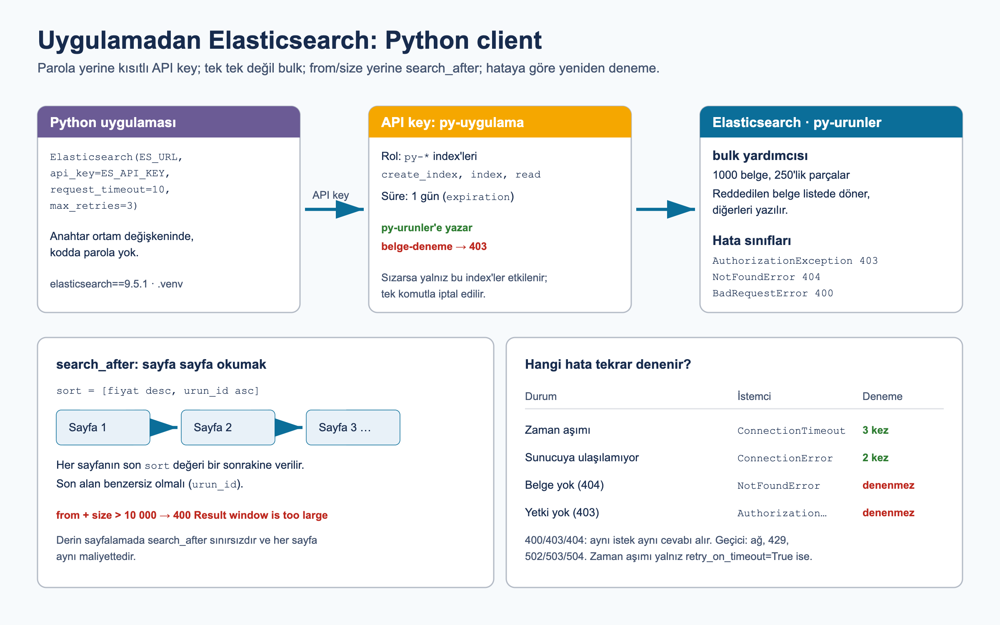

# LAB-25 — Uygulamadan Elasticsearch: Python Client ile Güvenli Bağlantı, Bulk ve Sayfalama

| Kullanılan Araçlar | Açık / Kullanılan Portlar |
|---|---|
| Python 3, `elasticsearch` 9.5.1 (resmî client), API key, `curl`, `jq` | 9200 — LAB-01 ana cluster'ı |

---

## Bu lab ne öğretiyor?

Dev Tools ve `curl` denemek için yeterlidir; gerçek uygulama ise Elasticsearch'e bir kütüphaneyle bağlanır.
Orada dört soru çıkar: kod hangi kimlikle bağlanır, binlerce document nasıl yazılır, bir document reddedilince ne
olur, 10.000'den fazla sonuç nasıl okunur.

Bu labda Python client ile:

- Yalnız kendi index'ine yetkili bir API key kullanacağız.
- `bulk` yardımcısıyla yazıp hataları türüne göre yakalayacağız.
- Sonuçları `search_after` ile sayfalayacak, hangi hatanın tekrar denendiğini göreceğiz.
- Tek document'i `index`, `get` ve `match` ile yazıp okuyacağız.



---

## Ön Koşullar

- LAB-01 ana cluster'ı çalışıyor. LAB-01'i atladıysanız onun Adım 1-2'sini çalıştırın.
- Sunucuda `python3 -m venv` çalışmalı; çalışmıyorsa `sudo apt-get install -y python3-venv`.

```bash
cd ~/elastic/labs/LAB-25-uygulamadan-elasticsearch
```


---

## Kavramlar: uygulama ve Elasticsearch

| Konu | Dev Tools'ta | Uygulamada |
|---|---|---|
| Kimlik | `elastic` kullanıcısı | Yalnız gereken index'lere yetkili, süreli **API key** |
| Çok document | `_bulk` isteği | `helpers.bulk`: parçalar, gönderir, reddedilenleri listeler |
| Hata | Yanıtı okursunuz | HTTP kodu bir **istisna sınıfına** dönüşür: `NotFoundError`, `AuthorizationException`… |
| Çok sonuç | `from` / `size` | `search_after`: 10.000 sınırı yok |
| Geçici hata (ağ, 429, 502/503/504) | Tekrar basarsınız | `request_timeout`, `max_retries`: istemci kendisi tekrar dener |

---

## Config dosyaları: hangi satır ne işe yarıyor?

`app/ortak.py` (bütün betiklerin istemcisi):

```python
def istemci(**ayar):
    anahtar = os.environ.get("ES_API_KEY")
    if not anahtar:
        raise SystemExit("ES_API_KEY tanimli degil (Adim 2).")
    # request_timeout: tek istegin en fazla bekleme suresi; max_retries: baglanti/zaman asimi hatasinda tekrar
    return Elasticsearch(ES_URL, api_key=anahtar, request_timeout=10, max_retries=3, retry_on_timeout=True, **ayar)
```

- `api_key`: anahtar kodda değil ortam değişkenindedir; kod repoya girse de anahtar girmez.
- `request_timeout=10`: cevap 10 saniyede gelmezse istek kesilir; uygulama sonsuza kadar beklemez.
- `max_retries=3`: bağlantı hatası, 429 ve 502/503/504 en çok 3 kez tekrar denenir; `retry_on_timeout=True`
  zaman aşımını da bu listeye ekler (varsayılanı `False`).

`requirements.txt` client sürümünü sabitler (`elasticsearch==9.5.1`). Client'ın ana sürümü cluster'ınkiyle
aynı olmalıdır (9.x ile 9.x).

---

## Adım Adım Uygulama Rehberi

### 1. Sanal ortam ve client

**Soru: Client hangi sürümle, nereye kurulur?**

Paketler sistem Python'una değil labın kendi sanal ortamına (`.venv`) kurulur:

```bash
python3 -m venv .venv
.venv/bin/pip install -q -r requirements.txt
.venv/bin/python -c "import elasticsearch; print(elasticsearch.__versionstr__)"
```

Beklenen çıktı:

```text
9.5.1
```

### 2. Kısıtlı API key ile bağlanın

**Soru: Uygulama hangi kimlikle bağlanmalı?**

API key'i `elastic` kullanıcısıyla bir kez üretip ortam değişkenine alıyoruz. Anahtar yalnız `py-*`
index'lerinde index açıp yazabilir ve okuyabilir; bir gün sonra geçersiz olur:

```bash
export ES_API_KEY=$(curl -s -u elastic:'DevOps2026!' -X POST 'http://127.0.0.1:9200/_security/api_key' \
  -H 'Content-Type: application/json' -d '{
    "name": "py-uygulama", "expiration": "1d",
    "role_descriptors": { "py-yazici": {
      "cluster": ["monitor"],
      "indices": [ { "names": ["py-*"], "privileges": ["create_index", "index", "read", "view_index_metadata"] } ] } }
  }' | jq -r .encoded)
echo "anahtar uzunlugu: ${#ES_API_KEY}"
```

Beklenen çıktı:

```text
anahtar uzunlugu: 60
```

Anahtarın kendisini ekrana yazdırmıyoruz; uzunluğu üretildiğini göstermeye yeter. `app/baglan.py` cluster'a
bağlanır, kimliğini sorar ve yetkisi olmayan bir index'e yazmayı dener:

```bash
cd app
../.venv/bin/python baglan.py
```

Beklenen çıktı:

```text
cluster  : docker-cluster 9.5.5
kimlik   : api_key py-uygulama
yetkisiz : 403 security_exception
```

403 istemcide `AuthorizationException` istisnası olarak gelir; betik onu yakalayıp durumunu yazar. Anahtar
sızsa bile yalnız `py-*` index'leri etkilenir.

### 3. Bulk ile 1000 ürün yazın

**Soru: Binlerce document tek tek mi yazılır?**

`app/yaz.py` index'i açar ve 1000 ürünü `helpers.bulk` ile 250'lik parçalar hâlinde gönderir. Document'ler bir
üreteçten (generator) gelir; hepsi aynı anda bellekte tutulmaz:

```bash
../.venv/bin/python yaz.py
```

Beklenen çıktı:

```text
yazilan  : 1000 | hata: 0
sayim    : 1000
```

Tek tek `index` çağrısı 1000 HTTP isteği demektir; bulk 4 istekle biter. `refresh="wait_for"` son parçanın
aramada görünmesini bekler, sayım bu yüzden hemen 1000'dir.

### 4. Hata yönetimi: reddedilen document ve olmayan document

**Soru: Bir document reddedilince ya da bulunamayınca uygulama ne görür?**

`app/hatalar.py` 5 document gönderir; ikisinin fiyatı sayı değildir. `raise_on_error=False` ile bulk istisna
atmaz, reddedilenleri ayrı bir liste olarak döndürür:

```bash
../.venv/bin/python hatalar.py
```

Beklenen çıktı:

```text
yazilan  : 3
reddedilen: Y2 400 document_parsing_exception
reddedilen: Y4 400 document_parsing_exception
bulunamadi: 404 U9999
```

Üç document yazıldı, iki document nedeniyle birlikte döndü; uygulama onları kaydedip düzeltebilir. Varsayılan
`raise_on_error=True` olsaydı ilk hatada `BulkIndexError` istisnası atılırdı. Olmayan document'i okumak
`NotFoundError` (404) verir; bu bir program hatası değil, beklenen bir durumdur ve `try/except` ile karşılanır.

### 5. Sıralama ve search_after ile sayfalama

**Soru: 10.000'den fazla sonuç nasıl okunur?**

Ürünleri fiyata göre sıralayıp 300'lük sayfalarla okuyoruz. Her sayfanın son document'inin `sort` değeri bir
sonraki isteğe `search_after` olarak verilir. Son sıralama field'ı (`urun_id`) benzersizdir; aynı fiyatlı
ürünlerde sıra sabit kalır, sayfa sınırında document kaybolmaz ya da tekrar gelmez:

```bash
../.venv/bin/python sayfala.py
```

Beklenen çıktı:

```text
sayfa 1: 300 document, ilk U0535, son U0091, search_after=[3417.91, 'U0091']
sayfa 2: 300 document, ilk U0626, son U0719, search_after=[1903.19, 'U0719']
sayfa 3: 300 document, ilk U0050, son U0949, search_after=[513.49, 'U0949']
sayfa 4: 103 document, ilk U0280, son Y5, search_after=[15.0, 'Y5']
toplam   : 1003
from+size: 400 Result window is too large, from + size must be less than or
```

1003 = 1000 ürün ve Adım 4'te yazılan 3 document. `from`/`size` ile 10.000'inci sonuçtan sonrası istenemez
(`index.max_result_window`); `search_after` için böyle bir sınır yoktur.

### 6. Zaman aşımı ve yeniden deneme

**Soru: Hangi hata tekrar denenir, hangisi denenmez?**

`app/zaman_asimi.py` üç durumu dener ve istemcinin kaç kez tekrar denediğini sayar:

```bash
../.venv/bin/python zaman_asimi.py
cd ..
```

Beklenen çıktı:

```text
zaman asimi : ConnectionTimeout, tekrar deneme = 3
kapali port : ConnectionError, tekrar deneme = 2
404         : 404 tekrar deneme = 0
```

- 1 ms'lik zaman aşımı yetişmez; istemci `max_retries=3` kadar dener ve `ConnectionTimeout` atar.
- Kapalı porta bağlanılamaz; `max_retries=2` olan bu istemci 2 kez dener ve `ConnectionError` atar.
- 404, 403 ve 400 tekrar denenmez: aynı istek aynı cevabı alır. Ağ hatası, 429 (cluster yoğun) ve
  502/503/504 geçici sayılır ve tekrar denenir; zaman aşımı yalnız `retry_on_timeout=True` verildiyse
  (varsayılanı `False`) tekrar denenir.

### 7. Tek document: yaz, oku, ara

**Soru: Tek bir document nasıl yazılır, id ile okunur ve aranır?**

Bulk binlerce document içindir; uygulamanın çoğu işi tek document'tir (bir sipariş açmak, bir ürünü kaydetmek).
`app/tek.py` üç ürünü `es.index` ile tek tek yazar, birini `es.get` ile id'siyle okur ve `match` sorgusuyla arar.
Ürünler Adım 3-6'daki sayıları bozmasın diye ayrı bir `py-tek` index'ine gider (API key `py-*` için yetkilidir):

```bash
cd app
../.venv/bin/python tek.py
cd ..
```

Beklenen çıktı:

```text
index  : T1 created (surum 1)
index  : T2 created (surum 1)
index  : T3 created (surum 1)
get    : True {'urun_id': 'T1', 'ad': 'Kablosuz Kulaklık', 'fiyat': 1149.5}
match  : 2 sonuc
  Kablosuz Kulaklık     1149.50  skor 0.50
  Kablolu Kulaklık       399.90  skor 0.50
```

- Betik önce index'i kendisi açar (`es.indices.create`, `mappings` ve replica 0). Mapping'i API key'in `index`
  yetkisine bıraktırmak çalışır ama client bir uyarı verir: otomatik mapping güncellemesi bir sonraki major sürümde
  açık yetki isteyecek. `create_index` yetkisi index'i açmaya yeter.
- `es.index` document'i verilen id ile yazar. Sonuç `created`'dır; aynı id'yle tekrar yazarsanız `updated` olur ve
  `_version` artar (document yerine yenisi konur).
- `es.get` id ile okur: `found` ve `_source` gelir. Id ile okuma refresh'i beklemez; document yazıldığı anda
  görünür. Olmayan id `NotFoundError` (404) verir (Adım 4).
- `es.search` ile `match` sorgusu metni analyzer'dan geçirip eşleştirir: `kulaklık` iki ürünü bulur (üçüncüsü
  eşleşmez); ikisinde de kelime bir kez geçtiği için puanları aynıdır. Sonuç `hits` içindedir; her isabetin `_source`'u (ürünün kendisi) ve `_score`'u (eşleşme puanı) vardır.
  Arama yalnız refresh'ten sonra görür; `refresh="wait_for"` bunu bekletir (LAB-07'de gördüğümüz gibi).

---

## Temizlik

Yalnız bu labın `py-urunler` ve `py-tek` index'lerini ve `py-uygulama` API key'ini siler, `.venv`'i kaldırır. Ana cluster'a
dokunmaz:

```bash
./teardown.sh
```

Beklenen çıktı:

```text
index py-urunler -> 200
index py-tek -> 200
api key py-uygulama -> {"invalidated":1}
.venv silindi
```

Labı aynı sunucuda yeniden yapacaksanız başlamadan önce `./teardown.sh` çalıştırın; README'deki sayılar temiz
başlangıca göredir.

---

Sonraki lab: **[LAB-26 — Elastic SIEM: Güvenlik Loglarından Tespit, Alarm ve Triyaj](../LAB-26-siem/README.md)**
