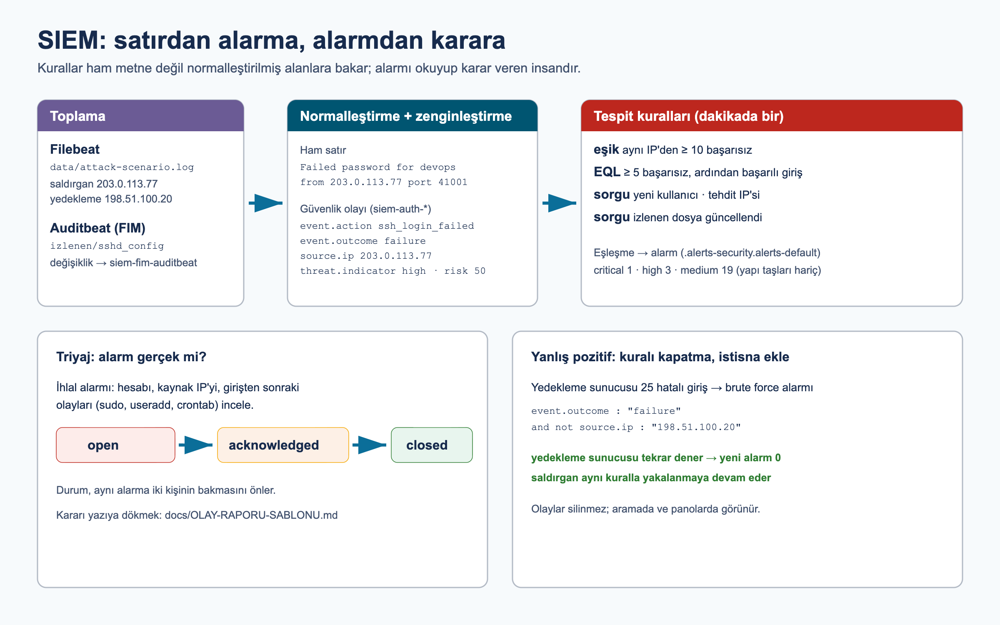
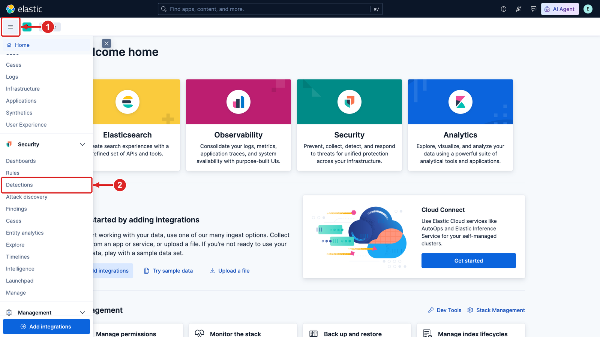
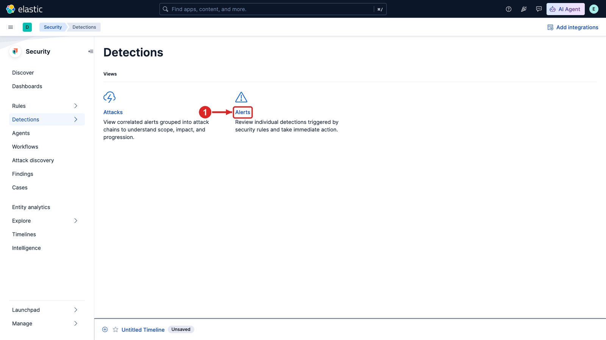
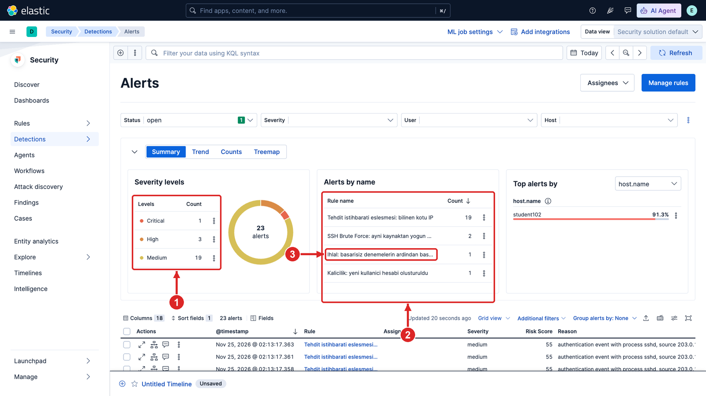
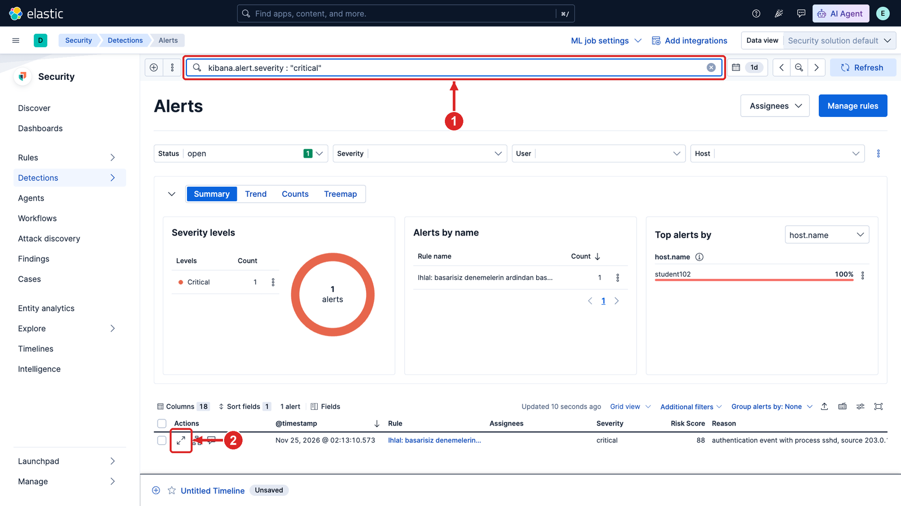
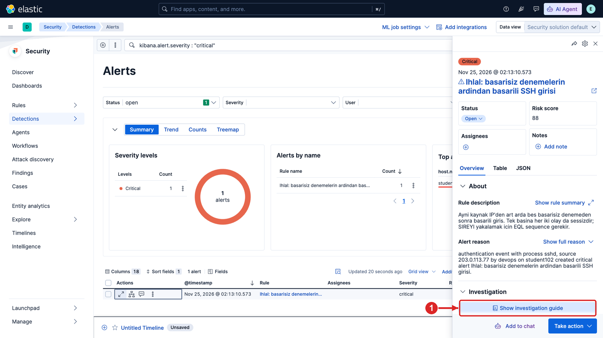
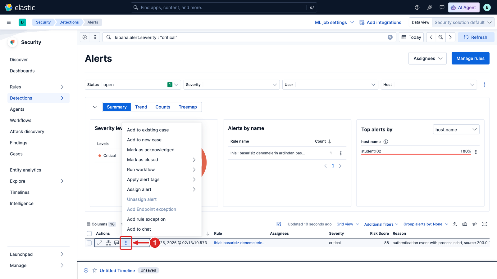
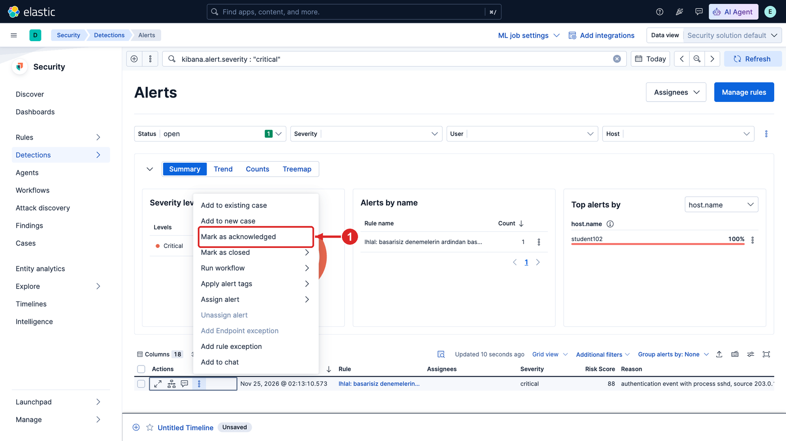

# LAB-26 — Elastic SIEM: Güvenlik Loglarından Tespit, Alarm ve Triyaj

| Kullanılan Araçlar | Açık / Kullanılan Portlar |
|---|---|
| Elastic Security (Detection Engine), Logstash, Filebeat ve Auditbeat 9.5.5 (container), enrich policy, Kibana | `127.0.0.1:9602` (Logstash API, yalnız sunucudan); 9200 / 5601 — LAB-01 ana cluster'ı |

---

## Bu lab ne öğretiyor?

`Failed password for devops from 203.0.113.77` satırı tek başına bir şey söylemez; aynı IP'den 18 deneme, ardından
başarılı giriş, `sudo` ve yeni bir kullanıcı bir saldırı hikâyesidir. SIEM, satırları güvenlik olaylarına
çevirir, onları kurallarla ilişkilendirir ve sonuçta alarm üretir; alarmı okuyup karar veren ise insandır.

Bu labda:

- Kontrollü bir saldırı senaryosunu Filebeat ve Logstash ile normalleştirip tehdit istihbaratıyla zenginleştireceğiz.
- Beş tespit kuralıyla alarm üretip bir alarmı Kibana'da triyaj edeceğiz.
- Yanlış pozitifi kuralı kapatmadan ayarlayacağız.
- Bir yapılandırma dosyasındaki değişikliği Auditbeat ile yakalayacağız.

Kibana'daki her tıklama kırmızı kutu ve numarayla gösterilir.



---

## Ön Koşullar

- LAB-01 ana cluster'ı çalışıyor ve trial lisans açık. LAB-01'i atladıysanız onun Adım 1-2'sini ve trial
  adımını çalıştırın.
- `127.0.0.1:9602` portu boş olmalı. Logstash, Filebeat ve Auditbeat birlikte yaklaşık 1,2 GB RAM kullanır.

```bash
cd ~/elastic/labs/LAB-26-siem
```

Kibana adresini sunucuda hesaplayın:

```bash
IP=$(curl -s https://api.ipify.org); H=$(hostname -s)
echo "Kibana: http://$IP:5601   https://$H-kibana.devopsatolyesi.com"
```

Beklenen çıktı:

```text
Kibana: http://<IP>:5601   https://<host>-kibana.devopsatolyesi.com
```

---

## Kavramlar: satırdan karara

| Aşama | Ne yapar | Bu labda |
|---|---|---|
| Toplama | Logu kaynaktan alır | Filebeat (senaryo logu), Auditbeat (dosya değişikliği) |
| Normalleştirme | Satırı ECS field'larına çevirir: `event.action`, `event.outcome`, `source.ip`, `user.name` | Logstash grok |
| Zenginleştirme | Bilinen kötü IP, risk skoru ekler | ingest pipeline + enrich policy |
| Tespit | Olaylar üzerinde kural çalıştırır, eşleşmede alarm üretir | eşik, EQL sekansı, sorgu kuralları |
| Triyaj | Alarmı inceler: gerçek mi, yanlış pozitif mi? | alarm durumu, kural istisnası |

Olay (`siem-auth-*`) her satırdır; alarm (`.alerts-security.alerts-default`) yalnız bir kural eşleşince oluşur.

---

## Config dosyaları: hangi satır ne işe yarıyor?

`pipeline/logstash.conf` (başarısız giriş satırı):

```conf
    if [log][detail] =~ /^Failed password/ {
      grok {
        id => "grok_ssh_failed"
        match => { "[log][detail]" => "^Failed password for (?:invalid user )?%{USERNAME:[user][name]} from %{IP:[source][ip]} port %{POSINT:[source][port]:int}" }
        tag_on_failure => ["_ssh_failed_unparsed"]
      }
      mutate {
        add_field => {
          "[event][action]"   => "ssh_login_failed"
          "[event][outcome]"  => "failure"
          "[event][category]" => "authentication"
        }
      }
```

- Her satır türü (başarısız, başarılı, `sudo`, `useradd`…) kendi grok'uyla ayrıştırılır ve ECS'in ortak
  field'larını alır. Kurallar ham metne değil bu field'lara bakar: `event.outcome : "failure"`.
- Sınıflandırılamayan satır silinmez, `event.action: uncategorized` olur; bilinmeyen de bir sinyaldir.

`scripts/setup-indices.sh` `siem-auth-*` index'lerine `siem-enrich` ingest pipeline'ını varsayılan yapar.
Pipeline `source.ip`'yi küçük bir tehdit istihbaratı listesiyle (`siem-threat-intel`) karşılaştırır ve eşleşirse
`threat.indicator.*` field'larını ekler; olaya 0–100 arası bir risk skoru verir.

---

## Adım Adım Uygulama Rehberi

Bu labdaki `http` blokları **Kibana › Dev Tools**'a, `bash` blokları terminale yapıştırılır.

### 1. SIEM veri katmanını kurun

**Soru: Güvenlik olayları hangi şablonlarla ve hangi index'lere yazılacak?**

```bash
./scripts/setup-indices.sh
```

<details>
<summary><strong>Çıktının tamamı (10 satır)</strong></summary>

```text
[1/4] siem-auth-* index sablonu
      ok (source.ip -> ip, source.geo.location -> geo_point, default_pipeline -> siem-enrich)
[2/4] Tehdit istihbarati listesi (siem-threat-intel)
      ok (3 gosterge)
[3/4] Enrich policy: IOC listesini bellekte arama tablosuna cevir
      ok (policy derlendi)
[4/4] Ingest pipeline: siem-enrich (GeoIP + ASN + IOC + risk skoru)
      ok

[+] SIEM veri katmani hazir.
```

</details>

Tehdit istihbaratı listesinde üç IP var; biri senaryodaki saldırgan `203.0.113.77`. Gerçek ortamda bu liste bir
beslemeden (MISP, AbuseIPDB…) düzenli olarak güncellenir.

### 2. Toplama hattını başlatın

**Soru: Senaryo logu ve izlenen dizin Elasticsearch'e nasıl gelir?**

Logstash, senaryo logunu okuyan Filebeat ve `izlenen/` dizinini izleyen Auditbeat:

```bash
docker compose up -d
timeout 180 bash -c 'until docker compose logs logstash 2>/dev/null | grep -q "Pipeline started"; do printf .; sleep 3; done'; echo " hazir"
```

Beklenen çıktı:

```text
.......... hazir
```

Filebeat ve Auditbeat Logstash'e ve Elasticsearch'e Docker ağı üzerinden bağlanır; host'a port açılmaz.

### 3. Saldırı senaryosu: önce ve sonra

**Soru: Ham log satırı nasıl bir güvenlik olayına dönüşür?**

Senaryo `data/attack-scenario.log` dosyasına 48 satır ekler. Saldırgan 18 kez dener, girer, yetki yükseltir ve
arka kapı hesap açar. Aynı anda parolası değişmiş bir yedekleme sunucusu 25 kez hatalı giriş dener:

```bash
./scripts/generate-attack-scenario.sh
timeout 120 bash -c 'until [ "$(curl -s -u elastic:"DevOps2026!" "http://127.0.0.1:9200/siem-auth-*/_count" | jq .count)" -ge 48 ]; do printf .; sleep 3; done'; echo
```

Beklenen çıktı:

```text
[+] 48 satir yazildi -> data/attack-scenario.log
    saldirgan 203.0.113.77: 18 basarisiz -> basarili giris -> sudo -> yeni kullanici
    yedekleme sunucusu 198.51.100.20: 25 basarisiz giris (zararsiz)
.......
```

Aynı başarısız giriş, ham satır ve Elasticsearch'teki güvenlik olayı olarak:

```bash
grep -m1 "Failed password for devops" data/attack-scenario.log
curl -s -u elastic:'DevOps2026!' 'http://127.0.0.1:9200/siem-auth-*/_search?size=1&q=event.action:ssh_login_failed%20AND%20user.name:devops' \
  | jq -c '.hits.hits[0]._source | {action: .event.action, outcome: .event.outcome, user: .user.name, ip: .source.ip, ioc: .threat.indicator.confidence, risk: .event.risk_score}'
```

Beklenen çıktı:

```text
2026-11-21T17:20:46.000000+00:00 <host> sshd[24813]: Failed password for devops from 203.0.113.77 port 41001 ssh2
{"action":"ssh_login_failed","outcome":"failure","user":"devops","ip":"203.0.113.77","ioc":"high","risk":50}
```

Ham satırdaki saat, sunucu adı ve süreç numarası sizde farklıdır.

Tek bir metin satırı; aranabilir, sayılabilir field'lara dönüştü. IP tehdit listesinde olduğu için olay `ioc: high`
etiketini ve daha yüksek risk skorunu aldı. Hangi tür olaydan kaç tane geldiği:

```bash
curl -s -u elastic:'DevOps2026!' 'http://127.0.0.1:9200/siem-auth-*/_search?size=0&filter_path=aggregations' -H 'Content-Type: application/json' \
  -d '{"aggs": {"a": {"terms": {"field": "event.action"}}}}' | jq -c '[.aggregations.a.buckets[] | {(.key): .doc_count}] | add'
```

Beklenen çıktı:

```text
{"ssh_login_failed":40,"ssh_invalid_user":3,"sudo_command":2,"session_opened":1,"ssh_login_success":1,"user_created":1}
```

40 başarısız girişin 15'i saldırganın, 25'i yedekleme sunucusunun; saldırganın 3 geçersiz kullanıcı denemesi
de başarısız sayılır.

### 4. Tespit kurallarını kurun

**Soru: Hangi davranış hangi kuralla alarma dönüşür?**

Beş kural kurulur, her biri dakikada bir çalışır:

| Kural | Türü | Ne arar |
|---|---|---|
| SSH Brute Force | eşik (threshold) | Aynı IP'den 10 dakikada en az 10 başarısız deneme |
| İhlal | EQL sekansı | Aynı IP'den en az 5 başarısızlığın **ardından** başarılı giriş |
| Kalıcılık | sorgu | `event.action : "user_created"` |
| Tehdit istihbaratı | sorgu | `threat.indicator.matched.field : "source.ip"` |
| Kritik yapılandırma değişti | sorgu (`siem-fim-*`) | İzlenen `sshd_config` güncellendi |

```bash
python3 scripts/provision_detections.py
```

<details>
<summary><strong>Çıktının tamamı (10 satır)</strong></summary>

```text
Kibana bekleniyor (http://127.0.0.1:5601) ...
[+] Kural kuruldu: SSH Brute Force: ayni kaynaktan yogun basarisiz deneme  [threshold] severity=high risk=73
[+] Kural kuruldu: Ihlal: basarisiz denemelerin ardindan basarili SSH girisi  [eql] severity=critical risk=88
[+] Kural kuruldu: Kalicilik: yeni kullanici hesabi olusturuldu  [query] severity=high risk=70
[+] Kural kuruldu: Tehdit istihbarati eslesmesi: bilinen kotu IP  [query] severity=medium risk=55
[+] Kural kuruldu: Kritik yapilandirma dosyasi degisti  [query] severity=high risk=73

[+] 5 tespit kurali etkin.
    Alarmlar: http://127.0.0.1:5601/app/security/alerts
    Kurallar: http://127.0.0.1:5601/app/security/rules
```

</details>

İlk dört kuralın alarm üretmesini bekleyin (ilk çalışmada gelir) ve kural başına sayıya bakın:

```bash
timeout 300 bash -c 'until [ "$(curl -s -u elastic:"DevOps2026!" "http://127.0.0.1:9200/.alerts-security.alerts-default/_search?size=0" -H "Content-Type: application/json" -d "{\"query\":{\"prefix\":{\"kibana.alert.rule.rule_id\":\"siem-lab-\"}},\"aggs\":{\"r\":{\"cardinality\":{\"field\":\"kibana.alert.rule.rule_id\"}}}}" | jq .aggregations.r.value)" -ge 4 ] 2>/dev/null; do printf .; sleep 5; done'; echo
curl -s -u elastic:'DevOps2026!' 'http://127.0.0.1:9200/.alerts-security.alerts-default/_search?size=0&filter_path=aggregations' -H 'Content-Type: application/json' \
  -d '{"query": {"prefix": {"kibana.alert.rule.rule_id": "siem-lab-"}}, "aggs": {"r": {"terms": {"field": "kibana.alert.rule.name", "size": 10}}}}' \
  | jq -r '.aggregations.r.buckets[] | "\(.doc_count)  \(.key)"'
```

Beklenen çıktı:

```text

19  Tehdit istihbarati eslesmesi: bilinen kotu IP
7  Ihlal: basarisiz denemelerin ardindan basarili SSH girisi
2  SSH Brute Force: ayni kaynaktan yogun basarisiz deneme
1  Kalicilik: yeni kullanici hesabi olusturuldu
```

- Tehdit istihbaratı saldırganın her olayında tetiklenir; tek başına gürültülüdür, diğer sinyallerle birlikte
  okunur.
- Eşik kuralı iki IP için alarm üretti: saldırgan (18 deneme) ve yedekleme sunucusu (25 deneme). İkincisi
  yanlış pozitiftir (Adım 6).
- EQL sekansı sırayı yakalar: başarısızlıklar tek başına da başarılı giriş tek başına da sessizdir; ikisi
  ardışık olunca ihlal alarmı oluşur. 7'nin 1'i sekans alarmı, 6'sı sekansı oluşturan olayların yapı taşı
  (building block) alarmlarıdır; arayüz yapı taşlarını varsayılan olarak gizler ve 1 gösterir.

### 5. Alarmı okuyun ve triyaj edin

**Soru: Alarmlar arasında önce hangisine bakılır, incelendiği nasıl işaretlenir?**

1. Sol üstteki menü düğmesine (1) tıklayın, **Security** altında **Detections**'ı (2) seçin (alarm sayfası; Observability
   altındaki **Alerts** başka bir sayfadır):

   

   **Detections** sayfasında **Alerts** (1) kartına tıklayın:

   

2. **Severity levels** (1) alarmları şiddete göre, **Alerts by name** (2) kurala göre sayar; `critical` olan tek
   alarm ihlal alarmıdır (3):

   

3. Liste en yeni alarmla başlar; ihlal alarmını bulmak için sorgu çubuğuna (1) `kibana.alert.severity : "critical"`
   yazıp Enter'a basın. Kalan tek satırın büyütme düğmesine (2) tıklayın:

   

4. Sağda alarmın ayrıntısı açılır: kuralın açıklaması ve alarmın sebebi (kaynak IP, kullanıcı) üsttedir; **Show
   investigation guide** (1) kuralın triyaj notunu açar, **Table** sekmesi olayın bütün field'larını gösterir:

   

Kibana, Alerts sayfası ilk açıldığında istisna listeleri için `.lists-default` ve `.items-default` data
stream'lerini 1 replica ile kurar. Tek node'lu ana cluster'da replica'nın konacağı ikinci node yoktur, cluster
yellow kalır. Replica'yı 0'a çekin:

```bash
curl -s -u elastic:'DevOps2026!' -X PUT 'http://127.0.0.1:9200/.lists-default,.items-default/_settings?ignore_unavailable=true&allow_no_indices=true' \
  -H 'Content-Type: application/json' -d '{"index.number_of_replicas": 0}'; echo
curl -s -u elastic:'DevOps2026!' 'http://127.0.0.1:9200/_cluster/health/.lists-default,.items-default?wait_for_status=green&timeout=30s&filter_path=status'; echo
```

```json
{"acknowledged":true}
{"status":"green"}
```

İhlal alarmını incelediğinizi işaretleyin. Alarm durumu `open` → `acknowledged` olur; aynı ekip üyesi ya da
başkası aynı alarma ikinci kez bakmaz. **İki yol var, birini seçin:** **komut yolu** aşağıdaki Dev Tools isteğidir,
**arayüz yolu** ondan sonraki açılır kutudadır. Öteki yolu yalnız okuyun, uygulamayın. Sayaç komutu iki yolda ortaktır,
sonucu yola göre farklıdır.

**Komut yolu.** Kibana › Dev Tools'a yapıştırın:

```http
POST kbn:/api/detection_engine/signals/status
{ "status": "acknowledged", "query": { "term": { "kibana.alert.rule.rule_id": "siem-lab-successful-login-after-bruteforce" } } }
```

<details>
<summary><strong>Arayüz yolu</strong> (komut yolundaysanız yalnız okuyun)</summary>

**Komut yolundaysanız bu adımları yapmayın;** alarm Dev Tools isteğiyle işaretlendi. Arayüz yolundaysanız yukarıdaki
isteği çalıştırmayın.

1. **Security › Detections › Alerts** sayfasında sorgu çubuğuna `kibana.alert.severity : "critical"` yazıp Enter'a basın; kalan satırın
   **⋯** (1) düğmesine tıklayın:

   

2. **Mark as acknowledged** (1):

   

</details>

İki yolda da sayacı kontrol edin:

```bash
curl -s -u elastic:'DevOps2026!' 'http://127.0.0.1:9200/.alerts-security.alerts-default/_search?size=0&filter_path=aggregations' -H 'Content-Type: application/json' \
  -d '{"query": {"prefix": {"kibana.alert.rule.rule_id": "siem-lab-"}}, "aggs": {"s": {"terms": {"field": "kibana.alert.workflow_status"}}}}' \
  | jq -c '[.aggregations.s.buckets[] | {(.key): .doc_count}] | add'
```

Beklenen çıktı (komut yolu):

```text
{"open":22,"acknowledged":7}
```

- **Komut yolu:** istek kuralın bütün alarmlarını işaretler; sekans alarmı ve yapı taşları birlikte (7) `acknowledged`
  oldu, geri kalan 22 alarm hâlâ `open`.
- **Arayüz yolu:** arayüzde yalnız sekans alarmı işaretlenir (yapı taşları gizli olduğu için); sayaç
  `{"open":28,"acknowledged":1}` olur.

İnceleme bitince alarm, Alerts sayfasında satırın **⋯** menüsünden **Mark as closed** ile kapatılır.

Olayı yazıya dökmek için [olay raporu şablonu](docs/OLAY-RAPORU-SABLONU.md) kullanılabilir.

### 6. Yanlış pozitifi ayarlayın

**Soru: Zararsız bir kaynak kuralı kapatmadan nasıl susturulur?**

Yedekleme sunucusu `198.51.100.20` zararsızdır ama parolası düzeltilene kadar her turda brute force alarmı
üretecektir. Kuralı kapatmak yerine o kaynağı kural düzeyinde istisnaya alın:

```bash
./scripts/tune-false-positive.sh 198.51.100.20
```

Beklenen çıktı:

```text
[1/2] Mevcut kural sorgusu: event.outcome : "failure"
{"name":"SSH Brute Force: ayni kaynaktan yogun basarisiz deneme","query":"event.outcome : \"failure\" and not source.ip : \"198.51.100.20\""}
[2/2] 198.51.100.20 artik brute force kuralini tetiklemeyecek.
      Not: istisna KURAL duzeyindedir; olay verisi silinmez, panolarda gorunmeye devam eder.
```

Yedekleme sunucusu yine 25 kez hatalı giriş denesin. Olaylar index'e düştükten sonra kuralın bir kez daha
çalışmasını bekleyin ve o andan sonra yeni brute force alarmı olup olmadığına bakın:

```bash
T0=$(date -u +%Y-%m-%dT%H:%M:%SZ)
./scripts/generate-attack-scenario.sh yedek
timeout 120 bash -c 'until [ "$(curl -s -u elastic:"DevOps2026!" "http://127.0.0.1:9200/siem-auth-*/_count" | jq .count)" -ge 73 ]; do printf .; sleep 3; done'
T1=$(date -u +%Y-%m-%dT%H:%M:%SZ)
T1="$T1" timeout 180 bash -c 'until [ "$(curl -s -u elastic:"DevOps2026!" "http://127.0.0.1:5601/api/detection_engine/rules?rule_id=siem-lab-ssh-brute-force" | jq -r .execution_summary.last_execution.date)" \> "$T1" ]; do printf .; sleep 5; done'; echo
curl -s -u elastic:'DevOps2026!' 'http://127.0.0.1:9200/.alerts-security.alerts-default/_count?filter_path=count' -H 'Content-Type: application/json' \
  -d "{\"query\": {\"bool\": {\"filter\": [{\"term\": {\"kibana.alert.rule.rule_id\": \"siem-lab-ssh-brute-force\"}}, {\"range\": {\"@timestamp\": {\"gte\": \"$T0\"}}}]}}}"; echo
```

Beklenen çıktı:

```text
[+] 25 satir yazildi: yedekleme sunucusu 198.51.100.20
....................
{"count":0}
```

Kural istisnadan sonra çalıştı ve yeni 25 deneme alarm üretmedi. Olaylar silinmedi; aramada ve panolarda
görünmeye devam eder. İstisna, kuralı kapatmaktan iyidir: saldırgan aynı kuralla yakalanmaya devam eder.

### 7. Dosya bütünlüğü: yapılandırma değişikliğini yakalamak

**Soru: Kritik bir yapılandırma dosyası değişince haberimiz olur mu?**

Saldırgan girdikten sonra çoğu zaman bir yapılandırma dosyasını değiştirir; bu adım o değişikliği yakalar.

<details>
<summary><strong>Adımlar: yapılandırma değişikliğini yakalamak</strong></summary>

Auditbeat `izlenen/` dizinini izliyor; dizindeki `sshd_config` sunucunun gerçek dosyası değil, bir örnektir.
Saldırganın root girişine izin verdiğini varsayın:

```bash
echo "PermitRootLogin yes" >> izlenen/sshd_config
timeout 240 bash -c 'until [ "$(curl -s -u elastic:"DevOps2026!" "http://127.0.0.1:9200/.alerts-security.alerts-default/_count" -H "Content-Type: application/json" -d "{\"query\":{\"term\":{\"kibana.alert.rule.rule_id\":\"siem-lab-config-changed\"}}}" | jq .count)" -ge 1 ]; do printf .; sleep 5; done'; echo
curl -s -u elastic:'DevOps2026!' 'http://127.0.0.1:9200/siem-fim-*/_search?size=1&sort=@timestamp:desc&filter_path=hits.hits._source' -H 'Content-Type: application/json' \
  -d '{"_source": ["event.action", "file.path"], "query": {"term": {"file.path": "/izlenen/sshd_config"}}}' | jq -c '.hits.hits[0]._source'
```

Beklenen çıktı:

```text
.............
{"event":{"action":["updated","attributes_modified"]},"file":{"path":"/izlenen/sshd_config"}}
```

Alarm değişiklikten yaklaşık bir dakika sonra gelir (kuralın çalışma aralığı).

Auditbeat dosyanın değiştiğini (`updated`) olay olarak yazdı, kural da bunu alarma çevirdi. Kimin değiştirdiğini
dosya bütünlüğü söylemez; bunu Auditbeat'in `auditd` modülü söyler.

<details>
<summary><strong>Auditbeat <code>auditd</code> modülü: değişikliği kim yaptı?</strong></summary>

`auditd` modülü çekirdeğin denetim altyapısına bağlanır ve `-w /etc/sudoers -p wa -k identity` gibi kurallarla
"hangi kullanıcı, hangi süreçle, hangi dosyaya yazdı" bilgisini yapısal olarak verir. Çekirdeğe kural yüklediği
için root yetkisi (container'da `AUDIT_CONTROL` yeteneği ve host PID ad alanı) ister ve sunucunun tamamını
etkiler; ortak bir sunucuda çalıştırılmaz, bu yüzden labın ana akışında yoktur. Örnek yapılandırma:

```yaml
auditbeat.modules:
  - module: auditd
    audit_rules: |
      -w /etc/passwd  -p wa -k identity
      -w /etc/sudoers -p wa -k identity
      -w /etc/ssh/sshd_config -p warx -k sshd_config
```

`-k` etiketi olayda `tags` olarak görünür; "kim `sudoers`'a dokundu" sorusu tek bir filtre olur.

</details>

</details>

---

## Temizlik

Yalnız bu labın container'larını, `siem-*` index'lerini ve data stream'lerini, şablonlarını, enrich policy ve
ingest pipeline'ını, `siem-lab-*` kurallarını ve bu kuralların ürettiği alarmları siler; senaryo logunu siler ve
`izlenen/sshd_config`'i ilk hâline döndürür. Ana cluster'a dokunmaz:

```bash
./teardown.sh
```

<details>
<summary><strong>Çıktının tamamı (14 satır)</strong></summary>

```text
Container filebeat-siem-lab Removed
Container auditbeat-siem-lab Removed
Container logstash-siem-lab Removed
Volume logstash-siem-lab_filebeat-data Removed
Volume logstash-siem-lab_auditbeat-data Removed
Volume logstash-siem-lab_logstash-data Removed
tespit kurali silindi -> 5
alarm silindi -> 30
data stream (siem-*) -> 200
index (siem-*) -> 200
sablon siem-auth -> 200
sablon siem-fim -> 200
ingest pipeline siem-enrich -> 200
enrich policy siem-threat-ip -> 200
```

</details>

Container ve volume satırlarının sırası sizde farklı olabilir.

Labı aynı sunucuda yeniden yapacaksanız başlamadan önce `./teardown.sh` çalıştırın; README'deki sayılar temiz
başlangıca göredir.

---

Sonraki lab: **[LAB-27 — Apache Uçtan Uca: Logstash, Harita, Alarm (E-posta ve Slack) ve PDF Rapor](../LAB-27-apache-uctan-uca/README.md)**
