# LAB-27 — Apache Uçtan Uca: Logstash, Harita, Alarm (E-posta ve Slack) ve PDF Rapor

| Kullanılan Araçlar | Açık / Kullanılan Portlar |
|---|---|
| Apache, Filebeat, Logstash (grok, GeoIP), Metricbeat, Kibana (pano, Maps, Discover ES\|QL, Alerting), Mailpit; isteğe bağlı Resend, Slack, Reporting | `8088` (Apache, dışarıdan), `127.0.0.1:8025` (Mailpit arayüzü), 9200 / 5601 (ana cluster) |

---

## Bu lab ne öğretiyor?

Önceki lablarda her parçayı ayrı ayrı kurduk. Gerçek bir web sitesinde hepsi birbirine bağlıdır: Apache bir
istek alır, Filebeat log satırını Logstash'e taşır, Logstash satırı field'lara ayırıp IP'den ülkeyi bulur,
Kibana panoda ve haritada gösterir. Bir gün hata sayısı artar; panodan arızayı görür, ES|QL ile hangi endpoint'in,
hangi IP'nin ve hangi ülkenin sorumlu olduğunu bulursunuz.

Bu labda zinciri tek seferde kuracak, panoyu ve haritayı açacak, bir arızayı kendimiz üretip kök nedenini
bulacak ve aynı arıza tekrar edince e-posta gelmesini sağlayacağız.

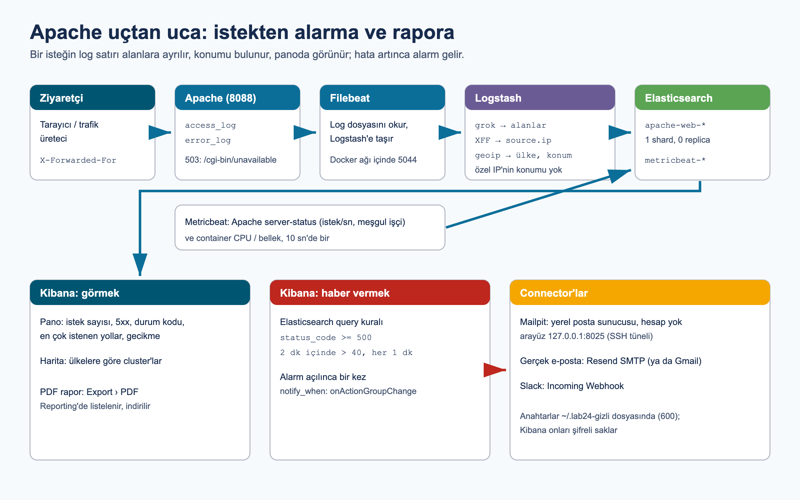

---

## Ön Koşullar

- Önce kurulu olmalı: LAB-01 ana cluster'ı ve trial lisans. E-posta connector'ı (5. adım) ücretli bir özelliktir.
- Önceki labları atladıysanız da bu lab çalışır; LAB-01 dışında hiçbir labın verisini kullanmaz.
- `8088` ve `127.0.0.1:8025` boş olmalı. Yedi container birlikte yaklaşık 2 GB RAM kullanır.

```bash
cd ~/elastic/labs/LAB-27-apache-uctan-uca
```


---

## Kavramlar: bir istek nereden geçer?

| Parça | Görevi | Bu labda |
|---|---|---|
| Apache | İsteği karşılar, her isteği `access_log`'a bir satır yazar | `apache-web-observability-apache-1`, port 8088 |
| Trafik üreteci | Siteye sürekli istek atar; boş pano olmasın | Saniyede bir istek, farklı ülkelerden IP'lerle |
| Filebeat | Log dosyasını okuyup Logstash'e gönderir | `access_log`, `error_log` |
| Logstash | grok ile field'lara ayırır, GeoIP ile IP'den konum bulur | `logstash/pipeline/apache.conf` |
| Metricbeat | Apache'nin anlık durumunu (`server-status`) ve container metriklerini ölçer | 10 saniyede bir |
| Kibana | Pano, harita, alarm kuralı, PDF rapor | |
| Mailpit | Gerçek e-posta göndermeden alarm e-postalarını yakalayan yerel posta sunucusu | `127.0.0.1:8025` |

---

## Config dosyaları: hangi satır ne işe yarıyor?

`logstash/pipeline/apache.conf` (kritik satırlar):

```conf
grok { match => { "message" => '^%{IP:[apache][remote_ip]} %{NOTSPACE:[apache][xff_ip]} ... %{INT:[http][response][status_code]} ...' } }
if [apache][xff_ip] != "-" { mutate { rename => { "[apache][xff_ip]" => "[source][ip]" } } }
geoip { source => "[source][ip]" target => "[source]" }
elasticsearch { index => "apache-web-%{+yyyy.MM.dd}" }
```

- Apache log satırına `X-Forwarded-For` başlığını da yazar; yük dengeleyici arkasında gerçek ziyaretçi IP'si
  budur. Logstash varsa onu `source.ip` yapar.
- `geoip`: IP'den `source.geo.country_name`, `city_name` ve haritada kullanılan `source.geo.location`
  (`geo_point`) üretir. Özel ağ IP'lerinin (10.x, 172.x, 192.168.x) konumu yoktur.
- `apache-web-*` index'leri `elastic/apache-index-template.json` şablonuyla tek shard ve 0 replica açılır.

---

## Adım Adım Uygulama Rehberi

### 1. Yığını başlatın

İlk çalıştırmada image'lar indirilir (yaklaşık 3 GB), birkaç dakika sürebilir. Image'lar hazırsa ilk veri
yaklaşık 1 dakikada gelir:

```bash
docker compose up --build -d
timeout 240 bash -c 'until [ "$(curl -s -u elastic:"DevOps2026!" "http://127.0.0.1:9200/apache-web-*/_count" 2>/dev/null | jq .count 2>/dev/null)" -gt 20 ] 2>/dev/null; do printf .; sleep 5; done'; echo " veri akiyor"
docker compose ps --format '{{.Name}}\t{{.Status}}'
```

<details>
<summary><strong>Çıktının sonu (7 satır; üstünde image derleme ve container başlatma satırları vardır)</strong></summary>

```text
....... veri akiyor
apache-web-observability-apache-1	Up 41 seconds
apache-web-observability-filebeat-1	Up 38 seconds
apache-web-observability-logstash-1	Up 39 seconds
apache-web-observability-metricbeat-1	Up 35 seconds
apache-web-observability-traffic-generator-1	Up 40 seconds
mailpit-apache-lab	Up 40 seconds (healthy)
```

</details>

Apache'yi tarayıcıda açmak için adresleri sunucuda hesaplayın:

```bash
IP=$(curl -s https://api.ipify.org); H=$(hostname -s)
echo "Apache: http://$IP:8088   https://$H-apache.devopsatolyesi.com"
echo "Kibana: http://$IP:5601   https://$H-kibana.devopsatolyesi.com"
```

Beklenen çıktı:

```text
Apache: http://<IP>:8088   https://<host>-apache.devopsatolyesi.com
Kibana: http://<IP>:5601   https://<host>-kibana.devopsatolyesi.com
```

### 2. Bir isteğin yolculuğu: ham satır ve document

Siteye Almanya'daki bir IP'den geliyormuş gibi tek bir istek atın; `X-Request-ID` onu sonra bulmamızı sağlar:

```bash
curl -s -o /dev/null -w '%{http_code}\n' -H 'X-Forwarded-For: 5.9.0.1' -H 'X-Request-ID: apache-yolculuk' http://127.0.0.1:8088/products/sku-100
docker compose exec -T apache grep apache-yolculuk /usr/local/apache2/logs/access_log
```

Beklenen çıktı:

```text
404
172.23.0.1 5.9.0.1 apache-yolculuk - - [22/Nov/2026:02:35:25 +0000] "GET /products/sku-100 HTTP/1.1" 404 236 231 "-" "curl/8.5.0"
```

Aynı istek birkaç saniye sonra Elasticsearch'te:

```bash
timeout 60 bash -c 'until [ "$(curl -s -u elastic:"DevOps2026!" "http://127.0.0.1:9200/apache-web-*/_count?q=http.request.id:apache-yolculuk" | jq .count)" -ge 1 ]; do printf .; sleep 3; done'; echo
curl -s -u elastic:'DevOps2026!' 'http://127.0.0.1:9200/apache-web-*/_search?q=http.request.id:apache-yolculuk' \
  | jq -c '.hits.hits[0]._source | {"source.ip": .source.ip, ulke: .source.geo.country_name, sehir: .source.geo.city_name, konum: {lon: .source.geo.location.lon, lat: .source.geo.location.lat}, method: .http.request.method, "url.path": .url.path, durum: .http.response.status_code}'
```

Beklenen çıktı:

```text
..
{"source.ip":"5.9.0.1","ulke":"Germany","sehir":"Falkenstein","konum":{"lon":12.3649,"lat":50.4777},"method":"GET","url.path":"/products/sku-100","durum":404}
```

Ham satırdaki Docker ağ adresi (`172.23.0.1`) ve tarih sizde farklıdır.

| Ham satırda | Document'te | Nasıl |
|---|---|---|
| `172.x... 5.9.0.1 apache-yolculuk` | `source.ip: 5.9.0.1` (Docker ağının IP'si değil) | grok + `X-Forwarded-For` kuralı |
| (yok) | `ulke`, `sehir`, `konum` | `geoip` |
| `"GET /products/sku-100 HTTP/1.1" 404` | `method`, `url.path`, `durum` (sayı) | grok + `convert` |

<details>
<summary><strong>Veri gelmiyorsa: zincir nerede koptu?</strong></summary>

Halkaları sırayla sayın: Apache'nin yazdığı satır, Logstash'in aldığı (`in`) ve gönderdiği (`out`) olay,
Elasticsearch'teki document:

```bash
docker compose exec -T apache sh -c 'wc -l < /usr/local/apache2/logs/access_log'
docker compose exec -T logstash curl -s localhost:9600/_node/stats/pipelines/main | jq -c '.pipelines.main.events | {in, out}'
curl -s -u elastic:'DevOps2026!' 'http://127.0.0.1:9200/apache-web-*/_count?q=event.dataset:apache.access' | jq .count
```

Beklenen çıktı (sayılar sizde farklıdır ve her saniye artar):

```text
3377
{"in":6375,"out":6375}
3370
```

- İlk sayı artmıyorsa Apache istek almıyordur: `docker compose ps` ile trafik üretecine bakın.
- `in` 0 ise Filebeat Logstash'e ulaşamıyordur: `docker compose logs --tail 20 filebeat`.
- `out`, `in`'den gerideyse Logstash Elasticsearch'e yazamıyordur: `docker compose logs --tail 20 logstash`.
- Logstash'in sayısı Apache'ninkinden büyüktür, çünkü `error_log` ve trafik üretecinin kendi kayıtları da aynı
  pipeline'dan geçer. Son sayı ilkine birkaç saniye geriden yetişir.

</details>

### 3. Pano ve harita

Betik iki data view ve Lens panellerinden oluşan bir pano kurar:

```bash
python3 scripts/provision_kibana.py
```

<details>
<summary><strong>Çıktının tamamı (8 satır)</strong></summary>

```text
PASS Data View: Apache Web İstek ve Hata Logları (apache-web-*)
PASS Data View: Apache ve Docker Metrikleri (metricbeat-*)
PASS Lens: apache-web-requests
PASS Lens: apache-web-error-count
PASS Lens: apache-web-endpoints
PASS Lens: apache-web-latency
PASS Lens: apache-web-geo
PASS Dashboard: apache-web-operations (5 Lens panels)
```

</details>

**Panoyu açın:**

1. Sol üstteki menü düğmesine (1) tıklayın, **Analytics** altında **Dashboards**'u (2) seçin:

   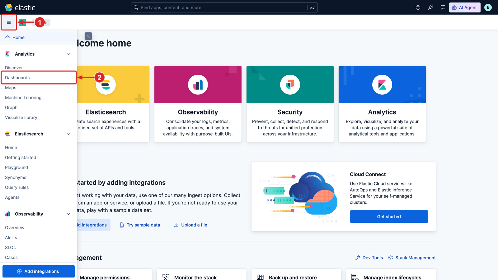

2. Arama kutusuna (1) `Apache` yazıp Enter'a basın, **Apache Web Trafiği ve GeoIP** (2) panosunu açın:

   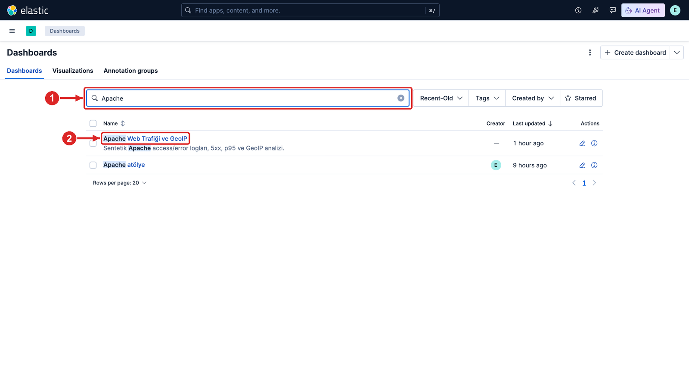

3. Üstte dakikalık istek sayısı (1) ve 5xx sayısı, altta en sorunlu endpoint'ler ve p95 yanıt süresi:

   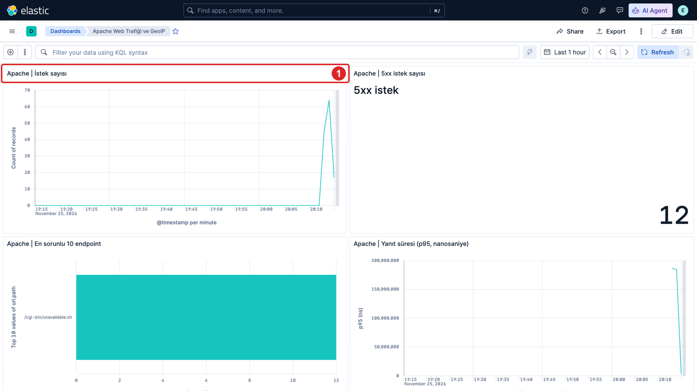

**Ziyaretçileri haritada görün:**

1. Menü düğmesine (1) tıklayın, **Analytics** altında **Maps**'i (2) seçin:

   

2. **Create map** (1):

   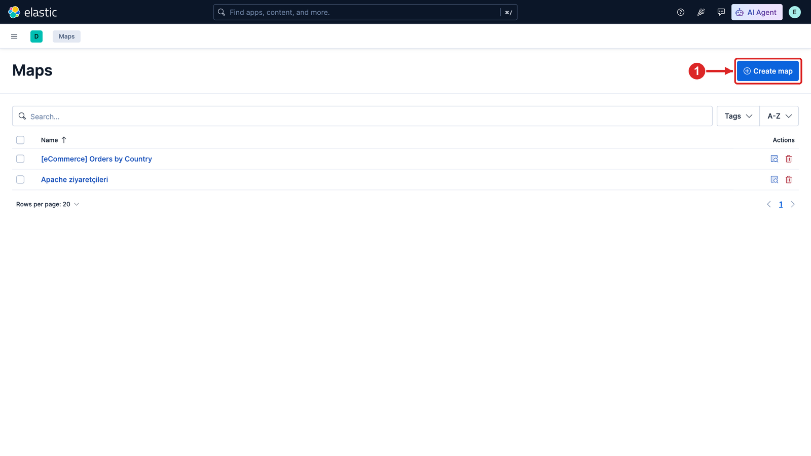

3. Zaman seçicisinden (1) **Last 1 hour**'u seçin, sonra **Add layer** (2):

   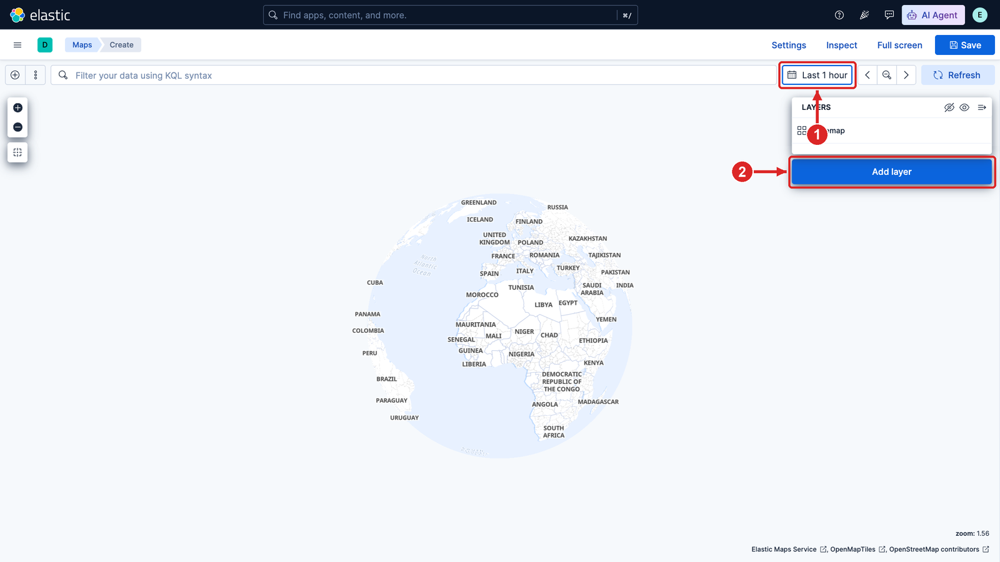

4. Katman türlerinden **Clusters** (1): yakın noktaları sayıyla birleştirir:

   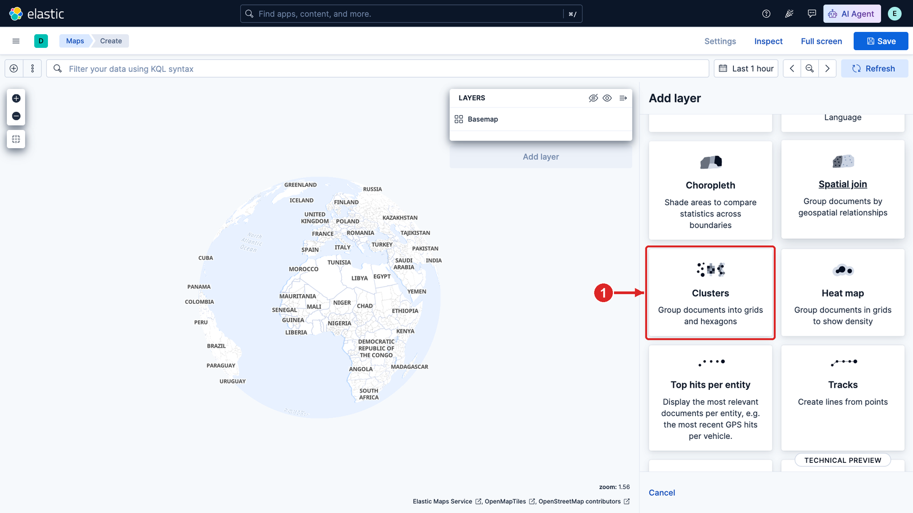

5. **Data view** (1) listesinden **Apache Web İstek ve Hata Logları**, sonra **Add and close** (2):

   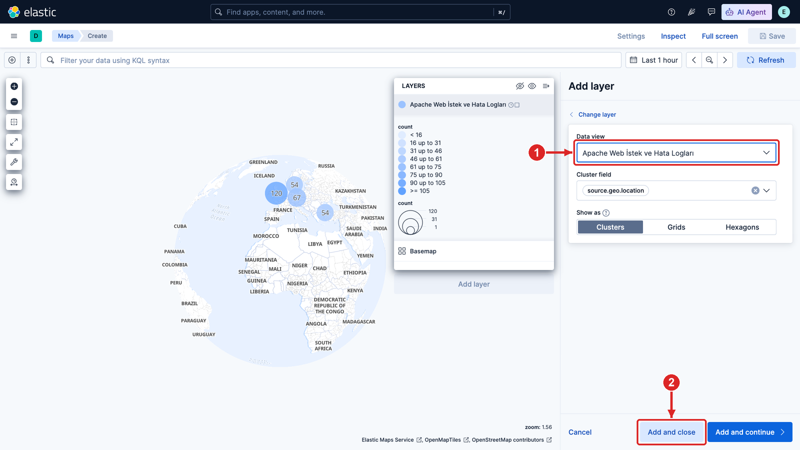

6. Katman listesi (1) sağda; daireler ülkelere göre istek sayısını gösterir:

   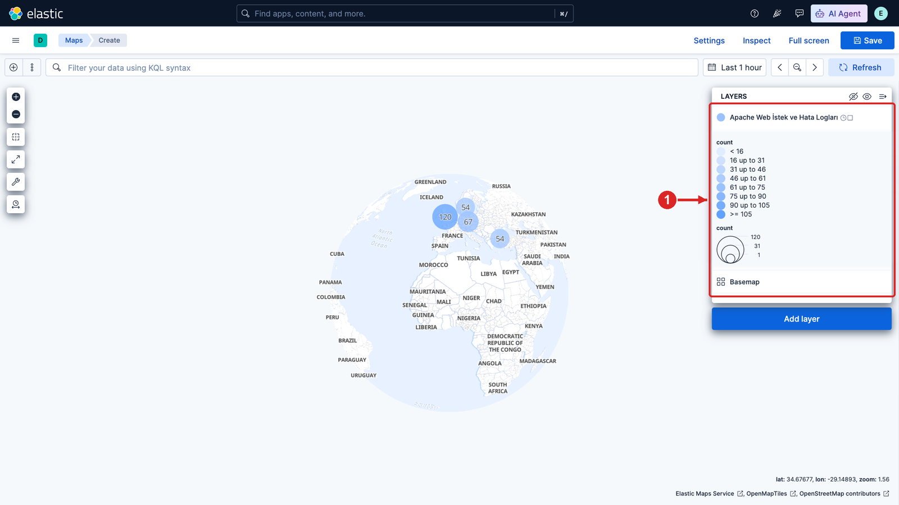

7. Sağ üstte **Save**. **Title** (1) `Apache ziyaretçileri`, **Add to dashboard** altında **None** (2), **Save and add to
   library** (3). Harita panoya **Add › From library** ile eklenebilir:

   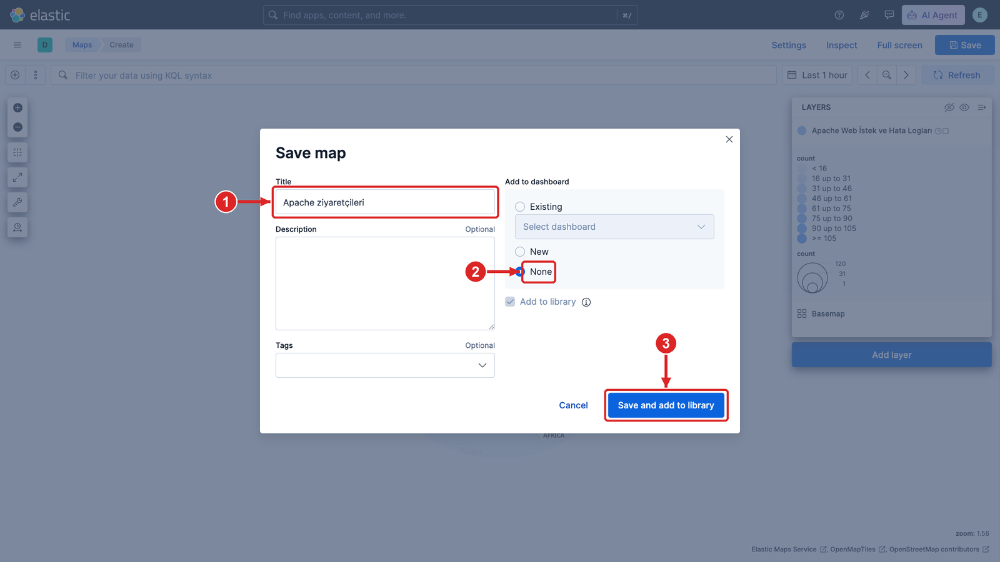

### 4. Arıza: panoda görün, ES|QL ile kök nedeni bulun

Bakımdaki bir sayfaya (`/cgi-bin/unavailable.sh`, 503 döner) tek bir IP'den 60 istek gönderin:

```bash
python3 scripts/generate_burst.py --path /cgi-bin/unavailable.sh --requests 60
```

Beklenen çıktı:

```text
requests=60 concurrency=8 ip=195.175.39.39 elapsed_seconds=0.31 statuses={503: 60}
```

Birkaç saniye sonra panoyu açın (3. adımdaki gibi), zaman seçicisinden **Last 15 minutes**'ı seçin. **5xx istek
sayısı** paneli (1) birden yükselir. Pano "ne oldu" sorusunu cevaplar; "kim, nereden" sorusu için ES|QL'e geçin:

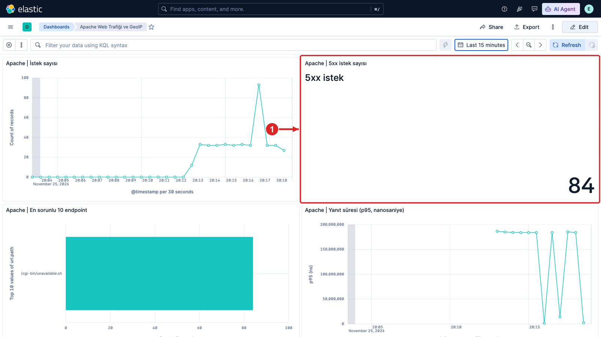

Son 10 dakikadaki 5xx'leri endpoint, IP ve ülkeye göre sayan sorgu. İki yol var, birini seçin: komut yolu terminalde,
arayüz yolu Discover'da aynı tabloyu verir.

**Komut yolu.**

```bash
Q='FROM apache-web-* | WHERE @timestamp > NOW() - 10 minutes AND event.dataset == "apache.access" AND http.response.status_code >= 500 | STATS istek = COUNT(*) BY url.path, source.ip, source.geo.country_name | SORT istek DESC | LIMIT 3'
jq -n --arg q "$Q" '{query: $q}' | curl -s -u elastic:'DevOps2026!' 'http://127.0.0.1:9200/_query?format=txt' -H 'Content-Type: application/json' -d @-
```

Beklenen çıktı:

```text
     istek     |       url.path        |   source.ip   |source.geo.country_name
---------------+-----------------------+---------------+-----------------------
62             |/cgi-bin/unavailable.sh|195.175.39.39  |Türkiye
6              |/cgi-bin/unavailable.sh|89.160.20.128  |Sweden
6              |/cgi-bin/unavailable.sh|5.9.0.1        |Germany
```

<details>
<summary><strong>Arayüz yolu</strong> (komut yolundaysanız yalnız okuyun)</summary>

**Komut yolundaysanız bu adımları yapmayın;** aynı sorgu Discover'da çalışır ve aynı tabloyu verir.

1. Menü düğmesine (1) tıklayın, **Analytics** altında **Discover**'ı (2) seçin:

   

2. Sağ üstte **Query in ES|QL** (1):

   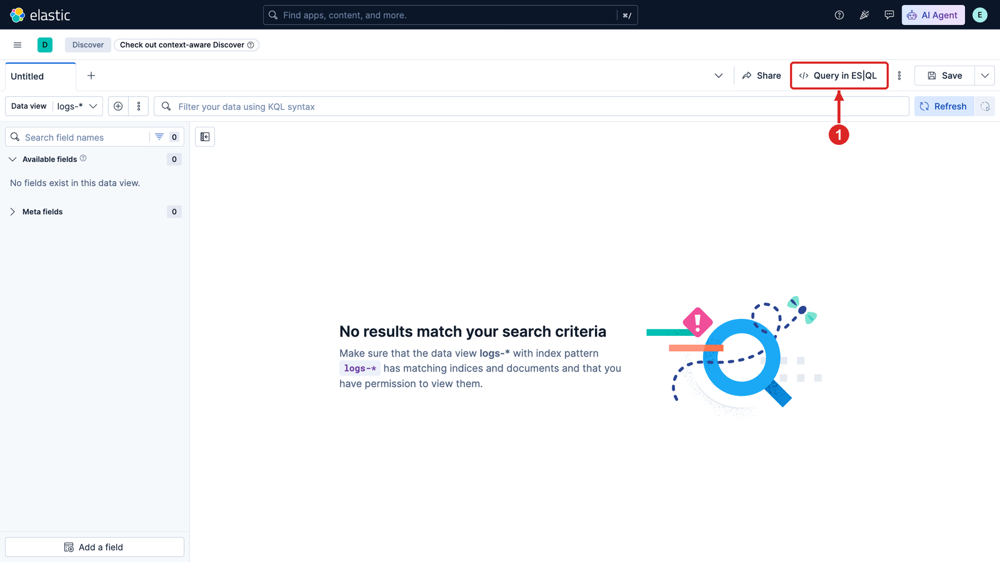

3. Sorgu kutusundaki metni silin, aşağıdaki sorguyu yapıştırın (1), **Search** (2). Sonuç tablosu (3):

   ```text
   FROM apache-web-* | WHERE @timestamp > NOW() - 10 minutes AND event.dataset == "apache.access" AND http.response.status_code >= 500 | STATS istek = COUNT(*) BY url.path, source.ip, source.geo.country_name | SORT istek DESC | LIMIT 3
   ```

   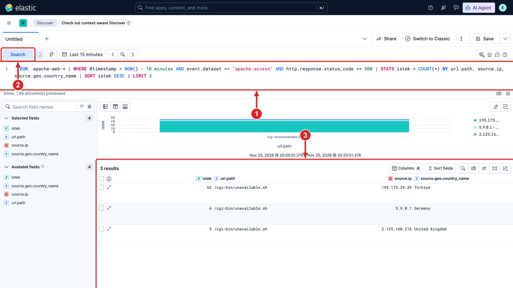

</details>

Sayılar ve alt satırlar sizde farklıdır. İlk satır kök nedendir: hataların çoğu tek bir IP'den (`195.175.39.39`, Türkiye) tek bir
endpoint'e gelmiş. Alt satırlar trafik üretecinin olağan hatalarıdır: her IP'den dakikada bir iki tane. Gerçek
hayatta bir sonraki adım bu IP'yi engellemek ya da bakımdaki sayfayı düzeltmek olurdu.

### 5. Alarm: 5xx artınca e-posta (Mailpit)

Bir dahaki arızada e-posta gelsin. Önce e-postayı yerel Mailpit'e gönderen connector. Kibana › Dev Tools'a
yapıştırın:

```http
POST kbn:/api/actions/connector/apache-mailpit
{ "name": "apache-mailpit", "connector_type_id": ".email",
  "config": { "service": "other", "host": "mailpit-apache-lab", "port": 1025, "secure": false, "from": "alarm@lab.local", "hasAuth": false },
  "secrets": {} }
```

<details>
<summary><strong>Çıktının tamamı (7 satır)</strong></summary>

```json
{
  "id": "apache-mailpit",
  "name": "apache-mailpit",
  "config": { "service": "other", "host": "mailpit-apache-lab", "port": 1025, "secure": false, "from": "alarm@lab.local", ... },
  "connector_type_id": ".email",
  ...
}
```

</details>

Kural her dakika çalışır, son 2 dakikada 40'tan fazla 5xx görünce alarm açar. Yalnız Apache kayıtları
(`event.dataset: apache.access`) sayılır. Trafik üreteci 2 dakikada en çok 10 hata üretir; 60 istekli arıza eşiği her
zaman aşar. `notify_when: onActionGroupChange` açılışta bir kez mesaj gönderir. Kibana › Dev Tools'a yapıştırın:

```http
POST kbn:/api/alerting/rule/apache-5xx
{
  "name": "Apache 5xx artışı", "rule_type_id": ".es-query", "consumer": "stackAlerts", "schedule": { "interval": "1m" },
  "params": { "searchType": "esQuery", "index": ["apache-web-*"], "timeField": "@timestamp",
    "esQuery": "{\"query\":{\"bool\":{\"filter\":[{\"term\":{\"event.dataset\":\"apache.access\"}},{\"range\":{\"http.response.status_code\":{\"gte\":500}}}]}}}",
    "threshold": [40], "thresholdComparator": ">", "timeWindowSize": 2, "timeWindowUnit": "m",
    "size": 0, "aggType": "count", "groupBy": "all", "excludeHitsFromPreviousRun": false },
  "actions": [ { "id": "apache-mailpit", "group": "query matched",
    "params": { "to": ["operasyon@lab.local"], "subject": "[ALARM] {{rule.name}}: {{context.value}} adet 5xx",
      "message": "{{context.conditions}}\nOlculen: {{context.value}}\nZaman: {{context.date}}" },
    "frequency": { "summary": false, "notify_when": "onActionGroupChange", "throttle": null } } ]
}
```

<details>
<summary><strong>Çıktının tamamı (8 satır)</strong></summary>

```json
{
  "id": "apache-5xx",
  "enabled": true,
  "name": "Apache 5xx artışı",
  "rule_type_id": ".es-query",
  "schedule": { "interval": "1m" },
  ...
}
```

</details>

Arızayı tekrar üretin:

```bash
python3 scripts/generate_burst.py --path /cgi-bin/unavailable.sh --requests 60
timeout 180 bash -c 'until [ "$(curl -s 127.0.0.1:8025/api/v1/messages | jq .total)" -ge 1 ]; do printf .; sleep 5; done'; echo
curl -s 127.0.0.1:8025/api/v1/messages | jq -c '.messages[0] | {Subject, To: [.To[].Address], From: .From.Address}'
```

Beklenen çıktı:

```text
requests=60 concurrency=8 ip=195.175.39.39 elapsed_seconds=0.44 statuses={503: 60}
.............
{"Subject":"[ALARM] Apache 5xx artışı: 65 adet 5xx","To":["operasyon@lab.local"],"From":"alarm@lab.local"}
```

E-posta yaklaşık 1 dakikada gelir; sayı sizde farklıdır. Mailpit arayüzü yalnız sunucudan açılır; tünel komutunu
sunucuda hesaplayın:

```bash
IP=$(curl -s https://api.ipify.org); echo "Kendi bilgisayarınızda: ssh -f -N -L 8025:127.0.0.1:8025 $(whoami)@$IP"
```

Beklenen çıktı:

```text
Kendi bilgisayarınızda: ssh -f -N -L 8025:127.0.0.1:8025 student@<IP>
```

Yazdırılan komutu kendi bilgisayarınızın terminalinde çalıştırın, sonra tarayıcıda `http://127.0.0.1:8025`:

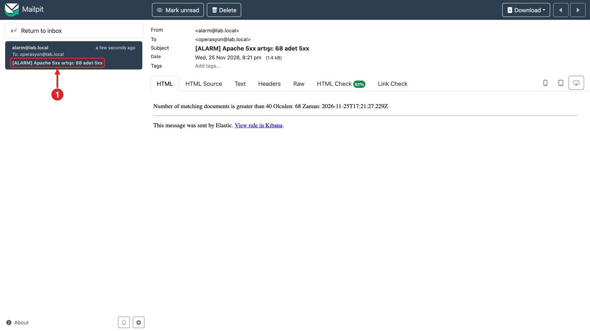

İşiniz bitince tüneli kapatın: `pkill -f "\-L 8025:127.0.0.1:8025"`.

<details>
<summary><strong>İsteğe bağlı: gerçek e-posta (Resend) ve Slack, hesabınız varsa</strong></summary>

İki gizli bilgi gerekir: Resend API anahtarı ve Slack webhook adresi. İkisi de parola gibidir; repoya ve ekran
görüntüsüne yazmayın.

<details>
<summary><strong>Resend anahtarı ve Slack webhook nasıl alınır?</strong></summary>

- **Resend API anahtarı:** [resend.com](https://resend.com)'da ücretsiz hesap açın; **API Keys › Create
  API Key**. Hesap doğrulanmış bir alan adı olmadan yalnız kendi e-posta adresinize gönderir; test için
  yeterlidir. Gönderen adres `onboarding@resend.dev` olur.
- **Slack webhook:** [api.slack.com/apps](https://api.slack.com/apps) › **Create New App** › **Pick features**
  (scope ve event eklemeden **Continue**) › **Create** › **Incoming Webhooks** › **Activate** › **Add New Webhook**
  › kanal seçin › **Allow** › **Copy**. Adres `https://hooks.slack.com/services/T…/B…/…` biçimindedir.
- Her tıklamanın işaretli ekran görüntüsü LAB-18'in "Slack ve e-posta: hesap, anahtar ve connector" kutusundadır:
  [LAB-18](../LAB-18-alerting-raporlama/README.md).

</details>

Değerleri terminale verin (tırnaklar kalsın; terminali kapatırsanız yeniden yapıştırın):

<!-- runner:skip -->
```bash
export RESEND_API_KEY='<Resend anahtarınız>'
export SLACK_WEBHOOK_URL='<Slack webhook adresiniz>'
export ALARM_TO='<Resend hesabınızın e-posta adresi>'
```

İki connector'ı kurun:

```bash
jq -n '{name:"apache-eposta", connector_type_id:".email", config:{service:"other", host:"smtp.resend.com", port:465, secure:true, from:"onboarding@resend.dev", hasAuth:true}, secrets:{user:"resend", password:$ENV.RESEND_API_KEY}}' | ./scripts/kbn.sh POST /api/actions/connector/apache-eposta @- | jq -c '{id, connector_type_id}'
jq -n '{name:"apache-slack", connector_type_id:".slack", secrets:{webhookUrl:$ENV.SLACK_WEBHOOK_URL}}' | ./scripts/kbn.sh POST /api/actions/connector/apache-slack @- | jq -c '{id, connector_type_id}'
```

Beklenen çıktı:

```text
{"id":"apache-eposta","connector_type_id":".email"}
{"id":"apache-slack","connector_type_id":".slack"}
```

<details>
<summary><strong>Connector kurulumu yarıda kaldıysa</strong></summary>

Komutlardan biri hata verdiyse aynı bloğu yeniden çalıştırmak `409 Conflict` verir. İkisini silip yeniden kurun:

```bash
./scripts/kbn.sh DELETE /api/actions/connector/apache-eposta; echo " apache-eposta silindi"
./scripts/kbn.sh DELETE /api/actions/connector/apache-slack; echo " apache-slack silindi"
jq -n '{name:"apache-eposta", connector_type_id:".email", config:{service:"other", host:"smtp.resend.com", port:465, secure:true, from:"onboarding@resend.dev", hasAuth:true}, secrets:{user:"resend", password:$ENV.RESEND_API_KEY}}' | ./scripts/kbn.sh POST /api/actions/connector/apache-eposta @- | jq -c '{id, connector_type_id}'
jq -n '{name:"apache-slack", connector_type_id:".slack", secrets:{webhookUrl:$ENV.SLACK_WEBHOOK_URL}}' | ./scripts/kbn.sh POST /api/actions/connector/apache-slack @- | jq -c '{id, connector_type_id}'
```

Beklenen çıktı:

```text
 apache-eposta silindi
 apache-slack silindi
{"id":"apache-eposta","connector_type_id":".email"}
{"id":"apache-slack","connector_type_id":".slack"}
```

</details>

Bağlantıyı deneyin; e-posta kutunuza ve Slack kanalınıza birer test mesajı düşer:

```bash
./scripts/kbn.sh POST /api/actions/connector/apache-eposta/_execute "{\"params\":{\"to\":[\"$ALARM_TO\"],\"subject\":\"LAB-27 e-posta testi\",\"message\":\"Kibana connector testi\"}}" | jq -c '{status, connector_id}'
./scripts/kbn.sh POST /api/actions/connector/apache-slack/_execute '{"params":{"message":"LAB-27 Slack testi"}}' | jq -c '{status, connector_id}'
```

Beklenen çıktı:

```text
{"status":"ok","connector_id":"apache-eposta"}
{"status":"ok","connector_id":"apache-slack"}
```

Kuralı iki aksiyonla yeniden kurun:

```bash
./scripts/kbn.sh DELETE /api/alerting/rule/apache-5xx; echo
jq -n --arg to "$ALARM_TO" -f scripts/kural.jq | ./scripts/kbn.sh POST /api/alerting/rule/apache-5xx @- | jq -c '{id, actions: [.actions[].id]}'
```

Beklenen çıktı:

```text
{"id":"apache-5xx","actions":["apache-mailpit","apache-eposta","apache-slack"]}
```

Arızayı tekrar üretin; alarm açılınca üç kanala birer mesaj gider:

```bash
python3 scripts/generate_burst.py --path /cgi-bin/unavailable.sh --requests 60
timeout 180 bash -c 'until curl -s -u elastic:"DevOps2026!" -H "kbn-xsrf: true" http://127.0.0.1:5601/api/alerting/rule/apache-5xx | jq -e ".last_run.alerts_count.active == 1" >/dev/null; do printf .; sleep 10; done'; echo " alarm acildi"
```

Beklenen çıktı:

```text
requests=60 concurrency=8 ip=195.175.39.39 elapsed_seconds=0.34 statuses={503: 60}
. alarm acildi
```

E-posta kutunuza ve Slack kanalınıza `[ALARM] Apache 5xx artışı` mesajı düşer. **Stack Management › Connectors**
listesinde üç connector görünür:

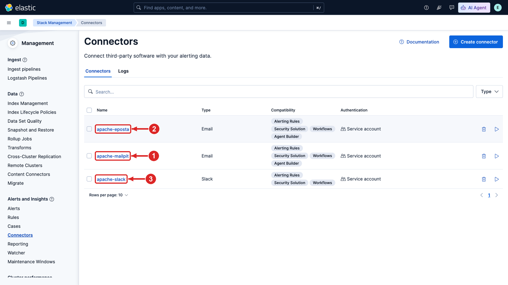

Gerçek kanallara gereksiz mesaj gitmesin diye kuralı kapatın (silinmez):

```bash
./scripts/kbn.sh POST /api/alerting/rule/apache-5xx/_disable; echo " kural kapatildi"
```

Beklenen çıktı:

```text
 kural kapatildi
```

<details>
<summary><strong>Resend yerine Gmail</strong></summary>

Gmail için Google hesabında iki adımlı doğrulama açık olmalı ve **Google Hesabı › Güvenlik › Uygulama
şifreleri** ile 16 karakterlik bir uygulama şifresi üretilir. Connector'da `"host": "smtp.gmail.com"`,
`"port": 465`, `"secure": true`, `"from"` ve `"user"` Gmail adresiniz, `"password"` uygulama şifresidir.
Hesap parolanız kullanılmaz.

</details>

</details>

<details>
<summary><strong>İsteğe bağlı: PDF rapor</strong></summary>

1. 3. adımdaki gibi **Apache Web Trafiği ve GeoIP** panosunu açın. Üstte **Export** (1), menüde **PDF reports** (2):

   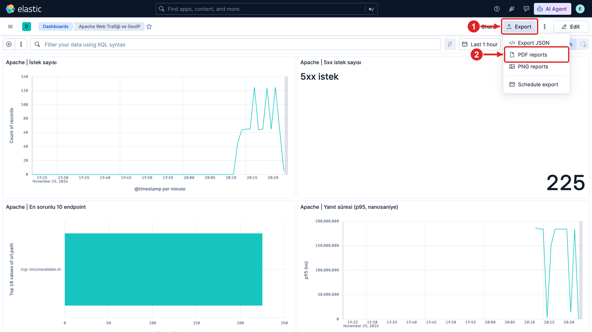

2. Sağdaki panelde **Export PDF** (1):

   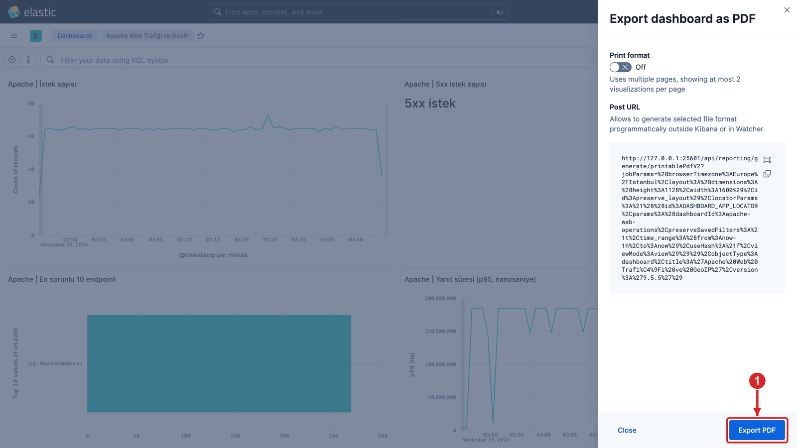

3. Menüden **Management › Stack Management**, soldaki listede **Reporting** (1):

   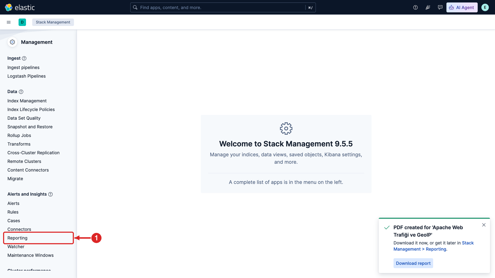

4. Pano satırı (1) **Done** olunca satır sonundaki menüden **Download report** ile indirilir:

   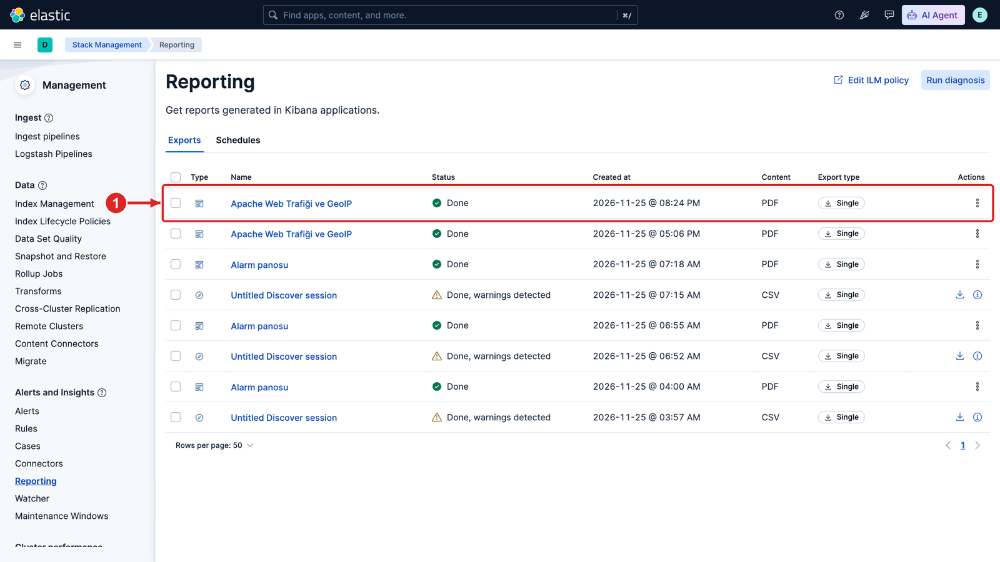

Raporun durumu komutla:

```bash
curl -s -u elastic:'DevOps2026!' -H 'Content-Type: application/json' 'http://127.0.0.1:9200/.kibana-reporting*/_search?expand_wildcards=all' \
  -d '{"size":1,"sort":[{"created_at":"desc"}],"query":{"term":{"jobtype":"printable_pdf_v2"}},"_source":["status","output.content_type","output.size"]}' \
  | jq -c '.hits.hits[0]._source'
```

Beklenen çıktı:

```text
{"status":"completed","output":{"content_type":"application/pdf","size":567696}}
```

</details>

<details>
<summary><strong>İsteğe bağlı: ML ile anomali tespiti ve SLO</strong></summary>

Machine learning her IP'nin olağan istek sayısını öğrenir, beklenmedik artışta anomali işaretler. SLO hizmetin
hedefini (ör. isteklerin %99,9'u 5xx olmasın) izler:

```bash
python3 scripts/provision_insights.py
curl -s -u elastic:'DevOps2026!' 'http://127.0.0.1:9200/_ml/anomaly_detectors/apache-ip-istek-anomali/_stats?filter_path=jobs.state' | jq -c .
curl -s -u elastic:'DevOps2026!' 'http://127.0.0.1:5601/api/observability/slos' | jq -c '[.results[] | {id, hedef: .objective.target}]'
```

Beklenen çıktı:

```text
ML işi: apache-ip-istek-anomali (açık, veri akışı başladı)
SLO: apache-web-erisilebilirlik
SLO: apache-web-gecikme-500ms
{"jobs":[{"state":"opened"}]}
[{"id":"apache-web-erisilebilirlik","hedef":0.999},{"id":"apache-web-gecikme-500ms","hedef":0.95}]
```

Kibana'da menüden **Analytics › Machine Learning**, **Anomaly Detection › Jobs**: iş (1) açık ve veri akışı çalışıyor:

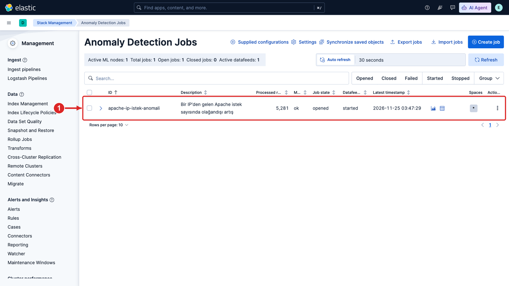

Menüden **Observability › SLOs**: iki hedef (1, 2). Kurulumdan hemen sonra **No data**, arızalardan sonra
**Violated** görünebilir:

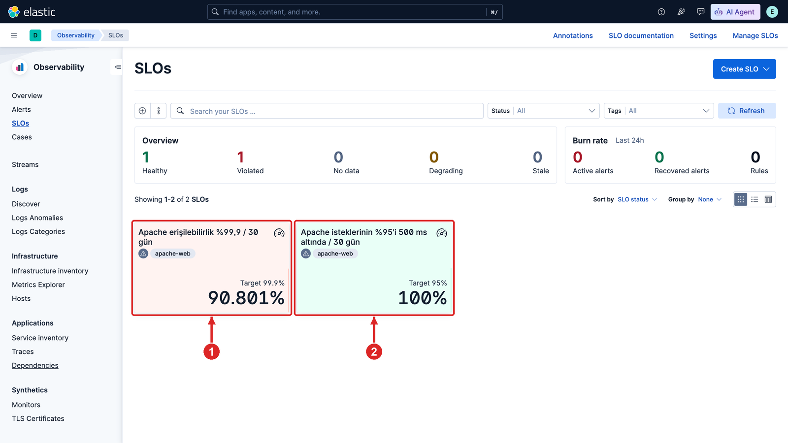

Anlamlı ML sonucu birkaç saat veri biriktikten sonra gelir.

</details>

---

## Temizlik

Yalnız bu labın container'larını ve volume'lerini, `apache-web-*` index'lerini ve şablonunu, Metricbeat'in
data stream'ini, kuralını, connector'larını, data view'larını, panosunu ve haritasını siler. Ana cluster'a ve Reporting listesindeki PDF kaydına dokunmaz. Resend ve Slack kutusunu yapmadıysanız
o iki connector için `404` yazar; silinecek bir şey yok demektir:

```bash
./teardown.sh
```

<details>
<summary><strong>Çıktının tamamı (27 satır)</strong></summary>

```text
Container apache-web-observability-apache-1 Removed
Container apache-web-observability-elastic-setup-1 Removed
Container apache-web-observability-filebeat-1 Removed
Container apache-web-observability-logstash-1 Removed
Container apache-web-observability-metricbeat-1 Removed
Container apache-web-observability-metricbeat-setup-1 Removed
Container apache-web-observability-traffic-generator-1 Removed
Container mailpit-apache-lab Removed
Network apache-web-observability_web Removed
Volume apache-web-observability_apache-logs Removed
Volume apache-web-observability_filebeat-data Removed
Volume apache-web-observability_metricbeat-data Removed
Volume apache-web-observability_traffic-logs Removed
kural apache-5xx -> 204
ML isi -> 200
SLO apache-web-erisilebilirlik -> 204
SLO apache-web-gecikme-500ms -> 204
connector apache-mailpit -> 204
connector apache-eposta -> 204
connector apache-slack -> 204
Kibana nesneleri -> 6 silindi
data view apache-web-logs -> 200
data view apache-web-metrics -> 200
index'ler -> 200
sablon apache-web -> 200
metricbeat data stream -> 200
metricbeat sablonu -> 200
```

</details>

Bu, çekirdek akışın son labıdır. İleri konular `labs/advanced/` altındadır: **[ADV-01 — Data stream kuralları ve Data Stream Lifecycle](../advanced/ADV-01-data-stream-kurallari-dsl/README.md)**

Labı aynı sunucuda yeniden yapacaksanız başlamadan önce `./teardown.sh` çalıştırın; README'deki sayılar temiz
başlangıca göredir.

