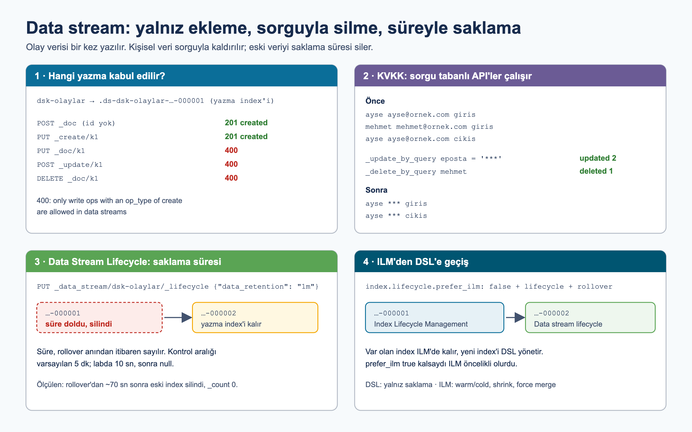

# ADV-01 — Data Stream Kuralları ve Data Stream Lifecycle: Yalnız Ekleme, KVKK Silmesi, Retention

| Kullanılan Araçlar | Açık / Kullanılan Portlar |
|---|---|
| Kibana Dev Tools, `curl`, `jq`, index template, data stream, Data Stream Lifecycle (DSL), ILM | 9200 / 5601 (ana cluster) |

---

## Bu lab ne öğretiyor?

Log ve olay verisi data stream'e yazılır: document eklenir, bir daha değiştirilmez. Ama bir gün "şu kullanıcının
e-postasını sil" talebi gelir ve tek document silme isteği reddedilir. Data stream'in hangi yazmaya izin verdiğini ve
kişisel veriyi nasıl kaldıracağınızı bilmeniz gerekir.

Bu labda bir data stream'in yalnız ekleme kuralını ölçecek, kişisel veriyi sorgu tabanlı API'lerle maskeleyip
silecek, eski veriyi ILM politikası yazmadan Data Stream Lifecycle (DSL) ile sildirecek ve ILM ile yönetilen bir
stream'i DSL'e geçireceğiz.



---

## Ön Koşullar

- LAB-01 ana cluster'ı çalışıyor. Önceki labları atladıysanız da lab çalışır; veri bu labın kendi komutlarıyla gelir.

```bash
cd ~/elastic/labs/advanced/ADV-01-data-stream-kurallari-dsl
```

Kibana adresini sunucuda hesaplayın:

```bash
IP=$(curl -s https://api.ipify.org); H=$(hostname -s)
echo "Kibana: http://$IP:5601   https://$H-kibana.devopsatolyesi.com"
```

Beklenen çıktı:

```text
Kibana: http://<IP>:5601   https://<host>-kibana.devopsatolyesi.com
```

---

## Kavramlar: data stream ve yaşam döngüsü

| | Klasik index | Data stream |
|---|---|---|
| Yazma | Her `_id`'ye yazılır, üzerine yazılır | Yalnız yeni document (`op_type: create`) |
| Tek document güncelleme / silme | Var | Yok: `400` |
| Sorgu ile güncelleme / silme | Var | Var: `_update_by_query`, `_delete_by_query` |
| Arkada | Tek index | `.ds-<ad>-<tarih>-00000N` backing index'leri; yazma son index'e gider |

Yaşam döngüsünü iki mekanizmadan biri yönetir: **ILM** fazlı bir politikadır (hot, warm, delete, shrink,
force merge). **Data Stream Lifecycle** stream'in üstüne yazılan tek bir saklama süresidir; rollover'ı da
kendisi yapar.

---

## Adım Adım Uygulama Rehberi

### 1. Şablon ve ilk olay

Data stream kendi şablonundan doğar: `data_stream: {}` olan bir index template, adıyla eşleşen ilk yazmada
stream'i açar. Kibana › Dev Tools'a yapıştırın:

```http
PUT _index_template/dsk-olaylar
{
  "index_patterns": ["dsk-olaylar"],
  "data_stream": {},
  "priority": 500,
  "template": {
    "settings": { "number_of_replicas": 0 },
    "mappings": { "properties": {
      "@timestamp": { "type": "date" }, "kullanici": { "type": "keyword" },
      "eposta": { "type": "keyword" }, "olay": { "type": "keyword" } } }
  }
}
POST dsk-olaylar/_doc?refresh=true&filter_path=result,_index
{ "@timestamp": "2026-11-20T10:00:00Z", "kullanici": "ayse", "eposta": "ayse@ornek.com", "olay": "giris" }
```

```json
{"acknowledged":true}
{"_index":".ds-dsk-olaylar-2026.11.21-000001","result":"created"}
```

Document `dsk-olaylar` adına yazıldı ama `.ds-dsk-olaylar-<tarih>-000001` index'inde duruyor; index adlarındaki tarih
bu labın bütün çıktılarında sizde labı yaptığınız gündür. `priority: 500`, aynı adla eşleşebilecek yerleşik şablonların önüne geçmek içindir.

### 2. Yalnız ekleme: hangi yazma kabul edilir?

Beş yazma isteğinin HTTP kodunu ve cevabını yan yana görün:

```bash
T=$(mktemp)
dene() { printf '%-22s -> ' "$1"; shift
  curl -s -u elastic:'DevOps2026!' -H 'Content-Type: application/json' -o "$T" -w '%{http_code}' "$@"
  echo " $(jq -r '.result // .error.reason' "$T")"; }
dene "POST _doc (id yok)" -X POST 'http://127.0.0.1:9200/dsk-olaylar/_doc?refresh=true' \
  -d '{"@timestamp": "2026-11-20T10:01:00Z", "kullanici": "mehmet", "eposta": "mehmet@ornek.com", "olay": "giris"}'
dene "PUT _create/k1" -X PUT 'http://127.0.0.1:9200/dsk-olaylar/_create/k1?refresh=true' \
  -d '{"@timestamp": "2026-11-20T10:02:00Z", "kullanici": "ayse", "eposta": "ayse@ornek.com", "olay": "cikis"}'
dene "PUT _doc/k1" -X PUT 'http://127.0.0.1:9200/dsk-olaylar/_doc/k1' -d '{"@timestamp": "2026-11-20T10:02:00Z", "olay": "degisti"}'
dene "POST _update/k1" -X POST 'http://127.0.0.1:9200/dsk-olaylar/_update/k1' -d '{"doc": {"olay": "degisti"}}'
dene "DELETE _doc/k1" -X DELETE 'http://127.0.0.1:9200/dsk-olaylar/_doc/k1'
rm -f "$T"
```

Beklenen çıktı:

```text
POST _doc (id yok)     -> 201 created
PUT _create/k1         -> 201 created
PUT _doc/k1            -> 400 only write ops with an op_type of create are allowed in data streams
POST _update/k1        -> 400 only write ops with an op_type of create are allowed in data streams
DELETE _doc/k1         -> 400 only write ops with an op_type of create are allowed in data streams
```

`_id` vermeden yazmak ve `_create` ile yeni bir `_id` açmak çalışır. Var olan document'in üzerine yazmak,
güncellemek ve silmek reddedilir. Data stream bu yüzden değişmeyen olaylar (log, metrik, denetim kaydı) içindir;
müşteri kaydı gibi güncellenen veri klasik index'te tutulur.

### 3. KVKK: kişisel veriyi maskelemek ve silmek

Tek document API'si reddedildi; sorgu tabanlı API'ler stream adı üzerinde çalışır. Ayşe'nin e-postasını maskeleyin,
Mehmet'in kayıtlarını silin:

```http
POST dsk-olaylar/_update_by_query?refresh=true&filter_path=updated
{ "query": { "term": { "kullanici": "ayse" } }, "script": { "source": "ctx._source.eposta = '***'" } }
POST dsk-olaylar/_delete_by_query?refresh=true&filter_path=deleted
{ "query": { "term": { "kullanici": "mehmet" } } }
GET dsk-olaylar/_search?filter_path=hits.hits._source&sort=@timestamp
```

```json
{"updated":2}
{"deleted":1}
{"hits":{"hits":[{"_source":{"olay":"giris","kullanici":"ayse","@timestamp":"2026-11-20T10:00:00Z","eposta":"***"}},{"_source":{"olay":"cikis","kullanici":"ayse","@timestamp":"2026-11-20T10:02:00Z","eposta":"***"}}]}}
```

Önce ve sonra: Ayşe'nin iki kaydında e-posta `***` oldu, Mehmet'in kaydı gitti. Bu istekler backing index'lerdeki
document'leri yerinde değiştirir; rollover ile çoktan yazmaya kapanmış eski backing index'ler de kapsanır.

### 4. Data Stream Lifecycle: eski veriyi kendiliğinden silmek

Stream'e bir saklama süresi verin. Lab için 1 dakika; gerçekte gün ya da ay olur:

```http
PUT _data_stream/dsk-olaylar/_lifecycle
{ "data_retention": "1m" }
GET dsk-olaylar/_lifecycle/explain?filter_path=indices.*.managed_by_lifecycle,indices.*.lifecycle
```

```json
{"acknowledged":true}
{"indices":{".ds-dsk-olaylar-2026.11.21-000001":{"managed_by_lifecycle":true,"lifecycle":{"enabled":true,"data_retention":"1m","effective_retention":"1m","retention_determined_by":"data_stream_configuration"}}}}
```

Saklama süresi bir backing index'in rollover anından itibaren sayılır; yazma index'i silinmez. DSL varsayılan
olarak 5 dakikada bir kontrol eder (`data_streams.lifecycle.poll_interval`, cluster geneli). Farkı beklemeden
görmek için aralığı geçici olarak 10 saniyeye indirin, rollover yapın ve eski index'in silinmesini izleyin
(yaklaşık 70 saniye):

```bash
curl -s -u elastic:'DevOps2026!' -X PUT 'http://127.0.0.1:9200/_cluster/settings?filter_path=persistent' \
  -H 'Content-Type: application/json' -d '{"persistent": {"data_streams.lifecycle.poll_interval": "10s"}}'; echo
curl -s -u elastic:'DevOps2026!' -X POST 'http://127.0.0.1:9200/dsk-olaylar/_rollover?filter_path=old_index,new_index'; echo
timeout 300 bash -c 'until [ "$(curl -s -u elastic:"DevOps2026!" http://127.0.0.1:9200/_data_stream/dsk-olaylar | jq ".data_streams[0].indices | length")" = 1 ]; do printf .; sleep 5; done'; echo
curl -s -u elastic:'DevOps2026!' 'http://127.0.0.1:9200/_data_stream/dsk-olaylar?filter_path=data_streams.indices.index_name'; echo
curl -s -u elastic:'DevOps2026!' 'http://127.0.0.1:9200/dsk-olaylar/_count?filter_path=count'; echo
curl -s -u elastic:'DevOps2026!' -X PUT 'http://127.0.0.1:9200/_cluster/settings?filter_path=persistent' \
  -H 'Content-Type: application/json' -d '{"persistent": {"data_streams.lifecycle.poll_interval": null}}'; echo
```

Beklenen çıktı:

```text
{"persistent":{"data_streams":{"lifecycle":{"poll_interval":"10s"}}}}
{"old_index":".ds-dsk-olaylar-2026.11.21-000001","new_index":".ds-dsk-olaylar-2026.11.21-000002"}
............
{"data_streams":[{"indices":[{"index_name":".ds-dsk-olaylar-2026.11.21-000002"}]}]}
{"count":0}
{"persistent":{}}
```

Eski backing index (`000001`) ve içindeki document'ler silindi; yalnız boş yazma index'i kaldı. Son komut kontrol
aralığını varsayılana döndürür: `{"persistent":{}}`. 10 saniyelik aralık lab içindir; üretimde gereksiz yüktür.

### 5. ILM'li bir stream'i DSL'e geçirmek

Önce ILM ile yönetilen bir stream kurun:

```http
PUT _ilm/policy/dsk-ilm
{ "policy": { "phases": { "hot": { "actions": { "rollover": { "max_primary_shard_size": "10gb" } } } } } }
PUT _index_template/dsk-gecis
{ "index_patterns": ["dsk-gecis"], "data_stream": {}, "priority": 500,
  "template": { "settings": { "number_of_replicas": 0, "index.lifecycle.name": "dsk-ilm" } } }
POST dsk-gecis/_doc?filter_path=result
{ "@timestamp": "2026-11-20T10:00:00Z", "olay": "giris" }
GET _data_stream/dsk-gecis?filter_path=data_streams.ilm_policy,data_streams.next_generation_managed_by,data_streams.prefer_ilm,data_streams.indices.index_name,data_streams.indices.managed_by
```

```json
{"acknowledged":true}
{"acknowledged":true}
{"result":"created"}
{"data_streams":[{"indices":[{"index_name":".ds-dsk-gecis-2026.11.21-000001","managed_by":"Index Lifecycle Management"}],"ilm_policy":"dsk-ilm","next_generation_managed_by":"Index Lifecycle Management","prefer_ilm":true}]}
```

Şimdi geçiş: şablona saklama süresini ve `index.lifecycle.prefer_ilm: false` ayarını ekleyin, stream'e de
lifecycle verin ve rollover yapın:

```http
PUT _index_template/dsk-gecis
{ "index_patterns": ["dsk-gecis"], "data_stream": {}, "priority": 500,
  "template": { "settings": { "number_of_replicas": 0, "index.lifecycle.name": "dsk-ilm", "index.lifecycle.prefer_ilm": false },
                "lifecycle": { "data_retention": "7d" } } }
PUT _data_stream/dsk-gecis/_lifecycle
{ "data_retention": "7d" }
POST dsk-gecis/_rollover?filter_path=new_index
GET _data_stream/dsk-gecis?filter_path=data_streams.ilm_policy,data_streams.next_generation_managed_by,data_streams.prefer_ilm,data_streams.indices.index_name,data_streams.indices.managed_by
```

```json
{"acknowledged":true}
{"acknowledged":true}
{"new_index":".ds-dsk-gecis-2026.11.21-000002"}
{"data_streams":[{"indices":[{"index_name":".ds-dsk-gecis-2026.11.21-000001","managed_by":"Index Lifecycle Management"},{"index_name":".ds-dsk-gecis-2026.11.21-000002","managed_by":"Data stream lifecycle"}],"ilm_policy":"dsk-ilm","next_generation_managed_by":"Data stream lifecycle","prefer_ilm":false}]}
```

Önce ve sonra: geçişten önce var olan index'i ve bir sonrakini ILM yönetiyordu. Geçişten sonra var olan index
ILM'de kaldı, rollover ile açılan yeni index'i DSL yönetiyor. `prefer_ilm: false` olmasaydı iki mekanizma da
tanımlıyken ILM öncelikli kalırdı.

| İhtiyaç | Seçim |
|---|---|
| Yalnız "N gün sakla, sonra sil" | DSL: tek ayar, politika yazmak gerekmez |
| Warm/cold katmanı, shrink, force merge, searchable snapshot | ILM |

---

## Temizlik

Yalnız bu labın `dsk-olaylar` ve `dsk-gecis` data stream'lerini, iki şablonunu ve `dsk-ilm` politikasını siler;
DSL kontrol aralığını varsayılana döndürür. Ana cluster'a ve diğer labların kaynaklarına dokunmaz:

```bash
./teardown.sh
```

Beklenen çıktı:

```text
data stream dsk-olaylar -> 200
data stream dsk-gecis -> 200
sablon dsk-olaylar -> 200
sablon dsk-gecis -> 200
ILM politikasi dsk-ilm -> 200
DSL kontrol araligi -> 200
```

Labı aynı sunucuda yeniden yapacaksanız başlamadan önce `./teardown.sh` çalıştırın; README'deki sayılar temiz
başlangıca göredir.

---

Sonraki lab: **[ADV-02 — OpenTelemetry ve Elastic OTel Collector (EDOT) Entegrasyonu](../ADV-02-opentelemetry-edot/README.md)**
