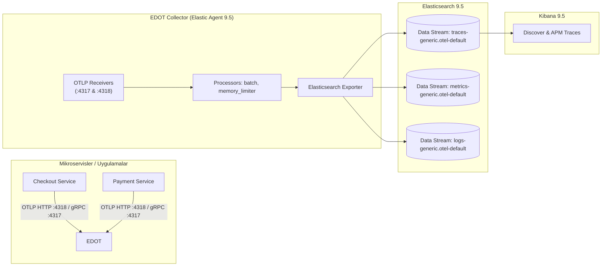
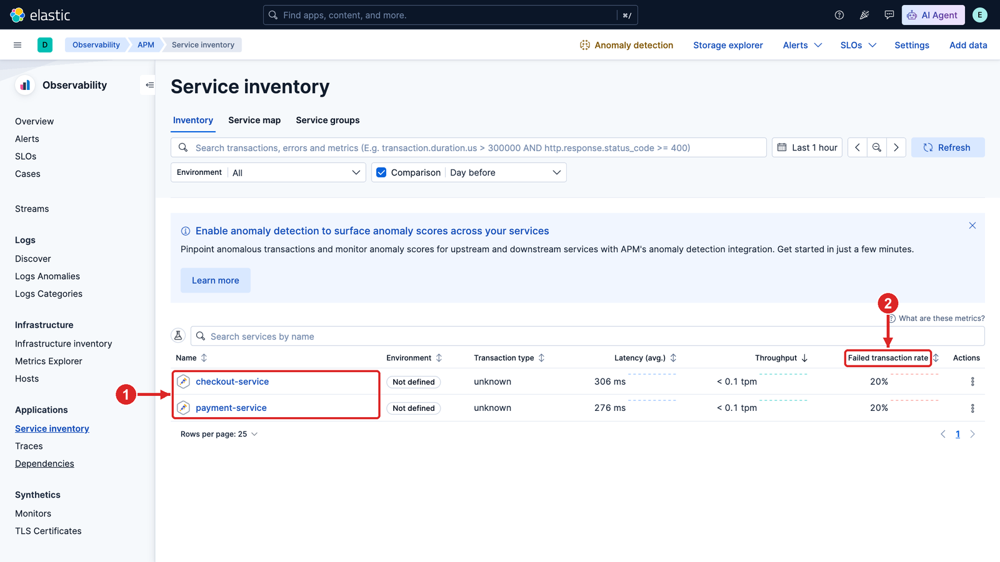
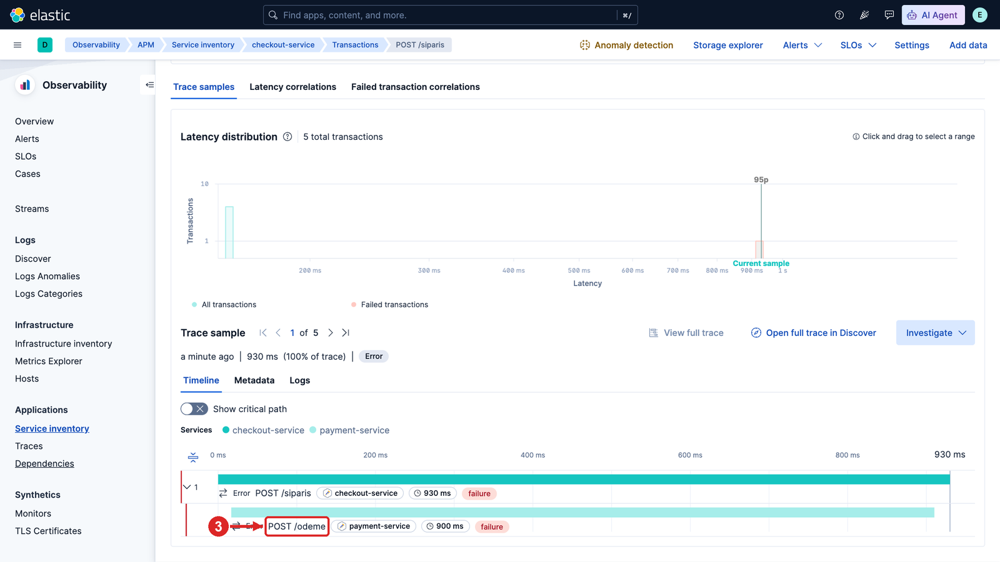

# ADV-02 — OpenTelemetry ve EDOT Collector: Trace, Log ve Metriği Tek Hatta Toplamak

| Kullanılan Araçlar | Açık / Kullanılan Portlar |
|---|---|
| OpenTelemetry (OTLP), EDOT Collector 9.5.5, Python, ES\|QL, Kibana APM | `127.0.0.1:4317` (OTLP gRPC), `127.0.0.1:4318` (OTLP HTTP), 9200 / 5601 (ana cluster) |

---

## Bu lab ne öğretiyor?

Bir sipariş iki servisten geçer ve ödeme adımında hata verir. Log tek başına "ödeme reddedildi" der ama hangi
isteğin, hangi servis çağrısında, ne kadar sürede bozulduğunu söylemez. OpenTelemetry uygulamanın trace'ini (her
servis çağrısı bir span), log'unu ve metriğini aynı kimlikle (`trace_id`) üretir; böylece üç sinyal birbirine bağlanır.

Bu labda EDOT Collector'ı (Elastic'in OpenTelemetry dağıtımı) kuracak, iki servisli beş siparişin telemetrisini OTLP
ile gönderecek, hatalı siparişin span'lerini ve log'unu ES|QL ile `trace_id` üzerinden birleştirecek ve aynı veriyi
Kibana APM ekranlarında göreceğiz.



Diyagramdaki data stream adlarının sonu bu labda `default` değil `otellab`'dır (Adım 2).

---

## Ön Koşullar

- LAB-01 ana cluster'ı çalışıyor. Önceki labları atladıysanız da lab çalışır; telemetriyi bu labın betiği üretir.
- `127.0.0.1:4317` ve `4318` boş olmalı. Collector yaklaşık 300 MB RAM kullanır.

```bash
cd ~/elastic/labs/advanced/ADV-02-opentelemetry-edot
```

Kibana adresini sunucuda hesaplayın:

```bash
IP=$(curl -s https://api.ipify.org); H=$(hostname -s)
echo "Kibana: http://$IP:5601   https://$H-kibana.devopsatolyesi.com"
```

Beklenen çıktı:

```text
Kibana: http://<IP>:5601   https://<host>-kibana.devopsatolyesi.com
```

---

## Kavramlar: trace, span ve OTLP

| Kavram | Ne | Bu labda |
|---|---|---|
| Trace | Bir isteğin bütün servislerdeki yolculuğu; tek `trace_id` | Bir sipariş |
| Span | Yolculuktaki bir iş; süresi ve durumu vardır, `parent_span_id` ile üstüne bağlanır | `POST /siparis` (checkout), altında `POST /odeme` (payment) |
| OTLP | OpenTelemetry'nin taşıma protokolü; gRPC (4317) ya da HTTP (4318) | Betik HTTP/JSON gönderir |
| Collector | OTLP'yi alıp işleyen ve hedefe yazan ara katman | EDOT Collector → Elasticsearch |

---

## Config dosyaları: hangi satır ne işe yarıyor?

`config/edot-config.yaml` (kritik satırlar):

```yaml
receivers:
  otlp: { protocols: { grpc: { endpoint: 0.0.0.0:4317 }, http: { endpoint: 0.0.0.0:4318 } } }
processors:
  elasticapm: {}
connectors:
  elasticapm: {}
exporters:
  elasticsearch: { endpoint: "${env:ELASTICSEARCH_URL}", mapping: { mode: otel } }
service:
  pipelines:
    traces: { receivers: [otlp], processors: [batch, elasticapm], exporters: [elasticapm, elasticsearch] }
    metrics/aggregated: { receivers: [elasticapm], processors: [batch], exporters: [elasticsearch] }
```

- `receivers.otlp`: container içinde bütün arayüzlerden dinler; host tarafında compose portları yalnız `127.0.0.1`'e
  açar.
- `mapping.mode: otel`: veriyi OpenTelemetry'nin kendi field adlarıyla (`trace_id`, `span_id`, `resource.attributes`)
  yazar.
- `elasticapm` processor ve connector: trace'lerden Kibana APM ekranlarının kullandığı servis metriklerini hesaplar.
  Bunlar olmadan veri Elasticsearch'e yazılır ama **APM › Service inventory boş kalır** (denendi).

---

## Adım Adım Uygulama Rehberi

### 1. Tek node için şablon ayarı ve collector

Yerleşik OTel şablonları her data stream'i 1 replica ile açar; tek node'lu ana cluster'da replica yerleşemez ve
cluster yellow kalır. Üstelik `elasticapm` connector'ı 10 ve 60 dakikalık metrik data stream'lerini ancak ilk özet
kapanınca açar; sonradan ayar yapmak onları kaçırır. Bu yüzden ayarı veriden önce, şablonların bunun için bıraktığı
`@custom` kancalarına koyun. Kibana › Dev Tools'a yapıştırın:

```http
PUT _component_template/traces-otel@custom
{ "template": { "settings": { "index.number_of_replicas": 0 } }, "_meta": { "sahibi": "ADV-02" } }
PUT _component_template/logs-otel@custom
{ "template": { "settings": { "index.number_of_replicas": 0 } }, "_meta": { "sahibi": "ADV-02" } }
PUT _component_template/metrics-otel@custom
{ "template": { "settings": { "index.number_of_replicas": 0 } }, "_meta": { "sahibi": "ADV-02" } }
POST _index_template/_simulate_index/metrics-transaction.60m.otel-otellab?filter_path=template.settings.index.number_of_replicas
```

```json
{"acknowledged":true}
{"acknowledged":true}
{"acknowledged":true}
{"template":{"settings":{"index":{"number_of_replicas":"0"}}}}
```

Simülasyon, 60 dakika sonra açılacak bir data stream'in de 0 replica alacağını gösteriyor. Bu üç şablon cluster'daki
bütün OTel data stream'lerine uygulanır; temizlik onları siler (yalnız `_meta.sahibi` bu lab ise).

Collector'ı başlatın. Container `Up` olsa da hemen istek kabul etmez; hazır olunca boş bir OTLP isteğine `200` döner
(birkaç saniye):

```bash
docker compose -f docker-compose.otel.yml up -d 2>&1 | grep -E "Started|Running"
timeout 90 bash -c 'until [ "$(curl -s -o /dev/null -w "%{http_code}" -X POST http://127.0.0.1:4318/v1/traces -H "Content-Type: application/json" -d "{}")" = 200 ]; do printf .; sleep 2; done'; echo " hazir"
```

Beklenen çıktı:

```text
 Container edot-collector Started
. hazir
```

### 2. Telemetri gönderin

Betik beş sipariş gönderir. Her siparişte checkout-service'in span'i payment-service'in span'ini çağırır; bir log
ve bir metrik aynı `trace_id`'yi taşır. 5. sipariş ödeme hatasıyla biter. Kimlikler sipariş numarasından
türetildiği için sizde de aynıdır:

```bash
python3 scripts/send-otlp-telemetry.py
timeout 60 bash -c 'until [ "$(curl -s -u elastic:"DevOps2026!" "http://127.0.0.1:9200/traces-generic.otel-otellab/_count" | jq .count 2>/dev/null)" = 10 ]; do printf .; sleep 2; done'; echo
for s in traces logs metrics; do printf '%-8s ' $s; curl -s -u elastic:'DevOps2026!' "http://127.0.0.1:9200/$s-generic.otel-otellab/_count" | jq .count; done
```

Beklenen çıktı:

```text
siparis 1  trace 0d625b490d5f2252e9035a83889a7b12  ok    HTTP [200, 200, 200]
siparis 2  trace dd158999d48d45f29f1225af5f355dfb  ok    HTTP [200, 200, 200]
siparis 3  trace d54bdaeb8651f11ac77203b269777056  ok    HTTP [200, 200, 200]
siparis 4  trace 88cb2338ad0912e505e9b234d29bad60  ok    HTTP [200, 200, 200]
siparis 5  trace 0f927e9d6892d8ca9613aef16cbbae30  HATA  HTTP [200, 200, 200]
..
traces   10
logs     5
metrics  5
```

Collector veriyi sinyal türüne göre ayrı data stream'lere yazdı: `<tür>-generic.otel-otellab`. Sondaki `otellab`,
betiğin her kayda koyduğu `data_stream.namespace` özelliğidir; başka uygulamaların OTel verisinden ayrılır.

`elasticapm` connector'ı trace'lerden servis metriklerini hesaplar ve 1 dakikalık aralıkla üç metrik data stream'i
daha açar (yaklaşık 1 dakika). Altısını ve sağlığını görün:

```bash
timeout 120 bash -c 'until [ "$(curl -s -u elastic:"DevOps2026!" "http://127.0.0.1:9200/_data_stream/*-otellab" | jq ".data_streams | length")" -ge 6 ]; do printf .; sleep 5; done'; echo
curl -s -u elastic:'DevOps2026!' 'http://127.0.0.1:9200/_data_stream/*-otellab' | jq -r '.data_streams[].name' | sort
curl -s -u elastic:'DevOps2026!' 'http://127.0.0.1:9200/_cluster/health/*-otellab?filter_path=status'; echo
```

Beklenen çıktı:

```text
........
logs-generic.otel-otellab
metrics-generic.otel-otellab
metrics-service_summary.1m.otel-otellab
metrics-service_transaction.1m.otel-otellab
metrics-transaction.1m.otel-otellab
traces-generic.otel-otellab
{"status":"green"}
```

Aynı connector 10 ve 60 dakikalık özetleri de hesaplar; onların data stream'leri (gizli, `hidden`) saatin 10 ve 60
dakikalık diliminin sonunda açılır (bu sunucuda 10 dakikalık olanlar kurulumdan 4 dakika sonra) ve Adım 1'deki şablon
sayesinde onlar da 0 replica alır.

### 3. ES|QL: servisler ve hatalı siparişin span'leri

Servis başına span sayısı ve ortalama süre (`duration` nanosaniyedir). Kibana › Dev Tools'a yapıştırın:

```http
POST /_query?format=txt
{
  "query": """
    FROM traces-generic.otel-otellab
    | STATS span = COUNT(*), ort_ms = AVG(duration) / 1000000 BY service.name
    | SORT service.name
  """
}
```

Beklenen çıktı:

```text
     span      |    ort_ms     |  service.name
---------------+---------------+----------------
5              |306.0          |checkout-service
5              |276.0          |payment-service
```

Hatalı siparişin (`0f927e9d…`) iki span'i: payment span'inin `parent_span_id`'si checkout span'inin `span_id`'sidir:

```http
POST /_query?format=txt
{
  "query": """
    FROM traces-generic.otel-otellab
    | WHERE trace_id == "0f927e9d6892d8ca9613aef16cbbae30"
    | EVAL ms = duration / 1000000
    | KEEP service.name, name, span_id, parent_span_id, ms, status.code
    | SORT parent_span_id NULLS FIRST
  """
}
```

Beklenen çıktı:

```text
  service.name  |     name      |    span_id     | parent_span_id |      ms       |  status.code
----------------+---------------+----------------+----------------+---------------+---------------
checkout-service|POST /siparis  |00b067b932ba0d20|null            |930            |Error
payment-service |POST /odeme    |41e6a69b048604bc|00b067b932ba0d20|900            |Error
```

Ödeme 900 ms sürüp hata verdi; checkout onu beklediği için 930 ms sürdü ve o da hatalı bitti.

### 4. Log ile trace'i birleştirmek

Aynı `trace_id` ile log kaydını arayın:

```http
POST /_query?format=txt
{
  "query": """
    FROM logs-generic.otel-otellab
    | WHERE trace_id == "0f927e9d6892d8ca9613aef16cbbae30"
    | KEEP service.name, severity_text, body.text, span_id
  """
}
```

Beklenen çıktı:

```text
  service.name  | severity_text |        body.text         |    span_id
----------------+---------------+--------------------------+----------------
checkout-service|ERROR          |siparis 5 odeme reddedildi|00b067b932ba0d20
```

Log'un `span_id`'si checkout span'iyle aynı: "ödeme reddedildi" satırının hangi istekte ve hangi servis çağrısında
yazıldığı artık biliniyor. Log'da `trace_id` yoksa bu bağ kurulamaz; uygulama log'una trace kimliğini OpenTelemetry
SDK'sı koyar.

### 5. Kibana APM: servisler ve trace akışı

Kibana menüsünden **Observability › APM › Service inventory**. İki servis (1) görünür; **Failed transaction rate** (2)
beş siparişten birinin hatalı olduğunu gösterir:

{width=75%}

Hatalı siparişin akışını açmak için trace kimliğiyle gidin: `http://<Kibana>/app/apm/link-to/trace/0f927e9d6892d8ca9613aef16cbbae30`.
Akışta checkout span'inin altında payment span'i (3) ve hata durumu görünür:

{width=75%}

---

## Temizlik

Yalnız EDOT Collector container'ını, bu labın `*-otellab` data stream'lerini (gizli olanlar dahil) ve Adım 1'deki üç
`@custom` şablonunu (sahibi bu lab ise) siler. Ana cluster'a ve diğer
labların kaynaklarına dokunmaz:

```bash
./teardown.sh
```

Beklenen çıktı:

```text
Container edot-collector Removed
data stream'ler (12) -> 200
sablon traces-otel@custom -> 200
sablon logs-otel@custom -> 200
sablon metrics-otel@custom -> 200
```

Labı aynı sunucuda yeniden yapacaksanız başlamadan önce `./teardown.sh` çalıştırın; README'deki sayılar temiz
başlangıca göredir.

---

Sonraki lab: **[ADV-03 — Kubernetes'te Pod Logları: kind, Filebeat DaemonSet ve Çok Satırlı Hata](../ADV-03-kubernetes-pod-loglari/README.md)**
