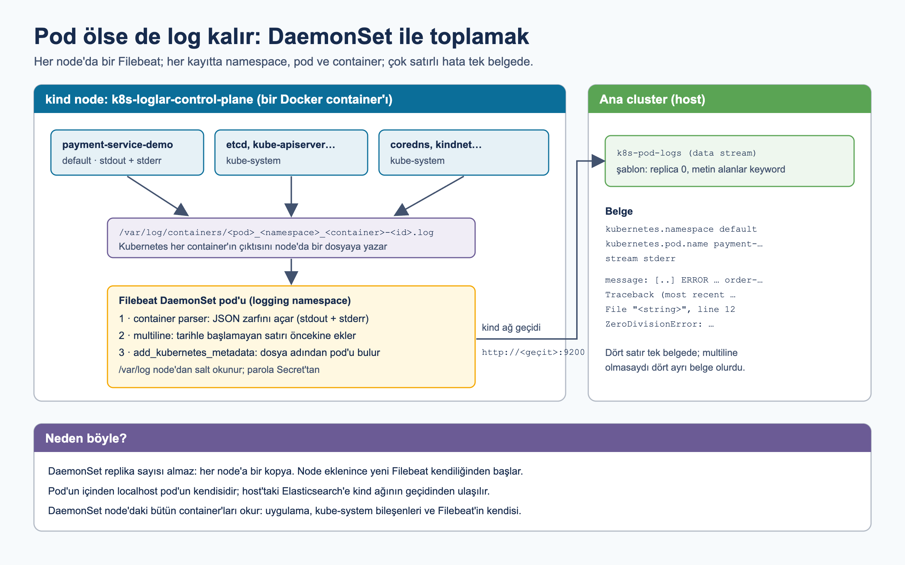

# ADV-03 — Kubernetes'te Pod Logları: kind, Filebeat DaemonSet ve Çok Satırlı Hata

| Kullanılan Araçlar | Açık / Kullanılan Portlar |
|---|---|
| kind, `kubectl`, Filebeat 9.5.5 (DaemonSet), `add_kubernetes_metadata`, multiline, `curl`, `jq` | 9200 / 5601 (ana cluster); kind dışarı port açmaz |

---

## Bu lab ne öğretiyor?

Kubernetes'te bir pod ölünce logu da onunla gider; `kubectl logs` yalnız yaşayan pod'u gösterir ve hangi pod'un hangi
namespace'te çalıştığını log satırı söylemez. Bir Java ya da Python hatası ise birkaç satırdır: her satır ayrı kayıt
olursa hatanın nedeni mesajdan kopar.

Bu labda bir kind cluster'ı kuracak, her node'a bir Filebeat kopyası yerleştiren bir DaemonSet ile bütün container
loglarını ana cluster'a gönderecek, her kaydı namespace, pod ve container bilgisiyle zenginleştirecek ve çok satırlı bir
Python hatasını tek document'te birleştireceğiz.

{width=60%}

---

## Ön Koşullar

- LAB-01 ana cluster'ı çalışıyor; sunucuda `kind` ve `kubectl` kurulu. Önceki labları atladıysanız da lab çalışır;
  loglar bu labın demo uygulamasından ve Kubernetes'in kendi bileşenlerinden gelir.
- kind node'u ve pod'lar yaklaşık 1 GB RAM kullanır.

```bash
cd ~/elastic/labs/advanced/ADV-03-kubernetes-pod-loglari
```

Kibana adresini sunucuda hesaplayın:

```bash
IP=$(curl -s https://api.ipify.org); H=$(hostname -s)
echo "Kibana: http://$IP:5601   https://$H-kibana.devopsatolyesi.com"
```

Beklenen çıktı:

```text
Kibana: http://<IP>:5601   https://<host>-kibana.devopsatolyesi.com
```

---

## Kavramlar: Kubernetes'te log nereden toplanır?

| Kavram | Ne | Bu labda |
|---|---|---|
| kind | Kubernetes node'larını Docker container'ı olarak çalıştırır | Tek node: `k8s-loglar-control-plane` |
| Container log dosyası | Kubernetes her container'ın çıktısını node'da bir dosyaya yazar | `/var/log/containers/<pod>_<namespace>_<container>-<id>.log` |
| DaemonSet | Her node'a bir kopya yerleştirir; replika sayısı almaz | Filebeat; yeni node gelince kendiliğinden başlar |
| `add_kubernetes_metadata` | Dosya adından pod'u bulur, Kubernetes API'sine sorup field'ları ekler | `kubernetes.namespace`, `pod.name`, `container.name` |
| multiline | Olay başını tanıyan bir desenle devam satırlarını bir öncekine ekler | Python traceback'i tek document |

---

## Config dosyaları: hangi satır ne işe yarıyor?

`filebeat-kubernetes-daemonset.yaml`, Filebeat'in ayarı (ConfigMap içinde):

```yaml
filebeat.inputs:
  - type: filestream
    paths: [/var/log/containers/*.log]
    parsers:
      - container: { stream: all, format: auto }
      - multiline: { type: pattern, pattern: '^(\[)?[0-9]{4}-[0-9]{2}-[0-9]{2}', negate: true, match: after }
    processors:
      - add_kubernetes_metadata: { host: "${NODE_NAME}", matchers: [{ logs_path: { logs_path: "/var/log/containers/" } }] }
output.elasticsearch:
  hosts: ["${ELASTICSEARCH_HOST:http://172.18.0.1:9200}"]
  index: "k8s-pod-logs"
```

- `container` parser'ı container runtime'ının JSON zarfını açar; `stream: all` hem stdout hem stderr'i alır.
- multiline deseni **yeni bir olayın ilk satırını** tanımlar (`[2026-…` ya da `2026-…` ile başlayan). `negate: true` desene
  uymayan satırları, `match: after` onları bir öncekinin ardına ekler. YAML'da tek tırnak içinde ters bölü kaçış değildir;
  `'^\\['` yazılırsa hiçbir satır eşleşmez ve ilgisiz kayıtlar tek document'te birleşir.
- `ELASTICSEARCH_HOST`: pod'un içinden `localhost` pod'un kendisidir; ana cluster'a kind ağının geçidinden ulaşılır (Adım 2).
- DaemonSet `/var/log`'u node'dan salt okunur bağlar, parolayı bir Secret'tan okur (YAML'a yazılmaz).

---

## Adım Adım Uygulama Rehberi

### 1. kind cluster'ı

```bash
kind create cluster --config kind-cluster.yaml 2>&1 | grep -E "Creating|Set kubectl"
kubectl wait --for=condition=Ready node --all --timeout=180s
kubectl get nodes
```

Beklenen çıktı:

```text
Creating cluster "k8s-loglar" ...
Set kubectl context to "kind-k8s-loglar"
node/k8s-loglar-control-plane condition met
NAME                       STATUS   ROLES           AGE   VERSION
k8s-loglar-control-plane   Ready    control-plane   26s   v1.37.0
```

Node bir Docker container'ıdır; ilk kurulumda node image'ı da çekilir.

### 2. Ana cluster tarafı: data stream şablonu, adres ve parola

Logların yazılacağı `k8s-pod-logs` data stream'inin şablonu: tek node için replica 0; `message` dışındaki metin field'ları
(`kubernetes.namespace`, `kubernetes.pod.name`…) `keyword` olur, böylece sayılabilir ve süzülebilir. Kibana › Dev Tools'a
yapıştırın:

```http
PUT _index_template/k8s-pod-logs
{ "index_patterns": ["k8s-pod-logs"], "data_stream": {}, "priority": 500,
  "template": { "settings": { "number_of_shards": 1, "number_of_replicas": 0 },
    "mappings": { "properties": { "message": { "type": "text" } },
      "dynamic_templates": [ { "metin_keyword": { "match_mapping_type": "string", "mapping": { "type": "keyword", "ignore_above": 1024 } } } ] } } }
```

```json
{"acknowledged":true}
```

Pod'un ana cluster'a ulaşacağı adres kind ağının geçididir; makineden makineye değişir. Hesaplayın, node'un içinden
ulaşılabildiğini sınayın ve parolayı bir Secret'a koyun:

```bash
export GATEWAY=$(docker network inspect kind -f '{{range .IPAM.Config}}{{.Gateway}} {{end}}' | tr ' ' '\n' | grep -E '^[0-9]+(\.[0-9]+){3}$' | head -1)
echo "Ana cluster: http://$GATEWAY:9200"
docker exec k8s-loglar-control-plane curl -s -o /dev/null -w 'node icinden: %{http_code}\n' -u elastic:'DevOps2026!' "http://$GATEWAY:9200"
kubectl create namespace logging
kubectl -n logging create secret generic elastic-credentials --from-literal=password='DevOps2026!'
```

Beklenen çıktı:

```text
Ana cluster: http://172.25.0.1:9200
node icinden: 200
namespace/logging created
secret/elastic-credentials created
```

Adres sizde farklıdır. `200`, node'un içinden ana cluster'a ulaşıldığını gösterir; `000` gelirse Filebeat hiçbir şey
gönderemez.

### 3. Filebeat DaemonSet ve demo uygulama

DaemonSet'i uygulayın, adresi ortam değişkeniyle verin ve her 4. işlemde Python hatası basan demo uygulamayı başlatın:

```bash
kubectl apply -f filebeat-kubernetes-daemonset.yaml | grep -c created
kubectl -n logging set env daemonset/filebeat "ELASTICSEARCH_HOST=http://$GATEWAY:9200"
kubectl -n logging rollout status daemonset/filebeat --timeout=180s | tail -1
kubectl apply -f multiline-app-deployment.yaml
kubectl rollout status deployment/payment-service-demo --timeout=180s | tail -1
kubectl get pods -A -o wide | awk 'NR==1 || /filebeat|payment/' | awk '{print $1, $2, $4}'
```

Beklenen çıktı:

```text
5
daemonset.apps/filebeat env updated
daemon set "filebeat" successfully rolled out
deployment.apps/payment-service-demo created
deployment "payment-service-demo" successfully rolled out
NAMESPACE NAME STATUS
default payment-service-demo-579bc9577d-vt8h2 Running
logging filebeat-kgrrc Running
```

Filebeat `logging` namespace'inde, node başına bir pod; pod adlarının son eki sizde farklıdır. `set env` DaemonSet'i yeniden başlatır; `rollout status`
yeni pod hazır olana kadar bekler.

### 4. Loglar ve Kubernetes field'ları

İlk loglar birkaç saniyede gelir. Demo uygulamanın kayıtları görünene kadar bekleyin, sonra container başına sayın:

```bash
timeout 120 bash -c 'until [ "$(curl -s -u elastic:"DevOps2026!" "http://127.0.0.1:9200/k8s-pod-logs/_count?q=kubernetes.container.name:payment-worker" | jq .count 2>/dev/null)" -ge 4 ] 2>/dev/null; do printf .; sleep 5; done'; echo
curl -s -u elastic:'DevOps2026!' 'http://127.0.0.1:9200/k8s-pod-logs/_search?size=0&filter_path=aggregations' -H 'Content-Type: application/json' \
  -d '{"aggs": {"ns": {"terms": {"field": "kubernetes.namespace", "size": 5}, "aggs": {"c": {"terms": {"field": "kubernetes.container.name", "size": 8}}}}}}' \
  | jq -r '.aggregations.ns.buckets[] | .key as $n | .c.buckets[] | "\($n) / \(.key)"' | sort
```

Beklenen çıktı:

```text
.....
default / payment-worker
kube-system / coredns
kube-system / etcd
kube-system / kindnet-cni
kube-system / kube-apiserver
kube-system / kube-controller-manager
kube-system / kube-proxy
kube-system / kube-scheduler
local-path-storage / local-path-provisioner
logging / filebeat
```

DaemonSet node'daki **bütün** container'ları okur: demo uygulamanın yanında `kube-system`'deki `etcd`,
`kube-apiserver`, `coredns` gibi bileşenler ve Filebeat'in kendisi de gelir. Sayılar zamanla artar, liste aynıdır.
Kibana › Discover'da `k8s-pod-logs` için bir data view açıp `kubernetes.container.name : "payment-worker"` ile
süzebilirsiniz.

### 5. Önce ve sonra: çok satırlı hata

Önce: pod'un kendi çıktısında hata dört satırdır:

```bash
kubectl logs deployment/payment-service-demo --tail=30 | grep -m1 -A3 ERROR
```

Beklenen çıktı:

```text
[2026-11-21 22:59:24] ERROR [payment-processor] Transaction processing failed for order-3400
Traceback (most recent call last):
  File "<string>", line 12, in <module>
ZeroDivisionError: division by zero
```

Sonra: aynı hata Elasticsearch'te tek document'tir:

```bash
curl -s -u elastic:'DevOps2026!' 'http://127.0.0.1:9200/k8s-pod-logs/_search?size=1&sort=@timestamp:desc&q=message:ZeroDivisionError' \
  | jq -r '.hits.hits[0]._source | "pod: \(.kubernetes.pod.name)\nnamespace: \(.kubernetes.namespace)\nstream: \(.stream)\n---\n\(.message)"'
```

Beklenen çıktı:

```text
pod: payment-service-demo-579bc9577d-vt8h2
namespace: default
stream: stderr
---
[2026-11-21 22:59:24] ERROR [payment-processor] Transaction processing failed for order-3400
Traceback (most recent call last):
  File "<string>", line 12, in <module>
ZeroDivisionError: division by zero
```

Dört satır tek document'in `message` field'ında; document pod, namespace ve stream bilgisini de taşıyor. Multiline olmasaydı
dört ayrı document olurdu ve "ZeroDivisionError" satırı hangi siparişe ait olduğunu kaybederdi. Saat ve sipariş
numarası sizde farklıdır.

---

## Temizlik

Yalnız bu labın kind cluster'ını (içindeki DaemonSet ve demo uygulamayla) ve ana cluster'daki `k8s-pod-logs` data
stream'ini ve şablonunu siler. Ana cluster'ın kendisine ve diğer labların kaynaklarına dokunmaz:

```bash
./teardown.sh
```

Beklenen çıktı:

```text
Deleted nodes: ["k8s-loglar-control-plane"]
data stream k8s-pod-logs -> 200
sablon k8s-pod-logs -> 200
```

Labı aynı sunucuda yeniden yapacaksanız başlamadan önce `./teardown.sh` çalıştırın; README'deki sayılar temiz
başlangıca göredir.

---

Sonraki lab: **[ADV-04 — S3 / MinIO ile Snapshot, Restore ve Searchable Snapshot: Cluster Dışına Yedek](../ADV-04-snapshot-restore-minio-s3/README.md)**
