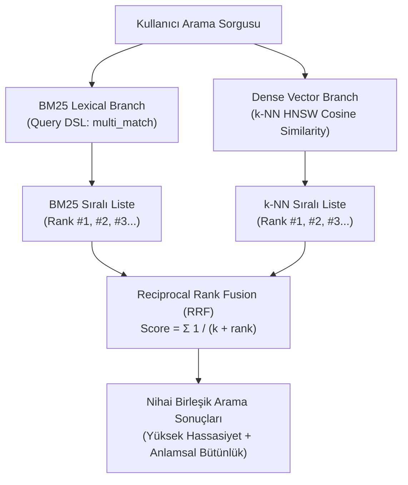

# ADV-05 — Semantik Arama: Embedding Modeli, k-NN ve Hybrid Search (RRF)

| Kullanılan Araçlar | Açık / Kullanılan Portlar |
|---|---|
| `.multilingual-e5-small` embedding modeli (inference endpoint), `semantic_text`, `semantic` ve `knn` sorgusu, `retriever.rrf`, `curl`, `jq` | 9200 / 5601 (ana cluster) |

---

## Bu lab ne öğretiyor?

Kullanıcı Türkçe olarak "RAM ve bellek tükenmesi nedeniyle öldürülen konteynerler" diye arar. Doğru runbook İngilizcedir
ve başlığında "OOMKilled" ile "Exit Code 137" yazar. Ortak kelime yoktur; BM25 (kelime eşleşmesi) doğru document'i
bulamaz. Buna **kelime uyuşmazlığı** (vocabulary mismatch) denir.

Bir embedding modeli metni anlamını taşıyan bir vektöre çevirir; yakın anlamlı metinlerin vektörleri birbirine
yakındır ve dil farkı bunu bozmaz. Bu labda Elastic'in çok dilli `.multilingual-e5-small` modelini kullanan bir
`semantic_text` field'ı kuracak, 20 İngilizce runbook'u index'leyecek ve aynı Türkçe soruyu BM25, semantik arama,
filtreli k-NN ve ikisini birleştiren **RRF** ile soracağız.



---

## Ön Koşullar

- LAB-01 ana cluster'ı çalışıyor ve trial lisans açık: model dağıtımı ve RRF trial ister. Önceki labları atladıysanız
  da lab çalışır; veri bu labın kendi dosyasından gelir.
- Model dağıtılınca yaklaşık 1 GB bellek kullanır; sunucuda `free -m` çıktısındaki `available` en az 1500 MB olmalı.

```bash
cd ~/elastic/labs/advanced/ADV-05-semantic-search-knn-rrf
free -m | sed -n 2p
```

Kibana adresini sunucuda hesaplayın:

```bash
IP=$(curl -s https://api.ipify.org); H=$(hostname -s)
echo "Kibana: http://$IP:5601   https://$H-kibana.devopsatolyesi.com"
```

Beklenen çıktı:

```text
Kibana: http://<IP>:5601   https://<host>-kibana.devopsatolyesi.com
```

---

## Kavramlar: hangi arama neyi bulur?

| Yöntem | Neye bakar | Güçlü | Zayıf |
|---|---|---|---|
| BM25 (`multi_match`) | Ortak kelime ve sıklık | Kod, hata mesajı, ürün adı gibi kesin terimler | Eş anlamlı, farklı dil, farklı ifade |
| Semantik (`semantic`, `knn`) | Embedding vektörleri arası açı (cosine) | Farklı kelime ya da dille aynı konu | Kesin terimi kaçırabilir; modelin kalitesine bağlı |
| Filtreli semantik | Aynısı + `filter` | Filtre arama sırasında uygulanır | Filtre içinde yakın document yoksa uzak document'ler gelir |
| RRF (`retriever.rrf`) | İki listenin **sıraları** | Skor ölçekleri farklı listeleri normalize etmeden birleştirir | Listelerden biri yanlışsa onu düzeltmez |

- **Inference endpoint:** modeli çağıran Elasticsearch nesnesi; endpoint oluşturulunca model ML node'una dağıtılır,
  silinince dağıtım da kalkar ve bellek boşalır.
- **`semantic_text`:** document yazılırken metni endpoint'e gönderip vektörü kendisi saklar; sorgu metnini de aynı modelle
  vektöre çevirir. Vektörü siz üretmezsiniz.
- **HNSW:** vektörler için bir komşuluk grafiğidir; k-NN bütün document'leri taramaz. `num_candidates` incelenecek aday
  sayısıdır: büyürse doğruluk artar, hız düşer.

---

## Adım Adım Uygulama Rehberi

### 1. Modeli bir inference endpoint'iyle dağıtın

Labın kendi endpoint'i `vektor-e5`, Elastic'in çok dilli `.multilingual-e5-small` modelini kullanır. Model ilk
kullanımda Elastic'ten indirilir (412 MB; ağ hızına bağlı olarak birkaç dakika sürebilir) ve ML node'una dağıtılır
(yaklaşık 1 GB bellek). `timeout=300s` isteğin dağıtım bitene kadar beklemesini sağlar; varsayılan 30 saniye yetmez.
Bu sunucuda, model önceden indirilmişken oluşturma 32 saniye sürdü:

```bash
curl -s -u elastic:'DevOps2026!' -X PUT 'http://127.0.0.1:9200/_inference/text_embedding/vektor-e5?timeout=300s' \
  -H 'Content-Type: application/json' \
  -d '{"service": "elasticsearch", "service_settings": {"model_id": ".multilingual-e5-small_linux-x86_64", "num_allocations": 1, "num_threads": 1}}' \
  | jq -c '{inference_id, task_type, service}'
curl -s -u elastic:'DevOps2026!' -X POST 'http://127.0.0.1:9200/_inference/text_embedding/vektor-e5' \
  -H 'Content-Type: application/json' -d '{"input": ["RAM ve bellek tükenmesi nedeniyle öldürülen konteynerler"]}' \
  | jq -c '.text_embedding[0].embedding | {boyut: length, ilk_uc: .[0:3]}'
```

```json
{"inference_id":"vektor-e5","task_type":"text_embedding","service":"elasticsearch"}
{"boyut":384,"ilk_uc":[0.037558753,-0.066348016,0.0070805904]}
```

Türkçe cümle 384 sayılık bir vektöre dönüştü. Sizdeki ilk değerler aynıdır: aynı model aynı metne aynı vektörü verir.

### 2. `semantic_text` field'ıyla index ve veri

`icerik` field'ı başlık, özet, kök neden ve çözümün birleşimidir; yazılırken vektörü model üretir. Kibana › Dev Tools'a
yapıştırın:

```http
PUT vektor-runbook
{
  "settings": { "number_of_shards": 1, "number_of_replicas": 0 },
  "mappings": { "properties": {
    "title": { "type": "text" }, "category": { "type": "keyword" },
    "summary": { "type": "text" }, "root_cause": { "type": "text" }, "remediation": { "type": "text" },
    "icerik": { "type": "semantic_text", "inference_id": "vektor-e5" } } }
}
```

```json
{"acknowledged":true,"shards_acknowledged":true,"index":"vektor-runbook"}
```

20 runbook'u yazın; `jq` her kaydı bulk satırına çevirip `icerik` field'ını ekler:

```bash
jq -c '.[] | {index: {_id: .id}}, {title, category, summary, root_cause, remediation, icerik: "\(.title). \(.summary) \(.root_cause) \(.remediation)"}' data/knowledge-base.json \
  | curl -s -u elastic:'DevOps2026!' -X POST 'http://127.0.0.1:9200/vektor-runbook/_bulk?refresh=true' -H 'Content-Type: application/x-ndjson' --data-binary @- \
  | jq -c '{errors, yazilan: (.items | length)}'
curl -s -u elastic:'DevOps2026!' 'http://127.0.0.1:9200/vektor-runbook/_mapping?filter_path=*.mappings.properties.icerik.model_settings' | jq -c '.[].mappings.properties.icerik'
```

```json
{"errors":false,"yazilan":20}
{"model_settings":{"service":"elasticsearch","task_type":"text_embedding","dimensions":384,"similarity":"cosine","element_type":"float"}}
```

`model_settings`, Elasticsearch'ün modelden öğrendiği vektör boyutunu ve benzerlik ölçüsünü gösterir.

### 3. BM25 ve semantik arama yan yana

Arama metnini bu shell oturumunda saklayın ve iki aramayı karşılaştırın:

```bash
export Q="RAM ve bellek tükenmesi nedeniyle öldürülen konteynerler"
echo "== BM25"
jq -n --arg q "$Q" '{size: 3, _source: ["title"], query: {multi_match: {query: $q, fields: ["title", "summary", "root_cause", "remediation"]}}}' \
  | curl -s -u elastic:'DevOps2026!' 'http://127.0.0.1:9200/vektor-runbook/_search' -H 'Content-Type: application/json' --data-binary @- \
  | jq -r '.hits.hits[] | "\(._score)  \(._id)  \(._source.title)"'
echo "== semantik"
jq -n --arg q "$Q" '{size: 3, _source: ["title"], query: {semantic: {field: "icerik", query: $q}}}' \
  | curl -s -u elastic:'DevOps2026!' 'http://127.0.0.1:9200/vektor-runbook/_search' -H 'Content-Type: application/json' --data-binary @- \
  | jq -r '.hits.hits[] | "\(._score)  \(._id)  \(._source.title)"'
```

Beklenen çıktı:

```text
== BM25
2.224385  KB-109  Elasticsearch High JVM Garbage Collection Stop-The-World Pauses
== semantik
0.89815074  KB-101  Kubernetes OOMKilled Pod Crash Exit Code 137
0.8808948  KB-111  Nginx Ingress 502 Bad Gateway Upstream Connection Refused
0.8782236  KB-106  Kafka Consumer Group Lag Rebalancing Storm
```

BM25 tek sonuç buldu ve **yanlış** document'i getirdi: tek bir ortak kelime yüzünden JVM çöp toplayıcısı runbook'u.
Semantik arama Türkçe sorudan İngilizce OOMKilled runbook'unu (KB-101) birinci buldu. Skorlar birbirine yakındır:
model küçük ve document sayısı az; ayrım skorun mutlak değerinde değil sırada görülür.

### 4. Arkada ne var: k-NN ve filtre

`semantic` sorgusu, arama metnini modelle vektöre çeviren bir k-NN aramasının kısayoludur. Aynısını açıkça yazın, sonra
yalnız `DATABASE` kategorisinde arayın:

```bash
echo "== knn"
jq -n --arg q "$Q" '{size: 3, _source: ["title"], query: {knn: {field: "icerik", k: 3, num_candidates: 20,
    query_vector_builder: {text_embedding: {model_id: "vektor-e5", model_text: $q}}}}}' \
  | curl -s -u elastic:'DevOps2026!' 'http://127.0.0.1:9200/vektor-runbook/_search' -H 'Content-Type: application/json' --data-binary @- \
  | jq -r '.hits.hits[] | "\(._score)  \(._id)  \(._source.title)"'
echo "== filtre: DATABASE"
jq -n --arg q "$Q" '{size: 3, _source: ["title"], query: {bool: {must: {semantic: {field: "icerik", query: $q}}, filter: {term: {category: "DATABASE"}}}}}' \
  | curl -s -u elastic:'DevOps2026!' 'http://127.0.0.1:9200/vektor-runbook/_search' -H 'Content-Type: application/json' --data-binary @- \
  | jq -r '.hits.hits[] | "\(._score)  \(._id)  \(._source.title)"'
```

Beklenen çıktı:

```text
== knn
0.89815074  KB-101  Kubernetes OOMKilled Pod Crash Exit Code 137
0.8808948  KB-111  Nginx Ingress 502 Bad Gateway Upstream Connection Refused
0.8782236  KB-106  Kafka Consumer Group Lag Rebalancing Storm
== filtre: DATABASE
0.87418205  KB-113  MySQL Deadlock Encountered When Trying To Get Lock
0.8701125  KB-107  Redis Memory Fragmentation Ratio Spike and Latency
0.8678138  KB-102  PostgreSQL Connection Pool Starvation and Max Connections Reached
```

k-NN sonuçları semantik aramayla birebir aynı. `query_vector_builder` vektörü sorgu anında üretir; elle 384 sayı
yazmak gerekmez. `semantic_text` field'ında k-NN, üst düzey `knn` anahtarıyla değil sorgunun içinde yazılır (üst düzey
`knn` yalnız `dense_vector` field'ında çalışır). Filtre arama sırasında uygulandı: üç sonuç da veritabanı runbook'u.

### 5. RRF: iki listeyi sıralarıyla birleştirmek

Önce aynı soru (BM25 yanlış, semantik doğru), sonra içine tam bir terim eklenmiş soru:

```bash
for metin in "$Q" "Exit Code 137 bellek tükenmesi"; do
  echo "== $metin"
  jq -n --arg q "$metin" '{size: 3, _source: ["title"], retriever: {rrf: {retrievers: [
      {standard: {query: {multi_match: {query: $q, fields: ["title", "summary", "root_cause", "remediation"]}}}},
      {standard: {query: {semantic: {field: "icerik", query: $q}}}}], rank_window_size: 10, rank_constant: 20}}}' \
    | curl -s -u elastic:'DevOps2026!' 'http://127.0.0.1:9200/vektor-runbook/_search' -H 'Content-Type: application/json' --data-binary @- \
    | jq -r '.hits.hits[] | "\(._score)  \(._id)  \(._source.title)"'
done
```

Beklenen çıktı:

```text
== RAM ve bellek tükenmesi nedeniyle öldürülen konteynerler
0.08761905  KB-109  Elasticsearch High JVM Garbage Collection Stop-The-World Pauses
0.04761905  KB-101  Kubernetes OOMKilled Pod Crash Exit Code 137
0.045454547  KB-111  Nginx Ingress 502 Bad Gateway Upstream Connection Refused
== Exit Code 137 bellek tükenmesi
0.0952381  KB-101  Kubernetes OOMKilled Pod Crash Exit Code 137
0.045454547  KB-105  TLS SSL Certificate Expiration and Handshake Failure
0.04347826  KB-112  ArgoCD Application OutOfSync and GitOps Sync Failure
```

RRF skoru her listedeki sıranın `1 / (rank_constant + sıra)` toplamıdır; bir listede birinci olan `1/21 = 0.0476` alır.
İlk soruda **yanlış** document (KB-109) birinci: BM25 listesinin birincisi olduğu gibi semantik listede de 5. sıradadır ve
iki katkı toplanınca doğru document'i geçer. RRF, listelerden biri yanlışsa onu düzeltmez. İkinci soruda iki liste de
KB-101'i birinci bulur, skoru iki katına çıkar (`2/21`) ve açıkça öne geçer. RRF'nin gücü, kesin terim ile anlam aynı
document'i gösterdiğinde ortaya çıkar; kelimesi tutmayan sorularda tek başına semantik arama daha iyidir.

---

## Temizlik

Yalnız `vektor-runbook` index'ini ve `vektor-e5` endpoint'ini siler; endpoint'le birlikte modelin dağıtımı kalkar ve
bellek boşalır. İndirilmiş model cluster'da kalır, bir sonraki endpoint'te yeniden dağıtılır. Ana cluster'a ve diğer labların kaynaklarına
dokunmaz:

```bash
./teardown.sh
```

Beklenen çıktı:

```text
index vektor-runbook -> 200
endpoint vektor-e5 -> 200
```

Labı aynı sunucuda yeniden yapacaksanız başlamadan önce `./teardown.sh` çalıştırın; README'deki sayılar temiz
başlangıca göredir.

---

Sonraki lab: **[ADV-06 — Reindex ve Atomik Alias Geçişi: Şemayı Kesintisiz Değiştirmek](../ADV-06-zero-downtime-reindex/README.md)**
