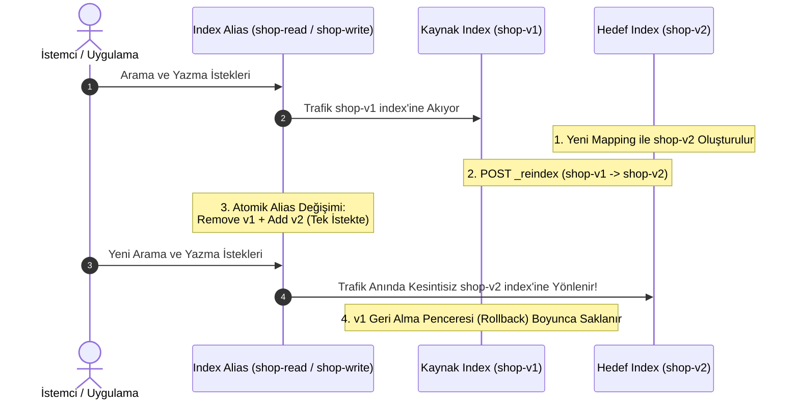

# ADV-06 — Reindex ve Atomik Alias Geçişi: Şemayı Kesintisiz Değiştirmek

| Kullanılan Araçlar | Açık / Kullanılan Portlar |
|---|---|
| Kibana Dev Tools, Reindex ve Aliases API, index block, `curl`, `jq` | 9200 / 5601 (ana cluster) |

---

## Bu lab ne öğretiyor?

Canlıdaki `shop-v1` index'ine iki yeni field (`description`, `currency`) eklemek ya da bir field'ın tipini değiştirmek
gerekiyor. Mevcut bir field'ın tipi yerinde değiştirilemez: yeni şemayla yeni bir index açılır ve veri oraya
`_reindex` ile kopyalanır. Uygulama doğrudan `shop-v1` adını kullanıyorsa bu, uygulamayı yeniden dağıtmak demektir.

Uygulama index yerine **alias** kullanırsa (`shop-read`, `shop-write`) geçiş tek bir `POST _aliases` isteğidir.
Bu labda geçişi yapacak, geri alacak ve iki **veri boşluğunu** ölçerek göreceğiz: "kesintisiz" isteklerin
reddedilmemesi demektir, verinin kendiliğinden korunması demek değildir. Son adımda boşlukları kapatan doğru sırayı
uygulayacağız.



---

## Ön Koşullar

- LAB-01 ana cluster'ı çalışıyor. Önceki labları atladıysanız da lab çalışır; veri bu labın kendi dosyasından gelir.

```bash
cd ~/elastic/labs/advanced/ADV-06-zero-downtime-reindex
```

Kibana adresini sunucuda hesaplayın:

```bash
IP=$(curl -s https://api.ipify.org); H=$(hostname -s)
echo "Kibana: http://$IP:5601   https://$H-kibana.devopsatolyesi.com"
```

Beklenen çıktı:

```text
Kibana: http://<IP>:5601   https://<host>-kibana.devopsatolyesi.com
```

---

## Kavramlar: alias neyi çözer, neyi çözmez?

| Kavram | Ne yapar |
|---|---|
| `shop-read` | Aramaların gittiği ad; birden çok index'i gösterebilir |
| `shop-write` + `is_write_index: true` | Yazmaların gittiği **tek** index |
| Atomik `POST _aliases` | `remove` ve `add` aynı istekte uygulanır; arada alias'sız bir an olmaz |
| `_reindex` | Başladığı andaki document'leri kopyalar; sonradan kaynağa yazılanı görmez |

---

## Adım Adım Uygulama Rehberi

### 1. Canlı senaryo: `shop-v1` ve alias'lar

Index'i iki alias'ıyla birlikte açın. Kibana › Dev Tools'a yapıştırın:

```http
PUT /shop-v1
{
  "settings": { "number_of_shards": 1, "number_of_replicas": 0 },
  "mappings": { "properties": {
      "order_id": { "type": "keyword" }, "customer_id": { "type": "keyword" },
      "amount": { "type": "double" }, "status": { "type": "keyword" }, "order_date": { "type": "date" } } },
  "aliases": { "shop-read": {}, "shop-write": { "is_write_index": true } }
}
```

```json
{"acknowledged":true,"shards_acknowledged":true,"index":"shop-v1"}
```

100 siparişi uygulamanın kullandığı `shop-write` adına yazın ve `shop-read` üzerinden sayın:

```bash
curl -s -u elastic:'DevOps2026!' -X POST 'http://127.0.0.1:9200/shop-write/_bulk?refresh=true' \
  -H 'Content-Type: application/x-ndjson' --data-binary @sample-data/siparisler.ndjson \
  | jq -c '{errors, yazilan: (.items | length), index: .items[0].index._index}'
curl -s -u elastic:'DevOps2026!' 'http://127.0.0.1:9200/shop-read/_count?filter_path=count'; echo
```

```json
{"errors":false,"yazilan":100,"index":"shop-v1"}
{"count":100}
```

Document'ler `shop-write` adına gönderildi ama `shop-v1`'e yazıldı; uygulama gerçek index adını bilmez.

### 2. Yeni şemayla `shop-v2`, reindex ve atomik geçiş

Yeni field'larla `shop-v2`'yi açın, veriyi kopyalayın ve iki alias'ı tek istekte çevirin:

```http
PUT /shop-v2
{
  "settings": { "number_of_shards": 1, "number_of_replicas": 0 },
  "mappings": { "properties": {
      "order_id": { "type": "keyword" }, "customer_id": { "type": "keyword" },
      "amount": { "type": "double" }, "status": { "type": "keyword" }, "order_date": { "type": "date" },
      "description": { "type": "text", "fields": { "keyword": { "type": "keyword", "ignore_above": 256 } } },
      "currency": { "type": "keyword" } } }
}
POST /_reindex?wait_for_completion=true&refresh=true&filter_path=created,total,failures
{ "source": { "index": "shop-v1" }, "dest": { "index": "shop-v2" } }
POST /_aliases
{
  "actions": [
    { "remove": { "index": "shop-v1", "alias": "shop-read" } },
    { "remove": { "index": "shop-v1", "alias": "shop-write" } },
    { "add":    { "index": "shop-v2", "alias": "shop-read" } },
    { "add":    { "index": "shop-v2", "alias": "shop-write", "is_write_index": true } }
  ]
}
POST /shop-write/_doc/order-9999?refresh=true&filter_path=_index,result
{ "order_id": "ORD-9999", "customer_id": "CUST-VIP", "amount": 999.99, "status": "COMPLETED",
  "order_date": "2026-03-01T15:00:00Z", "currency": "TRY", "description": "Kesintisiz gecis test siparisi" }
GET /_cat/aliases/shop-*?v&h=alias,index,is_write_index&s=alias
```

Beklenen çıktı:

```text
{"acknowledged":true,"shards_acknowledged":true,"index":"shop-v2"}
{"total":100,"created":100,"failures":[]}
{"acknowledged":true,"errors":false}
{"_index":"shop-v2","result":"created"}
alias      index   is_write_index
shop-read  shop-v2 -
shop-write shop-v2 true
```

100 document kopyalandı, alias'lar `shop-v2`'yi gösteriyor ve yeni sipariş `shop-v2`'ye yazıldı. Uygulama hiçbir
istek reddi görmedi.

### 3. Boşluk 1: geçişten sonra eski index'e yazılan document

Geç kalmış bir istemcinin hâlâ doğrudan `shop-v1`'e yazdığını düşünün (reindex ile alias değişimi arasındaki
pencerenin aynısı):

```bash
curl -s -u elastic:'DevOps2026!' -X POST 'http://127.0.0.1:9200/shop-v1/_doc/order-late?refresh=true' \
  -H 'Content-Type: application/json' \
  -d '{"order_id": "ORD-LATE", "customer_id": "CUST-LATE", "amount": 42.0, "status": "PENDING"}' | jq -c '{_index, result}'
curl -s -u elastic:'DevOps2026!' 'http://127.0.0.1:9200/shop-read/_doc/order-late?filter_path=found'; echo
```

```json
{"_index":"shop-v1","result":"created"}
{"found":false}
```

Document `shop-v1`'de var ama `shop-read` onu bulmuyor: yeni index'e hiç geçmedi.

### 4. Geri alma ve Boşluk 2

Uygulamada bir uyumsuzluk görüldü; alias'ları eski index'e geri çevirin ve iki geç document'e bakın:

```http
POST /_aliases
{
  "actions": [
    { "remove": { "index": "shop-v2", "alias": "shop-read" } },
    { "remove": { "index": "shop-v2", "alias": "shop-write" } },
    { "add":    { "index": "shop-v1", "alias": "shop-read" } },
    { "add":    { "index": "shop-v1", "alias": "shop-write", "is_write_index": true } }
  ]
}
GET /shop-read/_count?q=_id:order-9999&filter_path=count
GET /shop-v2/_count?q=_id:order-9999&filter_path=count
GET /shop-read/_count?q=_id:order-late&filter_path=count
```

```json
{"acknowledged":true,"errors":false}
{"count":0}
{"count":1}
{"count":1}
```

`order-9999` `shop-v2`'de duruyor ama `shop-read` artık onu göstermiyor. Buna karşılık geçişten sonra v1'e
yazılan `order-late` geri döndü.

| Document | Yazıldığı yer | Geçişten sonra `shop-read` | Geri almadan sonra `shop-read` |
|---|---|---|---|
| 100 eski sipariş | `shop-v1` (kopyası `shop-v2`) | görünür | görünür |
| `order-late` | `shop-v1` (geçişten sonra) | **görünmez** | görünür |
| `order-9999` | `shop-v2` (geçişten sonra) | görünür | **görünmez** |

### 5. Boşlukları kapatmak: önce yazmayı durdur, eksikleri taşı, sonra çevir

Doğru sıra üç adımdır. Önce Boşluk 2: geri almadan önce yeni index'e yazılan document'i eski index'e taşıyın.
Sonra geçişi yeniden yapın, bu kez eski index'i yazmaya kapatarak:

```http
POST /_reindex?refresh=true&filter_path=created,total
{ "source": { "index": "shop-v2", "query": { "ids": { "values": ["order-9999"] } } }, "dest": { "index": "shop-v1" } }
PUT /shop-v1/_block/write?filter_path=acknowledged
```

```json
{"total":1,"created":1}
{"acknowledged":true}
```

Artık `shop-v1`'e yazmak isteyen istemci reddedilir ve yeniden denemesi gerektiğini öğrenir:

```bash
curl -s -u elastic:'DevOps2026!' -X POST 'http://127.0.0.1:9200/shop-write/_doc/order-blok?refresh=true' \
  -H 'Content-Type: application/json' -d '{"order_id": "ORD-BLOK", "status": "PENDING"}' \
  | jq -c '{status, hata: .error.type}'
```

```json
{"status":403,"hata":"cluster_block_exception"}
```

Yazma durduğu için eski index artık değişmez. Yalnız yeni index'te olmayan document'leri kopyalayın
(`op_type: create` var olanları atlar), sonra alias'ları çevirin ve iki geç document'i arayın:

```http
POST /_reindex?refresh=true&filter_path=created,version_conflicts,failures
{ "conflicts": "proceed", "source": { "index": "shop-v1" }, "dest": { "index": "shop-v2", "op_type": "create" } }
POST /_aliases
{
  "actions": [
    { "remove": { "index": "shop-v1", "alias": "shop-read" } },
    { "remove": { "index": "shop-v1", "alias": "shop-write" } },
    { "add":    { "index": "shop-v2", "alias": "shop-read" } },
    { "add":    { "index": "shop-v2", "alias": "shop-write", "is_write_index": true } }
  ]
}
GET /shop-read/_search?filter_path=hits.hits._id&q=_id:order-late%20OR%20_id:order-9999
GET /shop-read/_count?filter_path=count
```

```json
{"created":1,"version_conflicts":101,"failures":[]}
{"acknowledged":true,"errors":false}
{"hits":{"hits":[{"_id":"order-9999"},{"_id":"order-late"}]}}
{"count":102}
```

Bir document (`order-late`) taşındı, 101'i zaten vardı ve atlandı. İki geç document de `shop-read`'de; toplam 102.
Yazmaların reddedildiği süre yalnız son reindex ile alias değişimi arasındaki birkaç saniyedir; `shop-v1` geri alma
penceresi boyunca salt okunur olarak saklanır.

---

## Temizlik

Yalnız `shop-v1` ve `shop-v2` index'lerini siler; alias'lar onlarla birlikte düşer. Ana cluster'a ve diğer
labların kaynaklarına dokunmaz:

```bash
./teardown.sh
```

Beklenen çıktı:

```text
index shop-v1 -> 200
index shop-v2 -> 200
```

Labı aynı sunucuda yeniden yapacaksanız başlamadan önce `./teardown.sh` çalıştırın; README'deki sayılar temiz
başlangıca göredir.

---

Sonraki lab: **[ADV-07 — Günlüklerden Kök Neden Analizi (Causal Graph & Cascading Failure with ES|QL)](../ADV-07-esql-causal-rca/README.md)**
