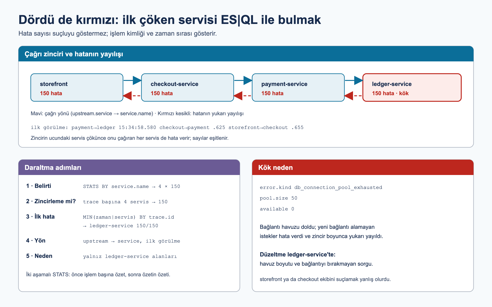

# ADV-07 — ES|QL ile Kök Neden Analizi: Zincirleme Arızada İlk Çöken Servisi Bulmak

| Kullanılan Araçlar | Açık / Kullanılan Portlar |
|---|---|
| Kibana Dev Tools, ES\|QL (`WHERE`, `EVAL`, `STATS … BY`, iki aşamalı `STATS`), `curl`, `jq` | 9200 / 5601 (ana cluster) |

---

## Bu lab ne öğretiyor?

Dört servis birbirini zincirleme çağırıyor: `storefront → checkout-service → payment-service → ledger-service`.
Arıza anında dördü de aynı sayıda hata yazar. En çok log basan ya da kullanıcıya en yakın servisi suçlamak kolaydır
ama yanlıştır: zincirin ucundaki servis çökünce onu çağıran her servis de hata verir.

Bu labda 1000 olaylık bir arıza kaydını ES|QL ile adım adım daraltacağız: belirtiyi sayacak, her işlemde (`trace.id`)
kaç servisin bozulduğunu, her işlemde ilk hatayı hangi servisin verdiğini ve servisler arası çağrı yönünü çıkaracak,
sonunda kök servisin neden çöktüğünü kendi field'larından okuyacağız.

{width=60%}

---

## Ön Koşullar

- LAB-01 ana cluster'ı çalışıyor. LAB-07'yi atladıysanız da lab çalışır; veri bu labın kendi dosyasından gelir.

```bash
cd ~/elastic/labs/advanced/ADV-07-esql-causal-rca
```

Kibana adresini sunucuda hesaplayın:

```bash
IP=$(curl -s https://api.ipify.org); H=$(hostname -s)
echo "Kibana: http://$IP:5601   https://$H-kibana.devopsatolyesi.com"
```

Beklenen çıktı:

```text
Kibana: http://<IP>:5601   https://<host>-kibana.devopsatolyesi.com
```

---

## Kavramlar: zincirleme arıza ve ES|QL

| Kavram | Bu labda |
|---|---|
| `trace.id` | Bir kullanıcı isteğinin dört servisteki bütün kayıtlarını bağlayan kimlik |
| `upstream.service` | Kaydı yazan servisi çağıran servis; çağrı yönünü verir |
| Zincirleme arıza (cascading failure) | Alttaki servis çökünce onu çağıranlar da hata verir; hata sayıları eşitlenir |
| İki aşamalı `STATS` | Önce `BY trace.id` ile işlem başına özet, sonra o özetin üstünde yeniden `STATS` |

---

## Adım Adım Uygulama Rehberi

### 1. Arıza kaydını yükleyin

Index'i field tipleriyle açın. Kibana › Dev Tools'a yapıştırın:

```http
PUT /rca-olaylar
{
  "settings": { "number_of_shards": 1, "number_of_replicas": 0 },
  "mappings": { "properties": {
    "@timestamp": { "type": "date" }, "message": { "type": "text" },
    "service": { "properties": { "name": { "type": "keyword" } } },
    "upstream": { "properties": { "service": { "type": "keyword" } } },
    "trace": { "properties": { "id": { "type": "keyword" } } },
    "log": { "properties": { "level": { "type": "keyword" } } },
    "http": { "properties": { "response": { "properties": { "status_code": { "type": "integer" } } } } },
    "error": { "properties": { "kind": { "type": "keyword" } } },
    "db": { "properties": { "connection_pool": { "properties": { "size": { "type": "integer" }, "available": { "type": "integer" } } } } } } }
}
```

```json
{"acknowledged":true,"shards_acknowledged":true,"index":"rca-olaylar"}
```

1000 olayı yükleyin (dosya sabittir; sayılar her seferinde aynıdır):

```bash
curl -s -u elastic:'DevOps2026!' -X POST 'http://127.0.0.1:9200/_bulk?refresh=true' \
  -H 'Content-Type: application/x-ndjson' --data-binary @data/incident-events.ndjson | jq -c '{errors, yazilan: (.items | length)}'
```

```json
{"errors":false,"yazilan":1000}
```

### 2. Belirti: hangi servis kaç hata verdi?

```http
POST /_query?format=txt
{
  "query": """
    FROM rca-olaylar
    | WHERE log.level == "ERROR"
    | STATS hata = COUNT(*), islem = COUNT_DISTINCT(trace.id) BY service.name
    | SORT hata DESC, service.name
  """
}
```

Beklenen çıktı:

```text
     hata      |     islem     |  service.name
---------------+---------------+----------------
150            |150            |checkout-service
150            |150            |ledger-service
150            |150            |payment-service
150            |150            |storefront
```

Dört servisin hata sayısı eşit. Hata hacmine bakarak kök nedeni bulamazsınız. Kibana'da aynı sorgu **Discover**'ın
ES|QL modunda da çalışır.

### 3. Zincirleme mi? Her işlemde kaç servis bozuldu?

İki aşamalı `STATS`: önce her `trace.id` için hata veren servis sayısı, sonra bu sayıya göre işlem sayısı:

```http
POST /_query?format=txt
{
  "query": """
    FROM rca-olaylar
    | WHERE log.level == "ERROR"
    | STATS bozulan_servis = COUNT_DISTINCT(service.name) BY trace.id
    | STATS islem = COUNT(*) BY bozulan_servis
  """
}
```

Beklenen çıktı:

```text
     islem     |bozulan_servis
---------------+---------------
150            |4
```

Her bozuk işlemde dört servisin dördü birden hata vermiş: hatalar bağımsız değil, zincirleme.

### 4. Her işlemde ilk hatayı hangi servis verdi?

Zamanı ve servis adını tek bir metinde birleştirip (`EVAL`) işlem başına en küçüğünü alın; en küçük metin en erken
zamandır. Sonra servis adını metinden kesip sayın:

```http
POST /_query?format=txt
{
  "query": """
    FROM rca-olaylar
    | WHERE log.level == "ERROR"
    | EVAL isaret = CONCAT(DATE_FORMAT("yyyy-MM-dd HH:mm:ss.SSS", @timestamp), "|", service.name)
    | STATS ilk = MIN(isaret) BY trace.id
    | EVAL ilk_servis = SUBSTRING(ilk, 25)
    | STATS islem = COUNT(*) BY ilk_servis
  """
}
```

Beklenen çıktı:

```text
     islem     |  ilk_servis
---------------+---------------
150            |ledger-service
```

150 işlemin hepsinde ilk hatayı `ledger-service` vermiş. `SUBSTRING(ilk, 25)`, 23 karakterlik zaman ve `|`
ayracından sonrasını alır.

### 5. Çağrı yönü: kim kimi düşürdü?

Her hata kaydındaki `upstream.service → service.name` çiftini bir kenar olarak sayın ve ilk görüldüğü zamana göre
sıralayın:

```http
POST /_query?format=txt
{
  "query": """
    FROM rca-olaylar
    | WHERE log.level == "ERROR" AND upstream.service IS NOT NULL
    | EVAL kenar = CONCAT(upstream.service, " -> ", service.name)
    | STATS islem = COUNT_DISTINCT(trace.id), ilk_gorulme = MIN(@timestamp) BY kenar
    | SORT ilk_gorulme
  """
}
```

Beklenen çıktı:

```text
     islem     |      ilk_gorulme       |               kenar
---------------+------------------------+-----------------------------------
150            |2026-11-02T15:34:58.580Z|payment-service -> ledger-service
150            |2026-11-02T15:34:58.625Z|checkout-service -> payment-service
150            |2026-11-02T15:34:58.655Z|storefront -> checkout-service
```

Sıra zinciri tersten gösterir: önce `payment-service → ledger-service` kenarı hata verdi, onu
`checkout-service → payment-service`, en son `storefront → checkout-service` izledi.

### 6. Kök servis neden çöktü?

Şüpheli belli; artık yalnız onun kayıtlarındaki field'lara bakın:

```http
POST /_query?format=txt
{
  "query": """
    FROM rca-olaylar
    | WHERE service.name == "ledger-service" AND log.level == "ERROR"
    | STATS hata = COUNT(*) BY error.kind, db.connection_pool.size, db.connection_pool.available
  """
}
```

Beklenen çıktı:

```text
     hata      |         error.kind         |db.connection_pool.size|db.connection_pool.available
---------------+----------------------------+-----------------------+----------------------------
150            |db_connection_pool_exhausted|50                     |0
```

`ledger-service`'in veritabanı bağlantı havuzu 50 bağlantının tamamını kullanmış (`available: 0`). Yeni bağlantı
alamayan istekler hata vermiş ve hata zincir boyunca yukarı yayılmış. Düzeltme ödeme ya da sepet servisinde değil,
havuz boyutunda ve bağlantıyı bırakmayan sorgudadır.

<details>
<summary><strong>Olay sonrası rapor</strong></summary>

Bulguları, kanıt sorgularını ve aksiyonları [olay raporu şablonuna](incident-report-template.md) yazın. Her iddianın
yanına onu kanıtlayan sorguyu koyun: Adım 2 belirti, Adım 3 zincirleme, Adım 4 ilk servis, Adım 5 yön, Adım 6 neden.

</details>

---

## Temizlik

Yalnız `rca-olaylar` index'ini siler. Ana cluster'a ve diğer labların kaynaklarına dokunmaz:

```bash
./teardown.sh
```

Beklenen çıktı:

```text
index rca-olaylar -> 200
```

Labı aynı sunucuda yeniden yapacaksanız başlamadan önce `./teardown.sh` çalıştırın; README'deki sayılar temiz
başlangıca göredir.

---

Sonraki lab: **[ADV-08 — Elasticsearch 8 vs 9 Karşılaştırması, Kırıcı Değişiklikler ve Geçiş (Migration) Rehberi](../ADV-08-elastic-8-vs-9/README.md)**
