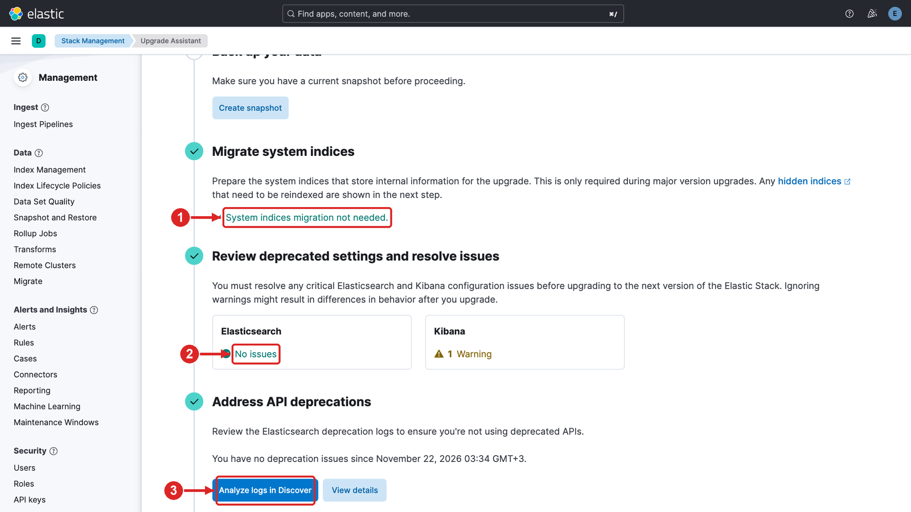

# ADV-08 — Elastic 8 ve 9: Sürüm Farkı, Eski API'ler ve Yükseltme Kapısı

| Kullanılan Araçlar | Açık / Kullanılan Portlar |
|---|---|
| Elasticsearch / Kibana 8.19.25 (bu lab) ve 9.5.5 (ana cluster), Docker Compose, `curl`, `jq` | `9208` (ES 8), `5608` (Kibana 8); karşılaştırma için `9200` / `5601` |

---

## Bu lab ne öğretiyor?

Kurumların çoğu hâlâ Elastic 8 çalıştırıyor. 9'a geçmeden önce iki soru var: hangi 8 sürümünden geçilebilir, ve
uygulamalarımız 9'da kalkacak hangi API'leri kullanıyor? Cevap sürüm numarasında değil, cluster'ın kendi
bildirdiği uyumluluk bilgisinde ve deprecation kayıtlarında.

Bu labda 8.19 ve 9.5.5'i yan yana çalıştırıp uyumluluk sürümlerini karşılaştıracak, aynı eski API isteğini iki
sürüme gönderecek, 8.19'da yükseltme kapısını (deprecation API, sistem index'leri, Upgrade Assistant) kontrol edecek
ve uygulamanın gönderdiği eski istekleri deprecation logunda bulup düzelteceğiz.

---

## Ön Koşullar

- LAB-01 ana cluster'ı (9.5.5) çalışıyor; karşılaştırma onunla yapılır. Önceki labları atladıysanız da çalışır.
- 8.19 cluster'ı yaklaşık 1,5 GB RAM kullanır; portları `9208` ve `5608`.

```bash
cd ~/elastic/labs/advanced/ADV-08-elastic-8-vs-9
```


---

## Kavramlar: yükseltmede neye bakılır?

| Soru | Nereden okunur | Bu labda ölçülen |
|---|---|---|
| Rolling upgrade hangi sürümden olur? | `version.minimum_wire_compatibility_version` (hedef sürümde) | 9.5.5 → `8.19.0` |
| Hangi index'ler açılabilir? | `version.minimum_index_compatibility_version` | 9.5.5 → `8.0.0` (7.x'te açılan index önce reindex edilir) |
| Engelleyici ayar var mı? | `GET _migration/deprecations`, Kibana Upgrade Assistant | Temiz cluster'da boş |
| Uygulama eski API kullanıyor mu? | Deprecation logu (`.logs-deprecation.elasticsearch-default`) ve yanıttaki `Warning: 299` başlığı | `_template`, mapping içinde `_source.mode` |

Deprecation API cluster'ın **durumuna** bakar (ayarlar, index'ler). Uygulamanın gönderdiği eski istekler orada
görünmez; onları deprecation logu yakalar.

---

## Config dosyaları: hangi satır ne işe yarıyor?

`docker-compose.yml`:

```yaml
name: es-v8-lab
services:
  elasticsearch8:
    image: docker.elastic.co/elasticsearch/elasticsearch:8.19.25
    environment:
      - discovery.type=single-node
      - ES_JAVA_OPTS=-Xms512m -Xmx512m
    ports: ["${ELASTIC8_PORT:-9208}:9200"]
  kibana8:
    image: docker.elastic.co/kibana/kibana:8.19.25
    ports: ["${KIBANA8_PORT:-5608}:5601"]
```

- Ayrı compose projesi (`es-v8-lab`) ve ayrı portlar: ana cluster'a dokunmaz, ikisi aynı anda çalışır.
- 8.19.25 bilinçli seçim: 8 serisinin son hattı, 9'a geçilebilen tek hat.
- `setup8` servisi `kibana_system` parolasını verir, sonra çıkar (LAB-01'deki gibi).

---

## Adım Adım Uygulama Rehberi

### 1. 8.19 cluster'ını başlatın

```bash
docker compose up -d 2>&1 | grep -c Started
timeout 300 bash -c 'until curl -s -u elastic:"DevOps2026!" http://127.0.0.1:5608/api/status | jq -e ".status.overall.level==\"available\"" >/dev/null 2>&1; do printf .; sleep 5; done'; echo " Kibana 8 hazır"
IP=$(curl -s https://api.ipify.org); H=$(hostname -s)
echo "Kibana 8: http://$IP:5608   https://$H-kibana8.devopsatolyesi.com"
```

Beklenen çıktı:

```text
3
........... Kibana 8 hazır
Kibana 8: http://<IP>:5608   https://<host>-kibana8.devopsatolyesi.com
```

İlk kurulumda image'lar da indirilir. Kibana 8'e `elastic` / `DevOps2026!` ile girilir.

### 2. Sürüm ve uyumluluk

```bash
for port in 9208 9200; do
  curl -s -u elastic:'DevOps2026!' "http://127.0.0.1:${port}/" \
    | jq -c '{port: '"${port}"', surum: .version.number, lucene: .version.lucene_version, wire_min: .version.minimum_wire_compatibility_version, index_min: .version.minimum_index_compatibility_version}'
done
```

Beklenen çıktı:

```text
{"port":9208,"surum":"8.19.25","lucene":"9.12.2","wire_min":"7.17.0","index_min":"7.0.0"}
{"port":9200,"surum":"9.5.5","lucene":"10.5.1","wire_min":"8.19.0","index_min":"8.0.0"}
```

- `wire_min`: 9.5.5 node'u yalnız 8.19 ve üstü node'larla aynı cluster'da konuşur. Rolling upgrade 8.19'dan yapılır;
  daha eski bir 8 önce 8.19'a yükseltilir.
- `index_min`: 9.5.5 yalnız 8.0 ve sonrasında açılmış index'leri açar. 7.x'te açılmış bir index 8.19'dayken reindex
  edilir; yoksa yükseltme o index yüzünden durur.
- Lucene 9'dan 10'a geçer; index formatı bu yüzden değişir.

### 3. Aynı eski API, iki sürüm

Eski (legacy) `_template` API'sini iki cluster'a gönderin, sonra yerine geçen `_index_template`'i:

```bash
for port in 9208 9200; do
  echo "== ${port}"
  curl -s -i -u elastic:'DevOps2026!' -X PUT "http://127.0.0.1:${port}/_template/surum-eski" -H 'Content-Type: application/json' \
    -d '{"index_patterns": ["surum-eski-*"], "settings": {"number_of_shards": 1}}' | grep -iE '^HTTP|^warning' | cut -c1-120
  curl -s -i -u elastic:'DevOps2026!' -X PUT "http://127.0.0.1:${port}/_index_template/surum-yeni" -H 'Content-Type: application/json' \
    -d '{"index_patterns": ["surum-yeni-*"], "template": {"settings": {"number_of_shards": 1}}}' | awk 'tolower($0) ~ /^warning/ {n++} END {print n+0}'
done
curl -s -u elastic:'DevOps2026!' -X DELETE 'http://127.0.0.1:9200/_template/surum-eski'; echo
curl -s -u elastic:'DevOps2026!' -X DELETE 'http://127.0.0.1:9200/_index_template/surum-yeni'; echo
```

Beklenen çıktı:

```text
== 9208
HTTP/1.1 200 OK
Warning: 299 Elasticsearch-8.19.25-104cb8651ae63460f8147c582dcdbf5c38451712 "Legacy index templates are deprecated in fa
0
== 9200
HTTP/1.1 200 OK
Warning: 299 Elasticsearch-9.5.5-48acba663b09e70b115dd879329141506c377890 "Legacy index templates are deprecated in favo
0
{"acknowledged":true}
{"acknowledged":true}
```

İki sürüm de eski API'yi kabul eder ve `Warning: 299` başlığıyla kalkacağını söyler; `_index_template` için uyarı
sayısı `0`. Son iki satır ana cluster'daki deneme şablonlarını siler.

### 4. Yükseltme kapısı: 8.19'da engel var mı?

```bash
curl -s -u elastic:'DevOps2026!' 'http://127.0.0.1:9208/_migration/deprecations' | jq -c 'with_entries(.value |= length)'
curl -s -u elastic:'DevOps2026!' 'http://127.0.0.1:9208/_migration/system_features' | jq -c '{migration_status, ozellik: (.features | length)}'
curl -s -u elastic:'DevOps2026!' 'http://127.0.0.1:5608/api/upgrade_assistant/status' | jq -c '{readyForUpgrade, details}'
```

Beklenen çıktı:

```text
{"cluster_settings":0,"node_settings":0,"ml_settings":0,"data_streams":0,"index_settings":0,"templates":0,"ilm_policies":0}
{"migration_status":"NO_MIGRATION_NEEDED","ozellik":15}
{"readyForUpgrade":true,"details":"All deprecation warnings have been resolved."}
```

- Deprecation API'nin bütün grupları `0`: cluster ayarlarında, index'lerde ve şablonlarda engel yok.
- `NO_MIGRATION_NEEDED`: Elastic'in kendi sistem index'leri (Kibana, güvenlik…) 9'a hazır.
- Kibana'nın Upgrade Assistant API'si ikisini birleştirir: `readyForUpgrade: true`.

Adım 3'teki eski şablon bu listede yok: deprecation API cluster'ın durumuna bakar, uygulamanın gönderdiği istekleri
görmez. Onlar için Adım 5.

### 5. Deprecation logu: uygulamanın eski istekleri

Eski bir mapping biçimiyle bir index açın: `_source.mode` mapping içinde verilmiş:

```bash
curl -s -i -u elastic:'DevOps2026!' -X PUT 'http://127.0.0.1:9208/surum-kaynak-eski' -H 'Content-Type: application/json' \
  -d '{"settings": {"number_of_replicas": 0}, "mappings": {"_source": {"mode": "stored"}}}' | grep -iE '^warning' | cut -c1-150
```

Beklenen çıktı:

```text
Warning: 299 Elasticsearch-8.19.25-104cb8651ae63460f8147c582dcdbf5c38451712 "Configuring source mode in mappings is deprecated and will be removed in
```

Elasticsearch bu uyarıları deprecation loguna (bir data stream) yazar. Yazma toplu ve asenkrondur; iki kayıt
düşene kadar bekleyip (birkaç saniye) Adım 3 ve bu adımdaki istekleri arayın:

```bash
timeout 120 bash -c 'until [ "$(curl -s -u elastic:"DevOps2026!" "http://127.0.0.1:9208/.logs-deprecation.elasticsearch-default/_search?size=50&filter_path=hits.hits._source.message" | jq "[.hits.hits[]?._source.message | select(test(\"Legacy index|source mode\"))] | length")" -ge 2 ]; do printf .; sleep 3; done'; echo
curl -s -u elastic:'DevOps2026!' 'http://127.0.0.1:9208/.logs-deprecation.elasticsearch-default/_search?size=10&sort=@timestamp:asc&filter_path=hits.hits._source' \
  -H 'Content-Type: application/json' -d '{"query": {"terms": {"elasticsearch.event.category": ["api", "mappings"]}}}' \
  | jq -r '.hits.hits[]._source | select(.message | test("Legacy index|source mode")) | "\(.["elasticsearch.event.category"]): \(.message[0:70])"'
```

Beklenen çıktı:

```text
..
api: Legacy index templates are deprecated in favor of composable templates
mappings: Configuring source mode in mappings is deprecated and will be removed
```

Sonra: aynı index'i yeni biçimle açın; ayar `index.mapping.source.mode` olarak index ayarına taşınır ve uyarı gelmez:

```bash
curl -s -i -u elastic:'DevOps2026!' -X PUT 'http://127.0.0.1:9208/surum-kaynak-yeni' -H 'Content-Type: application/json' \
  -d '{"settings": {"number_of_replicas": 0, "index.mapping.source.mode": "stored"}}' | awk 'tolower($0) ~ /^warning/ {n++} END {print n+0}'
```

Beklenen çıktı:

```text
0
```

Gerçek bir yükseltmede uygulamaların birkaç gün çalışmasını bekleyip bu logu okursunuz; her satır 9'dan önce
değiştirilecek bir istektir.

### 6. Upgrade Assistant

Kibana 8'de **Stack Management › Upgrade Assistant** sayfasını açın. Sistem index'leri hazır (1), Elasticsearch'te
engel yok (2) ve deprecation logları **Analyze logs in Discover** (3) ile açılır:

{width=75%}

Kibana kutusundaki uyarı Kibana'nın Node.js çalışma zamanına (eski OpenSSL sağlayıcısı) aittir; verinize ya da
isteklerinize değil.

Sayfadaki "no deprecation issues since …" sayacı bu testte Adım 3 ve 5'in kayıtlarını saymadı; kayıtların kendisi
**Analyze logs in Discover** ile açılan `.logs-deprecation.*` verisindedir (Adım 5'te aradığınız veri).

---

## Temizlik

Yalnız bu labın compose projesini (8.19 cluster'ı ve volume'leri) ve ana cluster'da kalmışsa Adım 3'ün deneme
şablonlarını siler. Ana cluster'a ve diğer lablara dokunmaz:

```bash
./teardown.sh
```

Beklenen çıktı:

```text
kaldirilan nesne: 6
ana cluster _template/surum-eski -> 404
ana cluster _index_template/surum-yeni -> 404
```

Labı aynı sunucuda yeniden yapacaksanız başlamadan önce `./teardown.sh` çalıştırın; README'deki sayılar temiz
başlangıca göredir.

---

Sonraki lab: **[ADV-09 — ECK: Elasticsearch ve Kibana'yı Kubernetes Operatörüyle Kurmak](../ADV-09-eck-operator/README.md)**
