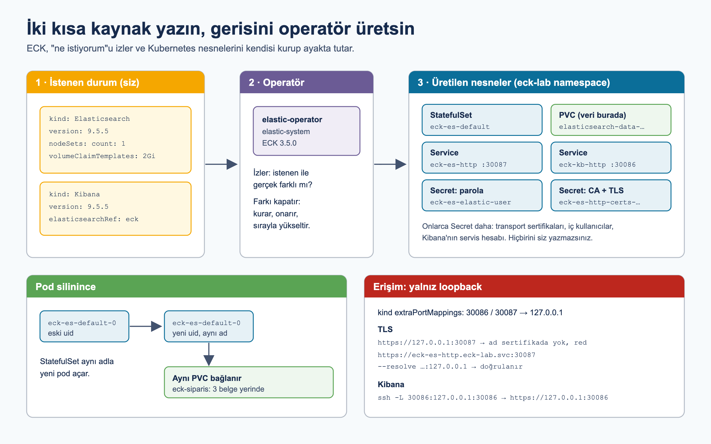
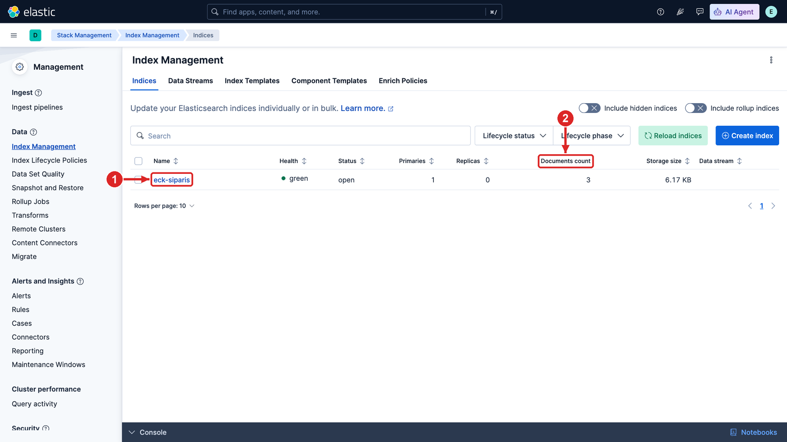

# ADV-09 — ECK: Elasticsearch ve Kibana'yı Kubernetes Operatörüyle Kurmak

| Kullanılan Araçlar | Açık / Kullanılan Portlar |
|---|---|
| kind, `kubectl`, ECK operatörü 3.5.0, Elasticsearch / Kibana 9.5.5, `curl`, `jq` | `127.0.0.1:30086` (ECK Kibana), `127.0.0.1:30087` (ECK Elasticsearch); ikisi de dışarı açılmaz |

---

## Bu lab ne öğretiyor?

Elasticsearch'ü Kubernetes'e elle kurmak; StatefulSet, Service, PVC, TLS sertifikaları, parola Secret'ı ve Kibana
bağlantısını tek tek yazmak demektir. Sürüm yükseltme ya da pod kaybında bunları doğru sırayla yönetmek de size kalır.

ECK (Elastic Cloud on Kubernetes) bir operatördür: siz "9.5.5 sürümünde 1 node'lu bir Elasticsearch ve ona bağlı bir
Kibana istiyorum" diye iki kısa kaynak yazarsınız, gerisini operatör üretir ve ayakta tutar. Bu labda operatörü
kuracak, ürettiklerine bakacak, TLS'i doğrulanmış biçimde kullanacak, pod'u silip verinin kaldığını görecek ve
Kibana'ya SSH tüneliyle gireceğiz.



---

## Ön Koşullar

- Sunucuda `kind` ve `kubectl` kurulu; en az 4 vCPU (`nproc`) ve boşta yaklaşık 3 GB RAM (`free -m` › `available`).
  2 vCPU'lu bir sunucuda Elasticsearch pod'u `Insufficient cpu` ile sonsuza kadar `Pending` kalır. Lab Kubernetes
  içinde ayrı bir Elasticsearch ve Kibana çalıştırır; ana cluster'ı kullanmaz.
- ADV-03'ü atladıysanız da lab çalışır: kendi kind cluster'ını (`k8s-eck`) kurar. ADV-03'ün `k8s-loglar` cluster'ı
  açıksa ona dokunmaz.

```bash
cd ~/elastic/labs/advanced/ADV-09-eck-operator
```


---

## Kavramlar: operatör ne yapar?

| Kavram | Ne | Bu labda |
|---|---|---|
| CRD | Kubernetes'e yeni bir kaynak türü öğretir | `Elasticsearch`, `Kibana`, `Beat`, `Agent`… |
| Operatör | O türdeki kaynakları izleyip istenen durumu gerçeğe çevirir | `elastic-system` namespace'inde `elastic-operator` |
| İstenen durum | Sizin yazdığınız kısa kaynak | `eck-elasticsearch-kibana.yaml` |
| Üretilen nesneler | Operatörün yazdığı StatefulSet, Service, Secret, PVC | `eck-es-*`, `eck-kb-*` |

---

## Config dosyaları: hangi satır ne işe yarıyor?

`eck-elasticsearch-kibana.yaml` (kritik satırlar):

```yaml
kind: Elasticsearch
spec:
  version: 9.5.5
  http: { service: { spec: { type: NodePort, ports: [{ name: https, port: 9200, nodePort: 30087 }] } } }
  nodeSets:
    - name: default
      count: 1
      config: { node.store.allow_mmap: false }
      volumeClaimTemplates: [{ metadata: { name: elasticsearch-data }, spec: { resources: { requests: { storage: 2Gi } } } }]
---
kind: Kibana
spec:
  version: 9.5.5
  elasticsearchRef: { name: eck }
```

- `version` tek satırdır; sürüm yükseltmek için bu değeri değiştirip yeniden uygularsınız, operatör node'ları sırayla
  yeniler.
- `count` node sayısıdır. `volumeClaimTemplates` her node'a bir PVC verir; pod silinse de veri PVC'de kalır.
- `node.store.allow_mmap: false`, host'ta `vm.max_map_count` ayarı gerektirmeden çalışmak içindir.
- `elasticsearchRef`: Kibana'nın adresi, CA sertifikası ve servis hesabı operatör tarafından bağlanır; Kibana ayarına
  parola yazılmaz.

`kind-cluster.yaml`, NodePort'ları (`30086`, `30087`) host'un `127.0.0.1`'ine bağlar. Bu eşleme yalnız cluster
oluşturulurken tanımlanabilir; dışarıya açılmaz, Kibana'ya SSH tüneliyle girilir.

---

## Adım Adım Uygulama Rehberi

### 1. kind cluster'ı

```bash
kind create cluster --config kind-cluster.yaml 2>&1 | grep -E "Creating|Set kubectl"
kubectl wait --for=condition=Ready node --all --timeout=180s
docker port k8s-eck-control-plane
```

Beklenen çıktı:

```text
Creating cluster "k8s-eck" ...
Set kubectl context to "kind-k8s-eck"
node/k8s-eck-control-plane condition met
6443/tcp -> 127.0.0.1:46631
30086/tcp -> 127.0.0.1:30086
30087/tcp -> 127.0.0.1:30087
```

`docker port` iki NodePort'un yalnız `127.0.0.1`'e bağlandığını gösterir; `6443` Kubernetes API'sidir, karşısındaki port
sizde farklıdır.

### 2. ECK operatörü

Önce kaynak türleri (CRD), sonra operatör. Sürüm sabittir:

```bash
ECK_VERSION=3.5.0
kubectl create -f https://download.elastic.co/downloads/eck/${ECK_VERSION}/crds.yaml | wc -l
kubectl apply -f https://download.elastic.co/downloads/eck/${ECK_VERSION}/operator.yaml | grep -c created
kubectl -n elastic-system rollout status statefulset/elastic-operator --timeout=180s | tail -1
kubectl get crd -o name | grep k8s.elastic.co | sed 's#.*/##' | sort
```

Beklenen çıktı:

```text
12
11
partitioned roll out complete: 1 new pods have been updated...
agents.agent.k8s.elastic.co
apmservers.apm.k8s.elastic.co
autoopsagentpolicies.autoops.k8s.elastic.co
beats.beat.k8s.elastic.co
elasticmapsservers.maps.k8s.elastic.co
elasticsearchautoscalers.autoscaling.k8s.elastic.co
elasticsearches.elasticsearch.k8s.elastic.co
enterprisesearches.enterprisesearch.k8s.elastic.co
kibanas.kibana.k8s.elastic.co
logstashes.logstash.k8s.elastic.co
packageregistries.packageregistry.k8s.elastic.co
stackconfigpolicies.stackconfigpolicy.k8s.elastic.co
```

Kubernetes artık `Elasticsearch` ve `Kibana` adlı kaynak türlerini tanıyor; `elastic-operator` pod'u bunları izliyor.

### 3. İstenen durum: Elasticsearch ve Kibana

İki kaynağı uygulayın. Operatör image'ları çeker, Elasticsearch'ü başlatır, sonra Kibana'yı ona bağlar; ilk kurulumda
birkaç dakika sürer (bu sunucuda ~5 dk ölçüldü):

```bash
kubectl apply -f eck-elasticsearch-kibana.yaml
timeout 900 bash -c 'until [ "$(kubectl -n eck-lab get elasticsearch eck -o jsonpath={.status.health})" = green ] && [ "$(kubectl -n eck-lab get kibana eck -o jsonpath={.status.health})" = green ]; do printf .; sleep 10; done'; echo
kubectl -n eck-lab get elasticsearch,kibana -o custom-columns=TUR:.kind,AD:.metadata.name,SAGLIK:.status.health,SURUM:.status.version
```

Beklenen çıktı:

```text
namespace/eck-lab created
elasticsearch.elasticsearch.k8s.elastic.co/eck created
kibana.kibana.k8s.elastic.co/eck created
............................
TUR             AD    SAGLIK   SURUM
Elasticsearch   eck   green    9.5.5
Kibana          eck   green    9.5.5
```

İki kısa kaynaktan operatörün ürettiği nesneler:

```bash
kubectl -n eck-lab get statefulset,pvc,service -o name
kubectl -n eck-lab get secret -o name | grep -cE '.'
kubectl -n eck-lab get secret -o name | grep -E '^secret/eck-es-(elastic-user|http-certs-public)$'
```

Beklenen çıktı:

```text
statefulset.apps/eck-es-default
persistentvolumeclaim/elasticsearch-data-eck-es-default-0
service/eck-es-default
service/eck-es-http
service/eck-es-internal-http
service/eck-es-transport
service/eck-kb-http
19
secret/eck-es-elastic-user
secret/eck-es-http-certs-public
```

Hiçbirini siz yazmadınız: StatefulSet ve PVC veriyi, Service'ler erişimi, onlarca Secret ise sertifikaları ve
parolaları taşır. `eck-es-elastic-user` operatörün ürettiği rastgele `elastic` parolasıdır.

### 4. Parola ve doğrulanmış TLS

Parolayı ve operatörün kendi CA sertifikasını Secret'lardan alın:

```bash
export PW=$(kubectl -n eck-lab get secret eck-es-elastic-user -o go-template='{{.data.elastic | base64decode}}')
echo "elastic parolasi: ${#PW} karakter"
kubectl -n eck-lab get secret eck-es-http-certs-public -o go-template='{{index .data "ca.crt" | base64decode}}' > eck-ca.crt
openssl x509 -in eck-ca.crt -noout -subject
```

Beklenen çıktı:

```text
elastic parolasi: 24 karakter
subject=OU = eck, CN = eck-http
```

Önce: `127.0.0.1` adresi sertifikada yoktur; CA doğru olsa bile TLS bağlantıyı reddeder:

<!-- runner:expect-fail -->
```bash
curl -sS --cacert eck-ca.crt -u "elastic:$PW" https://127.0.0.1:30087/
```

Beklenen çıktı:

```text
curl: (60) SSL: no alternative certificate subject name matches target host name '127.0.0.1'
More details here: https://curl.se/docs/sslcerts.html

curl failed to verify the legitimacy of the server and therefore could not
establish a secure connection to it. To learn more about this situation and
how to fix it, please visit the web page mentioned above.
```

Sonra: sertifikadaki servis adını kullanın, `--resolve` bu adı `127.0.0.1`'e yönlendirir. Sertifika doğrulanır, `-k`
gerekmez:

```bash
export ECK_ES=https://eck-es-http.eck-lab.svc:30087
export RES="eck-es-http.eck-lab.svc:30087:127.0.0.1"
curl -s --cacert eck-ca.crt --resolve "$RES" -u "elastic:$PW" "$ECK_ES/?filter_path=cluster_name,version.number"
```

Beklenen çıktı:

```text
{
  "cluster_name" : "eck",
  "version" : {
    "number" : "9.5.5"
  }
}
```

Sertifikadaki adlar: `eck-es-http`, `eck-es-http.eck-lab.svc`, `eck-es-http.eck-lab.es.local` ve iç adlar. Kubernetes
içindeki bir uygulama zaten bu adlarla bağlanır.

### 5. Pod'u silin: veri PVC'de kalır

Üç document yazın (tek node: replica 0):

```bash
curl -s --cacert eck-ca.crt --resolve "$RES" -u "elastic:$PW" -X PUT "$ECK_ES/eck-siparis" -H 'Content-Type: application/json' \
  -d '{"settings": {"number_of_shards": 1, "number_of_replicas": 0}}' | jq -c .
printf '%s\n' '{"index":{}}' '{"siparis":1,"durum":"odendi"}' '{"index":{}}' '{"siparis":2,"durum":"kargoda"}' '{"index":{}}' '{"siparis":3,"durum":"iade"}' \
  | curl -s --cacert eck-ca.crt --resolve "$RES" -u "elastic:$PW" -X POST "$ECK_ES/eck-siparis/_bulk?refresh=true" -H 'Content-Type: application/x-ndjson' --data-binary @- | jq -c '{errors, adet: (.items | length)}'
```

Beklenen çıktı:

```text
{"acknowledged":true,"shards_acknowledged":true,"index":"eck-siparis"}
{"errors":false,"adet":3}
```

Elasticsearch pod'unu silin. StatefulSet aynı adla yeni bir pod açar ve aynı PVC'yi bağlar; green olana kadar bekleyin
(bu sunucuda ~1 dk):

```bash
kubectl -n eck-lab get pod eck-es-default-0 -o jsonpath='{.metadata.uid}{"\n"}' | cut -c1-8
kubectl -n eck-lab delete pod eck-es-default-0
kubectl -n eck-lab wait --for=condition=Ready pod/eck-es-default-0 --timeout=300s
timeout 300 bash -c 'until [ "$(kubectl -n eck-lab get elasticsearch eck -o jsonpath={.status.health})" = green ]; do printf .; sleep 5; done'; echo
kubectl -n eck-lab get pod eck-es-default-0 -o jsonpath='{.metadata.uid}{"\n"}' | cut -c1-8
curl -s --cacert eck-ca.crt --resolve "$RES" -u "elastic:$PW" "$ECK_ES/eck-siparis/_count" | jq .count
```

Beklenen çıktı:

```text
bdc80020
pod "eck-es-default-0" deleted from eck-lab namespace
pod/eck-es-default-0 condition met
..
1cf3e62c
3
```

Pod'un kimliği (`uid`) değişti, yani bu yeni bir pod; ama üç document yerinde. Veri pod'da değil
`elasticsearch-data-eck-es-default-0` PVC'sinde duruyor. PVC olmasaydı silinen pod veriyi de götürürdü.

### 6. Kibana'ya SSH tüneliyle girin

Kibana `127.0.0.1:30086`'dadır ve dışarı açılmaz. Sunucunun adresini hesaplayın:

```bash
IP=$(curl -s https://api.ipify.org); echo "ssh -f -N -L 30086:127.0.0.1:30086 $(whoami)@$IP"
curl -sk -o /dev/null -w 'Kibana (sunucu icinden): %{http_code}\n' https://127.0.0.1:30086/login
```

Beklenen çıktı:

```text
ssh -f -N -L 30086:127.0.0.1:30086 <kullanıcı>@<IP>
Kibana (sunucu icinden): 200
```

Kendi bilgisayarınızda yazdırılan tünel komutunu çalıştırın:

<!-- runner:skip -->
```bash
ssh -f -N -L 30086:127.0.0.1:30086 <kullanıcı>@<IP>
```

Tarayıcıda `https://127.0.0.1:30086` adresini açın. Sertifika operatörün kendi CA'sıyla imzalı olduğu için tarayıcı
uyarı verir; devam edin. Kullanıcı `elastic`, parola Adım 4'teki `$PW`'dir (sunucuda `echo "$PW"` ile görün).
**Stack Management › Index Management**'ta `eck-siparis` index'ini (1) ve document sayısını (2) görün:



İşiniz bitince tüneli kendi bilgisayarınızda kapatın: `pkill -f "\-L 30086:127.0.0.1:30086"`.

---

## Temizlik

Yalnız bu labın kind cluster'ını (operatör, Elasticsearch, Kibana ve PVC içinde) ve indirilen `eck-ca.crt` dosyasını
siler. Ana cluster'a, ADV-03'ün `k8s-loglar` cluster'ına ve diğer lablara dokunmaz:

```bash
./teardown.sh
```

Beklenen çıktı:

```text
Deleted nodes: ["k8s-eck-control-plane"]
eck-ca.crt silindi
```

Labı aynı sunucuda yeniden yapacaksanız başlamadan önce `./teardown.sh` çalıştırın; README'deki sayılar temiz
başlangıca göredir.

---

Sonraki lab: **[ADV-10 — Paketle 3-Node Cluster: APT Kurulumu, Enrollment Token ve Quorum](../ADV-10-paketle-3-node-cluster/README.md)**
