# Project: FastAPI Centralized Logging, Error Monitoring & Logstash TCP

| Seviye | Kullanılan Araçlar | Açık / Kullanılan Portlar | Dış Erişim URL'leri |
|---|---|---|---|
| Orta / İleri | FastAPI (Python 3.12), Logstash 9.5.5, Elasticsearch 9.5.5, Kibana, Docker Compose | **19002** (FastAPI - App2), **5000** (Logstash TCP), **9200** (ES), **5601** (Kibana) | `http://<IP>:19002`<br>`http://<IP>:19002/docs`<br>`http://<IP>:5601` (Kibana) |

> [!NOTE]
> Bu lab, modern bulut-yerel mikroservislerde ve Python arka uçlarında (**FastAPI**) oluşan olay (event), uyarı (warning) ve çalışma zamanı istisnalarının (**HTTP 500 Uncaught Exceptions & Stack Traces**) ağ üzerinden kayıpsız toplanması, Logstash TCP hattı ile dönüştürülmesi ve Kibana üzerinde gerçek zamanlı hata izleme (Error Tracking & Root Cause Analysis) panellerine dönüştürülmesini inceler.

---

## 🎯 Amaç ve Teorik Çerçeve

Büyük ölçekli dağıtık mimarilerde veya konteynerize edilmiş ortamlarda:
1. **Düz Metin Loglarının Yetersizliği:** Konsola (`stdout`) veya dönen log dosyalarına (`logrotate`) yazılan yapılandırılmamış metinler; hata anında birden fazla satıra yayılan stack trace'lerin bölünmesine ve ilişkisel aramanın imkansızlaşmasına yol açar.
2. **Kök Neden İzolasyonu:** Hangi kullanıcının (`user_id`), hangi siparişte (`order_id`), hangi parametrelerle ve hangi korelasyon koduyla (`X-Request-ID`) 500 hatası aldığını bulmak için logların Elastic Common Schema (ECS) formatında yapılandırılması gerekir.
3. **Yüksek Performanslı Ağ Akışı:** Uygulama logları disk I/O darboğazına girmeden Logstash'in TCP soketine (`codec => json_lines`) asenkron akıtılmalı; Logstash geçici olarak dursa dahi uygulama kilitlenmemelidir.

---

## 🏗️ Mimari Akış

```mermaid
flowchart LR
    subgraph Client["İstemci & Trafik"]
        Trafik["Sentetik Trafik Simülatörü<br/>(2xx, 4xx, 5xx Hatalar)"]
    end

    subgraph AppContainer["FastAPI Mikroservisi (Port 19002)"]
        Middleware["Logging Middleware<br/>(Request-ID & Latency ms)"]
        Handler["Global Exception Handler<br/>(Stack Trace Capture)"]
        TCPHandler["Logstash TCP Socket Handler<br/>(JSON Lines Stream)"]
    end

    subgraph LogstashContainer["Logstash 9.5.5 (Port 5000)"]
        TCPInput["TCP Input (json_lines)"]
        Filter["Date Filter (@timestamp)<br/>Tagging (application_error)"]
        ESOutput["Elasticsearch Output"]
    end

    subgraph ElasticCluster["Elasticsearch 9.5.5 (Port 9200)"]
        Template["Index Template (fastapi-logs-*)"]
        DailyIndex["fastapi-logs-YYYY.MM.dd"]
    end

    subgraph Visualization["Kibana 9.5.5 (Port 5601)"]
        Discover["Discover & KQL Filtreleme"]
        Lens["Lens Error Monitoring Dashboard"]
        ESQL["ES|QL Root Cause Analysis"]
    end

    Trafik -->|HTTP İstekleri| Middleware
    Middleware --> Handler
    Handler -->|Formatlanmış ECS JSON| TCPHandler
    TCPHandler -->|TCP Socket Port 5000| TCPInput
    TCPInput --> Filter
    Filter --> ESOutput
    ESOutput --> DailyIndex
    DailyIndex --> Discover
    DailyIndex --> Lens
    DailyIndex --> ESQL
```



---

## 📂 Dosya ve Dizin Yapısı

```text
fastapi-elk-monitoring/
├── app/
│   ├── logger.py               # Asenkron TCP Socket Handler ve ECS JSON Formatter
│   ├── main.py                 # FastAPI servisi, middleware ve hata simülasyon rotaları
│   └── requirements.txt        # fastapi, uvicorn, pydantic bağımlılıkları
├── logstash/
│   ├── config/
│   │   └── logstash.yml        # Logstash 9.5.5 çalışma zamanı yapılandırması
│   └── pipeline/
│       └── logstash.conf       # TCP json_lines input, date filter ve ES output hattı
├── dev-tools/
│   ├── 01-index-template-and-mapping.http   # Index şablonu ve veri tipleri mapping'i
│   ├── 02-kql-error-investigation.http      # Discover için 6 pratik KQL sorgusu
│   └── 03-esql-rca-analytics.http           # Hata analitiği için 4 ileri düzey ES|QL sorgusu
├── scripts/
│   └── simulate-traffic.py     # Otomatik 2xx/4xx/5xx trafik ve hata üreteci
├── docker-compose.yml          # FastAPI ve Logstash servis tanımları
├── Dockerfile                  # Python 3.12 tabanlı FastAPI imajı
├── run-lab.sh                  # Tek komutla labı başlatan script
├── verify.sh                   # Uçtan uca doğrulama ve test betiği
└── README.md
```

---

## 🎯 İki Farklı Çalışma Seçeneği (Choose Your Path)

Bu labda öğrenme hızınıza veya amacınıza göre iki farklı yöntemden birini seçebilirsiniz:

1. **🛠️ Seçenek 1: Adım Adım Manuel Kurulum (Önerilen):** Her bir bileşeni kendi ellerinizle ayağa kaldırın, aradaki Logstash TCP soketini `netcat` ile elle test edin, kasıtlı 500 hatalarını `curl` ile tek tek patlatıp canlı log akışını terminalde izleyin. Mühendislik mantığını kavramak için en etkili yoldur.
2. **⚡ Seçenek 2: Hızlı Başlangıç (Otomasyon Modu):** Zamanınız kısıtlıysa veya ortamı hızlıca test etmek istiyorsanız, tek bir script (`./run-lab.sh`) ile tüm servisleri ayağa kaldırıp hazır hale getirin.

> **Ön Koşul (her iki seçenek için):** Bu proje `LAB-01` kapsamında kurulan Elasticsearch cluster'ını ve onun Docker ağını (`elastic-lab00_default`) kullanır. Devam etmeden önce cluster'ın çalıştığını doğrulayın:
> ```bash
> curl -s -u elastic:DevOps2026! http://localhost:9200/_cluster/health?pretty
> ```
> *(Eğer cluster çalışmıyorsa: `docker start elasticsearch-lab00 kibana-lab00` komutunu çalıştırın).*

---

## 🛠️ Seçenek 1: Adım Adım Manuel Kurulum (Önerilen Öğrenme Yolu)

Aşağıdaki adımları sırayla kopyalayıp terminalinizde veya Kibana Console'da çalıştırarak ilerleyin.

### Adım 1: Elasticsearch Data Stream Şablonunu ve API Key'i Tanımlayın
index'lere gelecek hata metinlerinin, stack trace alanlarının ve ECS korelasyonunun doğru analiz edilebilmesi için Kibana Dev Tools Console'da API key ve şablonu oluşturun:

*Kibana -> Dev Tools Console'a yapıştırın:*
```http
# 1. Logstash için API Key Oluşturun:
POST _security/api_key
{
  "name": "logstash-fastapi-writer",
  "role_descriptors": {
    "fastapi_writer_role": {
      "cluster": ["manage_index_templates", "monitor", "manage_data_stream_global_retention"],
      "indices": [
        {
          "names": ["logs-fastapi-*"],
          "privileges": ["write", "create_doc", "create_index", "view_index_metadata", "manage"]
        }
      ]
    }
  }
}

# 2. Data Stream Şablonunu Tanımlayın:
PUT _index_template/logs-fastapi-template
{
  "index_patterns": ["logs-fastapi-*"],
  "data_stream": {},
  "template": {
    "settings": {
      "number_of_shards": 1,
      "number_of_replicas": 0
    },
    "mappings": {
      "properties": {
        "@timestamp": { "type": "date" },
        "log.level": { "type": "keyword" },
        "service.name": { "type": "keyword" },
        "http.route": { "type": "keyword" },
        "http.duration_ms": { "type": "float" },
        "http.request.id": { "type": "keyword" },
        "http.request.method": { "type": "keyword" },
        "http.response.status_code": { "type": "integer" },
        "http.status_code": { "type": "integer" },
        "error.class": { "type": "keyword" },
        "error.message": { "type": "text" },
        "error.stack_trace": { "type": "text" }
      }
    }
  },
  "priority": 200
}
```

Runner veya terminal kullanıyorsanız aynı iki isteği [`dev-tools/01-index-template-and-mapping.http`](dev-tools/01-index-template-and-mapping.http)
dosyasında da bulursunuz; bu dosya Dev Tools Console biçimindedir, `curl -d @dosya` ile
gönderilemez (Elasticsearch `#` ile başlayan satırı JSON olarak ayrıştıramaz).

---

### Adım 2: Logstash'i Başlatın ve TCP 5000 Soketini Elle Test Edin

Önce sadece Logstash servisini ayağa kaldırın:
```bash
cd ~/elastic/projects/fastapi-elk-monitoring
docker compose up -d logstash
```

Logstash bir JVM uygulamasıdır; konteyner "Started" dedikten sonra pipeline'ın TCP dinleyicisini
açması ~45 saniye sürer. Bu sırada Docker'ın port yönlendiricisi (`docker-proxy`) bağlantıyı yine
kabul ettiği için `nc -z` tek başına yanıltıcıdır. Önce pipeline'ın gerçekten açıldığını log'dan
bekleyin:

```bash
until docker logs logstash-app2 2>&1 | grep -q "Pipelines running"; do sleep 5; done
docker logs logstash-app2 2>&1 | grep -E "Starting tcp input listener|Pipelines running"
```

Ardından **`netcat` (`nc`) ile doğrudan sokete örnek bir JSON logu gönderin.** Konteynerin
`5000` portu host'ta yalnızca loopback'e ve LAB-06 Logstash'iyle çakışmaması için `5010`
olarak açılır (uygulama ise Docker ağı içinden `logstash-app2:5000`'e yazar):

```bash
# TCP portunu kontrol edin
nc -zv 127.0.0.1 5010

# Elle doğrudan Logstash TCP soketine tek satır JSON gönderin:
echo '{"timestamp":"2026-11-08T12:00:00Z","log":{"level":"INFO"},"message":"Manuel TCP Test Mesaji","service":{"name":"manual-probe"}}' | nc -N 127.0.0.1 5010
```
*Bu test sayesinde Logstash'in bir HTTP web sunucusu değil, saf bir TCP JSON stream dinleyicisi olduğunu somut olarak görürsünüz.*

---

### Adım 3: FastAPI Mikroservisini Başlatın

Şimdi Python FastAPI uygulamasını derleyip ayağa kaldırın:
```bash
docker compose up -d --build fastapi-app
```

Uvicorn'un açılması birkaç saniye sürer; sağlık uç noktası yanıt verene kadar bekleyip
kontrol edin:
```bash
until curl -sf http://localhost:19002/api/v1/health >/dev/null; do sleep 2; done
curl -s http://localhost:19002/api/v1/health | jq .
```

---

### Adım 4: Canlı Log Akışını Terminalde Açın

Yeni bir terminal penceresi açın ve Logstash'e düşen olayları anlık izlemeye başlayın:
```bash
docker logs -f logstash-app2
```
*(Bu terminali açık bırakın; birazdan atacağınız isteklerin JSON olarak buraya aktığını göreceksiniz.)*

---

### Adım 5: Kasıtlı Hataları (500) Tek Tek Patlatın ve İnceleyin

Aşağıdaki istekleri sırayla çalıştırarak uygulamanın farklı hata senaryolarında nasıl davrandığını gözlemleyin:

#### 1. Başarılı Sipariş (201 Created):
```bash
curl -i -X POST http://localhost:19002/api/v1/orders \
  -H "Content-Type: application/json" \
  -d '{"user_id": "usr-101", "items": [{"item_id": "p-1", "item_name": "Laptop", "quantity": 1, "unit_price": 25000}]}'
```

#### 2. Bulunamayan Sipariş (404 Not Found - WARN seviyesinde loglanır):
```bash
curl -i http://localhost:19002/api/v1/orders/ord-9999
```

#### 3. Ödeme Gateway Zaman Aşımı (500 Internal Server Error & Timeout):
```bash
curl -i -X POST http://localhost:19002/api/v1/checkout/payment \
  -H "Content-Type: application/json" \
  -d '{"order_id": "ord-1001", "amount": 25000, "gateway": "timeout_gateway"}'
```

#### 4. Sıfıra Bölme Hatası (500 ZeroDivisionError & Python Stack Trace):
```bash
curl -i "http://localhost:19002/api/v1/calculate/discount?price=100&ratio=0"
```

#### 5. Veritabanı Kilitlenme Hatası (500 DatabaseDeadlockException):
```bash
curl -i http://localhost:19002/api/v1/database/deadlock
```
*Logstash terminaline baktığınızda, tüm bu 500 hatalarının `[tags] => ["application_error"]` etiketi ve tam Python stack trace'i ile birlikte ekrana aktığını göreceksiniz.*

---

### Adım 6: Toplu Trafik Simülatörünü Çalıştırın (Opsiyonel)

Kibana panolarında zengin istatistikler görebilmek için 50 adet karışık istek (2xx, 4xx, 5xx) gönderen betiği çalıştırın:
```bash
python3 scripts/simulate-traffic.py
```

---

### Adım 7: Kibana Discover Üzerinde Hataları Filtreleyin

1. **Kibana (`http://<IP>:5601`) -> Management -> Data Views** sayfasına gidin.
2. **Create Data View** butonuna tıklayın:
   - **Name:** `FastAPI Logs`
   - **Index pattern:** `logs-fastapi-*`
   - **Timestamp field:** `@timestamp`
3. **Discover** menüsüne gidin ve KQL filtrelerini uygulayın:
   - 500 Hataları: `http.response.status_code >= 500`
   - Belli bir Exception: `error.class : "PaymentGatewayTimeoutException"`
   - Belirli bir isteği arama (ECS korelasyonu): `http.request.id : "<UUID>"`

---

### Adım 8: ES|QL ile Kök Neden Analizi (Root Cause Analysis - RCA)

Kibana Dev Tools Console üzerinde aşağıdaki sorguları çalıştırarak anlık arıza analizi yapın:

#### En Çok 500 Hatası Veren Rotalar ve Hata Sınıfları:
```http
POST _query
{
  "query": """
    FROM logs-fastapi-*
    | WHERE http.response.status_code >= 500 OR http.status_code >= 500 OR log.level == "ERROR"
    | STATS fail_count = count() BY http.route, error.class
    | SORT fail_count DESC
    | LIMIT 5
  """
}
```

#### Endpoint Yanıt Süresi Metrikleri (P90 Latency):
```http
POST _query
{
  "query": """
    FROM logs-fastapi-*
    | WHERE http.duration_ms IS NOT NULL
    | STATS avg_ms = round(avg(http.duration_ms), 2),
            p90_ms = round(percentile(http.duration_ms, 90), 2),
            total_req = count() BY http.route
    | SORT avg_ms DESC
  """
}
```

---

### Adım 9: Otomatik Doğrulama

Tüm bileşenlerin (Elasticsearch, Logstash TCP, FastAPI servisi, log index'leri, error logları ve stack trace ayrıştırması) doğru çalıştığını teyit edin:
```bash
./verify.sh
```

---

## ⚡ Seçenek 2: Hızlı Başlangıç (Tek Komutla Otomasyon)

Eğer lab ortamını adım adım kurmak yerine doğrudan tek komutla ayağa kaldırmak ve doğrulamak isterseniz:

```bash
cd ~/elastic/projects/fastapi-elk-monitoring

# 1. Tüm servisleri otomatik derleyin ve ayağa kaldırın
./run-lab.sh

# 2. Sentetik trafik ve 500 hata logları üretin
python3 scripts/simulate-traffic.py

# 3. Uçtan uca doğrulamayı çalıştırın
./verify.sh
```

---

## 🔬 Derinlemesine Teknik İnceleme

### 1. Neden HTTP Yerine TCP Socket Loglama?
HTTP tabanlı log iletiminde her log satırı için ayrı bir HTTP el sıkışması (handshake), header yükü ve senkron bağlantı maliyeti oluşur. **TCP `json_lines`** soketi sayesinde FastAPI tek bir sürekli bağlantı üzerinden newline ile ayrılmış JSON stream'i gönderir. Bu yöntem:
- CPU ve soket tüketimini en aza indirir.
- Milisaniyenin altında aktarım gecikmesi sağlar.

### 2. Hata Anında Stack Trace Bütünlüğü
Klasik dosya loglamasında birden çok iş parçacığı (threads/coroutines) log yazdığında çok satırlı Python stack trace'leri birbirine karışabilir. Bu labda `ECSJsonFormatter`:
- `traceback.format_exception()` çıktısını tek bir JSON string alanı (`error.stack_trace`) içine hapseder.
- Elasticsearch bu alanı `type: text` olarak index'ler; böylece hem Kibana üzerinden aranabilir hem de log çizgisi asla bölünmez.

---

## 🧹 Temizlik ve Kapatma

Labı tamamladıktan sonra kaynakları serbest bırakmak için:
```bash
cd ~/elastic/projects/fastapi-elk-monitoring
./teardown.sh
```
Silinenler: `fastapi-elk-monitoring` compose projesi (Logstash + FastAPI konteynerleri ve
uygulama imajı), `logs-fastapi-production` data stream'i, `logs-fastapi-template` şablonu ve
`logstash-fastapi-writer` API key'i. Omurga (`elasticsearch-lab00`, `kibana-lab00`) ve diğer
labların kaynakları etkilenmez.
